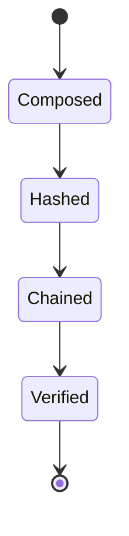
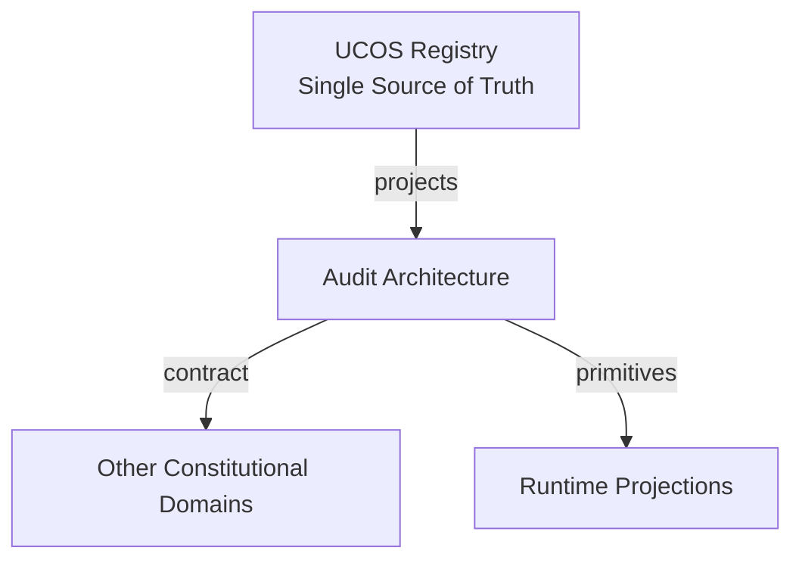
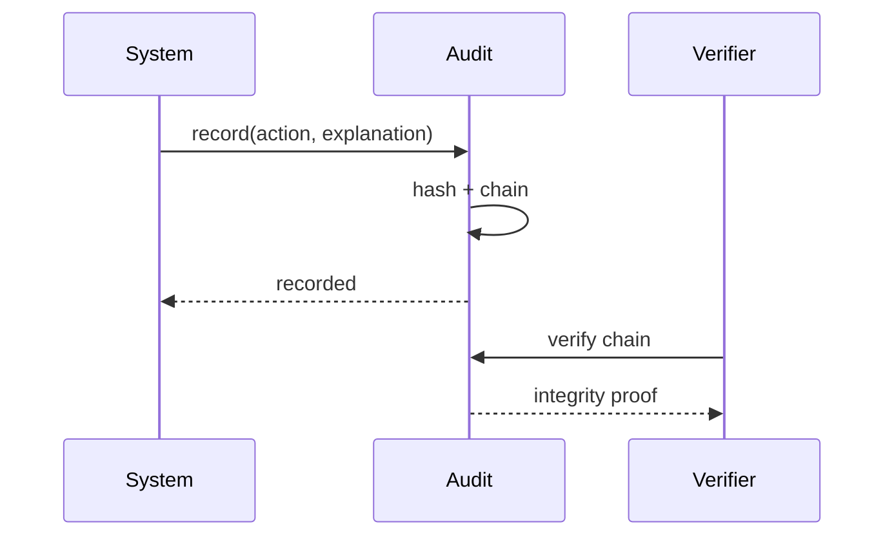
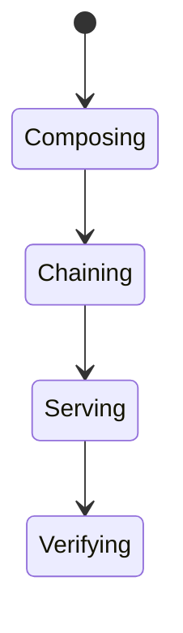
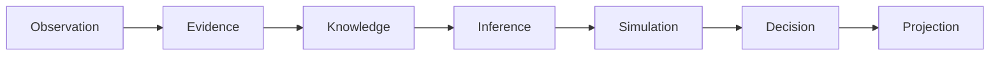
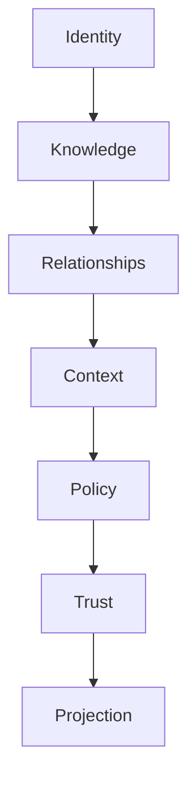

# UCOS-AUD-000001
# Audit Architecture

**Version:** Ω∞.1  |  **Status:** Constitutional Artifact  |  **Authority:** UCOS Ω∞ Constitutional Authority
**Category:** Operations  |  **Source of Truth:** `_registry/` (projected, never hand-authored)

> Constitutional notice: this document is a **projection**. Its truth lives in the registry. Editing this document directly violates Law 002 (Knowledge Once).

---

## 1. Executive Summary

**UCOS-AUD-000001 — Audit Architecture**

This artifact is a constitutionally governed, implementation-ready specification projected from the _UCOS Registry_ single source of truth.
It conforms to the _Immutable Primitive Registry_ (27 frozen primitives) and the _Canonical Terminology Registry_ (31 governed terms).
It contains no hardcoded business, industry, currency, country, or commerce concepts. All such concepts are runtime projections.

---

## 2. Constitutional Purpose

To define the binding contract for **Audit Architecture** such that:
- every concept it names has exactly one owner,
- every capability it exposes has exactly one boundary,
- every boundary is expressed as an explicit contract,
- every contract is enforceable by the Governance Constitution.

---

## 3. Scope

In scope: the primitives, contracts, schemas, events, and policies owned by **Audit Architecture**.
In scope: the projection rules by which this domain exposes its truth to other domains.
In scope: the verification obligations this domain must satisfy before activation.

---

## 4. Out of Scope

Out of scope: any concept owned by another constitutional domain.
Out of scope: business, industry, commerce, country, currency, or language content (all projected).
Out of scope: mutation of another domain’s internal state.

---

## 5. Definitions

All terms in this artifact are used in their canonical sense as defined in the Canonical Terminology Registry.
Where a term appears, its `termId` is normative and its `prohibitedMeanings` are void.

---

## 6. Canonical Terminology

| Term | Canonical Definition | Owner | Prohibited Meanings |
|---|---|---|---|
| Existence | Anything that may exist. | Universal Existence Kernel | business meaning, commercial meaning, operational meaning |
| Entity | Technical representation of an Existence Object. | Identity Domain | existence itself |
| Knowledge | Interpreted information with evidence and meaning. | Knowledge Domain | data, information, evidence |
| Data | Raw observations. | Observation Domain | knowledge, meaning |
| Information | Organized data. | Observation Domain | knowledge |
| Evidence | Proof supporting an assertion. | Evidence Domain | knowledge, trust |
| Trust | Computed confidence in an assertion, derived from evidence. | Trust Domain | evidence, faith |
| Meaning | Semantic interpretation; higher-level understanding. | Semantic Domain | classification, taxonomy, ontology |
| Ontology | What exists. | Semantic Domain | taxonomy, classification |
| Taxonomy | How things are classified. | Semantic Domain | ontology, meaning |
| Classification | Assignment into taxonomy. | Semantic Domain | meaning |
| Relationship | Connection between objects. | Relationship Domain | causality |

---

## 7. Ownership Boundaries

Ownership is recorded in the _Domain Ownership Registry_.

---

## 8. Domain Responsibilities

See the Domain Ownership Registry for the authoritative responsibility list.

---

## 9. Domain Non-Responsibilities

See the Domain Ownership Registry.

---

## 10. Concepts

Audit Architecture proves what happened, when, why, and under whose authority — to any stakeholder including regulators and data subjects. The audit log is append-only, cryptographically chained, and replayable.

---

## 11. Ontology

Audit has Records (immutable facts), Chains (hash-linked), Queries (stakeholder-scoped), and Attestations (third-party verification). Audit is a product, not a byproduct.

---

## 12. Taxonomy

By audience: Regulator / Data-subject / Internal / External-certifier / Court. By content: Action / Decision / Access / Change / Consent / Sovereignty. By retention: Regulated-minimum / Contractual / Eternal.

---

## 13. Registries

This domain is registry-driven. Its registries are entries in the Universal Registry System:

```yaml
RegistryEntry:
  registryId: UCOS-REG-DOMAIN
  owner: Constitutional Authority
  law: Knowledge Once — each concept defined exactly once
```

---

## 14. Data Model

```yaml
AuditRecord:
  recordId: <Identity>
  actor: <Identity>
  action: <registry action>
  authority: <Authority>
  policyVersion: <version>
  evidence: [<Evidence>]
  explanation: <seven questions>
  prevHash: <hash>
  hash: <hash>
  temporal: {at}
  context: <Context>
```

---

## 15. Graph Model

(:Record)-[:CHAINED_TO]->(:Record); (:Record)-[:BY_ACTOR]->(:Identity); (:Record)-[:UNDER_AUTHORITY]->(:Authority); (:Record)-[:ATTTESTED_BY]->(:Authority)

---

## 16. Schemas

```yaml
# Canonical projection schema for UCOS-AUD-000001
ucos_aud_000001:
  identity:      <Identity primitive>
  intent:        <Intent primitive>
  meaning:       <Meaning primitive>
  knowledge:     <Knowledge primitive>
  registry:      <Registry primitive>
  relationship:  <Relationship primitive>
  context:       <Context primitive>
  policy:        <Policy primitive>
  authority:     <Authority primitive>
  evidence:      <Evidence primitive>
  trust:         <Trust primitive>
  temporal:      <Time primitive>
  metadata:      <Metadata primitive>
```

---

## 17. Contracts

```yaml
DomainContract:
  domain: Audit Architecture
  commands:   []   # registry-driven
  queries:    []   # registry-driven
  events:     []   # registry-driven
  policies:   []   # registry-driven
  permissions: []  # registry-driven
```

Contract law: domains never directly access another domain’s internal structures.

---

## 18. APIs

POST /aud.v1.record,GET  /aud.v1/{id},POST /aud.v1.query,POST /aud.v1.attest,GET  /aud.v1.verify-chain

---

## 19. Events

AuditRecorded,ChainVerified,AttestationIssued,AuditQueryExecuted

---

## 20. Commands

aud.record,aud.query,aud.attest,aud.verify

---

## 21. Queries

aud.byActor,aud.bySubject,aud.byAction,aud.timeline,aud.chain

---

## 22. State Machines



---

## 23. Workflows

compose record with seven-question explanation → hash → chain to previous → verify → serve stakeholder queries

---

## 24. Policies

```yaml
Policy:
  identity: <Identity>
  conditions: []   # registry-driven
  actions:    []   # registry-driven
  priorities: []   # registry-driven
  exceptions: []   # registry-driven
```

All behavior derives from policy. Policy ≠ Rule: policy is behavioral governance; the rule is its executable projection.

---

## 25. Rules

```yaml
Rule:
  ruleId: <Identity>
  derivedFrom: <Policy identity>
  executable: true
  constraint: <registry expression>
```

---

## 26. Authorities

Audit Authority (record integrity); auditors query under their own scoped authority.

---

## 27. Permissions

aud.record (system, all governed actions),aud.query (stakeholder-scoped),aud.attest (certifying authority)

---

## 28. Security Model

Zero Trust applies: no implicit trust between domains, services, agents, or tenants.
Every call is authenticated, authorized against Policy, and evidenced.
Cryptographic identity is issued by the Identity Domain; keys by the Key Management Architecture.

---

## 29. Privacy Model

Subject access is a first-class query — data subjects see their own records in full, minimization applied elsewhere.

---

## 30. Trust Model

Trust is computed, never assumed. Inputs: evidence, authority, consistency, provenance, confidence.
```yaml
Trust:
  evidenceScore: <0..1>
  authorityScore: <0..1>
  consistencyScore: <0..1>
  provenanceScore: <0..1>
  confidenceScore: <0..1>
```

---

## 31. Audit Model

The chain self-verifies — a broken hash is a critical integrity event with immediate alert.

---

## 32. Observability Model

Every action emits: What happened? Why? Who authorized it? Which policy allowed it? What evidence supports it? What confidence exists? What alternatives were evaluated?
These are the seven Explainability questions and are mandatory event fields.

---

## 33. Digital Twin Model

Audit twin monitors chain health and query latency as compliance signals.

---

## 34. Agent Model

Audit agent detects chain anomalies and gaps in recorded coverage automatically.

---

## 35. Runtime Model

Records append in real time; hashing is in-line; verification is a background continuous job.

---

## 36. Scaling Model

Append-only logs shard by time bucket; queries fan out with stakeholder-scope enforcement.

---

## 37. Multi-Tenant Model

Records are tenant-scoped; regulator queries are cross-tenant under jurisdiction authority.

---

## 38. Geo-Distribution Model

Audit residency follows the action's jurisdiction; regulator access is jurisdiction-scoped.

---

## 39. Failure Model

Chain break, record gap, query-scope leak, retention violation.

---

## 40. Recovery Model

A broken chain is unrecoverable by design — integrity is proven, not repaired. Gaps trigger incident.

---

## 41. Verification Model

Before activation, Audit Architecture must pass identity, knowledge, relationship, context, policy, authority, trust, and reality integrity checks.
Verification is performed by the Formal Verification Architecture (UCOS-FML-000001).

---

## 42. Certification Model

The chain must verify end-to-end from genesis — any break voids certification of the period.

---

## 43. Migration Model

New record types are registry additions; the chain format is frozen.

---

## 44. Evolution Model

Evolution is governed and history-preserving. Primitives are frozen; extension occurs through registries, policies, capabilities, contexts, relationships, knowledge, agents, and projections — never through primitive expansion.

---

## 45. Implementation Blueprint

Build order for AUD: (1) define registry entries — this domain owns by audience: regulator / data-subject / internal / external-certifier / court as registry truth, not code; (2) implement the contract surface first (aud.record, aud.query, aud.attest) and validate against AUD boundaries; (3) event-source all state so history is reconstructable; (4) wire the enforcement points — authority check, policy guard, evidence binding, trace — in-line, with no bypass path; (5) add tests per the Testing Architecture, citing evidence per gate; (6) obtain Verification and Certification before activation. Acceptance: the Zero Partial and Law 001 audits pass, every action answers the seven explainability questions, and this domain mutates no other domain internals.

---

## 46. Reference Architecture Diagram



---

## 47. Sequence Diagrams



---

## 48. State Diagrams



---

## 49. Data Flow Diagrams



---

## 50. Dependency Maps



Forbidden: circular dependencies, mutual ownership, cross-domain state mutation.

---

## ∞

Constitutionally governed. Implementation ready. Universally extensible.