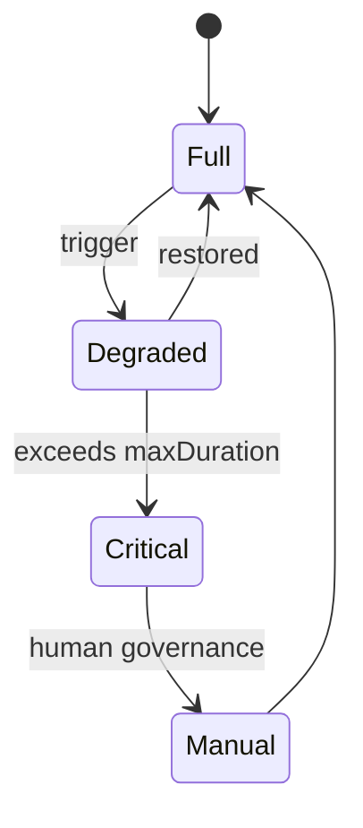
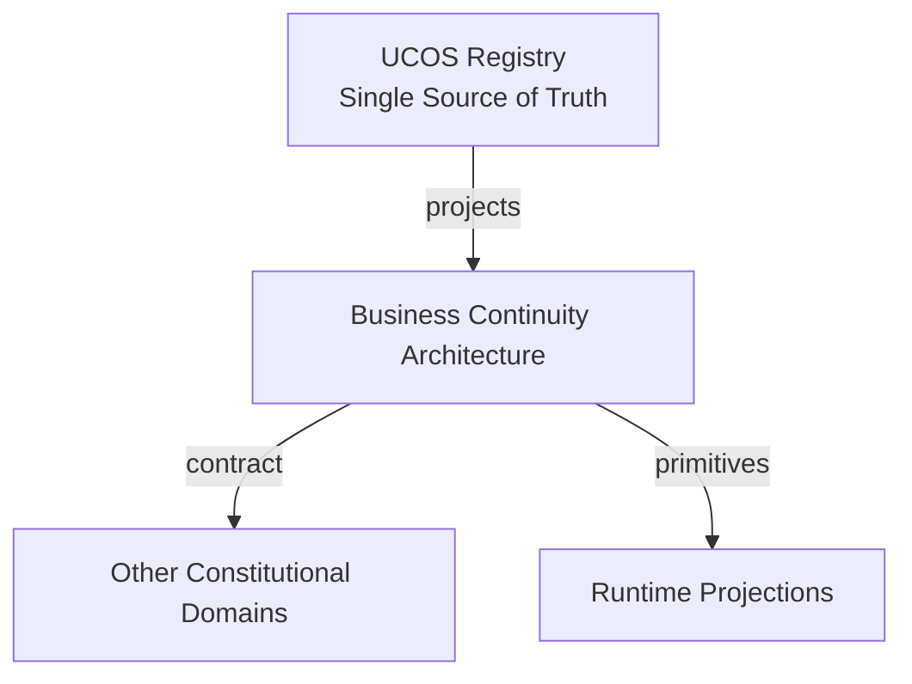
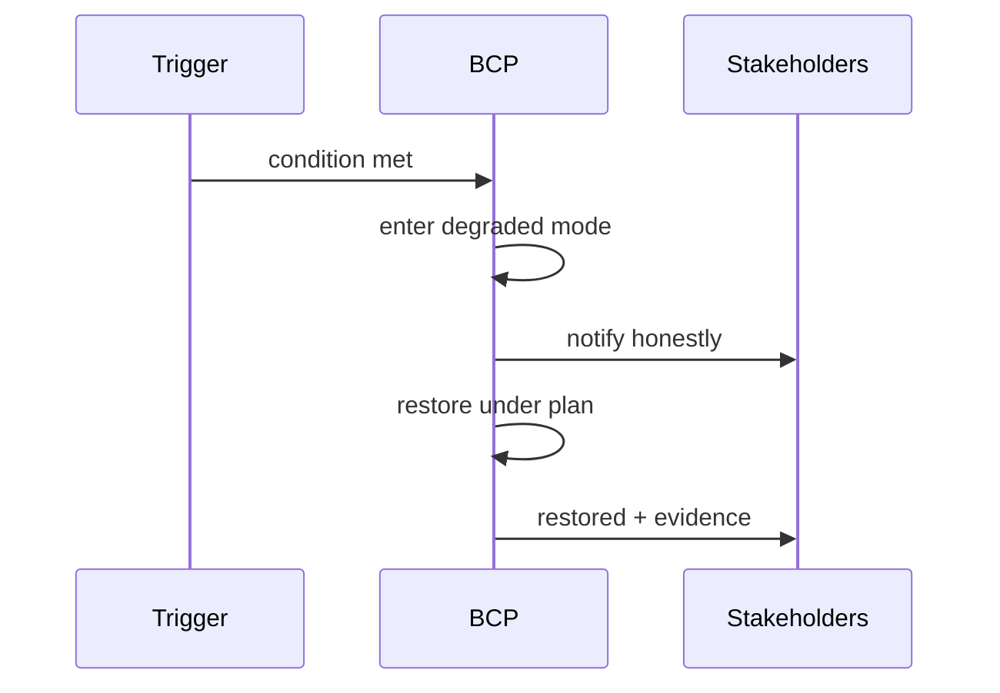
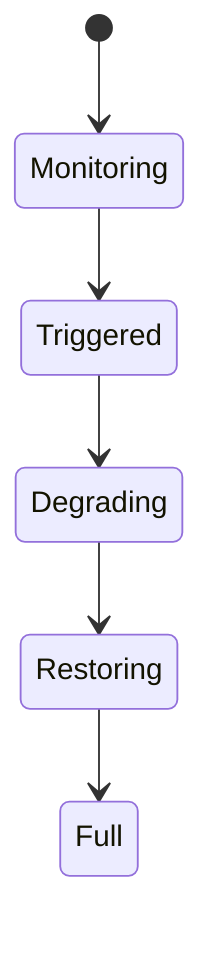
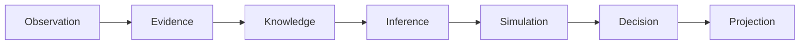
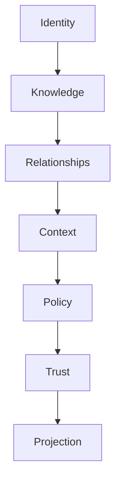

# UCOS-BCP-000001
# Business Continuity Architecture

**Version:** Ω∞.1  |  **Status:** Constitutional Artifact  |  **Authority:** UCOS Ω∞ Constitutional Authority
**Category:** Operations  |  **Source of Truth:** `_registry/` (projected, never hand-authored)

> Constitutional notice: this document is a **projection**. Its truth lives in the registry. Editing this document directly violates Law 002 (Knowledge Once).

---

## 1. Executive Summary

**UCOS-BCP-000001 — Business Continuity Architecture**

This artifact is a constitutionally governed, implementation-ready specification projected from the _UCOS Registry_ single source of truth.
It conforms to the _Immutable Primitive Registry_ (27 frozen primitives) and the _Canonical Terminology Registry_ (31 governed terms).
It contains no hardcoded business, industry, currency, country, or commerce concepts. All such concepts are runtime projections.

---

## 2. Constitutional Purpose

To define the binding contract for **Business Continuity Architecture** such that:
- every concept it names has exactly one owner,
- every capability it exposes has exactly one boundary,
- every boundary is expressed as an explicit contract,
- every contract is enforceable by the Governance Constitution.

---

## 3. Scope

In scope: the primitives, contracts, schemas, events, and policies owned by **Business Continuity Architecture**.
In scope: the projection rules by which this domain exposes its truth to other domains.
In scope: the verification obligations this domain must satisfy before activation.

---

## 4. Out of Scope

Out of scope: any concept owned by another constitutional domain.
Out of scope: business, industry, commerce, country, currency, or language content (all projected).
Out of scope: mutation of another domain’s internal state.

---

## 5. Definitions

All terms in this artifact are used in their canonical sense as defined in the Canonical Terminology Registry.
Where a term appears, its `termId` is normative and its `prohibitedMeanings` are void.

---

## 6. Canonical Terminology

| Term | Canonical Definition | Owner | Prohibited Meanings |
|---|---|---|---|
| Existence | Anything that may exist. | Universal Existence Kernel | business meaning, commercial meaning, operational meaning |
| Entity | Technical representation of an Existence Object. | Identity Domain | existence itself |
| Knowledge | Interpreted information with evidence and meaning. | Knowledge Domain | data, information, evidence |
| Data | Raw observations. | Observation Domain | knowledge, meaning |
| Information | Organized data. | Observation Domain | knowledge |
| Evidence | Proof supporting an assertion. | Evidence Domain | knowledge, trust |
| Trust | Computed confidence in an assertion, derived from evidence. | Trust Domain | evidence, faith |
| Meaning | Semantic interpretation; higher-level understanding. | Semantic Domain | classification, taxonomy, ontology |
| Ontology | What exists. | Semantic Domain | taxonomy, classification |
| Taxonomy | How things are classified. | Semantic Domain | ontology, meaning |
| Classification | Assignment into taxonomy. | Semantic Domain | meaning |
| Relationship | Connection between objects. | Relationship Domain | causality |

---

## 7. Ownership Boundaries

Ownership is recorded in the _Domain Ownership Registry_.

---

## 8. Domain Responsibilities

See the Domain Ownership Registry for the authoritative responsibility list.

---

## 9. Domain Non-Responsibilities

See the Domain Ownership Registry.

---

## 10. Concepts

Business Continuity Architecture keeps the mission running when the platform can't be at full strength. Continuity is degraded operation under governance — explicit degraded modes, not silent feature-drops.

---

## 11. Ontology

BCP has Continuity tiers (what must survive), Degraded modes (how it runs reduced), Governance-in-degradation (who decides), and Restoration paths (how it returns to full).

---

## 12. Taxonomy

By degradation: Read-only / Regional-isolation / Reduced-fidelity / Queue-and-defer / Manual-fallback. By duration: Minutes / Hours / Days / Weeks. By scope: Single-capability / Regional / Platform-wide.

---

## 13. Registries

This domain is registry-driven. Its registries are entries in the Universal Registry System:

```yaml
RegistryEntry:
  registryId: UCOS-REG-DOMAIN
  owner: Constitutional Authority
  law: Knowledge Once — each concept defined exactly once
```

---

## 14. Data Model

```yaml
ContinuityPlan:
  planId: <Identity>
  capability: <capability>
  degradedMode: <registry id>
  triggerConditions: [<registry expression>]
  governanceDelegation: <Authority>
  restorationPath: [<step>]
  temporal: {maxDuration}
  policy: <Policy>
```

---

## 15. Graph Model

(:Plan)-[:PROTECTS]->(:Capability); (:Plan)-[:DEGRADES_TO]->(:Mode); (:Plan)-[:DELEGATES_TO]->(:Authority); (:Plan)-[:RESTORES_VIA]->(:Step)

---

## 16. Schemas

```yaml
# Canonical projection schema for UCOS-BCP-000001
ucos_bcp_000001:
  identity:      <Identity primitive>
  intent:        <Intent primitive>
  meaning:       <Meaning primitive>
  knowledge:     <Knowledge primitive>
  registry:      <Registry primitive>
  relationship:  <Relationship primitive>
  context:       <Context primitive>
  policy:        <Policy primitive>
  authority:     <Authority primitive>
  evidence:      <Evidence primitive>
  trust:         <Trust primitive>
  temporal:      <Time primitive>
  metadata:      <Metadata primitive>
```

---

## 17. Contracts

```yaml
DomainContract:
  domain: Business Continuity Architecture
  commands:   []   # registry-driven
  queries:    []   # registry-driven
  events:     []   # registry-driven
  policies:   []   # registry-driven
  permissions: []  # registry-driven
```

Contract law: domains never directly access another domain’s internal structures.

---

## 18. APIs

GET  /bcp.v1/plans,POST /bcp.v1/degrade,POST  /bcp.v1/restore,GET  /bcp.v1/modes

---

## 19. Events

DegradedModeEntered,DegradedModeExited,ContinuityRehearsed,ContinuityBreach

---

## 20. Commands

bcp.degrade,bcp.restore,bcp.rehearse,bcp.declare

---

## 21. Queries

bcp.plans,bcp.modes,bcp.active,bcp.rehearsals

---

## 22. State Machines



---

## 23. Workflows

detect trigger → enter governed degraded mode → notify stakeholders → restore under plan → exit with evidence

---

## 24. Policies

```yaml
Policy:
  identity: <Identity>
  conditions: []   # registry-driven
  actions:    []   # registry-driven
  priorities: []   # registry-driven
  exceptions: []   # registry-driven
```

All behavior derives from policy. Policy ≠ Rule: policy is behavioral governance; the rule is its executable projection.

---

## 25. Rules

```yaml
Rule:
  ruleId: <Identity>
  derivedFrom: <Policy identity>
  executable: true
  constraint: <registry expression>
```

---

## 26. Authorities

BCP Authority (degradation decision); critical degradations escalate to human governance.

---

## 27. Permissions

bcp.degrade (bcp authority),bcp.restore (bcp authority),bcp.read (any)

---

## 28. Security Model

Zero Trust applies: no implicit trust between domains, services, agents, or tenants.
Every call is authenticated, authorized against Policy, and evidenced.
Cryptographic identity is issued by the Identity Domain; keys by the Key Management Architecture.

---

## 29. Privacy Model

Degraded modes must not silently widen personal-data use — privacy holds even when convenience can't.

---

## 30. Trust Model

Trust is computed, never assumed. Inputs: evidence, authority, consistency, provenance, confidence.
```yaml
Trust:
  evidenceScore: <0..1>
  authorityScore: <0..1>
  consistencyScore: <0..1>
  provenanceScore: <0..1>
  confidenceScore: <0..1>
```

---

## 31. Audit Model

Every degradation and restoration is recorded with trigger, duration, decisions, and evidence.

---

## 32. Observability Model

Every action emits: What happened? Why? Who authorized it? Which policy allowed it? What evidence supports it? What confidence exists? What alternatives were evaluated?
These are the seven Explainability questions and are mandatory event fields.

---

## 33. Digital Twin Model

Continuity twin monitors degradation duration against plan limits — overruns are breaches.

---

## 34. Agent Model

BCP agent detects approaching triggers and proposes early degradation to avoid hard failure.

---

## 35. Runtime Model

Degraded modes are declared, not emergent — the system says 'I am degraded' to consumers honestly.

---

## 36. Scaling Model

Continuity plans scale per capability; coordination is via BCP policy across domains.

---

## 37. Multi-Tenant Model

Tenant degradation is isolated; platform degradation notifies affected tenants under transparency policy.

---

## 38. Geo-Distribution Model

Regional isolation is a first-class degraded mode — sovereignty-compatible by construction.

---

## 39. Failure Model

Silent degradation, overrun without escalation, restoration data loss, mode conflict.

---

## 40. Recovery Model

Restoration is verified — returning to full requires evidence of consistency, not just uptime.

---

## 41. Verification Model

Before activation, Business Continuity Architecture must pass identity, knowledge, relationship, context, policy, authority, trust, and reality integrity checks.
Verification is performed by the Formal Verification Architecture (UCOS-FML-000001).

---

## 42. Certification Model

Critical capabilities must have declared degraded modes with rehearsed entry and exit.

---

## 43. Migration Model

New modes are registry additions.

---

## 44. Evolution Model

Evolution is governed and history-preserving. Primitives are frozen; extension occurs through registries, policies, capabilities, contexts, relationships, knowledge, agents, and projections — never through primitive expansion.

---

## 45. Implementation Blueprint

Build order for BCP: (1) define registry entries — this domain owns by degradation: read-only / regional-isolation / reduced-fidelity / queue-and-defer / manual-fallback as registry truth, not code; (2) implement the contract surface first (bcp.degrade, bcp.restore, bcp.rehearse) and validate against BCP boundaries; (3) event-source all state so history is reconstructable; (4) wire the enforcement points — authority check, policy guard, evidence binding, trace — in-line, with no bypass path; (5) add tests per the Testing Architecture, citing evidence per gate; (6) obtain Verification and Certification before activation. Acceptance: the Zero Partial and Law 001 audits pass, every action answers the seven explainability questions, and this domain mutates no other domain internals.

---

## 46. Reference Architecture Diagram



---

## 47. Sequence Diagrams



---

## 48. State Diagrams



---

## 49. Data Flow Diagrams



---

## 50. Dependency Maps



Forbidden: circular dependencies, mutual ownership, cross-domain state mutation.

---

## ∞

Constitutionally governed. Implementation ready. Universally extensible.