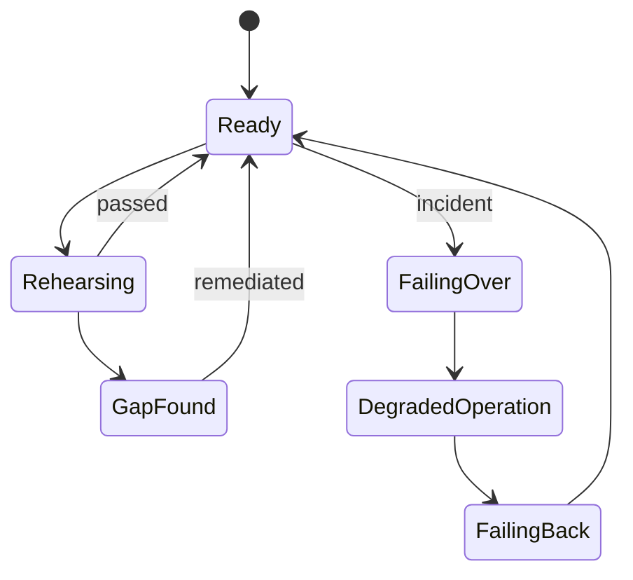
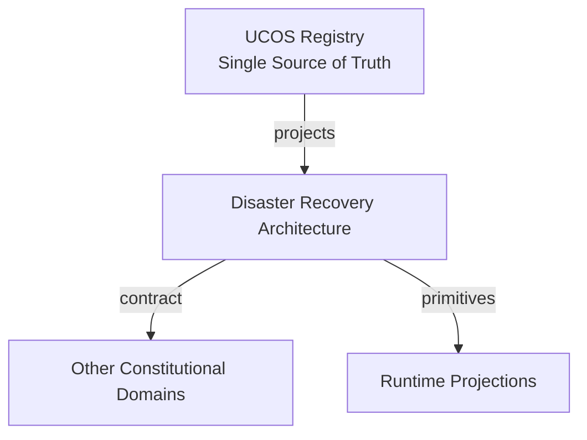
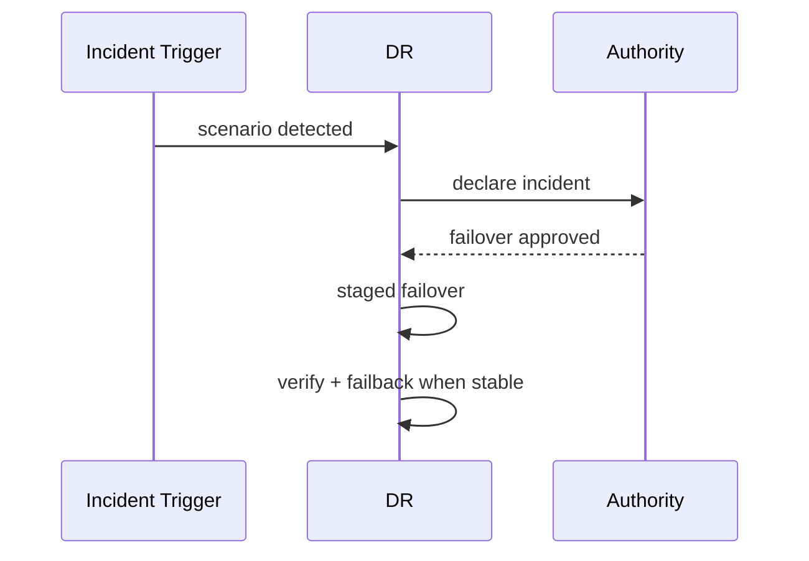
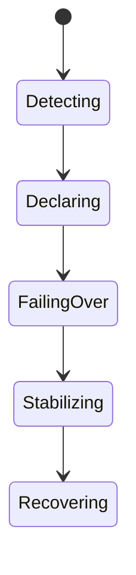
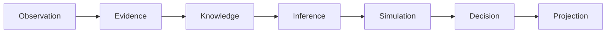
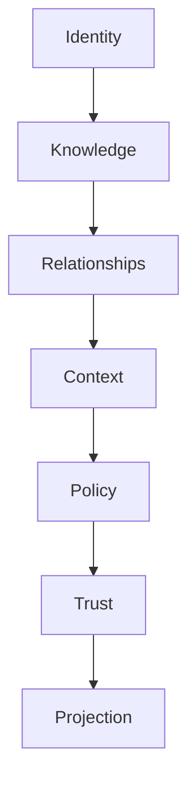

# UCOS-DR-000001
# Disaster Recovery Architecture

**Version:** Ω∞.1  |  **Status:** Constitutional Artifact  |  **Authority:** UCOS Ω∞ Constitutional Authority
**Category:** Operations  |  **Source of Truth:** `_registry/` (projected, never hand-authored)

> Constitutional notice: this document is a **projection**. Its truth lives in the registry. Editing this document directly violates Law 002 (Knowledge Once).

---

## 1. Executive Summary

**UCOS-DR-000001 — Disaster Recovery Architecture**

This artifact is a constitutionally governed, implementation-ready specification projected from the _UCOS Registry_ single source of truth.
It conforms to the _Immutable Primitive Registry_ (27 frozen primitives) and the _Canonical Terminology Registry_ (31 governed terms).
It contains no hardcoded business, industry, currency, country, or commerce concepts. All such concepts are runtime projections.

---

## 2. Constitutional Purpose

To define the binding contract for **Disaster Recovery Architecture** such that:
- every concept it names has exactly one owner,
- every capability it exposes has exactly one boundary,
- every boundary is expressed as an explicit contract,
- every contract is enforceable by the Governance Constitution.

---

## 3. Scope

In scope: the primitives, contracts, schemas, events, and policies owned by **Disaster Recovery Architecture**.
In scope: the projection rules by which this domain exposes its truth to other domains.
In scope: the verification obligations this domain must satisfy before activation.

---

## 4. Out of Scope

Out of scope: any concept owned by another constitutional domain.
Out of scope: business, industry, commerce, country, currency, or language content (all projected).
Out of scope: mutation of another domain’s internal state.

---

## 5. Definitions

All terms in this artifact are used in their canonical sense as defined in the Canonical Terminology Registry.
Where a term appears, its `termId` is normative and its `prohibitedMeanings` are void.

---

## 6. Canonical Terminology

| Term | Canonical Definition | Owner | Prohibited Meanings |
|---|---|---|---|
| Existence | Anything that may exist. | Universal Existence Kernel | business meaning, commercial meaning, operational meaning |
| Entity | Technical representation of an Existence Object. | Identity Domain | existence itself |
| Knowledge | Interpreted information with evidence and meaning. | Knowledge Domain | data, information, evidence |
| Data | Raw observations. | Observation Domain | knowledge, meaning |
| Information | Organized data. | Observation Domain | knowledge |
| Evidence | Proof supporting an assertion. | Evidence Domain | knowledge, trust |
| Trust | Computed confidence in an assertion, derived from evidence. | Trust Domain | evidence, faith |
| Meaning | Semantic interpretation; higher-level understanding. | Semantic Domain | classification, taxonomy, ontology |
| Ontology | What exists. | Semantic Domain | taxonomy, classification |
| Taxonomy | How things are classified. | Semantic Domain | ontology, meaning |
| Classification | Assignment into taxonomy. | Semantic Domain | meaning |
| Relationship | Connection between objects. | Relationship Domain | causality |

---

## 7. Ownership Boundaries

Ownership is recorded in the _Domain Ownership Registry_.

---

## 8. Domain Responsibilities

See the Domain Ownership Registry for the authoritative responsibility list.

---

## 9. Domain Non-Responsibilities

See the Domain Ownership Registry.

---

## 10. Concepts

Disaster Recovery Architecture ensures the constitution survives the worst. Recovery is rehearsed, measured, and governed — RTO and RPO are promises backed by tested procedure, not entries in a spreadsheet.

---

## 11. Ontology

DR has Scenarios (registry), Impact analyses (per capability tier), Recovery objectives (RTO/RPO), Failover paths (governed), and Rehearsal records. Truth is the registry — recovering it is recovering everything.

---

## 12. Taxonomy

By scenario: Region-loss / Cloud-loss / Data-corruption / Key-compromise / Supply-chain / Pandemic-capacity. By tier: Tier-0 immediate / Tier-1 hours / Tier-2 days / Tier-3 best-effort. By mechanism: Failover / Restore / Re-derive / Rebuild.

---

## 13. Registries

This domain is registry-driven. Its registries are entries in the Universal Registry System:

```yaml
RegistryEntry:
  registryId: UCOS-REG-DOMAIN
  owner: Constitutional Authority
  law: Knowledge Once — each concept defined exactly once
```

---

## 14. Data Model

```yaml
DRPlan:
  planId: <Identity>
  scenario: <registry id>
  capability: <capability>
  tier: <registry level>
  objectives: {rto, rpo}
  failoverPath: [<governed step>]
  rehearsal: {lastAt, result, nextDue}
  policy: <Policy>
```

---

## 15. Graph Model

(:Plan)-[:PROTECTS]->(:Capability); (:Plan)-[:RESPONDS_TO]->(:Scenario); (:Plan)-[:REHEARSED_IN]->(:Rehearsal); (:Plan)-[:GOVERNED_BY]->(:Policy)

---

## 16. Schemas

```yaml
# Canonical projection schema for UCOS-DR-000001
ucos_dr_000001:
  identity:      <Identity primitive>
  intent:        <Intent primitive>
  meaning:       <Meaning primitive>
  knowledge:     <Knowledge primitive>
  registry:      <Registry primitive>
  relationship:  <Relationship primitive>
  context:       <Context primitive>
  policy:        <Policy primitive>
  authority:     <Authority primitive>
  evidence:      <Evidence primitive>
  trust:         <Trust primitive>
  temporal:      <Time primitive>
  metadata:      <Metadata primitive>
```

---

## 17. Contracts

```yaml
DomainContract:
  domain: Disaster Recovery Architecture
  commands:   []   # registry-driven
  queries:    []   # registry-driven
  events:     []   # registry-driven
  policies:   []   # registry-driven
  permissions: []  # registry-driven
```

Contract law: domains never directly access another domain’s internal structures.

---

## 18. APIs

GET  /dr.v1/plans,POST /dr.v1/rehearse,POST /dr.v1/failover,GET  /dr.v1/rehearsals

---

## 19. Events

RehearsalStarted,RehearsalCompleted,FailoverInitiated,FailoverCompleted,FailbackCompleted,DRGapDetected

---

## 20. Commands

dr.rehearse,dr.failover,dr.failback,dr.declare-incident

---

## 21. Queries

dr.plans,dr.coverage,dr.rehearsals,dr.gaps

---

## 22. State Machines



---

## 23. Workflows

declare plan per capability → rehearse on schedule → record results → on incident: failover under governance → failback when stable

---

## 24. Policies

```yaml
Policy:
  identity: <Identity>
  conditions: []   # registry-driven
  actions:    []   # registry-driven
  priorities: []   # registry-driven
  exceptions: []   # registry-driven
```

All behavior derives from policy. Policy ≠ Rule: policy is behavioral governance; the rule is its executable projection.

---

## 25. Rules

```yaml
Rule:
  ruleId: <Identity>
  derivedFrom: <Policy identity>
  executable: true
  constraint: <registry expression>
```

---

## 26. Authorities

DR Authority (failover decision); incident declaration escalates to governance authority.

---

## 27. Permissions

dr.rehearse (dr authority),dr.failover (dr authority or automated under policy),dr.read (any)

---

## 28. Security Model

Zero Trust applies: no implicit trust between domains, services, agents, or tenants.
Every call is authenticated, authorized against Policy, and evidenced.
Cryptographic identity is issued by the Identity Domain; keys by the Key Management Architecture.

---

## 29. Privacy Model

Recovery of personal data must recover consent state too — partial recovery that loses consent bindings is a violation.

---

## 30. Trust Model

Trust is computed, never assumed. Inputs: evidence, authority, consistency, provenance, confidence.
```yaml
Trust:
  evidenceScore: <0..1>
  authorityScore: <0..1>
  consistencyScore: <0..1>
  provenanceScore: <0..1>
  confidenceScore: <0..1>
```

---

## 31. Audit Model

Every rehearsal and failover is a fully recorded incident with timeline, decisions, and evidence.

---

## 32. Observability Model

Every action emits: What happened? Why? Who authorized it? Which policy allowed it? What evidence supports it? What confidence exists? What alternatives were evaluated?
These are the seven Explainability questions and are mandatory event fields.

---

## 33. Digital Twin Model

DR twin simulates scenarios continuously against live topology — coverage gaps surface before disaster.

---

## 34. Agent Model

DR agent detects unrehearsed plans and overdue rehearsals, blocking certification drift.

---

## 35. Runtime Model

Failover is governed: health-checked, staged, and reversible. Registry truth re-derives projections on the target.

---

## 36. Scaling Model

DR scales with the platform — each domain's recovery is its own plan, coordinated by DR policy.

---

## 37. Multi-Tenant Model

Tenant recovery is isolated; platform recovery never depends on a single tenant's state.

---

## 38. Geo-Distribution Model

Regional loss is the canonical scenario — sovereignty may constrain failover targets, and plans encode that constraint.

---

## 39. Failure Model

Unrehearsed plan, failover target unavailable, split-brain, rehearsal-failure-ignored.

---

## 40. Recovery Model

Unrehearsed paths are assumed broken — a plan without a current rehearsal is a gap, not a plan.

---

## 41. Verification Model

Before activation, Disaster Recovery Architecture must pass identity, knowledge, relationship, context, policy, authority, trust, and reality integrity checks.
Verification is performed by the Formal Verification Architecture (UCOS-FML-000001).

---

## 42. Certification Model

Every tier-0/1 capability must have a rehearsed plan within policy window.

---

## 43. Migration Model

New scenarios are registry additions.

---

## 44. Evolution Model

Evolution is governed and history-preserving. Primitives are frozen; extension occurs through registries, policies, capabilities, contexts, relationships, knowledge, agents, and projections — never through primitive expansion.

---

## 45. Implementation Blueprint

Build order for DR: (1) define registry entries — this domain owns by scenario: region-loss / cloud-loss / data-corruption / key-compromise / supply-chain / pandemic-capacity as registry truth, not code; (2) implement the contract surface first (dr.rehearse, dr.failover, dr.failback) and validate against DR boundaries; (3) event-source all state so history is reconstructable; (4) wire the enforcement points — authority check, policy guard, evidence binding, trace — in-line, with no bypass path; (5) add tests per the Testing Architecture, citing evidence per gate; (6) obtain Verification and Certification before activation. Acceptance: the Zero Partial and Law 001 audits pass, every action answers the seven explainability questions, and this domain mutates no other domain internals.

---

## 46. Reference Architecture Diagram



---

## 47. Sequence Diagrams



---

## 48. State Diagrams



---

## 49. Data Flow Diagrams



---

## 50. Dependency Maps



Forbidden: circular dependencies, mutual ownership, cross-domain state mutation.

---

## ∞

Constitutionally governed. Implementation ready. Universally extensible.