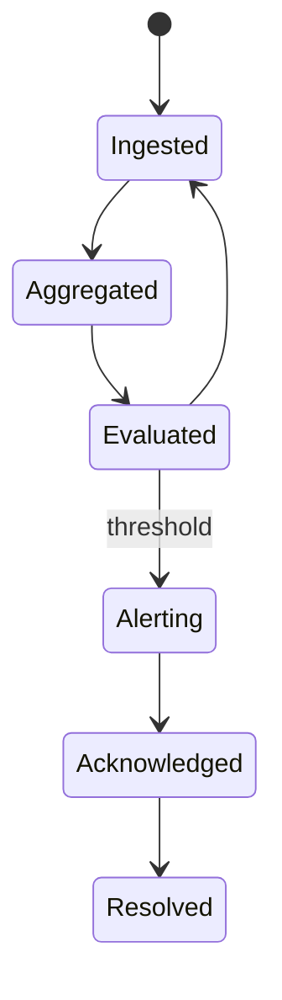
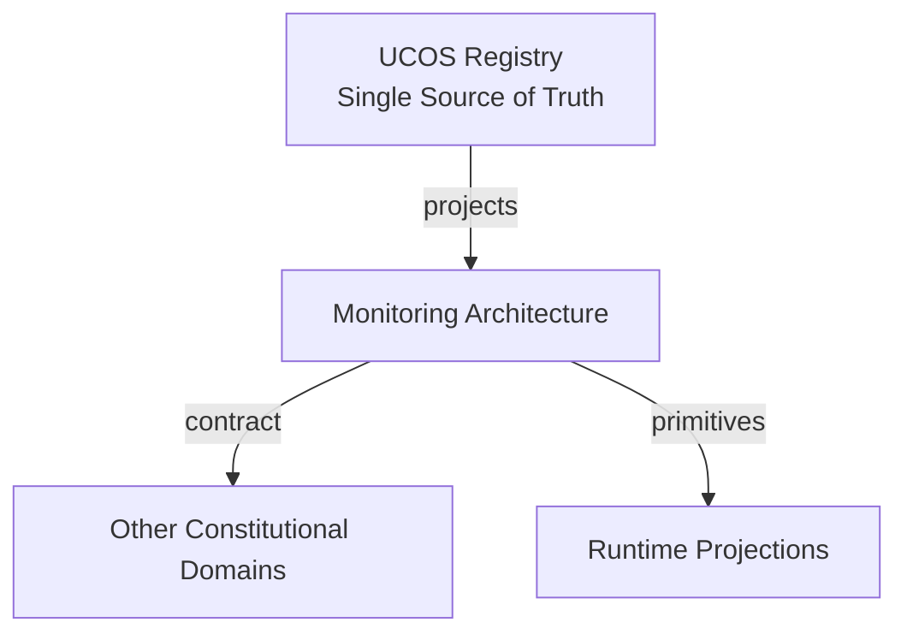
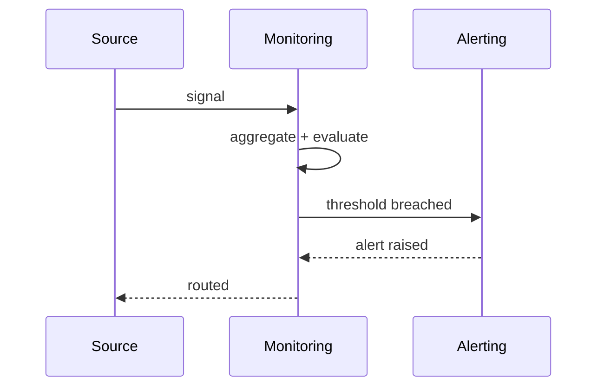
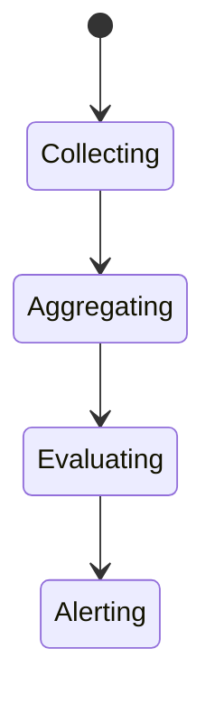
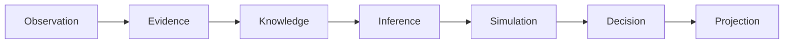
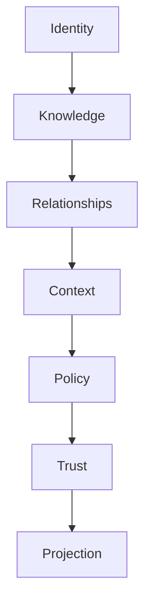

# UCOS-MON-000001
# Monitoring Architecture

**Version:** Ω∞.1  |  **Status:** Constitutional Artifact  |  **Authority:** UCOS Ω∞ Constitutional Authority
**Category:** Operations  |  **Source of Truth:** `_registry/` (projected, never hand-authored)

> Constitutional notice: this document is a **projection**. Its truth lives in the registry. Editing this document directly violates Law 002 (Knowledge Once).

---

## 1. Executive Summary

**UCOS-MON-000001 — Monitoring Architecture**

This artifact is a constitutionally governed, implementation-ready specification projected from the _UCOS Registry_ single source of truth.
It conforms to the _Immutable Primitive Registry_ (27 frozen primitives) and the _Canonical Terminology Registry_ (31 governed terms).
It contains no hardcoded business, industry, currency, country, or commerce concepts. All such concepts are runtime projections.

---

## 2. Constitutional Purpose

To define the binding contract for **Monitoring Architecture** such that:
- every concept it names has exactly one owner,
- every capability it exposes has exactly one boundary,
- every boundary is expressed as an explicit contract,
- every contract is enforceable by the Governance Constitution.

---

## 3. Scope

In scope: the primitives, contracts, schemas, events, and policies owned by **Monitoring Architecture**.
In scope: the projection rules by which this domain exposes its truth to other domains.
In scope: the verification obligations this domain must satisfy before activation.

---

## 4. Out of Scope

Out of scope: any concept owned by another constitutional domain.
Out of scope: business, industry, commerce, country, currency, or language content (all projected).
Out of scope: mutation of another domain’s internal state.

---

## 5. Definitions

All terms in this artifact are used in their canonical sense as defined in the Canonical Terminology Registry.
Where a term appears, its `termId` is normative and its `prohibitedMeanings` are void.

---

## 6. Canonical Terminology

| Term | Canonical Definition | Owner | Prohibited Meanings |
|---|---|---|---|
| Existence | Anything that may exist. | Universal Existence Kernel | business meaning, commercial meaning, operational meaning |
| Entity | Technical representation of an Existence Object. | Identity Domain | existence itself |
| Knowledge | Interpreted information with evidence and meaning. | Knowledge Domain | data, information, evidence |
| Data | Raw observations. | Observation Domain | knowledge, meaning |
| Information | Organized data. | Observation Domain | knowledge |
| Evidence | Proof supporting an assertion. | Evidence Domain | knowledge, trust |
| Trust | Computed confidence in an assertion, derived from evidence. | Trust Domain | evidence, faith |
| Meaning | Semantic interpretation; higher-level understanding. | Semantic Domain | classification, taxonomy, ontology |
| Ontology | What exists. | Semantic Domain | taxonomy, classification |
| Taxonomy | How things are classified. | Semantic Domain | ontology, meaning |
| Classification | Assignment into taxonomy. | Semantic Domain | meaning |
| Relationship | Connection between objects. | Relationship Domain | causality |

---

## 7. Ownership Boundaries

Ownership is recorded in the _Domain Ownership Registry_.

---

## 8. Domain Responsibilities

See the Domain Ownership Registry for the authoritative responsibility list.

---

## 9. Domain Non-Responsibilities

See the Domain Ownership Registry.

---

## 10. Concepts

Monitoring Architecture observes the platform continuously and in context. Metrics, logs, traces, and events are unified as Observations — feeding Knowledge, Trust, and Twins rather than sitting in siloed dashboards.

---

## 11. Ontology

Monitoring has Signals (metrics/logs/traces/events), Collection points, Aggregation policy, and Routing to the Observation Domain. Monitoring is not an end — it is the platform's senses.

---

## 12. Taxonomy

By signal: Metric / Log / Trace / Event / Profiling / Real-user. By collection: Agent / Exporter / SDK / Probe. By cadence: Continuous / Sampled / Periodic.

---

## 13. Registries

This domain is registry-driven. Its registries are entries in the Universal Registry System:

```yaml
RegistryEntry:
  registryId: UCOS-REG-DOMAIN
  owner: Constitutional Authority
  law: Knowledge Once — each concept defined exactly once
```

---

## 14. Data Model

```yaml
MonitoringSignal:
  signalId: <Identity>
  signalType: <registry id>
  source: <Identity>
  metric: <registry metric>
  value: <number|string>
  context: <Context>
  temporal: {at}
  retention: <Policy>
```

---

## 15. Graph Model

(:Signal)-[:FROM]->(:Source); (:Signal)-[:FEEDS]->(:Observation); (:Signal)-[:RETAINED_PER]->(:Policy); (:Signal)-[:ALERTS]->(:Alert)

---

## 16. Schemas

```yaml
# Canonical projection schema for UCOS-MON-000001
ucos_mon_000001:
  identity:      <Identity primitive>
  intent:        <Intent primitive>
  meaning:       <Meaning primitive>
  knowledge:     <Knowledge primitive>
  registry:      <Registry primitive>
  relationship:  <Relationship primitive>
  context:       <Context primitive>
  policy:        <Policy primitive>
  authority:     <Authority primitive>
  evidence:      <Evidence primitive>
  trust:         <Trust primitive>
  temporal:      <Time primitive>
  metadata:      <Metadata primitive>
```

---

## 17. Contracts

```yaml
DomainContract:
  domain: Monitoring Architecture
  commands:   []   # registry-driven
  queries:    []   # registry-driven
  events:     []   # registry-driven
  policies:   []   # registry-driven
  permissions: []  # registry-driven
```

Contract law: domains never directly access another domain’s internal structures.

---

## 18. APIs

POST /mon.v1.ingest,GET  /mon.v1/metrics,POST /mon.v1.alert,GET  /mon.v1/alerts

---

## 19. Events

SignalIngested,AlertRaised,AlertAcknowledged,AlertResolved,AnomalyDetected

---

## 20. Commands

mon.ingest,mon.alert,mon.acknowledge,mon.silence

---

## 21. Queries

mon.metrics,mon.alerts,mon.history,mon.anomalies

---

## 22. State Machines



---

## 23. Workflows

collect → validate schema → aggregate → evaluate thresholds → raise alerts → route to responders

---

## 24. Policies

```yaml
Policy:
  identity: <Identity>
  conditions: []   # registry-driven
  actions:    []   # registry-driven
  priorities: []   # registry-driven
  exceptions: []   # registry-driven
```

All behavior derives from policy. Policy ≠ Rule: policy is behavioral governance; the rule is its executable projection.

---

## 25. Rules

```yaml
Rule:
  ruleId: <Identity>
  derivedFrom: <Policy identity>
  executable: true
  constraint: <registry expression>
```

---

## 26. Authorities

Monitoring Authority (infrastructure); alert routing follows on-call authority in the acting jurisdiction.

---

## 27. Permissions

mon.ingest (authorized collector),mon.alert (system),mon.read (context-scoped)

---

## 28. Security Model

Zero Trust applies: no implicit trust between domains, services, agents, or tenants.
Every call is authenticated, authorized against Policy, and evidenced.
Cryptographic identity is issued by the Identity Domain; keys by the Key Management Architecture.

---

## 29. Privacy Model

Logs are the highest leak risk — personal data in logs is minimized by policy and scanned for violations.

---

## 30. Trust Model

Trust is computed, never assumed. Inputs: evidence, authority, consistency, provenance, confidence.
```yaml
Trust:
  evidenceScore: <0..1>
  authorityScore: <0..1>
  consistencyScore: <0..1>
  provenanceScore: <0..1>
  confidenceScore: <0..1>
```

---

## 31. Audit Model

Monitoring is itself audited — alert response times and silence windows are recorded.

---

## 32. Observability Model

Every action emits: What happened? Why? Who authorized it? Which policy allowed it? What evidence supports it? What confidence exists? What alternatives were evaluated?
These are the seven Explainability questions and are mandatory event fields.

---

## 33. Digital Twin Model

Monitoring twin tracks signal coverage — a blind spot is a monitored condition, ironically and deliberately.

---

## 34. Agent Model

Monitoring agent detects anomalies beyond static thresholds and auto-correlates alert storms.

---

## 35. Runtime Model

Ingest is high-throughput with backpressure; evaluation is stream-based with windowed aggregation.

---

## 36. Scaling Model

Signals partition by source; aggregation fans out by metric; retention is tiered per policy.

---

## 37. Multi-Tenant Model

Signals are tenant-scoped; platform-level monitoring uses anonymized aggregates only.

---

## 38. Geo-Distribution Model

Regional monitoring respects residency — signals stay in-jurisdiction, alerts route globally.

---

## 39. Failure Model

Signal loss, alert fatigue, aggregation lag, false-negative blind spot.

---

## 40. Recovery Model

Signals replay from the Observation log; alert state rebuilds from evaluations.

---

## 41. Verification Model

Before activation, Monitoring Architecture must pass identity, knowledge, relationship, context, policy, authority, trust, and reality integrity checks.
Verification is performed by the Formal Verification Architecture (UCOS-FML-000001).

---

## 42. Certification Model

Critical capabilities must prove their signals reach monitoring — unmonitored critical paths fail certification.

---

## 43. Migration Model

New signal types are registry additions.

---

## 44. Evolution Model

Evolution is governed and history-preserving. Primitives are frozen; extension occurs through registries, policies, capabilities, contexts, relationships, knowledge, agents, and projections — never through primitive expansion.

---

## 45. Implementation Blueprint

Build order for MON: (1) define registry entries — this domain owns by signal: metric / log / trace / event / profiling / real-user as registry truth, not code; (2) implement the contract surface first (mon.ingest, mon.alert, mon.acknowledge) and validate against MON boundaries; (3) event-source all state so history is reconstructable; (4) wire the enforcement points — authority check, policy guard, evidence binding, trace — in-line, with no bypass path; (5) add tests per the Testing Architecture, citing evidence per gate; (6) obtain Verification and Certification before activation. Acceptance: the Zero Partial and Law 001 audits pass, every action answers the seven explainability questions, and this domain mutates no other domain internals.

---

## 46. Reference Architecture Diagram



---

## 47. Sequence Diagrams



---

## 48. State Diagrams



---

## 49. Data Flow Diagrams



---

## 50. Dependency Maps



Forbidden: circular dependencies, mutual ownership, cross-domain state mutation.

---

## ∞

Constitutionally governed. Implementation ready. Universally extensible.