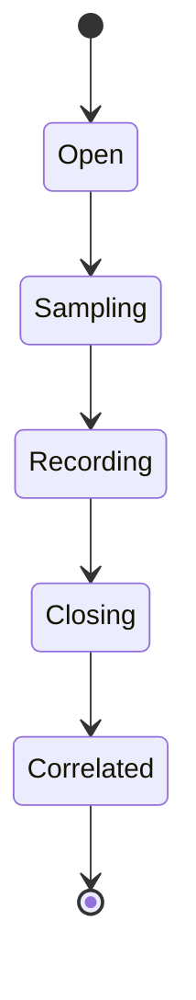
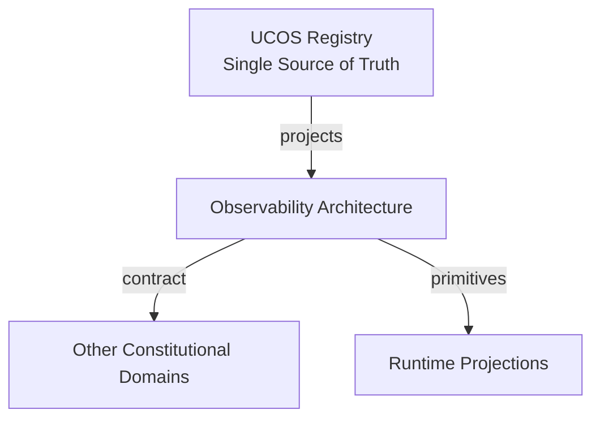
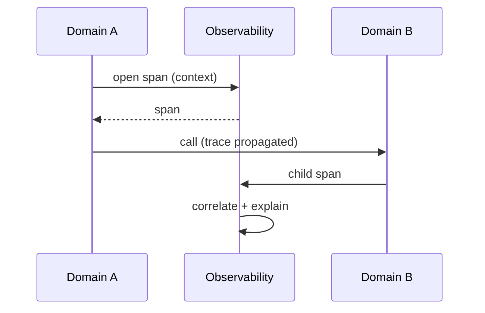
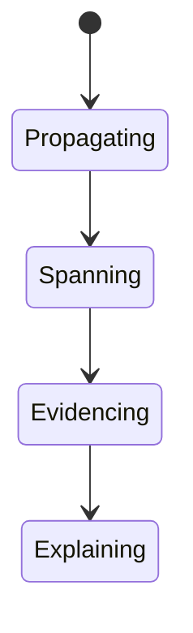
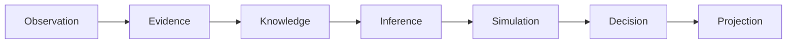
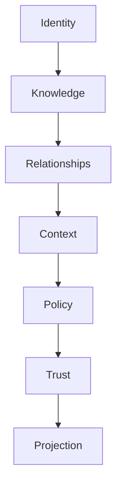

# UCOS-OBSV-000001
# Observability Architecture

**Version:** Ω∞.1  |  **Status:** Constitutional Artifact  |  **Authority:** UCOS Ω∞ Constitutional Authority
**Category:** Operations  |  **Source of Truth:** `_registry/` (projected, never hand-authored)

> Constitutional notice: this document is a **projection**. Its truth lives in the registry. Editing this document directly violates Law 002 (Knowledge Once).

---

## 1. Executive Summary

**UCOS-OBSV-000001 — Observability Architecture**

This artifact is a constitutionally governed, implementation-ready specification projected from the _UCOS Registry_ single source of truth.
It conforms to the _Immutable Primitive Registry_ (27 frozen primitives) and the _Canonical Terminology Registry_ (31 governed terms).
It contains no hardcoded business, industry, currency, country, or commerce concepts. All such concepts are runtime projections.

---

## 2. Constitutional Purpose

To define the binding contract for **Observability Architecture** such that:
- every concept it names has exactly one owner,
- every capability it exposes has exactly one boundary,
- every boundary is expressed as an explicit contract,
- every contract is enforceable by the Governance Constitution.

---

## 3. Scope

In scope: the primitives, contracts, schemas, events, and policies owned by **Observability Architecture**.
In scope: the projection rules by which this domain exposes its truth to other domains.
In scope: the verification obligations this domain must satisfy before activation.

---

## 4. Out of Scope

Out of scope: any concept owned by another constitutional domain.
Out of scope: business, industry, commerce, country, currency, or language content (all projected).
Out of scope: mutation of another domain’s internal state.

---

## 5. Definitions

All terms in this artifact are used in their canonical sense as defined in the Canonical Terminology Registry.
Where a term appears, its `termId` is normative and its `prohibitedMeanings` are void.

---

## 6. Canonical Terminology

| Term | Canonical Definition | Owner | Prohibited Meanings |
|---|---|---|---|
| Existence | Anything that may exist. | Universal Existence Kernel | business meaning, commercial meaning, operational meaning |
| Entity | Technical representation of an Existence Object. | Identity Domain | existence itself |
| Knowledge | Interpreted information with evidence and meaning. | Knowledge Domain | data, information, evidence |
| Data | Raw observations. | Observation Domain | knowledge, meaning |
| Information | Organized data. | Observation Domain | knowledge |
| Evidence | Proof supporting an assertion. | Evidence Domain | knowledge, trust |
| Trust | Computed confidence in an assertion, derived from evidence. | Trust Domain | evidence, faith |
| Meaning | Semantic interpretation; higher-level understanding. | Semantic Domain | classification, taxonomy, ontology |
| Ontology | What exists. | Semantic Domain | taxonomy, classification |
| Taxonomy | How things are classified. | Semantic Domain | ontology, meaning |
| Classification | Assignment into taxonomy. | Semantic Domain | meaning |
| Relationship | Connection between objects. | Relationship Domain | causality |

---

## 7. Ownership Boundaries

Ownership is recorded in the _Domain Ownership Registry_.

---

## 8. Domain Responsibilities

See the Domain Ownership Registry for the authoritative responsibility list.

---

## 9. Domain Non-Responsibilities

See the Domain Ownership Registry.

---

## 10. Concepts

Observability Architecture answers 'why is this happening?' — not just 'is it up?'. Traces, structured logs, metrics, evidence, and explanations are correlated across every domain so any behavior is reconstructable end-to-end.

---

## 11. Ontology

Observability has Spans (units of work), Context propagation (trace identity), Correlation (causation + correlation ids), and Explanation (the seven questions). It is the introspection layer of a self-explaining system.

---

## 12. Taxonomy

By output: Trace / Log / Metric / Evidence / Explanation. By depth: Request-level / Flow-level / System-level / Business-level. By audience: Engineer / Operator / Auditor / Regulator / Subject.

---

## 13. Registries

This domain is registry-driven. Its registries are entries in the Universal Registry System:

```yaml
RegistryEntry:
  registryId: UCOS-REG-DOMAIN
  owner: Constitutional Authority
  law: Knowledge Once — each concept defined exactly once
```

---

## 14. Data Model

```yaml
TraceSpan:
  spanId: <Identity>
  traceId: <Identity>
  parentSpanId: <Identity|null>
  domain: <Domain>
  action: <registry action>
  authority: <Authority>
  policyVersion: <version>
  evidence: [<Evidence>]
  temporal: {startedAt, endedAt}
  context: <Context>
  explanation: <the seven questions>
```

---

## 15. Graph Model

(:Span)-[:CHILD_OF]->(:Span); (:Span)-[:IN_DOMAIN]->(:Domain); (:Span)-[:EVIDENCED_BY]->(:Evidence); (:Span)-[:EXPLAINS]->(:Action)

---

## 16. Schemas

```yaml
# Canonical projection schema for UCOS-OBSV-000001
ucos_obsv_000001:
  identity:      <Identity primitive>
  intent:        <Intent primitive>
  meaning:       <Meaning primitive>
  knowledge:     <Knowledge primitive>
  registry:      <Registry primitive>
  relationship:  <Relationship primitive>
  context:       <Context primitive>
  policy:        <Policy primitive>
  authority:     <Authority primitive>
  evidence:      <Evidence primitive>
  trust:         <Trust primitive>
  temporal:      <Time primitive>
  metadata:      <Metadata primitive>
```

---

## 17. Contracts

```yaml
DomainContract:
  domain: Observability Architecture
  commands:   []   # registry-driven
  queries:    []   # registry-driven
  events:     []   # registry-driven
  policies:   []   # registry-driven
  permissions: []  # registry-driven
```

Contract law: domains never directly access another domain’s internal structures.

---

## 18. APIs

POST /obs.v1.span,GET  /obs.v1/trace/{traceId},GET  /obs.v1/explain/{traceId},POST /obs.v1.correlate

---

## 19. Events

SpanOpened,SpanClosed,TraceComplete,ExplanationRequested,CorrelationFound

---

## 20. Commands

obs.span.open,obs.span.close,obs.explain,obs.correlate

---

## 21. Queries

obs.trace,obs.explanation,obs.criticalPaths,obs.blindSpots

---

## 22. State Machines



---

## 23. Workflows

open span with context → propagate trace identity → record evidence at each stage → close → correlate across domains → explain

---

## 24. Policies

```yaml
Policy:
  identity: <Identity>
  conditions: []   # registry-driven
  actions:    []   # registry-driven
  priorities: []   # registry-driven
  exceptions: []   # registry-driven
```

All behavior derives from policy. Policy ≠ Rule: policy is behavioral governance; the rule is its executable projection.

---

## 25. Rules

```yaml
Rule:
  ruleId: <Identity>
  derivedFrom: <Policy identity>
  executable: true
  constraint: <registry expression>
```

---

## 26. Authorities

Observability Authority (infrastructure); explanations are governed artifacts, not informal notes.

---

## 27. Permissions

obs.span (any domain, its own),obs.read (context-scoped, auditor-elevated),obs.explain (any stakeholder)

---

## 28. Security Model

Zero Trust applies: no implicit trust between domains, services, agents, or tenants.
Every call is authenticated, authorized against Policy, and evidenced.
Cryptographic identity is issued by the Identity Domain; keys by the Key Management Architecture.

---

## 29. Privacy Model

Trace contents are minimized; personal data in spans is policy-prohibited and violation-scanned.

---

## 30. Trust Model

Trust is computed, never assumed. Inputs: evidence, authority, consistency, provenance, confidence.
```yaml
Trust:
  evidenceScore: <0..1>
  authorityScore: <0..1>
  consistencyScore: <0..1>
  provenanceScore: <0..1>
  confidenceScore: <0..1>
```

---

## 31. Audit Model

The trace IS the audit artifact — causation chains reconstruct any decision with authority and evidence.

---

## 32. Observability Model

Every action emits: What happened? Why? Who authorized it? Which policy allowed it? What evidence supports it? What confidence exists? What alternatives were evaluated?
These are the seven Explainability questions and are mandatory event fields.

---

## 33. Digital Twin Model

Observability twin monitors trace completeness — an untraced critical path is a defect, flagged automatically.

---

## 34. Agent Model

Observability agent detects trace gaps and correlates anomalies across domains into explanations.

---

## 35. Runtime Model

Context propagation is mandatory across every boundary; sampling is governed by policy with critical-path always-on.

---

## 36. Scaling Model

Trace volume is high — sampling by policy, full retention for critical tiers, tiered storage otherwise.

---

## 37. Multi-Tenant Model

Traces are tenant-scoped; cross-tenant traces exist only in marketplace flows with both authorities.

---

## 38. Geo-Distribution Model

Trace residency follows the data's jurisdiction; cross-region correlation respects sovereignty.

---

## 39. Failure Model

Trace context loss, span drop, correlation gap, explanation void.

---

## 40. Recovery Model

Traces are Observations — replayable; the Observation log is the source of reconstruction.

---

## 41. Verification Model

Before activation, Observability Architecture must pass identity, knowledge, relationship, context, policy, authority, trust, and reality integrity checks.
Verification is performed by the Formal Verification Architecture (UCOS-FML-000001).

---

## 42. Certification Model

Every governed action must be traceable end-to-end — an untraceable action is unconstitutional.

---

## 43. Migration Model

New span types are registry additions.

---

## 44. Evolution Model

Evolution is governed and history-preserving. Primitives are frozen; extension occurs through registries, policies, capabilities, contexts, relationships, knowledge, agents, and projections — never through primitive expansion.

---

## 45. Implementation Blueprint

Build order for OBSV: (1) define registry entries — this domain owns by output: trace / log / metric / evidence / explanation as registry truth, not code; (2) implement the contract surface first (obs.span.open, obs.span.close, obs.explain) and validate against OBSV boundaries; (3) event-source all state so history is reconstructable; (4) wire the enforcement points — authority check, policy guard, evidence binding, trace — in-line, with no bypass path; (5) add tests per the Testing Architecture, citing evidence per gate; (6) obtain Verification and Certification before activation. Acceptance: the Zero Partial and Law 001 audits pass, every action answers the seven explainability questions, and this domain mutates no other domain internals.

---

## 46. Reference Architecture Diagram



---

## 47. Sequence Diagrams



---

## 48. State Diagrams



---

## 49. Data Flow Diagrams



---

## 50. Dependency Maps



Forbidden: circular dependencies, mutual ownership, cross-domain state mutation.

---

## ∞

Constitutionally governed. Implementation ready. Universally extensible.