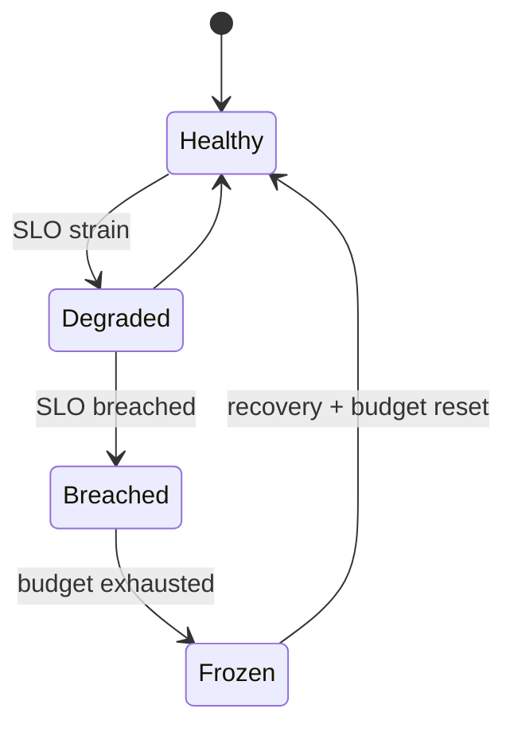
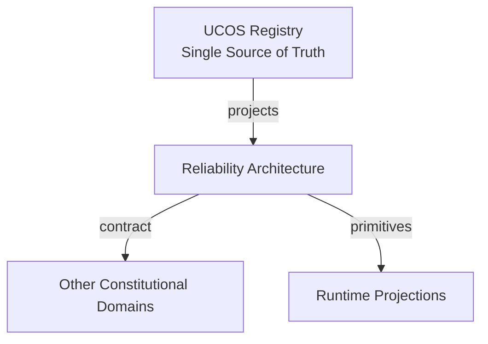
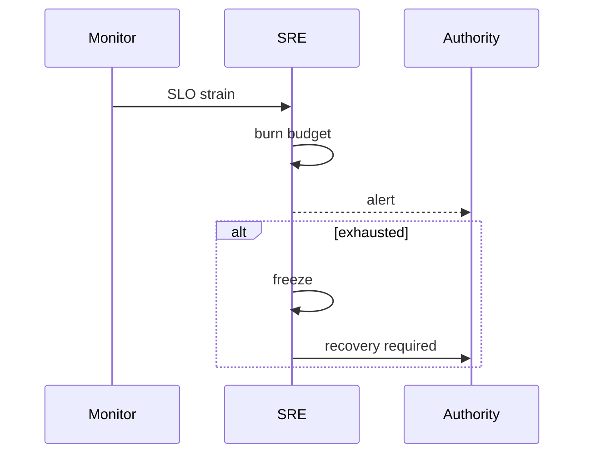
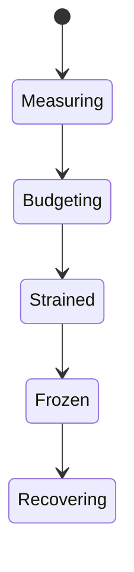
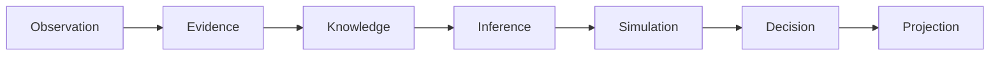
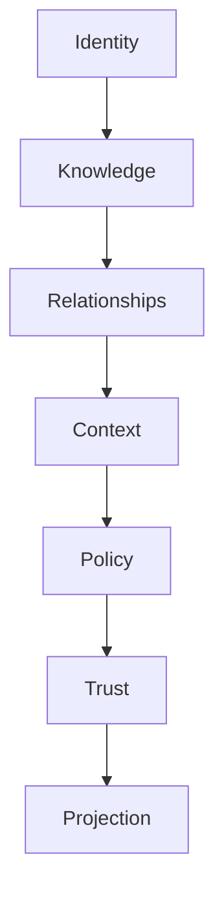

# UCOS-SRE-000001
# Reliability Architecture

**Version:** Ω∞.1  |  **Status:** Constitutional Artifact  |  **Authority:** UCOS Ω∞ Constitutional Authority
**Category:** Operations  |  **Source of Truth:** `_registry/` (projected, never hand-authored)

> Constitutional notice: this document is a **projection**. Its truth lives in the registry. Editing this document directly violates Law 002 (Knowledge Once).

---

## 1. Executive Summary

**UCOS-SRE-000001 — Reliability Architecture**

This artifact is a constitutionally governed, implementation-ready specification projected from the _UCOS Registry_ single source of truth.
It conforms to the _Immutable Primitive Registry_ (27 frozen primitives) and the _Canonical Terminology Registry_ (31 governed terms).
It contains no hardcoded business, industry, currency, country, or commerce concepts. All such concepts are runtime projections.

---

## 2. Constitutional Purpose

To define the binding contract for **Reliability Architecture** such that:
- every concept it names has exactly one owner,
- every capability it exposes has exactly one boundary,
- every boundary is expressed as an explicit contract,
- every contract is enforceable by the Governance Constitution.

---

## 3. Scope

In scope: the primitives, contracts, schemas, events, and policies owned by **Reliability Architecture**.
In scope: the projection rules by which this domain exposes its truth to other domains.
In scope: the verification obligations this domain must satisfy before activation.

---

## 4. Out of Scope

Out of scope: any concept owned by another constitutional domain.
Out of scope: business, industry, commerce, country, currency, or language content (all projected).
Out of scope: mutation of another domain’s internal state.

---

## 5. Definitions

All terms in this artifact are used in their canonical sense as defined in the Canonical Terminology Registry.
Where a term appears, its `termId` is normative and its `prohibitedMeanings` are void.

---

## 6. Canonical Terminology

| Term | Canonical Definition | Owner | Prohibited Meanings |
|---|---|---|---|
| Existence | Anything that may exist. | Universal Existence Kernel | business meaning, commercial meaning, operational meaning |
| Entity | Technical representation of an Existence Object. | Identity Domain | existence itself |
| Knowledge | Interpreted information with evidence and meaning. | Knowledge Domain | data, information, evidence |
| Data | Raw observations. | Observation Domain | knowledge, meaning |
| Information | Organized data. | Observation Domain | knowledge |
| Evidence | Proof supporting an assertion. | Evidence Domain | knowledge, trust |
| Trust | Computed confidence in an assertion, derived from evidence. | Trust Domain | evidence, faith |
| Meaning | Semantic interpretation; higher-level understanding. | Semantic Domain | classification, taxonomy, ontology |
| Ontology | What exists. | Semantic Domain | taxonomy, classification |
| Taxonomy | How things are classified. | Semantic Domain | ontology, meaning |
| Classification | Assignment into taxonomy. | Semantic Domain | meaning |
| Relationship | Connection between objects. | Relationship Domain | causality |

---

## 7. Ownership Boundaries

Ownership is recorded in the _Domain Ownership Registry_.

---

## 8. Domain Responsibilities

See the Domain Ownership Registry for the authoritative responsibility list.

---

## 9. Domain Non-Responsibilities

See the Domain Ownership Registry.

---

## 10. Concepts

Reliability Architecture treats uptime as a governed property: every capability declares an SLO, every breach burns a budget, and every recovery is rehearsed. Reliability is designed, not hoped for.

---

## 11. Ontology

Reliability has SLOs (targets), Error budgets (governed spend), Dependencies (relationships), Failure domains (bounded blast radius), and Recovery objectives (RTO/RPO per class).

---

## 12. Taxonomy

By criticality: Tier-0 (constitutional) / Tier-1 (critical) / Tier-2 (standard) / Tier-3 (best-effort). By metric: Availability / Latency / Durability / Correctness / Throughput. By recovery: RTO-immediate / RTO-hours / RTO-days.

---

## 13. Registries

This domain is registry-driven. Its registries are entries in the Universal Registry System:

```yaml
RegistryEntry:
  registryId: UCOS-REG-DOMAIN
  owner: Constitutional Authority
  law: Knowledge Once — each concept defined exactly once
```

---

## 14. Data Model

```yaml
ReliabilityTarget:
  targetId: <Identity>
  capability: <registry capability>
  tier: <registry level>
  slo: {indicator, target, window}
  errorBudget: {remaining, resetsAt}
  dependencies: [<Relationship>]
  recovery: {rto, rpo}
  policy: <Policy>
```

---

## 15. Graph Model

(:Target)-[:PROTECTS]->(:Capability); (:Target)-[:DEPENDS_ON]->(:Capability); (:Target)-[:BOUNDED_BY]->(:Policy); (:Target)-[:MEASURED_BY]->(:Indicator)

---

## 16. Schemas

```yaml
# Canonical projection schema for UCOS-SRE-000001
ucos_sre_000001:
  identity:      <Identity primitive>
  intent:        <Intent primitive>
  meaning:       <Meaning primitive>
  knowledge:     <Knowledge primitive>
  registry:      <Registry primitive>
  relationship:  <Relationship primitive>
  context:       <Context primitive>
  policy:        <Policy primitive>
  authority:     <Authority primitive>
  evidence:      <Evidence primitive>
  trust:         <Trust primitive>
  temporal:      <Time primitive>
  metadata:      <Metadata primitive>
```

---

## 17. Contracts

```yaml
DomainContract:
  domain: Reliability Architecture
  commands:   []   # registry-driven
  queries:    []   # registry-driven
  events:     []   # registry-driven
  policies:   []   # registry-driven
  permissions: []  # registry-driven
```

Contract law: domains never directly access another domain’s internal structures.

---

## 18. APIs

GET  /sre.v1/targets,POST /sre.v1/target,GET  /sre.v1/budgets,POST /sre.v1/freeze

---

## 19. Events

SLOBreached,BudgetExhausted,FreezeDeclared,RehearsalCompleted,DependencyFailed

---

## 20. Commands

sre.declare,sre.freeze,sre.unfreeze,sre.rehearse,sre.burn

---

## 21. Queries

sre.targets,sre.budgets,sre.dependencies,sre.blastRadius,sre.tiers

---

## 22. State Machines



---

## 23. Workflows

declare SLO → measure continuously → burn budget on errors → freeze on exhaustion → recover → rehearse

---

## 24. Policies

```yaml
Policy:
  identity: <Identity>
  conditions: []   # registry-driven
  actions:    []   # registry-driven
  priorities: []   # registry-driven
  exceptions: []   # registry-driven
```

All behavior derives from policy. Policy ≠ Rule: policy is behavioral governance; the rule is its executable projection.

---

## 25. Rules

```yaml
Rule:
  ruleId: <Identity>
  derivedFrom: <Policy identity>
  executable: true
  constraint: <registry expression>
```

---

## 26. Authorities

Reliability Authority (SLO governance); freeze halts non-critical change under policy.

---

## 27. Permissions

sre.declare (reliability authority),sre.freeze (reliability authority),sre.read (any)

---

## 28. Security Model

Zero Trust applies: no implicit trust between domains, services, agents, or tenants.
Every call is authenticated, authorized against Policy, and evidenced.
Cryptographic identity is issued by the Identity Domain; keys by the Key Management Architecture.

---

## 29. Privacy Model

Reliability metrics carry no personal data by construction — indicators are aggregate.

---

## 30. Trust Model

Trust is computed, never assumed. Inputs: evidence, authority, consistency, provenance, confidence.
```yaml
Trust:
  evidenceScore: <0..1>
  authorityScore: <0..1>
  consistencyScore: <0..1>
  provenanceScore: <0..1>
  confidenceScore: <0..1>
```

---

## 31. Audit Model

Every breach and freeze is logged with cause analysis and remediation; rehearsals are recorded.

---

## 32. Observability Model

Every action emits: What happened? Why? Who authorized it? Which policy allowed it? What evidence supports it? What confidence exists? What alternatives were evaluated?
These are the seven Explainability questions and are mandatory event fields.

---

## 33. Digital Twin Model

Reliability twin simulates failure scenarios against live topology — chaos engineering under governance.

---

## 34. Agent Model

Reliability agent detects budget burn early and proposes freezes before exhaustion.

---

## 35. Runtime Model

Probes are continuous; circuit breakers are automatic; fallbacks degrade gracefully, never silently.

---

## 36. Scaling Model

Failure domains are bounded per tier; blast radius is a queryable property, not a guess.

---

## 37. Multi-Tenant Model

Tenant reliability is isolated — one tenant's storm cannot breach another's SLO.

---

## 38. Geo-Distribution Model

Regional SLOs account for jurisdiction-failover constraints — sovereignty can limit recovery options, by design.

---

## 39. Failure Model

Cascading dependency failure, budget miscalculation, frozen-state deadlock, rehearsal gap.

---

## 40. Recovery Model

Recovery is rehearsed per tier; RTO/RPO are measured, not asserted. Unrehearsed paths are assumed broken.

---

## 41. Verification Model

Before activation, Reliability Architecture must pass identity, knowledge, relationship, context, policy, authority, trust, and reality integrity checks.
Verification is performed by the Formal Verification Architecture (UCOS-FML-000001).

---

## 42. Certification Model

Every capability must have a declared tier, SLO, and rehearsed recovery path.

---

## 43. Migration Model

New tiers are registry additions.

---

## 44. Evolution Model

Evolution is governed and history-preserving. Primitives are frozen; extension occurs through registries, policies, capabilities, contexts, relationships, knowledge, agents, and projections — never through primitive expansion.

---

## 45. Implementation Blueprint

Build order for SRE: (1) define registry entries — this domain owns by criticality: tier-0 (constitutional) / tier-1 (critical) / tier-2 (standard) / tier-3 (best-effort) as registry truth, not code; (2) implement the contract surface first (sre.declare, sre.freeze, sre.unfreeze) and validate against SRE boundaries; (3) event-source all state so history is reconstructable; (4) wire the enforcement points — authority check, policy guard, evidence binding, trace — in-line, with no bypass path; (5) add tests per the Testing Architecture, citing evidence per gate; (6) obtain Verification and Certification before activation. Acceptance: the Zero Partial and Law 001 audits pass, every action answers the seven explainability questions, and this domain mutates no other domain internals.

---

## 46. Reference Architecture Diagram



---

## 47. Sequence Diagrams



---

## 48. State Diagrams



---

## 49. Data Flow Diagrams



---

## 50. Dependency Maps



Forbidden: circular dependencies, mutual ownership, cross-domain state mutation.

---

## ∞

Constitutionally governed. Implementation ready. Universally extensible.