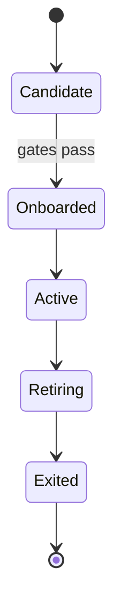
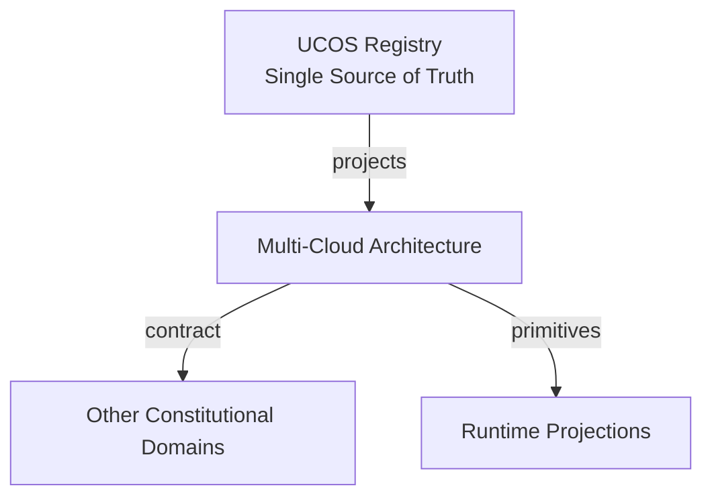
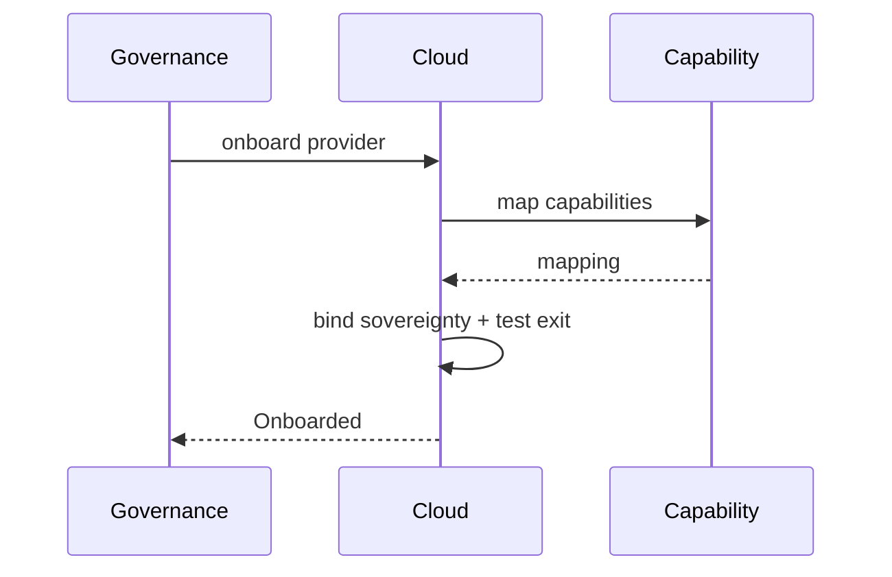
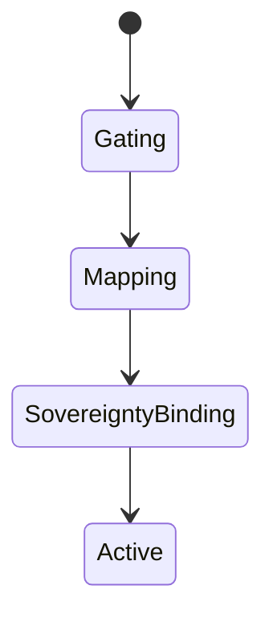
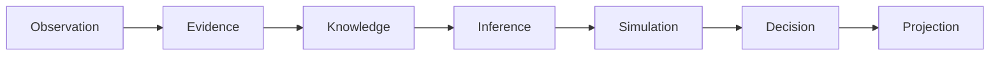
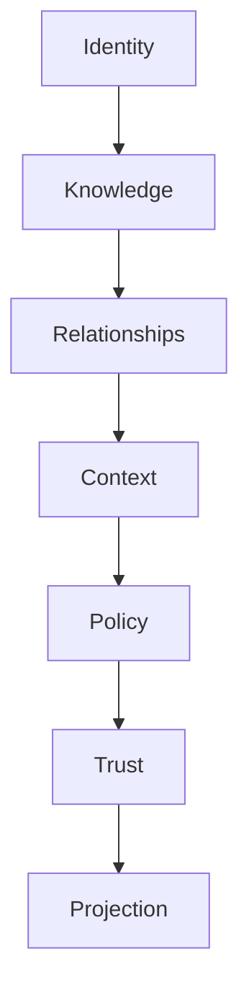

# UCOS-CLD-000001
# Multi-Cloud Architecture

**Version:** Ω∞.1  |  **Status:** Constitutional Artifact  |  **Authority:** UCOS Ω∞ Constitutional Authority
**Category:** Deployment  |  **Source of Truth:** `_registry/` (projected, never hand-authored)

> Constitutional notice: this document is a **projection**. Its truth lives in the registry. Editing this document directly violates Law 002 (Knowledge Once).

---

## 1. Executive Summary

**UCOS-CLD-000001 — Multi-Cloud Architecture**

This artifact is a constitutionally governed, implementation-ready specification projected from the _UCOS Registry_ single source of truth.
It conforms to the _Immutable Primitive Registry_ (27 frozen primitives) and the _Canonical Terminology Registry_ (31 governed terms).
It contains no hardcoded business, industry, currency, country, or commerce concepts. All such concepts are runtime projections.

---

## 2. Constitutional Purpose

To define the binding contract for **Multi-Cloud Architecture** such that:
- every concept it names has exactly one owner,
- every capability it exposes has exactly one boundary,
- every boundary is expressed as an explicit contract,
- every contract is enforceable by the Governance Constitution.

---

## 3. Scope

In scope: the primitives, contracts, schemas, events, and policies owned by **Multi-Cloud Architecture**.
In scope: the projection rules by which this domain exposes its truth to other domains.
In scope: the verification obligations this domain must satisfy before activation.

---

## 4. Out of Scope

Out of scope: any concept owned by another constitutional domain.
Out of scope: business, industry, commerce, country, currency, or language content (all projected).
Out of scope: mutation of another domain’s internal state.

---

## 5. Definitions

All terms in this artifact are used in their canonical sense as defined in the Canonical Terminology Registry.
Where a term appears, its `termId` is normative and its `prohibitedMeanings` are void.

---

## 6. Canonical Terminology

| Term | Canonical Definition | Owner | Prohibited Meanings |
|---|---|---|---|
| Existence | Anything that may exist. | Universal Existence Kernel | business meaning, commercial meaning, operational meaning |
| Entity | Technical representation of an Existence Object. | Identity Domain | existence itself |
| Knowledge | Interpreted information with evidence and meaning. | Knowledge Domain | data, information, evidence |
| Data | Raw observations. | Observation Domain | knowledge, meaning |
| Information | Organized data. | Observation Domain | knowledge |
| Evidence | Proof supporting an assertion. | Evidence Domain | knowledge, trust |
| Trust | Computed confidence in an assertion, derived from evidence. | Trust Domain | evidence, faith |
| Meaning | Semantic interpretation; higher-level understanding. | Semantic Domain | classification, taxonomy, ontology |
| Ontology | What exists. | Semantic Domain | taxonomy, classification |
| Taxonomy | How things are classified. | Semantic Domain | ontology, meaning |
| Classification | Assignment into taxonomy. | Semantic Domain | meaning |
| Relationship | Connection between objects. | Relationship Domain | causality |

---

## 7. Ownership Boundaries

Ownership is recorded in the _Domain Ownership Registry_.

---

## 8. Domain Responsibilities

See the Domain Ownership Registry for the authoritative responsibility list.

---

## 9. Domain Non-Responsibilities

See the Domain Ownership Registry.

---

## 10. Concepts

Multi-Cloud Architecture makes the platform cloud-agnostic by constitutional design. Clouds are registry-defined targets — capabilities are cloud-portable, sovereignty is per-target, and no vendor feature is ever a dependency.

---

## 11. Ontology

Cloud has a Provider (registry), a Capability mapping (platform capability → cloud service), a Sovereignty binding, and an Exit path. Every capability has at least one portable implementation and a documented exit.

---

## 12. Taxonomy

By portability: Portable / Adapter-wrapped / Vendor-specific (discouraged). By sovereignty: General / Sovereign-certified / Air-gapped. By usage: Primary / Failover / Burst / Niche.

---

## 13. Registries

This domain is registry-driven. Its registries are entries in the Universal Registry System:

```yaml
RegistryEntry:
  registryId: UCOS-REG-DOMAIN
  owner: Constitutional Authority
  law: Knowledge Once — each concept defined exactly once
```

---

## 14. Data Model

```yaml
CloudTarget:
  targetId: <Identity>
  provider: <registry id>
  capabilities: [{platformCapability, cloudService, portabilityClass}]
  sovereignty: <registry id>
  exitPath: <governed procedure>
  temporal: {onboardedAt}
```

---

## 15. Graph Model

(:Target)-[:PROVIDES]->(:CloudService); (:CloudService)-[:IMPLEMENTS]->(:Capability); (:Target)-[:SOVEREIGN_UNDER]->(:Jurisdiction); (:Target)-[:EXIT_VIA]->(:Procedure)

---

## 16. Schemas

```yaml
# Canonical projection schema for UCOS-CLD-000001
ucos_cld_000001:
  identity:      <Identity primitive>
  intent:        <Intent primitive>
  meaning:       <Meaning primitive>
  knowledge:     <Knowledge primitive>
  registry:      <Registry primitive>
  relationship:  <Relationship primitive>
  context:       <Context primitive>
  policy:        <Policy primitive>
  authority:     <Authority primitive>
  evidence:      <Evidence primitive>
  trust:         <Trust primitive>
  temporal:      <Time primitive>
  metadata:      <Metadata primitive>
```

---

## 17. Contracts

```yaml
DomainContract:
  domain: Multi-Cloud Architecture
  commands:   []   # registry-driven
  queries:    []   # registry-driven
  events:     []   # registry-driven
  policies:   []   # registry-driven
  permissions: []  # registry-driven
```

Contract law: domains never directly access another domain’s internal structures.

---

## 18. APIs

GET  /cloud.v1/targets,POST /cloud.v1/onboard,GET  /cloud.v1/mapping/{capabilityId},POST /cloud.v1.exit-plan

---

## 19. Events

CloudOnboarded,CloudRetired,CapabilityMapped,ExitExecuted,PortabilityViolation

---

## 20. Commands

cloud.onboard,cloud.retire,cloud.map,cloud.exit

---

## 21. Queries

cloud.targets,cloud.portability,cloud.sovereign,cloud.exitPaths

---

## 22. State Machines



---

## 23. Workflows

onboard under gates → map capabilities to services → bind sovereignty → keep exit path tested → retire cleanly

---

## 24. Policies

```yaml
Policy:
  identity: <Identity>
  conditions: []   # registry-driven
  actions:    []   # registry-driven
  priorities: []   # registry-driven
  exceptions: []   # registry-driven
```

All behavior derives from policy. Policy ≠ Rule: policy is behavioral governance; the rule is its executable projection.

---

## 25. Rules

```yaml
Rule:
  ruleId: <Identity>
  derivedFrom: <Policy identity>
  executable: true
  constraint: <registry expression>
```

---

## 26. Authorities

Cloud Authority (onboarding); exit requires governance approval and a tested path.

---

## 27. Permissions

cloud.onboard (cloud authority),cloud.map (capability owner),cloud.exit (governance)

---

## 28. Security Model

Zero Trust applies: no implicit trust between domains, services, agents, or tenants.
Every call is authenticated, authorized against Policy, and evidenced.
Cryptographic identity is issued by the Identity Domain; keys by the Key Management Architecture.

---

## 29. Privacy Model

Each target carries its own privacy gates — personal data only goes where its bindings permit.

---

## 30. Trust Model

Trust is computed, never assumed. Inputs: evidence, authority, consistency, provenance, confidence.
```yaml
Trust:
  evidenceScore: <0..1>
  authorityScore: <0..1>
  consistencyScore: <0..1>
  provenanceScore: <0..1>
  confidenceScore: <0..1>
```

---

## 31. Audit Model

Every capability mapping records portability class — vendor-specific dependencies are audited liabilities.

---

## 32. Observability Model

Every action emits: What happened? Why? Who authorized it? Which policy allowed it? What evidence supports it? What confidence exists? What alternatives were evaluated?
These are the seven Explainability questions and are mandatory event fields.

---

## 33. Digital Twin Model

Cloud twin monitors capability coverage and exit-path freshness across targets.

---

## 34. Agent Model

Cloud agent detects vendor lock-in drift and proposes adapter migration before exit becomes painful.

---

## 35. Runtime Model

Capability resolution goes through the registry mapping — code never names a cloud service directly.

---

## 36. Scaling Model

Burst across clouds is a governed strategy, not an emergency act.

---

## 37. Multi-Tenant Model

Tenants select targets under their sovereignty constraints; the platform enforces binding compatibility.

---

## 38. Geo-Distribution Model

Sovereign clouds are first-class targets with their own certification path.

---

## 39. Failure Model

Vendor-specific drift, unmapped capability, exit-path staleness, sovereignty conflict.

---

## 40. Recovery Model

Exit is a rehearsed procedure — a cloud loss is a failover to a mapped target, not a crisis.

---

## 41. Verification Model

Before activation, Multi-Cloud Architecture must pass identity, knowledge, relationship, context, policy, authority, trust, and reality integrity checks.
Verification is performed by the Formal Verification Architecture (UCOS-FML-000001).

---

## 42. Certification Model

Every capability must declare portability class; vendor-specific use requires governance waiver.

---

## 43. Migration Model

New providers are registry additions — onboarding never touches platform code.

---

## 44. Evolution Model

Evolution is governed and history-preserving. Primitives are frozen; extension occurs through registries, policies, capabilities, contexts, relationships, knowledge, agents, and projections — never through primitive expansion.

---

## 45. Implementation Blueprint

Build order for CLD: (1) define registry entries — this domain owns by portability: portable / adapter-wrapped / vendor-specific (discouraged) as registry truth, not code; (2) implement the contract surface first (cloud.onboard, cloud.retire, cloud.map) and validate against CLD boundaries; (3) event-source all state so history is reconstructable; (4) wire the enforcement points — authority check, policy guard, evidence binding, trace — in-line, with no bypass path; (5) add tests per the Testing Architecture, citing evidence per gate; (6) obtain Verification and Certification before activation. Acceptance: the Zero Partial and Law 001 audits pass, every action answers the seven explainability questions, and this domain mutates no other domain internals.

---

## 46. Reference Architecture Diagram



---

## 47. Sequence Diagrams



---

## 48. State Diagrams



---

## 49. Data Flow Diagrams



---

## 50. Dependency Maps



Forbidden: circular dependencies, mutual ownership, cross-domain state mutation.

---

## ∞

Constitutionally governed. Implementation ready. Universally extensible.