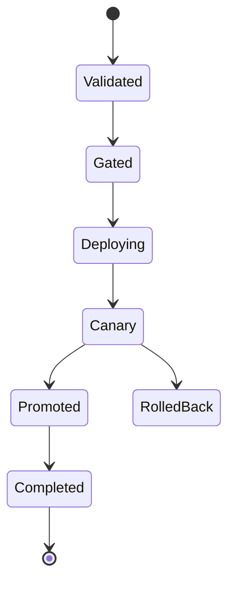
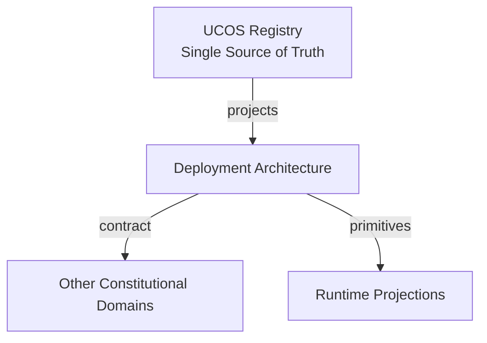
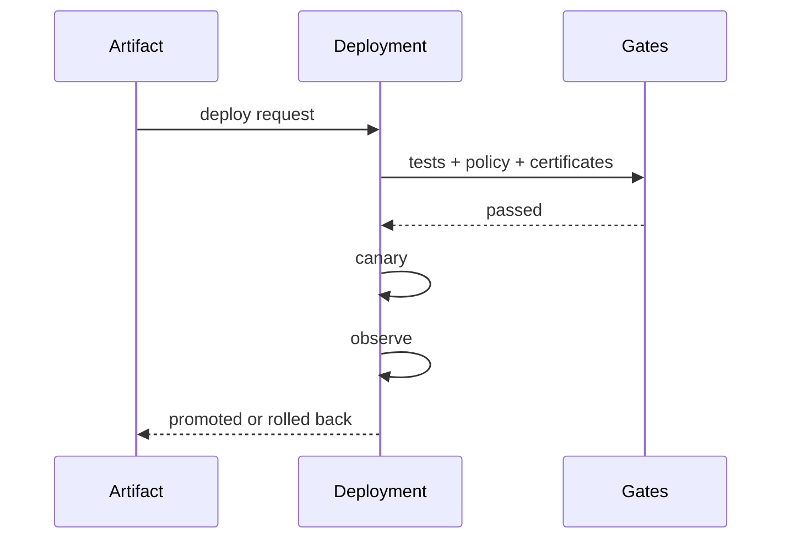
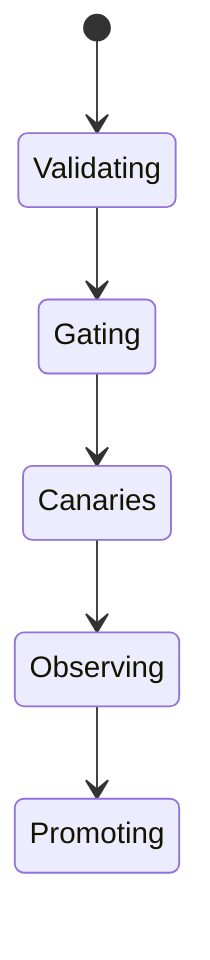
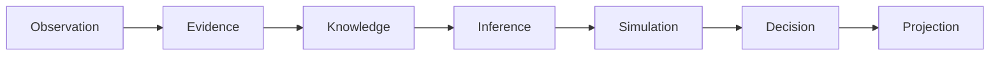
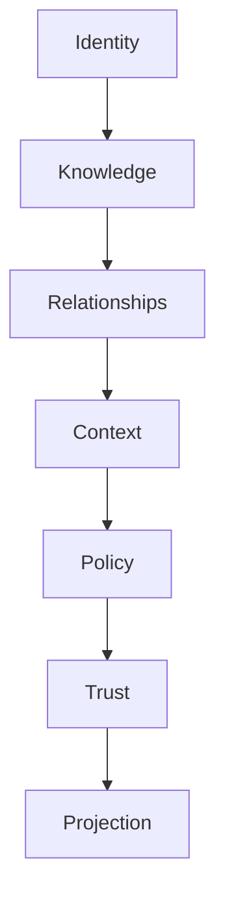

# UCOS-DEP-000001
# Deployment Architecture

**Version:** Ω∞.1  |  **Status:** Constitutional Artifact  |  **Authority:** UCOS Ω∞ Constitutional Authority
**Category:** Deployment  |  **Source of Truth:** `_registry/` (projected, never hand-authored)

> Constitutional notice: this document is a **projection**. Its truth lives in the registry. Editing this document directly violates Law 002 (Knowledge Once).

---

## 1. Executive Summary

**UCOS-DEP-000001 — Deployment Architecture**

This artifact is a constitutionally governed, implementation-ready specification projected from the _UCOS Registry_ single source of truth.
It conforms to the _Immutable Primitive Registry_ (27 frozen primitives) and the _Canonical Terminology Registry_ (31 governed terms).
It contains no hardcoded business, industry, currency, country, or commerce concepts. All such concepts are runtime projections.

---

## 2. Constitutional Purpose

To define the binding contract for **Deployment Architecture** such that:
- every concept it names has exactly one owner,
- every capability it exposes has exactly one boundary,
- every boundary is expressed as an explicit contract,
- every contract is enforceable by the Governance Constitution.

---

## 3. Scope

In scope: the primitives, contracts, schemas, events, and policies owned by **Deployment Architecture**.
In scope: the projection rules by which this domain exposes its truth to other domains.
In scope: the verification obligations this domain must satisfy before activation.

---

## 4. Out of Scope

Out of scope: any concept owned by another constitutional domain.
Out of scope: business, industry, commerce, country, currency, or language content (all projected).
Out of scope: mutation of another domain’s internal state.

---

## 5. Definitions

All terms in this artifact are used in their canonical sense as defined in the Canonical Terminology Registry.
Where a term appears, its `termId` is normative and its `prohibitedMeanings` are void.

---

## 6. Canonical Terminology

| Term | Canonical Definition | Owner | Prohibited Meanings |
|---|---|---|---|
| Existence | Anything that may exist. | Universal Existence Kernel | business meaning, commercial meaning, operational meaning |
| Entity | Technical representation of an Existence Object. | Identity Domain | existence itself |
| Knowledge | Interpreted information with evidence and meaning. | Knowledge Domain | data, information, evidence |
| Data | Raw observations. | Observation Domain | knowledge, meaning |
| Information | Organized data. | Observation Domain | knowledge |
| Evidence | Proof supporting an assertion. | Evidence Domain | knowledge, trust |
| Trust | Computed confidence in an assertion, derived from evidence. | Trust Domain | evidence, faith |
| Meaning | Semantic interpretation; higher-level understanding. | Semantic Domain | classification, taxonomy, ontology |
| Ontology | What exists. | Semantic Domain | taxonomy, classification |
| Taxonomy | How things are classified. | Semantic Domain | ontology, meaning |
| Classification | Assignment into taxonomy. | Semantic Domain | meaning |
| Relationship | Connection between objects. | Relationship Domain | causality |

---

## 7. Ownership Boundaries

Ownership is recorded in the _Domain Ownership Registry_.

---

## 8. Domain Responsibilities

See the Domain Ownership Registry for the authoritative responsibility list.

---

## 9. Domain Non-Responsibilities

See the Domain Ownership Registry.

---

## 10. Concepts

Deployment Architecture ships governed change. Every deployment is a versioned, policy-checked, reversible projection of the registry — the same machinery that evolves the platform is what deploys it.

---

## 11. Ontology

Deployment has an Artifact (content-addressed), a Target (registry-defined environment), a Policy (gate requirements), and a Rollback path. There is no out-of-band deployment path — every change is a governed event.

---

## 12. Taxonomy

By strategy: Canary / Blue-green / Rolling / Feature-flagged / Atomic. By target: Region / Cloud / Edge / On-prem / Sovereign. By risk: Standard / Gated / Frozen-window / Emergency.

---

## 13. Registries

This domain is registry-driven. Its registries are entries in the Universal Registry System:

```yaml
RegistryEntry:
  registryId: UCOS-REG-DOMAIN
  owner: Constitutional Authority
  law: Knowledge Once — each concept defined exactly once
```

---

## 14. Data Model

```yaml
Deployment:
  deploymentId: <Identity>
  artifact: <content-addressed ref>
  target: <registry environment>
  strategy: <registry id>
  policyVersion: <version>
  state: <registry state>
  rollbackTo: <Deployment|null>
  temporal: {at}
  evidence: [<Evidence>]
```

---

## 15. Graph Model

(:Deployment)-[:OF]->(:Artifact); (:Deployment)-[:TO]->(:Environment); (:Deployment)-[:GATED_BY]->(:Policy); (:Deployment)-[:ROLLS_BACK_TO]->(:Deployment)

---

## 16. Schemas

```yaml
# Canonical projection schema for UCOS-DEP-000001
ucos_dep_000001:
  identity:      <Identity primitive>
  intent:        <Intent primitive>
  meaning:       <Meaning primitive>
  knowledge:     <Knowledge primitive>
  registry:      <Registry primitive>
  relationship:  <Relationship primitive>
  context:       <Context primitive>
  policy:        <Policy primitive>
  authority:     <Authority primitive>
  evidence:      <Evidence primitive>
  trust:         <Trust primitive>
  temporal:      <Time primitive>
  metadata:      <Metadata primitive>
```

---

## 17. Contracts

```yaml
DomainContract:
  domain: Deployment Architecture
  commands:   []   # registry-driven
  queries:    []   # registry-driven
  events:     []   # registry-driven
  policies:   []   # registry-driven
  permissions: []  # registry-driven
```

Contract law: domains never directly access another domain’s internal structures.

---

## 18. APIs

POST /dep.v1.deploy,GET  /dep.v1/{id},POST /dep.v1.rollback,GET  /dep.v1.status/{id}

---

## 19. Events

DeploymentStarted,DeploymentPromoted,DeploymentCompleted,DeploymentRolledBack,DeploymentFrozen,GateFailed

---

## 20. Commands

dep.deploy,dep.promote,dep.rollback,dep.freeze

---

## 21. Queries

dep.history,dep.active,dep.byTarget,dep.blocked

---

## 22. State Machines



---

## 23. Workflows

validate artifact → evaluate gates (tests, policy, certificates) → deploy canary → observe → promote or rollback

---

## 24. Policies

```yaml
Policy:
  identity: <Identity>
  conditions: []   # registry-driven
  actions:    []   # registry-driven
  priorities: []   # registry-driven
  exceptions: []   # registry-driven
```

All behavior derives from policy. Policy ≠ Rule: policy is behavioral governance; the rule is its executable projection.

---

## 25. Rules

```yaml
Rule:
  ruleId: <Identity>
  derivedFrom: <Policy identity>
  executable: true
  constraint: <registry expression>
```

---

## 26. Authorities

Deployment Authority (promote); rollback is available to on-call under policy.

---

## 27. Permissions

dep.deploy (deployment authority),dep.rollback (on-call under policy),dep.read (any)

---

## 28. Security Model

Zero Trust applies: no implicit trust between domains, services, agents, or tenants.
Every call is authenticated, authorized against Policy, and evidenced.
Cryptographic identity is issued by the Identity Domain; keys by the Key Management Architecture.

---

## 29. Privacy Model

Deployments touching personal-data paths require privacy-gate pass — no shipping around privacy.

---

## 30. Trust Model

Trust is computed, never assumed. Inputs: evidence, authority, consistency, provenance, confidence.
```yaml
Trust:
  evidenceScore: <0..1>
  authorityScore: <0..1>
  consistencyScore: <0..1>
  provenanceScore: <0..1>
  confidenceScore: <0..1>
```

---

## 31. Audit Model

Every deployment and rollback is evidence-backed with gate results and artifact hashes.

---

## 32. Observability Model

Every action emits: What happened? Why? Who authorized it? Which policy allowed it? What evidence supports it? What confidence exists? What alternatives were evaluated?
These are the seven Explainability questions and are mandatory event fields.

---

## 33. Digital Twin Model

Deployment twin tracks failure rates per target and strategy, feeding reliability budgets.

---

## 34. Agent Model

Deployment agent observes canary metrics and auto-promotes or rolls back within policy bounds.

---

## 35. Runtime Model

Artifacts are immutable and content-addressed; the runtime loads by hash — 'what's running' is always answerable.

---

## 36. Scaling Model

Deployments fan out per target region under sovereignty constraints.

---

## 37. Multi-Tenant Model

Platform deployment is separate from tenant configuration; tenants evolve via registry, not deploys.

---

## 38. Geo-Distribution Model

Regional deployments respect sovereignty — some targets only accept sovereign artifacts.

---

## 39. Failure Model

Gate bypass, canary blindness, rollback failure, version skew across regions.

---

## 40. Recovery Model

Rollback is first-class and rehearsed; the artifact registry guarantees the previous version is retrievable.

---

## 41. Verification Model

Before activation, Deployment Architecture must pass identity, knowledge, relationship, context, policy, authority, trust, and reality integrity checks.
Verification is performed by the Formal Verification Architecture (UCOS-FML-000001).

---

## 42. Certification Model

Every gate must pass — a bypassed gate fails certification for the artifact and the process.

---

## 43. Migration Model

New strategies and targets are registry additions.

---

## 44. Evolution Model

Evolution is governed and history-preserving. Primitives are frozen; extension occurs through registries, policies, capabilities, contexts, relationships, knowledge, agents, and projections — never through primitive expansion.

---

## 45. Implementation Blueprint

Build order for DEP: (1) define registry entries — this domain owns by strategy: canary / blue-green / rolling / feature-flagged / atomic as registry truth, not code; (2) implement the contract surface first (dep.deploy, dep.promote, dep.rollback) and validate against DEP boundaries; (3) event-source all state so history is reconstructable; (4) wire the enforcement points — authority check, policy guard, evidence binding, trace — in-line, with no bypass path; (5) add tests per the Testing Architecture, citing evidence per gate; (6) obtain Verification and Certification before activation. Acceptance: the Zero Partial and Law 001 audits pass, every action answers the seven explainability questions, and this domain mutates no other domain internals.

---

## 46. Reference Architecture Diagram



---

## 47. Sequence Diagrams



---

## 48. State Diagrams



---

## 49. Data Flow Diagrams



---

## 50. Dependency Maps



Forbidden: circular dependencies, mutual ownership, cross-domain state mutation.

---

## ∞

Constitutionally governed. Implementation ready. Universally extensible.