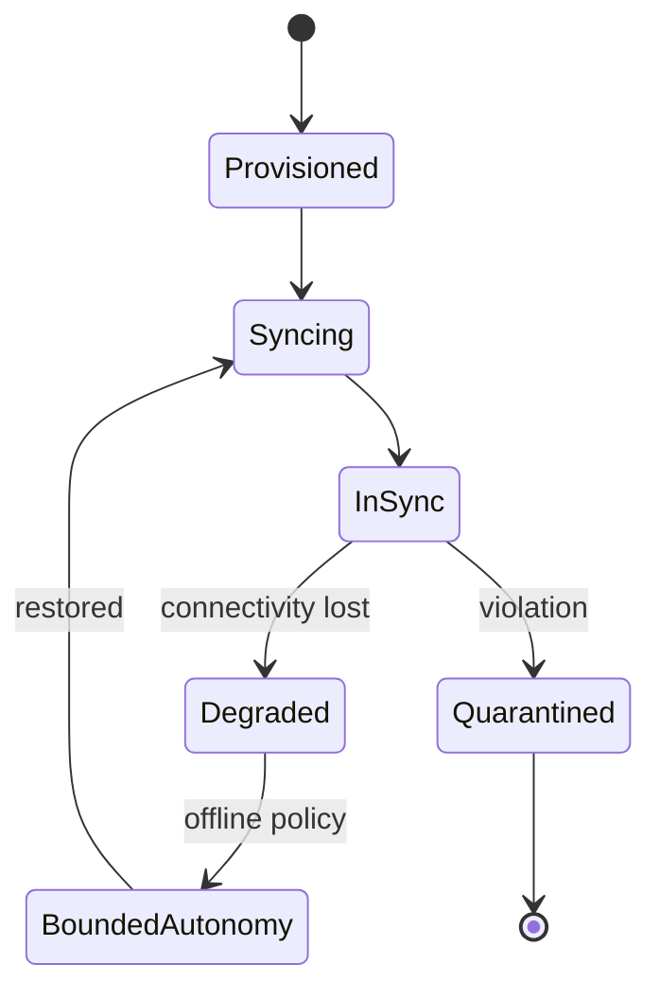
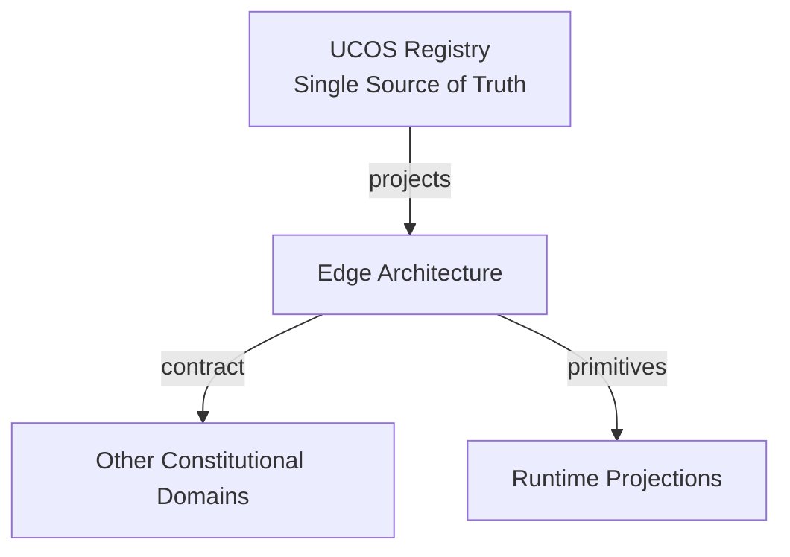
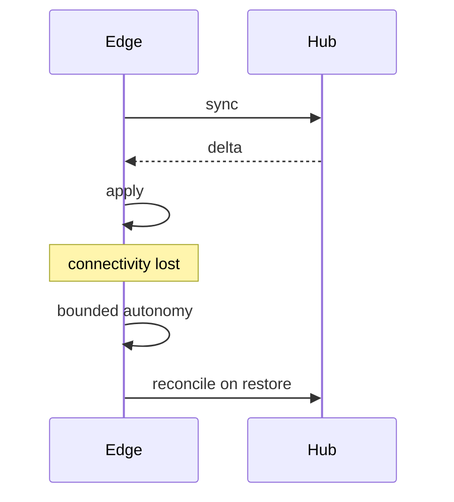
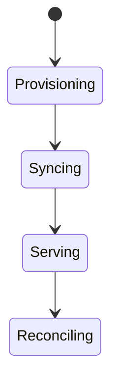
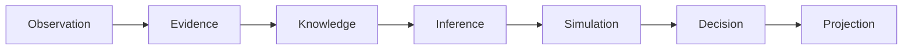
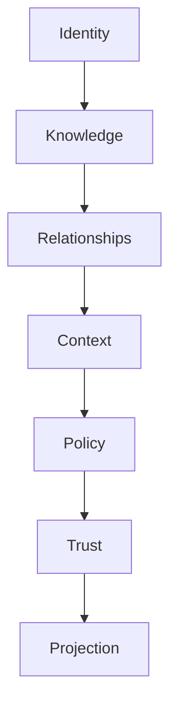

# UCOS-EDG-000001
# Edge Architecture

**Version:** Ω∞.1  |  **Status:** Constitutional Artifact  |  **Authority:** UCOS Ω∞ Constitutional Authority
**Category:** Deployment  |  **Source of Truth:** `_registry/` (projected, never hand-authored)

> Constitutional notice: this document is a **projection**. Its truth lives in the registry. Editing this document directly violates Law 002 (Knowledge Once).

---

## 1. Executive Summary

**UCOS-EDG-000001 — Edge Architecture**

This artifact is a constitutionally governed, implementation-ready specification projected from the _UCOS Registry_ single source of truth.
It conforms to the _Immutable Primitive Registry_ (27 frozen primitives) and the _Canonical Terminology Registry_ (31 governed terms).
It contains no hardcoded business, industry, currency, country, or commerce concepts. All such concepts are runtime projections.

---

## 2. Constitutional Purpose

To define the binding contract for **Edge Architecture** such that:
- every concept it names has exactly one owner,
- every capability it exposes has exactly one boundary,
- every boundary is expressed as an explicit contract,
- every contract is enforceable by the Governance Constitution.

---

## 3. Scope

In scope: the primitives, contracts, schemas, events, and policies owned by **Edge Architecture**.
In scope: the projection rules by which this domain exposes its truth to other domains.
In scope: the verification obligations this domain must satisfy before activation.

---

## 4. Out of Scope

Out of scope: any concept owned by another constitutional domain.
Out of scope: business, industry, commerce, country, currency, or language content (all projected).
Out of scope: mutation of another domain’s internal state.

---

## 5. Definitions

All terms in this artifact are used in their canonical sense as defined in the Canonical Terminology Registry.
Where a term appears, its `termId` is normative and its `prohibitedMeanings` are void.

---

## 6. Canonical Terminology

| Term | Canonical Definition | Owner | Prohibited Meanings |
|---|---|---|---|
| Existence | Anything that may exist. | Universal Existence Kernel | business meaning, commercial meaning, operational meaning |
| Entity | Technical representation of an Existence Object. | Identity Domain | existence itself |
| Knowledge | Interpreted information with evidence and meaning. | Knowledge Domain | data, information, evidence |
| Data | Raw observations. | Observation Domain | knowledge, meaning |
| Information | Organized data. | Observation Domain | knowledge |
| Evidence | Proof supporting an assertion. | Evidence Domain | knowledge, trust |
| Trust | Computed confidence in an assertion, derived from evidence. | Trust Domain | evidence, faith |
| Meaning | Semantic interpretation; higher-level understanding. | Semantic Domain | classification, taxonomy, ontology |
| Ontology | What exists. | Semantic Domain | taxonomy, classification |
| Taxonomy | How things are classified. | Semantic Domain | ontology, meaning |
| Classification | Assignment into taxonomy. | Semantic Domain | meaning |
| Relationship | Connection between objects. | Relationship Domain | causality |

---

## 7. Ownership Boundaries

Ownership is recorded in the _Domain Ownership Registry_.

---

## 8. Domain Responsibilities

See the Domain Ownership Registry for the authoritative responsibility list.

---

## 9. Domain Non-Responsibilities

See the Domain Ownership Registry.

---

## 10. Concepts

Edge Architecture runs governed computation where latency, sovereignty, or connectivity demand it. The edge is not a lesser platform — it is the same constitution, projected smaller, with bounded autonomy.

---

## 11. Ontology

Edge has a Node (registry), a Capability subset (declared), a Sync model (eventually consistent with hub), an Autonomy bound (what it may decide offline), and a Sovereignty binding (local jurisdiction).

---

## 12. Taxonomy

By form: Device / Appliance / Micro-datacenter / Regional-edge / On-prem. By connectivity: Always-on / Intermittent / Air-gapped. By autonomy: Full-offline / Bounded-offline / Online-only.

---

## 13. Registries

This domain is registry-driven. Its registries are entries in the Universal Registry System:

```yaml
RegistryEntry:
  registryId: UCOS-REG-DOMAIN
  owner: Constitutional Authority
  law: Knowledge Once — each concept defined exactly once
```

---

## 14. Data Model

```yaml
EdgeNode:
  nodeId: <Identity>
  form: <registry id>
  capabilities: [<registry capability>]
  syncModel: <registry id>
  autonomyBound: <Policy>
  sovereignty: <jurisdiction>
  temporal: {provisionedAt}
  state: <Provisioned|Syncing|Degraded|Quarantined>
```

---

## 15. Graph Model

(:Node)-[:RUNS]->(:Capability); (:Node)-[:SYNCS_WITH]->(:Hub); (:Node)-[:BOUNDED_BY]->(:Policy); (:Node)-[:SOVEREIGN_UNDER]->(:Jurisdiction)

---

## 16. Schemas

```yaml
# Canonical projection schema for UCOS-EDG-000001
ucos_edg_000001:
  identity:      <Identity primitive>
  intent:        <Intent primitive>
  meaning:       <Meaning primitive>
  knowledge:     <Knowledge primitive>
  registry:      <Registry primitive>
  relationship:  <Relationship primitive>
  context:       <Context primitive>
  policy:        <Policy primitive>
  authority:     <Authority primitive>
  evidence:      <Evidence primitive>
  trust:         <Trust primitive>
  temporal:      <Time primitive>
  metadata:      <Metadata primitive>
```

---

## 17. Contracts

```yaml
DomainContract:
  domain: Edge Architecture
  commands:   []   # registry-driven
  queries:    []   # registry-driven
  events:     []   # registry-driven
  policies:   []   # registry-driven
  permissions: []  # registry-driven
```

Contract law: domains never directly access another domain’s internal structures.

---

## 18. APIs

POST /edge.v1.provision,GET  /edge.v1/{id},POST /edge.v1.sync,POST /edge.v1.quarantine

---

## 19. Events

EdgeProvisioned,EdgeSynced,EdgeDegraded,EdgeQuarantined,EdgeDecommissioned,AutonomyExceeded

---

## 20. Commands

edge.provision,edge.sync,edge.quarantine,edge.decommission

---

## 21. Queries

edge.nodes,edge.capabilities,edge.lag,edge.degraded

---

## 22. State Machines



---

## 23. Workflows

provision with capability subset → sync under model → operate with bounded autonomy when offline → reconcile on reconnect

---

## 24. Policies

```yaml
Policy:
  identity: <Identity>
  conditions: []   # registry-driven
  actions:    []   # registry-driven
  priorities: []   # registry-driven
  exceptions: []   # registry-driven
```

All behavior derives from policy. Policy ≠ Rule: policy is behavioral governance; the rule is its executable projection.

---

## 25. Rules

```yaml
Rule:
  ruleId: <Identity>
  derivedFrom: <Policy identity>
  executable: true
  constraint: <registry expression>
```

---

## 26. Authorities

Edge Authority (provisioning); local jurisdiction binds sovereignty.

---

## 27. Permissions

edge.provision (edge authority),edge.sync (system),edge.quarantine (security authority)

---

## 28. Security Model

Zero Trust applies: no implicit trust between domains, services, agents, or tenants.
Every call is authenticated, authorized against Policy, and evidenced.
Cryptographic identity is issued by the Identity Domain; keys by the Key Management Architecture.

---

## 29. Privacy Model

Edge personal data is minimized and locally sovereign — the edge holds only what its jurisdiction permits.

---

## 30. Trust Model

Trust is computed, never assumed. Inputs: evidence, authority, consistency, provenance, confidence.
```yaml
Trust:
  evidenceScore: <0..1>
  authorityScore: <0..1>
  consistencyScore: <0..1>
  provenanceScore: <0..1>
  confidenceScore: <0..1>
```

---

## 31. Audit Model

Every offline decision is recorded locally and reconciled on sync — the edge is never an audit gap.

---

## 32. Observability Model

Every action emits: What happened? Why? Who authorized it? Which policy allowed it? What evidence supports it? What confidence exists? What alternatives were evaluated?
These are the seven Explainability questions and are mandatory event fields.

---

## 33. Digital Twin Model

Edge twin monitors sync lag and autonomy-bound breaches across the fleet.

---

## 34. Agent Model

Edge agent detects autonomy-bound approaches and escalates before offline decisions exceed bounds.

---

## 35. Runtime Model

Offline operation is bounded by the policy envelope — the edge cannot exceed what its envelope permits, even disconnected.

---

## 36. Scaling Model

Edge nodes scale by the thousands; sync is sharded per node with backpressure.

---

## 37. Multi-Tenant Model

Edge nodes serve tenants under their sovereignty bindings; a node's jurisdiction limits its tenants.

---

## 38. Geo-Distribution Model

The edge IS the geo answer for sovereignty — data stays where the node physically sits.

---

## 39. Failure Model

Split-brain on reconnect, sync conflict, autonomy exceedance, orphaned node.

---

## 40. Recovery Model

Reconciliation is governed: conflicts resolve by policy (never last-writer-wins for governed state); orphans are reaped or adopted.

---

## 41. Verification Model

Before activation, Edge Architecture must pass identity, knowledge, relationship, context, policy, authority, trust, and reality integrity checks.
Verification is performed by the Formal Verification Architecture (UCOS-FML-000001).

---

## 42. Certification Model

Every offline-capable edge must prove its autonomy bound is enforced — offline ≠ ungoverned.

---

## 43. Migration Model

New edge forms are registry additions.

---

## 44. Evolution Model

Evolution is governed and history-preserving. Primitives are frozen; extension occurs through registries, policies, capabilities, contexts, relationships, knowledge, agents, and projections — never through primitive expansion.

---

## 45. Implementation Blueprint

Build order for EDG: (1) define registry entries — this domain owns by form: device / appliance / micro-datacenter / regional-edge / on-prem as registry truth, not code; (2) implement the contract surface first (edge.provision, edge.sync, edge.quarantine) and validate against EDG boundaries; (3) event-source all state so history is reconstructable; (4) wire the enforcement points — authority check, policy guard, evidence binding, trace — in-line, with no bypass path; (5) add tests per the Testing Architecture, citing evidence per gate; (6) obtain Verification and Certification before activation. Acceptance: the Zero Partial and Law 001 audits pass, every action answers the seven explainability questions, and this domain mutates no other domain internals.

---

## 46. Reference Architecture Diagram



---

## 47. Sequence Diagrams



---

## 48. State Diagrams



---

## 49. Data Flow Diagrams



---

## 50. Dependency Maps



Forbidden: circular dependencies, mutual ownership, cross-domain state mutation.

---

## ∞

Constitutionally governed. Implementation ready. Universally extensible.