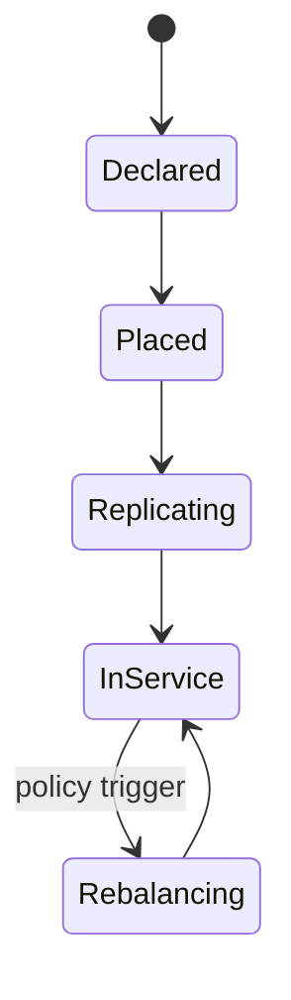
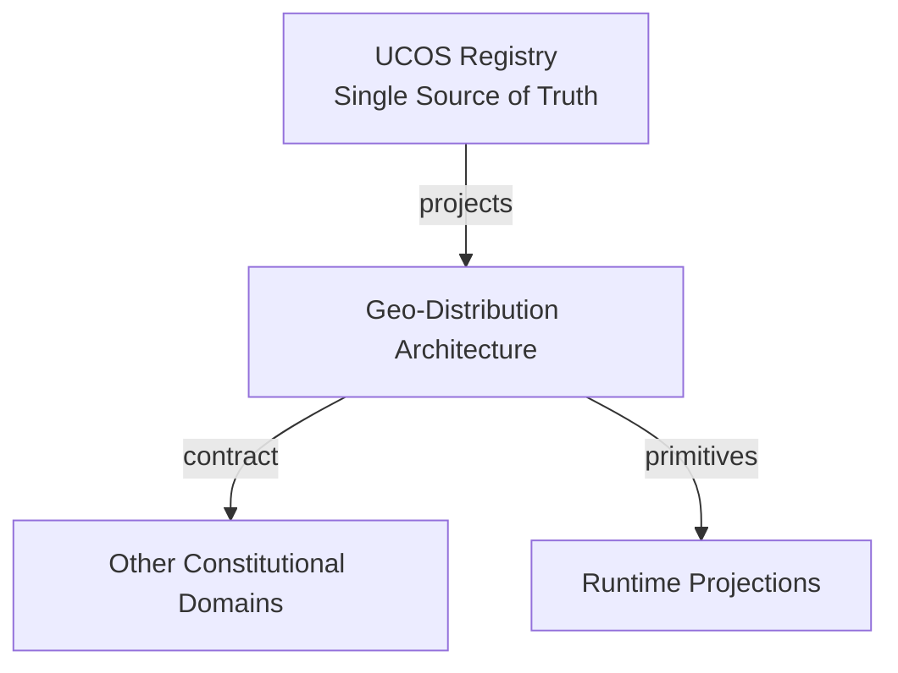
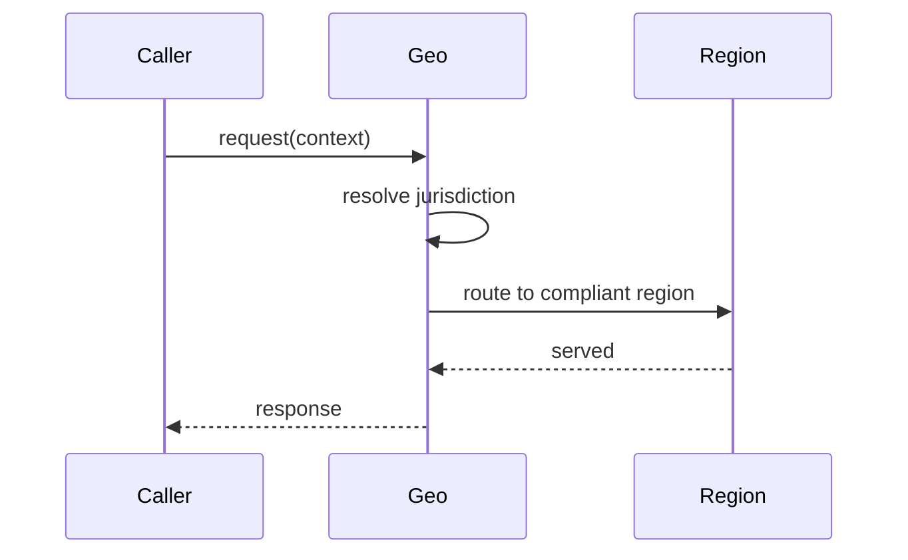
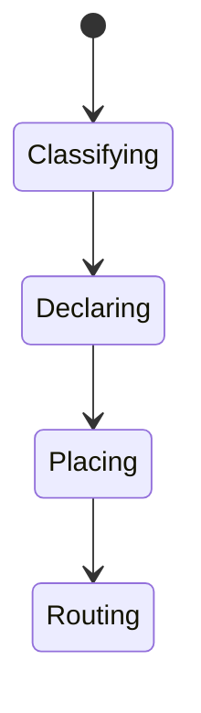
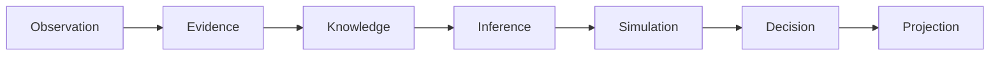
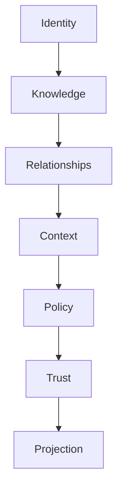

# UCOS-GEO-000001
# Geo-Distribution Architecture

**Version:** Ω∞.1  |  **Status:** Constitutional Artifact  |  **Authority:** UCOS Ω∞ Constitutional Authority
**Category:** Deployment  |  **Source of Truth:** `_registry/` (projected, never hand-authored)

> Constitutional notice: this document is a **projection**. Its truth lives in the registry. Editing this document directly violates Law 002 (Knowledge Once).

---

## 1. Executive Summary

**UCOS-GEO-000001 — Geo-Distribution Architecture**

This artifact is a constitutionally governed, implementation-ready specification projected from the _UCOS Registry_ single source of truth.
It conforms to the _Immutable Primitive Registry_ (27 frozen primitives) and the _Canonical Terminology Registry_ (31 governed terms).
It contains no hardcoded business, industry, currency, country, or commerce concepts. All such concepts are runtime projections.

---

## 2. Constitutional Purpose

To define the binding contract for **Geo-Distribution Architecture** such that:
- every concept it names has exactly one owner,
- every capability it exposes has exactly one boundary,
- every boundary is expressed as an explicit contract,
- every contract is enforceable by the Governance Constitution.

---

## 3. Scope

In scope: the primitives, contracts, schemas, events, and policies owned by **Geo-Distribution Architecture**.
In scope: the projection rules by which this domain exposes its truth to other domains.
In scope: the verification obligations this domain must satisfy before activation.

---

## 4. Out of Scope

Out of scope: any concept owned by another constitutional domain.
Out of scope: business, industry, commerce, country, currency, or language content (all projected).
Out of scope: mutation of another domain’s internal state.

---

## 5. Definitions

All terms in this artifact are used in their canonical sense as defined in the Canonical Terminology Registry.
Where a term appears, its `termId` is normative and its `prohibitedMeanings` are void.

---

## 6. Canonical Terminology

| Term | Canonical Definition | Owner | Prohibited Meanings |
|---|---|---|---|
| Existence | Anything that may exist. | Universal Existence Kernel | business meaning, commercial meaning, operational meaning |
| Entity | Technical representation of an Existence Object. | Identity Domain | existence itself |
| Knowledge | Interpreted information with evidence and meaning. | Knowledge Domain | data, information, evidence |
| Data | Raw observations. | Observation Domain | knowledge, meaning |
| Information | Organized data. | Observation Domain | knowledge |
| Evidence | Proof supporting an assertion. | Evidence Domain | knowledge, trust |
| Trust | Computed confidence in an assertion, derived from evidence. | Trust Domain | evidence, faith |
| Meaning | Semantic interpretation; higher-level understanding. | Semantic Domain | classification, taxonomy, ontology |
| Ontology | What exists. | Semantic Domain | taxonomy, classification |
| Taxonomy | How things are classified. | Semantic Domain | ontology, meaning |
| Classification | Assignment into taxonomy. | Semantic Domain | meaning |
| Relationship | Connection between objects. | Relationship Domain | causality |

---

## 7. Ownership Boundaries

Ownership is recorded in the _Domain Ownership Registry_.

---

## 8. Domain Responsibilities

See the Domain Ownership Registry for the authoritative responsibility list.

---

## 9. Domain Non-Responsibilities

See the Domain Ownership Registry.

---

## 10. Concepts

Geo-Distribution Architecture places data and computation where law, latency, and resilience demand — by registry, not by accident. Distribution is a governed projection of sovereignty and performance requirements.

---

## 11. Ontology

Geo has Regions (registry), Placement policies (per data class), Replication topology (sovereignty-constrained), and Routing (context-aware). The same primitive may legitimately exist in many places under many jurisdictions.

---

## 12. Taxonomy

By driver: Latency / Sovereignty / Resilience / Cost. By topology: Primary-standby / Multi-master / Sovereign-isolated / Edge-augmented. By consistency: Strong-per-region / Eventual / Causal.

---

## 13. Registries

This domain is registry-driven. Its registries are entries in the Universal Registry System:

```yaml
RegistryEntry:
  registryId: UCOS-REG-DOMAIN
  owner: Constitutional Authority
  law: Knowledge Once — each concept defined exactly once
```

---

## 14. Data Model

```yaml
GeoPlacement:
  placementId: <Identity>
  dataClass: <registry id>
  primaryRegion: <registry region>
  replicaRegions: [<region with policy>]
  consistencyModel: <registry id>
  driver: <Latency|Sovereignty|Resilience|Cost>
  temporal: {effectiveFrom}
```

---

## 15. Graph Model

(:Placement)-[:PLACES]->(:DataClass); (:Placement)-[:PRIMARY_IN]->(:Region); (:Placement)-[:REPLICATED_IN]->(:Region); (:Placement)-[:CONSTRAINED_BY]->(:Policy)

---

## 16. Schemas

```yaml
# Canonical projection schema for UCOS-GEO-000001
ucos_geo_000001:
  identity:      <Identity primitive>
  intent:        <Intent primitive>
  meaning:       <Meaning primitive>
  knowledge:     <Knowledge primitive>
  registry:      <Registry primitive>
  relationship:  <Relationship primitive>
  context:       <Context primitive>
  policy:        <Policy primitive>
  authority:     <Authority primitive>
  evidence:      <Evidence primitive>
  trust:         <Trust primitive>
  temporal:      <Time primitive>
  metadata:      <Metadata primitive>
```

---

## 17. Contracts

```yaml
DomainContract:
  domain: Geo-Distribution Architecture
  commands:   []   # registry-driven
  queries:    []   # registry-driven
  events:     []   # registry-driven
  policies:   []   # registry-driven
  permissions: []  # registry-driven
```

Contract law: domains never directly access another domain’s internal structures.

---

## 18. APIs

POST /geo.v1.place,GET  /geo.v1/{id},POST /geo.v1.route,GET  /geo.v1.placement/{dataClass}

---

## 19. Events

PlacementDeclared,GeoRebalanced,TrafficRouted,RelocationCompleted,ResidencyDrift

---

## 20. Commands

geo.place,geo.rebalance,geo.route,geo.relocate

---

## 21. Queries

geo.placements,geo.regions,geo.residency,geo.topology

---

## 22. State Machines



---

## 23. Workflows

classify data → declare placement under sovereignty → replicate per policy → route by context → rebalance on drift

---

## 24. Policies

```yaml
Policy:
  identity: <Identity>
  conditions: []   # registry-driven
  actions:    []   # registry-driven
  priorities: []   # registry-driven
  exceptions: []   # registry-driven
```

All behavior derives from policy. Policy ≠ Rule: policy is behavioral governance; the rule is its executable projection.

---

## 25. Rules

```yaml
Rule:
  ruleId: <Identity>
  derivedFrom: <Policy identity>
  executable: true
  constraint: <registry expression>
```

---

## 26. Authorities

Geo Authority (placement); jurisdiction authority constrains what may live where.

---

## 27. Permissions

geo.place (geo authority + jurisdiction pass),geo.route (system),geo.read (governance)

---

## 28. Security Model

Zero Trust applies: no implicit trust between domains, services, agents, or tenants.
Every call is authenticated, authorized against Policy, and evidenced.
Cryptographic identity is issued by the Identity Domain; keys by the Key Management Architecture.

---

## 29. Privacy Model

Placement is the physical guarantee behind privacy law — residency makes rights enforceable.

---

## 30. Trust Model

Trust is computed, never assumed. Inputs: evidence, authority, consistency, provenance, confidence.
```yaml
Trust:
  evidenceScore: <0..1>
  authorityScore: <0..1>
  consistencyScore: <0..1>
  provenanceScore: <0..1>
  confidenceScore: <0..1>
```

---

## 31. Audit Model

Every placement and relocation logs class, regions, and policy — regulator-queryable.

---

## 32. Observability Model

Every action emits: What happened? Why? Who authorized it? Which policy allowed it? What evidence supports it? What confidence exists? What alternatives were evaluated?
These are the seven Explainability questions and are mandatory event fields.

---

## 33. Digital Twin Model

Geo twin monitors actual vs declared placement continuously — drift is an alert, not a surprise.

---

## 34. Agent Model

Geo agent detects residency drift and proposes corrections before regulators do.

---

## 35. Runtime Model

Routing is context-aware: the request's jurisdiction participates in choosing the serving region.

---

## 36. Scaling Model

Regions scale independently; rebalancing is throttled to avoid thundering herds.

---

## 37. Multi-Tenant Model

Tenant placements bind to their jurisdictions; shared regions respect every tenant's constraints.

---

## 38. Geo-Distribution Model

This IS the geo architecture — distribution is governed, declared, and verifiable.

---

## 39. Failure Model

Residency violation, replication lag, routing error, rebalance storm.

---

## 40. Recovery Model

Drift triggers governed migration back into compliance with full audit.

---

## 41. Verification Model

Before activation, Geo-Distribution Architecture must pass identity, knowledge, relationship, context, policy, authority, trust, and reality integrity checks.
Verification is performed by the Formal Verification Architecture (UCOS-FML-000001).

---

## 42. Certification Model

Every data class must have a declared placement — undeclared data has no region and cannot be written.

---

## 43. Migration Model

New regions are registry additions.

---

## 44. Evolution Model

Evolution is governed and history-preserving. Primitives are frozen; extension occurs through registries, policies, capabilities, contexts, relationships, knowledge, agents, and projections — never through primitive expansion.

---

## 45. Implementation Blueprint

Build order for GEO: (1) define registry entries — this domain owns by driver: latency / sovereignty / resilience / cost as registry truth, not code; (2) implement the contract surface first (geo.place, geo.rebalance, geo.route) and validate against GEO boundaries; (3) event-source all state so history is reconstructable; (4) wire the enforcement points — authority check, policy guard, evidence binding, trace — in-line, with no bypass path; (5) add tests per the Testing Architecture, citing evidence per gate; (6) obtain Verification and Certification before activation. Acceptance: the Zero Partial and Law 001 audits pass, every action answers the seven explainability questions, and this domain mutates no other domain internals.

---

## 46. Reference Architecture Diagram



---

## 47. Sequence Diagrams



---

## 48. State Diagrams



---

## 49. Data Flow Diagrams



---

## 50. Dependency Maps



Forbidden: circular dependencies, mutual ownership, cross-domain state mutation.

---

## ∞

Constitutionally governed. Implementation ready. Universally extensible.