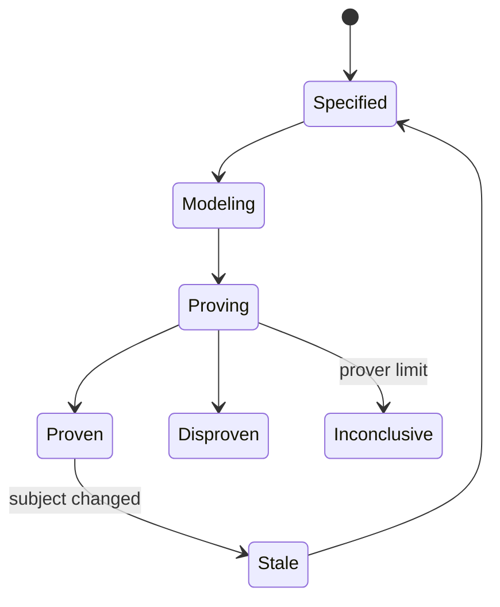
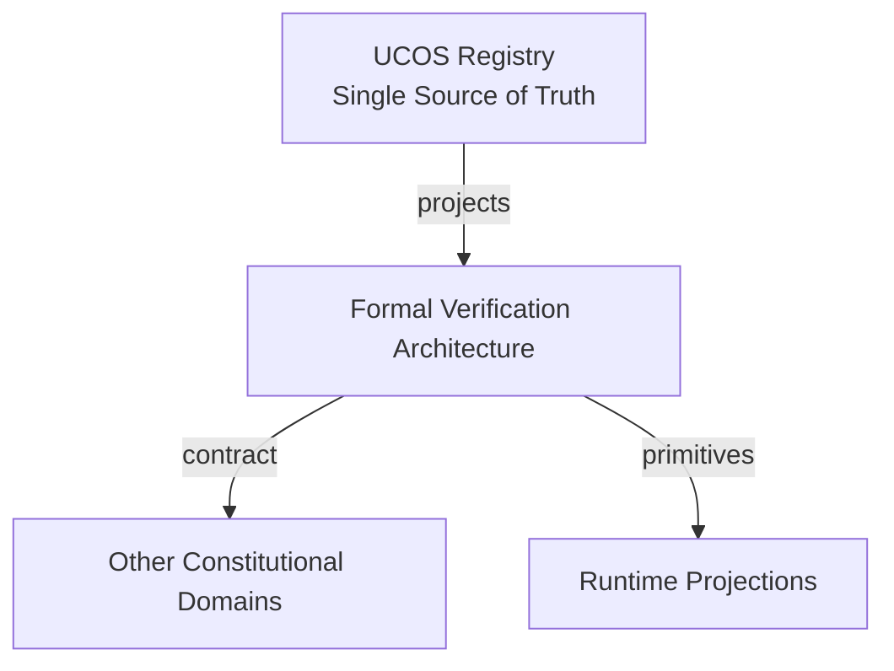
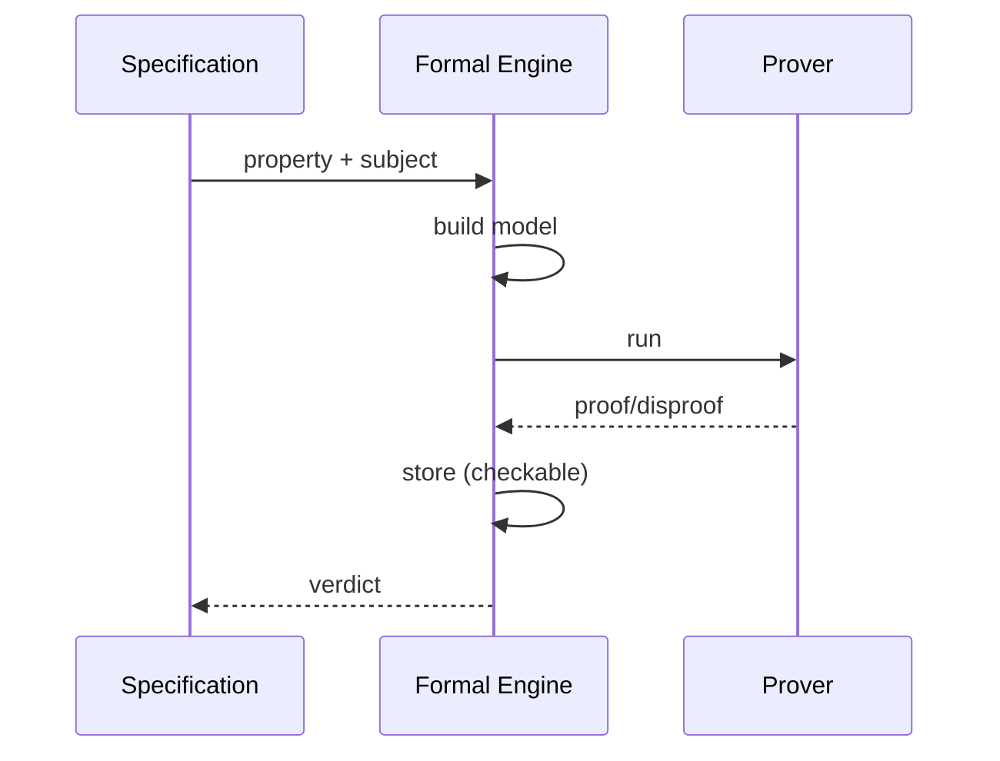
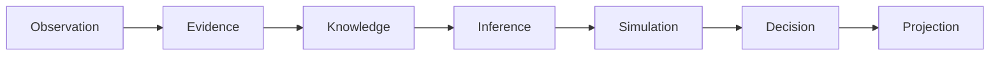
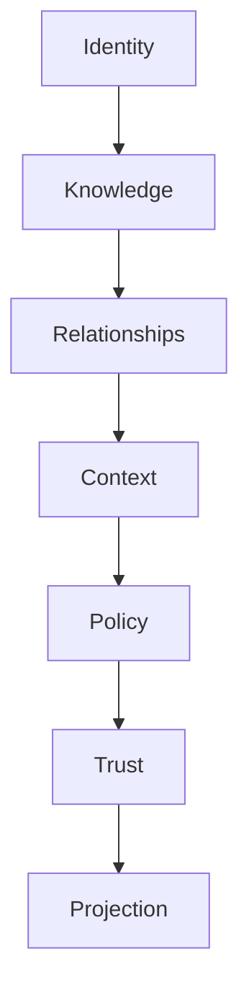

# UCOS-FML-000001
# Formal Verification Architecture

**Version:** Ω∞.1  |  **Status:** Constitutional Artifact  |  **Authority:** UCOS Ω∞ Constitutional Authority
**Category:** Quality  |  **Source of Truth:** `_registry/` (projected, never hand-authored)

> Constitutional notice: this document is a **projection**. Its truth lives in the registry. Editing this document directly violates Law 002 (Knowledge Once).

---

## 1. Executive Summary

**UCOS-FML-000001 — Formal Verification Architecture**

This artifact is a constitutionally governed, implementation-ready specification projected from the _UCOS Registry_ single source of truth.
It conforms to the _Immutable Primitive Registry_ (27 frozen primitives) and the _Canonical Terminology Registry_ (31 governed terms).
It contains no hardcoded business, industry, currency, country, or commerce concepts. All such concepts are runtime projections.

---

## 2. Constitutional Purpose

To define the binding contract for **Formal Verification Architecture** such that:
- every concept it names has exactly one owner,
- every capability it exposes has exactly one boundary,
- every boundary is expressed as an explicit contract,
- every contract is enforceable by the Governance Constitution.

---

## 3. Scope

In scope: the primitives, contracts, schemas, events, and policies owned by **Formal Verification Architecture**.
In scope: the projection rules by which this domain exposes its truth to other domains.
In scope: the verification obligations this domain must satisfy before activation.

---

## 4. Out of Scope

Out of scope: any concept owned by another constitutional domain.
Out of scope: business, industry, commerce, country, currency, or language content (all projected).
Out of scope: mutation of another domain’s internal state.

---

## 5. Definitions

All terms in this artifact are used in their canonical sense as defined in the Canonical Terminology Registry.
Where a term appears, its `termId` is normative and its `prohibitedMeanings` are void.

---

## 6. Canonical Terminology

| Term | Canonical Definition | Owner | Prohibited Meanings |
|---|---|---|---|
| Existence | Anything that may exist. | Universal Existence Kernel | business meaning, commercial meaning, operational meaning |
| Entity | Technical representation of an Existence Object. | Identity Domain | existence itself |
| Knowledge | Interpreted information with evidence and meaning. | Knowledge Domain | data, information, evidence |
| Data | Raw observations. | Observation Domain | knowledge, meaning |
| Information | Organized data. | Observation Domain | knowledge |
| Evidence | Proof supporting an assertion. | Evidence Domain | knowledge, trust |
| Trust | Computed confidence in an assertion, derived from evidence. | Trust Domain | evidence, faith |
| Meaning | Semantic interpretation; higher-level understanding. | Semantic Domain | classification, taxonomy, ontology |
| Ontology | What exists. | Semantic Domain | taxonomy, classification |
| Taxonomy | How things are classified. | Semantic Domain | ontology, meaning |
| Classification | Assignment into taxonomy. | Semantic Domain | meaning |
| Relationship | Connection between objects. | Relationship Domain | causality |

---

## 7. Ownership Boundaries

Ownership is recorded in the _Domain Ownership Registry_.

---

## 8. Domain Responsibilities

See the Domain Ownership Registry for the authoritative responsibility list.

---

## 9. Domain Non-Responsibilities

See the Domain Ownership Registry.

---

## 10. Concepts

Formal Verification Architecture proves critical properties mathematically — not by testing, but by construction. The constitution's most absolute claims (no bypass, no leak, no deadlock) are formal theorems where the cost is justified.

---

## 11. Ontology

Formal Verification has a Specification (property in a registry logic), a Model (system abstraction), a Prover (registry tool), and a Proof (machine-checkable artifact). Proofs are content-addressed and replayable.

---

## 12. Taxonomy

By technique: Model-checking / Theorem-proving / Static-analysis / Type-theory / Refinement. By property: Safety / Liveness / Security / Privacy / Termination / Determinism. By scope: Function / Module / Protocol / System.

---

## 13. Registries

This domain is registry-driven. Its registries are entries in the Universal Registry System:

```yaml
RegistryEntry:
  registryId: UCOS-REG-DOMAIN
  owner: Constitutional Authority
  law: Knowledge Once — each concept defined exactly once
```

---

## 14. Data Model

```yaml
FormalProof:
  proofId: <Identity>
  specification: <registry spec>
  subject: <artifact ref>
  technique: <registry id>
  prover: <registry tool + version>
  artifact: <content-addressed proof>
  verdict: <Proven|Disproven|Inconclusive>
  temporal: {at, validFor: <subject version>]
```

---

## 15. Graph Model

(:Proof)-[:PROVES]->(:Specification); (:Proof)-[:ABOUT]->(:Artifact); (:Proof)-[:USING]->(:Prover); (:Specification)-[:PROPERTY]->(:Property)

---

## 16. Schemas

```yaml
# Canonical projection schema for UCOS-FML-000001
ucos_fml_000001:
  identity:      <Identity primitive>
  intent:        <Intent primitive>
  meaning:       <Meaning primitive>
  knowledge:     <Knowledge primitive>
  registry:      <Registry primitive>
  relationship:  <Relationship primitive>
  context:       <Context primitive>
  policy:        <Policy primitive>
  authority:     <Authority primitive>
  evidence:      <Evidence primitive>
  trust:         <Trust primitive>
  temporal:      <Time primitive>
  metadata:      <Metadata primitive>
```

---

## 17. Contracts

```yaml
DomainContract:
  domain: Formal Verification Architecture
  commands:   []   # registry-driven
  queries:    []   # registry-driven
  events:     []   # registry-driven
  policies:   []   # registry-driven
  permissions: []  # registry-driven
```

Contract law: domains never directly access another domain’s internal structures.

---

## 18. APIs

POST /fml.v1.prove,GET  /fml.v1/{id},POST /fml.v1.check,GET  /fml.v1.bySubject/{subjectId}

---

## 19. Events

ProofCompleted,PropertyProven,PropertyDisproven,ProofStale,ProofChecked

---

## 20. Commands

fml.prove,fml.check,fml.disprove,fml.refresh

---

## 21. Queries

fml.proofs,fml.proven,fml.disproven,fml.coverage

---

## 22. State Machines



---

## 23. Workflows

write specification in registry logic → build model → run prover → store machine-checkable proof → invalidate on subject change

---

## 24. Policies

```yaml
Policy:
  identity: <Identity>
  conditions: []   # registry-driven
  actions:    []   # registry-driven
  priorities: []   # registry-driven
  exceptions: []   # registry-driven
```

All behavior derives from policy. Policy ≠ Rule: policy is behavioral governance; the rule is its executable projection.

---

## 25. Rules

```yaml
Rule:
  ruleId: <Identity>
  derivedFrom: <Policy identity>
  executable: true
  constraint: <registry expression>
```

---

## 26. Authorities

Quality Authority (method); disproofs are critical governance events with mandatory remediation.

---

## 27. Permissions

fml.prove (formal authority),fml.check (any),fml.read (any)

---

## 28. Security Model

Zero Trust applies: no implicit trust between domains, services, agents, or tenants.
Every call is authenticated, authorized against Policy, and evidenced.
Cryptographic identity is issued by the Identity Domain; keys by the Key Management Architecture.

---

## 29. Privacy Model

Privacy properties (no-leak, minimization) are formally specified where personal data flows — privacy by proof, not promise.

---

## 30. Trust Model

Trust is computed, never assumed. Inputs: evidence, authority, consistency, provenance, confidence.
```yaml
Trust:
  evidenceScore: <0..1>
  authorityScore: <0..1>
  consistencyScore: <0..1>
  provenanceScore: <0..1>
  confidenceScore: <0..1>
```

---

## 31. Audit Model

Proofs are replayable and content-addressed — anyone can re-check with the recorded prover version.

---

## 32. Observability Model

Every action emits: What happened? Why? Who authorized it? Which policy allowed it? What evidence supports it? What confidence exists? What alternatives were evaluated?
These are the seven Explainability questions and are mandatory event fields.

---

## 33. Digital Twin Model

Formal verification twin tracks proof coverage on critical paths and staleness after changes.

---

## 34. Agent Model

Formal agent selects properties worth proving by risk and cost, and re-proves on change.

---

## 35. Runtime Model

Proof checking is cheap; proving is expensive — proofs run in CI and on-demand, never in the hot path.

---

## 36. Scaling Model

Proving is compute-heavy and batched; proof checking is cached per subject version.

---

## 37. Multi-Tenant Model

Isolation properties are proven once for the platform, per topology change.

---

## 38. Geo-Distribution Model

Sovereignty properties (residency enforcement) are formally specified per jurisdiction.

---

## 39. Failure Model

Prover unsoundness, model drift, specification gap, inconclusive on critical property.

---

## 40. Recovery Model

A disproven critical property blocks the subject — remediation or rollback, no exceptions.

---

## 41. Verification Model

Before activation, Formal Verification Architecture must pass identity, knowledge, relationship, context, policy, authority, trust, and reality integrity checks.
Verification is performed by the Formal Verification Architecture (UCOS-FML-000001).

---

## 42. Certification Model

Tier-0 properties (guard bypass, key egress, isolation) require formal proof — testing alone is insufficient.

---

## 43. Migration Model

New techniques and provers are registry additions.

---

## 44. Evolution Model

Evolution is governed and history-preserving. Primitives are frozen; extension occurs through registries, policies, capabilities, contexts, relationships, knowledge, agents, and projections — never through primitive expansion.

---

## 45. Implementation Blueprint

Build order for FML: (1) define registry entries — this domain owns by technique: model-checking / theorem-proving / static-analysis / type-theory / refinement as registry truth, not code; (2) implement the contract surface first (fml.prove, fml.check, fml.disprove) and validate against FML boundaries; (3) event-source all state so history is reconstructable; (4) wire the enforcement points — authority check, policy guard, evidence binding, trace — in-line, with no bypass path; (5) add tests per the Testing Architecture, citing evidence per gate; (6) obtain Verification and Certification before activation. Acceptance: the Zero Partial and Law 001 audits pass, every action answers the seven explainability questions, and this domain mutates no other domain internals.

---

## 46. Reference Architecture Diagram



---

## 47. Sequence Diagrams



---

## 48. State Diagrams

```mermaid
stateDiagram-v2
    [*] --> Specifying
    Specifying --> Modeling
    Modeling --> Proving
    Proving -> Checking
```

---

## 49. Data Flow Diagrams



---

## 50. Dependency Maps



Forbidden: circular dependencies, mutual ownership, cross-domain state mutation.

---

## ∞

Constitutionally governed. Implementation ready. Universally extensible.