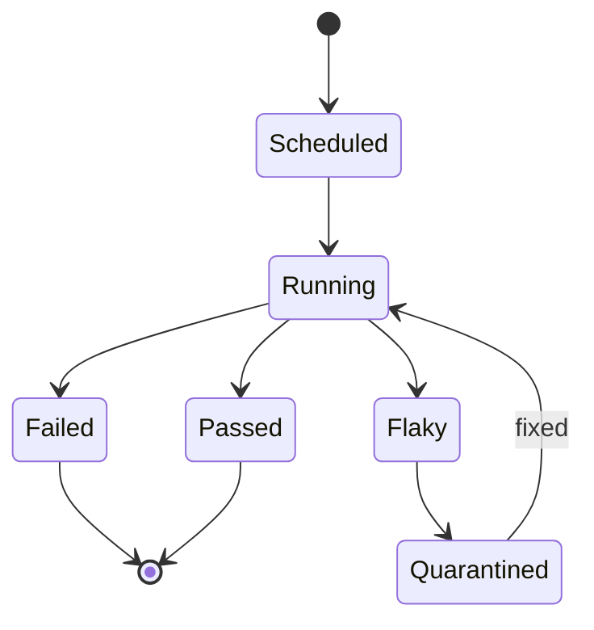
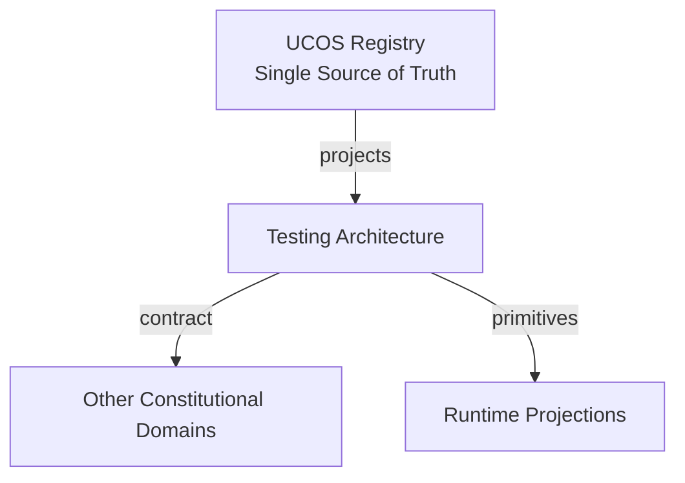
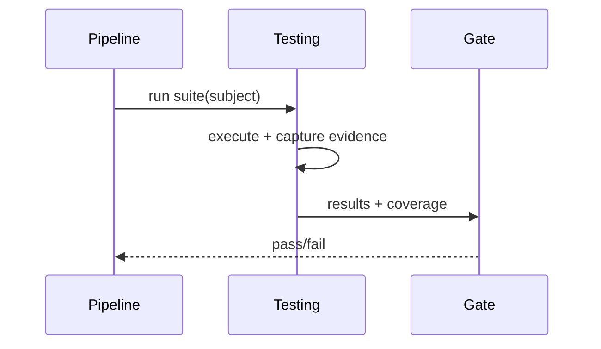
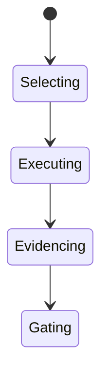
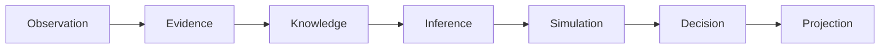
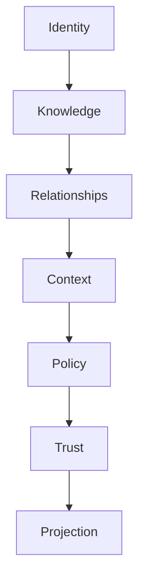

# UCOS-TST-000001
# Testing Architecture

**Version:** Ω∞.1  |  **Status:** Constitutional Artifact  |  **Authority:** UCOS Ω∞ Constitutional Authority
**Category:** Quality  |  **Source of Truth:** `_registry/` (projected, never hand-authored)

> Constitutional notice: this document is a **projection**. Its truth lives in the registry. Editing this document directly violates Law 002 (Knowledge Once).

---

## 1. Executive Summary

**UCOS-TST-000001 — Testing Architecture**

This artifact is a constitutionally governed, implementation-ready specification projected from the _UCOS Registry_ single source of truth.
It conforms to the _Immutable Primitive Registry_ (27 frozen primitives) and the _Canonical Terminology Registry_ (31 governed terms).
It contains no hardcoded business, industry, currency, country, or commerce concepts. All such concepts are runtime projections.

---

## 2. Constitutional Purpose

To define the binding contract for **Testing Architecture** such that:
- every concept it names has exactly one owner,
- every capability it exposes has exactly one boundary,
- every boundary is expressed as an explicit contract,
- every contract is enforceable by the Governance Constitution.

---

## 3. Scope

In scope: the primitives, contracts, schemas, events, and policies owned by **Testing Architecture**.
In scope: the projection rules by which this domain exposes its truth to other domains.
In scope: the verification obligations this domain must satisfy before activation.

---

## 4. Out of Scope

Out of scope: any concept owned by another constitutional domain.
Out of scope: business, industry, commerce, country, currency, or language content (all projected).
Out of scope: mutation of another domain’s internal state.

---

## 5. Definitions

All terms in this artifact are used in their canonical sense as defined in the Canonical Terminology Registry.
Where a term appears, its `termId` is normative and its `prohibitedMeanings` are void.

---

## 6. Canonical Terminology

| Term | Canonical Definition | Owner | Prohibited Meanings |
|---|---|---|---|
| Existence | Anything that may exist. | Universal Existence Kernel | business meaning, commercial meaning, operational meaning |
| Entity | Technical representation of an Existence Object. | Identity Domain | existence itself |
| Knowledge | Interpreted information with evidence and meaning. | Knowledge Domain | data, information, evidence |
| Data | Raw observations. | Observation Domain | knowledge, meaning |
| Information | Organized data. | Observation Domain | knowledge |
| Evidence | Proof supporting an assertion. | Evidence Domain | knowledge, trust |
| Trust | Computed confidence in an assertion, derived from evidence. | Trust Domain | evidence, faith |
| Meaning | Semantic interpretation; higher-level understanding. | Semantic Domain | classification, taxonomy, ontology |
| Ontology | What exists. | Semantic Domain | taxonomy, classification |
| Taxonomy | How things are classified. | Semantic Domain | ontology, meaning |
| Classification | Assignment into taxonomy. | Semantic Domain | meaning |
| Relationship | Connection between objects. | Relationship Domain | causality |

---

## 7. Ownership Boundaries

Ownership is recorded in the _Domain Ownership Registry_.

---

## 8. Domain Responsibilities

See the Domain Ownership Registry for the authoritative responsibility list.

---

## 9. Domain Non-Responsibilities

See the Domain Ownership Registry.

---

## 10. Concepts

Testing Architecture proves the constitution holds. Every artifact, contract, policy, and projection is testable — and tests are themselves governed artifacts, versioned with the thing they test.

---

## 11. Ontology

Test has a Subject (artifact under test), a Strategy (registry), a Coverage target, an Evidence output, and a Gate binding (which deployment gate it feeds). Untested code is uncertifiable code.

---

## 12. Taxonomy

By level: Unit / Contract / Integration / Domain-cross / System / Chaos / Regression. By target: Primitive conformance / Contract compliance / Policy enforcement / Performance / Security / Privacy. By evidence: Pass/fail / Coverage / Mutation / Formal.

---

## 13. Registries

This domain is registry-driven. Its registries are entries in the Universal Registry System:

```yaml
RegistryEntry:
  registryId: UCOS-REG-DOMAIN
  owner: Constitutional Authority
  law: Knowledge Once — each concept defined exactly once
```

---

## 14. Data Model

```yaml
Test:
  testId: <Identity>
  subject: <artifact ref>
  strategy: <registry id>
  coverage: {target, actual}
  evidence: <Evidence>
  gateBinding: <registry gate>
  temporal: {at}
  result: <Pass|Fail|Flaky|Quarantined>
```

---

## 15. Graph Model

(:Test)-[:TESTS]->(:Artifact); (:Test)-[:FEEDS]->(:Gate); (:Test)-[:EVIDENCED_BY]->(:Evidence); (:Test)-[:STRATEGY]->(:RegistryEntry)

---

## 16. Schemas

```yaml
# Canonical projection schema for UCOS-TST-000001
ucos_tst_000001:
  identity:      <Identity primitive>
  intent:        <Intent primitive>
  meaning:       <Meaning primitive>
  knowledge:     <Knowledge primitive>
  registry:      <Registry primitive>
  relationship:  <Relationship primitive>
  context:       <Context primitive>
  policy:        <Policy primitive>
  authority:     <Authority primitive>
  evidence:      <Evidence primitive>
  trust:         <Trust primitive>
  temporal:      <Time primitive>
  metadata:      <Metadata primitive>
```

---

## 17. Contracts

```yaml
DomainContract:
  domain: Testing Architecture
  commands:   []   # registry-driven
  queries:    []   # registry-driven
  events:     []   # registry-driven
  policies:   []   # registry-driven
  permissions: []  # registry-driven
```

Contract law: domains never directly access another domain’s internal structures.

---

## 18. APIs

POST /tst.v1.run,GET  /tst.v1/{id},POST /tst.v1.suite,GET  /tst.v1.coverage/{subjectId}

---

## 19. Events

TestRun,TestPassed,TestFailed,TestQuarantined,CoverageGap

---

## 20. Commands

tst.run,tst.quarantine,tst.promote,tst.coverage

---

## 21. Queries

tst.results,tst.coverage,tst.flaky,tst.gaps

---

## 22. State Machines



---

## 23. Workflows

select subject → run strategy → capture evidence → evaluate coverage → feed gate → quarantine flakes

---

## 24. Policies

```yaml
Policy:
  identity: <Identity>
  conditions: []   # registry-driven
  actions:    []   # registry-driven
  priorities: []   # registry-driven
  exceptions: []   # registry-driven
```

All behavior derives from policy. Policy ≠ Rule: policy is behavioral governance; the rule is its executable projection.

---

## 25. Rules

```yaml
Rule:
  ruleId: <Identity>
  derivedFrom: <Policy identity>
  executable: true
  constraint: <registry expression>
```

---

## 26. Authorities

Quality Authority (test governance); flaky quarantine requires owner accountability.

---

## 27. Permissions

tst.run (system or engineer),tst.quarantine (test owner),tst.read (any)

---

## 28. Security Model

Zero Trust applies: no implicit trust between domains, services, agents, or tenants.
Every call is authenticated, authorized against Policy, and evidenced.
Cryptographic identity is issued by the Identity Domain; keys by the Key Management Architecture.

---

## 29. Privacy Model

Tests over personal data use synthetic fixtures — production personal data never enters test environments.

---

## 30. Trust Model

Trust is computed, never assumed. Inputs: evidence, authority, consistency, provenance, confidence.
```yaml
Trust:
  evidenceScore: <0..1>
  authorityScore: <0..1>
  consistencyScore: <0..1>
  provenanceScore: <0..1>
  confidenceScore: <0..1>
```

---

## 31. Audit Model

Every gate pass cites the test evidence; a gate pass without evidence is a certification failure.

---

## 32. Observability Model

Every action emits: What happened? Why? Who authorized it? Which policy allowed it? What evidence supports it? What confidence exists? What alternatives were evaluated?
These are the seven Explainability questions and are mandatory event fields.

---

## 33. Digital Twin Model

Testing twin monitors coverage drift and flake rates as quality-health signals.

---

## 34. Agent Model

Testing agent generates contract tests from registry schemas and detects coverage gaps automatically.

---

## 35. Runtime Model

Tests run in isolated fixtures; domain-cross tests use contract mocks, never live dependencies.

---

## 36. Scaling Model

Suite execution is parallel by subject; hot suites are sharded.

---

## 37. Multi-Tenant Model

Tests are tenant-scoped; platform tests verify tenant isolation explicitly as a first-class suite.

---

## 38. Geo-Distribution Model

Regional test suites verify sovereignty and placement behavior per jurisdiction.

---

## 39. Failure Model

Flaky-masking, coverage theater, untested contract, gate bypass.

---

## 40. Recovery Model

Quarantined tests block promotion until fixed — flakes are debt, not noise to be ignored.

---

## 41. Verification Model

Before activation, Testing Architecture must pass identity, knowledge, relationship, context, policy, authority, trust, and reality integrity checks.
Verification is performed by the Formal Verification Architecture (UCOS-FML-000001).

---

## 42. Certification Model

Every gate must cite passing test evidence — no evidence, no pass, no exception.

---

## 43. Migration Model

New strategies are registry additions.

---

## 44. Evolution Model

Evolution is governed and history-preserving. Primitives are frozen; extension occurs through registries, policies, capabilities, contexts, relationships, knowledge, agents, and projections — never through primitive expansion.

---

## 45. Implementation Blueprint

Build order for TST: (1) define registry entries — this domain owns by level: unit / contract / integration / domain-cross / system / chaos / regression as registry truth, not code; (2) implement the contract surface first (tst.run, tst.quarantine, tst.promote) and validate against TST boundaries; (3) event-source all state so history is reconstructable; (4) wire the enforcement points — authority check, policy guard, evidence binding, trace — in-line, with no bypass path; (5) add tests per the Testing Architecture, citing evidence per gate; (6) obtain Verification and Certification before activation. Acceptance: the Zero Partial and Law 001 audits pass, every action answers the seven explainability questions, and this domain mutates no other domain internals.

---

## 46. Reference Architecture Diagram



---

## 47. Sequence Diagrams



---

## 48. State Diagrams



---

## 49. Data Flow Diagrams



---

## 50. Dependency Maps



Forbidden: circular dependencies, mutual ownership, cross-domain state mutation.

---

## ∞

Constitutionally governed. Implementation ready. Universally extensible.