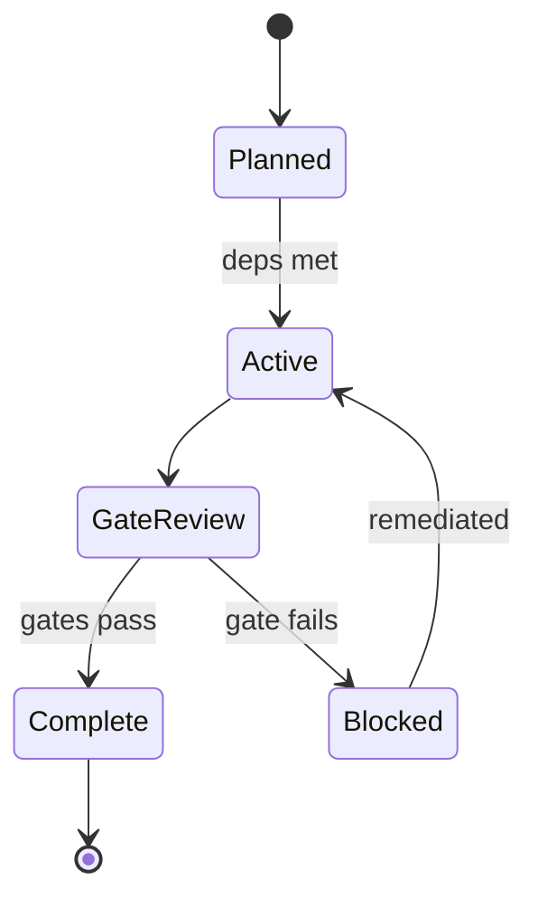
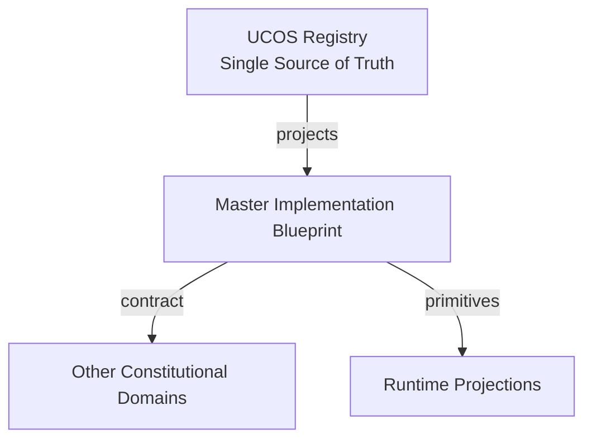
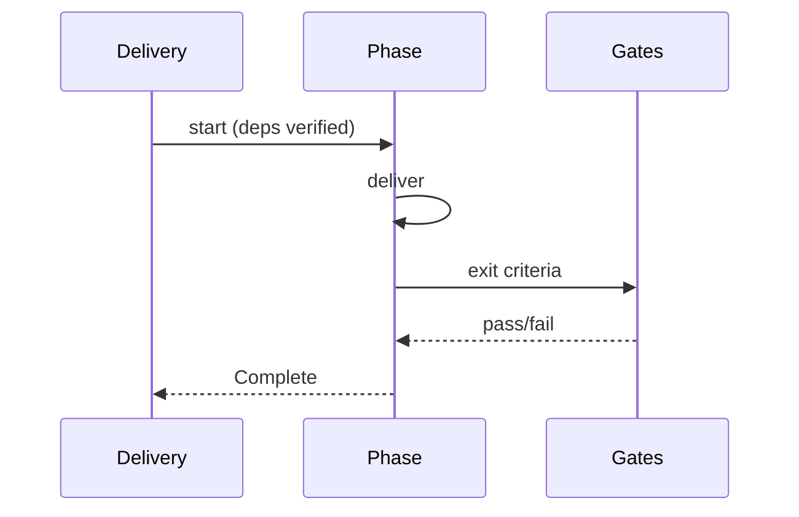
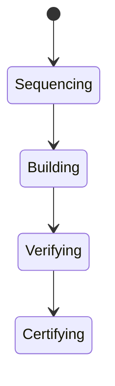
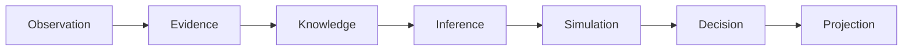
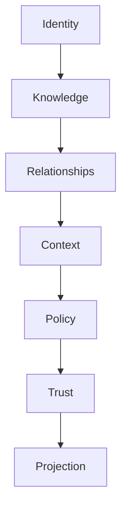

# UCOS-IMP-000001
# Master Implementation Blueprint

**Version:** Ω∞.1  |  **Status:** Constitutional Artifact  |  **Authority:** UCOS Ω∞ Constitutional Authority
**Category:** Implementation  |  **Source of Truth:** `_registry/` (projected, never hand-authored)

> Constitutional notice: this document is a **projection**. Its truth lives in the registry. Editing this document directly violates Law 002 (Knowledge Once).

---

## 1. Executive Summary

**UCOS-IMP-000001 — Master Implementation Blueprint**

This artifact is a constitutionally governed, implementation-ready specification projected from the _UCOS Registry_ single source of truth.
It conforms to the _Immutable Primitive Registry_ (27 frozen primitives) and the _Canonical Terminology Registry_ (31 governed terms).
It contains no hardcoded business, industry, currency, country, or commerce concepts. All such concepts are runtime projections.

---

## 2. Constitutional Purpose

To define the binding contract for **Master Implementation Blueprint** such that:
- every concept it names has exactly one owner,
- every capability it exposes has exactly one boundary,
- every boundary is expressed as an explicit contract,
- every contract is enforceable by the Governance Constitution.

---

## 3. Scope

In scope: the primitives, contracts, schemas, events, and policies owned by **Master Implementation Blueprint**.
In scope: the projection rules by which this domain exposes its truth to other domains.
In scope: the verification obligations this domain must satisfy before activation.

---

## 4. Out of Scope

Out of scope: any concept owned by another constitutional domain.
Out of scope: business, industry, commerce, country, currency, or language content (all projected).
Out of scope: mutation of another domain’s internal state.

---

## 5. Definitions

All terms in this artifact are used in their canonical sense as defined in the Canonical Terminology Registry.
Where a term appears, its `termId` is normative and its `prohibitedMeanings` are void.

---

## 6. Canonical Terminology

| Term | Canonical Definition | Owner | Prohibited Meanings |
|---|---|---|---|
| Existence | Anything that may exist. | Universal Existence Kernel | business meaning, commercial meaning, operational meaning |
| Entity | Technical representation of an Existence Object. | Identity Domain | existence itself |
| Knowledge | Interpreted information with evidence and meaning. | Knowledge Domain | data, information, evidence |
| Data | Raw observations. | Observation Domain | knowledge, meaning |
| Information | Organized data. | Observation Domain | knowledge |
| Evidence | Proof supporting an assertion. | Evidence Domain | knowledge, trust |
| Trust | Computed confidence in an assertion, derived from evidence. | Trust Domain | evidence, faith |
| Meaning | Semantic interpretation; higher-level understanding. | Semantic Domain | classification, taxonomy, ontology |
| Ontology | What exists. | Semantic Domain | taxonomy, classification |
| Taxonomy | How things are classified. | Semantic Domain | ontology, meaning |
| Classification | Assignment into taxonomy. | Semantic Domain | meaning |
| Relationship | Connection between objects. | Relationship Domain | causality |

---

## 7. Ownership Boundaries

Ownership is recorded in the _Domain Ownership Registry_.

---

## 8. Domain Responsibilities

See the Domain Ownership Registry for the authoritative responsibility list.

---

## 9. Domain Non-Responsibilities

See the Domain Ownership Registry.

---

## 10. Concepts

The Master Implementation Blueprint is the ordered path from constitution to running platform. It sequences domain delivery by dependency law — Identity first, Knowledge next, and so on to Projection — so nothing is built on a foundation that doesn't yet exist.

---

## 11. Ontology

The blueprint has Phases (ordered by dependency law), Milestones (gated by certification), Dependencies (relationships), and Exit criteria (verification + certification per phase). Each phase is independently shippable.

---

## 12. Taxonomy

By phase: Foundation / Core domains / Reality / Commerce / Twins+Agents / Runtime+Data / Security / Operations / Deployment / Quality / Certification. By gate: Architecture-review / Test-evidence / Formal-proof / Certification-issue.

---

## 13. Registries

This domain is registry-driven. Its registries are entries in the Universal Registry System:

```yaml
RegistryEntry:
  registryId: UCOS-REG-DOMAIN
  owner: Constitutional Authority
  law: Knowledge Once — each concept defined exactly once
```

---

## 14. Data Model

```yaml
ImplementationPhase:
  phaseId: <Identity>
  sequence: <int>
  deliverables: [<artifact ref>]
  dependencies: [<phaseId>]
  exitCriteria: [<Verification|Certificate>]
  status: <Planned|Active|Blocked|Complete>
  temporal: {startedAt, completedAt}
```

---

## 15. Graph Model

(:Phase)-[:DELIVERS]->(:Artifact); (:Phase)-[:DEPENDS_ON]->(:Phase); (:Phase)-[:GATED_BY]->(:Verification|:Certificate)

---

## 16. Schemas

```yaml
# Canonical projection schema for UCOS-IMP-000001
ucos_imp_000001:
  identity:      <Identity primitive>
  intent:        <Intent primitive>
  meaning:       <Meaning primitive>
  knowledge:     <Knowledge primitive>
  registry:      <Registry primitive>
  relationship:  <Relationship primitive>
  context:       <Context primitive>
  policy:        <Policy primitive>
  authority:     <Authority primitive>
  evidence:      <Evidence primitive>
  trust:         <Trust primitive>
  temporal:      <Time primitive>
  metadata:      <Metadata primitive>
```

---

## 17. Contracts

```yaml
DomainContract:
  domain: Master Implementation Blueprint
  commands:   []   # registry-driven
  queries:    []   # registry-driven
  events:     []   # registry-driven
  policies:   []   # registry-driven
  permissions: []  # registry-driven
```

Contract law: domains never directly access another domain’s internal structures.

---

## 18. APIs

GET  /imp.v1/phases,POST /imp.v1.phase.start,POST /imp.v1.phase.complete,GET  /imp.v1.progress

---

## 19. Events

PhaseStarted,PhaseCompleted,PhaseBlocked,GatePassed,SequenceAdjusted

---

## 20. Commands

imp.phase.start,imp.phase.complete,imp.phase.block,imp.resequence

---

## 21. Queries

imp.phases,imp.progress,imp.blocked,imp.next

---

## 22. State Machines



---

## 23. Workflows

sequence by dependency law → build phase → run verification → pass gates → certify → proceed

---

## 24. Policies

```yaml
Policy:
  identity: <Identity>
  conditions: []   # registry-driven
  actions:    []   # registry-driven
  priorities: []   # registry-driven
  exceptions: []   # registry-driven
```

All behavior derives from policy. Policy ≠ Rule: policy is behavioral governance; the rule is its executable projection.

---

## 25. Rules

```yaml
Rule:
  ruleId: <Identity>
  derivedFrom: <Policy identity>
  executable: true
  constraint: <registry expression>
```

---

## 26. Authorities

Delivery Authority (sequencing); gates are owned by Quality and Certification authorities.

---

## 27. Permissions

imp.phase.start (delivery authority),imp.phase.complete (only after gates pass),imp.read (any)

---

## 28. Security Model

Zero Trust applies: no implicit trust between domains, services, agents, or tenants.
Every call is authenticated, authorized against Policy, and evidenced.
Cryptographic identity is issued by the Identity Domain; keys by the Key Management Architecture.

---

## 29. Privacy Model

Phases touching personal data require privacy-gate evidence — privacy is sequenced in, not bolted on.

---

## 30. Trust Model

Trust is computed, never assumed. Inputs: evidence, authority, consistency, provenance, confidence.
```yaml
Trust:
  evidenceScore: <0..1>
  authorityScore: <0..1>
  consistencyScore: <0..1>
  provenanceScore: <0..1>
  confidenceScore: <0..1>
```

---

## 31. Audit Model

Every gate pass cites evidence; every resequence records rationale. The build history is itself an audit artifact.

---

## 32. Observability Model

Every action emits: What happened? Why? Who authorized it? Which policy allowed it? What evidence supports it? What confidence exists? What alternatives were evaluated?
These are the seven Explainability questions and are mandatory event fields.

---

## 33. Digital Twin Model

Delivery twin tracks phase health, gate failure rates, and dependency drift.

---

## 34. Agent Model

Delivery agent detects dependency violations (building ahead of foundation) and blocks them.

---

## 35. Runtime Model

The blueprint is executed as registry state — progress is queryable, gates are machine-checkable.

---

## 36. Scaling Model

Phases parallelize within dependency constraints; cross-phase work requires explicit dependency declaration.

---

## 37. Multi-Tenant Model

Platform phases deliver shared capability; tenant configuration is post-platform, not a phase.

---

## 38. Geo-Distribution Model

Regional rollout is a deployment concern layered after platform phases.

---

## 39. Failure Model

Dependency violation, gate bypass attempt, phase deadlock, foundation churn.

---

## 40. Recovery Model

A failed gate blocks the phase; remediation or resequencing are the only paths — gates never weaken to ship.

---

## 41. Verification Model

Before activation, Master Implementation Blueprint must pass identity, knowledge, relationship, context, policy, authority, trust, and reality integrity checks.
Verification is performed by the Formal Verification Architecture (UCOS-FML-000001).

---

## 42. Certification Model

No phase completes without its exit criteria met — the blueprint is the constitution's enforcement of build order.

---

## 43. Migration Model

Resequencing is governance-gated and recorded.

---

## 44. Evolution Model

Evolution is governed and history-preserving. Primitives are frozen; extension occurs through registries, policies, capabilities, contexts, relationships, knowledge, agents, and projections — never through primitive expansion.

---

## 45. Implementation Blueprint

Build order for IMP: (1) define registry entries — this domain owns by phase: foundation / core domains / reality / commerce / twins+agents / runtime+data / security / operations / deployment / quality / certification as registry truth, not code; (2) implement the contract surface first (imp.phase.start, imp.phase.complete, imp.phase.block) and validate against IMP boundaries; (3) event-source all state so history is reconstructable; (4) wire the enforcement points — authority check, policy guard, evidence binding, trace — in-line, with no bypass path; (5) add tests per the Testing Architecture, citing evidence per gate; (6) obtain Verification and Certification before activation. Acceptance: the Zero Partial and Law 001 audits pass, every action answers the seven explainability questions, and this domain mutates no other domain internals.

---

## 46. Reference Architecture Diagram



---

## 47. Sequence Diagrams



---

## 48. State Diagrams



---

## 49. Data Flow Diagrams



---

## 50. Dependency Maps



Forbidden: circular dependencies, mutual ownership, cross-domain state mutation.

---

## ∞

Constitutionally governed. Implementation ready. Universally extensible.