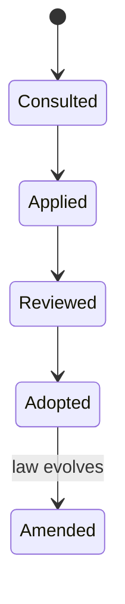
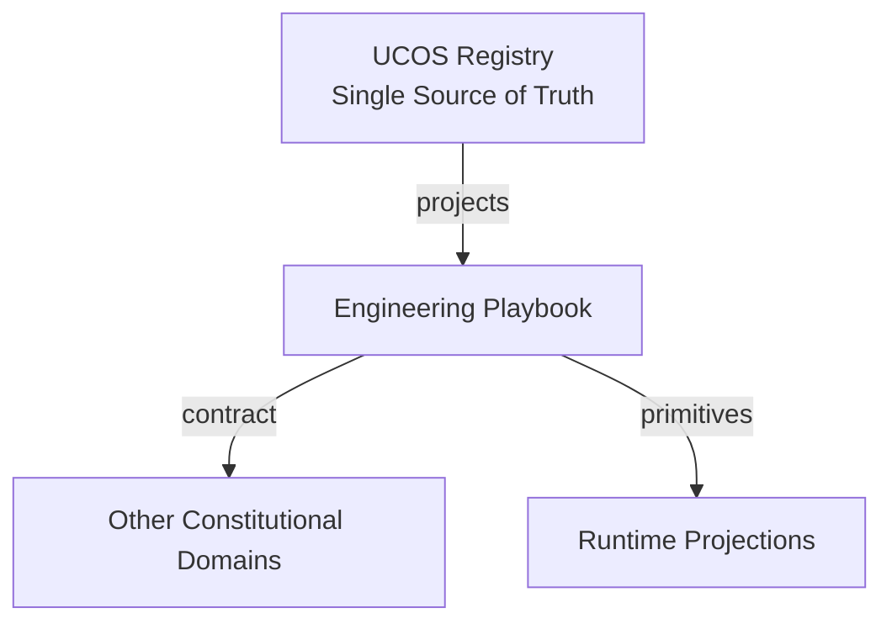
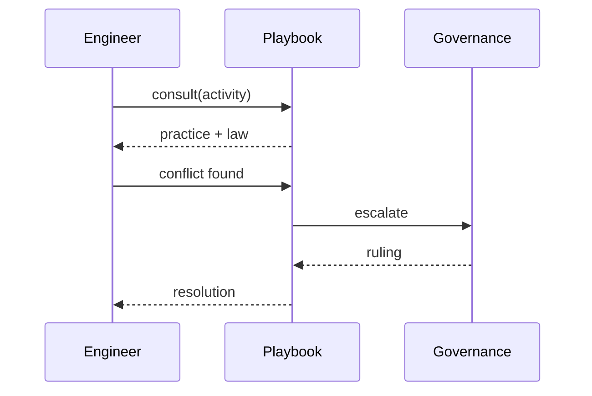
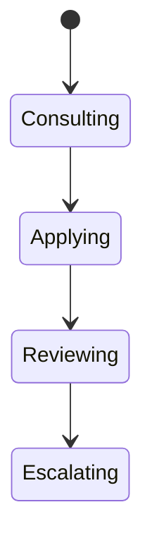
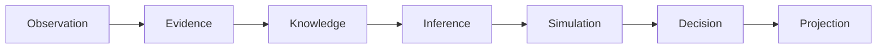
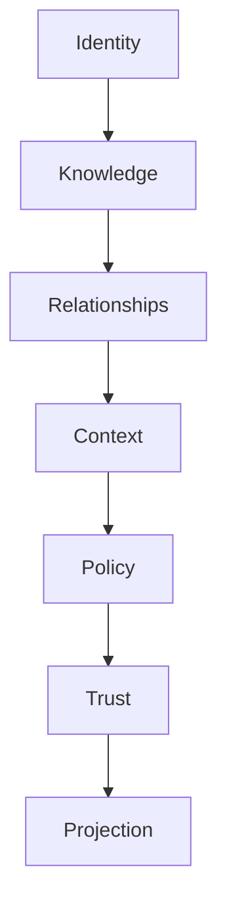

# UCOS-IMP-000003
# Engineering Playbook

**Version:** Ω∞.1  |  **Status:** Constitutional Artifact  |  **Authority:** UCOS Ω∞ Constitutional Authority
**Category:** Implementation  |  **Source of Truth:** `_registry/` (projected, never hand-authored)

> Constitutional notice: this document is a **projection**. Its truth lives in the registry. Editing this document directly violates Law 002 (Knowledge Once).

---

## 1. Executive Summary

**UCOS-IMP-000003 — Engineering Playbook**

This artifact is a constitutionally governed, implementation-ready specification projected from the _UCOS Registry_ single source of truth.
It conforms to the _Immutable Primitive Registry_ (27 frozen primitives) and the _Canonical Terminology Registry_ (31 governed terms).
It contains no hardcoded business, industry, currency, country, or commerce concepts. All such concepts are runtime projections.

---

## 2. Constitutional Purpose

To define the binding contract for **Engineering Playbook** such that:
- every concept it names has exactly one owner,
- every capability it exposes has exactly one boundary,
- every boundary is expressed as an explicit contract,
- every contract is enforceable by the Governance Constitution.

---

## 3. Scope

In scope: the primitives, contracts, schemas, events, and policies owned by **Engineering Playbook**.
In scope: the projection rules by which this domain exposes its truth to other domains.
In scope: the verification obligations this domain must satisfy before activation.

---

## 4. Out of Scope

Out of scope: any concept owned by another constitutional domain.
Out of scope: business, industry, commerce, country, currency, or language content (all projected).
Out of scope: mutation of another domain’s internal state.

---

## 5. Definitions

All terms in this artifact are used in their canonical sense as defined in the Canonical Terminology Registry.
Where a term appears, its `termId` is normative and its `prohibitedMeanings` are void.

---

## 6. Canonical Terminology

| Term | Canonical Definition | Owner | Prohibited Meanings |
|---|---|---|---|
| Existence | Anything that may exist. | Universal Existence Kernel | business meaning, commercial meaning, operational meaning |
| Entity | Technical representation of an Existence Object. | Identity Domain | existence itself |
| Knowledge | Interpreted information with evidence and meaning. | Knowledge Domain | data, information, evidence |
| Data | Raw observations. | Observation Domain | knowledge, meaning |
| Information | Organized data. | Observation Domain | knowledge |
| Evidence | Proof supporting an assertion. | Evidence Domain | knowledge, trust |
| Trust | Computed confidence in an assertion, derived from evidence. | Trust Domain | evidence, faith |
| Meaning | Semantic interpretation; higher-level understanding. | Semantic Domain | classification, taxonomy, ontology |
| Ontology | What exists. | Semantic Domain | taxonomy, classification |
| Taxonomy | How things are classified. | Semantic Domain | ontology, meaning |
| Classification | Assignment into taxonomy. | Semantic Domain | meaning |
| Relationship | Connection between objects. | Relationship Domain | causality |

---

## 7. Ownership Boundaries

Ownership is recorded in the _Domain Ownership Registry_.

---

## 8. Domain Responsibilities

See the Domain Ownership Registry for the authoritative responsibility list.

---

## 9. Domain Non-Responsibilities

See the Domain Ownership Registry.

---

## 10. Concepts

The Engineering Playbook is how engineers work within the constitution: registry-first thinking, projection discipline, contract boundaries, and the duty to escalate rather than work around. It converts law into habit.

---

## 11. Ontology

The Playbook has Practices (registry-driven patterns), Anti-patterns (violations with remedies), Escalation paths, and Review gates. Every practice cites the law it serves.

---

## 12. Taxonomy

By activity: Design / Implement / Review / Test / Deploy / Operate. By law served: Zero-hardcoding / Knowledge-once / Projection / Governance / Explainability. By audience: Individual / Team / Architect / Governance.

---

## 13. Registries

This domain is registry-driven. Its registries are entries in the Universal Registry System:

```yaml
RegistryEntry:
  registryId: UCOS-REG-DOMAIN
  owner: Constitutional Authority
  law: Knowledge Once — each concept defined exactly once
```

---

## 14. Data Model

```yaml
PlaybookPractice:
  practiceId: <Identity>
  activity: <registry id>
  law: <constitutional law id>
  pattern: <description>
  antiPattern: <description>
  remedy: <description>
  escalation: <path>
```

---

## 15. Graph Model

(:Practice)-[:SERVES]->(:Law); (:Practice)-[:APPLIES_TO]->(:Activity); (:Practice)-[:ESCALATES_VIA]->(:Path)

---

## 16. Schemas

```yaml
# Canonical projection schema for UCOS-IMP-000003
ucos_imp_000003:
  identity:      <Identity primitive>
  intent:        <Intent primitive>
  meaning:       <Meaning primitive>
  knowledge:     <Knowledge primitive>
  registry:      <Registry primitive>
  relationship:  <Relationship primitive>
  context:       <Context primitive>
  policy:        <Policy primitive>
  authority:     <Authority primitive>
  evidence:      <Evidence primitive>
  trust:         <Trust primitive>
  temporal:      <Time primitive>
  metadata:      <Metadata primitive>
```

---

## 17. Contracts

```yaml
DomainContract:
  domain: Engineering Playbook
  commands:   []   # registry-driven
  queries:    []   # registry-driven
  events:     []   # registry-driven
  policies:   []   # registry-driven
  permissions: []  # registry-driven
```

Contract law: domains never directly access another domain’s internal structures.

---

## 18. APIs

GET  /play.v1/practices,GET  /play.v1/{id},GET  /play.v1/byLaw/{lawId},POST /play.v1.escalate

---

## 19. Events

PlaybookConsulted,EscalationRaised,PlaybookAmended

---

## 20. Commands

play.consult,play.escalate,play.amend

---

## 21. Queries

play.practices,play.byActivity,play.byLaw,play.antipatterns

---

## 22. State Machines



---

## 23. Workflows

consult by activity → apply pattern → review against law → escalate on conflict → amend with the law

---

## 24. Policies

```yaml
Policy:
  identity: <Identity>
  conditions: []   # registry-driven
  actions:    []   # registry-driven
  priorities: []   # registry-driven
  exceptions: []   # registry-driven
```

All behavior derives from policy. Policy ≠ Rule: policy is behavioral governance; the rule is its executable projection.

---

## 25. Rules

```yaml
Rule:
  ruleId: <Identity>
  derivedFrom: <Policy identity>
  executable: true
  constraint: <registry expression>
```

---

## 26. Authorities

Engineering Authority (practice); amendments follow constitutional process.

---

## 27. Permissions

play.consult (any engineer),play.escalate (any engineer, protected),play.amend (engineering authority)

---

## 28. Security Model

Zero Trust applies: no implicit trust between domains, services, agents, or tenants.
Every call is authenticated, authorized against Policy, and evidenced.
Cryptographic identity is issued by the Identity Domain; keys by the Key Management Architecture.

---

## 29. Privacy Model

Escalations involving personal data route to privacy authority with minimized context.

---

## 30. Trust Model

Trust is computed, never assumed. Inputs: evidence, authority, consistency, provenance, confidence.
```yaml
Trust:
  evidenceScore: <0..1>
  authorityScore: <0..1>
  consistencyScore: <0..1>
  provenanceScore: <0..1>
  confidenceScore: <0..1>
```

---

## 31. Audit Model

Escalations are logged and reviewed — the playbook makes 'working around' harder than 'raising it'.

---

## 32. Observability Model

Every action emits: What happened? Why? Who authorized it? Which policy allowed it? What evidence supports it? What confidence exists? What alternatives were evaluated?
These are the seven Explainability questions and are mandatory event fields.

---

## 33. Digital Twin Model

Playbook twin tracks escalation themes, surfacing systemic friction for amendment.

---

## 34. Agent Model

Playbook agent surfaces the relevant practice during design review, automatically.

---

## 35. Runtime Model

The playbook is registry content — consultable programmatically by tooling and agents.

---

## 36. Scaling Model

Practices scale by being consulted; no runtime cost.

---

## 37. Multi-Tenant Model

The playbook is platform-wide; tenants may add practices but not weaken constitutional ones.

---

## 38. Geo-Distribution Model

Practices cite jurisdiction-aware laws where relevant.

---

## 39. Failure Model

Unreviewed practice, ignored escalation, unconstitutional workaround.

---

## 40. Recovery Model

An ignored escalation is a governance event with remediation — the system protects those who raise.

---

## 41. Verification Model

Before activation, Engineering Playbook must pass identity, knowledge, relationship, context, policy, authority, trust, and reality integrity checks.
Verification is performed by the Formal Verification Architecture (UCOS-FML-000001).

---

## 42. Certification Model

Every practice must cite its law — uncited practices are advisory only.

---

## 43. Migration Model

Amendments track constitutional evolution.

---

## 44. Evolution Model

Evolution is governed and history-preserving. Primitives are frozen; extension occurs through registries, policies, capabilities, contexts, relationships, knowledge, agents, and projections — never through primitive expansion.

---

## 45. Implementation Blueprint

Build order for IMP3: (1) define registry entries — this domain owns by activity: design / implement / review / test / deploy / operate as registry truth, not code; (2) implement the contract surface first (play.consult, play.escalate, play.amend) and validate against IMP3 boundaries; (3) event-source all state so history is reconstructable; (4) wire the enforcement points — authority check, policy guard, evidence binding, trace — in-line, with no bypass path; (5) add tests per the Testing Architecture, citing evidence per gate; (6) obtain Verification and Certification before activation. Acceptance: the Zero Partial and Law 001 audits pass, every action answers the seven explainability questions, and this domain mutates no other domain internals.

---

## 46. Reference Architecture Diagram



---

## 47. Sequence Diagrams



---

## 48. State Diagrams



---

## 49. Data Flow Diagrams



---

## 50. Dependency Maps



Forbidden: circular dependencies, mutual ownership, cross-domain state mutation.

---

## ∞

Constitutionally governed. Implementation ready. Universally extensible.