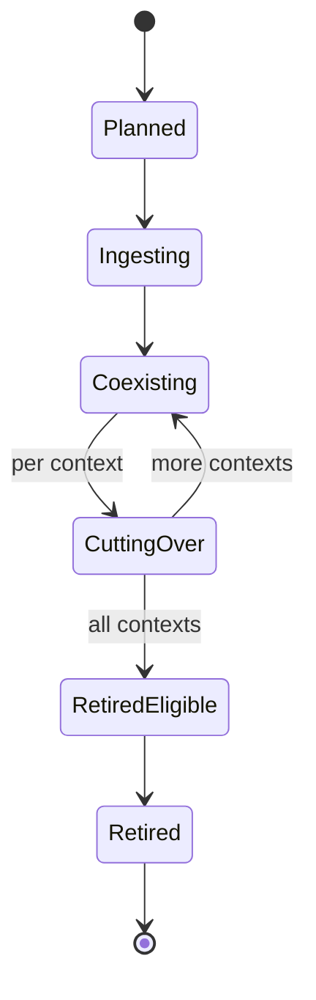
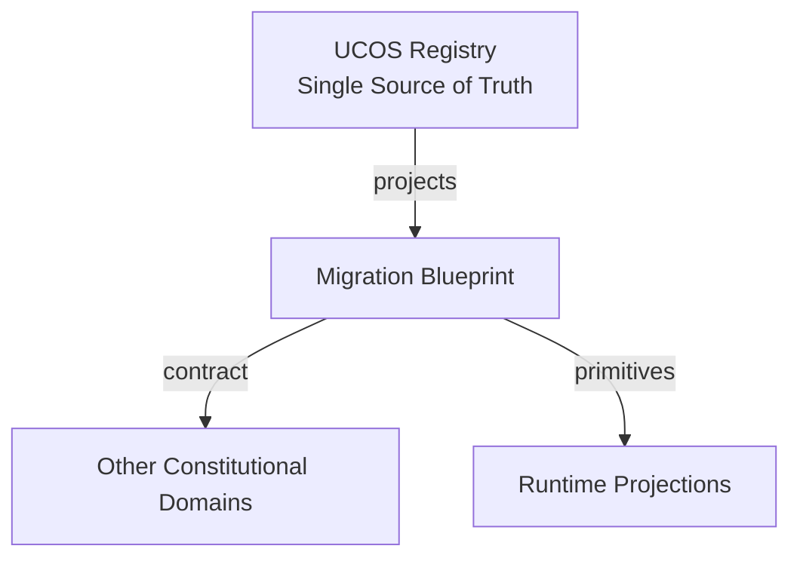
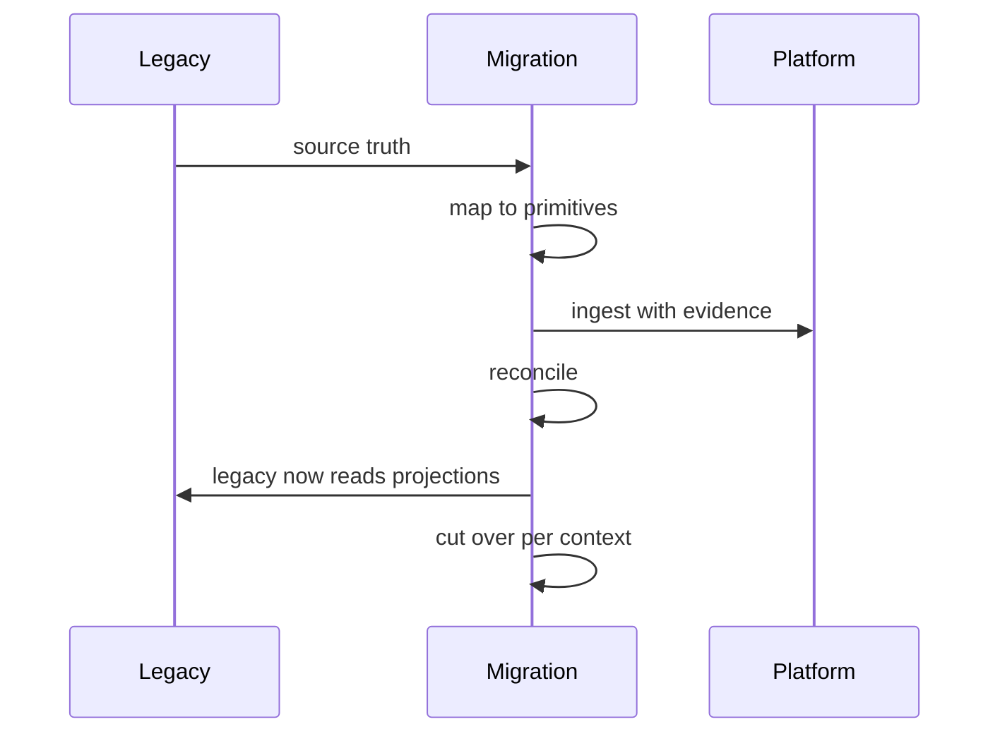
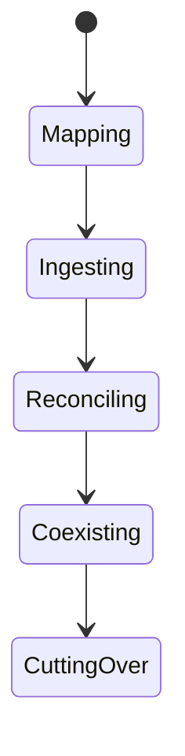
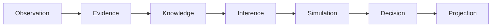
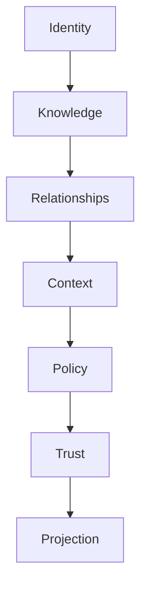

# UCOS-IMP-000004
# Migration Blueprint

**Version:** Ω∞.1  |  **Status:** Constitutional Artifact  |  **Authority:** UCOS Ω∞ Constitutional Authority
**Category:** Implementation  |  **Source of Truth:** `_registry/` (projected, never hand-authored)

> Constitutional notice: this document is a **projection**. Its truth lives in the registry. Editing this document directly violates Law 002 (Knowledge Once).

---

## 1. Executive Summary

**UCOS-IMP-000004 — Migration Blueprint**

This artifact is a constitutionally governed, implementation-ready specification projected from the _UCOS Registry_ single source of truth.
It conforms to the _Immutable Primitive Registry_ (27 frozen primitives) and the _Canonical Terminology Registry_ (31 governed terms).
It contains no hardcoded business, industry, currency, country, or commerce concepts. All such concepts are runtime projections.

---

## 2. Constitutional Purpose

To define the binding contract for **Migration Blueprint** such that:
- every concept it names has exactly one owner,
- every capability it exposes has exactly one boundary,
- every boundary is expressed as an explicit contract,
- every contract is enforceable by the Governance Constitution.

---

## 3. Scope

In scope: the primitives, contracts, schemas, events, and policies owned by **Migration Blueprint**.
In scope: the projection rules by which this domain exposes its truth to other domains.
In scope: the verification obligations this domain must satisfy before activation.

---

## 4. Out of Scope

Out of scope: any concept owned by another constitutional domain.
Out of scope: business, industry, commerce, country, currency, or language content (all projected).
Out of scope: mutation of another domain’s internal state.

---

## 5. Definitions

All terms in this artifact are used in their canonical sense as defined in the Canonical Terminology Registry.
Where a term appears, its `termId` is normative and its `prohibitedMeanings` are void.

---

## 6. Canonical Terminology

| Term | Canonical Definition | Owner | Prohibited Meanings |
|---|---|---|---|
| Existence | Anything that may exist. | Universal Existence Kernel | business meaning, commercial meaning, operational meaning |
| Entity | Technical representation of an Existence Object. | Identity Domain | existence itself |
| Knowledge | Interpreted information with evidence and meaning. | Knowledge Domain | data, information, evidence |
| Data | Raw observations. | Observation Domain | knowledge, meaning |
| Information | Organized data. | Observation Domain | knowledge |
| Evidence | Proof supporting an assertion. | Evidence Domain | knowledge, trust |
| Trust | Computed confidence in an assertion, derived from evidence. | Trust Domain | evidence, faith |
| Meaning | Semantic interpretation; higher-level understanding. | Semantic Domain | classification, taxonomy, ontology |
| Ontology | What exists. | Semantic Domain | taxonomy, classification |
| Taxonomy | How things are classified. | Semantic Domain | ontology, meaning |
| Classification | Assignment into taxonomy. | Semantic Domain | meaning |
| Relationship | Connection between objects. | Relationship Domain | causality |

---

## 7. Ownership Boundaries

Ownership is recorded in the _Domain Ownership Registry_.

---

## 8. Domain Responsibilities

See the Domain Ownership Registry for the authoritative responsibility list.

---

## 9. Domain Non-Responsibilities

See the Domain Ownership Registry.

---

## 10. Concepts

The Migration Blueprint moves existing systems onto the constitutional substrate without freezing the business. Migration is evolutionary: existing truth is ingested as primitives, existing interfaces continue as projections, and cutover is per-context.

---

## 11. Ontology

Migration has a Source (legacy truth), an Ingestion mapping (source → primitives), a Coexistence period (both served), a Cutover (per context), and a Retirement (when the source is no longer truth).

---

## 12. Taxonomy

By strategy: Lift-and-project / Strangler / Parallel-run / Big-bang / Phased-per-context. By source: Database / API / Files / ERP / Legacy-platform. By risk: Low / Medium / High / Critical.

---

## 13. Registries

This domain is registry-driven. Its registries are entries in the Universal Registry System:

```yaml
RegistryEntry:
  registryId: UCOS-REG-DOMAIN
  owner: Constitutional Authority
  law: Knowledge Once — each concept defined exactly once
```

---

## 14. Data Model

```yaml
Migration:
  migrationId: <Identity>
  source: <system ref>
  ingestionMapping: <registry expression>
  coexistencePolicy: <Policy>
  cutoverPlan: [{context, sequence}]
  retirement: {eligibilityAt, retiredAt}
  risk: <registry level>
  evidence: [<Evidence>]
```

---

## 15. Graph Model

(:Migration)-[:FROM]->(:Source); (:Migration)-[:INGESTS_AS]->(:Primitive); (:Migration)-[:COEXISTS_PER]->(:Policy); (:Migration)-[:CUTS_OVER]->(:Context)

---

## 16. Schemas

```yaml
# Canonical projection schema for UCOS-IMP-000004
ucos_imp_000004:
  identity:      <Identity primitive>
  intent:        <Intent primitive>
  meaning:       <Meaning primitive>
  knowledge:     <Knowledge primitive>
  registry:      <Registry primitive>
  relationship:  <Relationship primitive>
  context:       <Context primitive>
  policy:        <Policy primitive>
  authority:     <Authority primitive>
  evidence:      <Evidence primitive>
  trust:         <Trust primitive>
  temporal:      <Time primitive>
  metadata:      <Metadata primitive>
```

---

## 17. Contracts

```yaml
DomainContract:
  domain: Migration Blueprint
  commands:   []   # registry-driven
  queries:    []   # registry-driven
  events:     []   # registry-driven
  policies:   []   # registry-driven
  permissions: []  # registry-driven
```

Contract law: domains never directly access another domain’s internal structures.

---

## 18. APIs

POST /mig.v1.plan,POST /mig.v1.ingest,POST /mig.v1.cutover,POST /mig.v1.retire,GET  /mig.v1/{id}

---

## 19. Events

MigrationPlanned,DataIngested,ContextCutOver,MigrationRolledBack,SourceRetired

---

## 20. Commands

mig.plan,mig.ingest,mig.cutover,mig.rollback,mig.retire

---

## 21. Queries

mig.status,mig.byContext,mig.pending,mig.retirementEligible

---

## 22. State Machines



---

## 23. Workflows

map source to primitives → ingest as knowledge-with-evidence → serve legacy as projections over primitives → cut over per context → retire source

---

## 24. Policies

```yaml
Policy:
  identity: <Identity>
  conditions: []   # registry-driven
  actions:    []   # registry-driven
  priorities: []   # registry-driven
  exceptions: []   # registry-driven
```

All behavior derives from policy. Policy ≠ Rule: policy is behavioral governance; the rule is its executable projection.

---

## 25. Rules

```yaml
Rule:
  ruleId: <Identity>
  derivedFrom: <Policy identity>
  executable: true
  constraint: <registry expression>
```

---

## 26. Authorities

Migration Authority (plan); context cutover requires the context owner's authority.

---

## 27. Permissions

mig.plan (migration authority),mig.cutover (context owner),mig.retire (governance)

---

## 28. Security Model

Zero Trust applies: no implicit trust between domains, services, agents, or tenants.
Every call is authenticated, authorized against Policy, and evidenced.
Cryptographic identity is issued by the Identity Domain; keys by the Key Management Architecture.

---

## 29. Privacy Model

Personal-data migration re-binds consent — ingestion without consent mapping is prohibited.

---

## 30. Trust Model

Trust is computed, never assumed. Inputs: evidence, authority, consistency, provenance, confidence.
```yaml
Trust:
  evidenceScore: <0..1>
  authorityScore: <0..1>
  consistencyScore: <0..1>
  provenanceScore: <0..1>
  confidenceScore: <0..1>
```

---

## 31. Audit Model

Every ingested record carries provenance evidence; cutover and rollback are fully traced events.

---

## 32. Observability Model

Every action emits: What happened? Why? Who authorized it? Which policy allowed it? What evidence supports it? What confidence exists? What alternatives were evaluated?
These are the seven Explainability questions and are mandatory event fields.

---

## 33. Digital Twin Model

Migration twin tracks reconciliation between source and primitives, flagging drift during coexistence.

---

## 34. Agent Model

Migration agent reconciles source vs projection continuously and blocks cutover on unresolved divergence.

---

## 35. Runtime Model

Coexistence serves legacy interfaces as projections — the legacy system reads the new truth, transparently.

---

## 36. Scaling Model

Ingestion is batched per source; cutover is throttled per context to bound risk.

---

## 37. Multi-Tenant Model

Tenant migrations are independent; shared sources migrate under platform authority.

---

## 38. Geo-Distribution Model

Cross-border migration respects sovereignty — data moves only where bindings permit.

---

## 39. Failure Model

Mapping drift, reconciliation gap, premature cutover, retirement of still-referenced source.

---

## 40. Recovery Model

Rollback per context restores the source as truth — reversible until retirement, irreversible after.

---

## 41. Verification Model

Before activation, Migration Blueprint must pass identity, knowledge, relationship, context, policy, authority, trust, and reality integrity checks.
Verification is performed by the Formal Verification Architecture (UCOS-FML-000001).

---

## 42. Certification Model

Cutover requires reconciliation evidence — divergence blocks it, no exceptions for schedule.

---

## 43. Migration Model

Migration IS evolution — this blueprint is an application of the Evolution Domain, not a separate mechanism.

---

## 44. Evolution Model

Evolution is governed and history-preserving. Primitives are frozen; extension occurs through registries, policies, capabilities, contexts, relationships, knowledge, agents, and projections — never through primitive expansion.

---

## 45. Implementation Blueprint

Build order for IMP4: (1) define registry entries — this domain owns by strategy: lift-and-project / strangler / parallel-run / big-bang / phased-per-context as registry truth, not code; (2) implement the contract surface first (mig.plan, mig.ingest, mig.cutover) and validate against IMP4 boundaries; (3) event-source all state so history is reconstructable; (4) wire the enforcement points — authority check, policy guard, evidence binding, trace — in-line, with no bypass path; (5) add tests per the Testing Architecture, citing evidence per gate; (6) obtain Verification and Certification before activation. Acceptance: the Zero Partial and Law 001 audits pass, every action answers the seven explainability questions, and this domain mutates no other domain internals.

---

## 46. Reference Architecture Diagram



---

## 47. Sequence Diagrams



---

## 48. State Diagrams



---

## 49. Data Flow Diagrams



---

## 50. Dependency Maps



Forbidden: circular dependencies, mutual ownership, cross-domain state mutation.

---

## ∞

Constitutionally governed. Implementation ready. Universally extensible.