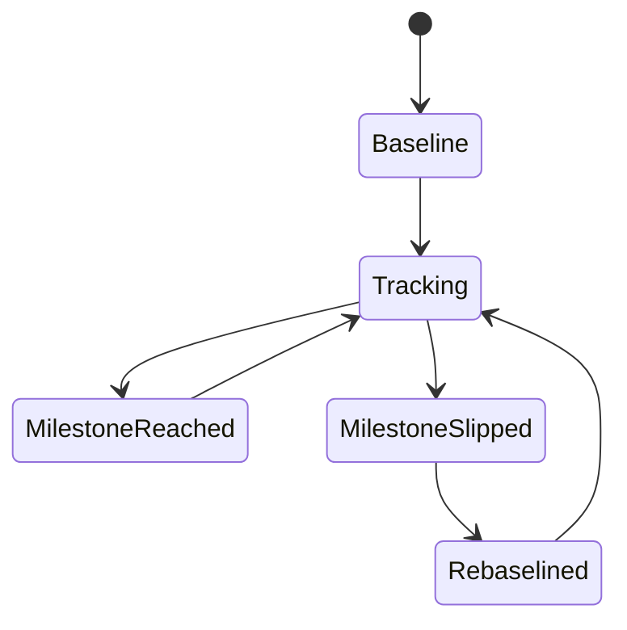
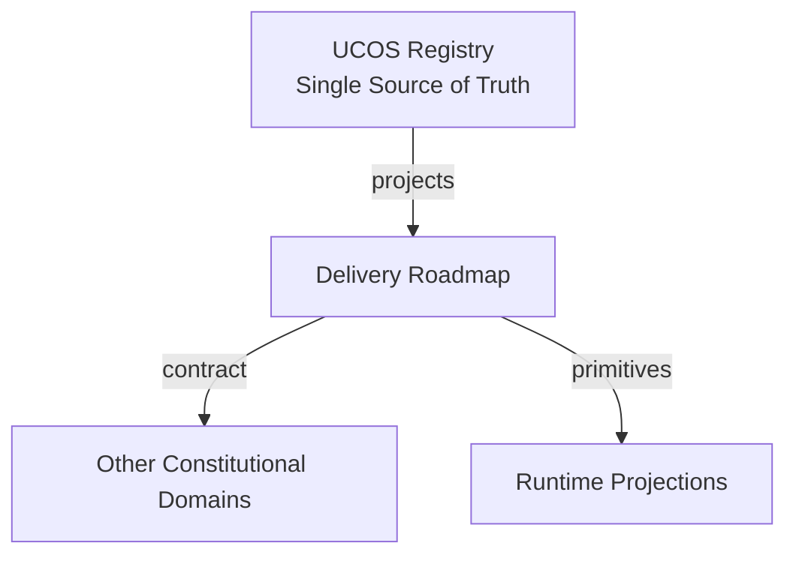
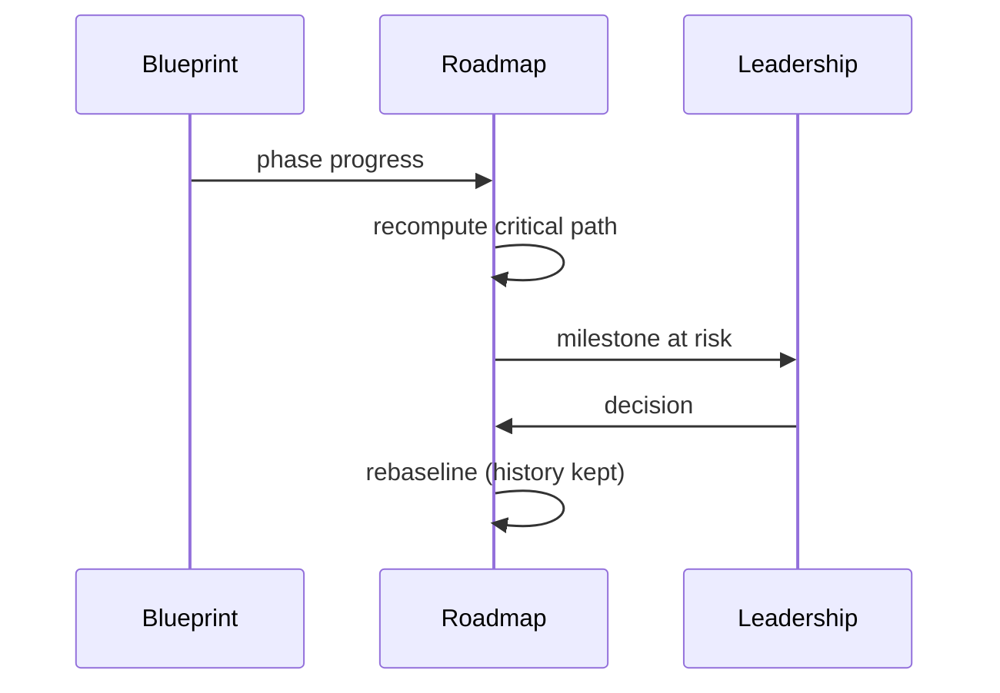
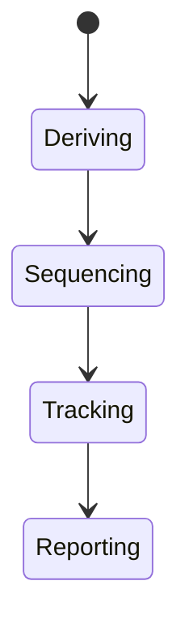
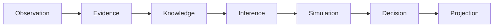
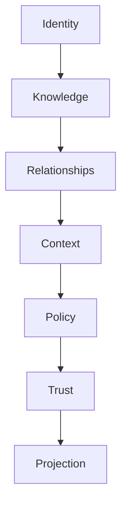

# UCOS-IMP-000005
# Delivery Roadmap

**Version:** Ω∞.1  |  **Status:** Constitutional Artifact  |  **Authority:** UCOS Ω∞ Constitutional Authority
**Category:** Implementation  |  **Source of Truth:** `_registry/` (projected, never hand-authored)

> Constitutional notice: this document is a **projection**. Its truth lives in the registry. Editing this document directly violates Law 002 (Knowledge Once).

---

## 1. Executive Summary

**UCOS-IMP-000005 — Delivery Roadmap**

This artifact is a constitutionally governed, implementation-ready specification projected from the _UCOS Registry_ single source of truth.
It conforms to the _Immutable Primitive Registry_ (27 frozen primitives) and the _Canonical Terminology Registry_ (31 governed terms).
It contains no hardcoded business, industry, currency, country, or commerce concepts. All such concepts are runtime projections.

---

## 2. Constitutional Purpose

To define the binding contract for **Delivery Roadmap** such that:
- every concept it names has exactly one owner,
- every capability it exposes has exactly one boundary,
- every boundary is expressed as an explicit contract,
- every contract is enforceable by the Governance Constitution.

---

## 3. Scope

In scope: the primitives, contracts, schemas, events, and policies owned by **Delivery Roadmap**.
In scope: the projection rules by which this domain exposes its truth to other domains.
In scope: the verification obligations this domain must satisfy before activation.

---

## 4. Out of Scope

Out of scope: any concept owned by another constitutional domain.
Out of scope: business, industry, commerce, country, currency, or language content (all projected).
Out of scope: mutation of another domain’s internal state.

---

## 5. Definitions

All terms in this artifact are used in their canonical sense as defined in the Canonical Terminology Registry.
Where a term appears, its `termId` is normative and its `prohibitedMeanings` are void.

---

## 6. Canonical Terminology

| Term | Canonical Definition | Owner | Prohibited Meanings |
|---|---|---|---|
| Existence | Anything that may exist. | Universal Existence Kernel | business meaning, commercial meaning, operational meaning |
| Entity | Technical representation of an Existence Object. | Identity Domain | existence itself |
| Knowledge | Interpreted information with evidence and meaning. | Knowledge Domain | data, information, evidence |
| Data | Raw observations. | Observation Domain | knowledge, meaning |
| Information | Organized data. | Observation Domain | knowledge |
| Evidence | Proof supporting an assertion. | Evidence Domain | knowledge, trust |
| Trust | Computed confidence in an assertion, derived from evidence. | Trust Domain | evidence, faith |
| Meaning | Semantic interpretation; higher-level understanding. | Semantic Domain | classification, taxonomy, ontology |
| Ontology | What exists. | Semantic Domain | taxonomy, classification |
| Taxonomy | How things are classified. | Semantic Domain | ontology, meaning |
| Classification | Assignment into taxonomy. | Semantic Domain | meaning |
| Relationship | Connection between objects. | Relationship Domain | causality |

---

## 7. Ownership Boundaries

Ownership is recorded in the _Domain Ownership Registry_.

---

## 8. Domain Responsibilities

See the Domain Ownership Registry for the authoritative responsibility list.

---

## 9. Domain Non-Responsibilities

See the Domain Ownership Registry.

---

## 10. Concepts

The Delivery Roadmap converts the blueprint into time — phases to horizons, gates to milestones, dependencies to critical path. It is the artifact leadership reads and engineers trust.

---

## 11. Ontology

The Roadmap has Horizons (time bands), Milestones (gated completions), Critical path (dependency-ordered), Risks (with mitigations), and Capacity (what's actually possible). It is derived from the blueprint, not independent of it.

---

## 12. Taxonomy

By horizon: Now / Next / Later / Future. By milestone: Alpha / Beta / GA / Certified / Sovereign-ready. By risk: Schedule / Dependency / Technical / Regulatory / Resource.

---

## 13. Registries

This domain is registry-driven. Its registries are entries in the Universal Registry System:

```yaml
RegistryEntry:
  registryId: UCOS-REG-DOMAIN
  owner: Constitutional Authority
  law: Knowledge Once — each concept defined exactly once
```

---

## 14. Data Model

```yaml
Roadmap:
  roadmapId: <Identity>
  horizons: [{name, window, phases: [<phaseId>]}]
  milestones: [{name, gate, target, status}]
  criticalPath: [<phaseId>]
  risks: [{description, mitigation, owner}]
  temporal: {asOf}
```

---

## 15. Graph Model

(:Roadmap)-[:SEQUENCES]->(:Phase); (:Roadmap)-[:GATES_AT]->(:Milestone); (:Milestone)-[:REQUIRES]->(:Verification|:Certificate); (:Roadmap)-[:RISKS]->(:Risk)

---

## 16. Schemas

```yaml
# Canonical projection schema for UCOS-IMP-000005
ucos_imp_000005:
  identity:      <Identity primitive>
  intent:        <Intent primitive>
  meaning:       <Meaning primitive>
  knowledge:     <Knowledge primitive>
  registry:      <Registry primitive>
  relationship:  <Relationship primitive>
  context:       <Context primitive>
  policy:        <Policy primitive>
  authority:     <Authority primitive>
  evidence:      <Evidence primitive>
  trust:         <Trust primitive>
  temporal:      <Time primitive>
  metadata:      <Metadata primitive>
```

---

## 17. Contracts

```yaml
DomainContract:
  domain: Delivery Roadmap
  commands:   []   # registry-driven
  queries:    []   # registry-driven
  events:     []   # registry-driven
  policies:   []   # registry-driven
  permissions: []  # registry-driven
```

Contract law: domains never directly access another domain’s internal structures.

---

## 18. APIs

GET  /road.v1,POST /road.v1.update,GET  /road.v1.critical-path,GET  /road.v1.risks

---

## 19. Events

RoadmapUpdated,MilestoneReached,MilestoneSlipped,RiskRaised,RoadmapRebaselined

---

## 20. Commands

road.update,road.milestone.set,road.risk.raise,road.rebaseline

---

## 21. Queries

road.horizons,road.milestones,road.criticalPath,road.risks,road.progress

---

## 22. State Machines



---

## 23. Workflows

derive from blueprint → sequence by dependency → set gated milestones → track → raise risks → rebaseline honestly

---

## 24. Policies

```yaml
Policy:
  identity: <Identity>
  conditions: []   # registry-driven
  actions:    []   # registry-driven
  priorities: []   # registry-driven
  exceptions: []   # registry-driven
```

All behavior derives from policy. Policy ≠ Rule: policy is behavioral governance; the rule is its executable projection.

---

## 25. Rules

```yaml
Rule:
  ruleId: <Identity>
  derivedFrom: <Policy identity>
  executable: true
  constraint: <registry expression>
```

---

## 26. Authorities

Delivery Authority (roadmap); milestone status is evidence-bound — slips are reported, not hidden.

---

## 27. Permissions

road.update (delivery authority),road.risk.raise (any, protected),road.read (any)

---

## 28. Security Model

Zero Trust applies: no implicit trust between domains, services, agents, or tenants.
Every call is authenticated, authorized against Policy, and evidenced.
Cryptographic identity is issued by the Identity Domain; keys by the Key Management Architecture.

---

## 29. Privacy Model

Roadmap items touching personal data cite privacy gates as milestones in their own right.

---

## 30. Trust Model

Trust is computed, never assumed. Inputs: evidence, authority, consistency, provenance, confidence.
```yaml
Trust:
  evidenceScore: <0..1>
  authorityScore: <0..1>
  consistencyScore: <0..1>
  provenanceScore: <0..1>
  confidenceScore: <0..1>
```

---

## 31. Audit Model

Every milestone and slip is recorded with cause; rebaselines preserve history — the roadmap never forgets a promise.

---

## 32. Observability Model

Every action emits: What happened? Why? Who authorized it? Which policy allowed it? What evidence supports it? What confidence exists? What alternatives were evaluated?
These are the seven Explainability questions and are mandatory event fields.

---

## 33. Digital Twin Model

Roadmap twin predicts slips from velocity and dependency drift, early.

---

## 34. Agent Model

Roadmap agent tracks critical-path health and raises risks before they become slips.

---

## 35. Runtime Model

The roadmap is derived from blueprint state — updates propagate from phase progress automatically.

---

## 36. Scaling Model

Horizons scale by team structure; the critical path is the irreducible sequence.

---

## 37. Multi-Tenant Model

The roadmap is platform delivery; tenant onboarding is a consequence, not a phase.

---

## 38. Geo-Distribution Model

Sovereign-ready milestones are first-class gates, not afterthoughts.

---

## 39. Failure Model

Hidden slip, dependency surprise, unraised risk, fantasy capacity.

---

## 40. Recovery Model

A slip is rebaselined with evidence and cause — the honest roadmap is the recoverable one.

---

## 41. Verification Model

Before activation, Delivery Roadmap must pass identity, knowledge, relationship, context, policy, authority, trust, and reality integrity checks.
Verification is performed by the Formal Verification Architecture (UCOS-FML-000001).

---

## 42. Certification Model

GA milestones require certification evidence — a date without certificates is a target, not a milestone.

---

## 43. Migration Model

Rebaseline is the roadmap's migration mechanism.

---

## 44. Evolution Model

Evolution is governed and history-preserving. Primitives are frozen; extension occurs through registries, policies, capabilities, contexts, relationships, knowledge, agents, and projections — never through primitive expansion.

---

## 45. Implementation Blueprint

Build order for IMP5: (1) define registry entries — this domain owns by horizon: now / next / later / future as registry truth, not code; (2) implement the contract surface first (road.update, road.milestone.set, road.risk.raise) and validate against IMP5 boundaries; (3) event-source all state so history is reconstructable; (4) wire the enforcement points — authority check, policy guard, evidence binding, trace — in-line, with no bypass path; (5) add tests per the Testing Architecture, citing evidence per gate; (6) obtain Verification and Certification before activation. Acceptance: the Zero Partial and Law 001 audits pass, every action answers the seven explainability questions, and this domain mutates no other domain internals.

---

## 46. Reference Architecture Diagram



---

## 47. Sequence Diagrams



---

## 48. State Diagrams



---

## 49. Data Flow Diagrams



---

## 50. Dependency Maps



Forbidden: circular dependencies, mutual ownership, cross-domain state mutation.

---

## ∞

Constitutionally governed. Implementation ready. Universally extensible.