# LUXORA Platform — Full Flow (Pictorial)

End-to-end architecture and operational flows. Every box maps to a real surface, route,
table, or module in the code. Diagrams are shown as **ASCII** (always readable) and
**Mermaid** (renders in GitHub/most MD viewers).

---

## 1. The three planes (who sees what)

```
                                   ┌───────────────────────────────────────────┐
                                   │            LUXORA PLATFORM CORE           │
                                   │  server.js  ·  lib/api.js  ·  entity.js   │
                                   │  db.js (SQLite)  ·  security.js (L1–L10)  │
                                   └───────────────────────────────────────────┘
        ▲                              ▲                                ▲
        │ public                       │ store-admin                      │ super-admin
┌───────┴────────┐            ┌─────────┴─────────┐            ┌─────────┴──────────┐
│  STOREFRONT    │            │   STORE CONSOLE   │            │  PLATFORM CONSOLE   │
│   /            │            │   /admin.html     │            │   /platform.html    │
│  (customer)    │            │  (store manager)  │            │   (super admin)     │
├────────────────┤            ├───────────────────┤            ├─────────────────────┤
│ browse/search  │            │ Dashboard          │            │ Command (KPIs)      │
│ product/SEO    │            │ Products + editor  │            │ Provisioning policy │
│ cart/coupon    │            │ SKUs · Inventory   │            │ Stores (+ wizard)   │
│ checkout       │            │ Orders · Returns   │            │  └─ Manage → jumps   │
│ gift cards     │            │ RFQs · Contracts   │            │     into Store       │
│ wishlist/orders│            │  · Tenders         │            │     Console          │
│ reviews/RFQ    │            │ Sellers·Settlements│            │ Geo·Countries·Taxes │
│ returns        │            │ Suppliers·Serialized│           │ Plans·Subs·Invoices │
│ customer svc   │            │  ·Compliance·i18n  │            │ Module Marketplace  │
│ (per store)    │            │ Promotions·Content │            │ Provider Registry   │
│                │            │ Payments·Modules   │            │ Monitoring          │
│                │            │ Settings·Billing   │            │ Global Audit        │
│                │            │ Analytics·Audit    │            │ Security Scorecard  │
│                │            │ Monitor·Data Studio│            │ (cross-store)       │
└────────────────┘            └───────────────────┘            └─────────────────────┘
     tenant-scoped               tenant-scoped                      platform-scoped
     (one store)                (one store)                        (all stores)
```

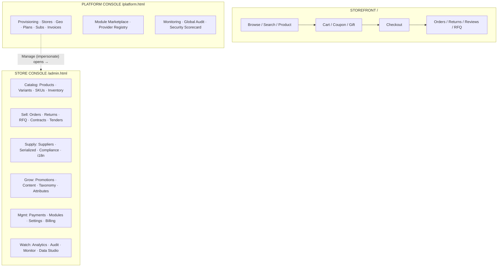

---

## 2. Request lifecycle + the 10-layer security pipeline

```
   Browser (any plane)
        │  HTTPS/HTTP
        ▼
┌─────────────────────────────────────────────────────────────────────────────┐
│ server.js  handler(req,res)                                                    │
│  L1  Security headers (per-request CSP, nosniff, frame-ancestors, HSTS, tls) │
│  L8  Rate limit  ──►  /api/* global limiter  +  auth-specific limiter         │
│      Origin pin ──►  POST/PUT/DELETE cross-origin rejected                    │
│  L2  Session   ──►  resolveTenant → getSession (azs) → tenant_state            │
│      CSRF double-submit (azc cookie ↔ x-csrf header, timing-safe)             │
│      store switch (?store= / subdomain / cookie) · suspended-store block      │
│  L10 Tenant isolation → session.tenant pins every query + role gates          │
│      readBody (1MB cap)                                                       │
└─────────────────────────────────────────────────────────────────────────────┘
        │  api.handle(req,res,url,session,body)
        ▼
┌─────────────────────── lib/api.js  (~120 routes) ────────────────────────┐
│  L9  parameterized SQL only · strict schema validation · HTML escaping    │
│  auth routes: login  → L3 scrypt-v2+pepper verify (v1→v2 upgrade)          │
│                register→ L4 password policy + history-reuse                  │
│                fail     → L8 per-account lockout w/ backoff                  │
│  secrets      → L5 AES-256-GCM envelope seals (AAD=tenant|provider|field)   │
│                 L6 versioned keyring + rotate (re-wraps all seals)           │
│  every write  → L7 SHA-256 hash-chained audit (append-only, verifiable)     │
└───────────────────────────────────────────────────────────────────────────┘
        │  response + Set-Cookie
        ▼   metrics.record(...)  +  access log line
   Browser
```

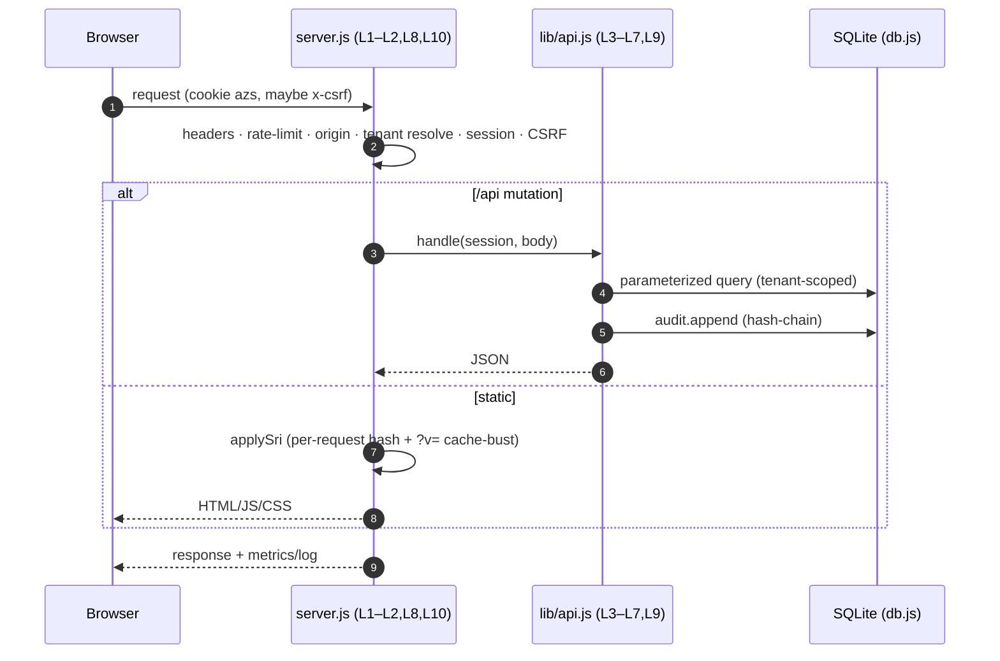

---

## 3. Multi-tenant resolution (which store answers?)

```
            host = aurum.localhost:8787  |  /?store=aurum  |  cookie store=aurum
                                   │
              ┌────────────────────▼─────────────────────┐
              │ resolveTenant(): subdomain → ?store= →    │
              │ cookie.store → default 'luxora' → any     │
              └────────────────────┬─────────────────────┘
                                   ▼  tenant row (id, slug, mode, country, industries)
        ┌──────────────────────────┼───────────────────────────┐
        ▼                          ▼                           ▼
   storefront                 store console              (same tenant_id pins
   /?store=aurum             /admin.html?store=aurum      EVERY api query)
        │                          │
        └──── azs session is per-origin; tenant_state(sid,tenant) holds zip/gift/coupon ────┘
        └──── users are per-tenant (unique tenant_id,email); a luxora admin ≠ aurum admin ──┘
```

Deployment modes (per tenant, same backend):
`marketplace` (all industries, many sellers) · `industry` (one vertical) · `brand` (single label).

---

## 4. The meta hierarchy & data spine (everything is entity data)

```
        Commerce Platform
        ├── Tenant ── Marketplace/Sellers ── Store/Catalog
        │
        │  Taxonomy spine (table: taxonomy)
        └── Domain
             └── Industry            (33 · meta_lists.industries)
                  └── Category
                       └── SubCategory
                            └── ProductFamily
                                 └── ProductModel
                                      └── Product        (table: products)
                                           ├─ identity     (20 codes: GTIN/UPC/EAN/ISBN/ISSN/
                                           │               MPN/OEM/part#/VIN/IMEI/serial/
                                           │               batch/lot/HSN/HS/UNSPSC/GPC/eCl@ss/ETIM)
                                           ├─ attrs        EAV (attribute_defs + attrs json)
                                           ├─ vertical     industry profile (16 schemas)
                                           ├─ media        (image/video/360/3D/AR/CAD/pdf/manual/
                                           │               msds/certificate/warranty)
                                           ├─ seo · docs · pricing_rules · logistics · packaging · uom
                                           ├─ compliance_records   (certificate/license/approval…)
                                           ├─ localizations        (per-locale name/desc/bullets)
                                           ├─ supplier links       product_suppliers (cost/lead/moq)
                                           ├─ relationships + links (parent/variant/accessory/
                                           │    replacement/cross_sell/upsell/bundle/kit/
                                           │    compatible/alternative/spare_part)
                                           ├─ variant_groups ── Variant ── SKU (table: skus)
                                           │                        └─ inventory (qty/reserved/lot/batch/expiry)
                                           │                             └─ serialized_items (per-unit)
                                           └─ lifecycle: draft→review→approved→published→
                                                         suspended→discontinued→archived
        Registries (all editable entity data): industries · productTypes · verticals · contexts
          · tax_modes · providers + provider_availability(country) · currencies/FX · countries
          · statuses/kinds/terms (serialized, compliance, supplier, contract, tender, i18n…)
```

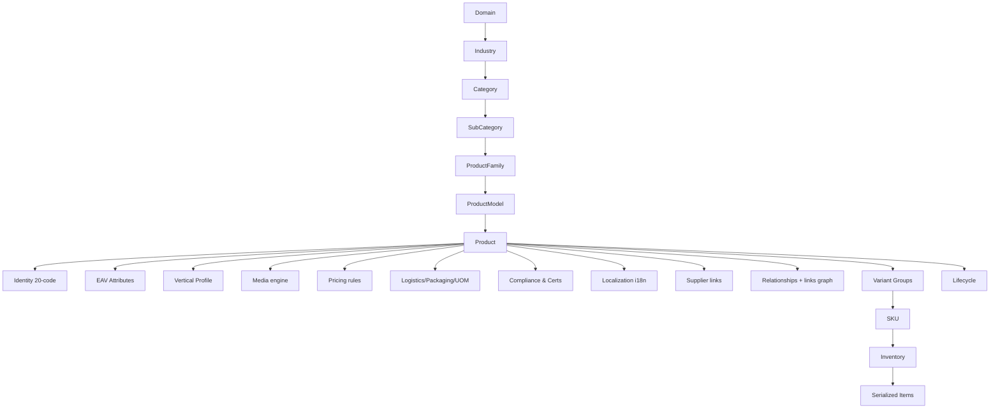

---

## 5. Product & price spine (how a price on the page is computed)

```
  stored (base, tenant currency)                       shown (store currency)
  ┌─────────────────────────────┐   FX (currencies.fx) ┌──────────────────────┐
  │ base: product.price                                   │ localised money      │
  │   └─ variant override: sku.price when a variant chosen│ priceHtml()          │
  │ contract price: active contract, buyer email, dates,  └──────────────────────┘
  │   product in scope, qty ≥ min_qty  → wins
  │ else tier qty rules:  qty≥t.qty → t.price  → wins
  │ else base
  └─────────────────────────────┘

  Cart/checkout subtotal then layers:
      Σ unit·qty  ─► promos/coupon  ─► gift/wallet  ─► shipping(free-threshold/base fee)
                 ─► logistics surcharge (DG/cold/heavy/white-glove)  ─► tax (context+tax mode)
                 ─► TOTAL  (order.sub / tax / ship_fee / gift_used / total, currency+fx persisted)
```

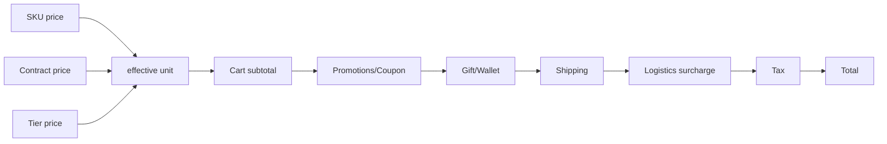

---

## 6. Checkout flow (customer) — with industry contexts

```
 cart ──► identity check (Identity Pro may require login)
      ──► shipping address (name/address/city/zip)
      ──► carrier select (providers shipping/*) → fee + ETA
      ──► payment select: enabled gateway AND available in country (provider_availability)
             US→Stripe/PayPal/COD   IN→Razorpay/UPI/COD   AE→Tabby/Stripe/COD
      ──► CONTEXTS validated per industry:
             tax (gst_profile | vat_profile | sales_tax | zero_rate)
             invoice (tax_invoice | commercial_invoice | proforma | cash_receipt)
             payment (online_capture | bnpl | cash_delivery | invoice_net)
             (server auto-derives defaults, rejects mismatched context)
      ──► plan check: monthly order limit
      ──► place order → order + order_items(+sku_id) + payment(simulated capture)
      ──► audit(checkout.complete, IP) · notify store · decrement cart
      ──► (optional) allocate serialized item to the order
```

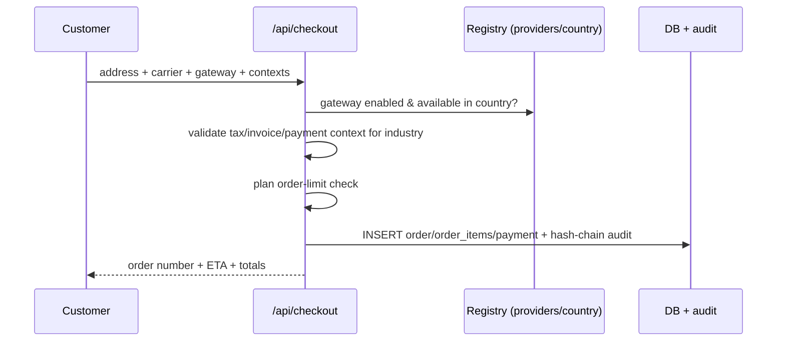

---

## 7. B2B procurement flows (RFQ · Tender · Contract)

```
  RFQ:   customer ─POST /api/rfqs─► rfqs(open)
         store admin ─ quote ─► rfqs.quotes[] ─► status: quoted
         customer accepts ─► accepted
         admin: /api/admin/rfqs/:id/contract ─► CONTRACT(active, fixed price, min qty, window)

  TENDER: admin ─POST /api/admin/tenders─► tenders(open) [title, items, budget, close date]
         admin ─ award ─► /api/admin/tenders/:id/award
                 ├─► new CONTRACT from tender line items (status active)
                 └─► tender.status=awarded (+ awarded_contract_id link)

  CONTRACT:  applies automatically at cart/checkout when buyer email matches,
             qty ≥ min_qty, product in scope, today within valid window → overrides tier price
```

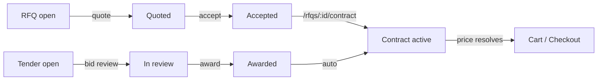

---

## 8. Supply side — marketplace sellers vs procurement suppliers

```
   MARKETPLACE (who sells on your store)          PROCUREMENT (who supplies stock)
   table: sellers                                  table: suppliers + product_suppliers
   role ∈ {manufacturer,distributor,wholesaler,    party_role ∈ {manufacturer,distributor,wholesaler,
          retailer,dropshipper,franchise,                    importer,exporter,logistics,service,
          marketplace_seller,importer,exporter}              raw_material}
   commission %                                     lead time · MOQ · terms · certs · price list
        │                                                     │
        ▼                                                     ▼
   order_items ─► /api/admin/settlements/generate     products.supplier links (many per product,
   (group by product.supplier_id = SELLER,               one is_primary; unit cost, lead, moq)
    gross·commission → net, period)                    shown on storefront (lead time/supplier)
   settlements: pending → paid
```

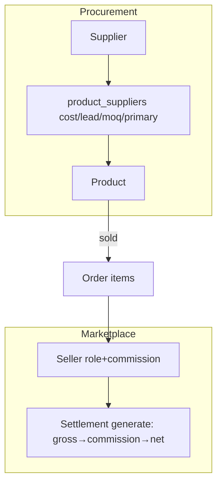

---

## 9. Unit lifecycle — inventory & serialized items

```
  Product ── SKU ── Inventory (per warehouse: qty, reserved, lot, batch, expiry)
                          └─ serialized_items (one row per physical unit):
                               in_stock → allocated → shipped → delivered
                                        ↘ returned → repaired/in_stock
                                        ↘ quarantined / lost / retired
                               fields: serial · imei · rfid · asset_tag · warranty_end ·
                                       purchase_date · order (custody)
  bulk create: POST /api/admin/serialized/bulk (product, count, prefix)
```

```mermaid
stateDiagram-v2
  [*] --> in_stock
  in_stock --> allocated --> shipped --> delivered
  delivered --> returned --> repaired --> in_stock
  in_stock --> quarantined
  in_stock --> lost
  in_stock --> retired
```

---

## 10. Product lifecycle (governance state machine)

```
  draft → review → approved → published ⇄ suspended → archived
                        │          │
                     rejected    discontinued → archived
   (non-published items are hidden from the storefront; enforced server-side)
```

---

## 11. Module marketplace (capabilities as data)

```
  Platform authors module (manifest: capabilities[], config fields, price)
        │  install (bills invoice MOD-*, audited, applies capabilities)
        ▼
  tenant_modules: {wallet, seoPro, listingPro, recoPro, identityPro, billingPro, offersPro, catalog-* }
        │
        ▼   capabilities gate behaviour at runtime (no code fork):
   wallet→gift balance · seoPro→sitemap · listingPro→facets · recoPro→recommendations ·
   identityPro→require-login checkout · offersPro→BOGO/bundle · billingPro→self-pay invoices
        │
        ▼  configure() tweaks module config · uninstall → unapplyModule (reverts capability)
```

---

## 12. Extensibility — the entity engine (Data Studio) & custom data

```
  POST /api/meta/entity-def {key,label,fields[]}   (or Data Studio "New entity")
        │
        ▼  entity_defs / entity_data (JSON storage)
  engine auto-provides: list + form + validation + tenant scoping + audit + Data Studio card
        └─ custom providers: custom_providers (JSON manifest, kind: payment/shipping/notify/tax)
   ── ALL built-in entities (products, suppliers, contracts, tenders, compliance, serialized,
      variant_groups, localizations, countries, currencies, providers…) ride the SAME engine ──
```

---

## 13. Console navigation maps

Store Console (`/admin.html`):
```
◈ Dashboard · 📦 Products · 🔖 SKUs & Inventory · 🧾 Orders · ↩️ Returns · 📋 RFQs ·
🏪 Sellers · 🤝 Settlements · 📝 Contracts · 🏛️ Tenders · 🚚 Suppliers · 🔢 Serialized ·
✅ Compliance · 🌐 Localizations · 🎯 Promotions · 🖼️ Home Content · 🌳 Taxonomy ·
🧬 Attributes · 💳 Payment Gateways · 🧩 Modules · ⚙️ Settings · 🧮 Billing ·
📊 Analytics · 📜 Audit Trail · 📈 Monitor · 🛠️ Data Studio
```

Platform Console (`/platform.html`):
```
◈ Command · 🛡️ Provisioning · 🏬 Stores (→ launch wizard · Manage=impersonate→Store Console) ·
🌍 Geo · Countries · Taxes · 💼 Plans · 🔁 Subscriptions · 🧾 Invoices · 🧩 Module Marketplace ·
🔌 Provider Registry · 📈 Monitoring · 📜 Global Audit · (GET /api/platform/security → scorecard)
```

---

## 14. Data model map (tables grouped by domain)

```
  PLATFORM   tenants · plans · subscriptions · invoices · payments · platform_admins ·
             platform_sessions · platform_settings · settings · modules · tenant_modules · wallets
  GEO/REG    countries · currencies · fx_rates · tax_modes · provider_defs ·
             provider_availability · meta_lists · context_types
  CATALOG    products · product_bullets · taxonomy · departments · attribute_defs · skus ·
             inventory · warehouses · relationships · links ·
             variant_groups · serialized_items · compliance_records · localizations
  PEOPLE     users · sessions · cart_items · saved_items · view_history · tenant_state
  SELL       orders · order_items · returns · reviews · sellers · settlements ·
             rfqs · contracts · tenders · suppliers · product_suppliers · promotions ·
             home_banners · home_cards · tokens
  SECURITY   audit_log (hash-chained) · entity_defs · entity_data · custom_providers
             (+ files: data/master.json keyring L6)
```

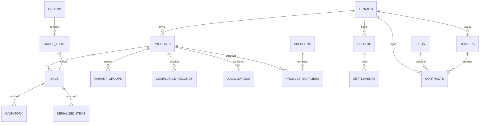

---

## 15. Roles → capabilities (quick matrix)

| Flow | Customer | Store Admin | Platform Admin |
|---|:--:|:--:|:--:|
| Browse/buy/cart/checkout | ✅(own) | ✅ | ✅ |
| Orders/returns/RFQ | ✅ own | ✅ all + act | ✅ |
| Catalog · variants · inventory · serialize | — | ✅ | ✅ |
| Compliance · i18n · suppliers · contracts · tenders | — | ✅ | ✅ |
| Promotions · content · taxonomy | — | ✅ | policy-gate ✅ |
| Payments config | — | ✅ | registry ✅ |
| Launch/suspend stores · geo/plans/modules | — | — | ✅ |
| Global audit + chain verify | — | per-store | ✅ global |
| Security scorecard | — | — | ✅ `/api/platform/security` |

## 16. AI product layer (free default · premium gated by billing)

```
  meta_lists: aiCapabilities · aiPlans · provider_defs(kind=ai)   ← editable data
  settings.ai: { per-capability: enabled / premium / provider / model }
        │
  capabilities(tenant): resolve(tier) — tier = active PAID plan OR aiPro module
        │            free  → built-in ai-local engine (heuristics, cost 0, always on)
        │            premium→ premium model if PAID + keys configured, else fall back free
  run(tenant,capability,params): gate → LOCAL engine (real, from store data) → meter ai_usage
  ── engines: product_recommendation · image_processing · data_analysis · data_cleaning · reporting
```
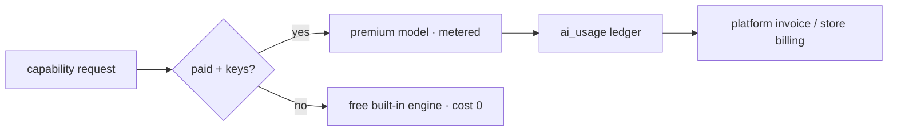

## 17. Central Offers / Coupons / Wallet (one reusable engine)

```
  meta_lists: offerTypes · offerScopes · offerChannels · offerDirections ·
              offerFunders · couponKinds · stackingPolicies   ← unlimited, editable
  tables:     offers (scope_level tenant|global, channel commerce|subscription|ai)
              coupons (code, kind, funder) · coupon_redemptions · wallet_entries(ledger)
        │
  offers.evaluate({channel, tenantId, items|amount, coupon, owner}) →
        { discount, credits, freeShip, applied[], redemptions[] }
        │  type handlers (data-typed): percent · fixed · free_ship · bogo · buy_x_get_y
        │  · x_for_y · multi_buy · bundle_price · tier_qty · cashback(→credit) · spend_get_credit
        │  scope: store · category · node · product · brand   |  stack: exclusive/group/max
  CONSUMERS (all call the SAME engine):  cart · checkout(+redeem/credit) · platform
        subscription invoices (channel=subscription) · AI runs (channel=ai)
  wallet = double-entry (wallet_entries ledger behind wallets.balance); funder split on
        every redemption → platform sees "who pays" (self/bank/brand/partner/platform)
  global offers/coupons = tenant_id 0, inherited by every store (policy-gated)
```
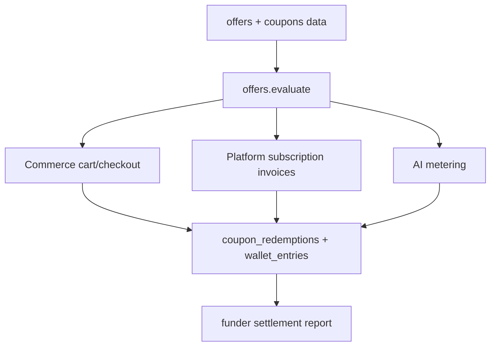

## 18. Integration layer — real payments & notifications (offline-safe)

```
  gateway/notifier row: mode = sandbox | live  +  sealed credentials (L5 AES-GCM)
        │
  api.js settlePayment / notify  ──►  lib/connect.js (zero-dep global fetch)
        │                                 │ adapters (PAY): stripe·razorpay·paypal·square·braintree
   mode≠live OR no creds OR LX_OFFLINE=1   │ adapters (NOTIFY): resend·sendgrid·twilio·webhook
        │                                 │ (+ connect.ping for gateway "verify")
        ▼                                 ▼
   simulateGateway (offline, _sim ref)   LIVE HTTPS call → real txn id / delivered
        │                                 on decline/error → payment.status='failed', order cancelled (402)
  tests: __setFetch() injects a fake transport ⇒ real code paths exercised, never hits the network
```
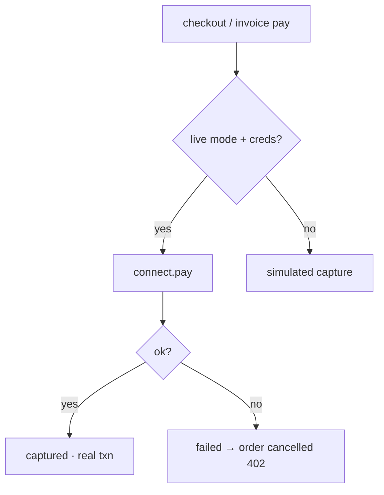
> Env `LX_OFFLINE=1` forces every outbound call to the simulated path (CI / no-secrets runs).
> AI premium models route through the same live/offline gate (`ai.js` provider `ai:<id>` creds).

## 19. Runtime configuration spine (every backend is config, zero code-fork)

```
  lib/config.js  ← platform_settings.runtime  ← env (LX_CACHE/LX_QUEUE/LX_STORAGE/…)  ← safe defaults
  one catalog of "concerns": cache · queue · storage · ratelimit · session · outbound · db
        │  each lists selectable drivers (data-described → new drivers need no UI code)
  lib/adapters.js implements them, dependency-free:
     cache     memory            | redis (RESP over TCP, write-through mirror)
     queue     inline (runs now) | redis (LPUSH) | webhook (POST job)
     storage   local disk        | s3 (SigV4 via fetch) | webhook
     ratelimit memory            | redis (shared counts)
     outbound  auto | offline     | live   (drives connect.js payments/notify/AI)
     db        sqlite (default) — swap seam (run/all/get) isolated; postgres reserved
  safe-by-default: unconfigured/unreachable drivers fall back in-process → nothing breaks, no hangs
  Platform → Runtime screen edits it live; /api/platform/runtime (GET/PUT); LX_OFFLINE=1 forces simulated
```
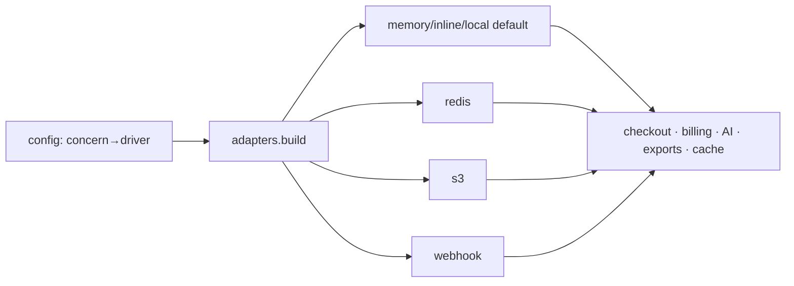
> Switching a store (or the platform) to Redis + S3 + a worker is a **config change**, not a
> deploy — the same "everything is data" principle, now applied to infrastructure.

## 20. Tax + Billing engines (first-class, config-driven, shared)

```
  lib/tax.js  — meta_lists: taxClasses · taxRules · exemptionReasons · taxNumberFormats
     quote({country, lines[{class|tax_rule, amount}], buyerVat, inclusive}) → per-line rate + tax
     · class → jurisdiction rate (standard/reduced/digital) · per-product tax_rule override
     · B2B reverse-charge zeroes digital VAT when buyer VAT/GST valid · exemption via class/flag
     validateNumber(country, num) — GSTIN / UK VAT / DE USt / AE TRN / FR TVA
     computeLegacy() — exact old formula, so checkout is byte-identical (no regression)
     ONE engine used by checkout AND invoices AND /api/admin/tax/quote

  lib/billing.js — invoice_lines · usage_records · credit_notes · billing_events
     issueInvoice(): plan line (+proration) + unbilled usage lines + offer discount (subscription
        channel via offers.discountFor) + tax (via tax.js) → draft invoice + lines + event
     recordUsage() (AI units, orders, storage, api) · creditNote() (refund → customer wallet via
        offers.js double-entry) · dunning() (escalating stages) · aging() (receivables buckets)
     AI premium runs auto-meter usage; module/plan purchases flow through invoices
```
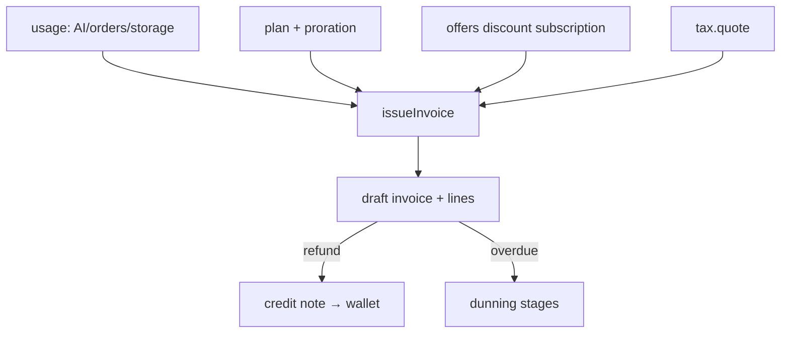

## 21. Declarative integrations (spec = data, not code)

```
  provider_defs.spec / custom_provider.manifest.spec   ← the "blanks"
     { method, url: "…{{cfg.id}}…", auth: basic|bearer|apikey, form|json,
       body: { …{{amountCents}} {{currency}} {{to}} {{payload.x}}… },
       idPath, statusPath, statusMap{ succeeded→captured,… }, errorPath, token:{…} }
        │
  lib/spec.js  render templates + execute (optional token step, urlencoded/json, idempotency)
        │
  lib/connect.js  pay/notify/marketing/ping — looks up the spec (provider_defs or inline),
                  checks offline + credentials, executes generically, maps status.
                  NO per-provider code. Offline/no-creds/no-spec → caller simulates.

  kinds (providerKinds registry): payment · shipping · notification · tax · ai · marketing
  marketing (data): meta · google-ads · ga4 · tiktok  — + ANY custom provider via a manifest spec
  → "Add Meta/Google/TikTok/my CRM" = a row of data (fill the blanks), not a deploy.
```
