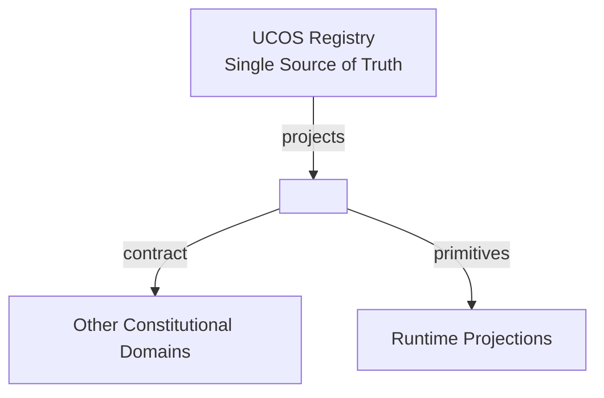
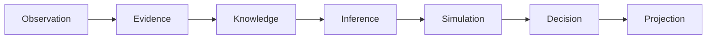
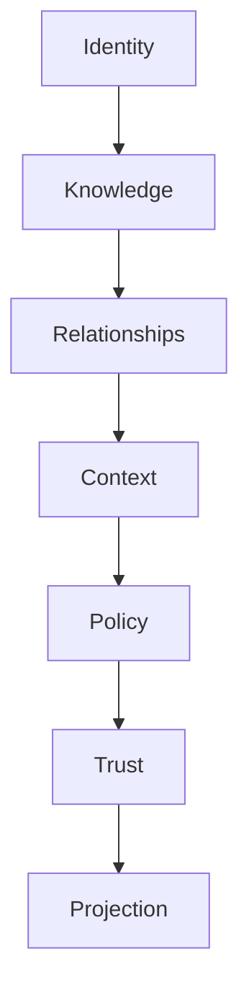

# UCOS Ω∞ — Master Document

**Projected from** `_registry/` (the single source of truth). Never edit this file or a volume: change the registry, then run `npm run registry`. Last amendment: AMD-0003 (2026-10-17).

## Contents

1. [How to manage](#how-to-manage)
2. [Volume register](#volume-register)
3. [Index](#index)
4. [Constitution](#constitution)
5. [Standard contract](#standard-contract)
6. [Glossary](#glossary)
7. [ID lookup](#id-lookup)

<a id="how-to-manage"></a>
## 1. How to manage

Everything here is projected. To change it, edit the registry entry named below, then run `npm run registry`. That re-projects this document and every volume, audits them, then compiles, gates and seals the registry. `npm test` fails if any document is out of date with the registry.

| To change | Edit |
|---|---|
| A category (add, rename, describe) | `_registry/domains.json` → `categories` |
| A domain (add, owns, responsibilities, category, contract) | `_registry/domains.json` → `domains` |
| A law | `_registry/domains.json` → `laws`, with an entry in `amendments` |
| A primitive (frozen: needs an amendment) | `_registry/primitives.json`, with an entry in `domains.json` → `amendments` |
| A term (add, define) | `_registry/terminology.json`, and add it to exactly one domain’s `owns` |
| An artifact (add, retitle, owner) | `_registry/manifest.json` → `artifacts`, a route in `_registry/content-map.json`, a content block in a `_registry/content-*.json` |
| An artifact’s sections | its content block (the route is shown under each artifact) |
| The document layout (master file, volume folder, size limit per volume) | `_registry/manifest.json` → `projection` |

**Commands.** `npm run registry` re-projects, audits, compiles, gates and seals · `node _registry/project.js --watch` re-projects whenever a registry file changes · `node _registry/project.js --list` lists the artifacts · `node _registry/project.js --check` checks registry integrity · `node _registry/audit.js` enforces the laws over the master and volumes · `node _registry/compile.js --search <words> [--kind …] [--category …] [--owner …]` finds anything.

**Provenance.** `_superseded/` keeps the hand-authored documents the registry was distilled from. They are history, not a source of truth.

The integrity gate refuses a change that leaves a name owned twice or not at all, a domain without a category or contract, an unowned artifact, or a reserved name.

<a id="volume-register"></a>
## 2. Volume register

**15 volumes** for 13 categories · 46 domains · 110 artifacts · 27 primitives · 74 terms.

A volume may reach 100 KB (`manifest.json` → `projection.maxVolumeBytes`). A category that would pass it is split into numbered parts on the next projection, and merged back when it shrinks.

| Volume | Category | Part | Domains | Artifacts | Size |
|---|---|---|---:|---:|---:|
| [V01](volumes/V01-constitution.md) | C01 Constitution | 1 of 1 | 1 | 10 | 70 KB |
| [V02](volumes/V02-meaning.md) | C02 Meaning | 1 of 1 | 4 | 12 | 78 KB |
| [V03.1](volumes/V03.1-reality-and-reasoning.md) | C03 Reality and Reasoning | 1 of 2 | 9 | 13 | 88 KB |
| [V03.2](volumes/V03.2-reality-and-reasoning.md) | C03 Reality and Reasoning | 2 of 2 | 1 | 3 | 20 KB |
| [V04](volumes/V04-universal-dimensions.md) | C04 Universal Dimensions | 1 of 1 | 6 | 6 | 38 KB |
| [V05](volumes/V05-structure.md) | C05 Structure | 1 of 1 | 2 | 2 | 14 KB |
| [V06](volumes/V06-decision-and-control.md) | C06 Decision and Control | 1 of 1 | 4 | 4 | 28 KB |
| [V07](volumes/V07-assurance.md) | C07 Assurance | 1 of 1 | 4 | 10 | 66 KB |
| [V08](volumes/V08-interaction.md) | C08 Interaction | 1 of 1 | 4 | 4 | 25 KB |
| [V09](volumes/V09-automation.md) | C09 Automation | 1 of 1 | 3 | 15 | 98 KB |
| [V10](volumes/V10-intelligence.md) | C10 Intelligence | 1 of 1 | 1 | 1 | 6 KB |
| [V11.1](volumes/V11.1-platform.md) | C11 Platform | 1 of 2 | 2 | 13 | 82 KB |
| [V11.2](volumes/V11.2-platform.md) | C11 Platform | 2 of 2 | 3 | 6 | 37 KB |
| [V12](volumes/V12-business.md) | C12 Business | 1 of 1 | 1 | 10 | 65 KB |
| [V13](volumes/V13-composition.md) | C13 Composition | 1 of 1 | 1 | 1 | 6 KB |

<a id="index"></a>
## 3. Index

### C01 · Constitution

The laws, amendments and certification law that govern every other category. Volume: [V01](volumes/V01-constitution.md).

- [Constitutional Authority](volumes/V01-constitution.md#d-con) — owns [Capability](#t-capability), [Constitution](#t-constitution), [Amendment](#t-amendment)
  - [UCOS-CON-000001](volumes/V01-constitution.md#ucos-con-000001) Constitutional Foundation
  - [UCOS-CON-000002](volumes/V01-constitution.md#ucos-con-000002) Canonical Terminology Constitution
  - [UCOS-CON-000003](volumes/V01-constitution.md#ucos-con-000003) Domain Ownership Constitution
  - [UCOS-CON-000004](volumes/V01-constitution.md#ucos-con-000004) Dependency Constitution
  - [UCOS-CON-000005](volumes/V01-constitution.md#ucos-con-000005) Governance Constitution
  - [UCOS-CON-000006](volumes/V01-constitution.md#ucos-con-000006) Security Constitution
  - [UCOS-CON-000007](volumes/V01-constitution.md#ucos-con-000007) Privacy Constitution
  - [UCOS-CON-000008](volumes/V01-constitution.md#ucos-con-000008) Trust Constitution
  - [UCOS-CON-000009](volumes/V01-constitution.md#ucos-con-000009) Evolution Constitution
  - [UCOS-CON-000010](volumes/V01-constitution.md#ucos-con-000010) Certification Constitution

### C02 · Meaning

What exists, what it is called, and what is known about it. Volume: [V02](volumes/V02-meaning.md).

- [Identity](volumes/V02-meaning.md#d-idn) — owns [Identity](#t-identity), [Intent](#t-intent), [Existence](#t-existence), [Entity](#t-entity)
  - [UCOS-IDN-000001](volumes/V02-meaning.md#ucos-idn-000001) Identity Architecture
- [Semantic](volumes/V02-meaning.md#d-sem) — owns [Meaning](#t-meaning), [Ontology](#t-ontology), [Taxonomy](#t-taxonomy), [Classification](#t-classification)
  - [UCOS-SEM-000001](volumes/V02-meaning.md#ucos-sem-000001) Universal Semantic Architecture
  - [UCOS-ONT-000001](volumes/V02-meaning.md#ucos-ont-000001) Universal Ontology
  - [UCOS-TAX-000001](volumes/V02-meaning.md#ucos-tax-000001) Universal Taxonomy
  - [UCOS-CLS-000001](volumes/V02-meaning.md#ucos-cls-000001) Universal Classification Architecture
- [Knowledge](volumes/V02-meaning.md#d-knw) — owns [Knowledge](#t-knowledge)
  - [UCOS-KNW-000001](volumes/V02-meaning.md#ucos-knw-000001) Knowledge Architecture
- [Guidance](volumes/V02-meaning.md#d-gdn) — owns [Guide](#t-guide)
  - [UCOS-IMP-000001](volumes/V02-meaning.md#ucos-imp-000001) Master Implementation Blueprint
  - [UCOS-IMP-000002](volumes/V02-meaning.md#ucos-imp-000002) Reference Platform Architecture
  - [UCOS-IMP-000003](volumes/V02-meaning.md#ucos-imp-000003) Engineering Playbook
  - [UCOS-IMP-000004](volumes/V02-meaning.md#ucos-imp-000004) Migration Blueprint
  - [UCOS-IMP-000005](volumes/V02-meaning.md#ucos-imp-000005) Delivery Roadmap
  - [UCOS-GDN-000001](volumes/V02-meaning.md#ucos-gdn-000001) Guidance Architecture

### C03 · Reality and Reasoning

How reality is observed, evidenced, explained, simulated and changed. Volumes: [V03.1](volumes/V03.1-reality-and-reasoning.md), [V03.2](volumes/V03.2-reality-and-reasoning.md).

- [Observation](volumes/V03.1-reality-and-reasoning.md#d-obs) — owns [Observation](#t-observation), [Data](#t-data), [Information](#t-information)
  - [UCOS-OBS-000001](volumes/V03.1-reality-and-reasoning.md#ucos-obs-000001) Observation Architecture
- [Evidence](volumes/V03.1-reality-and-reasoning.md#d-evd) — owns [Evidence](#t-evidence)
  - [UCOS-EVD-000001](volumes/V03.1-reality-and-reasoning.md#ucos-evd-000001) Evidence Architecture
- [Inference](volumes/V03.1-reality-and-reasoning.md#d-inf) — owns [Inference](#t-inference)
  - [UCOS-INF-000001](volumes/V03.1-reality-and-reasoning.md#ucos-inf-000001) Inference Architecture
  - [UCOS-UNC-000001](volumes/V03.1-reality-and-reasoning.md#ucos-unc-000001) Uncertainty Architecture
- [Reasoning](volumes/V03.1-reality-and-reasoning.md#d-rsn) — owns [Reasoning](#t-reasoning)
  - [UCOS-RSN-000001](volumes/V03.1-reality-and-reasoning.md#ucos-rsn-000001) Reasoning Architecture
  - [UCOS-CONTR-000001](volumes/V03.1-reality-and-reasoning.md#ucos-contr-000001) Contradiction Architecture
- [Simulation](volumes/V03.1-reality-and-reasoning.md#d-sim) — owns [Simulation](#t-simulation)
  - [UCOS-SIM-000001](volumes/V03.1-reality-and-reasoning.md#ucos-sim-000001) Simulation Architecture
- [Causality](volumes/V03.1-reality-and-reasoning.md#d-cau) — owns [Causality](#t-causality)
  - [UCOS-CAU-000001](volumes/V03.1-reality-and-reasoning.md#ucos-cau-000001) Causality Architecture
- [Perspective](volumes/V03.1-reality-and-reasoning.md#d-per) — owns [Perspective](#t-perspective)
  - [UCOS-PER-000001](volumes/V03.1-reality-and-reasoning.md#ucos-per-000001) Perspective Architecture
- [Possibility](volumes/V03.1-reality-and-reasoning.md#d-pos) — owns [Possibility](#t-possibility)
  - [UCOS-REA-000001](volumes/V03.1-reality-and-reasoning.md#ucos-rea-000001) Multi-Reality Architecture
  - [UCOS-POSS-000001](volumes/V03.1-reality-and-reasoning.md#ucos-poss-000001) Possibility Architecture
- [Evolution](volumes/V03.1-reality-and-reasoning.md#d-evo) — owns [Evolution](#t-evolution), [Emergence](#t-emergence)
  - [UCOS-EVO-000001](volumes/V03.1-reality-and-reasoning.md#ucos-evo-000001) Evolution Architecture
  - [UCOS-EMG-000001](volumes/V03.1-reality-and-reasoning.md#ucos-emg-000001) Emergence Architecture
- [Twin](volumes/V03.2-reality-and-reasoning.md#d-dtw) — owns [Digital Twin](#t-digital-twin)
  - [UCOS-DTW-000001](volumes/V03.2-reality-and-reasoning.md#ucos-dtw-000001) Digital Twin Architecture
  - [UCOS-DTW-000002](volumes/V03.2-reality-and-reasoning.md#ucos-dtw-000002) Twin Federation Architecture
  - [UCOS-DTW-000003](volumes/V03.2-reality-and-reasoning.md#ucos-dtw-000003) Twin Synchronization Architecture

### C04 · Universal Dimensions

The coordinates any fact is placed in: where, when, how much, what value, in which expression, in what context. Volume: [V04](volumes/V04-universal-dimensions.md).

- [Geo](volumes/V04-universal-dimensions.md#d-geo) — owns [Place](#t-place)
  - [UCOS-PLC-000001](volumes/V04-universal-dimensions.md#ucos-plc-000001) Geo Architecture
- [Time](volumes/V04-universal-dimensions.md#d-tim) — owns [Time](#t-time), [Calendar](#t-calendar)
  - [UCOS-TIM-000001](volumes/V04-universal-dimensions.md#ucos-tim-000001) Time Architecture
- [Measure](volumes/V04-universal-dimensions.md#d-mea) — owns [Quantity](#t-quantity), [Unit](#t-unit)
  - [UCOS-MEA-000001](volumes/V04-universal-dimensions.md#ucos-mea-000001) Measure Architecture
- [Value](volumes/V04-universal-dimensions.md#d-val) — owns [Value Unit](#t-value-unit)
  - [UCOS-VAL-000001](volumes/V04-universal-dimensions.md#ucos-val-000001) Value Architecture
- [Expression](volumes/V04-universal-dimensions.md#d-exr) — owns [Expression](#t-expression), [Script](#t-script)
  - [UCOS-EXR-000001](volumes/V04-universal-dimensions.md#ucos-exr-000001) Expression Architecture
- [Context](volumes/V04-universal-dimensions.md#d-ctx) — owns [Context](#t-context)
  - [UCOS-CTX-000001](volumes/V04-universal-dimensions.md#ucos-ctx-000001) Context Architecture

### C05 · Structure

How declarations are stored once and linked. Volume: [V05](volumes/V05-structure.md).

- [Registry](volumes/V05-structure.md#d-reg) — owns [Registry](#t-registry), [RegistryEntry](#t-registryentry), [Metadata](#t-metadata), [Kind](#t-kind)
  - [UCOS-REG-000001](volumes/V05-structure.md#ucos-reg-000001) Registry Architecture
- [Relationship](volumes/V05-structure.md#d-rel) — owns [Relationship](#t-relationship)
  - [UCOS-REL-000001](volumes/V05-structure.md#ucos-rel-000001) Relationship Architecture

### C06 · Decision and Control

Who may decide, under which policy and rule, and what was decided. Volume: [V06](volumes/V06-decision-and-control.md).

- [Policy](volumes/V06-decision-and-control.md#d-pol) — owns [Policy](#t-policy)
  - [UCOS-POL-000001](volumes/V06-decision-and-control.md#ucos-pol-000001) Policy Architecture
- [Rule](volumes/V06-decision-and-control.md#d-rul) — owns [Rule](#t-rule)
  - [UCOS-RUL-000001](volumes/V06-decision-and-control.md#ucos-rul-000001) Rule Architecture
- [Decision](volumes/V06-decision-and-control.md#d-dec) — owns [Decision](#t-decision)
  - [UCOS-DEC-000001](volumes/V06-decision-and-control.md#ucos-dec-000001) Decision Architecture
- [Authority](volumes/V06-decision-and-control.md#d-aut) — owns [Authority](#t-authority), [Ownership](#t-ownership), [Permission](#t-permission)
  - [UCOS-AUT-000001](volumes/V06-decision-and-control.md#ucos-aut-000001) Authority Architecture

### C07 · Assurance

Protection, computed trust, the immutable record, and obligations. Volume: [V07](volumes/V07-assurance.md).

- [Security](volumes/V07-assurance.md#d-sec) — owns [Credential](#t-credential), [Key](#t-key)
  - [UCOS-IAM-000001](volumes/V07-assurance.md#ucos-iam-000001) Identity & Access Management
  - [UCOS-ZTA-000001](volumes/V07-assurance.md#ucos-zta-000001) Zero Trust Architecture
  - [UCOS-CRY-000001](volumes/V07-assurance.md#ucos-cry-000001) Cryptography Architecture
  - [UCOS-KMS-000001](volumes/V07-assurance.md#ucos-kms-000001) Key Management Architecture
  - [UCOS-SEC-000001](volumes/V07-assurance.md#ucos-sec-000001) Security Runtime Architecture
- [Trust](volumes/V07-assurance.md#d-tru) — owns [Trust](#t-trust)
  - [UCOS-TRS-000001](volumes/V07-assurance.md#ucos-trs-000001) Trust Architecture
- [Audit](volumes/V07-assurance.md#d-aud) — owns [Audit Record](#t-audit-record)
  - [UCOS-AUD-000001](volumes/V07-assurance.md#ucos-aud-000001) Audit Architecture
- [Compliance](volumes/V07-assurance.md#d-cmp) — owns [Obligation](#t-obligation), [Consent](#t-consent)
  - [UCOS-DSP-000001](volumes/V07-assurance.md#ucos-dsp-000001) Data Sovereignty Architecture
  - [UCOS-CNS-000001](volumes/V07-assurance.md#ucos-cns-000001) Consent Architecture
  - [UCOS-CMP-000001](volumes/V07-assurance.md#ucos-cmp-000001) Compliance Architecture

### C08 · Interaction

How people see, are told, converse and find. Volume: [V08](volumes/V08-interaction.md).

- [Experience](volumes/V08-interaction.md#d-exp) — owns [Interface](#t-interface), [Device Type](#t-device-type)
  - [UCOS-EXP-000001](volumes/V08-interaction.md#ucos-exp-000001) Experience Architecture
- [Communication](volumes/V08-interaction.md#d-cmn) — owns [Message](#t-message), [Conversation](#t-conversation), [Communication Channel](#t-communication-channel)
  - [UCOS-CMN-000001](volumes/V08-interaction.md#ucos-cmn-000001) Communication Architecture
- [Notification](volumes/V08-interaction.md#d-ntf) — owns [Notification](#t-notification)
  - [UCOS-NTF-000001](volumes/V08-interaction.md#ucos-ntf-000001) Notification Architecture
- [Search](volumes/V08-interaction.md#d-srh) — owns [Search Index](#t-search-index)
  - [UCOS-SRC-000001](volumes/V08-interaction.md#ucos-src-000001) Search Architecture

### C09 · Automation

How work runs: events, state, workflows, agents and connections. Volume: [V09](volumes/V09-automation.md).

- [Runtime](volumes/V09-automation.md#d-run) — owns [State](#t-state), [Event](#t-event), [Process](#t-process), [Workflow](#t-workflow), [Projection](#t-projection)
  - [UCOS-RUN-000001](volumes/V09-automation.md#ucos-run-000001) Runtime Constitution
  - [UCOS-RUN-000002](volumes/V09-automation.md#ucos-run-000002) Execution Architecture
  - [UCOS-RUN-000003](volumes/V09-automation.md#ucos-run-000003) Orchestration Architecture
  - [UCOS-RUN-000004](volumes/V09-automation.md#ucos-run-000004) Workflow Architecture
  - [UCOS-RUN-000005](volumes/V09-automation.md#ucos-run-000005) State Machine Architecture
  - [UCOS-EVT-000001](volumes/V09-automation.md#ucos-evt-000001) Event Architecture
  - [UCOS-MSG-000001](volumes/V09-automation.md#ucos-msg-000001) Messaging Architecture
- [Agent](volumes/V09-automation.md#d-agt) — owns [Agent](#t-agent)
  - [UCOS-AGT-000001](volumes/V09-automation.md#ucos-agt-000001) Agent Constitution
  - [UCOS-AGT-000002](volumes/V09-automation.md#ucos-agt-000002) Agent Runtime
  - [UCOS-AGT-000003](volumes/V09-automation.md#ucos-agt-000003) Agent Governance
  - [UCOS-AGT-000004](volumes/V09-automation.md#ucos-agt-000004) Agent Trust
  - [UCOS-AGT-000005](volumes/V09-automation.md#ucos-agt-000005) Agent Safety
  - [UCOS-AGT-000006](volumes/V09-automation.md#ucos-agt-000006) Agent Economics
  - [UCOS-AGT-000007](volumes/V09-automation.md#ucos-agt-000007) Agent Society
- [Integration](volumes/V09-automation.md#d-int) — owns [API](#t-api), [Connector](#t-connector)
  - [UCOS-INT-000001](volumes/V09-automation.md#ucos-int-000001) Integration Architecture

### C10 · Intelligence

Measurement of the platform and the business. Volume: [V10](volumes/V10-intelligence.md).

- [Insight](volumes/V10-intelligence.md#d-ins) — owns [Metric](#t-metric), [Report](#t-report)
  - [UCOS-INS-000001](volumes/V10-intelligence.md#ucos-ins-000001) Insight Architecture

### C11 · Platform

Storing, running, verifying, holding content and offering the platform. Volumes: [V11.1](volumes/V11.1-platform.md), [V11.2](volumes/V11.2-platform.md).

- [Persistence](volumes/V11.1-platform.md#d-prs) — owns [Storage](#t-storage), [Cache](#t-cache), [Index](#t-index)
  - [UCOS-DB-000001](volumes/V11.1-platform.md#ucos-db-000001) Storage Architecture
  - [UCOS-GRF-000001](volumes/V11.1-platform.md#ucos-grf-000001) Graph Architecture
  - [UCOS-IDX-000001](volumes/V11.1-platform.md#ucos-idx-000001) Index Architecture
  - [UCOS-CCH-000001](volumes/V11.1-platform.md#ucos-cch-000001) Cache Architecture
- [Operations](volumes/V11.1-platform.md#d-ops) — owns [Environment](#t-environment), [Deployment](#t-deployment)
  - [UCOS-SRE-000001](volumes/V11.1-platform.md#ucos-sre-000001) Reliability Architecture
  - [UCOS-MON-000001](volumes/V11.1-platform.md#ucos-mon-000001) Monitoring Architecture
  - [UCOS-OBSV-000001](volumes/V11.1-platform.md#ucos-obsv-000001) Observability Architecture
  - [UCOS-DR-000001](volumes/V11.1-platform.md#ucos-dr-000001) Disaster Recovery Architecture
  - [UCOS-BCP-000001](volumes/V11.1-platform.md#ucos-bcp-000001) Business Continuity Architecture
  - [UCOS-DEP-000001](volumes/V11.1-platform.md#ucos-dep-000001) Deployment Architecture
  - [UCOS-CLD-000001](volumes/V11.1-platform.md#ucos-cld-000001) Multi-Cloud Architecture
  - [UCOS-EDG-000001](volumes/V11.1-platform.md#ucos-edg-000001) Edge Architecture
  - [UCOS-GEO-000001](volumes/V11.1-platform.md#ucos-geo-000001) Geo-Distribution Architecture
- [Quality](volumes/V11.2-platform.md#d-qlt) — owns [Verification](#t-verification), [Test](#t-test)
  - [UCOS-TST-000001](volumes/V11.2-platform.md#ucos-tst-000001) Testing Architecture
  - [UCOS-VER-000001](volumes/V11.2-platform.md#ucos-ver-000001) Verification Architecture
  - [UCOS-CER-000001](volumes/V11.2-platform.md#ucos-cer-000001) Certification Architecture
  - [UCOS-FML-000001](volumes/V11.2-platform.md#ucos-fml-000001) Formal Verification Architecture
- [Content](volumes/V11.2-platform.md#d-cnt) — owns [Media Asset](#t-media-asset)
  - [UCOS-MED-000001](volumes/V11.2-platform.md#ucos-med-000001) Content Architecture
- [Offering](volumes/V11.2-platform.md#d-ofg) — owns [Offering](#t-offering), [Plan](#t-plan), [Licence](#t-licence)
  - [UCOS-OFG-000001](volumes/V11.2-platform.md#ucos-ofg-000001) Offering Architecture

### C12 · Business

Business projections composed from the domains; they own no truth. Volume: [V12](volumes/V12-business.md).

- [Commerce](volumes/V12-business.md#d-biz) — owns [Commerce Projection](#t-commerce-projection)
  - [UCOS-COM-000001](volumes/V12-business.md#ucos-com-000001) Universal Commerce Architecture
  - [UCOS-GPS-000001](volumes/V12-business.md#ucos-gps-000001) Global Products & Services Architecture
  - [UCOS-PRC-000001](volumes/V12-business.md#ucos-prc-000001) Pricing Architecture
  - [UCOS-OFR-000001](volumes/V12-business.md#ucos-ofr-000001) Offer Architecture
  - [UCOS-SUB-000001](volumes/V12-business.md#ucos-sub-000001) Subscription Architecture
  - [UCOS-CNT-000001](volumes/V12-business.md#ucos-cnt-000001) Contract Architecture
  - [UCOS-MKT-000001](volumes/V12-business.md#ucos-mkt-000001) Marketplace Architecture
  - [UCOS-INV-000001](volumes/V12-business.md#ucos-inv-000001) Inventory Architecture
  - [UCOS-ORD-000001](volumes/V12-business.md#ucos-ord-000001) Order Architecture
  - [UCOS-FUL-000001](volumes/V12-business.md#ucos-ful-000001) Fulfillment Architecture

### C13 · Composition

Ready-made, editable compositions of domains. Volume: [V13](volumes/V13-composition.md).

- [Package](volumes/V13-composition.md#d-pkg) — owns [Package](#t-package), [Blueprint](#t-blueprint), [Overlay](#t-overlay)
  - [UCOS-PKG-000001](volumes/V13-composition.md#ucos-pkg-000001) Package Architecture

<a id="constitution"></a>
## 4. Constitution

### Laws

| Law | Statement | Enforced by |
|---|---|---|
| <a id="law-001"></a>LAW-001 Zero Hard Coding | No product, service, offer, contract, currency, country, language, industry or marketplace concept may appear as a schema type. They are projections. | _registry/audit.js |
| <a id="law-002"></a>LAW-002 Knowledge Once | Every concept is defined exactly once: every artifact ID, primitive, term and owner is unique, and nothing is stated twice. | _registry/gate.js, _registry/audit.js |
| <a id="law-003"></a>LAW-003 Projection Law | Documents are projected from the registry, never authored. Editing a projected document is a violation; change the registry and re-project. | _registry/project.js, _registry/audit.js |
| <a id="law-005"></a>LAW-005 Explainability | Every artifact answers what happened, who authorized it, which policy allowed it, what evidence supports it, and with what confidence. | _registry/audit.js |

### Laws of the registries

| Registry | Status | Law |
|---|---|---|
| `primitives.json` — Immutable Primitive Registry | Constitutional Freeze | No primitive may be introduced without constitutional amendment (ARCHITECTURAL FREEZE LAW). |
| `terminology.json` — Canonical Terminology Registry | Constitutional Freeze | No semantic term may exist with multiple meanings. No meaning may exist with multiple canonical definitions. |
| `domains.json` — Domain Ownership & Contract Registry | Constitutional Freeze | No concept may exist without ownership. No overlap may exist between constitutional domains. No cross-domain ownership permitted. |
| `content-map.json` — Artifact to Content Mapping | Constitutional Freeze | Maps every artifact to exactly one content source. Knowledge Once — no artifact may define its own content. |
| `content-core.json` — Core Domain Content Registry | Constitutional Freeze | Knowledge Once — domain substance is defined here once and projected to every artifact. |
| `content-ext.json` — Extended Domain Content Registry | Constitutional Freeze | Knowledge Once — domain substance defined here once, projected everywhere. |
| `content-commerce.json` — Commerce Content Registry | Constitutional Freeze | Knowledge Once — commerce substance defined here once, projected everywhere. Commerce objects are PROJECTIONS, never stored as truth. |
| `content-twin-agent.json` — Twin & Agent Content Registry | Constitutional Freeze | Knowledge Once — twin and agent substance defined here once, projected everywhere. |
| `content-runtime-data.json` — Runtime & Data Content Registry | Constitutional Freeze | Knowledge Once — runtime and data substance defined here once, projected everywhere. |
| `content-sec-ops-dep-qlt.json` — Security, Operations, Deployment & Quality Content Registry | Constitutional Freeze | Knowledge Once — security, operations, deployment, and quality substance defined here once, projected everywhere. |
| `content-platform.json` — Platform Domain Content Registry | Constitutional Freeze | Knowledge Once — the substance of the platform domains' contracts is defined here once and projected everywhere. |

### Ownership and dependency

- **Dependency law:** Identity -> Knowledge -> Relationships -> Context -> Policy -> Trust -> Projection. Forbidden: circular dependencies, mutual ownership, cross-domain state mutation.
- **Communication:** All cross-domain communication occurs exclusively through explicit contracts. No domain may access another domain's internals.
- **Projection law:** Products, services, offers, subscriptions, contracts are projections. No projection may own truth. Truth belongs only to constitutional domains.
- **No domain may:** Modify another domain directly; Bypass authority; Bypass policies; Bypass trust; Bypass governance; Interpret another domain's internals.
- **Primitives:** No primitive may be introduced without constitutional amendment (ARCHITECTURAL FREEZE LAW). Amendment: Constitutional Assembly + formal proof of mathematical unavoidability (LAW 031).
- **Reserved for projections (never primitives or schema types):** Product, Service, Offer, Subscription, Contract, Order, Inventory, Price, Currency, Country, Language, Industry, Category, Brand, Marketplace, Store, Tenant, Organization, Person. Every business/industry/commercial concept MUST be projected from primitives at runtime (LAW 003).

### Amendments

| ID | Date | Authorised by | Summary |
|---|---|---|---|
| <a id="amd-0001"></a>AMD-0001 | 2026-10-17 | Platform owner | Unifies the registry under one categorised ownership spine: 13 categories; every domain in exactly one category; every primitive and term owned by exactly one domain (ownership stated only here); the four undeclared owners resolved (Constitutional Authority and Runtime declared as domains, Perspective and Possibility declared, Existence owned by Identity); new domains for the platform; every artifact owned by one domain. |
| <a id="amd-0002"></a>AMD-0002 | 2026-10-17 | Platform owner | Writes the 17 missing domain contracts (Decision, Geo, Time, Measure, Value, Expression, Registry, Compliance, Experience, Communication, Notification, Guidance, Integration, Insight, Content, Offering, Package) into the registry, replacing FOUNDATIONS.md as their source; documents are filed by the owning domain's register category, so the manifest's separate document categories are retired. |
| <a id="amd-0003"></a>AMD-0003 | 2026-10-17 | Platform owner | One master document: the registry projects UCOS-MASTER.md and one volume per register category, replacing the per-artifact files and the repository index; the enforced laws become registry data. |

<a id="standard-contract"></a>
## 5. Standard contract

Every artifact inherits these sections. They are stated once here; `<artifact id>`, `<artifact title>` and `<owning domain>` stand for the artifact that inherits them. The ownership sections live on each domain’s card in its volume.

<a id="standard-executive-summary"></a>
### Executive Summary

**<artifact id> — <artifact title>**

This artifact is a constitutionally governed, implementation-ready specification projected from the _UCOS Registry_ single source of truth.
It conforms to the _Immutable Primitive Registry_ (27 frozen primitives) and the _Canonical Terminology Registry_ (74 governed terms).
It contains no hardcoded business, industry, currency, country, or commerce concepts. All such concepts are runtime projections.

<a id="standard-constitutional-purpose"></a>
### Constitutional Purpose

To define the binding contract for **<artifact title>** such that:
- every concept it names has exactly one owner,
- every capability it exposes has exactly one boundary,
- every boundary is expressed as an explicit contract,
- every contract is enforceable by the Governance Constitution.

<a id="standard-scope"></a>
### Scope

In scope: the primitives, contracts, schemas, events, and policies owned by **<artifact title>**.
In scope: the projection rules by which this domain exposes its truth to other domains.
In scope: the verification obligations this domain must satisfy before activation.

<a id="standard-out-of-scope"></a>
### Out of Scope

Out of scope: any concept owned by another constitutional domain.
Out of scope: business, industry, commerce, country, currency, or language content (all projected).
Out of scope: mutation of another domain’s internal state.

<a id="standard-definitions"></a>
### Definitions

All terms in this artifact are used in their canonical sense as defined in the Canonical Terminology Registry.
Where a term appears, its `termId` is normative and its `prohibitedMeanings` are void.

<a id="standard-canonical-terminology"></a>
### Canonical Terminology

| Term | Canonical Definition | Owner | Prohibited Meanings |
|---|---|---|---|
| Existence | Anything that may exist. | Identity | business meaning, commercial meaning, operational meaning |
| Entity | Technical representation of an Existence Object. | Identity | existence itself |
| Knowledge | Interpreted information with evidence and meaning. | Knowledge | data, information, evidence |
| Data | Raw observations. | Observation | knowledge, meaning |
| Information | Organized data. | Observation | knowledge |
| Evidence | Proof supporting an assertion. | Evidence | knowledge, trust |
| Trust | Computed confidence in an assertion, derived from evidence. | Trust | evidence, faith |
| Meaning | Semantic interpretation; higher-level understanding. | Semantic | classification, taxonomy, ontology |
| Ontology | What exists. | Semantic | taxonomy, classification |
| Taxonomy | How things are classified. | Semantic | ontology, meaning |
| Classification | Assignment into taxonomy. | Semantic | meaning |
| Relationship | Connection between objects. | Relationship | causality |

<a id="standard-registries"></a>
### Registries

This domain is registry-driven. Its registries are entries in the Universal Registry System:

```yaml
RegistryEntry:
  registryId: UCOS-REG-OWNINGDOMAIN
  owner: <owning domain> Domain
  law: Knowledge Once — each concept defined exactly once
```

<a id="standard-schemas"></a>
### Schemas

```yaml
# Canonical projection schema for <artifact id>
<artifact id>:
  identity:      <Identity primitive>
  intent:        <Intent primitive>
  meaning:       <Meaning primitive>
  knowledge:     <Knowledge primitive>
  registry:      <Registry primitive>
  relationship:  <Relationship primitive>
  context:       <Context primitive>
  policy:        <Policy primitive>
  authority:     <Authority primitive>
  evidence:      <Evidence primitive>
  trust:         <Trust primitive>
  temporal:      <Time primitive>
  metadata:      <Metadata primitive>
```

<a id="standard-contracts"></a>
### Contracts

```yaml
DomainContract:
  domain: <owning domain>
  commands:   []   # registry-driven
  queries:    []   # registry-driven
  events:     []   # registry-driven
  policies:   []   # registry-driven
  permissions: []  # registry-driven
```

Contract law: domains never directly access another domain’s internal structures.

<a id="standard-policies"></a>
### Policies

```yaml
Policy:
  identity: <Identity>
  conditions: []   # registry-driven
  actions:    []   # registry-driven
  priorities: []   # registry-driven
  exceptions: []   # registry-driven
```

All behavior derives from policy. Policy ≠ Rule: policy is behavioral governance; the rule is its executable projection.

<a id="standard-rules"></a>
### Rules

```yaml
Rule:
  ruleId: <Identity>
  derivedFrom: <Policy identity>
  executable: true
  constraint: <registry expression>
```

<a id="standard-security-model"></a>
### Security Model

Zero Trust applies: no implicit trust between domains, services, agents, or tenants.
Every call is authenticated, authorized against Policy, and evidenced.
Cryptographic identity is issued by the Identity Domain; keys by the Key Management Architecture.

<a id="standard-trust-model"></a>
### Trust Model

Trust is computed, never assumed. Inputs: evidence, authority, consistency, provenance, confidence.
```yaml
Trust:
  evidenceScore: <0..1>
  authorityScore: <0..1>
  consistencyScore: <0..1>
  provenanceScore: <0..1>
  confidenceScore: <0..1>
```

<a id="standard-observability-model"></a>
### Observability Model

Every action emits: What happened? Why? Who authorized it? Which policy allowed it? What evidence supports it? What confidence exists? What alternatives were evaluated?
These are the seven Explainability questions and are mandatory event fields.

<a id="standard-verification-model"></a>
### Verification Model

Before activation, <artifact title> must pass identity, knowledge, relationship, context, policy, authority, trust, and reality integrity checks.
Verification is performed by the Formal Verification Architecture (UCOS-FML-000001).

<a id="standard-evolution-model"></a>
### Evolution Model

Evolution is governed and history-preserving. Primitives are frozen; extension occurs through registries, policies, capabilities, contexts, relationships, knowledge, agents, and projections — never through primitive expansion.

<a id="standard-reference-architecture-diagram"></a>
### Reference Architecture Diagram



<a id="standard-data-flow-diagrams"></a>
### Data Flow Diagrams



<a id="standard-dependency-maps"></a>
### Dependency Maps



Forbidden: circular dependencies, mutual ownership, cross-domain state mutation.

<a id="glossary"></a>
## 6. Glossary

Every primitive and term, once, with its single owner.

<a id="t-agent"></a>
**Agent** T-AGENT — owned by [Agent](volumes/V09-automation.md#d-agt)

- Term: Autonomous actor operating under governance.
- Never means: user, service, process

<a id="t-amendment"></a>
**Amendment** T-AMENDMENT — owned by [Constitutional Authority](volumes/V01-constitution.md#d-con)

- Term: A governed, recorded change to the constitution or its registries.
- Also called: constitutional change
- Never means: edit

<a id="t-api"></a>
**API** T-API — owned by [Integration](volumes/V09-automation.md#d-int)

- Term: The generated, versioned interface through which every capability is called.
- Also called: endpoint
- Never means: interface

<a id="t-audit-record"></a>
**Audit Record** T-AUDIT-RECORD — owned by [Audit](volumes/V07-assurance.md#d-aud)

- Term: An immutable entry recording who did what, when, where and why.
- Also called: audit log entry
- Never means: evidence

<a id="t-authority"></a>
**Authority** P-12 · T-AUTHORITY — owned by [Authority](volumes/V06-decision-and-control.md#d-aut)

- Primitive: Right to govern within a jurisdiction.
- Term: Who has the right to govern.
- Also called: jurisdiction
- Never means: ownership

<a id="t-blueprint"></a>
**Blueprint** T-BLUEPRINT — owned by [Package](volumes/V13-composition.md#d-pkg)

- Term: A package's declared setup questions and their owning domains.
- Also called: setup flow
- Never means: plan

<a id="t-cache"></a>
**Cache** T-CACHE — owned by [Persistence](volumes/V11.1-platform.md#d-prs)

- Term: A derived, disposable copy kept for speed.
- Also called: cached copy
- Never means: source of truth

<a id="t-calendar"></a>
**Calendar** T-CALENDAR — owned by [Time](volumes/V04-universal-dimensions.md#d-tim)

- Term: A system for naming days and periods within a chronology.
- Also called: date system
- Never means: time zone

<a id="t-capability"></a>
**Capability** T-CAPABILITY — owned by [Constitutional Authority](volumes/V01-constitution.md#d-con)

- Term: What may be performed.
- Never means: process

<a id="t-causality"></a>
**Causality** P-27 · T-CAUSALITY — owned by [Causality](volumes/V03.1-reality-and-reasoning.md#d-cau)

- Primitive: Reason one existence influences another.
- Term: Reason one object influences another.
- Never means: relationship

<a id="t-classification"></a>
**Classification** T-CLASSIFICATION — owned by [Semantic](volumes/V02-meaning.md#d-sem)

- Term: Assignment into taxonomy.
- Never means: meaning

<a id="t-commerce-projection"></a>
**Commerce Projection** T-COMMERCE-PROJECTION — owned by [Commerce](volumes/V12-business.md#d-biz)

- Term: A business concept (product, order, offer, …) projected from primitives; owns no truth.
- Also called: business entity
- Never means: primitive

<a id="t-communication-channel"></a>
**Communication Channel** T-COMMUNICATION-CHANNEL — owned by [Communication](volumes/V08-interaction.md#d-cmn)

- Term: A medium over which messages reach people.
- Also called: messaging channel
- Never means: sales channel, context

<a id="t-connector"></a>
**Connector** T-CONNECTOR — owned by [Integration](volumes/V09-automation.md#d-int)

- Term: A declared connection to an outside system.
- Also called: integration
- Never means: communication channel

<a id="t-consent"></a>
**Consent** T-CONSENT — owned by [Compliance](volumes/V07-assurance.md#d-cmp)

- Term: A recorded permission from a person to process their data for a purpose.
- Also called: opt-in
- Never means: permission

<a id="t-constitution"></a>
**Constitution** T-CONSTITUTION — owned by [Constitutional Authority](volumes/V01-constitution.md#d-con)

- Term: The binding law every domain obeys.
- Also called: charter
- Never means: policy

<a id="t-context"></a>
**Context** P-08 · T-CONTEXT — owned by [Context](volumes/V04-universal-dimensions.md#d-ctx)

- Primitive: Applicability boundary that changes projection.
- Term: Applicability boundary.
- Also called: scope
- Never means: perspective

<a id="t-conversation"></a>
**Conversation** T-CONVERSATION — owned by [Communication](volumes/V08-interaction.md#d-cmn)

- Term: A thread of messages between parties across channels.
- Also called: thread
- Never means: workflow

<a id="t-credential"></a>
**Credential** T-CREDENTIAL — owned by [Security](volumes/V07-assurance.md#d-sec)

- Term: Proof presented to establish who is acting.
- Also called: sign-in method
- Never means: permission

<a id="t-data"></a>
**Data** T-DATA — owned by [Observation](volumes/V03.1-reality-and-reasoning.md#d-obs)

- Term: Raw observations.
- Also called: readings
- Never means: knowledge, meaning

<a id="t-decision"></a>
**Decision** P-11 · T-DECISION — owned by [Decision](volumes/V06-decision-and-control.md#d-dec)

- Primitive: Outcome of evaluating rules against evidence.
- Term: Outcome of evaluation.
- Also called: outcome
- Never means: rule

<a id="t-deployment"></a>
**Deployment** T-DEPLOYMENT — owned by [Operations](volumes/V11.1-platform.md#d-ops)

- Term: A running placement of the platform in a region.
- Also called: release
- Never means: place

<a id="t-device-type"></a>
**Device Type** T-DEVICE-TYPE — owned by [Experience](volumes/V08-interaction.md#d-exp)

- Term: A declared kind of device with its capabilities.
- Also called: form factor
- Never means: channel

<a id="t-digital-twin"></a>
**Digital Twin** T-TWIN — owned by [Twin](volumes/V03.2-reality-and-reasoning.md#d-dtw)

- Term: Digital representation of reality.
- Also called: twin
- Never means: reality

<a id="t-emergence"></a>
**Emergence** P-25 — owned by [Evolution](volumes/V03.1-reality-and-reasoning.md#d-evo)

- Primitive: Property arising from interaction, not present in parts.

<a id="t-entity"></a>
**Entity** T-ENTITY — owned by [Identity](volumes/V02-meaning.md#d-idn)

- Term: Technical representation of an Existence Object.
- Also called: record, row
- Never means: existence itself

<a id="t-environment"></a>
**Environment** T-ENVIRONMENT — owned by [Operations](volumes/V11.1-platform.md#d-ops)

- Term: A named runtime configuration (development, staging, production, …).
- Also called: stage
- Never means: context

<a id="t-event"></a>
**Event** P-20 · T-EVENT — owned by [Runtime](volumes/V09-automation.md#d-run)

- Primitive: Something that occurred.
- Term: Something that occurred.
- Also called: occurrence
- Never means: state

<a id="t-evidence"></a>
**Evidence** P-13 · T-EVIDENCE — owned by [Evidence](volumes/V03.1-reality-and-reasoning.md#d-evd)

- Primitive: Proof supporting an assertion.
- Term: Proof supporting an assertion.
- Also called: proof
- Never means: knowledge, trust

<a id="t-evolution"></a>
**Evolution** P-24 — owned by [Evolution](volumes/V03.1-reality-and-reasoning.md#d-evo)

- Primitive: Governed change over time preserving history.

<a id="t-existence"></a>
**Existence** T-EXISTENCE — owned by [Identity](volumes/V02-meaning.md#d-idn)

- Term: Anything that may exist.
- Also called: thing, object, item
- Never means: business meaning, commercial meaning, operational meaning

<a id="t-expression"></a>
**Expression** T-EXPRESSION — owned by [Expression](volumes/V04-universal-dimensions.md#d-exr)

- Term: The rendering of a meaning in a language and script.
- Also called: wording, translation
- Never means: meaning

<a id="t-guide"></a>
**Guide** T-GUIDE — owned by [Guidance](volumes/V02-meaning.md#d-gdn)

- Term: Instruction for people or agents, generated from declarations.
- Also called: manual, help
- Never means: knowledge

<a id="t-identity"></a>
**Identity** P-01 — owned by [Identity](volumes/V02-meaning.md#d-idn)

- Primitive: Unique, verifiable handle for any existence.

<a id="t-index"></a>
**Index** T-INDEX — owned by [Persistence](volumes/V11.1-platform.md#d-prs)

- Term: A derived access path over stored data.
- Also called: storage index
- Never means: search index

<a id="t-inference"></a>
**Inference** P-17 · T-INFERENCE — owned by [Inference](volumes/V03.1-reality-and-reasoning.md#d-inf)

- Primitive: Discovered reality derived without explicit definition.
- Term: Derived reality.
- Also called: discovery
- Never means: observation

<a id="t-information"></a>
**Information** T-INFORMATION — owned by [Observation](volumes/V03.1-reality-and-reasoning.md#d-obs)

- Term: Organized data.
- Never means: knowledge

<a id="t-intent"></a>
**Intent** P-02 — owned by [Identity](volumes/V02-meaning.md#d-idn)

- Primitive: Purpose an existence asserts or is asserted to hold.

<a id="t-interface"></a>
**Interface** T-INTERFACE — owned by [Experience](volumes/V08-interaction.md#d-exp)

- Term: What a person sees and touches on a device.
- Also called: screen, UI
- Never means: API

<a id="t-key"></a>
**Key** T-KEY — owned by [Security](volumes/V07-assurance.md#d-sec)

- Term: Secret material that encrypts, decrypts or signs.
- Also called: cryptographic key
- Never means: identifier

<a id="t-kind"></a>
**Kind** T-KIND — owned by [Registry](volumes/V05-structure.md#d-reg)

- Term: A declared type of node within a domain.
- Also called: type
- Never means: category

<a id="t-knowledge"></a>
**Knowledge** P-04 · T-KNOWLEDGE — owned by [Knowledge](volumes/V02-meaning.md#d-knw)

- Primitive: Validated understanding of reality, derived from evidence.
- Term: Interpreted information with evidence and meaning.
- Also called: validated understanding
- Never means: data, information, evidence

<a id="t-licence"></a>
**Licence** T-LICENCE — owned by [Offering](volumes/V11.2-platform.md#d-ofg)

- Term: The right a subscriber holds to read or use a published catalogue or package.
- Also called: license
- Never means: permission

<a id="t-meaning"></a>
**Meaning** P-03 · T-MEANING — owned by [Semantic](volumes/V02-meaning.md#d-sem)

- Primitive: Semantic interpretation of an existence.
- Term: Semantic interpretation; higher-level understanding.
- Also called: semantics
- Never means: classification, taxonomy, ontology

<a id="t-media-asset"></a>
**Media Asset** T-MEDIA-ASSET — owned by [Content](volumes/V11.2-platform.md#d-cnt)

- Term: A file or media item attached to any entity.
- Also called: file, media
- Never means: interface

<a id="t-message"></a>
**Message** T-MESSAGE — owned by [Communication](volumes/V08-interaction.md#d-cmn)

- Term: Content exchanged with a person over a communication channel.
- Also called: communication
- Never means: event

<a id="t-metadata"></a>
**Metadata** P-26 — owned by [Registry](volumes/V05-structure.md#d-reg)

- Primitive: Data describing data; carries provenance, never truth.

<a id="t-metric"></a>
**Metric** T-METRIC — owned by [Insight](volumes/V10-intelligence.md#d-ins)

- Term: A declared measurement with a formula, unit and aggregation.
- Also called: measure
- Never means: quantity

<a id="t-notification"></a>
**Notification** T-NOTIFICATION — owned by [Notification](volumes/V08-interaction.md#d-ntf)

- Term: A decision that a recipient is told about an event, and when.
- Also called: alert
- Never means: message delivery

<a id="t-obligation"></a>
**Obligation** T-OBLIGATION — owned by [Compliance](volumes/V07-assurance.md#d-cmp)

- Term: A requirement a regulation places on the platform.
- Also called: requirement
- Never means: policy

<a id="t-observation"></a>
**Observation** P-15 · T-OBSERVATION — owned by [Observation](volumes/V03.1-reality-and-reasoning.md#d-obs)

- Primitive: Captured reality at a point in time.
- Term: Captured reality.
- Also called: capture
- Never means: inference

<a id="t-offering"></a>
**Offering** T-OFFERING — owned by [Offering](volumes/V11.2-platform.md#d-ofg)

- Term: The terms on which an option is provided: free, paid, metered, trial or included.
- Also called: plan option
- Never means: commerce offer

<a id="t-ontology"></a>
**Ontology** T-ONTOLOGY — owned by [Semantic](volumes/V02-meaning.md#d-sem)

- Term: What exists.
- Never means: taxonomy, classification

<a id="t-overlay"></a>
**Overlay** T-OVERLAY — owned by [Package](volumes/V13-composition.md#d-pkg)

- Term: A platform's recorded changes on top of an installed package version.
- Also called: customisation
- Never means: fork

<a id="t-ownership"></a>
**Ownership** T-OWNERSHIP — owned by [Authority](volumes/V06-decision-and-control.md#d-aut)

- Term: Who possesses responsibility.
- Never means: authority

<a id="t-package"></a>
**Package** T-PACKAGE — owned by [Package](volumes/V13-composition.md#d-pkg)

- Term: A ready-made, editable composition of domains.
- Also called: bundle
- Never means: offering

<a id="t-permission"></a>
**Permission** T-PERMISSION — owned by [Authority](volumes/V06-decision-and-control.md#d-aut)

- Term: A grant to perform an action on a scope.
- Also called: grant
- Never means: authority, ownership

<a id="t-perspective"></a>
**Perspective** P-22 · T-PERSPECTIVE — owned by [Perspective](volumes/V03.1-reality-and-reasoning.md#d-per)

- Primitive: Observer-specific interpretation.
- Term: Observer-specific interpretation.
- Also called: viewpoint
- Never means: context

<a id="t-place"></a>
**Place** T-PLACE — owned by [Geo](volumes/V04-universal-dimensions.md#d-geo)

- Term: Any location at any scale, physical or not, from a coordinate to a galaxy.
- Also called: location, region
- Never means: deployment region

<a id="t-plan"></a>
**Plan** T-PLAN — owned by [Offering](volumes/V11.2-platform.md#d-ofg)

- Term: A named bundle of offerings.
- Also called: subscription plan
- Never means: blueprint

<a id="t-policy"></a>
**Policy** P-09 · T-POLICY — owned by [Policy](volumes/V06-decision-and-control.md#d-pol)

- Primitive: Behavioral governance statement.
- Term: Behavioral governance.
- Never means: rule

<a id="t-possibility"></a>
**Possibility** P-23 — owned by [Possibility](volumes/V03.1-reality-and-reasoning.md#d-pos)

- Primitive: Realizable future state.

<a id="t-process"></a>
**Process** T-PROCESS — owned by [Runtime](volumes/V09-automation.md#d-run)

- Term: Sequence of execution.
- Never means: capability, workflow

<a id="t-projection"></a>
**Projection** T-PROJECTION — owned by [Runtime](volumes/V09-automation.md#d-run)

- Term: Runtime representation derived from primitives; never owns truth.
- Also called: derived view
- Never means: primitive, source of truth

<a id="t-quantity"></a>
**Quantity** T-QUANTITY — owned by [Measure](volumes/V04-universal-dimensions.md#d-mea)

- Term: An amount of something measurable.
- Also called: amount
- Never means: value

<a id="t-reasoning"></a>
**Reasoning** P-16 — owned by [Reasoning](volumes/V03.1-reality-and-reasoning.md#d-rsn)

- Primitive: Deliberate derivation of conclusions.

<a id="t-registry"></a>
**Registry** P-05 — owned by [Registry](volumes/V05-structure.md#d-reg)

- Primitive: Governed store in which a concept is defined exactly once.

<a id="t-registryentry"></a>
**RegistryEntry** P-06 — owned by [Registry](volumes/V05-structure.md#d-reg)

- Primitive: Single record within a registry; the unit of Knowledge Once.

<a id="t-relationship"></a>
**Relationship** P-07 · T-RELATIONSHIP — owned by [Relationship](volumes/V05-structure.md#d-rel)

- Primitive: Typed connection between two or more existences.
- Term: Connection between objects.
- Also called: link, edge
- Never means: causality

<a id="t-report"></a>
**Report** T-REPORT — owned by [Insight](volumes/V10-intelligence.md#d-ins)

- Term: A declared view over metrics and dimensions.
- Also called: dashboard
- Never means: audit record

<a id="t-rule"></a>
**Rule** P-10 · T-RULE — owned by [Rule](volumes/V06-decision-and-control.md#d-rul)

- Primitive: Executable constraint derived from policy.
- Term: Executable constraint.
- Never means: policy, decision

<a id="t-script"></a>
**Script** T-SCRIPT — owned by [Expression](volumes/V04-universal-dimensions.md#d-exr)

- Term: A writing system and its direction.
- Also called: writing system
- Never means: font

<a id="t-search-index"></a>
**Search Index** T-SEARCH-INDEX — owned by [Search](volumes/V08-interaction.md#d-srh)

- Term: A declared structure that makes nodes findable.
- Also called: index for search
- Never means: storage index

<a id="t-simulation"></a>
**Simulation** P-18 · T-SIMULATION — owned by [Simulation](volumes/V03.1-reality-and-reasoning.md#d-sim)

- Primitive: Possible reality; never mutates actual reality.
- Term: Possible reality.
- Also called: scenario
- Never means: reality

<a id="t-state"></a>
**State** P-19 · T-STATE — owned by [Runtime](volumes/V09-automation.md#d-run)

- Primitive: Current condition of an existence.
- Term: Current condition.
- Also called: condition
- Never means: event

<a id="t-storage"></a>
**Storage** T-STORAGE — owned by [Persistence](volumes/V11.1-platform.md#d-prs)

- Term: Where declared data physically persists.
- Also called: database
- Never means: registry

<a id="t-taxonomy"></a>
**Taxonomy** T-TAXONOMY — owned by [Semantic](volumes/V02-meaning.md#d-sem)

- Term: How things are classified.
- Never means: ontology, meaning

<a id="t-test"></a>
**Test** T-TEST — owned by [Quality](volumes/V11.2-platform.md#d-qlt)

- Term: An executable check run before a change ships.
- Also called: gate test
- Never means: verification law

<a id="t-time"></a>
**Time** P-21 — owned by [Time](volumes/V04-universal-dimensions.md#d-tim)

- Primitive: Temporal applicability coordinate.

<a id="t-trust"></a>
**Trust** P-14 · T-TRUST — owned by [Trust](volumes/V07-assurance.md#d-tru)

- Primitive: Computed confidence in an assertion, derived from evidence.
- Term: Computed confidence in an assertion, derived from evidence.
- Also called: confidence
- Never means: evidence, faith

<a id="t-unit"></a>
**Unit** T-UNIT — owned by [Measure](volumes/V04-universal-dimensions.md#d-mea)

- Term: A declared standard in which a quantity is expressed.
- Also called: unit of measure
- Never means: value unit

<a id="t-value-unit"></a>
**Value Unit** T-VALUE-UNIT — owned by [Value](volumes/V04-universal-dimensions.md#d-val)

- Term: Any unit in which value is held or exchanged.
- Also called: unit of value
- Never means: price, offer

<a id="t-verification"></a>
**Verification** T-VERIFICATION — owned by [Quality](volumes/V11.2-platform.md#d-qlt)

- Term: Proof that a declaration or build meets its requirements.
- Also called: check
- Never means: evidence

<a id="t-workflow"></a>
**Workflow** T-WORKFLOW — owned by [Runtime](volumes/V09-automation.md#d-run)

- Term: Orchestrated process.
- Never means: process

<a id="id-lookup"></a>
## 7. ID lookup

| ID | Kind | Name | Where |
|---|---|---|---|
| AMD-0001 | amendment | Unifies the registry under one categorised ownership spine | [constitution](#amd-0001) |
| AMD-0002 | amendment | Writes the 17 missing domain contracts (Decision, Geo, Time, | [constitution](#amd-0002) |
| AMD-0003 | amendment | One master document | [constitution](#amd-0003) |
| C01 | category | Constitution | [V01](volumes/V01-constitution.md) |
| C02 | category | Meaning | [V02](volumes/V02-meaning.md) |
| C03 | category | Reality and Reasoning | [V03.1](volumes/V03.1-reality-and-reasoning.md), [V03.2](volumes/V03.2-reality-and-reasoning.md) |
| C04 | category | Universal Dimensions | [V04](volumes/V04-universal-dimensions.md) |
| C05 | category | Structure | [V05](volumes/V05-structure.md) |
| C06 | category | Decision and Control | [V06](volumes/V06-decision-and-control.md) |
| C07 | category | Assurance | [V07](volumes/V07-assurance.md) |
| C08 | category | Interaction | [V08](volumes/V08-interaction.md) |
| C09 | category | Automation | [V09](volumes/V09-automation.md) |
| C10 | category | Intelligence | [V10](volumes/V10-intelligence.md) |
| C11 | category | Platform | [V11.1](volumes/V11.1-platform.md), [V11.2](volumes/V11.2-platform.md) |
| C12 | category | Business | [V12](volumes/V12-business.md) |
| C13 | category | Composition | [V13](volumes/V13-composition.md) |
| D-AGT | domain | Agent | [Agent](volumes/V09-automation.md#d-agt) |
| D-AUD | domain | Audit | [Audit](volumes/V07-assurance.md#d-aud) |
| D-AUT | domain | Authority | [Authority](volumes/V06-decision-and-control.md#d-aut) |
| D-BIZ | domain | Commerce | [Commerce](volumes/V12-business.md#d-biz) |
| D-CAU | domain | Causality | [Causality](volumes/V03.1-reality-and-reasoning.md#d-cau) |
| D-CMN | domain | Communication | [Communication](volumes/V08-interaction.md#d-cmn) |
| D-CMP | domain | Compliance | [Compliance](volumes/V07-assurance.md#d-cmp) |
| D-CNT | domain | Content | [Content](volumes/V11.2-platform.md#d-cnt) |
| D-CON | domain | Constitutional Authority | [Constitutional Authority](volumes/V01-constitution.md#d-con) |
| D-CTX | domain | Context | [Context](volumes/V04-universal-dimensions.md#d-ctx) |
| D-DEC | domain | Decision | [Decision](volumes/V06-decision-and-control.md#d-dec) |
| D-DTW | domain | Twin | [Twin](volumes/V03.2-reality-and-reasoning.md#d-dtw) |
| D-EVD | domain | Evidence | [Evidence](volumes/V03.1-reality-and-reasoning.md#d-evd) |
| D-EVO | domain | Evolution | [Evolution](volumes/V03.1-reality-and-reasoning.md#d-evo) |
| D-EXP | domain | Experience | [Experience](volumes/V08-interaction.md#d-exp) |
| D-EXR | domain | Expression | [Expression](volumes/V04-universal-dimensions.md#d-exr) |
| D-GDN | domain | Guidance | [Guidance](volumes/V02-meaning.md#d-gdn) |
| D-GEO | domain | Geo | [Geo](volumes/V04-universal-dimensions.md#d-geo) |
| D-IDN | domain | Identity | [Identity](volumes/V02-meaning.md#d-idn) |
| D-INF | domain | Inference | [Inference](volumes/V03.1-reality-and-reasoning.md#d-inf) |
| D-INS | domain | Insight | [Insight](volumes/V10-intelligence.md#d-ins) |
| D-INT | domain | Integration | [Integration](volumes/V09-automation.md#d-int) |
| D-KNW | domain | Knowledge | [Knowledge](volumes/V02-meaning.md#d-knw) |
| D-MEA | domain | Measure | [Measure](volumes/V04-universal-dimensions.md#d-mea) |
| D-NTF | domain | Notification | [Notification](volumes/V08-interaction.md#d-ntf) |
| D-OBS | domain | Observation | [Observation](volumes/V03.1-reality-and-reasoning.md#d-obs) |
| D-OFG | domain | Offering | [Offering](volumes/V11.2-platform.md#d-ofg) |
| D-OPS | domain | Operations | [Operations](volumes/V11.1-platform.md#d-ops) |
| D-PER | domain | Perspective | [Perspective](volumes/V03.1-reality-and-reasoning.md#d-per) |
| D-PKG | domain | Package | [Package](volumes/V13-composition.md#d-pkg) |
| D-POL | domain | Policy | [Policy](volumes/V06-decision-and-control.md#d-pol) |
| D-POS | domain | Possibility | [Possibility](volumes/V03.1-reality-and-reasoning.md#d-pos) |
| D-PRS | domain | Persistence | [Persistence](volumes/V11.1-platform.md#d-prs) |
| D-QLT | domain | Quality | [Quality](volumes/V11.2-platform.md#d-qlt) |
| D-REG | domain | Registry | [Registry](volumes/V05-structure.md#d-reg) |
| D-REL | domain | Relationship | [Relationship](volumes/V05-structure.md#d-rel) |
| D-RSN | domain | Reasoning | [Reasoning](volumes/V03.1-reality-and-reasoning.md#d-rsn) |
| D-RUL | domain | Rule | [Rule](volumes/V06-decision-and-control.md#d-rul) |
| D-RUN | domain | Runtime | [Runtime](volumes/V09-automation.md#d-run) |
| D-SEC | domain | Security | [Security](volumes/V07-assurance.md#d-sec) |
| D-SEM | domain | Semantic | [Semantic](volumes/V02-meaning.md#d-sem) |
| D-SIM | domain | Simulation | [Simulation](volumes/V03.1-reality-and-reasoning.md#d-sim) |
| D-SRH | domain | Search | [Search](volumes/V08-interaction.md#d-srh) |
| D-TIM | domain | Time | [Time](volumes/V04-universal-dimensions.md#d-tim) |
| D-TRU | domain | Trust | [Trust](volumes/V07-assurance.md#d-tru) |
| D-VAL | domain | Value | [Value](volumes/V04-universal-dimensions.md#d-val) |
| LAW-001 | law | Zero Hard Coding | [constitution](#law-001) |
| LAW-002 | law | Knowledge Once | [constitution](#law-002) |
| LAW-003 | law | Projection Law | [constitution](#law-003) |
| LAW-005 | law | Explainability | [constitution](#law-005) |
| P-01 | primitive | Identity | [Identity](#t-identity) |
| P-02 | primitive | Intent | [Intent](#t-intent) |
| P-03 | primitive | Meaning | [Meaning](#t-meaning) |
| P-04 | primitive | Knowledge | [Knowledge](#t-knowledge) |
| P-05 | primitive | Registry | [Registry](#t-registry) |
| P-06 | primitive | RegistryEntry | [RegistryEntry](#t-registryentry) |
| P-07 | primitive | Relationship | [Relationship](#t-relationship) |
| P-08 | primitive | Context | [Context](#t-context) |
| P-09 | primitive | Policy | [Policy](#t-policy) |
| P-10 | primitive | Rule | [Rule](#t-rule) |
| P-11 | primitive | Decision | [Decision](#t-decision) |
| P-12 | primitive | Authority | [Authority](#t-authority) |
| P-13 | primitive | Evidence | [Evidence](#t-evidence) |
| P-14 | primitive | Trust | [Trust](#t-trust) |
| P-15 | primitive | Observation | [Observation](#t-observation) |
| P-16 | primitive | Reasoning | [Reasoning](#t-reasoning) |
| P-17 | primitive | Inference | [Inference](#t-inference) |
| P-18 | primitive | Simulation | [Simulation](#t-simulation) |
| P-19 | primitive | State | [State](#t-state) |
| P-20 | primitive | Event | [Event](#t-event) |
| P-21 | primitive | Time | [Time](#t-time) |
| P-22 | primitive | Perspective | [Perspective](#t-perspective) |
| P-23 | primitive | Possibility | [Possibility](#t-possibility) |
| P-24 | primitive | Evolution | [Evolution](#t-evolution) |
| P-25 | primitive | Emergence | [Emergence](#t-emergence) |
| P-26 | primitive | Metadata | [Metadata](#t-metadata) |
| P-27 | primitive | Causality | [Causality](#t-causality) |
| T-AGENT | term | Agent | [Agent](#t-agent) |
| T-AMENDMENT | term | Amendment | [Amendment](#t-amendment) |
| T-API | term | API | [API](#t-api) |
| T-AUDIT-RECORD | term | Audit Record | [Audit Record](#t-audit-record) |
| T-AUTHORITY | term | Authority | [Authority](#t-authority) |
| T-BLUEPRINT | term | Blueprint | [Blueprint](#t-blueprint) |
| T-CACHE | term | Cache | [Cache](#t-cache) |
| T-CALENDAR | term | Calendar | [Calendar](#t-calendar) |
| T-CAPABILITY | term | Capability | [Capability](#t-capability) |
| T-CAUSALITY | term | Causality | [Causality](#t-causality) |
| T-CLASSIFICATION | term | Classification | [Classification](#t-classification) |
| T-COMMERCE-PROJECTION | term | Commerce Projection | [Commerce Projection](#t-commerce-projection) |
| T-COMMUNICATION-CHANNEL | term | Communication Channel | [Communication Channel](#t-communication-channel) |
| T-CONNECTOR | term | Connector | [Connector](#t-connector) |
| T-CONSENT | term | Consent | [Consent](#t-consent) |
| T-CONSTITUTION | term | Constitution | [Constitution](#t-constitution) |
| T-CONTEXT | term | Context | [Context](#t-context) |
| T-CONVERSATION | term | Conversation | [Conversation](#t-conversation) |
| T-CREDENTIAL | term | Credential | [Credential](#t-credential) |
| T-DATA | term | Data | [Data](#t-data) |
| T-DECISION | term | Decision | [Decision](#t-decision) |
| T-DEPLOYMENT | term | Deployment | [Deployment](#t-deployment) |
| T-DEVICE-TYPE | term | Device Type | [Device Type](#t-device-type) |
| T-ENTITY | term | Entity | [Entity](#t-entity) |
| T-ENVIRONMENT | term | Environment | [Environment](#t-environment) |
| T-EVENT | term | Event | [Event](#t-event) |
| T-EVIDENCE | term | Evidence | [Evidence](#t-evidence) |
| T-EXISTENCE | term | Existence | [Existence](#t-existence) |
| T-EXPRESSION | term | Expression | [Expression](#t-expression) |
| T-GUIDE | term | Guide | [Guide](#t-guide) |
| T-INDEX | term | Index | [Index](#t-index) |
| T-INFERENCE | term | Inference | [Inference](#t-inference) |
| T-INFORMATION | term | Information | [Information](#t-information) |
| T-INTERFACE | term | Interface | [Interface](#t-interface) |
| T-KEY | term | Key | [Key](#t-key) |
| T-KIND | term | Kind | [Kind](#t-kind) |
| T-KNOWLEDGE | term | Knowledge | [Knowledge](#t-knowledge) |
| T-LICENCE | term | Licence | [Licence](#t-licence) |
| T-MEANING | term | Meaning | [Meaning](#t-meaning) |
| T-MEDIA-ASSET | term | Media Asset | [Media Asset](#t-media-asset) |
| T-MESSAGE | term | Message | [Message](#t-message) |
| T-METRIC | term | Metric | [Metric](#t-metric) |
| T-NOTIFICATION | term | Notification | [Notification](#t-notification) |
| T-OBLIGATION | term | Obligation | [Obligation](#t-obligation) |
| T-OBSERVATION | term | Observation | [Observation](#t-observation) |
| T-OFFERING | term | Offering | [Offering](#t-offering) |
| T-ONTOLOGY | term | Ontology | [Ontology](#t-ontology) |
| T-OVERLAY | term | Overlay | [Overlay](#t-overlay) |
| T-OWNERSHIP | term | Ownership | [Ownership](#t-ownership) |
| T-PACKAGE | term | Package | [Package](#t-package) |
| T-PERMISSION | term | Permission | [Permission](#t-permission) |
| T-PERSPECTIVE | term | Perspective | [Perspective](#t-perspective) |
| T-PLACE | term | Place | [Place](#t-place) |
| T-PLAN | term | Plan | [Plan](#t-plan) |
| T-POLICY | term | Policy | [Policy](#t-policy) |
| T-PROCESS | term | Process | [Process](#t-process) |
| T-PROJECTION | term | Projection | [Projection](#t-projection) |
| T-QUANTITY | term | Quantity | [Quantity](#t-quantity) |
| T-RELATIONSHIP | term | Relationship | [Relationship](#t-relationship) |
| T-REPORT | term | Report | [Report](#t-report) |
| T-RULE | term | Rule | [Rule](#t-rule) |
| T-SCRIPT | term | Script | [Script](#t-script) |
| T-SEARCH-INDEX | term | Search Index | [Search Index](#t-search-index) |
| T-SIMULATION | term | Simulation | [Simulation](#t-simulation) |
| T-STATE | term | State | [State](#t-state) |
| T-STORAGE | term | Storage | [Storage](#t-storage) |
| T-TAXONOMY | term | Taxonomy | [Taxonomy](#t-taxonomy) |
| T-TEST | term | Test | [Test](#t-test) |
| T-TRUST | term | Trust | [Trust](#t-trust) |
| T-TWIN | term | Digital Twin | [Digital Twin](#t-digital-twin) |
| T-UNIT | term | Unit | [Unit](#t-unit) |
| T-VALUE-UNIT | term | Value Unit | [Value Unit](#t-value-unit) |
| T-VERIFICATION | term | Verification | [Verification](#t-verification) |
| T-WORKFLOW | term | Workflow | [Workflow](#t-workflow) |
| UCOS-AGT-000001 | artifact | Agent Constitution | [UCOS-AGT-000001](volumes/V09-automation.md#ucos-agt-000001) |
| UCOS-AGT-000002 | artifact | Agent Runtime | [UCOS-AGT-000002](volumes/V09-automation.md#ucos-agt-000002) |
| UCOS-AGT-000003 | artifact | Agent Governance | [UCOS-AGT-000003](volumes/V09-automation.md#ucos-agt-000003) |
| UCOS-AGT-000004 | artifact | Agent Trust | [UCOS-AGT-000004](volumes/V09-automation.md#ucos-agt-000004) |
| UCOS-AGT-000005 | artifact | Agent Safety | [UCOS-AGT-000005](volumes/V09-automation.md#ucos-agt-000005) |
| UCOS-AGT-000006 | artifact | Agent Economics | [UCOS-AGT-000006](volumes/V09-automation.md#ucos-agt-000006) |
| UCOS-AGT-000007 | artifact | Agent Society | [UCOS-AGT-000007](volumes/V09-automation.md#ucos-agt-000007) |
| UCOS-AUD-000001 | artifact | Audit Architecture | [UCOS-AUD-000001](volumes/V07-assurance.md#ucos-aud-000001) |
| UCOS-AUT-000001 | artifact | Authority Architecture | [UCOS-AUT-000001](volumes/V06-decision-and-control.md#ucos-aut-000001) |
| UCOS-BCP-000001 | artifact | Business Continuity Architecture | [UCOS-BCP-000001](volumes/V11.1-platform.md#ucos-bcp-000001) |
| UCOS-CAU-000001 | artifact | Causality Architecture | [UCOS-CAU-000001](volumes/V03.1-reality-and-reasoning.md#ucos-cau-000001) |
| UCOS-CCH-000001 | artifact | Cache Architecture | [UCOS-CCH-000001](volumes/V11.1-platform.md#ucos-cch-000001) |
| UCOS-CER-000001 | artifact | Certification Architecture | [UCOS-CER-000001](volumes/V11.2-platform.md#ucos-cer-000001) |
| UCOS-CLD-000001 | artifact | Multi-Cloud Architecture | [UCOS-CLD-000001](volumes/V11.1-platform.md#ucos-cld-000001) |
| UCOS-CLS-000001 | artifact | Universal Classification Architecture | [UCOS-CLS-000001](volumes/V02-meaning.md#ucos-cls-000001) |
| UCOS-CMN-000001 | artifact | Communication Architecture | [UCOS-CMN-000001](volumes/V08-interaction.md#ucos-cmn-000001) |
| UCOS-CMP-000001 | artifact | Compliance Architecture | [UCOS-CMP-000001](volumes/V07-assurance.md#ucos-cmp-000001) |
| UCOS-CNS-000001 | artifact | Consent Architecture | [UCOS-CNS-000001](volumes/V07-assurance.md#ucos-cns-000001) |
| UCOS-CNT-000001 | artifact | Contract Architecture | [UCOS-CNT-000001](volumes/V12-business.md#ucos-cnt-000001) |
| UCOS-COM-000001 | artifact | Universal Commerce Architecture | [UCOS-COM-000001](volumes/V12-business.md#ucos-com-000001) |
| UCOS-CON-000001 | artifact | Constitutional Foundation | [UCOS-CON-000001](volumes/V01-constitution.md#ucos-con-000001) |
| UCOS-CON-000002 | artifact | Canonical Terminology Constitution | [UCOS-CON-000002](volumes/V01-constitution.md#ucos-con-000002) |
| UCOS-CON-000003 | artifact | Domain Ownership Constitution | [UCOS-CON-000003](volumes/V01-constitution.md#ucos-con-000003) |
| UCOS-CON-000004 | artifact | Dependency Constitution | [UCOS-CON-000004](volumes/V01-constitution.md#ucos-con-000004) |
| UCOS-CON-000005 | artifact | Governance Constitution | [UCOS-CON-000005](volumes/V01-constitution.md#ucos-con-000005) |
| UCOS-CON-000006 | artifact | Security Constitution | [UCOS-CON-000006](volumes/V01-constitution.md#ucos-con-000006) |
| UCOS-CON-000007 | artifact | Privacy Constitution | [UCOS-CON-000007](volumes/V01-constitution.md#ucos-con-000007) |
| UCOS-CON-000008 | artifact | Trust Constitution | [UCOS-CON-000008](volumes/V01-constitution.md#ucos-con-000008) |
| UCOS-CON-000009 | artifact | Evolution Constitution | [UCOS-CON-000009](volumes/V01-constitution.md#ucos-con-000009) |
| UCOS-CON-000010 | artifact | Certification Constitution | [UCOS-CON-000010](volumes/V01-constitution.md#ucos-con-000010) |
| UCOS-CONTR-000001 | artifact | Contradiction Architecture | [UCOS-CONTR-000001](volumes/V03.1-reality-and-reasoning.md#ucos-contr-000001) |
| UCOS-CRY-000001 | artifact | Cryptography Architecture | [UCOS-CRY-000001](volumes/V07-assurance.md#ucos-cry-000001) |
| UCOS-CTX-000001 | artifact | Context Architecture | [UCOS-CTX-000001](volumes/V04-universal-dimensions.md#ucos-ctx-000001) |
| UCOS-DB-000001 | artifact | Storage Architecture | [UCOS-DB-000001](volumes/V11.1-platform.md#ucos-db-000001) |
| UCOS-DEC-000001 | artifact | Decision Architecture | [UCOS-DEC-000001](volumes/V06-decision-and-control.md#ucos-dec-000001) |
| UCOS-DEP-000001 | artifact | Deployment Architecture | [UCOS-DEP-000001](volumes/V11.1-platform.md#ucos-dep-000001) |
| UCOS-DR-000001 | artifact | Disaster Recovery Architecture | [UCOS-DR-000001](volumes/V11.1-platform.md#ucos-dr-000001) |
| UCOS-DSP-000001 | artifact | Data Sovereignty Architecture | [UCOS-DSP-000001](volumes/V07-assurance.md#ucos-dsp-000001) |
| UCOS-DTW-000001 | artifact | Digital Twin Architecture | [UCOS-DTW-000001](volumes/V03.2-reality-and-reasoning.md#ucos-dtw-000001) |
| UCOS-DTW-000002 | artifact | Twin Federation Architecture | [UCOS-DTW-000002](volumes/V03.2-reality-and-reasoning.md#ucos-dtw-000002) |
| UCOS-DTW-000003 | artifact | Twin Synchronization Architecture | [UCOS-DTW-000003](volumes/V03.2-reality-and-reasoning.md#ucos-dtw-000003) |
| UCOS-EDG-000001 | artifact | Edge Architecture | [UCOS-EDG-000001](volumes/V11.1-platform.md#ucos-edg-000001) |
| UCOS-EMG-000001 | artifact | Emergence Architecture | [UCOS-EMG-000001](volumes/V03.1-reality-and-reasoning.md#ucos-emg-000001) |
| UCOS-EVD-000001 | artifact | Evidence Architecture | [UCOS-EVD-000001](volumes/V03.1-reality-and-reasoning.md#ucos-evd-000001) |
| UCOS-EVO-000001 | artifact | Evolution Architecture | [UCOS-EVO-000001](volumes/V03.1-reality-and-reasoning.md#ucos-evo-000001) |
| UCOS-EVT-000001 | artifact | Event Architecture | [UCOS-EVT-000001](volumes/V09-automation.md#ucos-evt-000001) |
| UCOS-EXP-000001 | artifact | Experience Architecture | [UCOS-EXP-000001](volumes/V08-interaction.md#ucos-exp-000001) |
| UCOS-EXR-000001 | artifact | Expression Architecture | [UCOS-EXR-000001](volumes/V04-universal-dimensions.md#ucos-exr-000001) |
| UCOS-FML-000001 | artifact | Formal Verification Architecture | [UCOS-FML-000001](volumes/V11.2-platform.md#ucos-fml-000001) |
| UCOS-FUL-000001 | artifact | Fulfillment Architecture | [UCOS-FUL-000001](volumes/V12-business.md#ucos-ful-000001) |
| UCOS-GDN-000001 | artifact | Guidance Architecture | [UCOS-GDN-000001](volumes/V02-meaning.md#ucos-gdn-000001) |
| UCOS-GEO-000001 | artifact | Geo-Distribution Architecture | [UCOS-GEO-000001](volumes/V11.1-platform.md#ucos-geo-000001) |
| UCOS-GPS-000001 | artifact | Global Products & Services Architecture | [UCOS-GPS-000001](volumes/V12-business.md#ucos-gps-000001) |
| UCOS-GRF-000001 | artifact | Graph Architecture | [UCOS-GRF-000001](volumes/V11.1-platform.md#ucos-grf-000001) |
| UCOS-IAM-000001 | artifact | Identity & Access Management | [UCOS-IAM-000001](volumes/V07-assurance.md#ucos-iam-000001) |
| UCOS-IDN-000001 | artifact | Identity Architecture | [UCOS-IDN-000001](volumes/V02-meaning.md#ucos-idn-000001) |
| UCOS-IDX-000001 | artifact | Index Architecture | [UCOS-IDX-000001](volumes/V11.1-platform.md#ucos-idx-000001) |
| UCOS-IMP-000001 | artifact | Master Implementation Blueprint | [UCOS-IMP-000001](volumes/V02-meaning.md#ucos-imp-000001) |
| UCOS-IMP-000002 | artifact | Reference Platform Architecture | [UCOS-IMP-000002](volumes/V02-meaning.md#ucos-imp-000002) |
| UCOS-IMP-000003 | artifact | Engineering Playbook | [UCOS-IMP-000003](volumes/V02-meaning.md#ucos-imp-000003) |
| UCOS-IMP-000004 | artifact | Migration Blueprint | [UCOS-IMP-000004](volumes/V02-meaning.md#ucos-imp-000004) |
| UCOS-IMP-000005 | artifact | Delivery Roadmap | [UCOS-IMP-000005](volumes/V02-meaning.md#ucos-imp-000005) |
| UCOS-INF-000001 | artifact | Inference Architecture | [UCOS-INF-000001](volumes/V03.1-reality-and-reasoning.md#ucos-inf-000001) |
| UCOS-INS-000001 | artifact | Insight Architecture | [UCOS-INS-000001](volumes/V10-intelligence.md#ucos-ins-000001) |
| UCOS-INT-000001 | artifact | Integration Architecture | [UCOS-INT-000001](volumes/V09-automation.md#ucos-int-000001) |
| UCOS-INV-000001 | artifact | Inventory Architecture | [UCOS-INV-000001](volumes/V12-business.md#ucos-inv-000001) |
| UCOS-KMS-000001 | artifact | Key Management Architecture | [UCOS-KMS-000001](volumes/V07-assurance.md#ucos-kms-000001) |
| UCOS-KNW-000001 | artifact | Knowledge Architecture | [UCOS-KNW-000001](volumes/V02-meaning.md#ucos-knw-000001) |
| UCOS-MEA-000001 | artifact | Measure Architecture | [UCOS-MEA-000001](volumes/V04-universal-dimensions.md#ucos-mea-000001) |
| UCOS-MED-000001 | artifact | Content Architecture | [UCOS-MED-000001](volumes/V11.2-platform.md#ucos-med-000001) |
| UCOS-MKT-000001 | artifact | Marketplace Architecture | [UCOS-MKT-000001](volumes/V12-business.md#ucos-mkt-000001) |
| UCOS-MON-000001 | artifact | Monitoring Architecture | [UCOS-MON-000001](volumes/V11.1-platform.md#ucos-mon-000001) |
| UCOS-MSG-000001 | artifact | Messaging Architecture | [UCOS-MSG-000001](volumes/V09-automation.md#ucos-msg-000001) |
| UCOS-NTF-000001 | artifact | Notification Architecture | [UCOS-NTF-000001](volumes/V08-interaction.md#ucos-ntf-000001) |
| UCOS-OBS-000001 | artifact | Observation Architecture | [UCOS-OBS-000001](volumes/V03.1-reality-and-reasoning.md#ucos-obs-000001) |
| UCOS-OBSV-000001 | artifact | Observability Architecture | [UCOS-OBSV-000001](volumes/V11.1-platform.md#ucos-obsv-000001) |
| UCOS-OFG-000001 | artifact | Offering Architecture | [UCOS-OFG-000001](volumes/V11.2-platform.md#ucos-ofg-000001) |
| UCOS-OFR-000001 | artifact | Offer Architecture | [UCOS-OFR-000001](volumes/V12-business.md#ucos-ofr-000001) |
| UCOS-ONT-000001 | artifact | Universal Ontology | [UCOS-ONT-000001](volumes/V02-meaning.md#ucos-ont-000001) |
| UCOS-ORD-000001 | artifact | Order Architecture | [UCOS-ORD-000001](volumes/V12-business.md#ucos-ord-000001) |
| UCOS-PER-000001 | artifact | Perspective Architecture | [UCOS-PER-000001](volumes/V03.1-reality-and-reasoning.md#ucos-per-000001) |
| UCOS-PKG-000001 | artifact | Package Architecture | [UCOS-PKG-000001](volumes/V13-composition.md#ucos-pkg-000001) |
| UCOS-PLC-000001 | artifact | Geo Architecture | [UCOS-PLC-000001](volumes/V04-universal-dimensions.md#ucos-plc-000001) |
| UCOS-POL-000001 | artifact | Policy Architecture | [UCOS-POL-000001](volumes/V06-decision-and-control.md#ucos-pol-000001) |
| UCOS-POSS-000001 | artifact | Possibility Architecture | [UCOS-POSS-000001](volumes/V03.1-reality-and-reasoning.md#ucos-poss-000001) |
| UCOS-PRC-000001 | artifact | Pricing Architecture | [UCOS-PRC-000001](volumes/V12-business.md#ucos-prc-000001) |
| UCOS-REA-000001 | artifact | Multi-Reality Architecture | [UCOS-REA-000001](volumes/V03.1-reality-and-reasoning.md#ucos-rea-000001) |
| UCOS-REG-000001 | artifact | Registry Architecture | [UCOS-REG-000001](volumes/V05-structure.md#ucos-reg-000001) |
| UCOS-REL-000001 | artifact | Relationship Architecture | [UCOS-REL-000001](volumes/V05-structure.md#ucos-rel-000001) |
| UCOS-RSN-000001 | artifact | Reasoning Architecture | [UCOS-RSN-000001](volumes/V03.1-reality-and-reasoning.md#ucos-rsn-000001) |
| UCOS-RUL-000001 | artifact | Rule Architecture | [UCOS-RUL-000001](volumes/V06-decision-and-control.md#ucos-rul-000001) |
| UCOS-RUN-000001 | artifact | Runtime Constitution | [UCOS-RUN-000001](volumes/V09-automation.md#ucos-run-000001) |
| UCOS-RUN-000002 | artifact | Execution Architecture | [UCOS-RUN-000002](volumes/V09-automation.md#ucos-run-000002) |
| UCOS-RUN-000003 | artifact | Orchestration Architecture | [UCOS-RUN-000003](volumes/V09-automation.md#ucos-run-000003) |
| UCOS-RUN-000004 | artifact | Workflow Architecture | [UCOS-RUN-000004](volumes/V09-automation.md#ucos-run-000004) |
| UCOS-RUN-000005 | artifact | State Machine Architecture | [UCOS-RUN-000005](volumes/V09-automation.md#ucos-run-000005) |
| UCOS-SEC-000001 | artifact | Security Runtime Architecture | [UCOS-SEC-000001](volumes/V07-assurance.md#ucos-sec-000001) |
| UCOS-SEM-000001 | artifact | Universal Semantic Architecture | [UCOS-SEM-000001](volumes/V02-meaning.md#ucos-sem-000001) |
| UCOS-SIM-000001 | artifact | Simulation Architecture | [UCOS-SIM-000001](volumes/V03.1-reality-and-reasoning.md#ucos-sim-000001) |
| UCOS-SRC-000001 | artifact | Search Architecture | [UCOS-SRC-000001](volumes/V08-interaction.md#ucos-src-000001) |
| UCOS-SRE-000001 | artifact | Reliability Architecture | [UCOS-SRE-000001](volumes/V11.1-platform.md#ucos-sre-000001) |
| UCOS-SUB-000001 | artifact | Subscription Architecture | [UCOS-SUB-000001](volumes/V12-business.md#ucos-sub-000001) |
| UCOS-TAX-000001 | artifact | Universal Taxonomy | [UCOS-TAX-000001](volumes/V02-meaning.md#ucos-tax-000001) |
| UCOS-TIM-000001 | artifact | Time Architecture | [UCOS-TIM-000001](volumes/V04-universal-dimensions.md#ucos-tim-000001) |
| UCOS-TRS-000001 | artifact | Trust Architecture | [UCOS-TRS-000001](volumes/V07-assurance.md#ucos-trs-000001) |
| UCOS-TST-000001 | artifact | Testing Architecture | [UCOS-TST-000001](volumes/V11.2-platform.md#ucos-tst-000001) |
| UCOS-UNC-000001 | artifact | Uncertainty Architecture | [UCOS-UNC-000001](volumes/V03.1-reality-and-reasoning.md#ucos-unc-000001) |
| UCOS-VAL-000001 | artifact | Value Architecture | [UCOS-VAL-000001](volumes/V04-universal-dimensions.md#ucos-val-000001) |
| UCOS-VER-000001 | artifact | Verification Architecture | [UCOS-VER-000001](volumes/V11.2-platform.md#ucos-ver-000001) |
| UCOS-ZTA-000001 | artifact | Zero Trust Architecture | [UCOS-ZTA-000001](volumes/V07-assurance.md#ucos-zta-000001) |
| V03.1 | volume | Reality and Reasoning, part 1 of 2 | [V03.1-reality-and-reasoning.md](volumes/V03.1-reality-and-reasoning.md) |
| V03.2 | volume | Reality and Reasoning, part 2 of 2 | [V03.2-reality-and-reasoning.md](volumes/V03.2-reality-and-reasoning.md) |
| V11.1 | volume | Platform, part 1 of 2 | [V11.1-platform.md](volumes/V11.1-platform.md) |
| V11.2 | volume | Platform, part 2 of 2 | [V11.2-platform.md](volumes/V11.2-platform.md) |
