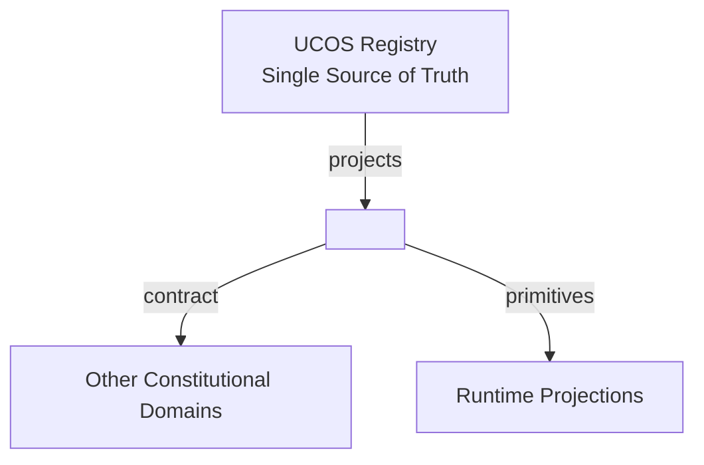
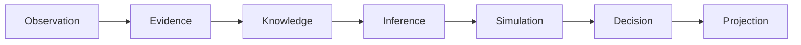
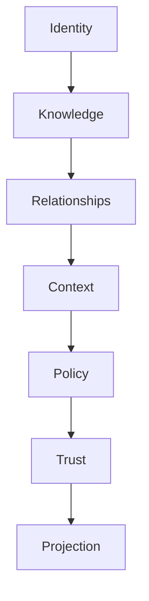

# UCOS Ω∞ — Master Document

**Projected from** `_registry/` (the single source of truth). Never edit this file or a volume: change the registry, then run `npm run registry`. Last amendment: AMD-0071 (2026-11-28).

## Contents

1. [How to manage](#how-to-manage)
2. [Volume register](#volume-register)
3. [Index](#index)
4. [Constitution](#constitution)
5. [Kernel](#kernel)
6. [Standard contract](#standard-contract)
7. [Glossary](#glossary)
8. [Code and document map](#code-map)
9. [Concept register](#concept-register)
10. [Other domain systems](#alignment)
11. [Build path and decisions](#build-path)
12. [ID lookup](#id-lookup)

<a id="how-to-manage"></a>
## 1. How to manage

Everything here is projected. To change it, edit the registry entry named below, then run `npm run registry`. That re-projects this document and every volume, audits them, then compiles, gates and seals the registry. `npm test` fails if any document is out of date with the registry.

| To change | Edit |
|---|---|
| A category (add, rename, describe) | `_registry/domains.json` → `categories` |
| A domain (add, owns, responsibilities, category, contract) | `_registry/domains.json` → `domains` |
| A law (statement, aliases, sources, enforcement status) | `_registry/domains.json` → `laws`, with an entry in `amendments` |
| A kernel part | `_registry/domains.json` → `kernel` |
| Which domain owns a code file | `_registry/codebase.json` → `modules` |
| A document’s status (corpus source, projection, living record, guidance, superseded) and owner | `_registry/documents.json` → `documents` (move a superseded document into `_superseded/`) |
| A build step’s status, a design decision, or a gap | `_registry/roadmap.json` → `steps`, `decisions`, `gaps` |
| Which domain owns a live API route | `_registry/api.json` → `owners` (rules by path; the first match wins) |
| A domain’s build status | derived: `designed` until it owns code or a live route (`_registry/domains.json` → `status`, checked by the gate) |
| Which register domain owns a part of another domain system | `_registry/alignment.json` → `systems` |
| A primitive (frozen: needs an amendment) | `_registry/primitives.json`, with an entry in `domains.json` → `amendments` |
| A term (add, define) | `_registry/terminology.json`, and add it to exactly one domain’s `owns` |
| An artifact (add, retitle, owner) | `_registry/manifest.json` → `artifacts`, a route in `_registry/content-map.json`, a content block in a `_registry/content-*.json` |
| An artifact’s sections | its content block (the route is shown under each artifact) |
| The document layout (master file, volume folder, size limit per volume) | `_registry/manifest.json` → `projection` |

**Commands.** `npm run registry` re-projects, audits, compiles, gates and seals · `node _registry/project.js --watch` re-projects whenever a registry file changes · `node _registry/project.js --list` lists the artifacts · `node _registry/project.js --check` checks registry integrity · `node _registry/audit.js` enforces the laws over the master and volumes · `node _registry/compile.js --search <words> [--kind …] [--category …] [--owner …]` finds anything.

**Provenance.** `_superseded/` keeps the hand-authored documents the registry was distilled from. They are history, not a source of truth.

The integrity gate refuses a change that leaves a name owned twice or not at all, a domain without a category or contract, an unowned artifact, or a reserved name.

<a id="volume-register"></a>
## 2. Volume register

**16 volumes** for 13 categories · 47 domains · 111 artifacts · 27 primitives · 82 terms.

A volume may reach 100 KB (`manifest.json` → `projection.maxVolumeBytes`). A category that would pass it is split into numbered parts on the next projection, and merged back when it shrinks.

| Volume | Category | Part | Domains | Artifacts | Size |
|---|---|---|---:|---:|---:|
| [V01](volumes/V01-constitution.md) | C01 Constitution | 1 of 1 | 1 | 10 | 71 KB |
| [V02](volumes/V02-meaning.md) | C02 Meaning | 1 of 1 | 5 | 13 | 90 KB |
| [V03.1](volumes/V03.1-reality-and-reasoning.md) | C03 Reality and Reasoning | 1 of 2 | 9 | 13 | 92 KB |
| [V03.2](volumes/V03.2-reality-and-reasoning.md) | C03 Reality and Reasoning | 2 of 2 | 1 | 3 | 21 KB |
| [V04](volumes/V04-universal-dimensions.md) | C04 Universal Dimensions | 1 of 1 | 6 | 6 | 43 KB |
| [V05](volumes/V05-structure.md) | C05 Structure | 1 of 1 | 2 | 2 | 19 KB |
| [V06](volumes/V06-decision-and-control.md) | C06 Decision and Control | 1 of 1 | 4 | 4 | 30 KB |
| [V07](volumes/V07-assurance.md) | C07 Assurance | 1 of 1 | 4 | 10 | 70 KB |
| [V08](volumes/V08-interaction.md) | C08 Interaction | 1 of 1 | 4 | 4 | 30 KB |
| [V09.1](volumes/V09.1-automation.md) | C09 Automation | 1 of 2 | 2 | 14 | 95 KB |
| [V09.2](volumes/V09.2-automation.md) | C09 Automation | 2 of 2 | 1 | 1 | 8 KB |
| [V10](volumes/V10-intelligence.md) | C10 Intelligence | 1 of 1 | 1 | 1 | 7 KB |
| [V11.1](volumes/V11.1-platform.md) | C11 Platform | 1 of 2 | 2 | 13 | 89 KB |
| [V11.2](volumes/V11.2-platform.md) | C11 Platform | 2 of 2 | 3 | 6 | 40 KB |
| [V12](volumes/V12-business.md) | C12 Business | 1 of 1 | 1 | 10 | 82 KB |
| [V13](volumes/V13-composition.md) | C13 Composition | 1 of 1 | 1 | 1 | 7 KB |

<a id="index"></a>
## 3. Index

### C01 · Constitution

The laws, amendments and certification law that govern every other category. Volume: [V01](volumes/V01-constitution.md).

- [Constitutional Authority](volumes/V01-constitution.md#d-con) — owns [Capability](#t-capability), [Constitution](#t-constitution), [Amendment](#t-amendment)
  - [UCOS-CON-000001](volumes/V01-constitution.md#ucos-con-000001) Constitutional Foundation
  - [UCOS-CON-000002](volumes/V01-constitution.md#ucos-con-000002) Canonical Terminology Constitution
  - [UCOS-CON-000003](volumes/V01-constitution.md#ucos-con-000003) Domain Ownership Constitution
  - [UCOS-CON-000004](volumes/V01-constitution.md#ucos-con-000004) Dependency Constitution
  - [UCOS-CON-000005](volumes/V01-constitution.md#ucos-con-000005) Governance Constitution
  - [UCOS-CON-000006](volumes/V01-constitution.md#ucos-con-000006) Security Constitution
  - [UCOS-CON-000007](volumes/V01-constitution.md#ucos-con-000007) Privacy Constitution
  - [UCOS-CON-000008](volumes/V01-constitution.md#ucos-con-000008) Trust Constitution
  - [UCOS-CON-000009](volumes/V01-constitution.md#ucos-con-000009) Evolution Constitution
  - [UCOS-CON-000010](volumes/V01-constitution.md#ucos-con-000010) Certification Constitution

### C02 · Meaning

What exists, what it is called, and what is known about it. Volume: [V02](volumes/V02-meaning.md).

- [Identity](volumes/V02-meaning.md#d-idn) — owns [Identity](#t-identity), [Intent](#t-intent), [Existence](#t-existence), [Entity](#t-entity), [Identifier Scheme](#t-identifier-scheme)
  - [UCOS-IDN-000001](volumes/V02-meaning.md#ucos-idn-000001) Identity Architecture
- [Semantic](volumes/V02-meaning.md#d-sem) — owns [Meaning](#t-meaning), [Ontology](#t-ontology), [Taxonomy](#t-taxonomy), [Classification](#t-classification)
  - [UCOS-SEM-000001](volumes/V02-meaning.md#ucos-sem-000001) Universal Semantic Architecture
  - [UCOS-ONT-000001](volumes/V02-meaning.md#ucos-ont-000001) Universal Ontology
  - [UCOS-TAX-000001](volumes/V02-meaning.md#ucos-tax-000001) Universal Taxonomy
  - [UCOS-CLS-000001](volumes/V02-meaning.md#ucos-cls-000001) Universal Classification Architecture
- [Knowledge](volumes/V02-meaning.md#d-knw) — owns [Knowledge](#t-knowledge)
  - [UCOS-KNW-000001](volumes/V02-meaning.md#ucos-knw-000001) Knowledge Architecture
- [Guidance](volumes/V02-meaning.md#d-gdn) — owns [Guide](#t-guide)
  - [UCOS-IMP-000001](volumes/V02-meaning.md#ucos-imp-000001) Master Implementation Blueprint
  - [UCOS-IMP-000002](volumes/V02-meaning.md#ucos-imp-000002) Reference Platform Architecture
  - [UCOS-IMP-000003](volumes/V02-meaning.md#ucos-imp-000003) Engineering Playbook
  - [UCOS-IMP-000004](volumes/V02-meaning.md#ucos-imp-000004) Migration Blueprint
  - [UCOS-IMP-000005](volumes/V02-meaning.md#ucos-imp-000005) Delivery Roadmap
  - [UCOS-GDN-000001](volumes/V02-meaning.md#ucos-gdn-000001) Guidance Architecture
- [Party](volumes/V02-meaning.md#d-pty) — owns [Party](#t-party), [Role](#t-role)
  - [UCOS-PTY-000001](volumes/V02-meaning.md#ucos-pty-000001) Party Architecture

### C03 · Reality and Reasoning

How reality is observed, evidenced, explained, simulated and changed. Volumes: [V03.1](volumes/V03.1-reality-and-reasoning.md), [V03.2](volumes/V03.2-reality-and-reasoning.md).

- [Observation](volumes/V03.1-reality-and-reasoning.md#d-obs) — owns [Observation](#t-observation), [Data](#t-data), [Information](#t-information)
  - [UCOS-OBS-000001](volumes/V03.1-reality-and-reasoning.md#ucos-obs-000001) Observation Architecture
- [Evidence](volumes/V03.1-reality-and-reasoning.md#d-evd) — owns [Evidence](#t-evidence)
  - [UCOS-EVD-000001](volumes/V03.1-reality-and-reasoning.md#ucos-evd-000001) Evidence Architecture
- [Inference](volumes/V03.1-reality-and-reasoning.md#d-inf) — owns [Inference](#t-inference)
  - [UCOS-INF-000001](volumes/V03.1-reality-and-reasoning.md#ucos-inf-000001) Inference Architecture
  - [UCOS-UNC-000001](volumes/V03.1-reality-and-reasoning.md#ucos-unc-000001) Uncertainty Architecture
- [Reasoning](volumes/V03.1-reality-and-reasoning.md#d-rsn) — owns [Reasoning](#t-reasoning)
  - [UCOS-RSN-000001](volumes/V03.1-reality-and-reasoning.md#ucos-rsn-000001) Reasoning Architecture
  - [UCOS-CONTR-000001](volumes/V03.1-reality-and-reasoning.md#ucos-contr-000001) Contradiction Architecture
- [Simulation](volumes/V03.1-reality-and-reasoning.md#d-sim) — owns [Simulation](#t-simulation)
  - [UCOS-SIM-000001](volumes/V03.1-reality-and-reasoning.md#ucos-sim-000001) Simulation Architecture
- [Causality](volumes/V03.1-reality-and-reasoning.md#d-cau) — owns [Causality](#t-causality)
  - [UCOS-CAU-000001](volumes/V03.1-reality-and-reasoning.md#ucos-cau-000001) Causality Architecture
- [Perspective](volumes/V03.1-reality-and-reasoning.md#d-per) — owns [Perspective](#t-perspective)
  - [UCOS-PER-000001](volumes/V03.1-reality-and-reasoning.md#ucos-per-000001) Perspective Architecture
- [Possibility](volumes/V03.1-reality-and-reasoning.md#d-pos) — owns [Possibility](#t-possibility)
  - [UCOS-REA-000001](volumes/V03.1-reality-and-reasoning.md#ucos-rea-000001) Multi-Reality Architecture
  - [UCOS-POSS-000001](volumes/V03.1-reality-and-reasoning.md#ucos-poss-000001) Possibility Architecture
- [Evolution](volumes/V03.1-reality-and-reasoning.md#d-evo) — owns [Evolution](#t-evolution), [Emergence](#t-emergence), [Contribution](#t-contribution), [Addendum](#t-addendum)
  - [UCOS-EVO-000001](volumes/V03.1-reality-and-reasoning.md#ucos-evo-000001) Evolution Architecture
  - [UCOS-EMG-000001](volumes/V03.1-reality-and-reasoning.md#ucos-emg-000001) Emergence Architecture
- [Twin](volumes/V03.2-reality-and-reasoning.md#d-dtw) — owns [Digital Twin](#t-digital-twin)
  - [UCOS-DTW-000001](volumes/V03.2-reality-and-reasoning.md#ucos-dtw-000001) Digital Twin Architecture
  - [UCOS-DTW-000002](volumes/V03.2-reality-and-reasoning.md#ucos-dtw-000002) Twin Federation Architecture
  - [UCOS-DTW-000003](volumes/V03.2-reality-and-reasoning.md#ucos-dtw-000003) Twin Synchronization Architecture

### C04 · Universal Dimensions

The coordinates any fact is placed in: where, when, how much, what value, in which expression, in what context. Volume: [V04](volumes/V04-universal-dimensions.md).

- [Geo](volumes/V04-universal-dimensions.md#d-geo) — owns [Place](#t-place)
  - [UCOS-PLC-000001](volumes/V04-universal-dimensions.md#ucos-plc-000001) Geo Architecture
- [Time](volumes/V04-universal-dimensions.md#d-tim) — owns [Time](#t-time), [Calendar](#t-calendar)
  - [UCOS-TIM-000001](volumes/V04-universal-dimensions.md#ucos-tim-000001) Time Architecture
- [Measure](volumes/V04-universal-dimensions.md#d-mea) — owns [Quantity](#t-quantity), [Unit](#t-unit)
  - [UCOS-MEA-000001](volumes/V04-universal-dimensions.md#ucos-mea-000001) Measure Architecture
- [Value](volumes/V04-universal-dimensions.md#d-val) — owns [Value Unit](#t-value-unit)
  - [UCOS-VAL-000001](volumes/V04-universal-dimensions.md#ucos-val-000001) Value Architecture
- [Expression](volumes/V04-universal-dimensions.md#d-exr) — owns [Expression](#t-expression), [Script](#t-script)
  - [UCOS-EXR-000001](volumes/V04-universal-dimensions.md#ucos-exr-000001) Expression Architecture
- [Context](volumes/V04-universal-dimensions.md#d-ctx) — owns [Context](#t-context)
  - [UCOS-CTX-000001](volumes/V04-universal-dimensions.md#ucos-ctx-000001) Context Architecture

### C05 · Structure

How declarations are stored once and linked. Volume: [V05](volumes/V05-structure.md).

- [Registry](volumes/V05-structure.md#d-reg) — owns [Registry](#t-registry), [RegistryEntry](#t-registryentry), [Metadata](#t-metadata), [Kind](#t-kind)
  - [UCOS-REG-000001](volumes/V05-structure.md#ucos-reg-000001) Registry Architecture
- [Relationship](volumes/V05-structure.md#d-rel) — owns [Relationship](#t-relationship)
  - [UCOS-REL-000001](volumes/V05-structure.md#ucos-rel-000001) Relationship Architecture

### C06 · Decision and Control

Who may decide, under which policy and rule, and what was decided. Volume: [V06](volumes/V06-decision-and-control.md).

- [Policy](volumes/V06-decision-and-control.md#d-pol) — owns [Policy](#t-policy)
  - [UCOS-POL-000001](volumes/V06-decision-and-control.md#ucos-pol-000001) Policy Architecture
- [Rule](volumes/V06-decision-and-control.md#d-rul) — owns [Rule](#t-rule)
  - [UCOS-RUL-000001](volumes/V06-decision-and-control.md#ucos-rul-000001) Rule Architecture
- [Decision](volumes/V06-decision-and-control.md#d-dec) — owns [Decision](#t-decision)
  - [UCOS-DEC-000001](volumes/V06-decision-and-control.md#ucos-dec-000001) Decision Architecture
- [Authority](volumes/V06-decision-and-control.md#d-aut) — owns [Authority](#t-authority), [Ownership](#t-ownership), [Permission](#t-permission)
  - [UCOS-AUT-000001](volumes/V06-decision-and-control.md#ucos-aut-000001) Authority Architecture

### C07 · Assurance

Protection, computed trust, the immutable record, and obligations. Volume: [V07](volumes/V07-assurance.md).

- [Security](volumes/V07-assurance.md#d-sec) — owns [Credential](#t-credential), [Key](#t-key)
  - [UCOS-IAM-000001](volumes/V07-assurance.md#ucos-iam-000001) Identity & Access Management
  - [UCOS-ZTA-000001](volumes/V07-assurance.md#ucos-zta-000001) Zero Trust Architecture
  - [UCOS-CRY-000001](volumes/V07-assurance.md#ucos-cry-000001) Cryptography Architecture
  - [UCOS-KMS-000001](volumes/V07-assurance.md#ucos-kms-000001) Key Management Architecture
  - [UCOS-SEC-000001](volumes/V07-assurance.md#ucos-sec-000001) Security Runtime Architecture
- [Trust](volumes/V07-assurance.md#d-tru) — owns [Trust](#t-trust)
  - [UCOS-TRS-000001](volumes/V07-assurance.md#ucos-trs-000001) Trust Architecture
- [Audit](volumes/V07-assurance.md#d-aud) — owns [Audit Record](#t-audit-record)
  - [UCOS-AUD-000001](volumes/V07-assurance.md#ucos-aud-000001) Audit Architecture
- [Compliance](volumes/V07-assurance.md#d-cmp) — owns [Obligation](#t-obligation), [Consent](#t-consent)
  - [UCOS-DSP-000001](volumes/V07-assurance.md#ucos-dsp-000001) Data Sovereignty Architecture
  - [UCOS-CNS-000001](volumes/V07-assurance.md#ucos-cns-000001) Consent Architecture
  - [UCOS-CMP-000001](volumes/V07-assurance.md#ucos-cmp-000001) Compliance Architecture

### C08 · Interaction

How people see, are told, converse and find. Volume: [V08](volumes/V08-interaction.md).

- [Experience](volumes/V08-interaction.md#d-exp) — owns [Interface](#t-interface), [Device Type](#t-device-type)
  - [UCOS-EXP-000001](volumes/V08-interaction.md#ucos-exp-000001) Experience Architecture
- [Communication](volumes/V08-interaction.md#d-cmn) — owns [Message](#t-message), [Conversation](#t-conversation), [Communication Channel](#t-communication-channel), [Media Session](#t-media-session)
  - [UCOS-CMN-000001](volumes/V08-interaction.md#ucos-cmn-000001) Communication Architecture
- [Notification](volumes/V08-interaction.md#d-ntf) — owns [Notification](#t-notification)
  - [UCOS-NTF-000001](volumes/V08-interaction.md#ucos-ntf-000001) Notification Architecture
- [Search](volumes/V08-interaction.md#d-srh) — owns [Search Index](#t-search-index)
  - [UCOS-SRC-000001](volumes/V08-interaction.md#ucos-src-000001) Search Architecture

### C09 · Automation

How work runs: events, state, workflows, agents and connections. Volumes: [V09.1](volumes/V09.1-automation.md), [V09.2](volumes/V09.2-automation.md).

- [Runtime](volumes/V09.1-automation.md#d-run) — owns [State](#t-state), [Event](#t-event), [Process](#t-process), [Workflow](#t-workflow), [Projection](#t-projection)
  - [UCOS-RUN-000001](volumes/V09.1-automation.md#ucos-run-000001) Runtime Constitution
  - [UCOS-RUN-000002](volumes/V09.1-automation.md#ucos-run-000002) Execution Architecture
  - [UCOS-RUN-000003](volumes/V09.1-automation.md#ucos-run-000003) Orchestration Architecture
  - [UCOS-RUN-000004](volumes/V09.1-automation.md#ucos-run-000004) Workflow Architecture
  - [UCOS-RUN-000005](volumes/V09.1-automation.md#ucos-run-000005) State Machine Architecture
  - [UCOS-EVT-000001](volumes/V09.1-automation.md#ucos-evt-000001) Event Architecture
  - [UCOS-MSG-000001](volumes/V09.1-automation.md#ucos-msg-000001) Messaging Architecture
- [Agent](volumes/V09.1-automation.md#d-agt) — owns [Agent](#t-agent)
  - [UCOS-AGT-000001](volumes/V09.1-automation.md#ucos-agt-000001) Agent Constitution
  - [UCOS-AGT-000002](volumes/V09.1-automation.md#ucos-agt-000002) Agent Runtime
  - [UCOS-AGT-000003](volumes/V09.1-automation.md#ucos-agt-000003) Agent Governance
  - [UCOS-AGT-000004](volumes/V09.1-automation.md#ucos-agt-000004) Agent Trust
  - [UCOS-AGT-000005](volumes/V09.1-automation.md#ucos-agt-000005) Agent Safety
  - [UCOS-AGT-000006](volumes/V09.1-automation.md#ucos-agt-000006) Agent Economics
  - [UCOS-AGT-000007](volumes/V09.1-automation.md#ucos-agt-000007) Agent Society
- [Integration](volumes/V09.2-automation.md#d-int) — owns [API](#t-api), [Connector](#t-connector)
  - [UCOS-INT-000001](volumes/V09.2-automation.md#ucos-int-000001) Integration Architecture

### C10 · Intelligence

Measurement of the platform and the business. Volume: [V10](volumes/V10-intelligence.md).

- [Insight](volumes/V10-intelligence.md#d-ins) — owns [Metric](#t-metric), [Report](#t-report)
  - [UCOS-INS-000001](volumes/V10-intelligence.md#ucos-ins-000001) Insight Architecture

### C11 · Platform

Storing, running, verifying, holding content and offering the platform. Volumes: [V11.1](volumes/V11.1-platform.md), [V11.2](volumes/V11.2-platform.md).

- [Persistence](volumes/V11.1-platform.md#d-prs) — owns [Storage](#t-storage), [Cache](#t-cache), [Index](#t-index)
  - [UCOS-DB-000001](volumes/V11.1-platform.md#ucos-db-000001) Storage Architecture
  - [UCOS-GRF-000001](volumes/V11.1-platform.md#ucos-grf-000001) Graph Architecture
  - [UCOS-IDX-000001](volumes/V11.1-platform.md#ucos-idx-000001) Index Architecture
  - [UCOS-CCH-000001](volumes/V11.1-platform.md#ucos-cch-000001) Cache Architecture
- [Operations](volumes/V11.1-platform.md#d-ops) — owns [Environment](#t-environment), [Deployment](#t-deployment)
  - [UCOS-SRE-000001](volumes/V11.1-platform.md#ucos-sre-000001) Reliability Architecture
  - [UCOS-MON-000001](volumes/V11.1-platform.md#ucos-mon-000001) Monitoring Architecture
  - [UCOS-OBSV-000001](volumes/V11.1-platform.md#ucos-obsv-000001) Observability Architecture
  - [UCOS-DR-000001](volumes/V11.1-platform.md#ucos-dr-000001) Disaster Recovery Architecture
  - [UCOS-BCP-000001](volumes/V11.1-platform.md#ucos-bcp-000001) Business Continuity Architecture
  - [UCOS-DEP-000001](volumes/V11.1-platform.md#ucos-dep-000001) Deployment Architecture
  - [UCOS-CLD-000001](volumes/V11.1-platform.md#ucos-cld-000001) Multi-Cloud Architecture
  - [UCOS-EDG-000001](volumes/V11.1-platform.md#ucos-edg-000001) Edge Architecture
  - [UCOS-GEO-000001](volumes/V11.1-platform.md#ucos-geo-000001) Geo-Distribution Architecture
- [Quality](volumes/V11.2-platform.md#d-qlt) — owns [Verification](#t-verification), [Test](#t-test)
  - [UCOS-TST-000001](volumes/V11.2-platform.md#ucos-tst-000001) Testing Architecture
  - [UCOS-VER-000001](volumes/V11.2-platform.md#ucos-ver-000001) Verification Architecture
  - [UCOS-CER-000001](volumes/V11.2-platform.md#ucos-cer-000001) Certification Architecture
  - [UCOS-FML-000001](volumes/V11.2-platform.md#ucos-fml-000001) Formal Verification Architecture
- [Content](volumes/V11.2-platform.md#d-cnt) — owns [Media Asset](#t-media-asset)
  - [UCOS-MED-000001](volumes/V11.2-platform.md#ucos-med-000001) Content Architecture
- [Offering](volumes/V11.2-platform.md#d-ofg) — owns [Offering](#t-offering), [Plan](#t-plan), [Licence](#t-licence)
  - [UCOS-OFG-000001](volumes/V11.2-platform.md#ucos-ofg-000001) Offering Architecture

### C12 · Business

Business projections composed from the domains; they own no truth. Volume: [V12](volumes/V12-business.md).

- [Commerce](volumes/V12-business.md#d-biz) — owns [Commerce Projection](#t-commerce-projection), [Fulfilment Mode](#t-fulfilment-mode)
  - [UCOS-COM-000001](volumes/V12-business.md#ucos-com-000001) Universal Commerce Architecture
  - [UCOS-GPS-000001](volumes/V12-business.md#ucos-gps-000001) Global Products & Services Architecture
  - [UCOS-PRC-000001](volumes/V12-business.md#ucos-prc-000001) Pricing Architecture
  - [UCOS-OFR-000001](volumes/V12-business.md#ucos-ofr-000001) Offer Architecture
  - [UCOS-SUB-000001](volumes/V12-business.md#ucos-sub-000001) Subscription Architecture
  - [UCOS-CNT-000001](volumes/V12-business.md#ucos-cnt-000001) Contract Architecture
  - [UCOS-MKT-000001](volumes/V12-business.md#ucos-mkt-000001) Marketplace Architecture
  - [UCOS-INV-000001](volumes/V12-business.md#ucos-inv-000001) Inventory Architecture
  - [UCOS-ORD-000001](volumes/V12-business.md#ucos-ord-000001) Order Architecture
  - [UCOS-FUL-000001](volumes/V12-business.md#ucos-ful-000001) Fulfillment Architecture

### C13 · Composition

Ready-made, editable compositions of domains. Volume: [V13](volumes/V13-composition.md).

- [Package](volumes/V13-composition.md#d-pkg) — owns [Package](#t-package), [Blueprint](#t-blueprint), [Overlay](#t-overlay), [Discovery](#t-discovery)
  - [UCOS-PKG-000001](volumes/V13-composition.md#ucos-pkg-000001) Package Architecture

<a id="constitution"></a>
## 4. Constitution

### Laws

26 laws: 9 enforced, 15 partly enforced, 2 planned. Each merges every place the corpus states it; its sources are document:line in the compiled corpus (`node _registry/compile.js --search` finds them).

| Law | Statement | Also called | Status | Enforced by | Sources |
|---|---|---|---|---|---|
| <a id="law-001"></a>**LAW-001** Zero Hard Coding | Only the immutable kernel is fixed in code. No business concept — product, service, offer, subscription, contract, industry, category, brand, country, currency, language, marketplace, store, tenant, organisation, person — is modelled as a primitive or a schema type; each is a projection of primitives, and the projection changes as context changes. | Fundamental Axiom, Immutable Kernel, Final UCOS Law, Final Constitutional Law | enforced | _registry/audit.js (schema types); _registry/gate.js (reserved names) | ucosma:66, ucosma:1362, ucrs:28, ucrs:137, ucrs:1357 |
| <a id="law-002"></a>**LAW-002** Knowledge Once | Every concept, fact and capability is defined once, in one canonical source, with one owner. There are no parallel definitions, no conflicting truth, no orphans, and every code module has one home. | Knowledge Once Principle, Single Canonical Source Of Truth, Final Implementation Law, One Owner Per Concern | enforced | _registry/gate.js (zero-duplicate, register and module-map checks) | ucosma:102, ucrs:1336, upip:48, upip:4940, upip:12828, ucos:1929, ucoso:2668, ucosadd:1244, _superseded/FOUNDATIONS.md §2 rules 3 and 17 |
| <a id="law-003"></a>**LAW-003** Projection Law | Truth lives in the registry. Documents, business objects and reality are projections derived from it, never authored and never a second source; everything that can be derived is derived, not stored. | Projection Boundary, Everything Else Is Derived | enforced | _registry/project.js; test/master-doc.js; _registry/audit.js | ucosma:132, ucosadd:1159, _superseded/FOUNDATIONS.md §2 rule 5 |
| <a id="law-004"></a>**LAW-004** Constitutional Governance | Every capability, change, evolution and autonomous action is governed; no execution bypasses governance. | — | partial | _registry/gate.js and the amendment record (registry changes) | ucosma:162 |
| <a id="law-005"></a>**LAW-005** Explainability | Every action answers what happened, why, who authorised it, which policy allowed it, what evidence supports it, what confidence exists and what alternatives were evaluated. | — | partial | _registry/audit.js (the standard contract carries the questions) | ucosma:183 |
| <a id="law-006"></a>**LAW-006** Configuration Over Code | Behaviour is driven by metadata, ontologies, policies, rules, registries and configuration, never by product-specific code. Launching anywhere, extending or changing the platform is configuration that a person with the manual, or an agent, can do from the console or the API. | Configuration Only, Everything Is Configurable From The Console | partial | scripts/audit-hardcoding.js; test/audit-gate.js (ratchet) | upip:58, _superseded/FOUNDATIONS.md §2 rules 1 and 11 |
| <a id="law-007"></a>**LAW-007** Single Ownership And Contract | No concept exists without an owner, no capability without a boundary, no boundary without a contract, no contract without governance; no term has two meanings, no meaning two definitions, and no two domains overlap. | Constitutional Law, Domain Ownership Law | enforced | _registry/gate.js (register checks) | ucosadd:33 |
| <a id="law-008"></a>**LAW-008** Independent Authorities | No entity owns another domain's concern — identity, geography, time, value, security, knowledge, intelligence, analytics or governance. It relates to them: a place stores no currency, a store stores no country. | Root Architectural Principle, No Embedding | partial | test/places.js (a place's currency and locale are settings owned by Value and Expression; a country row holds only the place); test/stores.js (a store serves a set of places; its country is its jurisdiction, a Party setting); test/laws.js (no table column defaults to a country or currency; lib/entity.js reads an omitted one from its owner — fields that declare resolves) | upip:8356, _superseded/FOUNDATIONS.md §2 rule 4 |
| <a id="law-009"></a>**LAW-009** Dependency Law | Dependencies run Identity → Knowledge → Relationships → Context → Policy → Trust → Projection. Circular dependencies, mutual ownership and cross-domain state mutation are forbidden. | — | enforced | test/laws.js (every module, loaded first in a fresh process, reads no module still loading; no artifact has two owning domains); lib/db.js (the bootstrap waits for a loading module to finish) | ucosadd:1123 |
| <a id="law-010"></a>**LAW-010** Runtime Responsibility | The constitution defines truth, domains manage truth, the runtime derives reality, agents execute reality and applications consume it. | — | partial | test/laws.js (ratchet: statements in one domain's code that write another domain's table may only fall — 368 at AMD-0050); lib/registry.js ensureList, mergeList, setList, dropList (the one writer of the registry's lists); lib/settings.js setPlatform, initPlatform, dropPlatform (the one writer of the platform's settings) | ucosadd:1186 |
| <a id="law-011"></a>**LAW-011** Architectural Freeze | Primitives, domain ownership, contract structure and the governance, dependency and projection models are frozen. Change happens through registries, policies, capabilities, contexts, relationships, knowledge, agents and projections, never by adding primitives, and only through a recorded amendment. | — | enforced | test/ucos-registry.js (the 27 primitives); _registry/domains.json → amendments | ucosadd:1207 |
| <a id="law-012"></a>**LAW-012** Generated Platform | Everything is generated from declarations: data models, APIs, interfaces, workflows, state machines, reports, dashboards, permissions, integrations, documentation, SDKs and tests. One generated API serves everyone — the console, storefronts, apps, agents, partners — with no private back door. | One API For Everyone | partial | _registry/project.js (documentation) | ucrs:1311, _superseded/FOUNDATIONS.md §2 rule 12 |
| <a id="law-013"></a>**LAW-013** Registry First | Everything is discoverable: if it exists it is registered, describable and searchable. | Meta-Architecture Principle, Meta Principle | partial | lib/canonical.js search (the register) | upip:73, upip:6609 |
| <a id="law-014"></a>**LAW-014** Infinite Extensibility | Every domain is complete from zero to infinite and assumes no Earth, country, calendar, value unit, language or text direction. New kinds, places, categories and domains arrive by registration and configuration, never redesign; every concept is self-governing, self-describing, self-registering, self-validating, self-certifying, composable, replaceable and independently evolvable. | Constitutional Decomposition Principle, Zero To Infinite | partial | test/laws.js (ratchet: literal countries, currencies, calendars and directions in platform code may only fall — 0 at AMD-0047); lib/time.js wallClock (the platform reckons in ISO 8601; a person's calendar is applied on display); lib/seed/demo.json (the demo fixtures name their places as data) | upip:93, upip:5796, _superseded/FOUNDATIONS.md §2 rule 2 |
| <a id="law-015"></a>**LAW-015** Technology Agnostic | Nothing depends on a vendor, database, cloud or framework; each is an adapter chosen by configuration, per domain or per tenant. | Any Database | partial | test/laws.js (no platform module outside the adapter layer names a vendor, database or driver; the words are read from the provider specs, carrier adapters and runtime drivers); lib/carrier-easypost.js (the carrier behind an adapter); lib/adapters.js probe, lib/db.js DRIVER (drivers named in their own layer) | upip:99, _superseded/FOUNDATIONS.md §2 rule 10 |
| <a id="law-016"></a>**LAW-016** Contextual Distribution | Configuring a place projects what applies there — expression, value units, tax, compliance, catalogue, pricing — inherited down the place hierarchies, for any number of places at once. | — | partial | test/places.js (a place resolves its country's currency nearest up the tree; a setting at a subdivision applies there and below, not above; Time's calendar resolves up the place tree) | ucosma:1071 |
| <a id="law-017"></a>**LAW-017** Platform-Owned Master Data | Master data belongs to the platform. Platforms, tenants and modules select it through views and never copy it; a tenant extends only within its own scope. | — | enforced | test/laws.js (no tenant-scoped table repeats a platform master's columns; the place, value and language masters carry no tenant column) | _superseded/FOUNDATIONS.md §2 rule 6 |
| <a id="law-018"></a>**LAW-018** Selection From Owners | Every choice offered anywhere is a selection from the domain that owns the subject, in any combination. Constraints are declared by the entities, and every option carries a free or paid offering. | — | partial | test/laws.js (ratchet: choices written in place instead of read from their owner may only fall — 0 at AMD-0049; every entity field that names its owner — a state machine or a registry list — gets choices from it); lib/entity.js optionsOf (one reader of a field's choices) | _superseded/FOUNDATIONS.md §2 rule 7 |
| <a id="law-019"></a>**LAW-019** Nothing Invented | Creating one thing never creates another. Anything missing shows as incomplete until a person or agent completes it; nothing is filled with a placeholder. | — | partial | test/geo.js (no invented countries); test/places.js (no place invented above the countries) | _superseded/FOUNDATIONS.md §2 rule 8 |
| <a id="law-020"></a>**LAW-020** Rules Belong To Kinds | A format or validation rule belongs to the kind that needs it, never to a whole domain. | — | partial | lib/entity.js field declarations (pattern, format, bounds); lib/kernel.js (attribute values checked against the type their kind declares) | _superseded/FOUNDATIONS.md §2 rule 9 |
| <a id="law-021"></a>**LAW-021** One Kernel | Every domain is built on the same kernel and receives every kernel part and shared service; no domain can lack one. | — | partial | _registry/gate.js (every domain complete, categorised and contracted) | _superseded/FOUNDATIONS.md §2 rule 10 |
| <a id="law-022"></a>**LAW-022** Bounded Agents | An agent is a party with declared permissions, scope, budget and audit; it never exceeds the person or role it acts for, and money or irreversible actions need declared approval. | — | planned | — | _superseded/FOUNDATIONS.md §2 rule 13 |
| <a id="law-023"></a>**LAW-023** Security Floor | Security and compliance are on by default; a tenant or operator may tighten policy but never weaken it below the platform baseline. | — | enforced | test/laws.js (every floor key detected, a weakening patch saved at the baseline, a weaker stored policy never effective, tightening kept, the policy route refuses with 422); lib/security.js (FLOOR, floorBreaches, withFloor) | _superseded/FOUNDATIONS.md §2 rule 14 |
| <a id="law-024"></a>**LAW-024** Immutable Record | Every change and every access to sensitive data is recorded in an append-only, hash-chained record that no one can edit. | — | partial | lib/security.js (hash-chained audit log); lib/kernel.js and test/kernel.js (the kernel's hash-chained event log) | _superseded/FOUNDATIONS.md §2 rule 15 |
| <a id="law-025"></a>**LAW-025** Packages Compose | Packages compose domains into ready-made, editable platforms; a customisation is an overlay that survives every package upgrade. | — | planned | — | _superseded/FOUNDATIONS.md §2 rule 16 |
| <a id="law-026"></a>**LAW-026** Every Law Is Enforced | A law without an executable check is not finished; the register records each law's enforcement, and the count of laws not yet enforced may only fall. | — | enforced | _registry/gate.js (law register); _registry/register-baseline.json | _superseded/FOUNDATIONS.md §2 rule 18 |

### Laws of the registries

| Registry | Status | Law |
|---|---|---|
| `primitives.json` — Immutable Primitive Registry | Constitutional Freeze | No primitive may be introduced without constitutional amendment (ARCHITECTURAL FREEZE LAW). |
| `terminology.json` — Canonical Terminology Registry | Constitutional Freeze | No semantic term may exist with multiple meanings. No meaning may exist with multiple canonical definitions. |
| `domains.json` — Domain Ownership & Contract Registry | Constitutional Freeze | No concept may exist without ownership. No overlap may exist between constitutional domains. No cross-domain ownership permitted. |
| `content-map.json` — Artifact to Content Mapping | Constitutional Freeze | Maps every artifact to exactly one content source. Knowledge Once — no artifact may define its own content. |
| `content-core.json` — Core Domain Content Registry | Constitutional Freeze | Knowledge Once — domain substance is defined here once and projected to every artifact. |
| `content-ext.json` — Extended Domain Content Registry | Constitutional Freeze | Knowledge Once — domain substance defined here once, projected everywhere. |
| `content-commerce.json` — Commerce Content Registry | Constitutional Freeze | Knowledge Once — commerce substance defined here once, projected everywhere. Commerce objects are PROJECTIONS, never stored as truth. |
| `content-twin-agent.json` — Twin & Agent Content Registry | Constitutional Freeze | Knowledge Once — twin and agent substance defined here once, projected everywhere. |
| `content-runtime-data.json` — Runtime & Data Content Registry | Constitutional Freeze | Knowledge Once — runtime and data substance defined here once, projected everywhere. |
| `content-sec-ops-dep-qlt.json` — Security, Operations, Deployment & Quality Content Registry | Constitutional Freeze | Knowledge Once — security, operations, deployment, and quality substance defined here once, projected everywhere. |
| `content-platform.json` — Platform Domain Content Registry | Constitutional Freeze | Knowledge Once — the substance of the platform domains' contracts is defined here once and projected everywhere. |

### Ownership and dependency

- **Dependency law:** Identity -> Knowledge -> Relationships -> Context -> Policy -> Trust -> Projection. Forbidden: circular dependencies, mutual ownership, cross-domain state mutation.
- **Communication:** All cross-domain communication occurs exclusively through explicit contracts. No domain may access another domain's internals.
- **Projection law:** Products, services, offers, subscriptions, contracts are projections. No projection may own truth. Truth belongs only to constitutional domains.
- **No domain may:** Modify another domain directly; Bypass authority; Bypass policies; Bypass trust; Bypass governance; Interpret another domain's internals.
- **Primitives:** No primitive may be introduced without constitutional amendment (ARCHITECTURAL FREEZE LAW). Amendment: Constitutional Assembly + formal proof of mathematical unavoidability (LAW 031).
- **Reserved for projections (never primitives or schema types):** Product, Service, Offer, Subscription, Contract, Order, Inventory, Price, Currency, Country, Language, Industry, Category, Brand, Marketplace, Store, Tenant, Organization, Person. Every business/industry/commercial concept MUST be projected from primitives at runtime (LAW 003).

### Amendments

| ID | Date | Authorised by | Summary |
|---|---|---|---|
| <a id="amd-0001"></a>AMD-0001 | 2026-10-17 | Platform owner | Unifies the registry under one categorised ownership spine: 13 categories; every domain in exactly one category; every primitive and term owned by exactly one domain (ownership stated only here); the four undeclared owners resolved (Constitutional Authority and Runtime declared as domains, Perspective and Possibility declared, Existence owned by Identity); new domains for the platform; every artifact owned by one domain. |
| <a id="amd-0002"></a>AMD-0002 | 2026-10-17 | Platform owner | Writes the 17 missing domain contracts (Decision, Geo, Time, Measure, Value, Expression, Registry, Compliance, Experience, Communication, Notification, Guidance, Integration, Insight, Content, Offering, Package) into the registry, replacing FOUNDATIONS.md as their source; documents are filed by the owning domain's register category, so the manifest's separate document categories are retired. |
| <a id="amd-0003"></a>AMD-0003 | 2026-10-17 | Platform owner | One master document: the registry projects UCOS-MASTER.md and one volume per register category, replacing the per-artifact files and the repository index; the enforced laws become registry data. |
| <a id="amd-0004"></a>AMD-0004 | 2026-10-17 | Platform owner | FOUNDATIONS.md absorbed: one law register (26 laws merging the corpus's laws and principles and the foundation rules, each with sources and enforcement status), the kernel parts K01–K12 with one owner each, the Party domain and its contract, the code-module map (codebase.json), and the build path with its decisions (roadmap.json). FOUNDATIONS.md moves to _superseded. |
| <a id="amd-0005"></a>AMD-0005 | 2026-10-18 | Platform owner | The concept register: every corpus concept placed once. Kind rules and owner rules in classification.json (owned by Semantic); every concept-holding container (5,609) and every concept in a structural container (3,552) reviewed by agents with independent second opinions on low-confidence calls and a maintainer sample check; the register is derived at compile time, sealed, gated and searchable by owner and category; low-confidence decisions form the master's review queue. |
| <a id="amd-0006"></a>AMD-0006 | 2026-10-19 | Platform owner | One set of domains: the other structures that call their parts domains are aligned to the register. GOIP's 67 incentive domains and the 7 capability domains each name their one register owner (alignment.json); every per-universe record engine takes its reviewed container's owner; the capability-domain list moves from lib/registry.js into seed data. |
| <a id="amd-0007"></a>AMD-0007 | 2026-10-19 | Platform owner | Every document has one registered status and owner (documents.json). 18 hand-written documents that the user manual, the master or the registry now cover — topic guides, flow diagrams, implementation summaries, an old code review and two roadmaps — move to _superseded with what replaced each. The compiler's corpus inputs are derived from the parser's document list, which puts the UCRS constitution in the seal's manifest for the first time. |
| <a id="amd-0008"></a>AMD-0008 | 2026-10-19 | Platform owner | The registry tells the truth about what runs. The live API (lib/api.js, 725 routes) is registered with one owning domain per route (api.json); every domain carries a build status derived from what it owns (designed: no code and no routes); mixed modules in the code map are split so storage, links, places and value units sit with their owners; the 25 gaps the audit found are recorded with owners and status (roadmap.json → gaps). Test isolation: tests may no longer open the default database. |
| <a id="amd-0009"></a>AMD-0009 | 2026-10-19 | Platform owner | The kernel's first slice runs (P08 in progress). lib/kernel.js holds kinds and typed attributes (K01, K06), nodes with universal IDs and identifier schemes in time windows (K02, K04), named hierarchies of any depth where one node may sit in many places (K03), bi-temporal versions where nothing is overwritten (K07) and one hash-chained event log that is the recorded time of every other table (K08). The kernel names no domain vocabulary; its namespaces, value types and event names are data (lib/seed/kernel.json). Each kernel part now carries a build status. The development server runs from the repository's new location (GAP-21 closed); the coexisting event records are recorded as GAP-27 and a one-off smoke-test connection reset as GAP-28. |
| <a id="amd-0010"></a>AMD-0010 | 2026-10-19 | Platform owner | The kernel's read side runs. Shape (K05, lib/kernel-shape.js): coordinate systems are data (axes, bounds, wrapping), shapes have valid time, and any coordinate resolves to every node that contains it, from a site to a galaxy. Scope and resolution (K11, K12, lib/kernel-context.js): a setting is declared once, assigned in a namespace at any scope node, and one resolver answers what applies here and now — nearest wins, profiles order hierarchies, every answer says where it came from, and nothing assigned stays unresolved. Views (K10): subtrees selected by reference and computed live. Namespaces carry their holder (tenant:42); kinds and hierarchies not declared in a namespace are the platform's. CI could not run on 3e67d62 because the GitHub account's billing blocked the jobs (GAP-29). |
| <a id="amd-0011"></a>AMD-0011 | 2026-10-19 | Platform owner | The kernel's change lifecycle runs (K09, lib/kernel-lifecycle.js). A change is a list of kernel operations written as data; it is validated and previewed by dry runs that leave nothing behind, approved by someone other than its author, published now or at a scheduled time, and rolled back by closing what it recorded and reopening what it superseded — refused while a later change still builds on it. A node hides (reversibly), archives, and is purged only when archived and only with the separate purge permission, leaving a tombstone event. States, transitions, operations and the permission are data (lib/seed/kernel.json → lifecycle). Every kernel part now runs; none is fully built. |
| <a id="amd-0012"></a>AMD-0012 | 2026-10-19 | Platform owner | Kernel follow-ups. Hidden and archived nodes drop out of every kernel listing — node lists, children, subtrees, views and coordinate lookups — unless a caller asks for them; paths, ancestors and history keep the whole structure, and hiding a node does not hide what sits under it. Approving a change needs the declared approve permission, which the caller is granted by Authority; the kernel checks grants, never role names. Node states moved into the kernel's own tables. |
| <a id="amd-0013"></a>AMD-0013 | 2026-10-19 | Platform owner | P09 begins: places are on the kernel. Every country and subdivision is a node of the place kind (declared as data in lib/seed/places.json) in one place tree — countries at the top, nothing invented above them, subdivisions under their country or parent subdivision to any depth — with its code as an identifier in its declared scheme and its row's universal ID as its own. lib/places.js mirrors the master after every write and on every boot: a rename is a new version, a switched-off country is hidden, a re-parented subdivision moves with its past kept, a deleted row is archived; a warm pass writes nothing. The tables remain the source until the writes move onto the kernel. |
| <a id="amd-0014"></a>AMD-0014 | 2026-10-19 | Platform owner | A place's currency and locale are no longer facts of the place. They are settings owned by Value and Expression (declared in lib/seed/places.json), assigned at the place's node on the kernel and answered by the resolver — so a subdivision inherits its country's currency, and a setting assigned at a subdivision applies there and below. registry.country(), through which the platform's readers ask, answers currency and locale from the kernel and a country's money symbol and decimals from its currency in Value's master; a country profile's tax is the tax engine's rule, no longer the country's legacy tax columns. The master's columns remain as the mirror's input until the writes move onto the kernel. |
| <a id="amd-0015"></a>AMD-0015 | 2026-10-19 | Platform owner | Every application write to a place goes to the kernel first. The entity engine's built-in entities may name their owner's write path (lib/seed/entity.json WRITERS; tenant-defined entities cannot): the country and subdivision entities name Geo's, which records the change on the kernel and writes the row in one transaction — a write the row refuses leaves the kernel untouched, a write the kernel refuses never reaches the row. global.js's country writes and the platform's country withdrawal take the same path; a deleted place is archived with its history; a country row carries its place's universal ID. The boot mirror remains for seeds and legacy rows. |
| <a id="amd-0016"></a>AMD-0016 | 2026-10-19 | Platform owner | The kernel is the record for places. The registry's first-boot seeding of countries, its repair of legacy and newly declared countries, and its materialisation of a country's subdivisions all go through Geo's write path, so every place is recorded on the kernel in the same transaction as its row. The boot mirror becomes an import: it creates places only for rows the kernel has never seen (an install that predates the place tree), under its own actor, and never changes a place that exists. A write that bypasses the write path no longer reaches the place tree. |
| <a id="amd-0017"></a>AMD-0017 | 2026-10-19 | Platform owner | A country row holds the place and nothing about it: its code, name, position and whether it is on. Its currency and locale exist only as Value's and Expression's settings at its place on the kernel, its money symbol and decimals are its currency's, and its tax is the tax engine's. A fresh install's country table has no other columns. The entity engine learns writer-held fields (stored: false): the writer records them and supplies them on every listing, so the console lists, filters and edits a country's currency and locale as before. A country naming a currency Value's master does not hold brings it into the master from the symbol given, in the same transaction, or is refused. An older install's columns are imported onto the kernel at boot and left in place; scripts/retire-country-columns.js drops them on an operator's --yes, after a copy, and only once every country's settings are on the kernel. |
| <a id="amd-0018"></a>AMD-0018 | 2026-10-19 | Platform owner | A store stores no country. Every store is a node of the store kind (owner Party), known by its store id, with its row's universal ID. The places it serves are a relationship of their own (owner Relationship): in the serves hierarchy a store sits under each place it serves — any mix of countries and subdivisions — each with a time window. Its jurisdiction is a Party setting at its node naming one of those places; settings, tax, billing, modules, the global console and the offer engine's context read the store's country from it, and a subdivision jurisdiction answers the country it lies in. Saving a store's country moves its jurisdiction and the settings row keeps no copy. A fresh install's store row has no country column; an older install's stores are imported at boot (what the storefront showed, else the row's column, else provisioning policy) and the column is never read again. A deleted store's node is archived with its history; a country a store serves cannot be deleted. |
| <a id="amd-0019"></a>AMD-0019 | 2026-10-20 | Platform owner | P09 completes: the offer engine's spatial systems, coordinate systems and place list are Geo's. Places above and beside the countries are declared as data (lib/seed/places.json declared): a planet, a moon, a galaxy, a network realm heads its own place system with its levels and coordinate system, and its calendar is Time's setting at the place, resolved up the tree. Countries sit under the declared Earth. Every place has a path identifier (its parent's path and its own segment), which follows a move; a declared entry may give an existing subdivision its path. The coordinate systems are kernel coordinate systems (K05). A new place at any scale is declared at runtime through Geo's write path (putPlace), with no code. goip.js holds no spatial list: it names places by path and reads their system and calendar from the place tree; a store's default place is its jurisdiction's path. Places an operator added to the engine's old list are imported once. |
| <a id="amd-0020"></a>AMD-0020 | 2026-10-20 | Platform owner | P10 begins: every unit of value is Value's. The currency master is the master of every unit of value — an ISO 4217 currency, a colony's credits, carbon credits, loyalty points — with its class (Value's class list, lib/seed/value.json; a class that is money prices goods) and whether it can be paid out. A unit's code is capital letters, digits and underscores: ISO 4217's three letters are one case, not an assumption; a unit may have no exchange value. The units the offer engine declared in code arrive in Value's master switched off; units and classes an operator added to its old lists are imported once. goip.js holds no economic list: it reads units and classes from Value. The shipped default country for a new store is seed data (lib/seed/defaults.json), not code. |
| <a id="amd-0021"></a>AMD-0021 | 2026-10-20 | Platform owner | P11: Time owns time. Calendars, chronologies, temporal units and their conversions are Time's registries (lib/seed/time.json), not lists in the offer engine; rows an operator added under the engine's old list names join Time's once. A place's time zone is Time's setting at the place, resolved up the place tree like its calendar: each seeded country has its primary zone, any subdivision, city or colony may have its own, and a place under none is in the declared default zone. A zone the host's clock knows answers the local date, weekday and hour at an instant; a colony's own clock is carried as declared. The offer engine's temporal context carries the zone where the exchange happens (the request's, the place's, else the store's jurisdiction's) and its local time. |
| <a id="amd-0022"></a>AMD-0022 | 2026-10-20 | Platform owner | An idle keep-alive connection outlives a load balancer's idle timeout: the server's keep-alive is 65 s by default (LX_KEEPALIVE_MS), so the balancer, not the server, closes it. With Node's 5 s default the server closed idle sockets while a client was about to reuse one, which reset the client's next request — the cause of the intermittent ECONNRESET in the test suites (GAP-28), and of 502s behind a balancer. Shutdown closes the listening server, TLS included. A security-suite crash now prints the server's last words and the network cause. |
| <a id="amd-0023"></a>AMD-0023 | 2026-10-20 | Platform owner | P12 begins: Expression speaks languages by configuration. Languages are a registry naming each one's script and writing direction (lib/seed/expression.json); the storefront's shipped copy is the source language, and the message catalogue (the messages table, the console's message entity) holds it in Arabic, Hindi, Spanish, French and German. A request is answered in the language it names, else the shopper's remembered choice, else the best one the browser asks for, else the store's locale's language, else the source — always one the platform can speak. The storefront sets the page's language and direction, so a right-to-left language lays out right to left, and offers a language switch. A store's own saved copy applies in its own language only; an operator's catalogue edit survives the seed. Bug fixed: the store import failed when the settings module was what first booted the database (a circular load). |
| <a id="amd-0024"></a>AMD-0024 | 2026-10-20 | Platform owner | The platform runs on Postgres, and is checked there end to end. The Postgres client opened a new connection for every statement, so no transaction held (a BEGIN, its statements and its COMMIT or ROLLBACK each ran on a different connection), the migration could not roll back, and a busy server exhausted its ports; it authenticated only with md5 or cleartext, not SCRAM-SHA-256 (Postgres's default and what managed Postgres requires), and a TLS connection wrote to a closed socket. Now one persistent connection serves the db bridge and a migration: SCRAM-SHA-256, TLS upgraded in place, one statement at a time, and a connection lost inside a transaction refuses every statement until the caller's ROLLBACK. The migration quotes reserved column names, keeps any identity column (the kernel's seq) and SQLite's implicit rowid (which subdivisions point at), declares TEXT a numeric column that holds text, translates indexes on their own, and runs in one transaction that stops at its first error. The dialect translator learned IFNULL, last_insert_rowid(), strftime and date() of stored text timestamps, datetime('now', ?), typed concatenation parameters and multi-row INSERT OR IGNORE. Queries fixed to be portable: GROUP BY lists, HAVING on aggregates, an unaliased day, IS ? on a parameter. Three latent bugs found by sweeping every SELECT through Postgres, broken on SQLite too: a store's providers on the global console read columns tenant_gateways never had, a shipment's third-party push looked up a column that does not exist (so it never ran), and a supplier's minimum order looked up a SKU column product_suppliers does not have. scripts/pg-check.js (npm run check:postgres) migrates a fresh install, checks the kernel's transactions, places, stores, time, expression and Value, and loads every page and console section with the server on Postgres; CI runs it against a SCRAM-authenticated Postgres 16 service. CI moves to the actions' Node 24 runtime on a pinned ubuntu-24.04 runner. |
| <a id="amd-0025"></a>AMD-0025 | 2026-10-21 | Platform owner | The platform master and configuration by selection, adopted as design (GLOBAL_MASTER.md). Every product and service is an entity in the platform master, of a kind declared as a row and classified in any number of hierarchies of any depth; codes, scientific names and local codes are identifiers under identifier schemes; what the source model called columns are attributes on kinds, inherited down a hierarchy and applicable by context. A platform sees the master through its permissions (scope, objects, actions, review) as a projection, with its overlays held in its own scope; nothing is copied. Every platform addition, modification or retirement is a contribution: the platform master's owner reviews each one, and once approved applies it, adds it as new, or attaches it as an addendum, or rejects it with a reason. A platform is configured through a blueprint's steps (official and working authorities, languages, value units, taxes, identifier schemes, selling model, what it sells, features, sites), every setting on its own with an effective time to the minute; discovery derives each capability as mandatory, recommended, added or requested with its reason, and requests are captured at configuration and editable by the platform owner afterwards. Platform kinds and blends stop deciding features and become starter packages. Fulfilment modes include appointment, chat, audio and video; media sessions are built in, with connectors plugged in beside them, and communication may itself be offered on any commercial terms. The starter master ships the maximum declared content. Steps P27–P30. |
| <a id="amd-0026"></a>AMD-0026 | 2026-10-21 | Platform owner | Coverage of every type of platform, product, service, deal and offer, adopted as design (GLOBAL_MASTER.md sections 8–10). The coverage matrix names 32 types of platform by what they do (everything marketplaces, cross-border bargain marketplaces, hypermarket chains, wholesale exchanges, quick commerce, fresh and perishables grocery, online pharmacy and health, food delivery, fashion, electronics, furniture, automotive parts, digital goods, education, subscription boxes, services and consultancy, rentals, travel, ticketing, resale, auctions, group buying, live selling, reseller commerce, dropshipping, made-to-order, gifts, pre-orders, super apps, mobility, operations); each becomes a blueprint fixture that fails while any capability is left requested. The engines still missing and the offer types still missing (payment-instrument offers, instalments without cost, exchange, free gift, mix and match, lightning deals, sale events, clearance, price match, price-drop protection, member and tier prices, loyalty points, channel, time-window and place conditions, clipped coupons, two-sided referrals, gamified rewards, fee waivers) are listed as phase 9. Steps P31–P32. |
| <a id="amd-0027"></a>AMD-0027 | 2026-10-21 | Platform owner | Phase 1 of GLOBAL_MASTER.md: the kernel parts the platform master stands on are complete. K01: a kind may extend another (entity and sub-entity, any depth, no loops); it inherits attributes, identifier schemes, placement rules and root, and may add attributes or tighten an inherited one but never change its type; a placement rule, a view's kinds and a nodeKind reference accept every kind extending the one named; validation rules are declared per attribute from a registry of operators (min, max, minLength, maxLength, pattern, oneOf, nodeKind, unique, languages), each checked against the value types it applies to and its parameter when declared. K06: text in many languages is a value type (expression) whose languages come from the Expression registry, answered in the language asked, else the source language; an amount in a unit is a value type (quantity) whose unit is a node. K10: a view declares groupings (by kind, by an attribute, by the nearest ancestor of a kind in a hierarchy), nested in order, each declaring its parameters. K11: kinds, hierarchies, settings, resolution profiles and views may be declared at a scope node inside a namespace; a node created at a scope is checked against the scope's kind. Bug fixed: a namespace holder could not be a number, so a tenant namespace such as tenant:42 was refused; holders have their own declared pattern. |
| <a id="amd-0028"></a>AMD-0028 | 2026-10-21 | Platform owner | Phase 2, first part, of GLOBAL_MASTER.md (P27): the platform master stands on the kernel. lib/platform-master.js writes the starter content of lib/seed/master.json into the kernel the first time the master is asked for anything, in one transaction and only what is missing: 54 kinds (classification levels from domain to model, the item kinds every product and service type extends, identifier schemes, dimensions and units, attribute definitions, vocabularies and terms), the trade taxonomy (998 nodes: domains, industries with the capabilities each requires and recommends, categories and subcategories), the tariff nomenclature's sections and chapters with their codes, 36 identifier schemes each declaring its format, check rule, authority and places, 18 dimensions and 82 units with conversion factors and offsets, 124 attribute definitions bound to taxonomy nodes, kinds and places, 14 relationship types each a hierarchy of its own, and vocabularies for item kinds, fulfilment modes (each with the capabilities it requires), lifecycle, media kinds, packaging levels, variant axes, shipping classes, roles and selling models. An item's attribute set is computed: a definition bound nowhere applies everywhere, one bound to taxonomy nodes applies under them, one bound to kinds applies to every kind extending them, one bound to places applies inside them; its facts are checked against that set with the kernel's one value check. The kernel now checks every code against its scheme's declaration (format, case, check digit: GS1, Luhn, ISBN, ISSN, CAS) and exposes checkValue and checkCode. Measure moves from designed to partial (units still duplicated in lib/meta.js until the vocabularies are projected from the master). |
| <a id="amd-0029"></a>AMD-0029 | 2026-10-21 | Platform owner | Phase 2, second part, of GLOBAL_MASTER.md (P27): the global catalogue is the platform master. The global_products table is gone: every global product is a master item — its code under the seller-code scheme, its multilingual title and description, its place in the trade taxonomy, its place among the product universes, its media, its lifecycle term and the profile the platform authors for stores — and lib/gcatalog.js only projects an item into the record the console edits and the store import copies, and writes such a record back as master writes (an edit is a new version; a delete retires the item, keeping its history). The product universes the registry declares are a classification of the master, and the kind each sells as is data on the kinds vocabulary (the universe-to-type constant in code is gone; an unmapped universe sells as the kind marked default; an entity named by the words of a universe or a kind resolves to it). The placeholder product the old seed wrote for every universe is gone: a universe is a classification, not a product. An install that predates the master moves every row onto it once, keeping code, place, universe, price, tax class, attributes, profile and status, re-points the store permissions and imported products that named it, and drops the table. Lifecycle states in the console come from the master; what an imported product starts with is platform policy (provisioning.importedProduct). |
| <a id="amd-0030"></a>AMD-0030 | 2026-10-21 | Platform owner | Phase 2, third part, of GLOBAL_MASTER.md (P27): every product vocabulary the platform reads by name is answered by the platform master, and its copies are gone. The master's seed declares sixteen projections — product types, lifecycle and its transitions, media kinds, packaging levels, shipping classes, variant axes, roles, fulfilment modes, selling models, taxonomy levels (vocabularies), industries (the taxonomy's industry nodes with their domain), units and their conversions (from each unit's factor against its dimension's base unit), identity fields (the codes an item may carry) and relationship types (the relationship hierarchies) — and lib/registry.js answers each from the master, lists it for authoring beside its own lists, and writes a console save or removal to the master (a vocabulary term, an industry under its domain, a unit in its dimension, an identifier scheme that items may then carry, a relationship hierarchy). A list's default stays declared once, in lib/seed/defaults.json. An install that kept such a list as a registry row has the entries the master lacks added to it once, and the row goes. lib/meta.js no longer holds industries, product types, lifecycle, relationship types, media kinds, packaging levels, units, conversions, roles, identity fields, shipping classes, variant axes or taxonomy levels; the store seeders and modules read them through the registry. The universe a corpus entity names is matched by its words; a universe no kind names sells as the kind the vocabulary marks for it. Fixes: the database exports are visible before the bootstrap seeds its stores (seeding now reads the master, which reads the database); a scheme's places are held as codes and resolved when asked, so a scheme written before the place tree loads still names its places. |
| <a id="amd-0031"></a>AMD-0031 | 2026-10-21 | Platform owner | Phase 3 and 4 of GLOBAL_MASTER.md (P28): permissions on the platform master, contributions and their review, addenda. A permission (lib/master-permissions.js, owner Authority) is a node of the master: its holder (a namespace), the master nodes it covers (each with everything under it in the trade taxonomy and the product universes; none: the whole master), the objects and actions it allows (an action implies the actions its term names: select implies view, sell implies select), the attributes the holder sees and when the holder's changes are reviewed. It is revoked by recording so from an instant on, so what it allowed before stays answerable. A store's access to a global product is a permission at one of the master's access levels (none, read, list, sell, full); the store_product_config table is gone — an install that kept it has each row moved onto a permission at the same level, and the table dropped. A platform never writes the master: what it proposes (add, modify, overlay, retire) is a contribution (lib/master-contributions.js, owner Evolution) the global platform reviews — approved and placed (applied to the master as a new version; added as a new entity; attached as an addendum for the platforms and places named, a retirement so placed hiding the entity there) or rejected with a reason; its author never reviews it. Reviewed before, nothing changes until approval; reviewed after, it holds at once for the proposing platform only, as a provisional addendum or a provisional entity the review places or withdraws. What a platform sees of an entity is the master with the addenda for it (and its place) over it, cut to the attributes its permission shows; a store imports a global product as it sees it. The actions, objects, review modes, access levels, contribution actions and placements are master vocabularies; the life of a contribution is the contribution state machine. Platform console: Master Review (approve with a placement or reject with a reason) and Master Permissions (grant and revoke by platform). Store console: Master Contributions (its permissions, its proposals, propose and withdraw). Fix: the store-access screen sent a product's id as a number, which item ids are not. |
| <a id="amd-0032"></a>AMD-0032 | 2026-10-21 | Platform owner | Phase 5 of GLOBAL_MASTER.md (P29): a platform is configured by answering its setup steps, and discovery decides its capabilities. The steps are the master's blueprint_steps vocabulary — official jurisdiction, working jurisdictions, languages, currencies, taxes, identity types, selling model, what it sells, how it delivers, features switched on, recommended features switched off, features requested, sites — each naming its answer, where its options come from, whether many may be chosen and whether it must be answered (lib/platform-setup.js). Each answer is its own setting on the kernel in the platform's namespace, effective from the minute it is given for (DEC-018); what has come due is applied, at once or by the server's sweep each minute: the jurisdiction moves and the places served follow, the currency, language and tax mode follow, the platform's permission on the master covers what it sells at the setup's access level, and discovery (lib/platform-discovery.js) classes every capability — mandatory (something chosen requires it: a taxonomy node and everything above it, an item kind, a fulfilment mode the platform chose, its selling model, a rule of a jurisdiction where it trades), recommended (something chosen recommends it, or a fulfilment mode its kinds can use but it did not choose), added (switched on with no cause) or requested (no capability atom provides it yet) — each with its reasons. Mandatory and recommended capabilities are switched on, a declined recommendation off, and what was requested is kept for the platform owner to edit (DEC-019). Platform kinds and their blends are starter packages: a kind pre-fills setup answers (its selling model, what it sells, how it delivers, its blend's features, its jurisdiction's currency and language), every one editable; a registration that gives answers is provisioned from them (a shopfront when it sells anything under a selling model with one, shipping and a warehouse when it delivers something physical) rather than from its kind (DEC-021). Selling models, the jurisdictions' rules and the discovery classes are master vocabularies. Platform console: Platform Setup (answer the steps, the minute they take effect, discovery's preview with reasons, requests). |
| <a id="amd-0033"></a>AMD-0033 | 2026-10-21 | Platform owner | Phase 3, last part, of GLOBAL_MASTER.md (P27, P28): a store's categories and attribute definitions are read models of the platform master, and their copies are gone. A store's category tree (lib/store-taxonomy.js) is the master's trade taxonomy under the industries it sells in — its permissions' scope, else its departments, else the industries it registered with — plus its own categories (nodes of the same kinds in its namespace, placed in the same tree, seen by no one else), with its addenda over them (a local name, an icon, an order, a category hidden there). The taxonomy table is that tree's read model, one row per node keyed by the node, so a row keeps its id however often the tree is rebuilt and every product filed under it stays filed. A store's attribute definitions (lib/store-attributes.js) are the master's definitions that apply where it sells plus its own, in the product editor's shape: the master's attribute_types vocabulary shows a kernel value type as a field type (a one-of rule as a choice with its options, a quantity in its dimension's base unit). Neither table is edited: a store's own category or definition is a master write in its namespace, a change to a master one a contribution reviewed by the global platform; the generic entity surface writes through the same path (an entity may declare writeThrough). The platform's attribute registry is the master's definitions. Rows an older install kept are linked to the master once — an industry by its key, a category by its name under its parent, a definition by its name — and any the master lacks becomes the store's own. The starter categories each store was given (CATEGORY_SEED, lib/seed/catalog.json) and the starter attribute list are gone: the master's are the only ones; the demo products are filed under master categories. Setup grants a store's permission over what it sells on items and classifications. The master's healthcare industry gains a medical equipment category. |
| <a id="amd-0034"></a>AMD-0034 | 2026-10-21 | Platform owner | The coverage matrix (GLOBAL_MASTER.md §8, P31) and the first phase-9 capability (P32). The master's platform_types vocabulary names 32 types of platform by what they do, each as the setup answers that configure it; scripts/coverage-matrix.js configures every type from its answers alone and reports what discovery leaves requested, exiting 1 while any type is not fully covered — the gate the phase-9 engines are built against. Requirements the master declared under names of their own now name the capability that already provides them (delivery slots and serviceable areas: instant_delivery; club pricing: segment_pricing; sale events: deals; payment-instrument offers: coupons) and overlapping needs are merged under one name each (attached services, artwork proofs and sample orders: product_options; sizes and vehicle fitment: fit_profiles; fees and tips: order_charges; pre-orders and funding goals: advance_orders; duties, customs declarations and consolidated shipping: cross_border; schedule rules: prescriptions; and others), so what remains to build is a list with no overlaps. Product options gain four kinds of group as registry rows: a service done for the item (installation, assembly) leaves a visit to schedule, a plan (a warranty, a protection plan) runs for the months its value declares, the shopper's own artwork is proofed before making, and a sample sets the line's price and caps how many a bag holds (the sample_max_qty param); each follow-up is the option_follow_up state machine — staff schedule visits and send proofs, the shopper approves a proof or asks for changes. Console: follow-ups on Product Options. |
| <a id="amd-0035"></a>AMD-0035 | 2026-10-21 | Platform owner | Phase 9 (P32), first engines. Cases (lib/cases.js): anything someone asks a store to decide is a case of a kind, and every kind is a caseKinds row declaring its capability, its subject (a caseSubjects row and how it is looked up), its fields, who opens it, its state machine and its effect as flags — an amount decided on approval, credited to the opener's wallet, valid for a number of days, or taken once off a bag line through the case line term — and a gate (a product fact that makes buying it need a valid case of the kind). Five capabilities are kinds of case: price_match, prescriptions (gating items whose facts say prescription_required), credential_verification, lead_capture (with its own enquiry machine) and exchange_offers (a trade-in credit off one item). Fees and tips (lib/charges.js, order_charges): a store's fee rules — an amount and/or a share, under an order amount, inside a window of the store's local hours, waived for members or with free shipping, taxed or not — and the shopper's tip among the amounts offered; both join the cart and checkout totals and stay on the order. Live sessions (lib/media-sessions.js, media_sessions): a booking held live by audio or video, carried by the platform itself (the browsers connect directly; the platform relays only the handshake, each side reading what is for it; the server says which side offers) or by a media connector from the Provider Registry whose room link is the store's template; metered (metered_billing), its minutes are charged to the guest's wallet at the item's per-minute price or a default rate, in increments with a minimum, and a metered session goes live only when the guest holds the minimum. Try and buy (lib/trials.js, try_and_buy): a trial line costs a deposit share; within the window the shopper keeps (the rest charged) or returns (the deposit refunded); a closed window keeps. Console: Cases, Fees & Tips, Live Sessions; storefront: tips, fees, a session page, trials under Your activity. |
| <a id="amd-0036"></a>AMD-0036 | 2026-10-21 | Platform owner | Every feature is its own, complete capability (supersedes the merges recorded in AMD-0034 and AMD-0035). Each kind of case, deliverable and product option names the capability that switches it on, whose params are its settings, the console section and screen it is run from, and — where it leaves work behind — the state machine it lives by: price match, prescriptions, practitioner verification, enquiries and trade-ins; licence keys, lab tests and course progress; installation booking, assembly booking, extended warranties, customisation proofs and sample orders. Service fees and tips, health records and per-minute billing are separate capabilities. Staff routes are authorized against the section of the kind they name. Notification kinds the engines send are registered, and fields a seed newly declares on a registry row reach existing installs without overwriting an operator's values. |
| <a id="amd-0037"></a>AMD-0037 | 2026-10-21 | Platform owner | The Universal Wallet, first slice (Value). A wallet definition is a versioned blueprint in a namespace — names in any language with aliases, the value classes it may hold (Value's classes), the operations it allows and its policy (overdraft, maximum balance, wallets per owner per unit, hold expiry); a new version never changes a wallet bound to an older one. An owner holds any number of wallets with immutable ids and names of their choosing (every past name kept). Value moves only as balanced journals in exact minor units against declared system accounts (issuance, clearing, migration, suspense), each with an idempotency key (the same key and request return the first outcome; a different request is refused) and an event in the kernel's hash-chained log; posted journals and postings cannot be updated or deleted (corrections are linked reversals, once). Balances are projections: posted, reserved by holds, available. Holds keep value until spent in full or in part, released or expired (wallet_hold machine); wallets restrict, suspend, reactivate and close by the wallet machine, closing only when empty. The single-balance wallet becomes each owner's default wallet with an opening journal; offers.credit/debit and the modules wallet calls are adapters onto it, so there is one money path, and a spend beyond what is available is refused instead of clamped to zero. Checkout holds the gift balance before writing the order and spends it after; a failed payment gives it back as a linked refund; an installment whose recording fails reverses its own spend; P2P is one transfer journal; a trial keep the wallet cannot pay stays open; a live session records any shortfall; a mandate charge takes the money before it counts against the mandate, in one transaction; a split payment pays every party in, all or none (a commission share was posted as a spend). Whether a unit is money is one predicate, its Value class's `money` flag (lib/registry.js isMoney; the offer engine and GOIP each had their own, and points were posted down the cash path); any registered unit may be held, issuance by place being the jurisdiction gate's. A definition version that only widens what its wallets may do takes them with it; one that narrows needs its own migration. An order's rewards are clawed back on refund as reversals linked to their journals. The wallet is what the Customer Wallets module sells. walletEntryKinds and walletAccountKinds are retired (the wallet's operations and definitions replace them). Conversion, commission, external links, custody and jurisdiction activation are the next slices. |
| <a id="amd-0038"></a>AMD-0038 | 2026-10-21 | Platform owner | The Universal Wallet is derived only from the kernel (supersedes the definition, wallet and name tables of AMD-0037). Wallet definitions, wallets and holders are kernel nodes; a definition sits under the definition it refines in the definitions hierarchy to any depth, and a wallet under its definition and under its holder in the holding hierarchy. Every setting — value classes, operations, overdraft, maximum balance, wallets per owner, hold expiry, the default definition — is a kernel setting assigned at a definition node, a wallet or a namespace and resolved by context from the wallet upward, a store's namespace before the platform's; a definition states only what differs from the one above it. Names, aliases, state and settings are versions in valid and recorded time. The holder's identity is a sensitive attribute, sealed with AES-256-GCM bound to the node, and holders are found by a keyed blind index (lib/security.js blindIndex), never by a readable value. Every journal and every hold move is an event in the kernel's hash-chained log; verify() replays the log against the ledger index. A transfer now respects the receiving wallet's resolved maximum. Wallets held in AMD-0037's tables are ported onto the kernel once and the tables dropped. |
| <a id="amd-0039"></a>AMD-0039 | 2026-11-19 | Platform owner | Phase A, the working tree made honest again. The uncommitted request path crashed every API call (a currency module reading a database handle and a tenant_settings table that do not exist) and served cached responses keyed by store and URL only, ahead of any login check, so one user's response reached any caller of the same store. The response cache, the per-request currency fields and the process-wide locale are removed: languages are Expression's (lib/expression.js, the messages catalogue) and units of value are Value's (the currencies and fx_rates tables), so the duplicate lib/i18n.js, lib/currency.js and i18n/locales are withdrawn rather than given a second home. The per-store request ceiling is a security-policy setting (tenantPerMin, 0 = off), not literal numbers. Unused session-revocation and MFA helpers are removed. The logger writes files only to a deliberately mounted LX_LOG_DIR, asynchronously, and never fails a request. The store's setup checklist and the platform's are one function (setupStatus). .gitignore no longer hides the authored _registry/ sources or _superseded/. .env.example names only variables the code reads. GAP-19: the test countries XX, XY, ZN (Zephyria Prime) and AQ and their provider availability are removed from the development database, and ZA is South Africa again (a backup is kept in data/backups/). GAP-20: the description of PR #3 now covers all 62 of its commits, including the 37 after 813e5f7, and says plainly that its head is unverified. GAP-30: the project folder moved off the iCloud-synced Desktop to /Users/bipin/Luxora; the conflict copies inside the repository are gone and the zero-byte and orphaned database files are removed. Also: the store's setup checklist is the stores domain's own (lib/routes/stores.js, public/js/admin/stores.js), with the wizard's duplicate modal() removed; deleting a platform provider names its store gateway through global.gatewayId (the kind prefixes are seed data, GATEWAY_PREFIX) rather than branching on provider kinds; the platform console's custom-provider form no longer reads its error element before declaring it; the hard-coding baseline falls to 47 branches and 79 fallbacks. |
| <a id="amd-0040"></a>AMD-0040 | 2026-11-19 | Platform owner | Phase B, routes: every business domain's API routes and the handlers only it uses live in its own file, lib/routes/<domain>.js, the shape the Offers domain proved; lib/api.js is the shared HTTP kit and the router, and holds no route of its own (routesInSharedFile 839 → 0; lib/api.js 9,397 → 2,140 lines). Which route answers is decided by specificity, not by which file declared it first: at the first segment where two patterns differ a literal beats a :param, so the fifteen order-dependent pairs now resolve as their own comments say (/api/admin/deliverables/item/:id is the deliverable; /api/ucos/foundations/:key is Foundations, never a document named "foundations"). Three checks that read only lib/api.js now read every domain file too: the live-API register (lib/canonical.js apiRegister), the gate's independent route count, and the hard-coding audit (lib/routes, public/js/admin) — which had never counted the Offers files; the six gift-card routes they exposed have an owner (Commerce). Two literals the wider audit found are gone: the GOIP widget route no longer restates the engine's own distribution default, and the offer scope that takes one value says so in its row (offerScopes.node single). Tests that read the API's source as text read every domain route file too (test/api-source.js), so a negative check — api.js never writes offers directly, no fallback to a declared default — cannot pass vacuously once a handler moves. Every GET route answered the same status and shape before and after for a shopper, a store admin and a platform admin; every finding the audit counts moved file without one added or lost. |
| <a id="amd-0041"></a>AMD-0041 | 2026-11-20 | Platform owner | Phase B, store console: every store-console screen is registered by its owning domain in public/js/admin/<domain>.js, the shape public/js/admin/offer.js proved; public/js/admin.js is the console shell and holds no screen of its own (screensInSharedScript 88 → 0; admin.js 3,077 → 1,370 lines). The shell's nav keeps only its groups; a screen declares its group, label and position, and screen() puts it back where it stood, so the menu is identical item for item (17 groups, 96 screens). The views that painted #vBody themselves (affiliate, sitemap, shipping) became an html and a wire function like every other view; screens a kind vocabulary dispatches (case, deliverable and option kinds) are registered by their domains while the dynamic branch stays for kinds an operator adds. Tests that read the console as text read every domain console file (test/console-source.js), and the no-inline-onclick check covers every script the browser runs. GAP-28 in part: a test that restarted its server without waiting for the old process to exit (test/identity-modes.js, test/backup.js) could have its next request reset by the draining process; both now wait for the exit. |
| <a id="amd-0042"></a>AMD-0042 | 2026-11-20 | Platform owner | Phase B, platform console: no menu group mixes business domains (mixedConsoleGroups 14 → 0). Each of the 22 screens that sat in a group another domain leads moved to the group its own domain leads — tenants, brands, compose and provisioning to Tenancy; roles and policies to Access; platform admins to Identity; module marketplace to Capabilities; the command dashboard to Analytics; data explorer, data studio, registries and universes to Knowledge Graph; entity definitions to Products; risk to Trust Intelligence; traceability to Canonical Model — and three domains that led no group have one beside where their screens stood: Platform Billing (subscriptions, plans, invoices, billing ops), Settlements (finance and payments) and Business Operations (ops hub), each claimed by its domain. Every moved screen was owned by an explicit key claim, so no owner changed; all 303 platform screens keep one owner. |
| <a id="amd-0043"></a>AMD-0043 | 2026-11-20 | Platform owner | Phase B, schema: the code is the single source of truth for every table — lib/db.js for the core, and each module that declares its own tables (kernel, shape, context, lifecycle, tenancy, affiliate, shipping, sitemap) for its own — and schema.sql is their generated projection, every table with its indexes under the business domain that owns it (57 sections, 298 tables, none unowned). scripts/schema-dump.js boots all of them; test/security.js now requires schema.sql to equal a fresh boot's snapshot exactly and every table to have an owner, where before it checked only that live tables appeared in it. The two schema sources that had drifted were never two sources: the 27 tables absent from lib/db.js are their modules' own, and cart_items_v2 is the scratch name of a one-time migration that renames itself back to cart_items. |
| <a id="amd-0044"></a>AMD-0044 | 2026-11-20 | Platform owner | Phase C, first laws enforced: LAW-009, LAW-017 and LAW-023 each have a check in test/laws.js that passes with nothing outstanding (lawsNotEnforced 20 → 17). LAW-009: loading any of the 182 platform modules first used to let the bootstrap seed read modules still loading — 22 of them broke so, seeding undefined vocabularies (the identity provider types among them) or failing with "… is not a function"; lib/db.js now runs its bootstrap as soon as a loading module finishes, which changes nothing when it loads first (server.js), and the identity provider types are seed data (lib/seed/identity.json) both identity and the registry read. Calls made lazily inside functions are not load-time dependencies and are not counted. LAW-017: no tenant table repeats a platform master's columns — tenant_modules references a module and holds only the store's choice, which is the selection the law asks for. LAW-023: the security policy had no floor — a minimum password length of 1, common-password blocking off or a weaker key derivation could be saved. The shipped baseline is now a floor for the password rules, the per-account lockout, CSRF, HSTS and the KDF cost: a weaker value is refused by the policy route (422), saved at the baseline by any other path, and never takes effect even if written to storage directly. Request ceilings (authPerMin, apiPerMin, tenantPerMin) are capacity and stay tunable; the lockout is the guard against guessing. |
| <a id="amd-0045"></a>AMD-0045 | 2026-11-20 | Platform owner | Phase C, LAW-015 enforced (lawsNotEnforced 17 → 16): no platform module outside the adapter layer names a vendor, a database or a driver. The shipping engine carried EasyPost inside it — its endpoint, credentials, rate parsing, label purchase and webhook signature; that is now lib/carrier-easypost.js, one carrier adapter among any number (lib/carrier-<id>.js, found in the folder), each declaring its provider row and its quote, buy, verify and normalize, and lib/shipping.js rates, buys and tracks through whichever carrier a platform admin activated. The runtime test route's per-driver probes live in lib/adapters.js (probe), and the persistence layer names its own driver (lib/db.js DRIVER, EMBEDDED) for the database reports. The check reads its vendor words from the data — the provider specs that call an external host, the carrier adapters, the runtime drivers — so a new vendor is covered the moment it is registered. The platform console's carrier-account form still speaks EasyPost by name (GAP-31). |
| <a id="amd-0046"></a>AMD-0046 | 2026-11-20 | Platform owner | Phase C, every planned law that has a surface to measure now has a check (LAW-026). Four move from planned to partial, each with its outstanding work counted: LAW-010 — 446 statements in one domain's code write a table another domain owns (most of them the boot seeding in lib/db.js and the shared kit); LAW-014 — 62 literal countries, currencies, calendars and directions in platform code (most of them demo fixtures in lib/db.js; the FX base is USD by Value's design, its currencies.usd column); LAW-018 — 87 choices written in place instead of read from their owner (35 entity-field option lists, 52 console option tags). Each is a ratchet in test/laws.js against _registry/register-baseline.json → lawRatchets: the count may only fall. LAW-016 is partial on test/places.js — expression, value units and time resolve down the place tree with overrides below and never above; tax, compliance, catalogue and pricing are not yet place-resolved (K12: rules are not an input to the resolver). LAW-022 (bounded agents) and LAW-025 (packages compose) stay planned: there is no agent party and no package or overlay to check until roadmap steps P21 and P22 build them. |
| <a id="amd-0047"></a>AMD-0047 | 2026-11-20 | Platform owner | Phase C, LAW-014 and LAW-008: platform code assumes no country, currency, calendar or text direction — the LAW-014 ratchet falls from 62 to 0. Gateway minor units read the currency's decimals from Value's master (ISO 4217 through Intl for a code it does not hold), so a 3-decimal currency is no longer sent ×100; Time owns the wall clock (wallClock, knowsZone: ISO 8601 numbers in Latin digits), which bookings and fees now read instead of formatting in one locale; the USD fallbacks of the tax report, the FX ledger, AI cashback and the membership tiers read the store's currency (lib/defaults.js); goip no longer pins a calendar on install. The 22 table columns that defaulted to 'USD' or 'US' (LAW-008: a row stored Value's and Geo's answer) declare no default: every insert names its currency, and the entity engine reads an omitted currency or country from its owner (fields that declare resolves: the store's, or the platform's for plans and platform invoices). The demo fixtures — two brand stores' settings, the demo shopper, the vertical catalogue, suppliers, compliance issuers and the dark store — move from lib/db.js and lib/qcommerce.js to lib/seed/demo.json. The platform console's FX bulk box no longer comes filled with invented rates (LAW-019); it shows the current ones. Remaining (GAP-32): Value's FX anchor is still USD by design (the currencies.usd column) and the browser consoles are not yet in the scan. |
| <a id="amd-0048"></a>AMD-0048 | 2026-11-20 | Platform owner | Phase C, LAW-018: no entity field writes its choices in place — the ratchet falls from 87 to 52 (35 entity-field option lists to 0; the 52 console option tags remain). Eleven status fields read their state machine (options "states:<machine>": order, return, rfq, consent, payment, tenant, plan_subscription, invoice, goip_budget, module), which also ends two conflicting truths — the module form offered 'retired' and the invoice form 'void', states neither machine has (no row holds either). report.kind reads the report kinds lib/dashboards.js owns (the form offered lowercase keys the scheduler never runs: it accepts only the dashboards list's 'Scheduled', 'Event'…); taxonomy.level and attribute.type read the platform master's vocabularies (attributeTypes is now a master projection of vocab.attribute_types). The other 21 lists are registry lists declared once in lib/seed/entity.json → LISTS, seeded by lib/registry.js and editable in Data Studio. lib/entity.js optionsOf is the one reader of a field's choices and reads lists through registry.list, so the master's projections now validate too (they were skipped: entity.js read meta_lists directly). The kernel serves each field's resolved choices, so the platform console's generic editor renders a named list instead of an empty select; the store console keeps resolving names with the store's own additions. Making these vocabularies registry lists shows the hard-coding audit 22 existing branches and fallbacks on them (dashboards on widget metrics, the platform console on widget kinds, modules on 'installed', and word collisions such as 'universe' and 'csv'); no code changed there and the audit baseline is refreshed to hold them — they are LAW-018's remaining work with the console option tags. |
| <a id="amd-0049"></a>AMD-0049 | 2026-11-20 | Platform owner | Phase C, LAW-018: the consoles' own forms write no choice in place — the ratchet falls from 52 to 0. The count no longer includes value="" options (a form's "none", 26 of the 52). The 26 written-in choices now read their owners: affiliate tiers (a registry list, its default the route's fallback), import sample formats (the export registry's importable formats), capability parameter types (lib/capabilities.js PARAM_TYPES — define() validated against its own copy), identity provider flows (described in lib/seed/identity.json → FLOWS, the flows lib/identity.js dispatches), the platform's new-user roles (customerRoles, now labelled rows), the decision tester's capabilities (GOIP capabilities that declare probe, apply the probeDefault), and the setup wizard's staff roles and product types (the store's roles and the platform master's product types — the wizard offered 4 of 35). /api/meta serves the new vocabularies. The registry seed stamp moves to reg_v8 so unedited lists from an earlier seed take the new shapes. LAW-018 stays partial: an option carrying a free or paid offering is not yet modelled. |
| <a id="amd-0050"></a>AMD-0050 | 2026-11-20 | Platform owner | Phase C, LAW-010: the two tables most written from outside their domain now have one writer each — the cross-domain-write ratchet falls from 440 to 368. The registry's lists (meta_lists, the Kernel's: 49 foreign writes) are written only through lib/registry.js ensureList (create when absent), mergeList (append the seed's missing keyed items), setList (replace, with an operator's edited stamp or a seed's origin) and dropList; eleven modules each carried their own copy of the same additive merge (recurring, helpdesk, mobility, operations, planning, marketplace, risk, ugc, fin, compliance, experiments — a LAW-002 duplicate), now one function. The platform's settings (platform_settings, Rules': 24 foreign writes) are written only through lib/settings.js setPlatform, initPlatform (write a key nobody holds) and dropPlatform; five modules' own platSet/setK/setGlobalSetting now delegate to it. Behaviour is unchanged (a merge now writes only when it adds an item). The rest of the 368 are mostly boot seeding in lib/db.js (97) and the shared kit in lib/api.js (36): each domain seeding and writing its own tables is the remaining work. |
| <a id="amd-0051"></a>AMD-0051 | 2026-11-24 | Platform owner | Go-live hardening. Orders: checkout takes stock in one transaction or refuses; a gateway without live credentials takes no order in production; a payment is asked for in the currency shown; cancelling, a failed or late payment and a return give stock and money back once, in part or in full, and what could not be sent is recorded as owed; tax invoices and credit notes run in one series a fiscal year. Identity: platform and store admins confirm a second factor in production; a stranger's guesses lock strangers, not the owner; email addresses are confirmed. Stores: an address is proven by a DNS record and belongs to one store. Web: visitors who keep no cookie leave no row, files are compressed with ETags, pages carry their own metadata, a proxy's forged addresses are ignored, shutdown drains. Legal pages are filled from settings. Operations: a TLS proxy that asks before requesting a certificate, nightly backups on SQLite and Postgres, alerts and a readiness check. Capabilities: delivery_slots, serviceable_areas, size_guides, preorders. Postgres: MAX/MIN of several values with nested calls. |
| <a id="amd-0052"></a>AMD-0052 | 2026-11-25 | Platform owner | The platform whole on one machine. npm run demo runs it with demo credentials and local stand-ins for payments, email, SMS and carriers; the platform's own specs and adapters run unchanged. lib/features.js is the frame the 26 remaining shopper capabilities stand in, each declared in lib/seed/features.json with its engine in lib/features/: 33 of 33 platform types are covered. Expression: the storefront's fixed wording and the letters a shopper is sent speak five languages besides the source. A carrier's adapter declares its own setup and the console draws whichever carriers exist (GAP-31). An instalment plan's offer reaches the gateway. A provider whose protocol is not finished takes no order in production. |
| <a id="amd-0053"></a>AMD-0053 | 2026-11-25 | Platform owner | Everything derived from the platform master: registry, entity, context, temporal and relationship, used to configure any type of platform. Units of value are entities of the master: a currency's row is its node's read model, its class a relationship, its rate and name versions in time, and one a store trades in cannot be switched off or deleted. One surface shows the five parts of anything in the master and declares new kinds of record as data; a platform's setup chooses which records it keeps, and they are its own. The console screens that were bound to nothing show what the master already answers; seven are marked declared and not built. |
| <a id="amd-0054"></a>AMD-0054 | 2026-11-26 | Platform owner | Everything comes from the database, the schema and the backend. The consoles' menus — every screen of both consoles, where it sits, its label, what it shows, its access section and its fit to a kind of store — are rows of console_screens, seeded from lib/seed/consoles.json, edited in Data Studio and served by the backend with each console's script; the browser keeps only each screen's drawing code. The registry compiler, the grant surface, the domain map, the docs and the trace read the declaration, no longer parsing browser files. The sample catalogue the backend seeded from a browser file is the backend's own seed. |
| <a id="amd-0055"></a>AMD-0055 | 2026-11-26 | Platform owner | The consoles' wording comes from the database. Every phrase both consoles show — 2,906, menus included — is a message in the source language (editable in Data Studio, kept across seeds) and, where translated, in Spanish, French, German, Hindi and Arabic; scripts/console-texts.js keeps the seed in step with the code and a test fails when a phrase is not in the database. The backend serves each console its words, direction and language choices with its script; a language asked for in the address is remembered. One translator (public/js/words.js) serves the storefront and both consoles. A shopper is sent only the storefront's wording. 498 phrases are translated (menus, groups, sections, common words); 2,400 are not yet. |
| <a id="amd-0056"></a>AMD-0056 | 2026-11-26 | Platform owner | LAW-015 Technology Agnostic is recorded as partial, not enforced. Its check proves that no module outside the adapter layer names a vendor, database or driver, and every provider is an adapter chosen by configuration; but a database is chosen for the whole platform rather than per domain or per tenant (GAP-15, P26), the platform runs on one node (GAP-22), and client integration has no published API description (P19). The baseline of laws not yet fully enforced rises from 16 to 17 to record the truth, not a regression. |
| <a id="amd-0057"></a>AMD-0057 | 2026-11-26 | Platform owner | P19 begins: the API for any language. An OpenAPI 3.1 description of every route is generated from the route table, each handler's comment and the API register (scripts/openapi.js → docs/api/openapi.json, served at /api/openapi.json); a test fails when it differs from the code. A store's systems call the API with a store key as the Bearer token — the key an MCP client already used — acting as one staff role in its own store, recorded by name, stopped by revocation. Client libraries are generated from the description with standard tools (docs/api/README.md). CI runs the suite in four parallel shards per Node version (scripts/test-shard.js). Not yet: request and response bodies are not described field by field, and 692 routes have no written description. |
| <a id="amd-0058"></a>AMD-0058 | 2026-11-26 | Platform owner | P24 begins: business data on the master, people first. Every account of a store is a person of the party.person kind in the store's namespace, with its users row's identity: name, email (sealed), staff role and whether it is disabled are versions in time, and the role it plays (customer, staff) is a relationship to a term of the master's party roles. Every change to who a person is goes through lib/parties.js, the kernel first and the row in the same transaction; credentials stay Security's in the users table. A deleted account's person is archived; an erasure request purges it, so no version of who they were remains. Also: a new install starts in about 11 s (vocabularies read once until the master changes). |
| <a id="amd-0059"></a>AMD-0059 | 2026-11-26 | Platform owner | P24 continues: what a store offers is on the master. Every product is an offering of the offering.listing kind in its store's namespace, with its row's identity; its title, brand, department, kind, price, list price and lifecycle are versions in time, so a product's price history is answerable at any instant. Price is the store's, not the item's. Every write of a product — console, Data Studio, listings, the global catalogue, universe publishing, the AI fixer, seeding — goes through lib/offerings.js in one transaction with its row; stock and display details are not the offer. A product in the bin is hidden and restored with it (soft delete runs through an entity's writer); one deleted is archived with its history. |
| <a id="amd-0060"></a>AMD-0060 | 2026-11-26 | Platform owner | P24 continues: orders are on the master. Every order is a commerce.order in its store's namespace with its row's identity: number, status, amounts, currency, why it was cancelled and when it was delivered are versions in time, so its status history is answerable at any instant. Its lines are the offerings bought, as they stood at checkout; the person who placed it is a relationship in the commerce.buyers hierarchy. The buyer's name, address and email are not copied: the order is kept for the law, its personal data stays under the store's retention. Every status write — the order mover, checkout, payment confirmation, shipping, pickup, group buys, quick commerce — goes through lib/order-records.js in one transaction with its row; money, stock and the status machine are unchanged. |
| <a id="amd-0061"></a>AMD-0061 | 2026-11-26 | Platform owner | P24 continues: returns and payments are on the master, through one engine. lib/row-records.js keeps any table of business records on the kernel from a declaration in lib/seed/row-records.json — the kind, the facts kept as versions in time, and the row each belongs to — so a new table on the master is a new entry, not new code. A return and a payment each belong to their order; a payment's refunded amount over time is its refund history, including a claim handed back when the gateway refused. Every insert and status or refund write of returns and payments goes through the engine in one transaction with its row. Corrects eleven writes from AMD-0059/AMD-0060 that wrapped the database rather than the statement, so their record was taken before the write; the three engines now refuse that shape. |
| <a id="amd-0062"></a>AMD-0062 | 2026-11-26 | Platform owner | P24 continues: invoices and support cases are on the master, as two entries of lib/seed/row-records.json — no new code beyond letting a record belong to the person its owner column names. An invoice's status (issued, overdue, paid) is a version in time; a support case keeps its reason, priority, status, assignee, response and resolution times and rating, belongs to the person who raised it, and copies neither its subject and message nor the customer's name, email or comment. Wallets and store credit were already on the kernel (the Universal Wallet). Every insert and update of both tables goes through the engine in one transaction with its row; a store's purge archives their records. |
| <a id="amd-0063"></a>AMD-0063 | 2026-11-26 | Platform owner | The owner's requirement that the platform match at least the features and functions of the leading general marketplaces, ride-hailing platforms, CRM and ERP suites and consultancy platforms is made measurable. lib/seed/benchmarks.json lists 83 features those products are known for, each with the evidence the platform must have (a capability, a table); scripts/benchmarks.js checks the evidence against the code and reports each as present, partial (with the stated gap) or missing. At recording: 57 present, 6 partial, 20 missing — marketplace 23/24, mobility 8/14, CRM 7/13, ERP 12/20, professional services 7/12. test/benchmarks.js is a ratchet: what is present never goes down. |
| <a id="amd-0064"></a>AMD-0064 | 2026-11-27 | Platform owner | A store's books: the first ERP benchmark gap (AMD-0063) closed. The chart of accounts is on the kernel — every account a books.account node in the books.chart hierarchy, coded per chart through the books-account identifier scheme; a store adds its own accounts in its namespace. Entries are journals of the platform's one ledger (lib/wallet.js writeJournal): balanced in every currency, written to the hash-chained log first, immutable, corrected only by a linked reversal. Business events post themselves through rules in lib/seed/books.json — a captured sale (sales, delivery, tax, store credit used, gateway fee), each refund (with the tax given back), a lost chargeback, a membership paid from store credit, the platform's bill to the store and its payment — triggered by lib/row-records.js listeners in the same transaction as the write, idempotent, and never blocking a sale: what cannot be posted is reported by health(). Trial balance, profit and loss, balance sheet and account ledgers per currency over any period; an accountant posts and reverses entries. Routes /api/admin/books/* under a new books section the Finance role holds (store roles rb_v7); the store console's Books screen. |
| <a id="amd-0065"></a>AMD-0065 | 2026-11-27 | Platform owner | Purchasing: two more ERP benchmark gaps closed (purchase orders with goods receipt; supplier bills). lib/purchasing.js: a purchase order to a supplier — on its own or from an approved purchase request, which follows it to ordered and received — the goods received against it into a warehouse batch (lot, batch, expiry; never more than ordered), and the supplier's bill, once per supplier invoice number, matched against what was received and not yet billed: within the tolerance (lib/seed/purchasing.json) it is approved and owed; beyond it, held until released with a reason. Each is a record on the master and moves through its state machine (purchase_order, goods_receipt, supplier_bill); the screen and the API offer only the actions a state allows. The books post each step — stock against received-not-billed, the bill against it with tax to reclaim and any purchase price difference, payment from the bank, a void undone — through rules in lib/seed/books.json; a rule may now require the state it moves from. stock.receive raises the product, variant and warehouse batch together. Routes /api/admin/purchasing/* under a purchasing section the Finance role holds (store roles rb_v8); the store console's Purchasing screen. |
| <a id="amd-0066"></a>AMD-0066 | 2026-11-27 | Platform owner | Stock valuation: the ERP benchmark's stock valuation gap closed. lib/valuation.js keeps what each unit on hand cost as cost layers in whole minor units — goods received add a layer at the order's price; stock counted before valuation began is given an opening cost on request (inventory against owner's capital). Each unit that leaves — sold at checkout, or written off — takes its cost by the store's method (lib/seed/valuation.json; settings commerce.stockValuation): first in, first out, or the weighted average (the layers are evened out first, shared in minor units so the total never moves). The cost posts to the books — cost of goods sold or stock written off against inventory — once per stock move; a unit that comes back returns at the cost it left at and the entry reverses. Stock with no cost is the oldest: it leaves first, at no cost, and is reported, never guessed at. The layers equal the books' inventory account to the cent (reconcile). Every stock movement in lib/stock.js (take, giveBack, writeOff) and every goods receipt carries its cost. Routes stock-value, opening-stock, valuation-method and an order's cost under the books section; the Books screen's Stock value card. |
| <a id="amd-0067"></a>AMD-0067 | 2026-11-27 | Platform owner | Customer relationships, and erasure that works. lib/crm.js: companies (party.company, an organisation of the master — a record kind may now extend a master kind without redefining it), contacts (belonging to their company, linked to their shopper account by email), deals (commerce.deal, under their company) through the store's pipeline (lib/seed/crm.json, or the store's own stages in settings crm.stages; a stage with open deals cannot be removed) to won or lost (crm_deal machine), a weighted forecast by month and currency, activities (calls, meetings, emails, tasks, notes) on a timeline and an agenda, a deal from a shopper's enquiry, and one view of a customer. Each is a record on the master; who a contact is and what was said stay in the tables. Erasure (lib/compliance.js eraseSubject) is rewritten from data (lib/seed/erasure.json): it removed only the account and consents, because it looked people up by email in tables keyed by owner or user id (addresses, reviews, questions, support cases) and swallowed the errors. It now finds a person by email, owner key and user id, clears every table listed, keeps what the law requires, reports anything it could not clear, and erases a person who has placed orders — which failed since AMD-0060 — by detaching what is kept from the erased person on the master (kernel-lifecycle purge detach, recorded in the tombstone). Routes /api/admin/crm/* under a crm section (Growth writes, Support reads; store roles rb_v9); the CRM screen. Benchmarks 65/5/13. |
| <a id="amd-0068"></a>AMD-0068 | 2026-11-27 | Platform owner | Campaigns (lib/campaigns.js): email, SMS or in-app messages to every customer, a segment, every CRM contact or one company's people (lib/seed/campaigns.json). Only people with a live marketing consent are reached (lib/compliance.js mayProcess) — checked when the list is built and again right before each message; a preview shows who would be reached and who skipped and why. Every message carries the person's own unsubscribe link, a public route that withdraws their consent and confirms it. Recipients are claimed before their message, so several servers never send one person the same campaign; an interrupted send is marked, never repeated. Campaigns are drafted, scheduled (sent by the platform's sweep), sent in batches, cancelled (campaign machine), and are records on the master; messages and recipients stay in the tables, erased with the person. The benchmark marks campaigns partial: automated journeys and open or click tracking are not built. Routes /api/admin/campaigns/* under a campaigns section the Growth role holds (rb_v10), /api/campaigns/unsubscribe; the Campaigns screen. |
| <a id="amd-0069"></a>AMD-0069 | 2026-11-27 | Platform owner | Consultancy (lib/consulting.js, lib/seed/consulting.json). Projects are records on the master under the CRM company they are for, billed by time and materials, a fixed fee in instalments, or not at all, with a project rate and a rate per person. A timesheet per person and week (timesheets, time_entries) is saved while a draft, submitted, and approved or sent back with a reason by someone other than whoever submitted it (settings consulting.selfApproval allows it); approval prices each billable hour at the person's rate on the project and every hour at their cost, adding to the tasks' logged hours and the project's spend. Expense claims are drafted, submitted, approved (the books owe the person: 6500/2100) and paid back (2100/1000), and may be billed on. Invoices to clients are drafted from a project's approved, unbilled time and expenses up to a day, or a fixed-fee instalment never above the fee left; each entry is claimed by one invoice only, so two drafts at once cannot bill it twice; issuing posts what the client owes (1100 against 4300 fees, 4310 expenses billed on, 2200 tax) and can email it; payment clears it to the bank; voiding undoes the entry and frees the time and expenses. Proposals are drafted from a deal, sent with a private link (public/proposal.html, /api/proposals/view and /answer), expire after their date (platform sweep), and when accepted — by the client typing their name, or recorded by staff — start the project for the company billed the proposal's way and win the deal at the proposal's value. The resource plan books people's weeks onto projects against their capacity; utilisation sets billable hours against capacity beside what was planned and logged. Records on the master re-place themselves when the row they belong to changes (lib/row-records.js follow). New role Delivery; Finance holds consulting (rb_v11). Benchmarks 71/4/8: consultancy 12 of 12, CRM quotes present. |
| <a id="amd-0070"></a>AMD-0070 | 2026-11-27 | Platform owner | The ERP gaps. Leave (lib/leave.js, lib/seed/leave.json): kinds of leave with yearly allowances, carry-over and a person's own allowance; requests counted in the store's working days, refused when they overlap or ask for more than is left; approved by someone other than the person or whoever asked; approved days written to attendance as paid leave or unpaid absence, which payroll already reads; leave not yet started cancelled with its days back; approved leave taken off the consulting resource plan and utilisation. Fixed assets (lib/assets.js, lib/seed/assets.json): registered onto the books (1500 against the bank or 2000), depreciated month by month once (depreciation_entries; 6600 against 1510) straight line or declining balance to the residual value, by staff up to a month or by the platform sweep as each month ends; sold or written off with depreciation to that month and the gain or loss on 4950; the schedule and register totals. Budgets (lib/budgets.js): a year per income and expense account month by month, set by month, spread from a year's amount or filled from a year's actuals with an uplift; one approved budget per year and currency; reported against the books to date with what is off plan beyond the tolerance. Material requirements planning (lib/mrp.js, lib/seed/mrp.json): bills of materials to any depth, refused when they would make a cycle; item lead times, safety stock and smallest lots; a master schedule; runs that net demand and open work orders' needs against stock and open purchase and work orders level by level, with need and order-by dates and lateness; suggestions turned once (claimed first) into draft purchase orders per supplier and planned work orders carrying their components. Leave requests, assets and budgets are records on the master. Roles People and Planning; Finance holds fixed assets and budgets (rb_v12). Benchmarks: ERP 20 of 20. |
| <a id="amd-0071"></a>AMD-0071 | 2026-11-28 | Platform owner | The mobility gaps (lib/trips.js, lib/seed/trips.json). The rating both ways: a rider rates the driver and a driver the rider, 1 to 5 stars with the tags offered, once per side within a window; a driver's rating is the average of their recent ratings, and one whose average falls below the fleet's minimum to dispatch is held out of dispatch until the store clears them; a rider's rating comes from their drivers. Rides booked for later: between a lead time and a horizon, with an estimate, cancelled free while waiting, dispatched as the rider's ride shortly before the time, and marked missed rather than sent late. Shared rides: riders of the same kind of car picked up and dropped near each other share one driver at a discount until someone is on board or the pool's time is up; the driver stays busy until the last rider is dropped. The live position: the driver's phone reports where it is; dispatch matches the nearest driver by it; each ride keeps its track; a finished trip's distance and time come from the track. Safety: a private link to a ride's progress for whoever the rider sends it to, closed a while after the ride; the emergency button for riders and drivers, alerting the store's notifiers at once with the position and giving the local emergency number; incidents and lost items reported after a trip; reports acknowledged and resolved in the console. Tips on a finished ride. What each driver earns trip by trip (fare less the platform's share, plus tips), payouts taking every unpaid trip up to a day, approved by someone other than whoever made them and paid, on the books (5200 against 2150, then 2150 against the bank). Rides waiting for a driver are given one when a driver comes free. The rider's page (ride.html), the driver's page (drive.html) and the shared trip's page (trip.html); bookings, safety reports and payouts are records on the master. Role Dispatch & Safety; Finance holds driver payouts (rb_v13). The store's pages may ask for the device's position. Benchmarks: mobility 14 of 14. |

<a id="kernel"></a>
## 5. Kernel

The parts every domain is built on. Each part has one owning domain.

| Part | Name | Owner | Build status | What it is |
|---|---|---|---|---|
| <a id="k01"></a>K01 | Kinds | [Registry](volumes/V05-structure.md#d-reg) | built (AMD-0009, AMD-0027) | The kinds a domain contains, each declaring its attributes, where it may sit, its validation rules, its identifier schemes and whether it carries a shape. Users add kinds. |
| <a id="k02"></a>K02 | Nodes | [Identity](volumes/V02-meaning.md#d-idn) | built (AMD-0009) | The instances of every kind, with no limit on count or depth. |
| <a id="k03"></a>K03 | Hierarchies | [Relationship](volumes/V05-structure.md#d-rel) | built (AMD-0009) | Named hierarchies over shared nodes; a node may sit in many, and in more than one place within one. |
| <a id="k04"></a>K04 | Identifiers | [Identity](volumes/V02-meaning.md#d-idn) | built (AMD-0009) | A universal ID for every node, plus any number of code schemes, declared as data. |
| <a id="k05"></a>K05 | Shape | [Geo](volumes/V04-universal-dimensions.md#d-geo) | partial (AMD-0010): any declared coordinate system; point, box (across a wrapping seam), ball and polygon; containment scans every shape in a system (no spatial index yet) and polygons are planar on the first two axes | A point, area or volume in a declared coordinate system; any coordinate resolves to every node that contains it. |
| <a id="k06"></a>K06 | Attributes | [Registry](volumes/V05-structure.md#d-reg) | built (AMD-0009, AMD-0027) | Typed values declared in the registry; text is multilingual through Expression, sensitive values are encrypted through Security. |
| <a id="k07"></a>K07 | Versions | [Evolution](volumes/V03.1-reality-and-reasoning.md#d-evo) | built (AMD-0009) | Bi-temporal history: valid time and recorded time; nothing is overwritten and any past state can be queried. |
| <a id="k08"></a>K08 | Events | [Runtime](volumes/V09.1-automation.md#d-run) | partial (AMD-0009): the kernel's log is hash-chained; audit_log and the webhook bus (lib/events.js) are not yet merged into it (GAP-27) | One event log that every change and declared occurrence is written to; workflows, notifications, analytics, webhooks and audit read it. |
| <a id="k09"></a>K09 | Change Lifecycle | [Evolution](volumes/V03.1-reality-and-reasoning.md#d-evo) | partial (AMD-0011, AMD-0012): changes are drafted as data and validated, previewed, approved (with the approve permission, by someone other than the author), published now or on schedule and rolled back; nodes hide (left out of every listing), archive and purge with a separate permission. Purge cannot remove codes already written in earlier event payloads, because the log is never edited | Draft, validate, preview, approve, publish (now or scheduled), roll back; hide is reversible; delete is archive, then purge with a separate permission. |
| <a id="k10"></a>K10 | Views | [Perspective](volumes/V03.1-reality-and-reasoning.md#d-per) | built (AMD-0010, AMD-0027) | A platform, tenant, module or subscriber selects hierarchies, subtrees, depth, groupings and labels by reference, never by copy. |
| <a id="k11"></a>K11 | Scope | [Context](volumes/V04-universal-dimensions.md#d-ctx) | built (AMD-0010, AMD-0027) | Every declaration lives in a namespace (platform, tenant, publisher) and at a scope level (platform, tenant, store, channel, place, language, segment, device type, person). |
| <a id="k12"></a>K12 | Resolution | [Context](volumes/V04-universal-dimensions.md#d-ctx) | partial (AMD-0010): one resolver: nearest assignment up each hierarchy, profiles order hierarchies, namespaces most specific first, the answer says where it came from; time windows apply, rules (Rule) are not yet an input | One resolver answers what applies here and now from relationships, hierarchies (nearest wins), time windows, context and rules; settings and defaults are its answers, not stored copies. |

<a id="standard-contract"></a>
## 6. Standard contract

Every artifact inherits these sections. They are stated once here; `<artifact id>`, `<artifact title>` and `<owning domain>` stand for the artifact that inherits them. The ownership sections live on each domain’s card in its volume.

<a id="standard-executive-summary"></a>
### Executive Summary

**<artifact id> — <artifact title>**

This artifact is a constitutionally governed, implementation-ready specification projected from the _UCOS Registry_ single source of truth.
It conforms to the _Immutable Primitive Registry_ (27 frozen primitives) and the _Canonical Terminology Registry_ (82 governed terms).
It contains no hardcoded business, industry, currency, country, or commerce concepts. All such concepts are runtime projections.

<a id="standard-constitutional-purpose"></a>
### Constitutional Purpose

To define the binding contract for **<artifact title>** such that:
- every concept it names has exactly one owner,
- every capability it exposes has exactly one boundary,
- every boundary is expressed as an explicit contract,
- every contract is enforceable by the Governance Constitution.

<a id="standard-scope"></a>
### Scope

In scope: the primitives, contracts, schemas, events, and policies owned by **<artifact title>**.
In scope: the projection rules by which this domain exposes its truth to other domains.
In scope: the verification obligations this domain must satisfy before activation.

<a id="standard-out-of-scope"></a>
### Out of Scope

Out of scope: any concept owned by another constitutional domain.
Out of scope: business, industry, commerce, country, currency, or language content (all projected).
Out of scope: mutation of another domain’s internal state.

<a id="standard-definitions"></a>
### Definitions

All terms in this artifact are used in their canonical sense as defined in the Canonical Terminology Registry.
Where a term appears, its `termId` is normative and its `prohibitedMeanings` are void.

<a id="standard-canonical-terminology"></a>
### Canonical Terminology

| Term | Canonical Definition | Owner | Prohibited Meanings |
|---|---|---|---|
| Existence | Anything that may exist. | Identity | business meaning, commercial meaning, operational meaning |
| Entity | Technical representation of an Existence Object. | Identity | existence itself |
| Knowledge | Interpreted information with evidence and meaning. | Knowledge | data, information, evidence |
| Data | Raw observations. | Observation | knowledge, meaning |
| Information | Organized data. | Observation | knowledge |
| Evidence | Proof supporting an assertion. | Evidence | knowledge, trust |
| Trust | Computed confidence in an assertion, derived from evidence. | Trust | evidence, faith |
| Meaning | Semantic interpretation; higher-level understanding. | Semantic | classification, taxonomy, ontology |
| Ontology | What exists. | Semantic | taxonomy, classification |
| Taxonomy | How things are classified. | Semantic | ontology, meaning |
| Classification | Assignment into taxonomy. | Semantic | meaning |
| Relationship | Connection between objects. | Relationship | causality |

<a id="standard-registries"></a>
### Registries

This domain is registry-driven. Its registries are entries in the Universal Registry System:

```yaml
RegistryEntry:
  registryId: UCOS-REG-OWNINGDOMAIN
  owner: <owning domain> Domain
  law: Knowledge Once — each concept defined exactly once
```

<a id="standard-schemas"></a>
### Schemas

```yaml
# Canonical projection schema for <artifact id>
<artifact id>:
  identity:      <Identity primitive>
  intent:        <Intent primitive>
  meaning:       <Meaning primitive>
  knowledge:     <Knowledge primitive>
  registry:      <Registry primitive>
  relationship:  <Relationship primitive>
  context:       <Context primitive>
  policy:        <Policy primitive>
  authority:     <Authority primitive>
  evidence:      <Evidence primitive>
  trust:         <Trust primitive>
  temporal:      <Time primitive>
  metadata:      <Metadata primitive>
```

<a id="standard-contracts"></a>
### Contracts

```yaml
DomainContract:
  domain: <owning domain>
  commands:   []   # registry-driven
  queries:    []   # registry-driven
  events:     []   # registry-driven
  policies:   []   # registry-driven
  permissions: []  # registry-driven
```

Contract law: domains never directly access another domain’s internal structures.

<a id="standard-policies"></a>
### Policies

```yaml
Policy:
  identity: <Identity>
  conditions: []   # registry-driven
  actions:    []   # registry-driven
  priorities: []   # registry-driven
  exceptions: []   # registry-driven
```

All behavior derives from policy. Policy ≠ Rule: policy is behavioral governance; the rule is its executable projection.

<a id="standard-rules"></a>
### Rules

```yaml
Rule:
  ruleId: <Identity>
  derivedFrom: <Policy identity>
  executable: true
  constraint: <registry expression>
```

<a id="standard-security-model"></a>
### Security Model

Zero Trust applies: no implicit trust between domains, services, agents, or tenants.
Every call is authenticated, authorized against Policy, and evidenced.
Cryptographic identity is issued by the Identity Domain; keys by the Key Management Architecture.

<a id="standard-trust-model"></a>
### Trust Model

Trust is computed, never assumed. Inputs: evidence, authority, consistency, provenance, confidence.
```yaml
Trust:
  evidenceScore: <0..1>
  authorityScore: <0..1>
  consistencyScore: <0..1>
  provenanceScore: <0..1>
  confidenceScore: <0..1>
```

<a id="standard-observability-model"></a>
### Observability Model

Every action emits: What happened? Why? Who authorized it? Which policy allowed it? What evidence supports it? What confidence exists? What alternatives were evaluated?
These are the seven Explainability questions and are mandatory event fields.

<a id="standard-verification-model"></a>
### Verification Model

Before activation, <artifact title> must pass identity, knowledge, relationship, context, policy, authority, trust, and reality integrity checks.
Verification is performed by the Formal Verification Architecture (UCOS-FML-000001).

<a id="standard-evolution-model"></a>
### Evolution Model

Evolution is governed and history-preserving. Primitives are frozen; extension occurs through registries, policies, capabilities, contexts, relationships, knowledge, agents, and projections — never through primitive expansion.

<a id="standard-reference-architecture-diagram"></a>
### Reference Architecture Diagram



<a id="standard-data-flow-diagrams"></a>
### Data Flow Diagrams



<a id="standard-dependency-maps"></a>
### Dependency Maps



Forbidden: circular dependencies, mutual ownership, cross-domain state mutation.

<a id="glossary"></a>
## 7. Glossary

Every primitive and term, once, with its single owner.

<a id="t-addendum"></a>
**Addendum** T-ADDENDUM — owned by [Evolution](volumes/V03.1-reality-and-reasoning.md#d-evo)

- Term: An approved extension attached to an entity without changing it, applicable in a declared context such as a place, an authority or a platform.
- Also called: extension
- Never means: amendment, overlay, copy

<a id="t-agent"></a>
**Agent** T-AGENT — owned by [Agent](volumes/V09.1-automation.md#d-agt)

- Term: Autonomous actor operating under governance.
- Never means: user, service, process

<a id="t-amendment"></a>
**Amendment** T-AMENDMENT — owned by [Constitutional Authority](volumes/V01-constitution.md#d-con)

- Term: A governed, recorded change to the constitution or its registries.
- Also called: constitutional change
- Never means: edit

<a id="t-api"></a>
**API** T-API — owned by [Integration](volumes/V09.2-automation.md#d-int)

- Term: The generated, versioned interface through which every capability is called.
- Also called: endpoint
- Never means: interface

<a id="t-audit-record"></a>
**Audit Record** T-AUDIT-RECORD — owned by [Audit](volumes/V07-assurance.md#d-aud)

- Term: An immutable entry recording who did what, when, where and why.
- Also called: audit log entry
- Never means: evidence

<a id="t-authority"></a>
**Authority** P-12 · T-AUTHORITY — owned by [Authority](volumes/V06-decision-and-control.md#d-aut)

- Primitive: Right to govern within a jurisdiction.
- Term: Who has the right to govern.
- Also called: jurisdiction
- Never means: ownership

<a id="t-blueprint"></a>
**Blueprint** T-BLUEPRINT — owned by [Package](volumes/V13-composition.md#d-pkg)

- Term: A package's declared setup questions and their owning domains.
- Also called: setup flow
- Never means: plan

<a id="t-cache"></a>
**Cache** T-CACHE — owned by [Persistence](volumes/V11.1-platform.md#d-prs)

- Term: A derived, disposable copy kept for speed.
- Also called: cached copy
- Never means: source of truth

<a id="t-calendar"></a>
**Calendar** T-CALENDAR — owned by [Time](volumes/V04-universal-dimensions.md#d-tim)

- Term: A system for naming days and periods within a chronology.
- Also called: date system
- Never means: time zone

<a id="t-capability"></a>
**Capability** T-CAPABILITY — owned by [Constitutional Authority](volumes/V01-constitution.md#d-con)

- Term: What may be performed.
- Never means: process

<a id="t-causality"></a>
**Causality** P-27 · T-CAUSALITY — owned by [Causality](volumes/V03.1-reality-and-reasoning.md#d-cau)

- Primitive: Reason one existence influences another.
- Term: Reason one object influences another.
- Never means: relationship

<a id="t-classification"></a>
**Classification** T-CLASSIFICATION — owned by [Semantic](volumes/V02-meaning.md#d-sem)

- Term: Assignment into taxonomy.
- Never means: meaning

<a id="t-commerce-projection"></a>
**Commerce Projection** T-COMMERCE-PROJECTION — owned by [Commerce](volumes/V12-business.md#d-biz)

- Term: A business concept (product, order, offer, …) projected from primitives; owns no truth.
- Also called: business entity
- Never means: primitive

<a id="t-communication-channel"></a>
**Communication Channel** T-COMMUNICATION-CHANNEL — owned by [Communication](volumes/V08-interaction.md#d-cmn)

- Term: A medium over which messages reach people.
- Also called: messaging channel
- Never means: sales channel, context

<a id="t-connector"></a>
**Connector** T-CONNECTOR — owned by [Integration](volumes/V09.2-automation.md#d-int)

- Term: A declared connection to an outside system.
- Also called: integration
- Never means: communication channel

<a id="t-consent"></a>
**Consent** T-CONSENT — owned by [Compliance](volumes/V07-assurance.md#d-cmp)

- Term: A recorded permission from a person to process their data for a purpose.
- Also called: opt-in
- Never means: permission

<a id="t-constitution"></a>
**Constitution** T-CONSTITUTION — owned by [Constitutional Authority](volumes/V01-constitution.md#d-con)

- Term: The binding law every domain obeys.
- Also called: charter
- Never means: policy

<a id="t-context"></a>
**Context** P-08 · T-CONTEXT — owned by [Context](volumes/V04-universal-dimensions.md#d-ctx)

- Primitive: Applicability boundary that changes projection.
- Term: Applicability boundary.
- Also called: scope
- Never means: perspective

<a id="t-contribution"></a>
**Contribution** T-CONTRIBUTION — owned by [Evolution](volumes/V03.1-reality-and-reasoning.md#d-evo)

- Term: A change a party proposes to data another party owns: an addition, a modification or a retirement. The owner reviews every one; once approved it is applied to the owner's data, added as a new entity, or attached as an addendum; otherwise it is rejected with a reason.
- Also called: proposal
- Never means: overlay, amendment, edit

<a id="t-conversation"></a>
**Conversation** T-CONVERSATION — owned by [Communication](volumes/V08-interaction.md#d-cmn)

- Term: A thread of messages between parties across channels.
- Also called: thread
- Never means: workflow

<a id="t-credential"></a>
**Credential** T-CREDENTIAL — owned by [Security](volumes/V07-assurance.md#d-sec)

- Term: Proof presented to establish who is acting.
- Also called: sign-in method
- Never means: permission

<a id="t-data"></a>
**Data** T-DATA — owned by [Observation](volumes/V03.1-reality-and-reasoning.md#d-obs)

- Term: Raw observations.
- Also called: readings
- Never means: knowledge, meaning

<a id="t-decision"></a>
**Decision** P-11 · T-DECISION — owned by [Decision](volumes/V06-decision-and-control.md#d-dec)

- Primitive: Outcome of evaluating rules against evidence.
- Term: Outcome of evaluation.
- Also called: outcome
- Never means: rule

<a id="t-deployment"></a>
**Deployment** T-DEPLOYMENT — owned by [Operations](volumes/V11.1-platform.md#d-ops)

- Term: A running placement of the platform in a region.
- Also called: release
- Never means: place

<a id="t-device-type"></a>
**Device Type** T-DEVICE-TYPE — owned by [Experience](volumes/V08-interaction.md#d-exp)

- Term: A declared kind of device with its capabilities.
- Also called: form factor
- Never means: channel

<a id="t-digital-twin"></a>
**Digital Twin** T-TWIN — owned by [Twin](volumes/V03.2-reality-and-reasoning.md#d-dtw)

- Term: Digital representation of reality.
- Also called: twin
- Never means: reality

<a id="t-discovery"></a>
**Discovery** T-DISCOVERY — owned by [Package](volumes/V13-composition.md#d-pkg)

- Term: Deriving the capabilities a configuration needs from its blueprint answers: each one mandatory, recommended, added or requested, with the reason it was derived.
- Also called: feature discovery
- Never means: search, inference

<a id="t-emergence"></a>
**Emergence** P-25 — owned by [Evolution](volumes/V03.1-reality-and-reasoning.md#d-evo)

- Primitive: Property arising from interaction, not present in parts.

<a id="t-entity"></a>
**Entity** T-ENTITY — owned by [Identity](volumes/V02-meaning.md#d-idn)

- Term: Technical representation of an Existence Object.
- Also called: record, row
- Never means: existence itself

<a id="t-environment"></a>
**Environment** T-ENVIRONMENT — owned by [Operations](volumes/V11.1-platform.md#d-ops)

- Term: A named runtime configuration (development, staging, production, …).
- Also called: stage
- Never means: context

<a id="t-event"></a>
**Event** P-20 · T-EVENT — owned by [Runtime](volumes/V09.1-automation.md#d-run)

- Primitive: Something that occurred.
- Term: Something that occurred.
- Also called: occurrence
- Never means: state

<a id="t-evidence"></a>
**Evidence** P-13 · T-EVIDENCE — owned by [Evidence](volumes/V03.1-reality-and-reasoning.md#d-evd)

- Primitive: Proof supporting an assertion.
- Term: Proof supporting an assertion.
- Also called: proof
- Never means: knowledge, trust

<a id="t-evolution"></a>
**Evolution** P-24 — owned by [Evolution](volumes/V03.1-reality-and-reasoning.md#d-evo)

- Primitive: Governed change over time preserving history.

<a id="t-existence"></a>
**Existence** T-EXISTENCE — owned by [Identity](volumes/V02-meaning.md#d-idn)

- Term: Anything that may exist.
- Also called: thing, object, item
- Never means: business meaning, commercial meaning, operational meaning

<a id="t-expression"></a>
**Expression** T-EXPRESSION — owned by [Expression](volumes/V04-universal-dimensions.md#d-exr)

- Term: The rendering of a meaning in a language and script.
- Also called: wording, translation
- Never means: meaning

<a id="t-fulfilment-mode"></a>
**Fulfilment Mode** T-FULFILMENT-MODE — owned by [Commerce](volumes/V12-business.md#d-biz)

- Term: A declared way something reaches whoever acquires it: shipped, collected, downloaded, by appointment, by chat, by audio or video call, by visit, any declared.
- Also called: delivery mode
- Never means: communication channel, shipping method

<a id="t-guide"></a>
**Guide** T-GUIDE — owned by [Guidance](volumes/V02-meaning.md#d-gdn)

- Term: Instruction for people or agents, generated from declarations.
- Also called: manual, help
- Never means: knowledge

<a id="t-identifier-scheme"></a>
**Identifier Scheme** T-IDENTIFIER-SCHEME — owned by [Identity](volumes/V02-meaning.md#d-idn)

- Term: A declared system of identifiers: its format, check rule, issuing authority, the places it applies in and its validity.
- Also called: code system, nomenclature
- Never means: key, credential

<a id="t-identity"></a>
**Identity** P-01 — owned by [Identity](volumes/V02-meaning.md#d-idn)

- Primitive: Unique, verifiable handle for any existence.

<a id="t-index"></a>
**Index** T-INDEX — owned by [Persistence](volumes/V11.1-platform.md#d-prs)

- Term: A derived access path over stored data.
- Also called: storage index
- Never means: search index

<a id="t-inference"></a>
**Inference** P-17 · T-INFERENCE — owned by [Inference](volumes/V03.1-reality-and-reasoning.md#d-inf)

- Primitive: Discovered reality derived without explicit definition.
- Term: Derived reality.
- Also called: discovery
- Never means: observation

<a id="t-information"></a>
**Information** T-INFORMATION — owned by [Observation](volumes/V03.1-reality-and-reasoning.md#d-obs)

- Term: Organized data.
- Never means: knowledge

<a id="t-intent"></a>
**Intent** P-02 — owned by [Identity](volumes/V02-meaning.md#d-idn)

- Primitive: Purpose an existence asserts or is asserted to hold.

<a id="t-interface"></a>
**Interface** T-INTERFACE — owned by [Experience](volumes/V08-interaction.md#d-exp)

- Term: What a person sees and touches on a device.
- Also called: screen, UI
- Never means: API

<a id="t-key"></a>
**Key** T-KEY — owned by [Security](volumes/V07-assurance.md#d-sec)

- Term: Secret material that encrypts, decrypts or signs.
- Also called: cryptographic key
- Never means: identifier

<a id="t-kind"></a>
**Kind** T-KIND — owned by [Registry](volumes/V05-structure.md#d-reg)

- Term: A declared type of node within a domain.
- Also called: type
- Never means: category

<a id="t-knowledge"></a>
**Knowledge** P-04 · T-KNOWLEDGE — owned by [Knowledge](volumes/V02-meaning.md#d-knw)

- Primitive: Validated understanding of reality, derived from evidence.
- Term: Interpreted information with evidence and meaning.
- Also called: validated understanding
- Never means: data, information, evidence

<a id="t-licence"></a>
**Licence** T-LICENCE — owned by [Offering](volumes/V11.2-platform.md#d-ofg)

- Term: The right a subscriber holds to read or use a published catalogue or package.
- Also called: license
- Never means: permission

<a id="t-meaning"></a>
**Meaning** P-03 · T-MEANING — owned by [Semantic](volumes/V02-meaning.md#d-sem)

- Primitive: Semantic interpretation of an existence.
- Term: Semantic interpretation; higher-level understanding.
- Also called: semantics
- Never means: classification, taxonomy, ontology

<a id="t-media-asset"></a>
**Media Asset** T-MEDIA-ASSET — owned by [Content](volumes/V11.2-platform.md#d-cnt)

- Term: A file or media item attached to any entity.
- Also called: file, media
- Never means: interface

<a id="t-media-session"></a>
**Media Session** T-MEDIA-SESSION — owned by [Communication](volumes/V08-interaction.md#d-cmn)

- Term: A live audio or video exchange between parties, carried by the platform itself or by a connector.
- Also called: call
- Never means: message, conversation

<a id="t-message"></a>
**Message** T-MESSAGE — owned by [Communication](volumes/V08-interaction.md#d-cmn)

- Term: Content exchanged with a person over a communication channel.
- Also called: communication
- Never means: event

<a id="t-metadata"></a>
**Metadata** P-26 — owned by [Registry](volumes/V05-structure.md#d-reg)

- Primitive: Data describing data; carries provenance, never truth.

<a id="t-metric"></a>
**Metric** T-METRIC — owned by [Insight](volumes/V10-intelligence.md#d-ins)

- Term: A declared measurement with a formula, unit and aggregation.
- Also called: measure
- Never means: quantity

<a id="t-notification"></a>
**Notification** T-NOTIFICATION — owned by [Notification](volumes/V08-interaction.md#d-ntf)

- Term: A decision that a recipient is told about an event, and when.
- Also called: alert
- Never means: message delivery

<a id="t-obligation"></a>
**Obligation** T-OBLIGATION — owned by [Compliance](volumes/V07-assurance.md#d-cmp)

- Term: A requirement a regulation places on the platform.
- Also called: requirement
- Never means: policy

<a id="t-observation"></a>
**Observation** P-15 · T-OBSERVATION — owned by [Observation](volumes/V03.1-reality-and-reasoning.md#d-obs)

- Primitive: Captured reality at a point in time.
- Term: Captured reality.
- Also called: capture
- Never means: inference

<a id="t-offering"></a>
**Offering** T-OFFERING — owned by [Offering](volumes/V11.2-platform.md#d-ofg)

- Term: The terms on which an option is provided: free, paid, metered, trial or included.
- Also called: plan option
- Never means: commerce offer

<a id="t-ontology"></a>
**Ontology** T-ONTOLOGY — owned by [Semantic](volumes/V02-meaning.md#d-sem)

- Term: What exists.
- Never means: taxonomy, classification

<a id="t-overlay"></a>
**Overlay** T-OVERLAY — owned by [Package](volumes/V13-composition.md#d-pkg)

- Term: A platform's recorded changes on top of what it does not own: an installed package version, or the platform master's entities, held in the platform's own scope.
- Also called: customisation
- Never means: fork, copy, contribution

<a id="t-ownership"></a>
**Ownership** T-OWNERSHIP — owned by [Authority](volumes/V06-decision-and-control.md#d-aut)

- Term: Who possesses responsibility.
- Never means: authority

<a id="t-package"></a>
**Package** T-PACKAGE — owned by [Package](volumes/V13-composition.md#d-pkg)

- Term: A ready-made, editable composition of domains.
- Also called: bundle
- Never means: offering

<a id="t-party"></a>
**Party** T-PARTY — owned by [Party](volumes/V02-meaning.md#d-pty)

- Term: Anyone or anything that acts: a platform, tenant, organisation, person, agent or provider.
- Also called: actor
- Never means: identity, role

<a id="t-permission"></a>
**Permission** T-PERMISSION — owned by [Authority](volumes/V06-decision-and-control.md#d-aut)

- Term: A grant to perform an action on a scope.
- Also called: grant
- Never means: authority, ownership

<a id="t-perspective"></a>
**Perspective** P-22 · T-PERSPECTIVE — owned by [Perspective](volumes/V03.1-reality-and-reasoning.md#d-per)

- Primitive: Observer-specific interpretation.
- Term: Observer-specific interpretation.
- Also called: viewpoint
- Never means: context

<a id="t-place"></a>
**Place** T-PLACE — owned by [Geo](volumes/V04-universal-dimensions.md#d-geo)

- Term: Any location at any scale, physical or not, from a coordinate to a galaxy.
- Also called: location, region
- Never means: deployment region

<a id="t-plan"></a>
**Plan** T-PLAN — owned by [Offering](volumes/V11.2-platform.md#d-ofg)

- Term: A named bundle of offerings.
- Also called: subscription plan
- Never means: blueprint

<a id="t-policy"></a>
**Policy** P-09 · T-POLICY — owned by [Policy](volumes/V06-decision-and-control.md#d-pol)

- Primitive: Behavioral governance statement.
- Term: Behavioral governance.
- Never means: rule

<a id="t-possibility"></a>
**Possibility** P-23 — owned by [Possibility](volumes/V03.1-reality-and-reasoning.md#d-pos)

- Primitive: Realizable future state.

<a id="t-process"></a>
**Process** T-PROCESS — owned by [Runtime](volumes/V09.1-automation.md#d-run)

- Term: Sequence of execution.
- Never means: capability, workflow

<a id="t-projection"></a>
**Projection** T-PROJECTION — owned by [Runtime](volumes/V09.1-automation.md#d-run)

- Term: Runtime representation derived from primitives; never owns truth.
- Also called: derived view
- Never means: primitive, source of truth

<a id="t-quantity"></a>
**Quantity** T-QUANTITY — owned by [Measure](volumes/V04-universal-dimensions.md#d-mea)

- Term: An amount of something measurable.
- Also called: amount
- Never means: value

<a id="t-reasoning"></a>
**Reasoning** P-16 — owned by [Reasoning](volumes/V03.1-reality-and-reasoning.md#d-rsn)

- Primitive: Deliberate derivation of conclusions.

<a id="t-registry"></a>
**Registry** P-05 — owned by [Registry](volumes/V05-structure.md#d-reg)

- Primitive: Governed store in which a concept is defined exactly once.

<a id="t-registryentry"></a>
**RegistryEntry** P-06 — owned by [Registry](volumes/V05-structure.md#d-reg)

- Primitive: Single record within a registry; the unit of Knowledge Once.

<a id="t-relationship"></a>
**Relationship** P-07 · T-RELATIONSHIP — owned by [Relationship](volumes/V05-structure.md#d-rel)

- Primitive: Typed connection between two or more existences.
- Term: Connection between objects.
- Also called: link, edge
- Never means: causality

<a id="t-report"></a>
**Report** T-REPORT — owned by [Insight](volumes/V10-intelligence.md#d-ins)

- Term: A declared view over metrics and dimensions.
- Also called: dashboard
- Never means: audit record

<a id="t-role"></a>
**Role** T-ROLE — owned by [Party](volumes/V02-meaning.md#d-pty)

- Term: A part a party plays in a context: customer, seller, staff, carrier, partner, any declared.
- Never means: permission, party

<a id="t-rule"></a>
**Rule** P-10 · T-RULE — owned by [Rule](volumes/V06-decision-and-control.md#d-rul)

- Primitive: Executable constraint derived from policy.
- Term: Executable constraint.
- Never means: policy, decision

<a id="t-script"></a>
**Script** T-SCRIPT — owned by [Expression](volumes/V04-universal-dimensions.md#d-exr)

- Term: A writing system and its direction.
- Also called: writing system
- Never means: font

<a id="t-search-index"></a>
**Search Index** T-SEARCH-INDEX — owned by [Search](volumes/V08-interaction.md#d-srh)

- Term: A declared structure that makes nodes findable.
- Also called: index for search
- Never means: storage index

<a id="t-simulation"></a>
**Simulation** P-18 · T-SIMULATION — owned by [Simulation](volumes/V03.1-reality-and-reasoning.md#d-sim)

- Primitive: Possible reality; never mutates actual reality.
- Term: Possible reality.
- Also called: scenario
- Never means: reality

<a id="t-state"></a>
**State** P-19 · T-STATE — owned by [Runtime](volumes/V09.1-automation.md#d-run)

- Primitive: Current condition of an existence.
- Term: Current condition.
- Also called: condition
- Never means: event

<a id="t-storage"></a>
**Storage** T-STORAGE — owned by [Persistence](volumes/V11.1-platform.md#d-prs)

- Term: Where declared data physically persists.
- Also called: database
- Never means: registry

<a id="t-taxonomy"></a>
**Taxonomy** T-TAXONOMY — owned by [Semantic](volumes/V02-meaning.md#d-sem)

- Term: How things are classified.
- Never means: ontology, meaning

<a id="t-test"></a>
**Test** T-TEST — owned by [Quality](volumes/V11.2-platform.md#d-qlt)

- Term: An executable check run before a change ships.
- Also called: gate test
- Never means: verification law

<a id="t-time"></a>
**Time** P-21 — owned by [Time](volumes/V04-universal-dimensions.md#d-tim)

- Primitive: Temporal applicability coordinate.

<a id="t-trust"></a>
**Trust** P-14 · T-TRUST — owned by [Trust](volumes/V07-assurance.md#d-tru)

- Primitive: Computed confidence in an assertion, derived from evidence.
- Term: Computed confidence in an assertion, derived from evidence.
- Also called: confidence
- Never means: evidence, faith

<a id="t-unit"></a>
**Unit** T-UNIT — owned by [Measure](volumes/V04-universal-dimensions.md#d-mea)

- Term: A declared standard in which a quantity is expressed.
- Also called: unit of measure
- Never means: value unit

<a id="t-value-unit"></a>
**Value Unit** T-VALUE-UNIT — owned by [Value](volumes/V04-universal-dimensions.md#d-val)

- Term: Any unit in which value is held or exchanged.
- Also called: unit of value
- Never means: price, offer

<a id="t-verification"></a>
**Verification** T-VERIFICATION — owned by [Quality](volumes/V11.2-platform.md#d-qlt)

- Term: Proof that a declaration or build meets its requirements.
- Also called: check
- Never means: evidence

<a id="t-workflow"></a>
**Workflow** T-WORKFLOW — owned by [Runtime](volumes/V09.1-automation.md#d-run)

- Term: Orchestrated process.
- Never means: process

<a id="code-map"></a>
## 8. Code and document map

Every file under `server.js`, `lib/*.js`, `lib/seed/*.json`, `lib/routes/*.js`, `public/js/admin/*.js`, `public/js/*.js`, `public/docs/*`, `scripts/*` and the single domain that owns it. A file that mixes concerns is split into parts, each with one owner. 395 files.

### C02 · Meaning

| File | Owner | Part |
|---|---|---|
| `lib/uid.js` | [Identity](volumes/V02-meaning.md#d-idn) |  |
| `lib/kernel.js` | [Identity](volumes/V02-meaning.md#d-idn) | nodes and identifiers (K02, K04) |
| `scripts/domain-map.js` | [Guidance](volumes/V02-meaning.md#d-gdn) | every artifact's business domain, read from the code; unowned, doubly owned and stale claims |
| `scripts/domain-docs.js` | [Guidance](volumes/V02-meaning.md#d-gdn) | each business domain's documentation and each user type's manual, generated from the catalogue and the code |
| `lib/store-taxonomy.js` | [Semantic](volumes/V02-meaning.md#d-sem) | a store's category tree as a read model of the platform master |
| `lib/platform-master.js` | [Identity](volumes/V02-meaning.md#d-idn) | items, their codes and identifier schemes |
| `lib/platform-master.js` | [Semantic](volumes/V02-meaning.md#d-sem) | the trade, tariff and scientific classifications |
| `lib/stores.js` | [Party](volumes/V02-meaning.md#d-pty) | stores on the kernel: the places each store serves (a Relationship hierarchy, time-windowed) and its jurisdiction (a Party setting) (P09) |
| `lib/tenancy.js` | [Party](volumes/V02-meaning.md#d-pty) |  |
| `lib/routes/customers.js` | [Party](volumes/V02-meaning.md#d-pty) | the Customers domain's API routes and handlers |
| `lib/routes/identity.js` | [Identity](volumes/V02-meaning.md#d-idn) | the Identity domain's API routes and handlers |
| `lib/routes/knowledge.js` | [Guidance](volumes/V02-meaning.md#d-gdn) | the Platform knowledge domain's API routes and handlers |
| `lib/routes/stores.js` | [Party](volumes/V02-meaning.md#d-pty) | the Stores and organisation domain's API routes and handlers |
| `lib/seed/master.json` | [Semantic](volumes/V02-meaning.md#d-sem) | the platform master starter content (GLOBAL_MASTER.md) |
| `lib/seed/stores.json` | [Party](volumes/V02-meaning.md#d-pty) | the store kind, the serves hierarchy and the jurisdiction setting |
| `lib/seed/identity.json` | [Identity](volumes/V02-meaning.md#d-idn) | the identity provider types the platform ships |
| `public/docs/architecture.html` | [Guidance](volumes/V02-meaning.md#d-gdn) |  |
| `public/docs/e2e-flow.html` | [Guidance](volumes/V02-meaning.md#d-gdn) |  |
| `public/docs/platform-reference.html` | [Guidance](volumes/V02-meaning.md#d-gdn) |  |
| `public/docs/provisioning-guide.html` | [Guidance](volumes/V02-meaning.md#d-gdn) |  |
| `public/docs/user-manual.html` | [Guidance](volumes/V02-meaning.md#d-gdn) |  |
| `public/docs/user-manual.js` | [Guidance](volumes/V02-meaning.md#d-gdn) |  |
| `lib/parties.js` | [Party](volumes/V02-meaning.md#d-pty) |  |
| `lib/crm.js` | [Party](volumes/V02-meaning.md#d-pty) |  |
| `lib/seed/crm.json` | [Party](volumes/V02-meaning.md#d-pty) |  |
| `lib/routes/crm.js` | [Party](volumes/V02-meaning.md#d-pty) |  |
| `public/js/admin/crm.js` | [Party](volumes/V02-meaning.md#d-pty) |  |
| `lib/seed/parties.json` | [Party](volumes/V02-meaning.md#d-pty) |  |

### C03 · Reality and Reasoning

| File | Owner | Part |
|---|---|---|
| `lib/kernel.js` | [Evolution](volumes/V03.1-reality-and-reasoning.md#d-evo) | bi-temporal versions (K07) |
| `lib/kernel-lifecycle.js` | [Evolution](volumes/V03.1-reality-and-reasoning.md#d-evo) | kernel part K09: changes and node states |
| `lib/master-contributions.js` | [Evolution](volumes/V03.1-reality-and-reasoning.md#d-evo) | contributions to the platform master, their review and placement, addenda, and what a platform sees |
| `lib/kernel-context.js` | [Perspective](volumes/V03.1-reality-and-reasoning.md#d-per) | views (K10) |
| `lib/governance.js` | [Evolution](volumes/V03.1-reality-and-reasoning.md#d-evo) | archive, restore, purge (K09) |
| `lib/master-view.js` | [Perspective](volumes/V03.1-reality-and-reasoning.md#d-per) |  |
| `lib/seed/screens.json` | [Perspective](volumes/V03.1-reality-and-reasoning.md#d-per) |  |

### C04 · Universal Dimensions

| File | Owner | Part |
|---|---|---|
| `lib/registry.js` | [Geo](volumes/V04-universal-dimensions.md#d-geo) | countries and subdivisions: seed, repair, reconcile, profile, withdraw |
| `lib/registry.js` | [Value](volumes/V04-universal-dimensions.md#d-val) | currencies and exchange rates |
| `lib/global.js` | [Geo](volumes/V04-universal-dimensions.md#d-geo) | countries and a store's country |
| `lib/global.js` | [Value](volumes/V04-universal-dimensions.md#d-val) | currencies and a store's currency |
| `lib/global.js` | [Context](volumes/V04-universal-dimensions.md#d-ctx) | global settings |
| `lib/kernel-shape.js` | [Geo](volumes/V04-universal-dimensions.md#d-geo) | kernel part K05: coordinate systems and shapes |
| `lib/wallet.js` | [Value](volumes/V04-universal-dimensions.md#d-val) | the Universal Wallet: versioned definitions, many named wallets per owner, the balanced immutable ledger, idempotency and holds |
| `lib/platform-master.js` | [Measure](volumes/V04-universal-dimensions.md#d-mea) | dimensions, units and conversion |
| `lib/kernel-context.js` | [Context](volumes/V04-universal-dimensions.md#d-ctx) | scope and resolution (K11, K12) |
| `lib/expression.js` | [Expression](volumes/V04-universal-dimensions.md#d-exr) | languages, the message catalogue, and the language a request is answered in (P12) |
| `lib/time.js` | [Time](volumes/V04-universal-dimensions.md#d-tim) | Time's registries and a place's time zone, resolved up the place tree (P11) |
| `lib/places.js` | [Geo](volumes/V04-universal-dimensions.md#d-geo) | the place tree on the kernel; the write path for countries and subdivisions, and the import of rows it has never seen (P09) |
| `lib/defaults.js` | [Context](volumes/V04-universal-dimensions.md#d-ctx) | resolver answers (K12) |
| `lib/settings.js` | [Context](volumes/V04-universal-dimensions.md#d-ctx) | resolver answers (K12) |
| `lib/subdivisions.js` | [Geo](volumes/V04-universal-dimensions.md#d-geo) |  |
| `lib/routes/currency.js` | [Value](volumes/V04-universal-dimensions.md#d-val) | the Currencies and exchange domain's API routes and handlers |
| `lib/routes/financial_services.js` | [Value](volumes/V04-universal-dimensions.md#d-val) | the Financial services domain's API routes and handlers |
| `lib/routes/platform_billing.js` | [Value](volumes/V04-universal-dimensions.md#d-val) | the Platform billing domain's API routes and handlers |
| `lib/routes/settlement.js` | [Value](volumes/V04-universal-dimensions.md#d-val) | the Settlements and payouts domain's API routes and handlers |
| `lib/routes/wallet.js` | [Value](volumes/V04-universal-dimensions.md#d-val) | the Wallets domain's API routes and handlers |
| `lib/seed/defaults.json` | [Context](volumes/V04-universal-dimensions.md#d-ctx) |  |
| `lib/seed/expression.json` | [Expression](volumes/V04-universal-dimensions.md#d-exr) | the language registry and the storefront copy catalogues |
| `lib/seed/time.json` | [Time](volumes/V04-universal-dimensions.md#d-tim) | calendars, chronologies, temporal units, conversions and each seeded country's primary zone |
| `lib/seed/wallet.json` | [Value](volumes/V04-universal-dimensions.md#d-val) | the wallet's system accounts, operations, machines and the definitions it ships |
| `lib/seed/value.json` | [Value](volumes/V04-universal-dimensions.md#d-val) | the classes of units of value and the units shipped beyond the currency seed |
| `lib/seed/places.json` | [Geo](volumes/V04-universal-dimensions.md#d-geo) | the place kind, the place tree and their identifier schemes |
| `lib/seed/settings.json` | [Context](volumes/V04-universal-dimensions.md#d-ctx) |  |
| `lib/seed/subdivisions.json` | [Geo](volumes/V04-universal-dimensions.md#d-geo) |  |
| `scripts/retire-country-columns.js` | [Geo](volumes/V04-universal-dimensions.md#d-geo) | drops the retired country columns on an operator's --yes, after a copy and once the kernel holds every setting |
| `lib/books.js` | [Value](volumes/V04-universal-dimensions.md#d-val) |  |
| `lib/seed/books.json` | [Value](volumes/V04-universal-dimensions.md#d-val) |  |
| `lib/routes/books.js` | [Value](volumes/V04-universal-dimensions.md#d-val) |  |
| `public/js/admin/books.js` | [Value](volumes/V04-universal-dimensions.md#d-val) |  |
| `lib/valuation.js` | [Value](volumes/V04-universal-dimensions.md#d-val) |  |
| `lib/seed/valuation.json` | [Value](volumes/V04-universal-dimensions.md#d-val) |  |
| `lib/assets.js` | [Value](volumes/V04-universal-dimensions.md#d-val) |  |
| `lib/seed/assets.json` | [Value](volumes/V04-universal-dimensions.md#d-val) |  |
| `lib/routes/assets.js` | [Value](volumes/V04-universal-dimensions.md#d-val) |  |
| `public/js/admin/assets.js` | [Value](volumes/V04-universal-dimensions.md#d-val) |  |
| `lib/budgets.js` | [Value](volumes/V04-universal-dimensions.md#d-val) |  |
| `lib/seed/budgets.json` | [Value](volumes/V04-universal-dimensions.md#d-val) |  |
| `lib/routes/budgets.js` | [Value](volumes/V04-universal-dimensions.md#d-val) |  |
| `public/js/admin/budgets.js` | [Value](volumes/V04-universal-dimensions.md#d-val) |  |
| `lib/seed/console-texts.json` | [Expression](volumes/V04-universal-dimensions.md#d-exr) |  |
| `scripts/console-texts.js` | [Expression](volumes/V04-universal-dimensions.md#d-exr) |  |
| `public/js/words.js` | [Expression](volumes/V04-universal-dimensions.md#d-exr) |  |
| `lib/value-units.js` | [Value](volumes/V04-universal-dimensions.md#d-val) |  |
| `lib/letters.js` | [Expression](volumes/V04-universal-dimensions.md#d-exr) |  |
| `lib/seed/letters.json` | [Expression](volumes/V04-universal-dimensions.md#d-exr) |  |
| `lib/seed/texts.json` | [Expression](volumes/V04-universal-dimensions.md#d-exr) |  |

### C05 · Structure

| File | Owner | Part |
|---|---|---|
| `lib/entity.js` | [Registry](volumes/V05-structure.md#d-reg) |  |
| `lib/meta.js` | [Registry](volumes/V05-structure.md#d-reg) |  |
| `lib/parity-registries.js` | [Registry](volumes/V05-structure.md#d-reg) |  |
| `lib/registry.js` | [Registry](volumes/V05-structure.md#d-reg) | registry lists: seed, read, save, delete, upgrade, defaults |
| `lib/registry.js` | [Relationship](volumes/V05-structure.md#d-rel) | link reconciliation |
| `lib/canonical.js` | [Registry](volumes/V05-structure.md#d-reg) |  |
| `lib/ucos.js` | [Registry](volumes/V05-structure.md#d-reg) |  |
| `lib/ucos-registry.js` | [Registry](volumes/V05-structure.md#d-reg) |  |
| `lib/ucos-foundations.js` | [Registry](volumes/V05-structure.md#d-reg) |  |
| `lib/ucos-universes.js` | [Registry](volumes/V05-structure.md#d-reg) |  |
| `lib/ucos-domain.js` | [Registry](volumes/V05-structure.md#d-reg) |  |
| `lib/ucos-catalog.js` | [Registry](volumes/V05-structure.md#d-reg) |  |
| `lib/ucos-completeness.js` | [Registry](volumes/V05-structure.md#d-reg) |  |
| `lib/db.js` | [Relationship](volumes/V05-structure.md#d-rel) | the links table and addLink |
| `lib/kernel.js` | [Registry](volumes/V05-structure.md#d-reg) | kinds and typed attributes (K01, K06) |
| `lib/kernel.js` | [Relationship](volumes/V05-structure.md#d-rel) | hierarchies and placements (K03) |
| `lib/store-attributes.js` | [Registry](volumes/V05-structure.md#d-reg) | a store's attribute definitions as a read model of the platform master; the platform's attribute registry |
| `lib/platform-master.js` | [Registry](volumes/V05-structure.md#d-reg) | attribute definitions, attribute sets and vocabularies |
| `lib/platform-master.js` | [Relationship](volumes/V05-structure.md#d-rel) | relationships between items |
| `lib/routes/kernel.js` | [Registry](volumes/V05-structure.md#d-reg) | the Kernel and registries domain's API routes and handlers |
| `lib/seed/entity.json` | [Registry](volumes/V05-structure.md#d-reg) |  |
| `lib/seed/kernel.json` | [Registry](volumes/V05-structure.md#d-reg) | the kernel's namespaces, value types and event names |
| `lib/seed/meta.json` | [Registry](volumes/V05-structure.md#d-reg) |  |
| `lib/seed/parity-registries.json` | [Registry](volumes/V05-structure.md#d-reg) |  |
| `lib/seed/ucos.json` | [Registry](volumes/V05-structure.md#d-reg) |  |
| `lib/seed/benchmarks.json` | [Registry](volumes/V05-structure.md#d-reg) |  |
| `scripts/benchmarks.js` | [Registry](volumes/V05-structure.md#d-reg) |  |

### C06 · Decision and Control

| File | Owner | Part |
|---|---|---|
| `lib/registry.js` | [Rule](volumes/V06-decision-and-control.md#d-rul) | tax modes |
| `lib/master-permissions.js` | [Authority](volumes/V06-decision-and-control.md#d-aut) | permissions on the platform master: scope, objects, actions, visible attributes, review; store access levels |
| `lib/rules.js` | [Rule](volumes/V06-decision-and-control.md#d-rul) |  |
| `lib/policies.js` | [Policy](volumes/V06-decision-and-control.md#d-pol) |  |
| `lib/gates.js` | [Rule](volumes/V06-decision-and-control.md#d-rul) |  |
| `lib/tax.js` | [Rule](volumes/V06-decision-and-control.md#d-rul) |  |
| `lib/authz.js` | [Authority](volumes/V06-decision-and-control.md#d-aut) |  |
| `lib/rbac.js` | [Authority](volumes/V06-decision-and-control.md#d-aut) |  |
| `lib/prbac.js` | [Authority](volumes/V06-decision-and-control.md#d-aut) |  |
| `lib/routes/access.js` | [Authority](volumes/V06-decision-and-control.md#d-aut) | the Access and roles domain's API routes and handlers |
| `lib/routes/rules.js` | [Rule](volumes/V06-decision-and-control.md#d-rul) | the Rules, states and settings domain's API routes and handlers |
| `lib/routes/tax.js` | [Rule](volumes/V06-decision-and-control.md#d-rul) | the Tax domain's API routes and handlers |
| `lib/seed/authz.json` | [Authority](volumes/V06-decision-and-control.md#d-aut) |  |
| `lib/seed/gates.json` | [Rule](volumes/V06-decision-and-control.md#d-rul) |  |
| `lib/seed/rules.json` | [Rule](volumes/V06-decision-and-control.md#d-rul) |  |
| `lib/seed/tax.json` | [Rule](volumes/V06-decision-and-control.md#d-rul) |  |

### C07 · Assurance

| File | Owner | Part |
|---|---|---|
| `lib/ucos-trace.js` | [Audit](volumes/V07-assurance.md#d-aud) |  |
| `lib/security.js` | [Security](volumes/V07-assurance.md#d-sec) | keys, encryption, credentials, threat protection |
| `lib/security.js` | [Audit](volumes/V07-assurance.md#d-aud) | the hash-chained audit log |
| `lib/identity.js` | [Security](volumes/V07-assurance.md#d-sec) |  |
| `lib/webauthn.js` | [Security](volumes/V07-assurance.md#d-sec) |  |
| `lib/risk.js` | [Security](volumes/V07-assurance.md#d-sec) | fraud screening |
| `lib/compliance.js` | [Compliance](volumes/V07-assurance.md#d-cmp) |  |
| `lib/routes/audit.js` | [Audit](volumes/V07-assurance.md#d-aud) | the Audit domain's API routes and handlers |
| `lib/routes/compliance.js` | [Compliance](volumes/V07-assurance.md#d-cmp) | the Compliance and privacy domain's API routes and handlers |
| `lib/routes/risk.js` | [Security](volumes/V07-assurance.md#d-sec) | the Risk and fraud domain's API routes and handlers |
| `lib/routes/security.js` | [Security](volumes/V07-assurance.md#d-sec) | the Security domain's API routes and handlers |
| `lib/seed/compliance.json` | [Compliance](volumes/V07-assurance.md#d-cmp) |  |
| `lib/mfa.js` | [Security](volumes/V07-assurance.md#d-sec) |  |
| `lib/seed/erasure.json` | [Compliance](volumes/V07-assurance.md#d-cmp) |  |
| `lib/session-sweep.js` | [Security](volumes/V07-assurance.md#d-sec) |  |

### C08 · Interaction

| File | Owner | Part |
|---|---|---|
| `lib/media-sessions.js` | [Communication](volumes/V08-interaction.md#d-cmn) | live audio and video sessions, the platform's own transport or a connector; charged by the minute where per_minute_billing is on |
| `lib/themes.js` | [Experience](volumes/V08-interaction.md#d-exp) |  |
| `lib/branding.js` | [Experience](volumes/V08-interaction.md#d-exp) |  |
| `lib/bundle.js` | [Experience](volumes/V08-interaction.md#d-exp) |  |
| `lib/sitemap.js` | [Experience](volumes/V08-interaction.md#d-exp) |  |
| `lib/mailer.js` | [Communication](volumes/V08-interaction.md#d-cmn) |  |
| `lib/helpdesk.js` | [Communication](volumes/V08-interaction.md#d-cmn) | conversations |
| `lib/search.js` | [Search](volumes/V08-interaction.md#d-srh) |  |
| `public/js/admin/offer.js` | [Experience](volumes/V08-interaction.md#d-exp) | the Offers domain's store-console screens |
| `public/js/astro.js` | [Experience](volumes/V08-interaction.md#d-exp) | the storefront astrology page: chart in the store's style, dasha, panchang, matching, the astrology guide |
| `public/js/admin/access.js` | [Experience](volumes/V08-interaction.md#d-exp) | the Access and roles domain's store-console screens |
| `public/js/admin/affiliate.js` | [Experience](volumes/V08-interaction.md#d-exp) | the Affiliates and creators domain's store-console screens |
| `public/js/admin/ai.js` | [Experience](volumes/V08-interaction.md#d-exp) | the AI domain's store-console screens |
| `public/js/admin/analytics.js` | [Experience](volumes/V08-interaction.md#d-exp) | the Analytics and reports domain's store-console screens |
| `public/js/admin/audit.js` | [Experience](volumes/V08-interaction.md#d-exp) | the Audit domain's store-console screens |
| `public/js/admin/business_operations.js` | [Experience](volumes/V08-interaction.md#d-exp) | the Business operations domain's store-console screens |
| `public/js/admin/cart.js` | [Experience](volumes/V08-interaction.md#d-exp) | the Cart and checkout domain's store-console screens |
| `public/js/admin/catalog.js` | [Experience](volumes/V08-interaction.md#d-exp) | the Catalogue domain's store-console screens |
| `public/js/admin/communication.js` | [Experience](volumes/V08-interaction.md#d-exp) | the Messages and notifications domain's store-console screens |
| `public/js/admin/compliance.js` | [Experience](volumes/V08-interaction.md#d-exp) | the Compliance and privacy domain's store-console screens |
| `public/js/admin/digital_goods.js` | [Experience](volumes/V08-interaction.md#d-exp) | the Digital goods domain's store-console screens |
| `public/js/admin/experiments.js` | [Experience](volumes/V08-interaction.md#d-exp) | the Experiments domain's store-console screens |
| `public/js/admin/health.js` | [Experience](volumes/V08-interaction.md#d-exp) | the Health and pharmacy domain's store-console screens |
| `public/js/admin/identity.js` | [Experience](volumes/V08-interaction.md#d-exp) | the Identity domain's store-console screens |
| `public/js/admin/integration.js` | [Experience](volumes/V08-interaction.md#d-exp) | the Integrations and webhooks domain's store-console screens |
| `public/js/admin/inventory.js` | [Experience](volumes/V08-interaction.md#d-exp) | the Inventory domain's store-console screens |
| `public/js/admin/kernel.js` | [Experience](volumes/V08-interaction.md#d-exp) | the Kernel and registries domain's store-console screens |
| `public/js/admin/knowledge.js` | [Experience](volumes/V08-interaction.md#d-exp) | the Platform knowledge domain's store-console screens |
| `public/js/admin/localisation.js` | [Experience](volumes/V08-interaction.md#d-exp) | the Languages and localisation domain's store-console screens |
| `public/js/admin/made_to_order.js` | [Experience](volumes/V08-interaction.md#d-exp) | the Made to order domain's store-console screens |
| `public/js/admin/marketplace.js` | [Experience](volumes/V08-interaction.md#d-exp) | the Marketplace domain's store-console screens |
| `public/js/admin/mobility.js` | [Experience](volumes/V08-interaction.md#d-exp) | the Mobility domain's store-console screens |
| `public/js/admin/modules.js` | [Experience](volumes/V08-interaction.md#d-exp) | the Modules and capabilities domain's store-console screens |
| `public/js/admin/order.js` | [Experience](volumes/V08-interaction.md#d-exp) | the Orders domain's store-console screens |
| `public/js/admin/payments.js` | [Experience](volumes/V08-interaction.md#d-exp) | the Payment gateways domain's store-console screens |
| `public/js/admin/platform_billing.js` | [Experience](volumes/V08-interaction.md#d-exp) | the Platform billing domain's store-console screens |
| `public/js/admin/price_discovery.js` | [Experience](volumes/V08-interaction.md#d-exp) | the Negotiation and auctions domain's store-console screens |
| `public/js/admin/product_content.js` | [Experience](volumes/V08-interaction.md#d-exp) | the Product content domain's store-console screens |
| `public/js/admin/product_options.js` | [Experience](volumes/V08-interaction.md#d-exp) | the Product options domain's store-console screens |
| `public/js/admin/returns.js` | [Experience](volumes/V08-interaction.md#d-exp) | the Returns and refunds domain's store-console screens |
| `public/js/admin/reviews.js` | [Experience](volumes/V08-interaction.md#d-exp) | the Reviews and questions domain's store-console screens |
| `public/js/admin/risk.js` | [Experience](volumes/V08-interaction.md#d-exp) | the Risk and fraud domain's store-console screens |
| `public/js/admin/rules.js` | [Experience](volumes/V08-interaction.md#d-exp) | the Rules, states and settings domain's store-console screens |
| `public/js/admin/runtime.js` | [Experience](volumes/V08-interaction.md#d-exp) | the Runtime and operations domain's store-console screens |
| `public/js/admin/search.js` | [Experience](volumes/V08-interaction.md#d-exp) | the Search and discovery domain's store-console screens |
| `public/js/admin/seo.js` | [Experience](volumes/V08-interaction.md#d-exp) | the Search engine optimisation domain's store-console screens |
| `public/js/admin/services.js` | [Experience](volumes/V08-interaction.md#d-exp) | the Services and appointments domain's store-console screens |
| `public/js/admin/settlement.js` | [Experience](volumes/V08-interaction.md#d-exp) | the Settlements and payouts domain's store-console screens |
| `public/js/admin/shipping.js` | [Experience](volumes/V08-interaction.md#d-exp) | the Shipping and delivery domain's store-console screens |
| `public/js/admin/storefront.js` | [Experience](volumes/V08-interaction.md#d-exp) | the Storefront and content domain's store-console screens |
| `public/js/admin/subscriptions.js` | [Experience](volumes/V08-interaction.md#d-exp) | the Subscriptions and memberships domain's store-console screens |
| `public/js/admin/supply.js` | [Experience](volumes/V08-interaction.md#d-exp) | the Supply and planning domain's store-console screens |
| `public/js/admin/support.js` | [Experience](volumes/V08-interaction.md#d-exp) | the Customer support domain's store-console screens |
| `public/js/admin/trade.js` | [Experience](volumes/V08-interaction.md#d-exp) | the Business-to-business trade domain's store-console screens |
| `public/js/admin/wallet.js` | [Experience](volumes/V08-interaction.md#d-exp) | the Wallets domain's store-console screens |
| `lib/routes/communication.js` | [Communication](volumes/V08-interaction.md#d-cmn) | the Messages and notifications domain's API routes and handlers |
| `lib/routes/engagement.js` | [Experience](volumes/V08-interaction.md#d-exp) | the Lists, alerts and history domain's API routes and handlers |
| `lib/routes/reviews.js` | [Experience](volumes/V08-interaction.md#d-exp) | the Reviews and questions domain's API routes and handlers |
| `lib/routes/search.js` | [Search](volumes/V08-interaction.md#d-srh) | the Search and discovery domain's API routes and handlers |
| `lib/routes/seo.js` | [Experience](volumes/V08-interaction.md#d-exp) | the Search engine optimisation domain's API routes and handlers |
| `lib/routes/storefront.js` | [Experience](volumes/V08-interaction.md#d-exp) | the Storefront and content domain's API routes and handlers |
| `lib/routes/support.js` | [Communication](volumes/V08-interaction.md#d-cmn) | the Customer support domain's API routes and handlers |
| `public/js/admin/stores.js` | [Experience](volumes/V08-interaction.md#d-exp) | the Stores and organisation domain's store-console screens |
| `lib/tell.js` | [Notification](volumes/V08-interaction.md#d-ntf) |  |
| `lib/seed/themes.json` | [Experience](volumes/V08-interaction.md#d-exp) |  |
| `public/js/admin.js` | [Experience](volumes/V08-interaction.md#d-exp) |  |
| `public/js/admin/groupbuy.js` | [Experience](volumes/V08-interaction.md#d-exp) | group buying and shared offer console screens |
| `public/js/admin/coupon.js` | [Experience](volumes/V08-interaction.md#d-exp) | coupon console screen |
| `public/js/admin/giftcard.js` | [Experience](volumes/V08-interaction.md#d-exp) | gift-card console screen |
| `public/js/app.js` | [Experience](volumes/V08-interaction.md#d-exp) |  |
| `public/js/console.js` | [Experience](volumes/V08-interaction.md#d-exp) |  |
| `public/js/platform.js` | [Experience](volumes/V08-interaction.md#d-exp) |  |
| `public/js/editors.js` | [Experience](volumes/V08-interaction.md#d-exp) |  |
| `public/js/provisioning.js` | [Experience](volumes/V08-interaction.md#d-exp) |  |
| `public/js/rules-ui.js` | [Experience](volumes/V08-interaction.md#d-exp) |  |
| `lib/consoles.js` | [Experience](volumes/V08-interaction.md#d-exp) |  |
| `lib/campaigns.js` | [Communication](volumes/V08-interaction.md#d-cmn) |  |
| `lib/seed/campaigns.json` | [Communication](volumes/V08-interaction.md#d-cmn) |  |
| `lib/routes/campaigns.js` | [Communication](volumes/V08-interaction.md#d-cmn) |  |
| `public/js/admin/campaigns.js` | [Communication](volumes/V08-interaction.md#d-cmn) |  |
| `lib/seed/consoles.json` | [Experience](volumes/V08-interaction.md#d-exp) |  |
| `public/js/invoice.js` | [Experience](volumes/V08-interaction.md#d-exp) |  |
| `lib/page-meta.js` | [Experience](volumes/V08-interaction.md#d-exp) |  |

### C09 · Automation

| File | Owner | Part |
|---|---|---|
| `server.js` | [Integration](volumes/V09.2-automation.md#d-int) | the HTTP entry point |
| `lib/registry.js` | [Integration](volumes/V09.2-automation.md#d-int) | provider definitions, availability and exemptions |
| `lib/global.js` | [Integration](volumes/V09.2-automation.md#d-int) | providers and their availability, a store's providers |
| `lib/kernel.js` | [Runtime](volumes/V09.1-automation.md#d-run) | the hash-chained event log (K08) |
| `lib/events.js` | [Runtime](volumes/V09.1-automation.md#d-run) | the event log; its outbound webhooks are Integration's |
| `lib/providers.js` | [Integration](volumes/V09.2-automation.md#d-int) | provider connectors; providers as parties are Party's |
| `lib/states.js` | [Runtime](volumes/V09.1-automation.md#d-run) |  |
| `lib/queue.js` | [Runtime](volumes/V09.1-automation.md#d-run) | job semantics |
| `lib/ai.js` | [Agent](volumes/V09.1-automation.md#d-agt) |  |
| `lib/api.js` | [Integration](volumes/V09.2-automation.md#d-int) |  |
| `lib/spec.js` | [Integration](volumes/V09.2-automation.md#d-int) |  |
| `lib/connect.js` | [Integration](volumes/V09.2-automation.md#d-int) |  |
| `lib/idempotency.js` | [Integration](volumes/V09.2-automation.md#d-int) |  |
| `lib/carrier-easypost.js` | [Integration](volumes/V09.2-automation.md#d-int) | the EasyPost carrier adapter (rates, labels, signed tracker webhooks) |
| `lib/rag.js` | [Agent](volumes/V09.1-automation.md#d-agt) | the knowledge base any app keeps: collections, modes (expert, AI-assisted, self-learning, auto-evolving), versions, proposals, feedback, retrieval |
| `lib/assistant.js` | [Agent](volumes/V09.1-automation.md#d-agt) | the AI assistant: profiles per app, retrieval from the knowledge base, the platform's tools, Claude through the official SDK |
| `lib/mcp.js` | [Agent](volumes/V09.1-automation.md#d-agt) | the platform's MCP server: declared tools, role-scoped, JSON-RPC at /api/mcp; MCP access keys |
| `lib/seed/rag.json` | [Agent](volumes/V09.1-automation.md#d-agt) | the knowledge base's modes, statuses and defaults |
| `lib/seed/assistant.json` | [Agent](volumes/V09.1-automation.md#d-agt) | the assistant's profile templates, rules and model |
| `lib/seed/mcp.json` | [Agent](volumes/V09.1-automation.md#d-agt) | the platform's MCP tools as data |
| `lib/routes/ai.js` | [Agent](volumes/V09.1-automation.md#d-agt) | the AI domain's API routes and handlers |
| `lib/routes/integration.js` | [Integration](volumes/V09.2-automation.md#d-int) | the Integrations and webhooks domain's API routes and handlers |
| `lib/routes/payments.js` | [Integration](volumes/V09.2-automation.md#d-int) | the Payment gateways domain's API routes and handlers |
| `lib/seed/providers.json` | [Integration](volumes/V09.2-automation.md#d-int) |  |
| `lib/seed/ai.json` | [Agent](volumes/V09.1-automation.md#d-agt) |  |
| `lib/seed/states.json` | [Runtime](volumes/V09.1-automation.md#d-run) |  |
| `scripts/openapi.js` | [Integration](volumes/V09.2-automation.md#d-int) |  |
| `lib/seed/openapi.json` | [Integration](volumes/V09.2-automation.md#d-int) |  |
| `lib/store-domains.js` | [Integration](volumes/V09.2-automation.md#d-int) |  |
| `lib/refunds.js` | [Integration](volumes/V09.2-automation.md#d-int) |  |

### C10 · Intelligence

| File | Owner | Part |
|---|---|---|
| `lib/dashboards.js` | [Insight](volumes/V10-intelligence.md#d-ins) |  |
| `lib/experiments.js` | [Insight](volumes/V10-intelligence.md#d-ins) |  |
| `lib/planning.js` | [Insight](volumes/V10-intelligence.md#d-ins) | forecasts |
| `lib/routes/analytics.js` | [Insight](volumes/V10-intelligence.md#d-ins) | the Analytics and reports domain's API routes and handlers |
| `lib/routes/experiments.js` | [Insight](volumes/V10-intelligence.md#d-ins) | the Experiments domain's API routes and handlers |

### C11 · Platform

| File | Owner | Part |
|---|---|---|
| `lib/global.js` | [Offering](volumes/V11.2-platform.md#d-ofg) | plans and a store's plan |
| `lib/db.js` | [Persistence](volumes/V11.1-platform.md#d-prs) | the SQLite connection, schema, migrations and first-boot seeding |
| `lib/dbpool.js` | [Persistence](volumes/V11.1-platform.md#d-prs) | storage adapter: the async data pool |
| `lib/sql.js` | [Persistence](volumes/V11.1-platform.md#d-prs) | storage adapter: SQL dialect |
| `lib/pg.js` | [Persistence](volumes/V11.1-platform.md#d-prs) | storage adapter: PostgreSQL wire client |
| `lib/pgbridge.js` | [Persistence](volumes/V11.1-platform.md#d-prs) | storage adapter: PostgreSQL bridge |
| `lib/pgworker.js` | [Persistence](volumes/V11.1-platform.md#d-prs) | storage adapter: PostgreSQL worker |
| `lib/migrate.js` | [Persistence](volumes/V11.1-platform.md#d-prs) | storage adapter: SQLite to PostgreSQL migration |
| `lib/ucos-monitor.js` | [Operations](volumes/V11.1-platform.md#d-ops) |  |
| `lib/queue.js` | [Operations](volumes/V11.1-platform.md#d-ops) | queue runtime adapter |
| `lib/billing.js` | [Offering](volumes/V11.2-platform.md#d-ofg) | platform subscriptions, metering, platform invoices |
| `lib/modules.js` | [Offering](volumes/V11.2-platform.md#d-ofg) |  |
| `lib/capabilities.js` | [Offering](volumes/V11.2-platform.md#d-ofg) |  |
| `lib/env.js` | [Operations](volumes/V11.1-platform.md#d-ops) |  |
| `lib/config.js` | [Operations](volumes/V11.1-platform.md#d-ops) |  |
| `lib/adapters.js` | [Operations](volumes/V11.1-platform.md#d-ops) |  |
| `lib/enterprise.js` | [Operations](volumes/V11.1-platform.md#d-ops) |  |
| `lib/logger.js` | [Operations](volumes/V11.1-platform.md#d-ops) |  |
| `lib/metrics.js` | [Operations](volumes/V11.1-platform.md#d-ops) |  |
| `lib/routes/business_operations.js` | [Operations](volumes/V11.1-platform.md#d-ops) | the Business operations domain's API routes and handlers |
| `lib/routes/catalog.js` | [Offering](volumes/V11.2-platform.md#d-ofg) | the Catalogue domain's API routes and handlers |
| `lib/routes/digital_goods.js` | [Offering](volumes/V11.2-platform.md#d-ofg) | the Digital goods domain's API routes and handlers |
| `lib/routes/health.js` | [Offering](volumes/V11.2-platform.md#d-ofg) | the Health and pharmacy domain's API routes and handlers |
| `lib/routes/inventory.js` | [Offering](volumes/V11.2-platform.md#d-ofg) | the Inventory domain's API routes and handlers |
| `lib/routes/mobility.js` | [Operations](volumes/V11.1-platform.md#d-ops) | the Mobility domain's API routes and handlers |
| `lib/routes/modules.js` | [Offering](volumes/V11.2-platform.md#d-ofg) | the Modules and capabilities domain's API routes and handlers |
| `lib/routes/product_content.js` | [Content](volumes/V11.2-platform.md#d-cnt) | the Product content domain's API routes and handlers |
| `lib/routes/product_options.js` | [Offering](volumes/V11.2-platform.md#d-ofg) | the Product options domain's API routes and handlers |
| `lib/routes/runtime.js` | [Operations](volumes/V11.1-platform.md#d-ops) | the Runtime and operations domain's API routes and handlers |
| `lib/routes/services.js` | [Offering](volumes/V11.2-platform.md#d-ofg) | the Services and appointments domain's API routes and handlers |
| `lib/routes/supply.js` | [Operations](volumes/V11.1-platform.md#d-ops) | the Supply and planning domain's API routes and handlers |
| `lib/ugc.js` | [Content](volumes/V11.2-platform.md#d-cnt) | uploaded media |
| `lib/seed/capabilities.json` | [Offering](volumes/V11.2-platform.md#d-ofg) |  |
| `lib/seed/modules.json` | [Offering](volumes/V11.2-platform.md#d-ofg) |  |
| `scripts/audit-hardcoding.js` | [Quality](volumes/V11.2-platform.md#d-qlt) |  |
| `scripts/white-label.js` | [Quality](volumes/V11.2-platform.md#d-qlt) | the white-label guard: no other platform's name anywhere in the platform (related/ is the owner's other projects, kept as reference) |
| `scripts/audit-baseline.json` | [Quality](volumes/V11.2-platform.md#d-qlt) |  |
| `scripts/browser-check.js` | [Quality](volumes/V11.2-platform.md#d-qlt) |  |
| `scripts/pg-check.js` | [Quality](volumes/V11.2-platform.md#d-qlt) | the platform on Postgres end to end: migrate, boot, kernel checks and the browser check |
| `scripts/backup.js` | [Operations](volumes/V11.1-platform.md#d-ops) |  |
| `scripts/restore.js` | [Operations](volumes/V11.1-platform.md#d-ops) |  |
| `scripts/schema-dump.js` | [Persistence](volumes/V11.1-platform.md#d-prs) | dumps the storage schema |
| `scripts/size-guard.js` | [Quality](volumes/V11.2-platform.md#d-qlt) | no file of 50 MB or more is tracked or committed (npm test, the pre-commit hook in .githooks) |
| `lib/offerings.js` | [Offering](volumes/V11.2-platform.md#d-ofg) |  |
| `lib/consulting.js` | [Operations](volumes/V11.1-platform.md#d-ops) |  |
| `lib/seed/consulting.json` | [Operations](volumes/V11.1-platform.md#d-ops) |  |
| `lib/routes/consulting.js` | [Operations](volumes/V11.1-platform.md#d-ops) |  |
| `public/js/admin/consulting.js` | [Operations](volumes/V11.1-platform.md#d-ops) |  |
| `public/js/proposal.js` | [Operations](volumes/V11.1-platform.md#d-ops) |  |
| `lib/trips.js` | [Operations](volumes/V11.1-platform.md#d-ops) |  |
| `lib/seed/trips.json` | [Operations](volumes/V11.1-platform.md#d-ops) |  |
| `public/js/rides.js` | [Operations](volumes/V11.1-platform.md#d-ops) |  |
| `public/js/trip.js` | [Operations](volumes/V11.1-platform.md#d-ops) |  |
| `lib/leave.js` | [Operations](volumes/V11.1-platform.md#d-ops) |  |
| `lib/seed/leave.json` | [Operations](volumes/V11.1-platform.md#d-ops) |  |
| `lib/routes/leave.js` | [Operations](volumes/V11.1-platform.md#d-ops) |  |
| `public/js/admin/leave.js` | [Operations](volumes/V11.1-platform.md#d-ops) |  |
| `lib/seed/offerings.json` | [Offering](volumes/V11.2-platform.md#d-ofg) |  |
| `scripts/test-shard.js` | [Quality](volumes/V11.2-platform.md#d-qlt) |  |
| `scripts/test-times.json` | [Quality](volumes/V11.2-platform.md#d-qlt) |  |
| `lib/readiness.js` | [Operations](volumes/V11.1-platform.md#d-ops) |  |
| `lib/ops-alerts.js` | [Operations](volumes/V11.1-platform.md#d-ops) |  |
| `scripts/preflight.js` | [Operations](volumes/V11.1-platform.md#d-ops) |  |
| `scripts/sandbox.js` | [Quality](volumes/V11.2-platform.md#d-qlt) |  |
| `scripts/demo.js` | [Quality](volumes/V11.2-platform.md#d-qlt) |  |
| `scripts/demo-data.js` | [Quality](volumes/V11.2-platform.md#d-qlt) |  |

### C12 · Business

| File | Owner | Part |
|---|---|---|
| `lib/trials.js` | [Commerce](volumes/V12-business.md#d-biz) | try and buy: a deposit now, keep or return within the window |
| `lib/fees.js` | [Commerce](volumes/V12-business.md#d-biz) | service fees: a store's fee rules and when they apply |
| `lib/tips.js` | [Commerce](volumes/V12-business.md#d-biz) | tips: what a shopper adds for whoever serves them |
| `lib/deliverables.js` | [Commerce](volumes/V12-business.md#d-biz) | deliverables: licence keys, lab tests and course progress, each kind its own feature over one machinery |
| `lib/health-records.js` | [Commerce](volumes/V12-business.md#d-biz) | health records: the shopper's own vault, shared with a party for some days |
| `lib/cases.js` | [Commerce](volumes/V12-business.md#d-biz) | cases: what someone asks a store to decide, every kind a registry row (price match, prescriptions, credentials, enquiries, trade-ins) |
| `lib/billing.js` | [Commerce](volumes/V12-business.md#d-biz) | customer invoices, credit notes, dunning |
| `lib/routes/offer.js` | [Commerce](volumes/V12-business.md#d-biz) | the Offers domain's API routes and handlers |
| `lib/offers.js` | [Commerce](volumes/V12-business.md#d-biz) |  |
| `lib/grants.js` | [Commerce](volumes/V12-business.md#d-biz) | the shared registry where each domain registers the writer for the thing it grants |
| `lib/coupons.js` | [Commerce](volumes/V12-business.md#d-biz) | the Coupon domain: the codes a shopper types at the cart, their kinds and the redemption ledger |
| `lib/vouchers.js` | [Commerce](volumes/V12-business.md#d-biz) | the Voucher domain: an instrument of value issued by someone other than the shop |
| `lib/giftcards.js` | [Commerce](volumes/V12-business.md#d-biz) | the Gift Card domain: a code with a value, on the kernel, redeemable into a wallet |
| `lib/goip.js` | [Commerce](volumes/V12-business.md#d-biz) | its spatial, temporal, value and context registries move to Geo, Time, Value and Context |
| `lib/shipping.js` | [Commerce](volumes/V12-business.md#d-biz) |  |
| `lib/logistics.js` | [Commerce](volumes/V12-business.md#d-biz) |  |
| `lib/fin.js` | [Commerce](volumes/V12-business.md#d-biz) |  |
| `lib/fintech.js` | [Commerce](volumes/V12-business.md#d-biz) |  |
| `lib/marketplace.js` | [Commerce](volumes/V12-business.md#d-biz) |  |
| `lib/marketplace-ext.js` | [Commerce](volumes/V12-business.md#d-biz) |  |
| `lib/lists.js` | [Commerce](volumes/V12-business.md#d-biz) |  |
| `lib/alerts.js` | [Commerce](volumes/V12-business.md#d-biz) |  |
| `lib/pickup.js` | [Commerce](volumes/V12-business.md#d-biz) |  |
| `lib/richcontent.js` | [Commerce](volumes/V12-business.md#d-biz) |  |
| `lib/brandreg.js` | [Commerce](volumes/V12-business.md#d-biz) |  |
| `lib/lineterms.js` | [Commerce](volumes/V12-business.md#d-biz) |  |
| `lib/options.js` | [Commerce](volumes/V12-business.md#d-biz) |  |
| `lib/bookings.js` | [Commerce](volumes/V12-business.md#d-biz) |  |
| `lib/astro.js` | [Commerce](volumes/V12-business.md#d-biz) | the astrology engine: birth charts, Vimshottari dashas and the panchang, by the provider a store chooses (capability astro_engine) |
| `lib/seed/astro.json` | [Commerce](volumes/V12-business.md#d-biz) | the astrology engine's declared providers, zodiacs, ayanamsas, house systems, signs, nakshatras, dasha and panchang names |
| `lib/listings.js` | [Commerce](volumes/V12-business.md#d-biz) |  |
| `lib/negotiation.js` | [Commerce](volumes/V12-business.md#d-biz) |  |
| `lib/auctions.js` | [Commerce](volumes/V12-business.md#d-biz) |  |
| `lib/conversations.js` | [Commerce](volumes/V12-business.md#d-biz) |  |
| `lib/groupbuy.js` | [Commerce](volumes/V12-business.md#d-biz) |  |
| `lib/routes/groupbuy.js` | [Commerce](volumes/V12-business.md#d-biz) | group-buy campaigns and member settlement routes |
| `lib/routes/coupon.js` | [Commerce](volumes/V12-business.md#d-biz) | coupon issuance, redemption and analytics routes |
| `lib/routes/giftcard.js` | [Commerce](volumes/V12-business.md#d-biz) | gift-card redemption and issuance routes |
| `lib/routes/advertising.js` | [Commerce](volumes/V12-business.md#d-biz) | the Advertising domain's API routes and handlers |
| `lib/routes/affiliate.js` | [Commerce](volumes/V12-business.md#d-biz) | the Affiliates and creators domain's API routes and handlers |
| `lib/routes/cart.js` | [Commerce](volumes/V12-business.md#d-biz) | the Cart and checkout domain's API routes and handlers |
| `lib/routes/marketplace.js` | [Commerce](volumes/V12-business.md#d-biz) | the Marketplace domain's API routes and handlers |
| `lib/routes/order.js` | [Commerce](volumes/V12-business.md#d-biz) | the Orders domain's API routes and handlers |
| `lib/routes/price_discovery.js` | [Commerce](volumes/V12-business.md#d-biz) | the Negotiation and auctions domain's API routes and handlers |
| `lib/routes/returns.js` | [Commerce](volumes/V12-business.md#d-biz) | the Returns and refunds domain's API routes and handlers |
| `lib/routes/shipping.js` | [Commerce](volumes/V12-business.md#d-biz) | the Shipping and delivery domain's API routes and handlers |
| `lib/routes/subscriptions.js` | [Commerce](volumes/V12-business.md#d-biz) | the Subscriptions and memberships domain's API routes and handlers |
| `lib/routes/trade.js` | [Commerce](volumes/V12-business.md#d-biz) | the Business-to-business trade domain's API routes and handlers |
| `lib/substitutions.js` | [Commerce](volumes/V12-business.md#d-biz) |  |
| `lib/affiliate.js` | [Commerce](volumes/V12-business.md#d-biz) |  |
| `lib/trade.js` | [Commerce](volumes/V12-business.md#d-biz) |  |
| `lib/qcommerce.js` | [Commerce](volumes/V12-business.md#d-biz) |  |
| `lib/mobility.js` | [Commerce](volumes/V12-business.md#d-biz) |  |
| `lib/operations.js` | [Commerce](volumes/V12-business.md#d-biz) |  |
| `lib/recurring.js` | [Commerce](volumes/V12-business.md#d-biz) |  |
| `lib/ugc.js` | [Commerce](volumes/V12-business.md#d-biz) | reviews and questions |
| `lib/gcatalog.js` | [Commerce](volumes/V12-business.md#d-biz) |  |
| `lib/seed/goip.json` | [Commerce](volumes/V12-business.md#d-biz) |  |
| `lib/seed/offers.json` | [Commerce](volumes/V12-business.md#d-biz) |  |
| `lib/seed/coupons.json` | [Commerce](volumes/V12-business.md#d-biz) | the Coupon domain's kinds |
| `lib/seed/vouchers.json` | [Commerce](volumes/V12-business.md#d-biz) | the Voucher domain's kinds |
| `lib/seed/giftcards.json` | [Commerce](volumes/V12-business.md#d-biz) | the gift card's kind, hierarchy, states, occasions and sources |
| `lib/stock.js` | [Commerce](volumes/V12-business.md#d-biz) |  |
| `lib/product-counts.js` | [Commerce](volumes/V12-business.md#d-biz) |  |
| `lib/returns.js` | [Commerce](volumes/V12-business.md#d-biz) |  |
| `lib/order-records.js` | [Commerce](volumes/V12-business.md#d-biz) |  |
| `lib/seed/order-records.json` | [Commerce](volumes/V12-business.md#d-biz) |  |
| `lib/row-records.js` | [Commerce](volumes/V12-business.md#d-biz) |  |
| `lib/seed/row-records.json` | [Commerce](volumes/V12-business.md#d-biz) |  |
| `lib/purchasing.js` | [Commerce](volumes/V12-business.md#d-biz) |  |
| `lib/seed/purchasing.json` | [Commerce](volumes/V12-business.md#d-biz) |  |
| `lib/routes/purchasing.js` | [Commerce](volumes/V12-business.md#d-biz) |  |
| `public/js/admin/purchasing.js` | [Commerce](volumes/V12-business.md#d-biz) |  |
| `lib/mrp.js` | [Commerce](volumes/V12-business.md#d-biz) |  |
| `lib/seed/mrp.json` | [Commerce](volumes/V12-business.md#d-biz) |  |
| `lib/routes/mrp.js` | [Commerce](volumes/V12-business.md#d-biz) |  |
| `public/js/admin/mrp.js` | [Commerce](volumes/V12-business.md#d-biz) |  |
| `lib/seed/sample-catalogue.json` | [Commerce](volumes/V12-business.md#d-biz) |  |
| `lib/features.js` | [Commerce](volumes/V12-business.md#d-biz) |  |
| `lib/seed/features.json` | [Commerce](volumes/V12-business.md#d-biz) |  |
| `lib/delivery-windows.js` | [Commerce](volumes/V12-business.md#d-biz) |  |
| `lib/serviceable-areas.js` | [Commerce](volumes/V12-business.md#d-biz) |  |
| `lib/size-guides.js` | [Commerce](volumes/V12-business.md#d-biz) |  |
| `lib/preorders.js` | [Commerce](volumes/V12-business.md#d-biz) |  |
| `lib/invoices.js` | [Commerce](volumes/V12-business.md#d-biz) |  |
| `lib/orders.js` | [Commerce](volumes/V12-business.md#d-biz) |  |

### C13 · Composition

| File | Owner | Part |
|---|---|---|
| `lib/registry.js` | [Package](volumes/V13-composition.md#d-pkg) | platform kinds |
| `scripts/coverage-matrix.js` | [Package](volumes/V13-composition.md#d-pkg) | the coverage matrix: every type of platform configured from its setup answers, and what it still needs |
| `lib/platform-setup.js` | [Package](volumes/V13-composition.md#d-pkg) | configuring a platform by its setup steps: answers on the kernel to the minute, applied as they come due |
| `lib/platform-discovery.js` | [Package](volumes/V13-composition.md#d-pkg) | discovery: each capability a platform needs, from its setup answers, classed and explained |
| `lib/compose.js` | [Package](volumes/V13-composition.md#d-pkg) |  |
| `lib/seed/demo.json` | [Package](volumes/V13-composition.md#d-pkg) | the demonstration fixtures: the demo stores' settings, shopper, catalogue, suppliers, compliance issuers and dark store |

### Documents

Every document at the repository root and in `_superseded/` (42), with its one status and owner. Superseded documents are kept for provenance; the last column says what replaced each.

| Document | Status | Owner | Generated by, or replaced by |
|---|---|---|---|
| `Architecture1.txt` | corpus-source | [Constitutional Authority](volumes/V01-constitution.md#d-con) | compiled into the sealed registry (lib/seed/ucos.json → DOCS) |
| `Architecture2.txt` | corpus-source | [Constitutional Authority](volumes/V01-constitution.md#d-con) | compiled into the sealed registry (lib/seed/ucos.json → DOCS) |
| `Architecture3.txt` | corpus-source | [Constitutional Authority](volumes/V01-constitution.md#d-con) | compiled into the sealed registry (lib/seed/ucos.json → DOCS) |
| `Architecture4.txt` | corpus-source | [Constitutional Authority](volumes/V01-constitution.md#d-con) | compiled into the sealed registry (lib/seed/ucos.json → DOCS) |
| `Architecture5.txt` | corpus-source | [Constitutional Authority](volumes/V01-constitution.md#d-con) | compiled into the sealed registry (lib/seed/ucos.json → DOCS) |
| `Architecture6.txt` | corpus-source | [Constitutional Authority](volumes/V01-constitution.md#d-con) | compiled into the sealed registry (lib/seed/ucos.json → DOCS) |
| `UCOS_Omega_Constitutional_Architecture_v1.0.md` | corpus-source | [Constitutional Authority](volumes/V01-constitution.md#d-con) | compiled into the sealed registry (lib/seed/ucos.json → DOCS) |
| `UCOS-Universal-Capability-Operating-System.md` | corpus-source | [Constitutional Authority](volumes/V01-constitution.md#d-con) | compiled into the sealed registry (lib/seed/ucos.json → DOCS) |
| `UCRS-Zero-Hardcoding-Constitution.md` | corpus-source | [Constitutional Authority](volumes/V01-constitution.md#d-con) | compiled into the sealed registry (lib/seed/ucos.json → DOCS) |
| `UCOS-Constitutional-Addendum.md` | corpus-source | [Constitutional Authority](volumes/V01-constitution.md#d-con) | compiled into the sealed registry (lib/seed/ucos.json → DOCS) |
| `UCOS-Constitutional-Master-Architecture.md` | corpus-source | [Constitutional Authority](volumes/V01-constitution.md#d-con) | compiled into the sealed registry (lib/seed/ucos.json → DOCS) |
| `UCOS-MASTER.md` | projection | [Guidance](volumes/V02-meaning.md#d-gdn) | _registry/project.js |
| `HARDCODING_AUDIT.generated.md` | projection | [Quality](volumes/V11.2-platform.md#d-qlt) | scripts/audit-hardcoding.js |
| `HARDCODING_AUDIT.md` | living-record | [Quality](volumes/V11.2-platform.md#d-qlt) | the hard-coding audit: findings, batches and reviewed word collisions |
| `GLOBAL_MASTER.md` | guidance | [Package](volumes/V13-composition.md#d-pkg) | the platform master, permissions, overlays, contributions, configuration by blueprint and discovery: the adopted design and its phases |
| `PLATFORM_TYPES.md` | guidance | [Package](volumes/V13-composition.md#d-pkg) | every type of commerce platform: its kind, its blend and the engines it relies on |
| `README.md` | guidance | [Guidance](volumes/V02-meaning.md#d-gdn) | the entry point: install, run, and where everything is |
| `LUXORA-Complete-Master-Execution-Prompt.md` | guidance | [Quality](volumes/V11.2-platform.md#d-qlt) | owner-supplied implementation and conformance execution directive; kept out of the repository (.gitignore), so a clone does not have it |
| `USER_MANUAL.md` | guidance | [Guidance](volumes/V02-meaning.md#d-gdn) | authored manual for every role; generated from declarations in build step P18 |
| `_superseded/BRAND_SYSTEM.md` | superseded | [Experience](volumes/V08-interaction.md#d-exp) | USER_MANUAL.md §E11 |
| `_superseded/FLOWS.md` | superseded | [Guidance](volumes/V02-meaning.md#d-gdn) | UCOS-MASTER.md |
| `_superseded/FLOW_DIAGRAM.md` | superseded | [Guidance](volumes/V02-meaning.md#d-gdn) | UCOS-MASTER.md |
| `_superseded/FOUNDATIONS.md` | superseded | [Constitutional Authority](volumes/V01-constitution.md#d-con) | _registry/ (AMD-0004) |
| `_superseded/GOIP-ROADMAP-2.md` | superseded | [Commerce](volumes/V12-business.md#d-biz) | _registry/roadmap.json |
| `_superseded/GOIP-ROADMAP.md` | superseded | [Commerce](volumes/V12-business.md#d-biz) | _registry/roadmap.json |
| `_superseded/IDENTITY_IMPLEMENTATION.md` | superseded | [Security](volumes/V07-assurance.md#d-sec) | USER_MANUAL.md §E9 |
| `_superseded/IDENTITY_PRODUCT.md` | superseded | [Security](volumes/V07-assurance.md#d-sec) | USER_MANUAL.md §E9 |
| `_superseded/IDENTITY_TEMPLATES.md` | superseded | [Security](volumes/V07-assurance.md#d-sec) | USER_MANUAL.md §E9 |
| `_superseded/IMPLEMENTATION_MAP.md` | superseded | [Audit](volumes/V07-assurance.md#d-aud) | UCOS-MASTER.md |
| `_superseded/IMPLEMENTATION_SUMMARY.md` | superseded | [Security](volumes/V07-assurance.md#d-sec) | USER_MANUAL.md §E9 |
| `_superseded/INTERNATIONAL_READINESS.md` | superseded | [Geo](volumes/V04-universal-dimensions.md#d-geo) | _registry/ (AMD-0004) |
| `_superseded/Identity_CONFIG.md` | superseded | [Security](volumes/V07-assurance.md#d-sec) | USER_MANUAL.md §E9 |
| `_superseded/MODULE_CONFIG.md` | superseded | [Offering](volumes/V11.2-platform.md#d-ofg) | USER_MANUAL.md §E5 |
| `_superseded/MULTI_TENANT_BRANDING.md` | superseded | [Experience](volumes/V08-interaction.md#d-exp) | USER_MANUAL.md §E11 |
| `_superseded/PLATFORM_DYNAMIC_POLICIES.md` | superseded | [Policy](volumes/V06-decision-and-control.md#d-pol) | USER_MANUAL.md §E10 |
| `_superseded/PLATFORM_GLOBAL_FEATURES.md` | superseded | [Guidance](volumes/V02-meaning.md#d-gdn) | USER_MANUAL.md |
| `_superseded/QUICKSHOP_SETUP.md` | superseded | [Guidance](volumes/V02-meaning.md#d-gdn) | USER_MANUAL.md §E2–E3 |
| `_superseded/REVIEW.md` | superseded | [Quality](volumes/V11.2-platform.md#d-qlt) | the commits that fixed each finding |
| `_superseded/UCOS-Constitutional-Addendum.original.md` | superseded | [Constitutional Authority](volumes/V01-constitution.md#d-con) | UCOS-Constitutional-Addendum.md |
| `_superseded/UCOS-Constitutional-Master-Architecture.original.md` | superseded | [Constitutional Authority](volumes/V01-constitution.md#d-con) | UCOS-Constitutional-Master-Architecture.md |
| `_superseded/UCRS-Zero-Hardcoding-Constitution.original.md` | superseded | [Constitutional Authority](volumes/V01-constitution.md#d-con) | UCRS-Zero-Hardcoding-Constitution.md |
| `_superseded/configure-branding.md` | superseded | [Experience](volumes/V08-interaction.md#d-exp) | USER_MANUAL.md §E11 |

<a id="concept-register"></a>
## 9. Concept register

Every concept the corpus names, once, from `_registry/classification.json` (owned by Semantic). 28214 distinct names: 18299 concepts, 3873 statements, 4628 parse fragments, 1414 identifiers. Each concept has one owner, taken from an exact registry name, else its reviewed container, else the rules on its name. Find any of them with `node _registry/compile.js --search <words> --kind concept [--owner …] [--category …]`.

| Basis | Concepts |
|---|---:|
| reviewed-container | 15333 |
| reviewed-concept | 2800 |
| exact | 148 |
| name-rule | 18 |

Containers reviewed: 5604 of 5604. Concepts reviewed on their own: 3522.

| Category | Domain | Concepts |
|---|---|---:|
| C01 Constitution | [Constitutional Authority](volumes/V01-constitution.md#d-con) | 1380 |
| C02 Meaning | [Identity](volumes/V02-meaning.md#d-idn) | 1349 |
| C02 Meaning | [Semantic](volumes/V02-meaning.md#d-sem) | 314 |
| C02 Meaning | [Knowledge](volumes/V02-meaning.md#d-knw) | 2774 |
| C02 Meaning | [Guidance](volumes/V02-meaning.md#d-gdn) | 8 |
| C02 Meaning | [Party](volumes/V02-meaning.md#d-pty) | 267 |
| C03 Reality and Reasoning | [Observation](volumes/V03.1-reality-and-reasoning.md#d-obs) | 226 |
| C03 Reality and Reasoning | [Evidence](volumes/V03.1-reality-and-reasoning.md#d-evd) | 146 |
| C03 Reality and Reasoning | [Inference](volumes/V03.1-reality-and-reasoning.md#d-inf) | 707 |
| C03 Reality and Reasoning | [Reasoning](volumes/V03.1-reality-and-reasoning.md#d-rsn) | 1437 |
| C03 Reality and Reasoning | [Simulation](volumes/V03.1-reality-and-reasoning.md#d-sim) | 335 |
| C03 Reality and Reasoning | [Causality](volumes/V03.1-reality-and-reasoning.md#d-cau) | 44 |
| C03 Reality and Reasoning | [Perspective](volumes/V03.1-reality-and-reasoning.md#d-per) | 94 |
| C03 Reality and Reasoning | [Possibility](volumes/V03.1-reality-and-reasoning.md#d-pos) | 50 |
| C03 Reality and Reasoning | [Evolution](volumes/V03.1-reality-and-reasoning.md#d-evo) | 455 |
| C03 Reality and Reasoning | [Twin](volumes/V03.2-reality-and-reasoning.md#d-dtw) | 395 |
| C04 Universal Dimensions | [Geo](volumes/V04-universal-dimensions.md#d-geo) | 69 |
| C04 Universal Dimensions | [Time](volumes/V04-universal-dimensions.md#d-tim) | 112 |
| C04 Universal Dimensions | [Measure](volumes/V04-universal-dimensions.md#d-mea) | 189 |
| C04 Universal Dimensions | [Value](volumes/V04-universal-dimensions.md#d-val) | 149 |
| C04 Universal Dimensions | [Expression](volumes/V04-universal-dimensions.md#d-exr) | 41 |
| C04 Universal Dimensions | [Context](volumes/V04-universal-dimensions.md#d-ctx) | 123 |
| C05 Structure | [Registry](volumes/V05-structure.md#d-reg) | 327 |
| C05 Structure | [Relationship](volumes/V05-structure.md#d-rel) | 298 |
| C06 Decision and Control | [Policy](volumes/V06-decision-and-control.md#d-pol) | 342 |
| C06 Decision and Control | [Rule](volumes/V06-decision-and-control.md#d-rul) | 35 |
| C06 Decision and Control | [Decision](volumes/V06-decision-and-control.md#d-dec) | 212 |
| C06 Decision and Control | [Authority](volumes/V06-decision-and-control.md#d-aut) | 331 |
| C07 Assurance | [Security](volumes/V07-assurance.md#d-sec) | 285 |
| C07 Assurance | [Trust](volumes/V07-assurance.md#d-tru) | 215 |
| C07 Assurance | [Audit](volumes/V07-assurance.md#d-aud) | 40 |
| C07 Assurance | [Compliance](volumes/V07-assurance.md#d-cmp) | 211 |
| C08 Interaction | [Experience](volumes/V08-interaction.md#d-exp) | 97 |
| C08 Interaction | [Communication](volumes/V08-interaction.md#d-cmn) | 117 |
| C08 Interaction | [Notification](volumes/V08-interaction.md#d-ntf) | 5 |
| C08 Interaction | [Search](volumes/V08-interaction.md#d-srh) | 99 |
| C09 Automation | [Runtime](volumes/V09.1-automation.md#d-run) | 731 |
| C09 Automation | [Agent](volumes/V09.1-automation.md#d-agt) | 331 |
| C09 Automation | [Integration](volumes/V09.2-automation.md#d-int) | 169 |
| C10 Intelligence | [Insight](volumes/V10-intelligence.md#d-ins) | 597 |
| C11 Platform | [Persistence](volumes/V11.1-platform.md#d-prs) | 38 |
| C11 Platform | [Operations](volumes/V11.1-platform.md#d-ops) | 392 |
| C11 Platform | [Quality](volumes/V11.2-platform.md#d-qlt) | 442 |
| C11 Platform | [Content](volumes/V11.2-platform.md#d-cnt) | 82 |
| C11 Platform | [Offering](volumes/V11.2-platform.md#d-ofg) | 20 |
| C12 Business | [Commerce](volumes/V12-business.md#d-biz) | 1968 |
| C13 Composition | [Package](volumes/V13-composition.md#d-pkg) | 251 |

<a id="review-queue"></a>
### Review queue

375 decisions were made with low confidence even after a second opinion. Confirm or correct each by editing its entry in `_registry/classification.json` (`containers` or `concepts`): set `owner`, set `confidence` to `high` and `by` to your name, then run `npm run registry`.

| ID | Current owner | Reviewer’s reason |
|---|---|---|
| `u:abstraction` | Semantic | Abstraction levels of concepts fit ontology and meaning; could be philosophy. |
| `u:agency` | Agent | Agency is the capacity of autonomous actors; Party or Knowledge plausible. |
| `u:agi` | Agent | AGI is about artificial intelligent agents, despite sitting under Evolution. |
| `u:agi_universe` | Agent | The subject is AGI itself; Possibility is plausible for future framing. |
| `u:ai_object` | Inference | AI object as canonical model; machine learning belongs to Inference, Agent plausible. |
| `u:auto_correction_universe` | Evolution | Governed self-correction of the system; Quality or Operations plausible. |
| `u:awareness_systems` | Observation | Awareness systems sense and capture situational reality; no concepts to confirm. |
| `u:balance` | Structural | Bare family heading of Balance Domains; no single subject. |
| `u:boundless_advancement` | Evolution | Advancement means ongoing governed change and growth. |
| `u:breakthrough_creation` | Knowledge | Breakthroughs are creation of new knowledge. |
| `u:business_creativity` | Commerce | Creativity applied specifically to business; Knowledge plausible. |
| `u:capability_balance` | Constitutional Authority | Capability is owned by Constitutional Authority. |
| `u:capability_preservation` | Evolution | Preservation over time maps to history preservation. |
| `u:capability_sustainability` | Evolution | Long-term sustainment of capabilities is governed change over time. |
| `u:carbon_emission` | Compliance | Emissions tracked for sustainability obligations; Measure or Knowledge plausible. |
| `u:computational_resources` | Operations | Compute capacity and environments; Knowledge plausible |
| `u:continuation` | Knowledge | Lists knowledge, civilisation, existence continuation; civilisational subject, not execution. |
| `u:coordination` | Runtime | Coordination across domains is orchestration; civilisational framing makes Knowledge plausible. |
| `u:creates` | Relationship | Verb edge linking actors to media; a relationship type. |
| `u:critical_infrastructure` | Commerce | Utilities, grids, transport as industry vertical, not platform operations. |
| `u:digital_utilities` | Commerce | Utility sector as business vertical; Knowledge plausible. |
| `u:durability` | Quality | Quality attribute in universe series; Operations reliability also plausible |
| `u:dynamics_structures` | Evolution | Dynamics means change over time; Evolution owns change and emergence |
| `u:effectiveness` | Insight | Effectiveness is measured outcome; metrics owned by Insight |
| `u:element` | Semantic | Level in a structure hierarchy; a classification concept |
| `u:environmental_risk` | Knowledge | Ecological and environmental subject matter about the world |
| `u:environmental_threats` | Operations | Natural or environmental hazards affect continuity, not cyber protection |
| `u:environmental_value` | Knowledge | Ecological worth is world knowledge, not value units |
| `u:federated_behavior` | Knowledge | Collective behaviour category alongside cooperative, emergent; human behaviour. |
| `u:federation_capabilities` | Party | Capabilities of communities, institutions, federations as collective actors. |
| `u:federation_civilization` | Relationship | Federation between platforms/parties; civilisation index entry ambiguous. |
| `u:freeze_status` | Evolution | Freezing a meta-model is governed change control |
| `u:future_domains` | Measure | Placeholder within Quantitative Domains; quantities belong to Measure |
| `u:future_risk` | Inference | Generic risk categories are uncertainty, not security threats |
| `u:future_risks` | Inference | Generic risk categories are uncertainty, not security threats |
| `u:future_robots` | Agent | Robots as autonomous executing actors; Knowledge plausible |
| `u:generation_systems` | Knowledge | Likely world generation systems (e.g., energy); no platform capability |
| `u:geopolitical_risk` | Knowledge | Geopolitics is world knowledge, not country reference data |
| `u:grid_intelligence` | Commerce | Energy grid industry vertical, like manufacturing and mobility; Knowledge plausible. |
| `u:harmony` | Knowledge | Societal/cultural concept with no platform capability evident. |
| `u:ideation` | Knowledge | Idea creation as human creative behaviour; Possibility plausible. |
| `u:incentives` | Commerce | Economic incentives fit business projections; Knowledge plausible. |
| `u:infinite_balance` | Structural | Empty aspirational heading with no concepts; no single subject. |
| `u:infinite_continuation` | Evolution | Continuation over time is governed change and persistence of systems. |
| `u:infinite_domain` | Measure | Domain type (finite/infinite value range) is a measurement value-domain concept. |
| `u:infinite_stability` | Operations | Long-run stability maps best to reliability practice. |
| `u:informational` | Semantic | Informational dimension category concerns meaning classification. |
| `u:institutional_prosperity` | Knowledge | Prosperity of institutions is societal subject matter. |
| `u:interacting` | Runtime | A state category; Runtime owns state. |
| `u:intergenerational_continuity_authority` | Evolution | Long-term continuity across generations is governed change over time. |
| `u:intergenerational_responsibility` | Compliance | Ethics obligations toward future generations. |
| `u:interplanetary` | Geo | Truncated heading about spatial location beyond Earth. |
| `u:interplanetary_operations` | Knowledge | Space operations as world subject matter, not platform ops. |
| `u:knowledge_returns` | Knowledge | Returns category about knowledge gained; not financial projection. |
| `u:learning_universe` | Evolution | Factory learning universe concerns governed change and emergence. |
| `u:liability` | Constitutional Authority | Liability under law within legal and jurisdiction universe. |
| `u:lms` | Knowledge | Learning management concerns knowledge creation and transfer. |
| `u:medical_iot` | Twin | IoT device category binding physical devices to digital representations. |
| `u:meta_intelligence` | Knowledge | Covers awareness, consciousness, cognition, wisdom: philosophy and human behaviour. |
| `u:model` | Semantic | Model in canonical object hierarchy suggests a meaning/schema model, not ML. |
| `u:modeling` | Simulation | Modeling domains concern representing and projecting systems; Simulation owns modeling. |
| `u:monolith` | Operations | Monolithic deployment architecture style; deployment topology fits Operations. |
| `u:movement` | Commerce | Follows Movement Systems universe; mobility belongs to Commerce. |
| `u:network_capabilities` | Integration | Network capability category suggests connectivity, protocols, connectors. |
| `u:npu` | Knowledge | Neural processing hardware is world technical subject knowledge. |
| `u:operational_coherence` | Operations | Consistency of operational platform state and reliability. |
| `u:operational_consensus` | Runtime | Consensus among executing processes is runtime coordination. |
| `u:operational_query` | Persistence | Querying operational stored data, not search ranking or discovery. |
| `u:participation_continuity` | Knowledge | About civilisational continuity of collective existence, not platform ops continuity. |
| `u:perpetual_viability` | Evolution | Long-term survivability and preservation across change; civilisational Knowledge also plausible. |
| `u:perpetuity` | Evolution | Persistence of institutions and civilisation over long horizons of change. |
| `u:platform_studio` | Experience | Studio is a builder interface surface; Package plausible. |
| `u:preservation` | Knowledge | Heritage/cultural preservation subject; Evolution plausible for history preservation. |
| `u:productivity` | Knowledge | Societal/economic productivity universe in existence-scale list; Commerce plausible. |
| `u:professional_capabilities` | Party | Capabilities of professionals as actors in roles. |
| `u:programme` | Commerce | Programme management is a business work projection; Runtime plausible. |
| `u:project` | Commerce | Project management business universe; Runtime plausible for work execution. |
| `u:project_portfolio` | Commerce | Portfolio management is a business projection; Insight plausible. |
| `u:project_work_management` | Commerce | Business work-management universe projection; Runtime plausible. |
| `u:rag` | Inference | AI engine for retrieval-augmented generation; Search plausible. |
| `u:readiness` | Operations | Readiness principle; operational readiness; Quality plausible. |
| `u:realities_physical` | Twin | Platform representation of physical reality; Context plausible. |
| `u:reality` | Twin | Reality meta-model is reality representation; Knowledge plausible. |
| `u:reality_continuation` | Evolution | Continuation of reality over time is governed change. |
| `u:reality_coordination` | Knowledge | Existence-scale philosophical domain. |
| `u:reality_stability` | Knowledge | Existence-scale stability subject. |
| `u:reality_unification` | Knowledge | Unification of reality; physics/philosophy subject. |
| `u:replaceable` | Package | Decomposition property alongside composable; composition concern, else structural. |
| `u:research_risk` | Insight | Risk category in risk intelligence; assessed and reported analytically. |
| `u:resource` | Commerce | Resources natural, human, financial, infrastructure as business assets. |
| `u:resource_balance` | Knowledge | Balance among economic, civilisational resources; world-systems subject. |
| `u:scales` | Measure | Scale levels are magnitudes; Geo or Knowledge also plausible. |
| `u:scientific_negotiation` | Commerce | Negotiation domain concerns deals and agreements, a business projection. |
| `u:scientific_returns` | Value | Return categories are kinds of value yielded, not product returns. |
| `u:sentient_systems` | Knowledge | Subject-matter about sentient systems; Agent plausible if AI-focused. |
| `u:service_request` | Commerce | Support service management is a business service projection; Runtime plausible. |
| `u:service_system` | Commerce | Service systems are business service projections; Identity plausible. |
| `u:stability` | Operations | No concepts given; stability most likely means system reliability. |
| `u:strategic_systems` | Decision | Strategy is high-level decision-making; Knowledge would also fit. |
| `u:sustainability_target` | Insight | Targets are tracked metrics; ecology knowledge is the alternative. |
| `u:synergy` | Evolution | Synergy is emergent combined effect; Evolution owns emergence. |
| `u:synthetic_economies_universe` | Commerce | Economies and markets are business projections; Knowledge plausible. |
| `u:system_integrity` | Reasoning | Sits in mathematical invariance hierarchy; Rule plausible. |
| `u:systemic_risk` | Knowledge | Societal systemic risk category; Inference or Simulation plausible. |
| `u:systemic_stability` | Knowledge | Stability of societal systems; Evolution plausible. |
| `u:telecommunications` | Commerce | Industry vertical like mobility or logistics; Knowledge plausible. |
| `u:terminal_existence_governance` | Policy | Governance practice; Identity owns existence, plausible alternative. |
| `u:ultimate_continuation` | Knowledge | Existence-scale philosophical continuity subject; no platform capability fits. |
| `u:ultimate_equilibrium` | Knowledge | Meta-existence stability and balance; philosophical existence subject. |
| `u:ultimate_preservation` | Knowledge | Civilisational sustainability and preservation; world/civilisation knowledge. |
| `u:ultimate_survivability` | Knowledge | Existence-scale civilisational longevity subject, not platform reliability. |
| `u:unification` | Knowledge | Existence coherence, harmony and synergy; philosophical subject. |
| `u:universal_coherence` | Knowledge | Existence-scale coherence domain; philosophical subject. |
| `u:universal_consistency` | Knowledge | Existence harmony and consistency list; philosophical subject. |
| `u:universal_generation_engine` | Package | Generates deliverables from blueprints and contracts; composition machinery. |
| `u:universal_homeostasis` | Knowledge | Systemic stability and equilibrium; existence-scale systems subject. |
| `u:universal_risk_architecture` | Inference | Generic risk is quantified uncertainty; no domain owns risk outright. |
| `u:universal_risk_universe` | Inference | Model, AI, research, future risk span beyond security; uncertainty quantification. |
| `u:utility` | Commerce | Utilities authority (power, water, telecom) is an industry/service vertical. |
| `u:vehicles` | Commerce | IoT device category; vehicles map to mobility, owned by Commerce. |
| `ucos:article_ucos_doc_003_5_attribute_relationship_capability_19` | Registry | Meta-model kinds and attributes; capability declarations plausible for Constitutional Authority. |
| `ucos:article_ucos_doc_003_9_time_and_space_23` | Time | Time-and-space meta model; Geo equally plausible, no concepts. |
| `ucos:article_ucos_doc_009_1_constitutional_purpose_52` | Registry | Generating artifacts from registry metadata; Package plausible. |
| `ucos:article_ucos_doc_009_2_generators_53` | Registry | Generators derive schemas/APIs/UIs from registry metadata declarations. |
| `ucos:article_ucos_doc_009_3_governance_and_lifecycle_54` | Registry | Lifecycle of metadata-driven generators; follows parent generation document. |
| `ucos:article_ucos_doc_009_4_security_apis_events_data_model_55` | Registry | Generator registration and regeneration on metadata change. |
| `ucosm:completeness_rule` | Package | Composing complete platforms from requests via blueprints; Rule plausible. |
| `ucosma:layer_29_computational_economics_engine` | Insight | Measures cost, benefit, risk per capability; metrics, not value units. |
| `ucosma:layer_30_sustainability_engine` | Insight | Platform tracking of carbon, energy, waste metrics; not world knowledge. |
| `ucosu:auto_correction_universe` | Operations | Self-correction aligns with reliability and recovery; Evolution plausible. |
| `ucosu:support_universe` | Commerce | Customer support service projection: tickets, SLAs, entitlements. |
| `ucosu:sustainability_universe` | Insight | Platform energy, carbon and efficiency tracking are metrics; Knowledge plausible. |
| `ucosu:universal_generation_engine` | Package | Generates apps, SDKs, databases from composed definitions; Registry plausible. |
| `umqscr:article_umqsocr_doc_019_10_system_of_systems_authority_364` | Knowledge | Systems-theory sibling; interoperability semantics makes Integration plausible |
| `umqscr:article_umqsocr_doc_024_17V__517` | Observation | Source systems and data forms from which information is captured. |
| `upce:final_ucos_execution_model` | Structural | End-to-end pipeline spanning knowledge, registries, relationships, twins; Runtime plausible. |
| `upip:civilization_scale_composition` | Package | Composing blueprints for cities and governments; Knowledge plausible for civilisation subject |
| `upip:coherence_authority` | Integration | Operational coherence across systems. |
| `upip:cosmic_infrastructure_authority` | Knowledge | Physical habitat and transport infrastructure, not platform operations. |
| `upip:cosmic_resource_authority` | Commerce | Rare interplanetary resources as economic assets; Knowledge plausible. |
| `upip:dispute_authority` | Decision | Dispute initiation to closure is adjudication; Policy plausible. |
| `upip:existence_framework_authority` | Identity | Existence frameworks; Identity owns existence, Semantic plausible. |
| `upip:existence_harmony_authority` | Policy | Governance harmony across domains. |
| `upip:existence_maximization_authority` | Reasoning | Maximization is optimisation. |
| `upip:existence_unification_authority` | Integration | Unifying independent domains; Identity plausible. |
| `upip:existential_renewal_authority` | Evolution | Perpetual renewal is governed change over time |
| `upip:existential_stability_authority` | Operations | Stability of systems and governance is reliability. |
| `upip:expansion_authority` | Evolution | Growth of capabilities and civilisation across boundaries is governed change. |
| `upip:future_transmission_authority` | Evolution | Intergenerational transfer across centuries aligns with history preservation over time. |
| `upip:harmonization_authority` | Policy | Governance harmonization across systems is governance practice. |
| `upip:harmony_authority` | Knowledge | Civilisational and institutional harmony is societal subject. |
| `upip:hybrid_intelligence_authority` | Party | Human plus organisation intelligence concerns actors combined; not analytics, so not Insight |
| `upip:incentive_authority` | Commerce | Economic, market incentives and rewards; Policy (behavior) plausible |
| `upip:infinite_balance_authority` | Knowledge | Abstract balance of power, knowledge, existence; no platform capability |
| `upip:infinite_continuation_authority` | Knowledge | Continuation of civilisation and existence as world subject |
| `upip:information_flow_authority` | Observation | Observation owns data and information; flow spans knowledge and communication. |
| `upip:innovation_authority` | Evolution | Innovation is governed change and emergence across domains; Knowledge plausible |
| `upip:intelligence_economy` | Commerce | Economies and markets for knowledge, agents, AI; Knowledge plausible. |
| `upip:intergenerational_authority` | Knowledge | Intergenerational transfer is societal subject matter. |
| `upip:labor_authority` | Party | Human, digital and agent labor are actors and their skills |
| `upip:long_horizon_viability_authority` | Possibility | Viable futures over centuries are realizable-future modelling |
| `upip:long_term_care_authority` | Knowledge | Civilisational care of knowledge and institutions. |
| `upip:meta_existence_stability_authority` | Knowledge | Stability of civilisation, reality, existence as subject knowledge |
| `upip:perpetual_reality_authority` | Evolution | Persistence, continuity and renewal over time is governed change |
| `upip:perpetuity_authority` | Operations | Long-term continuity is reliability; Evolution plausible. |
| `upip:persistence_authority` | Operations | Continuity of capabilities and infrastructure is reliability, not storage. |
| `upip:reality_continuation_authority` | Twin | Reality state, lifecycles and future state are reality representation |
| `upip:reality_coordination_authority` | Integration | Coordinating independent domains into unified operations. |
| `upip:reality_federation_authority` | Integration | Federation of autonomous domains; Relationship plausible. |
| `upip:resource_expansion_authority` | Knowledge | Resource discovery and sustainability is world subject matter. |
| `upip:resource_preservation_authority` | Commerce | Only concept is economic resources, a business projection. |
| `upip:risk_authority` | Inference | Risk as likelihood and uncertainty across categories; no risk domain. |
| `upip:scientific_computing_authority` | Knowledge | Computational science as research practice; Runtime or Reasoning plausible. |
| `upip:space_infrastructure_authority` | Knowledge | Real-world space engineering subject matter; Geo or Commerce also plausible. |
| `upip:strategic_reserve_authority` | Operations | Capability and infrastructure reserves for future availability are continuity concerns. |
| `upip:survival_authority` | Knowledge | Individual, institutional and knowledge survival is civilisational subject matter. |
| `upip:sustainability_authority` | Knowledge | Environmental, social, civilisational sustainability is world knowledge; Compliance plausible. |
| `upip:synergy_authority` | Integration | Combining independent capabilities; Evolution emergence plausible. |
| `upip:treaty_authority` | Constitutional Authority | Treaties are binding inter-jurisdictional law across many fields, not commerce alone |
| `upip:ultimate_equilibrium_authority` | Policy | Balancing capability and governance is governance practice |
| `upip:ultimate_stewardship_authority` | Knowledge | Civilisation and existence stewardship is world subject matter |
| `upip:universal_alignment_authority` | Compliance | Value and intelligence alignment are ethics obligations |
| `upip:universal_coherence_authority` | Integration | Coherence across integrated domains; vague subject. |
| `upip:universal_collective_structure_meta_model` | Party | Collective structures are organisations, institutions, communities as actors |
| `upip:universal_derivation_model` | Structural | No concepts; cross-kernel derivation framing spans many subjects |
| `upip:universal_homeostasis_authority` | Knowledge | Homeostasis is a systems-science concept applied broadly |
| `upip:universal_intelligence_object` | Inference | Intelligence object models machine intelligence; Insight plausible but analytics-specific |
| `upip:universal_risk_universe` | Compliance | Risk taxonomy spans domains; Compliance controls is closest, no risk owner listed |
| `ureg:delivery_roadmap` | Guidance | Registry build path reads as implementation guidance; could be structural. |
| `c:administration` | Policy | Administration is governance practice; subject is vague |
| `c:affiliation` | Party | Actor membership in groups; Relationship plausible |
| `c:ai_context` | Context | Contextual dimension for AI; Agent plausible |
| `c:ai_platforms_research_platforms_and_future_platforms` | Package | Platform types composed from packages and blueprints |
| `c:all_intelligence_universes` | Knowledge | Intelligence as subject matter |
| `c:all_quantitative_universes` | Measure | Quantities owned by Measure; rule proposal accepted |
| `c:architecture_completeness` | Quality | Verifying architecture is complete |
| `c:autonomous_documentation_engine` | Registry | Documentation generated from declarations; Content plausible |
| `c:bootstrap_principle` | Operations | Initial kernel construction and environment bring-up |
| `c:canonical_object_schema_and_relationship_architecture_29_sections` | Semantic | Canonical object schema is ontology; relationships secondary |
| `c:catastrophic_event_management` | Operations | Disaster response and continuity practice. |
| `c:change_registry` | Evolution | Tracks changes over time; Registry or Audit plausible |
| `c:civilization_computational_authority` | Knowledge | Civilisation-scale computation knowledge; Reasoning plausible |
| `c:civilization_scale_composition` | Package | Composition at scale; Operations rule proposal wrong |
| `c:collective_existence_architecture` | Knowledge | Collective existence is civilisational subject matter |
| `c:constitutional_production_system_production_chain_levels_1_20` | Package | Production chain composes capabilities into platforms |
| `c:coordination_structures` | Knowledge | Societal coordination structures |
| `c:create_canonical_objects` | Registry | Execution step creating registered canonical objects |
| `c:data_composition` | Observation | Observation owns Data; composition layer of data |
| `c:deep_time_preservation` | Knowledge | Long-term heritage preservation; Time plausible. |
| `c:demonstrating_ucos_completeness_by_composing_reference_platforms_without_code_28_4` | Quality | Completeness verification through composition |
| `c:dissolution` | Party | Dissolution of organisations/institutions as actors' lifecycle |
| `c:distributed_existence` | Knowledge | Civilisation spread across worlds; Identity plausible |
| `c:durability` | Operations | Durability as reliability; Persistence plausible |
| `c:dynamics_structures` | Knowledge | Social dynamics subject matter; ambiguous structural heading |
| `c:economic_decision_systems` | Commerce | Economic/finance decision projections; Decision plausible |
| `c:education_and_healthcare_platforms` | Package | Vertical platforms built from blueprints; Knowledge plausible |
| `c:enterprise_systems` | Commerce | Enterprise business system sector projection |
| `c:execution_structures` | Knowledge | Civilisational execution institutions; Runtime plausible |
| `c:existence_closure` | Identity | About existence; rule proposal Identity accepted |
| `c:existence_harmony` | Knowledge | Existence as philosophical subject matter |
| `c:existence_integration` | Knowledge | Existence as philosophical subject matter |
| `c:existence_maximization` | Knowledge | Existence as philosophical subject, not entity identity |
| `c:existence_optimization` | Identity | Identity owns Existence; Knowledge plausible |
| `c:existence_preservation` | Knowledge | Existential survival of civilisation; Identity plausible. |
| `c:existence_sustainability` | Knowledge | Civilisational sustainability subject; Identity owns Existence |
| `c:existence_synergy` | Knowledge | Existence as philosophical subject matter |
| `c:existence_unification` | Knowledge | Existence as philosophical subject matter |
| `c:existence_wide_coordination` | Knowledge | Existence as philosophical/civilisational subject |
| `c:existential_balance` | Knowledge | Existence philosophy subject matter |
| `c:existential_harmony` | Knowledge | Existence as philosophical subject matter |
| `c:existential_stability` | Knowledge | Existence as philosophical/civilisational subject |
| `c:federation_civilization` | Integration | Federation across platforms via protocols |
| `c:financial_evolution` | Evolution | Evolution of financial systems; Commerce plausible |
| `c:foundational_quantitative_economic_universe` | Knowledge | Economics as social science knowledge; Reasoning plausible |
| `c:foundational_quantitative_universe` | Measure | Quantitative foundations are quantities and units |
| `c:future_transmission` | Knowledge | Transmitting heritage and knowledge to future generations. |
| `c:generation_layer` | Registry | Generating artefacts from registry declarations |
| `c:generation_strategy` | Registry | Generating platform artefacts from registry declarations |
| `c:government_and_industrial_platforms` | Package | Vertical platforms built from blueprints; Commerce plausible |
| `c:hazard_analysis` | Knowledge | Natural and existential hazard science. |
| `c:industrial_physical` | Commerce | Industrial sector category; manufacturing is Commerce; Twin plausible |
| `c:industries_healthcare` | Package | Truncated industry-vertical entry; industry packs compose as packages |
| `c:infinite_configurability_extensibility_scalability_and_reusability` | Registry | Declaration-driven configurability; mixed quality attributes |
| `c:infinite_configurable_civilization_platform` | Package | Vision of configurable platform composition via blueprints and packages |
| `c:infinite_continuity` | Knowledge | Civilisational continuity aspiration, not platform reliability |
| `c:infinite_harmony` | Knowledge | Philosophical harmony concept |
| `c:infinite_persistence` | Operations | Persistence-as-continuity; Operations owns continuity |
| `c:infinite_stability` | NotAConcept | Vague slogan without concrete subject |
| `c:infinite_sustainability` | Knowledge | Sustainability as societal/nature subject |
| `c:intelligence_foundation_layer` | Knowledge | Intelligence as subject; Inference plausible |
| `c:interest` | Knowledge | Community interest as social subject in context |
| `c:intergenerational_responsibility` | Compliance | Ethical obligation to future generations |
| `c:long_horizon_viability` | Knowledge | Civilisational long-horizon viability; Operations continuity plausible |
| `c:long_term_survivability` | Knowledge | Civilisational survival is world subject matter |
| `c:meta_existence_finality` | Identity | About existence, owned by Identity |
| `c:meta_existence_governance` | Policy | Governance is Policy |
| `c:meta_existence_stability` | Knowledge | Existence as philosophical subject matter |
| `c:meta_reality_interaction` | Knowledge | Speculative existence and reality subject |
| `c:meta_reality_operations` | Possibility | Operations across multiple realities |
| `c:meta_systems` | Knowledge | Systems-theory subject matter |
| `c:meta_universe_architecture` | Package | Composing universes into larger structures |
| `c:negotiation_universes` | Reasoning | Negotiation as bargaining/game theory; Commerce plausible |
| `c:no_hardcoded_technologies` | Registry | Technologies declared as registry kinds, not hard-coded |
| `c:organizational_evolution` | Knowledge | Societal organisation change; Evolution also plausible |
| `c:perpetual_reality` | Knowledge | Reality and existence as philosophical subject |
| `c:perpetual_survivability` | Knowledge | Civilisational survival subject matter |
| `c:perpetual_viability` | Knowledge | Civilisational long-term viability as world subject |
| `c:pre_ai` | Knowledge | Historical era before AI; civilisation history |
| `c:pre_computation` | Knowledge | Historical era before computation; civilisation history |
| `c:pre_governance` | Policy | Governance practice; civilisational sense could be Knowledge |
| `c:pre_ontology` | Semantic | Concept preceding ontology; Semantic owns ontology |
| `c:project_work_management` | Runtime | Work and task process execution |
| `c:proof_by_composition` | Quality | Verifying completeness by composing reference platforms |
| `c:quantum_platform` | Knowledge | Quantum science subject; no specific platform domain fits |
| `c:reality_continuation` | Knowledge | Reality as philosophical subject |
| `c:reality_scale_coordination` | Knowledge | Speculative cosmic coordination, not platform operations |
| `c:reality_stewardship` | Policy | Stewardship is governance practice |
| `c:repository_structure` | Package | Layout of deliverable packages and blueprints |
| `c:representation_types` | Authority | Representation as acting on behalf: delegation |
| `c:self_correction` | Operations | Self-healing reliability; Evolution plausible |
| `c:synthetic_assets` | Content | AI-generated synthetic media assets; Commerce plausible |
| `c:systemic_stability` | Knowledge | Systems stability as world subject matter |
| `c:talent` | Knowledge | Human talent; human behaviour subject. |
| `c:technology_platform` | Commerce | Infrastructure sector listed alongside power and networks |
| `c:terminal_existence_governance` | Identity | About existence, owned by Identity |
| `c:the_canonical_structure_every_capability_fills_in_3_5` | Constitutional Authority | Constitutional Authority owns Capability and its charter structure |
| `c:the_end_to_end_lifecycle_from_intent_to_operating` | Package | Composition lifecycle from intent to operating platform |
| `c:the_one_time_conventional_construction_of_the_minimum_kernel` | Operations | Bootstrap kernel construction; not about time |
| `c:ucicccc_universe` | Knowledge | Collective intelligence and cognition of society. |
| `c:uertspls_universe` | Knowledge | Existential risk and long-term survival universe. |
| `c:uiunp_universe` | Commerce | Infrastructure and utilities industries universe, business projection |
| `c:ultimate_sustainability` | Knowledge | Sustainability as societal/nature subject |
| `c:ultimate_system_loop` | Runtime | Continuous system execution loop |
| `c:universal_adaptive_intelligence_authority` | Inference | Adaptive learning intelligence; Agent plausible |
| `c:universal_balance_authority` | Reasoning | Balance as equilibrium/optimisation |
| `c:universal_capability_authority` | Knowledge | Human capability within human development part. |
| `c:universal_capability_civilization_graph` | Relationship | Graph connecting capabilities; graph structure is relationships |
| `c:universal_capability_operating_system` | NotAConcept | Name of whole system, no single subject |
| `c:universal_career_authority` | Knowledge | Careers as human development; Party plausible. |
| `c:universal_civilizational_intelligence_authority` | Knowledge | Civilisation-scale intelligence subject; Insight plausible. |
| `c:universal_coherence` | Reasoning | Coherence as logical consistency |
| `c:universal_coherence_authority` | Reasoning | Coherence as logical consistency |
| `c:universal_consistency` | Reasoning | Consistency as logical property |
| `c:universal_consistency_authority` | Reasoning | Consistency as logical property |
| `c:universal_continuity_intelligence_authority` | Operations | About continuity, which Operations owns |
| `c:universal_coordination_authority` | Runtime | Coordination of collective processes; Agent plausible. |
| `c:universal_development_intelligence_authority` | Knowledge | Human development knowledge; Insight plausible. |
| `c:universal_dispute_authority` | Decision | Dispute resolution is adjudication, recorded as a decision |
| `c:universal_distributed_existence_authority` | Knowledge | Civilisation across worlds; Identity plausible |
| `c:universal_durability_authority` | Operations | Durability as reliability |
| `c:universal_engagement_authority` | Insight | Engagement is mostly measured as metrics; Experience is plausible |
| `c:universal_existence_care_authority` | Knowledge | Care for existence, civilisational subject; Identity plausible |
| `c:universal_existence_framework_authority` | Knowledge | Existence as philosophical subject matter |
| `c:universal_existence_harmony_authority` | Knowledge | Existence as philosophical subject matter |
| `c:universal_existence_integration_authority` | Knowledge | Existence as philosophical subject matter |
| `c:universal_existence_intelligence_authority` | Knowledge | About existence, a philosophical subject |
| `c:universal_existence_maximization_authority` | Knowledge | Existence as philosophical subject matter |
| `c:universal_existence_preservation_authority` | Knowledge | Existential survival of civilisation. |
| `c:universal_existence_unification_authority` | Knowledge | Existence as philosophical subject matter |
| `c:universal_existential_balance_authority` | Knowledge | Existence philosophy subject matter |
| `c:universal_existential_renewal_authority` | Evolution | Renewal is governed change |
| `c:universal_existential_stability_authority` | Knowledge | Existence as philosophical subject matter |
| `c:universal_gap_discovery_completeness_universe` | Quality | Completeness verification; gap discovery not search |
| `c:universal_harmonization_authority` | Knowledge | Harmonisation as abstract philosophical subject |
| `c:universal_harmony` | Knowledge | Philosophical harmony concept, world subject matter |
| `c:universal_harmony_authority` | Knowledge | Philosophical harmony concept |
| `c:universal_harmony_intelligence_authority` | Knowledge | About harmony, a philosophical subject |
| `c:universal_hazard_authority` | Knowledge | Hazards of the natural world. |
| `c:universal_hybrid_intelligence_authority` | Agent | Human-AI collaboration of autonomous agents |
| `c:universal_infinite_balance_authority` | Knowledge | Balance as systems subject matter |
| `c:universal_infinite_continuation_authority` | Knowledge | Existential continuation, philosophical subject |
| `c:universal_information_intelligence_authority` | Observation | Subject is information; Insight plausible |
| `c:universal_integration_intelligence_authority` | Knowledge | Existence-integration theme; abstract world subject |
| `c:universal_intelligence_authority` | Knowledge | Intelligence as cognitive subject; Insight is only metrics |
| `c:universal_intergenerational_authority` | Knowledge | Intergenerational society subject; Compliance plausible |
| `c:universal_lineage_authority` | Evolution | Lineage as history preservation; Evidence chain plausible |
| `c:universal_long_horizon_viability_authority` | Knowledge | About long-horizon civilisational viability |
| `c:universal_meta_existence_governance_authority` | Policy | Governance is Policy |
| `c:universal_meta_existence_stability_authority` | Identity | About existence, which Identity owns |
| `c:universal_meta_intelligence_authority` | Knowledge | Intelligence as a subject of knowledge |
| `c:universal_negotiation_authority` | Knowledge | Negotiation as societal behaviour; Reasoning game theory plausible |
| `c:universal_network_authority` | Commerce | Physical infrastructure networks industry; not graph relationships |
| `c:universal_network_intelligence_authority` | Relationship | Intelligence emerging from relationship networks. |
| `c:universal_organizational_evolution_authority` | Knowledge | About organisational evolution in society |
| `c:universal_perpetual_reality_authority` | Knowledge | Reality as philosophical subject |
| `c:universal_perpetuity_authority` | Operations | Perpetuity as continuity |
| `c:universal_persistence_authority` | Operations | Continuity context, not storage; Persistence plausible |
| `c:universal_preservation` | Knowledge | Civilisational preservation subject; Persistence unlikely. |
| `c:universal_primitive_stack` | Registry | Primitives are declared kinds in the registry |
| `c:universal_prosperity_authority` | Knowledge | Prosperity is societal/civilisational subject matter |
| `c:universal_reality_continuation_authority` | Knowledge | Reality as philosophical subject |
| `c:universal_reality_kernel` | Twin | Kernel representing reality; Twin owns reality representation |
| `c:universal_records_authority` | Audit | Durable records align with immutable record; Persistence plausible |
| `c:universal_resilience_intelligence_authority` | Operations | Resilience and recovery practice; Insight plausible. |
| `c:universal_resource_allocation_authority` | Reasoning | Allocation is an optimisation problem |
| `c:universal_resource_authority` | Commerce | Resources as economic business projection |
| `c:universal_risk_mitigation_authority` | Security | Risk mitigation as protection against harm. |
| `c:universal_safety_authority` | Security | AI safety protection; Compliance plausible |
| `c:universal_scale_coordination` | Knowledge | Cosmic civilisational coordination, not platform operations |
| `c:universal_strategic_reserve_authority` | Commerce | Resource reserves and stockpile logistics. |
| `c:universal_survival_intelligence_authority` | Knowledge | Survival subject; Insight plausible. |
| `c:universal_sustainability_authority` | Operations | Infrastructure sustainability next to economics; Knowledge is plausible |
| `c:universal_symbol_authority` | Knowledge | Cultural symbols in culture universe; Semantic plausible. |
| `c:universal_synergy_authority` | Reasoning | Synergy as collective optimisation |
| `c:universal_synergy_maximization_authority` | Reasoning | Maximisation is optimisation |
| `c:universal_systemic_stability_authority` | Knowledge | Systems stability as world subject matter |
| `c:universal_talent_authority` | Knowledge | Human talent subject. |
| `c:universal_terminal_existence_governance_authority` | Identity | About existence, owned by Identity |
| `c:universal_ultimate_equilibrium_authority` | Knowledge | Equilibrium as systems-science subject |
| `c:universal_unification_authority` | Semantic | Unification of meaning and structure |
| `c:urcara_universe` | Operations | Resilience, continuity, recovery; civilisational Knowledge plausible. |
| `c:urecs_universe` | NotAConcept | Opaque acronym identifier; no recognisable subject |
| `c:usgres_universe` | Authority | Opaque acronym; stewardship as custodial authority |
| `c:vision_architecture` | Guidance | Vision document guides readers through architecture |
| `c:zero_product_specific_logic` | Constitutional Authority | Constitutional principle forbidding product-specific code |

<a id="alignment"></a>
## 10. Other domain systems

The platform has one set of domains, the register’s. Other structures that call their parts “domains” are aligned to it: each part names the one register domain that owns it (`_registry/alignment.json`).

### GOIP incentive domains

partitions of the offers and incentives engine, each a store and a discriminator. Source: `lib/seed/goip.json` → `DOMAINS`.

| Part | Register owner |
|---|---|
| Incentive Domain (`incentive`) | [Commerce](volumes/V12-business.md#d-biz) |
| Offer Domain (`offer`) | [Commerce](volumes/V12-business.md#d-biz) |
| Coupon Domain (`coupon`) | [Commerce](volumes/V12-business.md#d-biz) |
| Promotion Domain (`promotion`) | [Commerce](volumes/V12-business.md#d-biz) |
| Discount Domain (`discount`) | [Commerce](volumes/V12-business.md#d-biz) |
| Cashback Domain (`cashback`) | [Commerce](volumes/V12-business.md#d-biz) |
| Reward Domain (`reward`) | [Commerce](volumes/V12-business.md#d-biz) |
| Gift Card Domain (`gift_card`) | [Commerce](volumes/V12-business.md#d-biz) |
| Voucher Domain (`voucher`) | [Commerce](volumes/V12-business.md#d-biz) |
| Loyalty Domain (`loyalty`) | [Commerce](volumes/V12-business.md#d-biz) |
| Membership Domain (`membership`) | [Commerce](volumes/V12-business.md#d-biz) |
| Referral Domain (`referral`) | [Party](volumes/V02-meaning.md#d-pty) |
| Affiliate Domain (`affiliate`) | [Party](volumes/V02-meaning.md#d-pty) |
| Creator Domain (`creator`) | [Party](volumes/V02-meaning.md#d-pty) |
| Influencer Domain (`influencer`) | [Party](volumes/V02-meaning.md#d-pty) |
| Deal Domain (`deal`) | [Commerce](volumes/V12-business.md#d-biz) |
| Pricing Domain (`pricing`) | [Rule](volumes/V06-decision-and-control.md#d-rul) |
| Dynamic Pricing Domain (`dynamic_pricing`) | [Commerce](volumes/V12-business.md#d-biz) |
| Auction Domain (`auction`) | [Commerce](volumes/V12-business.md#d-biz) |
| Subscription Benefit Domain (`subscription_benefit`) | [Commerce](volumes/V12-business.md#d-biz) |
| Partner Benefit Domain (`partner_benefit`) | [Commerce](volumes/V12-business.md#d-biz) |
| Corporate Benefit Domain (`corporate_benefit`) | [Commerce](volumes/V12-business.md#d-biz) |
| Government Benefit Domain (`government_benefit`) | [Commerce](volumes/V12-business.md#d-biz) |
| Employee Benefit Domain (`employee_benefit`) | [Commerce](volumes/V12-business.md#d-biz) |
| Gamification Domain (`gamification`) | [Commerce](volumes/V12-business.md#d-biz) |
| Audience Domain (`audience`) | [Context](volumes/V04-universal-dimensions.md#d-ctx) |
| Segmentation Domain (`segmentation`) | [Insight](volumes/V10-intelligence.md#d-ins) |
| Campaign Domain (`campaign`) | [Commerce](volumes/V12-business.md#d-biz) |
| Discovery Domain (`discovery`) | [Search](volumes/V08-interaction.md#d-srh) |
| Search Domain (`search`) | [Search](volumes/V08-interaction.md#d-srh) |
| Recommendation Domain (`recommendation`) | [Search](volumes/V08-interaction.md#d-srh) |
| Personalization Domain (`personalization`) | [Search](volumes/V08-interaction.md#d-srh) |
| Distribution Domain (`distribution`) | [Integration](volumes/V09.2-automation.md#d-int) |
| Syndication Domain (`syndication`) | [Integration](volumes/V09.2-automation.md#d-int) |
| Marketplace Domain (`marketplace`) | [Party](volumes/V02-meaning.md#d-pty) |
| Merchant Domain (`merchant`) | [Party](volumes/V02-meaning.md#d-pty) |
| Brand Domain (`brand`) | [Commerce](volumes/V12-business.md#d-biz) |
| Provider Domain (`provider`) | [Party](volumes/V02-meaning.md#d-pty) |
| Partner Domain (`partner`) | [Party](volumes/V02-meaning.md#d-pty) |
| Exchange Domain (`exchange`) | [Value](volumes/V04-universal-dimensions.md#d-val) |
| Attribution Domain (`attribution`) | [Insight](volumes/V10-intelligence.md#d-ins) |
| Tracking Domain (`tracking`) | [Observation](volumes/V03.1-reality-and-reasoning.md#d-obs) |
| Wallet Domain (`wallet`) | [Commerce](volumes/V12-business.md#d-biz) |
| Treasury Domain (`treasury`) | [Commerce](volumes/V12-business.md#d-biz) |
| Funding Domain (`funding`) | [Commerce](volumes/V12-business.md#d-biz) |
| Budget Domain (`budget`) | [Commerce](volumes/V12-business.md#d-biz) |
| Payment Domain (`payment`) | [Commerce](volumes/V12-business.md#d-biz) |
| Settlement Domain (`settlement`) | [Commerce](volumes/V12-business.md#d-biz) |
| Reconciliation Domain (`reconciliation`) | [Commerce](volumes/V12-business.md#d-biz) |
| Payout Domain (`payout`) | [Commerce](volumes/V12-business.md#d-biz) |
| Fraud Domain (`fraud`) | [Security](volumes/V07-assurance.md#d-sec) |
| Risk Domain (`risk`) | [Security](volumes/V07-assurance.md#d-sec) |
| Analytics Domain (`analytics`) | [Insight](volumes/V10-intelligence.md#d-ins) |
| Forecasting Domain (`forecasting`) | [Insight](volumes/V10-intelligence.md#d-ins) |
| Simulation Domain (`simulation`) | [Simulation](volumes/V03.1-reality-and-reasoning.md#d-sim) |
| AI Domain (`ai`) | [Agent](volumes/V09.1-automation.md#d-agt) |
| Agent Domain (`agent`) | [Agent](volumes/V09.1-automation.md#d-agt) |
| Governance Domain (`governance`) | [Policy](volumes/V06-decision-and-control.md#d-pol) |
| Compliance Domain (`compliance`) | [Compliance](volumes/V07-assurance.md#d-cmp) |
| Knowledge Domain (`knowledge`) | [Registry](volumes/V05-structure.md#d-reg) |
| Registry Domain (`registry`) | [Registry](volumes/V05-structure.md#d-reg) |
| Universal Context Domain (`universal_context`) | [Context](volumes/V04-universal-dimensions.md#d-ctx) |
| Universal Temporal Domain (`universal_temporal`) | [Time](volumes/V04-universal-dimensions.md#d-tim) |
| Universal Spatial Domain (`universal_spatial`) | [Geo](volumes/V04-universal-dimensions.md#d-geo) |
| Universal Economic Domain (`universal_economic`) | [Value](volumes/V04-universal-dimensions.md#d-val) |
| Universal Governance Domain (`universal_governance`) | [Policy](volumes/V06-decision-and-control.md#d-pol) |
| Universal Reality Domain (`universal_reality`) | [Possibility](volumes/V03.1-reality-and-reasoning.md#d-pos) |

### Capability domains

console groupings of capabilities; each names a package. Source: `lib/seed/meta.json` → `CAPABILITY_DOMAINS`.

| Part | Register owner |
|---|---|
| 🛒 Marketplace (`marketplace`) | [Package](volumes/V13-composition.md#d-pkg) |
| 🛍️ Storefront (`storefront`) | [Package](volumes/V13-composition.md#d-pkg) |
| 🧺 Shopper services (`shopper`) | [Package](volumes/V13-composition.md#d-pkg) |
| ⚡ Quick-commerce (`qc`) | [Package](volumes/V13-composition.md#d-pkg) |
| 💸 Fintech (`fintech`) | [Package](volumes/V13-composition.md#d-pkg) |
| 🤝 B2B trust & trade (`trade`) | [Package](volumes/V13-composition.md#d-pkg) |
| 🚗 Mobility (`mobility`) | [Package](volumes/V13-composition.md#d-pkg) |
| 🏭 Operations (`operations`) | [Package](volumes/V13-composition.md#d-pkg) |

### Per-universe record engines

every corpus universe's record lifecycle (lib/ucos-domain.js); its owner is its reviewed container's. Source: `the compiled universes`.

Derived from _registry/classification.json → containers (u:<universe key>): each universe takes its reviewed container’s owner.

| Register owner | Universes |
|---|---:|
| [Knowledge](volumes/V02-meaning.md#d-knw) | 607 |
| [Commerce](volumes/V12-business.md#d-biz) | 510 |
| [Operations](volumes/V11.1-platform.md#d-ops) | 127 |
| [Reasoning](volumes/V03.1-reality-and-reasoning.md#d-rsn) | 123 |
| [Party](volumes/V02-meaning.md#d-pty) | 111 |
| [Security](volumes/V07-assurance.md#d-sec) | 91 |
| [Runtime](volumes/V09.1-automation.md#d-run) | 70 |
| [Evolution](volumes/V03.1-reality-and-reasoning.md#d-evo) | 69 |
| [Compliance](volumes/V07-assurance.md#d-cmp) | 68 |
| [Insight](volumes/V10-intelligence.md#d-ins) | 62 |
| [Inference](volumes/V03.1-reality-and-reasoning.md#d-inf) | 60 |
| [Semantic](volumes/V02-meaning.md#d-sem) | 58 |
| [Policy](volumes/V06-decision-and-control.md#d-pol) | 58 |
| [Agent](volumes/V09.1-automation.md#d-agt) | 55 |
| [Time](volumes/V04-universal-dimensions.md#d-tim) | 48 |
| [Authority](volumes/V06-decision-and-control.md#d-aut) | 44 |
| [Geo](volumes/V04-universal-dimensions.md#d-geo) | 44 |
| [Constitutional Authority](volumes/V01-constitution.md#d-con) | 44 |
| [Identity](volumes/V02-meaning.md#d-idn) | 44 |
| [Quality](volumes/V11.2-platform.md#d-qlt) | 39 |
| [Relationship](volumes/V05-structure.md#d-rel) | 39 |
| [Experience](volumes/V08-interaction.md#d-exp) | 37 |
| [Twin](volumes/V03.2-reality-and-reasoning.md#d-dtw) | 36 |
| [Decision](volumes/V06-decision-and-control.md#d-dec) | 36 |
| [Integration](volumes/V09.2-automation.md#d-int) | 35 |
| [Simulation](volumes/V03.1-reality-and-reasoning.md#d-sim) | 34 |
| [Trust](volumes/V07-assurance.md#d-tru) | 32 |
| [Search](volumes/V08-interaction.md#d-srh) | 28 |
| [Content](volumes/V11.2-platform.md#d-cnt) | 28 |
| [Audit](volumes/V07-assurance.md#d-aud) | 27 |
| [Observation](volumes/V03.1-reality-and-reasoning.md#d-obs) | 24 |
| [Communication](volumes/V08-interaction.md#d-cmn) | 24 |
| [Persistence](volumes/V11.1-platform.md#d-prs) | 23 |
| Structural | 22 |
| [Value](volumes/V04-universal-dimensions.md#d-val) | 22 |
| [Registry](volumes/V05-structure.md#d-reg) | 20 |
| [Evidence](volumes/V03.1-reality-and-reasoning.md#d-evd) | 20 |
| [Package](volumes/V13-composition.md#d-pkg) | 17 |
| [Rule](volumes/V06-decision-and-control.md#d-rul) | 16 |
| [Context](volumes/V04-universal-dimensions.md#d-ctx) | 16 |
| [Measure](volumes/V04-universal-dimensions.md#d-mea) | 14 |
| [Expression](volumes/V04-universal-dimensions.md#d-exr) | 14 |
| [Offering](volumes/V11.2-platform.md#d-ofg) | 13 |
| [Guidance](volumes/V02-meaning.md#d-gdn) | 6 |
| [Possibility](volumes/V03.1-reality-and-reasoning.md#d-pos) | 6 |
| [Causality](volumes/V03.1-reality-and-reasoning.md#d-cau) | 5 |
| [Perspective](volumes/V03.1-reality-and-reasoning.md#d-per) | 5 |
| [Notification](volumes/V08-interaction.md#d-ntf) | 1 |

<a id="build-path"></a>
## 11. Build path and decisions

<a id="gaps"></a>
### Gaps

19 open, 13 closed. Every gap has one owning domain; a closed gap names the amendment that closed it (`_registry/roadmap.json` → `gaps`).

| Gap | Group | What | Owner | Status |
|---|---|---|---|---|
| <a id="gap-01"></a>GAP-01 | broken | CI failed on Node 22: the smoke test's own process booted the default database (a full first seed past the server's keep-alive) | [Quality](volumes/V11.2-platform.md#d-qlt) | closed (AMD-0008) |
| <a id="gap-02"></a>GAP-02 | broken | The code map gave storage, links, places and value units to Registry; mixed modules were not split | [Registry](volumes/V05-structure.md#d-reg) | closed (AMD-0008) |
| <a id="gap-03"></a>GAP-03 | truth | Contract APIs are designed interfaces, and the live API was unregistered; nothing said what is built | [Integration](volumes/V09.2-automation.md#d-int) | closed (AMD-0008) |
| <a id="gap-04"></a>GAP-04 | truth | Domains with no code and no live route (designed only) | [Constitutional Authority](volumes/V01-constitution.md#d-con) | open |
| <a id="gap-05"></a>GAP-05 | truth | Laws not yet fully enforced (11 planned, 9 partial) | [Constitutional Authority](volumes/V01-constitution.md#d-con) | open |
| <a id="gap-06"></a>GAP-06 | truth | Every kernel part runs, but K01, K05, K06 and K08–K12 are partial (see each part's note); no domain is on the kernel yet (P09 onward) | [Registry](volumes/V05-structure.md#d-reg) | open |
| <a id="gap-07"></a>GAP-07 | truth | 375 low-confidence classification decisions await a person | [Semantic](volumes/V02-meaning.md#d-sem) | open |
| <a id="gap-08"></a>GAP-08 | law | Stores embedded one country and region, and the country master embedded currency, symbol, locale, decimals and tax columns (LAW-008). Countries hold only the place (AMD-0017); stores serve a set of places with a jurisdiction among them (AMD-0018). An older install keeps the retired columns, unread, until an operator retires them | [Geo](volumes/V04-universal-dimensions.md#d-geo) | closed (AMD-0018) |
| <a id="gap-09"></a>GAP-09 | law | goip.js still holds the literal registries that belong to Time (calendars, chronologies, temporal units and conversions); Geo's places (AMD-0019) and Value's units (AMD-0020) are their owners' | [Commerce](volumes/V12-business.md#d-biz) | closed (AMD-0021) |
| <a id="gap-10"></a>GAP-10 | law | The hard-coding ratchet still counts 65 branches, 99 fallbacks and 8 seed-sized constants | [Quality](volumes/V11.2-platform.md#d-qlt) | open |
| <a id="gap-11"></a>GAP-11 | requirement | Places carry no shapes yet: coordinate systems are declared and any place at any scale can be declared, but no country, subdivision or body has coordinates, so 'which places contain this point' answers nothing on real data | [Geo](volumes/V04-universal-dimensions.md#d-geo) | open |
| <a id="gap-12"></a>GAP-12 | requirement | Time: no time zones anywhere; calendars only in the offers module | [Time](volumes/V04-universal-dimensions.md#d-tim) | closed (AMD-0021) |
| <a id="gap-13"></a>GAP-13 | requirement | Languages: the storefront's copy keys speak every catalogued language, right to left included (AMD-0023), but most page text — the footer columns, page headings, both consoles, emails — is still English written in code rather than catalogue keys | [Expression](volumes/V04-universal-dimensions.md#d-exr) | open |
| <a id="gap-14"></a>GAP-14 | requirement | Value: the core knows Earth fiat only; other units of value live only in the offers module | [Value](volumes/V04-universal-dimensions.md#d-val) | closed (AMD-0020) |
| <a id="gap-15"></a>GAP-15 | requirement | Schema and database from the console: custom entities exist and the platform now runs on Postgres end to end (AMD-0024, npm run check:postgres), but there is no per-domain storage choice and no console-driven move between databases | [Persistence](volumes/V11.1-platform.md#d-prs) | open |
| <a id="gap-16"></a>GAP-16 | requirement | Interface for every device: themes exist; no device types, component registry or screen builder | [Experience](volumes/V08-interaction.md#d-exp) | open |
| <a id="gap-17"></a>GAP-17 | requirement | Workflow, notification, package, agent, integration and report designers described by the contracts are not built | [Runtime](volumes/V09.1-automation.md#d-run) | open |
| <a id="gap-18"></a>GAP-18 | requirement | Launch by configuration, end to end, is not yet possible | [Package](volumes/V13-composition.md#d-pkg) | open |
| <a id="gap-19"></a>GAP-19 | data | The development database holds test countries (XX, XY, Zamunda under ZA, Zephyria, Antarctica); awaiting the owner's go-ahead to remove | [Geo](volumes/V04-universal-dimensions.md#d-geo) | closed (AMD-0039) |
| <a id="gap-20"></a>GAP-20 | process | PR #3's description does not cover its last commits | [Guidance](volumes/V02-meaning.md#d-gdn) | closed (AMD-0039) |
| <a id="gap-21"></a>GAP-21 | process | The development server is not running from the repository's new location | [Operations](volumes/V11.1-platform.md#d-ops) | closed (AMD-0009) |
| <a id="gap-22"></a>GAP-22 | process | Stripe and EasyPost have never been run against real sandboxes; deployment is a single node | [Operations](volumes/V11.1-platform.md#d-ops) | open |
| <a id="gap-23"></a>GAP-23 | process | CI moved to the actions' Node 24 runtime (checkout and setup-node v5) on a pinned ubuntu-24.04 runner (AMD-0024); unverified until CI can run again (GAP-29) | [Operations](volumes/V11.1-platform.md#d-ops) | open |
| <a id="gap-24"></a>GAP-24 | process | USER_MANUAL.md is hand-written; nothing checks it against the code | [Guidance](volumes/V02-meaning.md#d-gdn) | open |
| <a id="gap-25"></a>GAP-25 | process | Search filters by owner and category only for register entries, not universes or corpus documents | [Search](volumes/V08-interaction.md#d-srh) | open |
| <a id="gap-26"></a>GAP-26 | broken | test/identity.js opened the developer's own database on every run; no guard stopped a test doing so | [Quality](volumes/V11.2-platform.md#d-qlt) | closed (AMD-0008) |
| <a id="gap-27"></a>GAP-27 | truth | Three event records coexist — audit_log, the webhook bus (lib/events.js) and the kernel's log (k_events); K08 requires one | [Runtime](volumes/V09.1-automation.md#d-run) | open |
| <a id="gap-28"></a>GAP-28 | process | Intermittent test failures: the ECONNRESET was a 5 s server keep-alive racing a reused client socket (fixed, AMD-0022); the browser check's occasional Runtime.evaluate timeout and a console render that misses its fixed wait under full-suite load remain unexplained | [Quality](volumes/V11.2-platform.md#d-qlt) | open |
| <a id="gap-29"></a>GAP-29 | process | CI did not run on 3e67d62: GitHub refused to start the jobs because the account's payments failed or its spending limit is reached; every later commit is checked locally only until the owner fixes billing | [Operations](volumes/V11.1-platform.md#d-ops) | open |
| <a id="gap-30"></a>GAP-30 | process | The repository sits in an iCloud-synced Desktop folder: the sync made 67 conflict copies ("canonical 2.lxr", test databases, ".luxora 2.pid"), one hung git add, and its file locking may explain the intermittent test failures (GAP-28); the repository belongs outside iCloud | [Operations](volumes/V11.1-platform.md#d-ops) | closed (AMD-0039) |
| <a id="gap-31"></a>GAP-31 | structure | The platform console's carrier-account form is written for one carrier by name (its key formats, setup steps and webhook URL); each carrier adapter should declare its own setup and the console render whichever carriers exist | [Experience](volumes/V08-interaction.md#d-exp) | closed (AMD-0052) |
| <a id="gap-32"></a>GAP-32 | structure | Value's FX anchor is USD by design — currencies.usd holds each currency's value in USD, registry.fxTo divides through it and the platform console labels it "1 unit = USD"; Value should declare its anchor unit (any currency, or a non-Earth unit) and the browser consoles join the LAW-014 scan | [Value](volumes/V04-universal-dimensions.md#d-val) | open |

### Steps

9 of 32 steps done. Each step is committed only once the full test suite passes.

| Step | What | Domains | Status | Delivered by |
|---|---|---|---|---|
| <a id="p01"></a>P01 | The register: categories, single ownership, artifact owners | [Registry](volumes/V05-structure.md#d-reg), [Constitutional Authority](volumes/V01-constitution.md#d-con) | done | [AMD-0001](#amd-0001) |
| <a id="p02"></a>P02 | The missing domain contracts | [Constitutional Authority](volumes/V01-constitution.md#d-con) | done | [AMD-0002](#amd-0002) |
| <a id="p03"></a>P03 | One master document with self-splitting volumes, kept current automatically | [Guidance](volumes/V02-meaning.md#d-gdn), [Registry](volumes/V05-structure.md#d-reg) | done | [AMD-0003](#amd-0003) |
| <a id="p04"></a>P04 | The law register, the kernel, the module map and this path in the registry; FOUNDATIONS.md superseded | [Constitutional Authority](volumes/V01-constitution.md#d-con), [Registry](volumes/V05-structure.md#d-reg) | done | [AMD-0004](#amd-0004) |
| <a id="p05"></a>P05 | Corpus concepts placed in the register (one owner, aliases, sources) | [Registry](volumes/V05-structure.md#d-reg), [Semantic](volumes/V02-meaning.md#d-sem) | done | [AMD-0005](#amd-0005) |
| <a id="p06"></a>P06 | The other domain systems unified (GOIP's 67 domains, capability domains, the per-universe record engine) | [Registry](volumes/V05-structure.md#d-reg), [Commerce](volumes/V12-business.md#d-biz), [Offering](volumes/V11.2-platform.md#d-ofg) | done | [AMD-0006](#amd-0006) |
| <a id="p07"></a>P07 | The remaining root design documents absorbed or superseded | [Guidance](volumes/V02-meaning.md#d-gdn) | done | [AMD-0007](#amd-0007) |
| <a id="p08"></a>P08 | Kernel K01–K12 built: kinds, nodes, hierarchies, identifiers, shape, attributes, versions, events, change lifecycle, views, scope, resolution | [Registry](volumes/V05-structure.md#d-reg), [Identity](volumes/V02-meaning.md#d-idn), [Relationship](volumes/V05-structure.md#d-rel), [Geo](volumes/V04-universal-dimensions.md#d-geo), [Evolution](volumes/V03.1-reality-and-reasoning.md#d-evo), [Runtime](volumes/V09.1-automation.md#d-run), [Perspective](volumes/V03.1-reality-and-reasoning.md#d-per), [Context](volumes/V04-universal-dimensions.md#d-ctx) | in-progress | [AMD-0009](#amd-0009), [AMD-0010](#amd-0010), [AMD-0011](#amd-0011), [AMD-0012](#amd-0012) |
| <a id="p09"></a>P09 | Geo, with GOIP's spatial systems merged; countries and subdivisions migrate and their embedded columns become relationships | [Geo](volumes/V04-universal-dimensions.md#d-geo) | done | [AMD-0013](#amd-0013), [AMD-0014](#amd-0014), [AMD-0015](#amd-0015), [AMD-0016](#amd-0016), [AMD-0017](#amd-0017), [AMD-0018](#amd-0018), [AMD-0019](#amd-0019) |
| <a id="p10"></a>P10 | Measure and Value, with GOIP's units merged | [Measure](volumes/V04-universal-dimensions.md#d-mea), [Value](volumes/V04-universal-dimensions.md#d-val) | in-progress | [AMD-0020](#amd-0020) |
| <a id="p11"></a>P11 | Time, with GOIP's calendars merged | [Time](volumes/V04-universal-dimensions.md#d-tim) | done | [AMD-0021](#amd-0021) |
| <a id="p12"></a>P12 | Expression: languages, scripts, message catalogues | [Expression](volumes/V04-universal-dimensions.md#d-exr) | in-progress | [AMD-0023](#amd-0023) |
| <a id="p13"></a>P13 | Classification, Context, Party and Rule on the kernel; one authorisation engine | [Semantic](volumes/V02-meaning.md#d-sem), [Context](volumes/V04-universal-dimensions.md#d-ctx), [Party](volumes/V02-meaning.md#d-pty), [Rule](volumes/V06-decision-and-control.md#d-rul), [Authority](volumes/V06-decision-and-control.md#d-aut) | planned | — |
| <a id="p14"></a>P14 | Compliance: regulations, controls, consent, subject requests, retention | [Compliance](volumes/V07-assurance.md#d-cmp) | planned | — |
| <a id="p15"></a>P15 | Experience: device types, themes, components, configured screens | [Experience](volumes/V08-interaction.md#d-exp) | planned | — |
| <a id="p16"></a>P16 | Communication and Notification | [Communication](volumes/V08-interaction.md#d-cmn), [Notification](volumes/V08-interaction.md#d-ntf) | planned | — |
| <a id="p17"></a>P17 | Runtime workflows on today's state machines | [Runtime](volumes/V09.1-automation.md#d-run) | planned | — |
| <a id="p18"></a>P18 | Search, Content and Guidance; the user manual generated | [Search](volumes/V08-interaction.md#d-srh), [Content](volumes/V11.2-platform.md#d-cnt), [Guidance](volumes/V02-meaning.md#d-gdn) | planned | — |
| <a id="p19"></a>P19 | Integration: the generated API, connectors, webhooks | [Integration](volumes/V09.2-automation.md#d-int) | in-progress | [AMD-0057](#amd-0057) |
| <a id="p20"></a>P20 | Insight on today's dashboards and experiments | [Insight](volumes/V10-intelligence.md#d-ins) | planned | — |
| <a id="p21"></a>P21 | Agent on today's AI layer | [Agent](volumes/V09.1-automation.md#d-agt) | planned | — |
| <a id="p22"></a>P22 | Offering and Package: configuring by selection, blueprints, overlays, the first packages | [Offering](volumes/V11.2-platform.md#d-ofg), [Package](volumes/V13-composition.md#d-pkg) | planned | — |
| <a id="p23"></a>P23 | Operations consolidated | [Operations](volumes/V11.1-platform.md#d-ops) | planned | — |
| <a id="p24"></a>P24 | Business entities on the kernel; engines read the resolver; stores lose their single country and currency | [Commerce](volumes/V12-business.md#d-biz) | in-progress | [AMD-0058](#amd-0058), [AMD-0059](#amd-0059), [AMD-0060](#amd-0060), [AMD-0061](#amd-0061), [AMD-0062](#amd-0062), [AMD-0064](#amd-0064), [AMD-0065](#amd-0065), [AMD-0066](#amd-0066), [AMD-0067](#amd-0067), [AMD-0068](#amd-0068), [AMD-0069](#amd-0069), [AMD-0070](#amd-0070), [AMD-0071](#amd-0071) |
| <a id="p25"></a>P25 | Launch by configuration, end to end, for a person with the manual and for an agent | [Package](volumes/V13-composition.md#d-pkg), [Guidance](volumes/V02-meaning.md#d-gdn) | planned | — |
| <a id="p26"></a>P26 | More storage adapters; moving domains between databases from the console | [Registry](volumes/V05-structure.md#d-reg) | planned | — |
| <a id="p27"></a>P27 | The platform master: entities of every kind as rows, classified in many hierarchies, identifier schemes, attributes inherited and applicable by context, the maximum starter content; the flat global catalogue and per-platform taxonomies and attributes merged into it | [Identity](volumes/V02-meaning.md#d-idn), [Semantic](volumes/V02-meaning.md#d-sem), [Registry](volumes/V05-structure.md#d-reg), [Relationship](volumes/V05-structure.md#d-rel), [Context](volumes/V04-universal-dimensions.md#d-ctx) | planned | — |
| <a id="p28"></a>P28 | Permissions on the platform master, projections and overlays; contributions reviewed and applied, added as new or attached as an addendum | [Authority](volumes/V06-decision-and-control.md#d-aut), [Perspective](volumes/V03.1-reality-and-reasoning.md#d-per), [Evolution](volumes/V03.1-reality-and-reasoning.md#d-evo), [Package](volumes/V13-composition.md#d-pkg) | planned | — |
| <a id="p29"></a>P29 | Configuration by blueprint steps, each setting effective to the minute; discovery of mandatory, recommended, added and requested capabilities; platform kinds and blends become starter packages | [Package](volumes/V13-composition.md#d-pkg), [Context](volumes/V04-universal-dimensions.md#d-ctx), [Time](volumes/V04-universal-dimensions.md#d-tim) | planned | — |
| <a id="p30"></a>P30 | Fulfilment modes for every kind of offering; built-in media sessions beside connectors; communication offered on commercial terms | [Commerce](volumes/V12-business.md#d-biz), [Communication](volumes/V08-interaction.md#d-cmn), [Integration](volumes/V09.2-automation.md#d-int), [Offering](volumes/V11.2-platform.md#d-ofg) | planned | — |
| <a id="p31"></a>P31 | The coverage matrix: every type of platform as blueprint answers, each launched by a test that fails while any capability is left requested | [Package](volumes/V13-composition.md#d-pkg), [Quality](volumes/V11.2-platform.md#d-qlt) | planned | — |
| <a id="p32"></a>P32 | The missing engines (pricing and money, fulfilment, health, catalogue fit, time and place, services around a sale, engagement) and every type of deal and offer as rows with the conditions they need | [Commerce](volumes/V12-business.md#d-biz), [Offering](volumes/V11.2-platform.md#d-ofg), [Value](volumes/V04-universal-dimensions.md#d-val), [Rule](volumes/V06-decision-and-control.md#d-rul) | planned | — |

### Decisions

| ID | Question | Decision |
|---|---|---|
| <a id="dec-001"></a>DEC-001 | One tree or several hierarchies? | Several named hierarchies over shared nodes (K03). |
| <a id="dec-002"></a>DEC-002 | How much real place data ships? | The core down to first-level regions; deeper levels imported on demand from declared sources. |
| <a id="dec-003"></a>DEC-003 | What is sold to other platforms? | A mix: domains, hierarchies, depth, regions, update feeds, API usage, packages and connectors, through Offering. |
| <a id="dec-004"></a>DEC-004 | What is sensitive by default? | Coordinates and addresses of people and private sites; public places are not. |
| <a id="dec-005"></a>DEC-005 | Can the database and schema change without code? | Yes, through Registry and the change lifecycle; delete is archive first, purge later with a separate permission. |
| <a id="dec-006"></a>DEC-006 | Can the interface change without code? | Yes, through Experience, on every declared device type. |
| <a id="dec-007"></a>DEC-007 | How do agents work? | As bounded parties using only the public API, with approvals, budgets, a kill switch and Audit. |
| <a id="dec-008"></a>DEC-008 | When is security built? | From the first kernel step; policy can only tighten. |
| <a id="dec-009"></a>DEC-009 | Where do configuration choices come from? | The owning domain, in any combination, with declared constraints and an offering per option. |
| <a id="dec-010"></a>DEC-010 | How are workflows, notifications and communication split? | Runtime decides what happens; Notification decides who is told and when; Communication owns channels, templates, conversations and delivery. |
| <a id="dec-011"></a>DEC-011 | How are audit and compliance split? | Audit owns the immutable record; Compliance owns obligations, controls, evidence, consent, subject requests and retention; Security owns the security controls. |
| <a id="dec-012"></a>DEC-012 | How is configuration made fast? | Packages: editable compositions with overlays that survive upgrades. |
| <a id="dec-013"></a>DEC-013 | Which names do place, value and language domains take? | Geo, Value and Expression — named by what they own, because the constitution reserves Country, Currency and Language for projections. |
| <a id="dec-014"></a>DEC-014 | How is the documentation organised? | One master document and one volume per category, split into numbered parts past a declared size, projected and checked automatically. |
| <a id="dec-015"></a>DEC-015 | Who adopts a platform's change to the platform master? | The platform master's owner reviews every contribution; once approved it is applied to the master, added as new, or attached as an addendum. Nothing is adopted automatically. |
| <a id="dec-016"></a>DEC-016 | What does the platform master hold on day one? | The maximum: every declared level, kind, identifier scheme, unit, packaging level and relationship type, the existing catalogue, and data packs for public classifications. |
| <a id="dec-017"></a>DEC-017 | Can a platform remove something from the platform master? | Only as a contribution, reviewed like any other: once approved it retires the entity as a new version, or is attached as an addendum. Nothing is erased. |
| <a id="dec-018"></a>DEC-018 | How do existing platforms reach the new configuration? | Every setting is configurable on its own, with an effective time to the minute; there is no bulk migration. |
| <a id="dec-019"></a>DEC-019 | Where do requested capabilities go? | They are captured during configuration, and the platform owner can edit them afterwards. |
| <a id="dec-020"></a>DEC-020 | How are audio and video carried? | A built-in media session and connectors plugged in beside it; communication may itself be offered on any commercial terms. |
| <a id="dec-021"></a>DEC-021 | How is a platform's type decided? | By its blueprint answers and discovery; platform kinds and blends are starter packages that pre-fill answers, never gates. |
| <a id="dec-022"></a>DEC-022 | Which types of platform, product, service, deal and offer must the platform cover? | Every type, each described by what it does and never by a company name: the coverage matrix in GLOBAL_MASTER.md is the list, a new type is a new row, and a row passes only when it launches with nothing left requested. |

<a id="id-lookup"></a>
## 12. ID lookup

| ID | Kind | Name | Where |
|---|---|---|---|
| AMD-0001 | amendment | Unifies the registry under one categorised ownership spine | [constitution](#amd-0001) |
| AMD-0002 | amendment | Writes the 17 missing domain contracts (Decision, Geo, Time, | [constitution](#amd-0002) |
| AMD-0003 | amendment | One master document | [constitution](#amd-0003) |
| AMD-0004 | amendment | FOUNDATIONS.md absorbed | [constitution](#amd-0004) |
| AMD-0005 | amendment | The concept register | [constitution](#amd-0005) |
| AMD-0006 | amendment | One set of domains | [constitution](#amd-0006) |
| AMD-0007 | amendment | Every document has one registered status and owner (document | [constitution](#amd-0007) |
| AMD-0008 | amendment | The registry tells the truth about what runs. The live API ( | [constitution](#amd-0008) |
| AMD-0009 | amendment | The kernel's first slice runs (P08 in progress). lib/kernel. | [constitution](#amd-0009) |
| AMD-0010 | amendment | The kernel's read side runs. Shape (K05, lib/kernel-shape.js | [constitution](#amd-0010) |
| AMD-0011 | amendment | The kernel's change lifecycle runs (K09, lib/kernel-lifecycl | [constitution](#amd-0011) |
| AMD-0012 | amendment | Kernel follow-ups. Hidden and archived nodes drop out of eve | [constitution](#amd-0012) |
| AMD-0013 | amendment | P09 begins | [constitution](#amd-0013) |
| AMD-0014 | amendment | A place's currency and locale are no longer facts of the pla | [constitution](#amd-0014) |
| AMD-0015 | amendment | Every application write to a place goes to the kernel first. | [constitution](#amd-0015) |
| AMD-0016 | amendment | The kernel is the record for places. The registry's first-bo | [constitution](#amd-0016) |
| AMD-0017 | amendment | A country row holds the place and nothing about it | [constitution](#amd-0017) |
| AMD-0018 | amendment | A store stores no country. Every store is a node of the stor | [constitution](#amd-0018) |
| AMD-0019 | amendment | P09 completes | [constitution](#amd-0019) |
| AMD-0020 | amendment | P10 begins | [constitution](#amd-0020) |
| AMD-0021 | amendment | P11 | [constitution](#amd-0021) |
| AMD-0022 | amendment | An idle keep-alive connection outlives a load balancer's idl | [constitution](#amd-0022) |
| AMD-0023 | amendment | P12 begins | [constitution](#amd-0023) |
| AMD-0024 | amendment | The platform runs on Postgres, and is checked there end to e | [constitution](#amd-0024) |
| AMD-0025 | amendment | The platform master and configuration by selection, adopted  | [constitution](#amd-0025) |
| AMD-0026 | amendment | Coverage of every type of platform, product, service, deal a | [constitution](#amd-0026) |
| AMD-0027 | amendment | Phase 1 of GLOBAL_MASTER.md | [constitution](#amd-0027) |
| AMD-0028 | amendment | Phase 2, first part, of GLOBAL_MASTER.md (P27) | [constitution](#amd-0028) |
| AMD-0029 | amendment | Phase 2, second part, of GLOBAL_MASTER.md (P27) | [constitution](#amd-0029) |
| AMD-0030 | amendment | Phase 2, third part, of GLOBAL_MASTER.md (P27) | [constitution](#amd-0030) |
| AMD-0031 | amendment | Phase 3 and 4 of GLOBAL_MASTER.md (P28) | [constitution](#amd-0031) |
| AMD-0032 | amendment | Phase 5 of GLOBAL_MASTER.md (P29) | [constitution](#amd-0032) |
| AMD-0033 | amendment | Phase 3, last part, of GLOBAL_MASTER.md (P27, P28) | [constitution](#amd-0033) |
| AMD-0034 | amendment | The coverage matrix (GLOBAL_MASTER.md §8, P31) and the first | [constitution](#amd-0034) |
| AMD-0035 | amendment | Phase 9 (P32), first engines. Cases (lib/cases.js) | [constitution](#amd-0035) |
| AMD-0036 | amendment | Every feature is its own, complete capability (supersedes th | [constitution](#amd-0036) |
| AMD-0037 | amendment | The Universal Wallet, first slice (Value). A wallet definiti | [constitution](#amd-0037) |
| AMD-0038 | amendment | The Universal Wallet is derived only from the kernel (supers | [constitution](#amd-0038) |
| AMD-0039 | amendment | Phase A, the working tree made honest again. The uncommitted | [constitution](#amd-0039) |
| AMD-0040 | amendment | Phase B, routes | [constitution](#amd-0040) |
| AMD-0041 | amendment | Phase B, store console | [constitution](#amd-0041) |
| AMD-0042 | amendment | Phase B, platform console | [constitution](#amd-0042) |
| AMD-0043 | amendment | Phase B, schema | [constitution](#amd-0043) |
| AMD-0044 | amendment | Phase C, first laws enforced | [constitution](#amd-0044) |
| AMD-0045 | amendment | Phase C, LAW-015 enforced (lawsNotEnforced 17 → 16) | [constitution](#amd-0045) |
| AMD-0046 | amendment | Phase C, every planned law that has a surface to measure now | [constitution](#amd-0046) |
| AMD-0047 | amendment | Phase C, LAW-014 and LAW-008 | [constitution](#amd-0047) |
| AMD-0048 | amendment | Phase C, LAW-018 | [constitution](#amd-0048) |
| AMD-0049 | amendment | Phase C, LAW-018 | [constitution](#amd-0049) |
| AMD-0050 | amendment | Phase C, LAW-010 | [constitution](#amd-0050) |
| AMD-0051 | amendment | Go-live hardening. Orders | [constitution](#amd-0051) |
| AMD-0052 | amendment | The platform whole on one machine. npm run demo runs it with | [constitution](#amd-0052) |
| AMD-0053 | amendment | Everything derived from the platform master | [constitution](#amd-0053) |
| AMD-0054 | amendment | Everything comes from the database, the schema and the backe | [constitution](#amd-0054) |
| AMD-0055 | amendment | The consoles' wording comes from the database. Every phrase  | [constitution](#amd-0055) |
| AMD-0056 | amendment | LAW-015 Technology Agnostic is recorded as partial, not enfo | [constitution](#amd-0056) |
| AMD-0057 | amendment | P19 begins | [constitution](#amd-0057) |
| AMD-0058 | amendment | P24 begins | [constitution](#amd-0058) |
| AMD-0059 | amendment | P24 continues | [constitution](#amd-0059) |
| AMD-0060 | amendment | P24 continues | [constitution](#amd-0060) |
| AMD-0061 | amendment | P24 continues | [constitution](#amd-0061) |
| AMD-0062 | amendment | P24 continues | [constitution](#amd-0062) |
| AMD-0063 | amendment | The owner's requirement that the platform match at least the | [constitution](#amd-0063) |
| AMD-0064 | amendment | A store's books | [constitution](#amd-0064) |
| AMD-0065 | amendment | Purchasing | [constitution](#amd-0065) |
| AMD-0066 | amendment | Stock valuation | [constitution](#amd-0066) |
| AMD-0067 | amendment | Customer relationships, and erasure that works. lib/crm.js | [constitution](#amd-0067) |
| AMD-0068 | amendment | Campaigns (lib/campaigns.js) | [constitution](#amd-0068) |
| AMD-0069 | amendment | Consultancy (lib/consulting.js, lib/seed/consulting.json). P | [constitution](#amd-0069) |
| AMD-0070 | amendment | The ERP gaps. Leave (lib/leave.js, lib/seed/leave.json) | [constitution](#amd-0070) |
| AMD-0071 | amendment | The mobility gaps (lib/trips.js, lib/seed/trips.json). The r | [constitution](#amd-0071) |
| C01 | category | Constitution | [V01](volumes/V01-constitution.md) |
| C02 | category | Meaning | [V02](volumes/V02-meaning.md) |
| C03 | category | Reality and Reasoning | [V03.1](volumes/V03.1-reality-and-reasoning.md), [V03.2](volumes/V03.2-reality-and-reasoning.md) |
| C04 | category | Universal Dimensions | [V04](volumes/V04-universal-dimensions.md) |
| C05 | category | Structure | [V05](volumes/V05-structure.md) |
| C06 | category | Decision and Control | [V06](volumes/V06-decision-and-control.md) |
| C07 | category | Assurance | [V07](volumes/V07-assurance.md) |
| C08 | category | Interaction | [V08](volumes/V08-interaction.md) |
| C09 | category | Automation | [V09.1](volumes/V09.1-automation.md), [V09.2](volumes/V09.2-automation.md) |
| C10 | category | Intelligence | [V10](volumes/V10-intelligence.md) |
| C11 | category | Platform | [V11.1](volumes/V11.1-platform.md), [V11.2](volumes/V11.2-platform.md) |
| C12 | category | Business | [V12](volumes/V12-business.md) |
| C13 | category | Composition | [V13](volumes/V13-composition.md) |
| D-AGT | domain | Agent | [Agent](volumes/V09.1-automation.md#d-agt) |
| D-AUD | domain | Audit | [Audit](volumes/V07-assurance.md#d-aud) |
| D-AUT | domain | Authority | [Authority](volumes/V06-decision-and-control.md#d-aut) |
| D-BIZ | domain | Commerce | [Commerce](volumes/V12-business.md#d-biz) |
| D-CAU | domain | Causality | [Causality](volumes/V03.1-reality-and-reasoning.md#d-cau) |
| D-CMN | domain | Communication | [Communication](volumes/V08-interaction.md#d-cmn) |
| D-CMP | domain | Compliance | [Compliance](volumes/V07-assurance.md#d-cmp) |
| D-CNT | domain | Content | [Content](volumes/V11.2-platform.md#d-cnt) |
| D-CON | domain | Constitutional Authority | [Constitutional Authority](volumes/V01-constitution.md#d-con) |
| D-CTX | domain | Context | [Context](volumes/V04-universal-dimensions.md#d-ctx) |
| D-DEC | domain | Decision | [Decision](volumes/V06-decision-and-control.md#d-dec) |
| D-DTW | domain | Twin | [Twin](volumes/V03.2-reality-and-reasoning.md#d-dtw) |
| D-EVD | domain | Evidence | [Evidence](volumes/V03.1-reality-and-reasoning.md#d-evd) |
| D-EVO | domain | Evolution | [Evolution](volumes/V03.1-reality-and-reasoning.md#d-evo) |
| D-EXP | domain | Experience | [Experience](volumes/V08-interaction.md#d-exp) |
| D-EXR | domain | Expression | [Expression](volumes/V04-universal-dimensions.md#d-exr) |
| D-GDN | domain | Guidance | [Guidance](volumes/V02-meaning.md#d-gdn) |
| D-GEO | domain | Geo | [Geo](volumes/V04-universal-dimensions.md#d-geo) |
| D-IDN | domain | Identity | [Identity](volumes/V02-meaning.md#d-idn) |
| D-INF | domain | Inference | [Inference](volumes/V03.1-reality-and-reasoning.md#d-inf) |
| D-INS | domain | Insight | [Insight](volumes/V10-intelligence.md#d-ins) |
| D-INT | domain | Integration | [Integration](volumes/V09.2-automation.md#d-int) |
| D-KNW | domain | Knowledge | [Knowledge](volumes/V02-meaning.md#d-knw) |
| D-MEA | domain | Measure | [Measure](volumes/V04-universal-dimensions.md#d-mea) |
| D-NTF | domain | Notification | [Notification](volumes/V08-interaction.md#d-ntf) |
| D-OBS | domain | Observation | [Observation](volumes/V03.1-reality-and-reasoning.md#d-obs) |
| D-OFG | domain | Offering | [Offering](volumes/V11.2-platform.md#d-ofg) |
| D-OPS | domain | Operations | [Operations](volumes/V11.1-platform.md#d-ops) |
| D-PER | domain | Perspective | [Perspective](volumes/V03.1-reality-and-reasoning.md#d-per) |
| D-PKG | domain | Package | [Package](volumes/V13-composition.md#d-pkg) |
| D-POL | domain | Policy | [Policy](volumes/V06-decision-and-control.md#d-pol) |
| D-POS | domain | Possibility | [Possibility](volumes/V03.1-reality-and-reasoning.md#d-pos) |
| D-PRS | domain | Persistence | [Persistence](volumes/V11.1-platform.md#d-prs) |
| D-PTY | domain | Party | [Party](volumes/V02-meaning.md#d-pty) |
| D-QLT | domain | Quality | [Quality](volumes/V11.2-platform.md#d-qlt) |
| D-REG | domain | Registry | [Registry](volumes/V05-structure.md#d-reg) |
| D-REL | domain | Relationship | [Relationship](volumes/V05-structure.md#d-rel) |
| D-RSN | domain | Reasoning | [Reasoning](volumes/V03.1-reality-and-reasoning.md#d-rsn) |
| D-RUL | domain | Rule | [Rule](volumes/V06-decision-and-control.md#d-rul) |
| D-RUN | domain | Runtime | [Runtime](volumes/V09.1-automation.md#d-run) |
| D-SEC | domain | Security | [Security](volumes/V07-assurance.md#d-sec) |
| D-SEM | domain | Semantic | [Semantic](volumes/V02-meaning.md#d-sem) |
| D-SIM | domain | Simulation | [Simulation](volumes/V03.1-reality-and-reasoning.md#d-sim) |
| D-SRH | domain | Search | [Search](volumes/V08-interaction.md#d-srh) |
| D-TIM | domain | Time | [Time](volumes/V04-universal-dimensions.md#d-tim) |
| D-TRU | domain | Trust | [Trust](volumes/V07-assurance.md#d-tru) |
| D-VAL | domain | Value | [Value](volumes/V04-universal-dimensions.md#d-val) |
| DEC-001 | decision | One tree or several hierarchies? | [decisions](#dec-001) |
| DEC-002 | decision | How much real place data ships? | [decisions](#dec-002) |
| DEC-003 | decision | What is sold to other platforms? | [decisions](#dec-003) |
| DEC-004 | decision | What is sensitive by default? | [decisions](#dec-004) |
| DEC-005 | decision | Can the database and schema change without code? | [decisions](#dec-005) |
| DEC-006 | decision | Can the interface change without code? | [decisions](#dec-006) |
| DEC-007 | decision | How do agents work? | [decisions](#dec-007) |
| DEC-008 | decision | When is security built? | [decisions](#dec-008) |
| DEC-009 | decision | Where do configuration choices come from? | [decisions](#dec-009) |
| DEC-010 | decision | How are workflows, notifications and communication split? | [decisions](#dec-010) |
| DEC-011 | decision | How are audit and compliance split? | [decisions](#dec-011) |
| DEC-012 | decision | How is configuration made fast? | [decisions](#dec-012) |
| DEC-013 | decision | Which names do place, value and language domains take? | [decisions](#dec-013) |
| DEC-014 | decision | How is the documentation organised? | [decisions](#dec-014) |
| DEC-015 | decision | Who adopts a platform's change to the platform master? | [decisions](#dec-015) |
| DEC-016 | decision | What does the platform master hold on day one? | [decisions](#dec-016) |
| DEC-017 | decision | Can a platform remove something from the platform master? | [decisions](#dec-017) |
| DEC-018 | decision | How do existing platforms reach the new configuration? | [decisions](#dec-018) |
| DEC-019 | decision | Where do requested capabilities go? | [decisions](#dec-019) |
| DEC-020 | decision | How are audio and video carried? | [decisions](#dec-020) |
| DEC-021 | decision | How is a platform's type decided? | [decisions](#dec-021) |
| DEC-022 | decision | Which types of platform, product, service, deal and offer must the platform cover? | [decisions](#dec-022) |
| GAP-01 | gap | CI failed on Node 22: the smoke test's own process booted th | [gaps](#gap-01) |
| GAP-02 | gap | The code map gave storage, links, places and value units to  | [gaps](#gap-02) |
| GAP-03 | gap | Contract APIs are designed interfaces, and the live API was  | [gaps](#gap-03) |
| GAP-04 | gap | Domains with no code and no live route (designed only) | [gaps](#gap-04) |
| GAP-05 | gap | Laws not yet fully enforced (11 planned, 9 partial) | [gaps](#gap-05) |
| GAP-06 | gap | Every kernel part runs, but K01, K05, K06 and K08–K12 are pa | [gaps](#gap-06) |
| GAP-07 | gap | 375 low-confidence classification decisions await a person | [gaps](#gap-07) |
| GAP-08 | gap | Stores embedded one country and region, and the country mast | [gaps](#gap-08) |
| GAP-09 | gap | goip.js still holds the literal registries that belong to Ti | [gaps](#gap-09) |
| GAP-10 | gap | The hard-coding ratchet still counts 65 branches, 99 fallbac | [gaps](#gap-10) |
| GAP-11 | gap | Places carry no shapes yet: coordinate systems are declared  | [gaps](#gap-11) |
| GAP-12 | gap | Time: no time zones anywhere; calendars only in the offers m | [gaps](#gap-12) |
| GAP-13 | gap | Languages: the storefront's copy keys speak every catalogued | [gaps](#gap-13) |
| GAP-14 | gap | Value: the core knows Earth fiat only; other units of value  | [gaps](#gap-14) |
| GAP-15 | gap | Schema and database from the console: custom entities exist  | [gaps](#gap-15) |
| GAP-16 | gap | Interface for every device: themes exist; no device types, c | [gaps](#gap-16) |
| GAP-17 | gap | Workflow, notification, package, agent, integration and repo | [gaps](#gap-17) |
| GAP-18 | gap | Launch by configuration, end to end, is not yet possible | [gaps](#gap-18) |
| GAP-19 | gap | The development database holds test countries (XX, XY, Zamun | [gaps](#gap-19) |
| GAP-20 | gap | PR #3's description does not cover its last commits | [gaps](#gap-20) |
| GAP-21 | gap | The development server is not running from the repository's  | [gaps](#gap-21) |
| GAP-22 | gap | Stripe and EasyPost have never been run against real sandbox | [gaps](#gap-22) |
| GAP-23 | gap | CI moved to the actions' Node 24 runtime (checkout and setup | [gaps](#gap-23) |
| GAP-24 | gap | USER_MANUAL.md is hand-written; nothing checks it against th | [gaps](#gap-24) |
| GAP-25 | gap | Search filters by owner and category only for register entri | [gaps](#gap-25) |
| GAP-26 | gap | test/identity.js opened the developer's own database on ever | [gaps](#gap-26) |
| GAP-27 | gap | Three event records coexist — audit_log, the webhook bus (li | [gaps](#gap-27) |
| GAP-28 | gap | Intermittent test failures: the ECONNRESET was a 5 s server  | [gaps](#gap-28) |
| GAP-29 | gap | CI did not run on 3e67d62: GitHub refused to start the jobs  | [gaps](#gap-29) |
| GAP-30 | gap | The repository sits in an iCloud-synced Desktop folder: the  | [gaps](#gap-30) |
| GAP-31 | gap | The platform console's carrier-account form is written for o | [gaps](#gap-31) |
| GAP-32 | gap | Value's FX anchor is USD by design — currencies.usd holds ea | [gaps](#gap-32) |
| K01 | kernel part | Kinds | [kernel](#k01) |
| K02 | kernel part | Nodes | [kernel](#k02) |
| K03 | kernel part | Hierarchies | [kernel](#k03) |
| K04 | kernel part | Identifiers | [kernel](#k04) |
| K05 | kernel part | Shape | [kernel](#k05) |
| K06 | kernel part | Attributes | [kernel](#k06) |
| K07 | kernel part | Versions | [kernel](#k07) |
| K08 | kernel part | Events | [kernel](#k08) |
| K09 | kernel part | Change Lifecycle | [kernel](#k09) |
| K10 | kernel part | Views | [kernel](#k10) |
| K11 | kernel part | Scope | [kernel](#k11) |
| K12 | kernel part | Resolution | [kernel](#k12) |
| LAW-001 | law | Zero Hard Coding | [constitution](#law-001) |
| LAW-002 | law | Knowledge Once | [constitution](#law-002) |
| LAW-003 | law | Projection Law | [constitution](#law-003) |
| LAW-004 | law | Constitutional Governance | [constitution](#law-004) |
| LAW-005 | law | Explainability | [constitution](#law-005) |
| LAW-006 | law | Configuration Over Code | [constitution](#law-006) |
| LAW-007 | law | Single Ownership And Contract | [constitution](#law-007) |
| LAW-008 | law | Independent Authorities | [constitution](#law-008) |
| LAW-009 | law | Dependency Law | [constitution](#law-009) |
| LAW-010 | law | Runtime Responsibility | [constitution](#law-010) |
| LAW-011 | law | Architectural Freeze | [constitution](#law-011) |
| LAW-012 | law | Generated Platform | [constitution](#law-012) |
| LAW-013 | law | Registry First | [constitution](#law-013) |
| LAW-014 | law | Infinite Extensibility | [constitution](#law-014) |
| LAW-015 | law | Technology Agnostic | [constitution](#law-015) |
| LAW-016 | law | Contextual Distribution | [constitution](#law-016) |
| LAW-017 | law | Platform-Owned Master Data | [constitution](#law-017) |
| LAW-018 | law | Selection From Owners | [constitution](#law-018) |
| LAW-019 | law | Nothing Invented | [constitution](#law-019) |
| LAW-020 | law | Rules Belong To Kinds | [constitution](#law-020) |
| LAW-021 | law | One Kernel | [constitution](#law-021) |
| LAW-022 | law | Bounded Agents | [constitution](#law-022) |
| LAW-023 | law | Security Floor | [constitution](#law-023) |
| LAW-024 | law | Immutable Record | [constitution](#law-024) |
| LAW-025 | law | Packages Compose | [constitution](#law-025) |
| LAW-026 | law | Every Law Is Enforced | [constitution](#law-026) |
| P-01 | primitive | Identity | [Identity](#t-identity) |
| P-02 | primitive | Intent | [Intent](#t-intent) |
| P-03 | primitive | Meaning | [Meaning](#t-meaning) |
| P-04 | primitive | Knowledge | [Knowledge](#t-knowledge) |
| P-05 | primitive | Registry | [Registry](#t-registry) |
| P-06 | primitive | RegistryEntry | [RegistryEntry](#t-registryentry) |
| P-07 | primitive | Relationship | [Relationship](#t-relationship) |
| P-08 | primitive | Context | [Context](#t-context) |
| P-09 | primitive | Policy | [Policy](#t-policy) |
| P-10 | primitive | Rule | [Rule](#t-rule) |
| P-11 | primitive | Decision | [Decision](#t-decision) |
| P-12 | primitive | Authority | [Authority](#t-authority) |
| P-13 | primitive | Evidence | [Evidence](#t-evidence) |
| P-14 | primitive | Trust | [Trust](#t-trust) |
| P-15 | primitive | Observation | [Observation](#t-observation) |
| P-16 | primitive | Reasoning | [Reasoning](#t-reasoning) |
| P-17 | primitive | Inference | [Inference](#t-inference) |
| P-18 | primitive | Simulation | [Simulation](#t-simulation) |
| P-19 | primitive | State | [State](#t-state) |
| P-20 | primitive | Event | [Event](#t-event) |
| P-21 | primitive | Time | [Time](#t-time) |
| P-22 | primitive | Perspective | [Perspective](#t-perspective) |
| P-23 | primitive | Possibility | [Possibility](#t-possibility) |
| P-24 | primitive | Evolution | [Evolution](#t-evolution) |
| P-25 | primitive | Emergence | [Emergence](#t-emergence) |
| P-26 | primitive | Metadata | [Metadata](#t-metadata) |
| P-27 | primitive | Causality | [Causality](#t-causality) |
| P01 | build step | The register: categories, single ownership, artifact owners | [build path](#p01) |
| P02 | build step | The missing domain contracts | [build path](#p02) |
| P03 | build step | One master document with self-splitting volumes, kept curren | [build path](#p03) |
| P04 | build step | The law register, the kernel, the module map and this path i | [build path](#p04) |
| P05 | build step | Corpus concepts placed in the register (one owner, aliases,  | [build path](#p05) |
| P06 | build step | The other domain systems unified (GOIP's 67 domains, capabil | [build path](#p06) |
| P07 | build step | The remaining root design documents absorbed or superseded | [build path](#p07) |
| P08 | build step | Kernel K01–K12 built: kinds, nodes, hierarchies, identifiers | [build path](#p08) |
| P09 | build step | Geo, with GOIP's spatial systems merged; countries and subdi | [build path](#p09) |
| P10 | build step | Measure and Value, with GOIP's units merged | [build path](#p10) |
| P11 | build step | Time, with GOIP's calendars merged | [build path](#p11) |
| P12 | build step | Expression: languages, scripts, message catalogues | [build path](#p12) |
| P13 | build step | Classification, Context, Party and Rule on the kernel; one a | [build path](#p13) |
| P14 | build step | Compliance: regulations, controls, consent, subject requests | [build path](#p14) |
| P15 | build step | Experience: device types, themes, components, configured scr | [build path](#p15) |
| P16 | build step | Communication and Notification | [build path](#p16) |
| P17 | build step | Runtime workflows on today's state machines | [build path](#p17) |
| P18 | build step | Search, Content and Guidance; the user manual generated | [build path](#p18) |
| P19 | build step | Integration: the generated API, connectors, webhooks | [build path](#p19) |
| P20 | build step | Insight on today's dashboards and experiments | [build path](#p20) |
| P21 | build step | Agent on today's AI layer | [build path](#p21) |
| P22 | build step | Offering and Package: configuring by selection, blueprints,  | [build path](#p22) |
| P23 | build step | Operations consolidated | [build path](#p23) |
| P24 | build step | Business entities on the kernel; engines read the resolver;  | [build path](#p24) |
| P25 | build step | Launch by configuration, end to end, for a person with the m | [build path](#p25) |
| P26 | build step | More storage adapters; moving domains between databases from | [build path](#p26) |
| P27 | build step | The platform master: entities of every kind as rows, classif | [build path](#p27) |
| P28 | build step | Permissions on the platform master, projections and overlays | [build path](#p28) |
| P29 | build step | Configuration by blueprint steps, each setting effective to  | [build path](#p29) |
| P30 | build step | Fulfilment modes for every kind of offering; built-in media  | [build path](#p30) |
| P31 | build step | The coverage matrix: every type of platform as blueprint ans | [build path](#p31) |
| P32 | build step | The missing engines (pricing and money, fulfilment, health,  | [build path](#p32) |
| T-ADDENDUM | term | Addendum | [Addendum](#t-addendum) |
| T-AGENT | term | Agent | [Agent](#t-agent) |
| T-AMENDMENT | term | Amendment | [Amendment](#t-amendment) |
| T-API | term | API | [API](#t-api) |
| T-AUDIT-RECORD | term | Audit Record | [Audit Record](#t-audit-record) |
| T-AUTHORITY | term | Authority | [Authority](#t-authority) |
| T-BLUEPRINT | term | Blueprint | [Blueprint](#t-blueprint) |
| T-CACHE | term | Cache | [Cache](#t-cache) |
| T-CALENDAR | term | Calendar | [Calendar](#t-calendar) |
| T-CAPABILITY | term | Capability | [Capability](#t-capability) |
| T-CAUSALITY | term | Causality | [Causality](#t-causality) |
| T-CLASSIFICATION | term | Classification | [Classification](#t-classification) |
| T-COMMERCE-PROJECTION | term | Commerce Projection | [Commerce Projection](#t-commerce-projection) |
| T-COMMUNICATION-CHANNEL | term | Communication Channel | [Communication Channel](#t-communication-channel) |
| T-CONNECTOR | term | Connector | [Connector](#t-connector) |
| T-CONSENT | term | Consent | [Consent](#t-consent) |
| T-CONSTITUTION | term | Constitution | [Constitution](#t-constitution) |
| T-CONTEXT | term | Context | [Context](#t-context) |
| T-CONTRIBUTION | term | Contribution | [Contribution](#t-contribution) |
| T-CONVERSATION | term | Conversation | [Conversation](#t-conversation) |
| T-CREDENTIAL | term | Credential | [Credential](#t-credential) |
| T-DATA | term | Data | [Data](#t-data) |
| T-DECISION | term | Decision | [Decision](#t-decision) |
| T-DEPLOYMENT | term | Deployment | [Deployment](#t-deployment) |
| T-DEVICE-TYPE | term | Device Type | [Device Type](#t-device-type) |
| T-DISCOVERY | term | Discovery | [Discovery](#t-discovery) |
| T-ENTITY | term | Entity | [Entity](#t-entity) |
| T-ENVIRONMENT | term | Environment | [Environment](#t-environment) |
| T-EVENT | term | Event | [Event](#t-event) |
| T-EVIDENCE | term | Evidence | [Evidence](#t-evidence) |
| T-EXISTENCE | term | Existence | [Existence](#t-existence) |
| T-EXPRESSION | term | Expression | [Expression](#t-expression) |
| T-FULFILMENT-MODE | term | Fulfilment Mode | [Fulfilment Mode](#t-fulfilment-mode) |
| T-GUIDE | term | Guide | [Guide](#t-guide) |
| T-IDENTIFIER-SCHEME | term | Identifier Scheme | [Identifier Scheme](#t-identifier-scheme) |
| T-INDEX | term | Index | [Index](#t-index) |
| T-INFERENCE | term | Inference | [Inference](#t-inference) |
| T-INFORMATION | term | Information | [Information](#t-information) |
| T-INTERFACE | term | Interface | [Interface](#t-interface) |
| T-KEY | term | Key | [Key](#t-key) |
| T-KIND | term | Kind | [Kind](#t-kind) |
| T-KNOWLEDGE | term | Knowledge | [Knowledge](#t-knowledge) |
| T-LICENCE | term | Licence | [Licence](#t-licence) |
| T-MEANING | term | Meaning | [Meaning](#t-meaning) |
| T-MEDIA-ASSET | term | Media Asset | [Media Asset](#t-media-asset) |
| T-MEDIA-SESSION | term | Media Session | [Media Session](#t-media-session) |
| T-MESSAGE | term | Message | [Message](#t-message) |
| T-METRIC | term | Metric | [Metric](#t-metric) |
| T-NOTIFICATION | term | Notification | [Notification](#t-notification) |
| T-OBLIGATION | term | Obligation | [Obligation](#t-obligation) |
| T-OBSERVATION | term | Observation | [Observation](#t-observation) |
| T-OFFERING | term | Offering | [Offering](#t-offering) |
| T-ONTOLOGY | term | Ontology | [Ontology](#t-ontology) |
| T-OVERLAY | term | Overlay | [Overlay](#t-overlay) |
| T-OWNERSHIP | term | Ownership | [Ownership](#t-ownership) |
| T-PACKAGE | term | Package | [Package](#t-package) |
| T-PARTY | term | Party | [Party](#t-party) |
| T-PERMISSION | term | Permission | [Permission](#t-permission) |
| T-PERSPECTIVE | term | Perspective | [Perspective](#t-perspective) |
| T-PLACE | term | Place | [Place](#t-place) |
| T-PLAN | term | Plan | [Plan](#t-plan) |
| T-POLICY | term | Policy | [Policy](#t-policy) |
| T-PROCESS | term | Process | [Process](#t-process) |
| T-PROJECTION | term | Projection | [Projection](#t-projection) |
| T-QUANTITY | term | Quantity | [Quantity](#t-quantity) |
| T-RELATIONSHIP | term | Relationship | [Relationship](#t-relationship) |
| T-REPORT | term | Report | [Report](#t-report) |
| T-ROLE | term | Role | [Role](#t-role) |
| T-RULE | term | Rule | [Rule](#t-rule) |
| T-SCRIPT | term | Script | [Script](#t-script) |
| T-SEARCH-INDEX | term | Search Index | [Search Index](#t-search-index) |
| T-SIMULATION | term | Simulation | [Simulation](#t-simulation) |
| T-STATE | term | State | [State](#t-state) |
| T-STORAGE | term | Storage | [Storage](#t-storage) |
| T-TAXONOMY | term | Taxonomy | [Taxonomy](#t-taxonomy) |
| T-TEST | term | Test | [Test](#t-test) |
| T-TRUST | term | Trust | [Trust](#t-trust) |
| T-TWIN | term | Digital Twin | [Digital Twin](#t-digital-twin) |
| T-UNIT | term | Unit | [Unit](#t-unit) |
| T-VALUE-UNIT | term | Value Unit | [Value Unit](#t-value-unit) |
| T-VERIFICATION | term | Verification | [Verification](#t-verification) |
| T-WORKFLOW | term | Workflow | [Workflow](#t-workflow) |
| UCOS-AGT-000001 | artifact | Agent Constitution | [UCOS-AGT-000001](volumes/V09.1-automation.md#ucos-agt-000001) |
| UCOS-AGT-000002 | artifact | Agent Runtime | [UCOS-AGT-000002](volumes/V09.1-automation.md#ucos-agt-000002) |
| UCOS-AGT-000003 | artifact | Agent Governance | [UCOS-AGT-000003](volumes/V09.1-automation.md#ucos-agt-000003) |
| UCOS-AGT-000004 | artifact | Agent Trust | [UCOS-AGT-000004](volumes/V09.1-automation.md#ucos-agt-000004) |
| UCOS-AGT-000005 | artifact | Agent Safety | [UCOS-AGT-000005](volumes/V09.1-automation.md#ucos-agt-000005) |
| UCOS-AGT-000006 | artifact | Agent Economics | [UCOS-AGT-000006](volumes/V09.1-automation.md#ucos-agt-000006) |
| UCOS-AGT-000007 | artifact | Agent Society | [UCOS-AGT-000007](volumes/V09.1-automation.md#ucos-agt-000007) |
| UCOS-AUD-000001 | artifact | Audit Architecture | [UCOS-AUD-000001](volumes/V07-assurance.md#ucos-aud-000001) |
| UCOS-AUT-000001 | artifact | Authority Architecture | [UCOS-AUT-000001](volumes/V06-decision-and-control.md#ucos-aut-000001) |
| UCOS-BCP-000001 | artifact | Business Continuity Architecture | [UCOS-BCP-000001](volumes/V11.1-platform.md#ucos-bcp-000001) |
| UCOS-CAU-000001 | artifact | Causality Architecture | [UCOS-CAU-000001](volumes/V03.1-reality-and-reasoning.md#ucos-cau-000001) |
| UCOS-CCH-000001 | artifact | Cache Architecture | [UCOS-CCH-000001](volumes/V11.1-platform.md#ucos-cch-000001) |
| UCOS-CER-000001 | artifact | Certification Architecture | [UCOS-CER-000001](volumes/V11.2-platform.md#ucos-cer-000001) |
| UCOS-CLD-000001 | artifact | Multi-Cloud Architecture | [UCOS-CLD-000001](volumes/V11.1-platform.md#ucos-cld-000001) |
| UCOS-CLS-000001 | artifact | Universal Classification Architecture | [UCOS-CLS-000001](volumes/V02-meaning.md#ucos-cls-000001) |
| UCOS-CMN-000001 | artifact | Communication Architecture | [UCOS-CMN-000001](volumes/V08-interaction.md#ucos-cmn-000001) |
| UCOS-CMP-000001 | artifact | Compliance Architecture | [UCOS-CMP-000001](volumes/V07-assurance.md#ucos-cmp-000001) |
| UCOS-CNS-000001 | artifact | Consent Architecture | [UCOS-CNS-000001](volumes/V07-assurance.md#ucos-cns-000001) |
| UCOS-CNT-000001 | artifact | Contract Architecture | [UCOS-CNT-000001](volumes/V12-business.md#ucos-cnt-000001) |
| UCOS-COM-000001 | artifact | Universal Commerce Architecture | [UCOS-COM-000001](volumes/V12-business.md#ucos-com-000001) |
| UCOS-CON-000001 | artifact | Constitutional Foundation | [UCOS-CON-000001](volumes/V01-constitution.md#ucos-con-000001) |
| UCOS-CON-000002 | artifact | Canonical Terminology Constitution | [UCOS-CON-000002](volumes/V01-constitution.md#ucos-con-000002) |
| UCOS-CON-000003 | artifact | Domain Ownership Constitution | [UCOS-CON-000003](volumes/V01-constitution.md#ucos-con-000003) |
| UCOS-CON-000004 | artifact | Dependency Constitution | [UCOS-CON-000004](volumes/V01-constitution.md#ucos-con-000004) |
| UCOS-CON-000005 | artifact | Governance Constitution | [UCOS-CON-000005](volumes/V01-constitution.md#ucos-con-000005) |
| UCOS-CON-000006 | artifact | Security Constitution | [UCOS-CON-000006](volumes/V01-constitution.md#ucos-con-000006) |
| UCOS-CON-000007 | artifact | Privacy Constitution | [UCOS-CON-000007](volumes/V01-constitution.md#ucos-con-000007) |
| UCOS-CON-000008 | artifact | Trust Constitution | [UCOS-CON-000008](volumes/V01-constitution.md#ucos-con-000008) |
| UCOS-CON-000009 | artifact | Evolution Constitution | [UCOS-CON-000009](volumes/V01-constitution.md#ucos-con-000009) |
| UCOS-CON-000010 | artifact | Certification Constitution | [UCOS-CON-000010](volumes/V01-constitution.md#ucos-con-000010) |
| UCOS-CONTR-000001 | artifact | Contradiction Architecture | [UCOS-CONTR-000001](volumes/V03.1-reality-and-reasoning.md#ucos-contr-000001) |
| UCOS-CRY-000001 | artifact | Cryptography Architecture | [UCOS-CRY-000001](volumes/V07-assurance.md#ucos-cry-000001) |
| UCOS-CTX-000001 | artifact | Context Architecture | [UCOS-CTX-000001](volumes/V04-universal-dimensions.md#ucos-ctx-000001) |
| UCOS-DB-000001 | artifact | Storage Architecture | [UCOS-DB-000001](volumes/V11.1-platform.md#ucos-db-000001) |
| UCOS-DEC-000001 | artifact | Decision Architecture | [UCOS-DEC-000001](volumes/V06-decision-and-control.md#ucos-dec-000001) |
| UCOS-DEP-000001 | artifact | Deployment Architecture | [UCOS-DEP-000001](volumes/V11.1-platform.md#ucos-dep-000001) |
| UCOS-DR-000001 | artifact | Disaster Recovery Architecture | [UCOS-DR-000001](volumes/V11.1-platform.md#ucos-dr-000001) |
| UCOS-DSP-000001 | artifact | Data Sovereignty Architecture | [UCOS-DSP-000001](volumes/V07-assurance.md#ucos-dsp-000001) |
| UCOS-DTW-000001 | artifact | Digital Twin Architecture | [UCOS-DTW-000001](volumes/V03.2-reality-and-reasoning.md#ucos-dtw-000001) |
| UCOS-DTW-000002 | artifact | Twin Federation Architecture | [UCOS-DTW-000002](volumes/V03.2-reality-and-reasoning.md#ucos-dtw-000002) |
| UCOS-DTW-000003 | artifact | Twin Synchronization Architecture | [UCOS-DTW-000003](volumes/V03.2-reality-and-reasoning.md#ucos-dtw-000003) |
| UCOS-EDG-000001 | artifact | Edge Architecture | [UCOS-EDG-000001](volumes/V11.1-platform.md#ucos-edg-000001) |
| UCOS-EMG-000001 | artifact | Emergence Architecture | [UCOS-EMG-000001](volumes/V03.1-reality-and-reasoning.md#ucos-emg-000001) |
| UCOS-EVD-000001 | artifact | Evidence Architecture | [UCOS-EVD-000001](volumes/V03.1-reality-and-reasoning.md#ucos-evd-000001) |
| UCOS-EVO-000001 | artifact | Evolution Architecture | [UCOS-EVO-000001](volumes/V03.1-reality-and-reasoning.md#ucos-evo-000001) |
| UCOS-EVT-000001 | artifact | Event Architecture | [UCOS-EVT-000001](volumes/V09.1-automation.md#ucos-evt-000001) |
| UCOS-EXP-000001 | artifact | Experience Architecture | [UCOS-EXP-000001](volumes/V08-interaction.md#ucos-exp-000001) |
| UCOS-EXR-000001 | artifact | Expression Architecture | [UCOS-EXR-000001](volumes/V04-universal-dimensions.md#ucos-exr-000001) |
| UCOS-FML-000001 | artifact | Formal Verification Architecture | [UCOS-FML-000001](volumes/V11.2-platform.md#ucos-fml-000001) |
| UCOS-FUL-000001 | artifact | Fulfillment Architecture | [UCOS-FUL-000001](volumes/V12-business.md#ucos-ful-000001) |
| UCOS-GDN-000001 | artifact | Guidance Architecture | [UCOS-GDN-000001](volumes/V02-meaning.md#ucos-gdn-000001) |
| UCOS-GEO-000001 | artifact | Geo-Distribution Architecture | [UCOS-GEO-000001](volumes/V11.1-platform.md#ucos-geo-000001) |
| UCOS-GPS-000001 | artifact | Global Products & Services Architecture | [UCOS-GPS-000001](volumes/V12-business.md#ucos-gps-000001) |
| UCOS-GRF-000001 | artifact | Graph Architecture | [UCOS-GRF-000001](volumes/V11.1-platform.md#ucos-grf-000001) |
| UCOS-IAM-000001 | artifact | Identity & Access Management | [UCOS-IAM-000001](volumes/V07-assurance.md#ucos-iam-000001) |
| UCOS-IDN-000001 | artifact | Identity Architecture | [UCOS-IDN-000001](volumes/V02-meaning.md#ucos-idn-000001) |
| UCOS-IDX-000001 | artifact | Index Architecture | [UCOS-IDX-000001](volumes/V11.1-platform.md#ucos-idx-000001) |
| UCOS-IMP-000001 | artifact | Master Implementation Blueprint | [UCOS-IMP-000001](volumes/V02-meaning.md#ucos-imp-000001) |
| UCOS-IMP-000002 | artifact | Reference Platform Architecture | [UCOS-IMP-000002](volumes/V02-meaning.md#ucos-imp-000002) |
| UCOS-IMP-000003 | artifact | Engineering Playbook | [UCOS-IMP-000003](volumes/V02-meaning.md#ucos-imp-000003) |
| UCOS-IMP-000004 | artifact | Migration Blueprint | [UCOS-IMP-000004](volumes/V02-meaning.md#ucos-imp-000004) |
| UCOS-IMP-000005 | artifact | Delivery Roadmap | [UCOS-IMP-000005](volumes/V02-meaning.md#ucos-imp-000005) |
| UCOS-INF-000001 | artifact | Inference Architecture | [UCOS-INF-000001](volumes/V03.1-reality-and-reasoning.md#ucos-inf-000001) |
| UCOS-INS-000001 | artifact | Insight Architecture | [UCOS-INS-000001](volumes/V10-intelligence.md#ucos-ins-000001) |
| UCOS-INT-000001 | artifact | Integration Architecture | [UCOS-INT-000001](volumes/V09.2-automation.md#ucos-int-000001) |
| UCOS-INV-000001 | artifact | Inventory Architecture | [UCOS-INV-000001](volumes/V12-business.md#ucos-inv-000001) |
| UCOS-KMS-000001 | artifact | Key Management Architecture | [UCOS-KMS-000001](volumes/V07-assurance.md#ucos-kms-000001) |
| UCOS-KNW-000001 | artifact | Knowledge Architecture | [UCOS-KNW-000001](volumes/V02-meaning.md#ucos-knw-000001) |
| UCOS-MEA-000001 | artifact | Measure Architecture | [UCOS-MEA-000001](volumes/V04-universal-dimensions.md#ucos-mea-000001) |
| UCOS-MED-000001 | artifact | Content Architecture | [UCOS-MED-000001](volumes/V11.2-platform.md#ucos-med-000001) |
| UCOS-MKT-000001 | artifact | Marketplace Architecture | [UCOS-MKT-000001](volumes/V12-business.md#ucos-mkt-000001) |
| UCOS-MON-000001 | artifact | Monitoring Architecture | [UCOS-MON-000001](volumes/V11.1-platform.md#ucos-mon-000001) |
| UCOS-MSG-000001 | artifact | Messaging Architecture | [UCOS-MSG-000001](volumes/V09.1-automation.md#ucos-msg-000001) |
| UCOS-NTF-000001 | artifact | Notification Architecture | [UCOS-NTF-000001](volumes/V08-interaction.md#ucos-ntf-000001) |
| UCOS-OBS-000001 | artifact | Observation Architecture | [UCOS-OBS-000001](volumes/V03.1-reality-and-reasoning.md#ucos-obs-000001) |
| UCOS-OBSV-000001 | artifact | Observability Architecture | [UCOS-OBSV-000001](volumes/V11.1-platform.md#ucos-obsv-000001) |
| UCOS-OFG-000001 | artifact | Offering Architecture | [UCOS-OFG-000001](volumes/V11.2-platform.md#ucos-ofg-000001) |
| UCOS-OFR-000001 | artifact | Offer Architecture | [UCOS-OFR-000001](volumes/V12-business.md#ucos-ofr-000001) |
| UCOS-ONT-000001 | artifact | Universal Ontology | [UCOS-ONT-000001](volumes/V02-meaning.md#ucos-ont-000001) |
| UCOS-ORD-000001 | artifact | Order Architecture | [UCOS-ORD-000001](volumes/V12-business.md#ucos-ord-000001) |
| UCOS-PER-000001 | artifact | Perspective Architecture | [UCOS-PER-000001](volumes/V03.1-reality-and-reasoning.md#ucos-per-000001) |
| UCOS-PKG-000001 | artifact | Package Architecture | [UCOS-PKG-000001](volumes/V13-composition.md#ucos-pkg-000001) |
| UCOS-PLC-000001 | artifact | Geo Architecture | [UCOS-PLC-000001](volumes/V04-universal-dimensions.md#ucos-plc-000001) |
| UCOS-POL-000001 | artifact | Policy Architecture | [UCOS-POL-000001](volumes/V06-decision-and-control.md#ucos-pol-000001) |
| UCOS-POSS-000001 | artifact | Possibility Architecture | [UCOS-POSS-000001](volumes/V03.1-reality-and-reasoning.md#ucos-poss-000001) |
| UCOS-PRC-000001 | artifact | Pricing Architecture | [UCOS-PRC-000001](volumes/V12-business.md#ucos-prc-000001) |
| UCOS-PTY-000001 | artifact | Party Architecture | [UCOS-PTY-000001](volumes/V02-meaning.md#ucos-pty-000001) |
| UCOS-REA-000001 | artifact | Multi-Reality Architecture | [UCOS-REA-000001](volumes/V03.1-reality-and-reasoning.md#ucos-rea-000001) |
| UCOS-REG-000001 | artifact | Registry Architecture | [UCOS-REG-000001](volumes/V05-structure.md#ucos-reg-000001) |
| UCOS-REL-000001 | artifact | Relationship Architecture | [UCOS-REL-000001](volumes/V05-structure.md#ucos-rel-000001) |
| UCOS-RSN-000001 | artifact | Reasoning Architecture | [UCOS-RSN-000001](volumes/V03.1-reality-and-reasoning.md#ucos-rsn-000001) |
| UCOS-RUL-000001 | artifact | Rule Architecture | [UCOS-RUL-000001](volumes/V06-decision-and-control.md#ucos-rul-000001) |
| UCOS-RUN-000001 | artifact | Runtime Constitution | [UCOS-RUN-000001](volumes/V09.1-automation.md#ucos-run-000001) |
| UCOS-RUN-000002 | artifact | Execution Architecture | [UCOS-RUN-000002](volumes/V09.1-automation.md#ucos-run-000002) |
| UCOS-RUN-000003 | artifact | Orchestration Architecture | [UCOS-RUN-000003](volumes/V09.1-automation.md#ucos-run-000003) |
| UCOS-RUN-000004 | artifact | Workflow Architecture | [UCOS-RUN-000004](volumes/V09.1-automation.md#ucos-run-000004) |
| UCOS-RUN-000005 | artifact | State Machine Architecture | [UCOS-RUN-000005](volumes/V09.1-automation.md#ucos-run-000005) |
| UCOS-SEC-000001 | artifact | Security Runtime Architecture | [UCOS-SEC-000001](volumes/V07-assurance.md#ucos-sec-000001) |
| UCOS-SEM-000001 | artifact | Universal Semantic Architecture | [UCOS-SEM-000001](volumes/V02-meaning.md#ucos-sem-000001) |
| UCOS-SIM-000001 | artifact | Simulation Architecture | [UCOS-SIM-000001](volumes/V03.1-reality-and-reasoning.md#ucos-sim-000001) |
| UCOS-SRC-000001 | artifact | Search Architecture | [UCOS-SRC-000001](volumes/V08-interaction.md#ucos-src-000001) |
| UCOS-SRE-000001 | artifact | Reliability Architecture | [UCOS-SRE-000001](volumes/V11.1-platform.md#ucos-sre-000001) |
| UCOS-SUB-000001 | artifact | Subscription Architecture | [UCOS-SUB-000001](volumes/V12-business.md#ucos-sub-000001) |
| UCOS-TAX-000001 | artifact | Universal Taxonomy | [UCOS-TAX-000001](volumes/V02-meaning.md#ucos-tax-000001) |
| UCOS-TIM-000001 | artifact | Time Architecture | [UCOS-TIM-000001](volumes/V04-universal-dimensions.md#ucos-tim-000001) |
| UCOS-TRS-000001 | artifact | Trust Architecture | [UCOS-TRS-000001](volumes/V07-assurance.md#ucos-trs-000001) |
| UCOS-TST-000001 | artifact | Testing Architecture | [UCOS-TST-000001](volumes/V11.2-platform.md#ucos-tst-000001) |
| UCOS-UNC-000001 | artifact | Uncertainty Architecture | [UCOS-UNC-000001](volumes/V03.1-reality-and-reasoning.md#ucos-unc-000001) |
| UCOS-VAL-000001 | artifact | Value Architecture | [UCOS-VAL-000001](volumes/V04-universal-dimensions.md#ucos-val-000001) |
| UCOS-VER-000001 | artifact | Verification Architecture | [UCOS-VER-000001](volumes/V11.2-platform.md#ucos-ver-000001) |
| UCOS-ZTA-000001 | artifact | Zero Trust Architecture | [UCOS-ZTA-000001](volumes/V07-assurance.md#ucos-zta-000001) |
| V03.1 | volume | Reality and Reasoning, part 1 of 2 | [V03.1-reality-and-reasoning.md](volumes/V03.1-reality-and-reasoning.md) |
| V03.2 | volume | Reality and Reasoning, part 2 of 2 | [V03.2-reality-and-reasoning.md](volumes/V03.2-reality-and-reasoning.md) |
| V09.1 | volume | Automation, part 1 of 2 | [V09.1-automation.md](volumes/V09.1-automation.md) |
| V09.2 | volume | Automation, part 2 of 2 | [V09.2-automation.md](volumes/V09.2-automation.md) |
| V11.1 | volume | Platform, part 1 of 2 | [V11.1-platform.md](volumes/V11.1-platform.md) |
| V11.2 | volume | Platform, part 2 of 2 | [V11.2-platform.md](volumes/V11.2-platform.md) |
