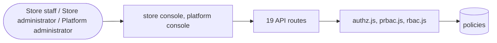

# Access and roles

> Generated from `_registry/business-domains.json`, the code and `docs/source/access.md` — edit those, then run `node scripts/domain-docs.js`.

## Overview

What someone may do: store roles and staff, platform roles, permission sections and scopes, and the policies that grant or refuse.

**Foundation domain:** Authority · **Used by:** Store staff, Store administrator, Platform administrator

## Architecture

| Module | What it is |
|---|---|
| `lib/authz.js` | UCOS Ω∞ · authz — THE ONE AUTHORIZATION ENGINE --------------------------------------------------------------------------- There used to be two engines with two vocabularies: lib/rbac.js for the store console (staff roles, per-tenant) and lib/prbac.js for the platform console (operator roles, global). Two engines meant two places a grant could be mis-scoped, two seeds to keep alive, and — the defect that made this file necessary — two grant surfaces that SHARE THIRTY SECTION KEYS. "orders", "dash", "settings", "audit" exist on BOTH surfaces and mean different things on each. A single merged surface would have collided silently: a store manager's "orders" grant would have opened the platform's global order view, or the reverse. |
| `lib/prbac.js` | PLATFORM RBAC (facade over the ONE authorization engine). * * lib/authz.js is now the single engine: it owns both grant surfaces (store and * platform) and namespaces every grant by scope, because the two consoles share * thirty section keys and a merged surface would have collided silently. This * file keeps the platform console's original call shapes alive — prbac.can(admin, * section, mode), prbac.grant(admin), the global operator-role CRUD — so every * call site, test and stored platformRoles row resolves exactly as before. Only * the resolver that read them was unified. * * The platform's sections are the platform console's NAV leaf keys * (public/js/platform.js); '*' expands to the platform surface only. See authz.js. |
| `lib/rbac.js` | STORE RBAC (facade over the ONE authorization engine). * * lib/authz.js is now the single engine: it owns both grant surfaces (store and * platform) and namespaces every grant by scope, because the two consoles share * thirty section keys and a merged surface would have collided silently. This * file keeps the store console's original call shapes alive — rbac.can(user, * section, mode, tenantId), rbac.grant(user, tenantId), the per-tenant staff * role CRUD — so every call site, test and stored staffRoles row resolves * exactly as before. Only the resolver that reads them was unified. * * The store's sections are the store console's NAV leaf keys (public/js/admin.js); * '*' expands to the store surface only, never the platform one. See authz.js. |

## Data model

### `policies`

| Column | Type |
|---|---|
| `id` | INTEGER PRIMARY KEY AUTOINCREMENT |
| `key` | TEXT NOT NULL UNIQUE |
| `domain` | TEXT |
| `name` | TEXT NOT NULL |
| `description` | TEXT DEFAULT '' |
| `type` | TEXT NOT NULL DEFAULT 'validation' |
| `priority` | INTEGER NOT NULL DEFAULT 0 |
| `rule` | TEXT NOT NULL |
| `context` | TEXT NOT NULL DEFAULT '{}' |
| `status` | TEXT NOT NULL DEFAULT 'active' |
| `created_at` | TEXT NOT NULL DEFAULT (datetime('now')) |

## API reference

Every call is JSON over HTTPS; store calls carry the store (`?store=`) and the session; mutating calls accept an `Idempotency-Key` header where noted.

| Method and path | Handler | What it does |
|---|---|---|
| `GET /api/admin/roles` | `apiRoles` | the store console reads ITS OWN role set (rbac.roles(tenant)) — a store that forked the platform default edits what it forked, and a store that never forked reads the inherited default through the same call. hasOwnSet tells the console which it is looking at, so the "reset to platform default" control only appears when there is a fork to undo. |
| `POST /api/admin/roles` | `apiRoleSave` | a store defines and re-scopes its OWN roles from its own console — the per-tenant fork. The first save forks the full inherited set (the store keeps every role it had and diverges from there), and a fork can be dissolved back to the platform default. Gated on team:write: scoping who on this team may do what is the team trust. |
| `DELETE /api/admin/roles/:key` | `apiRoleDelete` | — |
| `POST /api/admin/roles/reset` | `apiRoleReset` | dissolve this store's fork back to the shared platform default |
| `GET /api/admin/staff` | `apiStaffList` | — |
| `POST /api/admin/staff` | `apiStaffCreate` | — |
| `PUT /api/admin/staff/:id` | `apiStaffUpdate` | — |
| `DELETE /api/admin/staff/:id` | `apiStaffDelete` | — |
| `GET /api/platform/branding-permissions/:id` | `apiPlatformBrandingPerms` | — |
| `GET /api/platform/policies` | `apiPlatformPolicies` | ========== Dynamic Policy Management APIs ========== |
| `GET /api/platform/policies/:category` | `apiPlatformPolicy` | — |
| `PUT /api/platform/policies/:category` | `apiPlatformPolicy` | — |
| `DELETE /api/platform/policies/:category` | `apiPlatformPolicy` | — |
| `PUT /api/platform/branding-permissions/:id` | `apiPlatformBrandingPerms` | — |
| `GET /api/platform/roles` | `apiPlatformRoles` | the platform role catalog + the caller's own grants — the console reads this to filter its nav and to render the role picker. Owner-only writes stay open to every admin so a role can never lock the console's own user management. |
| `POST /api/platform/roles` | `apiPlatformRoleSave` | ---------- role management ---------- Both grant surfaces the platform enforces are DATA in meta_lists, so defining a role and its rights is a console operation, never a deploy. One pair of handlers per surface, sharing a shape: the platform surface ('roles') governs this console's own operators (prbac); the staff surface ('roles/staff') governs every store's team (rbac). Both write through the engines, which validate against that surface's own section list and stamp the row edited so the seed's self-heal never reverts an operator's intent. Gated on roles:write — reading is the padmins read grant the console already needed, writing the roles themselves is a distinct trust. |
| `DELETE /api/platform/roles/:key` | `apiPlatformRoleDelete` | — |
| `POST /api/platform/roles/staff` | `apiStaffRoleSave` | the store-staff surface. Each store may carry its OWN role set (rbac 'staffRoles:t<id>'), so the platform console edits the set the selected store actually enforces: name a store in the body to fork/edit that store's set, or omit it to edit the shared default every un-forked store inherits. rbac.upsertRole takes (tenantId, role) — the store first, the role second — and the first save to a store forks the full inherited set, so a store never starts empty. |
| `DELETE /api/platform/roles/staff/:key` | `apiStaffRoleDelete` | — |

## Data flow

## User interface

**Store console:** 👥 Team & Roles

**Platform console:** 🎭 Roles · 🔒 Policies · 👤 Users · 🎭 Roles · 🔑 Permissions · 🪪 Licenses · 👥 Team · Access · Settings

## User flows

_Not yet written — `docs/source/access.md`, section `## Flows`._

## Manuals

### Store staff

_Not yet written — `docs/source/access.md`, section `## Manual: store_staff`._

### Store administrator

_Not yet written — `docs/source/access.md`, section `## Manual: store_admin`._

### Platform administrator

_Not yet written — `docs/source/access.md`, section `## Manual: platform_admin`._

