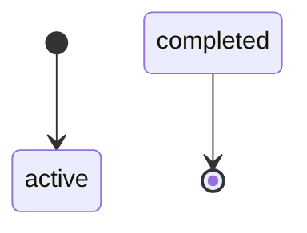
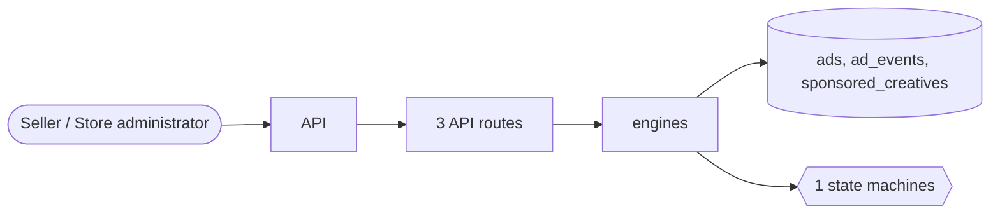

# Advertising

> Generated from `_registry/business-domains.json`, the code and `docs/source/advertising.md` — edit those, then run `node scripts/domain-docs.js`.

## Overview

Paid placement: sellers' sponsored products and creatives competing in an auction for slots, and what each impression and click costs.

**Foundation domain:** Commerce · **Used by:** Seller, Store administrator

## Switches and settings

Each is switched on per store under ⚙️ Capabilities; its parameters are that store's settings.

### Sponsored products (`sponsored_ads`)

Sellers' ads compete in a second-price auction for slots in search results and other surfaces, targeted by keyword and paid per click, thousand impressions or sale. Budgets and schedules are enforced.

| Setting | Meaning | Default |
|---|---|---|
| `slots` | Sponsored slots per surface | `3` |
| `reserve_price` | Lowest bid that may serve (per charged unit) | `0` |
| `pctr_baseline` | Predicted click rate of a new ad | `0.05` |
| `pctr_spend_lift` | Most an ad's past spend can add to its predicted click rate | `0.05` |
| `spend_divisor` | Past spend is divided by this and added to the predicted click rate (up to the lift) | `10000` |
| `runner_up_factor` | Share of its own score the last ad pays when no one bids below it | `0.5` |
| `enforce_budget` | An ad stops serving once it has spent its budget | `true` |
| `enforce_schedule` | An ad serves only between its start and end | `true` |
| `record_impressions` | Serving an ad records an impression (charged under per-thousand bidding) | `true` |
| `impression_event` | Ad event recorded when an ad is served (an adEventKinds row) | `"impression"` |
| `label` | Label shown on an ad | `"Sponsored"` |

## Architecture

**Registry lists** (editable in Data Studio): `mktAdKinds`, `mktCreativeStatuses`

## Data model

### `ads`

| Column | Type |
|---|---|
| `id` | INTEGER PRIMARY KEY AUTOINCREMENT |
| `tenant_id` | INTEGER NOT NULL |
| `seller_id` | INTEGER |
| `name` | TEXT NOT NULL |
| `status` | TEXT NOT NULL DEFAULT 'active' |
| `bid_model` | TEXT NOT NULL DEFAULT 'cpc' |
| `bid_amount` | REAL NOT NULL DEFAULT 0 |
| `budget` | REAL DEFAULT 0 |
| `spent` | REAL DEFAULT 0 |
| `target` | TEXT DEFAULT '{}' |
| `start_at` | TEXT |
| `end_at` | TEXT |
| `created_at` | TEXT NOT NULL DEFAULT (datetime('now')) |

### `ad_events`

| Column | Type |
|---|---|
| `id` | INTEGER PRIMARY KEY AUTOINCREMENT |
| `tenant_id` | INTEGER NOT NULL |
| `ad_id` | INTEGER NOT NULL |
| `kind` | TEXT NOT NULL DEFAULT 'impression' |
| `ref` | TEXT |
| `cost` | REAL DEFAULT 0 |
| `at` | TEXT NOT NULL DEFAULT (datetime('now')) |

### `sponsored_creatives`

| Column | Type |
|---|---|
| `id` | INTEGER PRIMARY KEY AUTOINCREMENT |
| `tenant_id` | INTEGER NOT NULL |
| `ad_id` | INTEGER |
| `seller_id` | INTEGER |
| `kind` | TEXT NOT NULL DEFAULT 'sponsored_product' |
| `headline` | TEXT |
| `creative` | TEXT |
| `landing` | TEXT |
| `bid_model` | TEXT |
| `bid_amount` | REAL |
| `budget` | REAL |
| `spent` | REAL DEFAULT 0 |
| `status` | TEXT NOT NULL DEFAULT 'draft' |
| `start_at` | TEXT |
| `end_at` | TEXT |
| `created_at` | TEXT NOT NULL DEFAULT (datetime('now')) |

## API reference

Every call is JSON over HTTPS; store calls carry the store (`?store=`) and the session; mutating calls accept an `Idempotency-Key` header where noted.

| Method and path | Handler | What it does |
|---|---|---|
| `GET /api/marketplace/sponsored` | `apiSponsored` | sponsored results: the auction's winners for a surface (and a search), as product cards |
| `GET /api/marketplace/ads` | `apiMktAds` | the full ad book (bids, budgets, spend) is staff data; shoppers see ads through ranking |
| `POST /api/marketplace/ads/:id/event` | `apiMktEvent` | — |

## Process flows

Each record's life is a declared state machine (`lib/seed/states.json`): the moves it may make, and the actions that make them.

### Sponsored ad (`ad`)

Actions: 

## Data flow

## User interface

## User flows

_Not yet written — `docs/source/advertising.md`, section `## Flows`._

## Manuals

### Seller

_Not yet written — `docs/source/advertising.md`, section `## Manual: seller`._

### Store administrator

_Not yet written — `docs/source/advertising.md`, section `## Manual: store_admin`._

