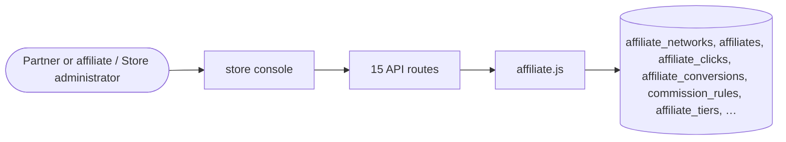

# Affiliates and creators

> Generated from `_registry/business-domains.json`, the code and `docs/source/affiliate.md` — edit those, then run `node scripts/domain-docs.js`.

## Overview

Who brings buyers and what they earn: affiliate networks and tiers, tracked clicks and conversions, commission rules and affiliate payouts.

**Foundation domain:** Commerce · **Used by:** Partner or affiliate, Store administrator

## Architecture

| Module | What it is |
|---|---|
| `lib/affiliate.js` | Affiliate Network Module Full-stack affiliate tracking, attribution, commissions, and payouts. Built on top of GOIP touchpoints and settlement infrastructure. Registry-driven: all rules, tiers, and networks are configurable. |

## Data model

### `affiliate_networks`

| Column | Type |
|---|---|
| `id` | INTEGER PRIMARY KEY AUTOINCREMENT |
| `name` | TEXT NOT NULL |
| `slug` | TEXT UNIQUE |
| `tenant_id` | INTEGER DEFAULT 1 |
| `status` | TEXT DEFAULT 'active' |
| `default_commission_pct` | REAL DEFAULT 5.0 |
| `cookie_days` | INTEGER DEFAULT 30 |
| `attribution_model` | TEXT DEFAULT 'last_touch' |
| `min_payout` | REAL DEFAULT 50.0 |
| `currency` | TEXT DEFAULT 'USD' |
| `created_at` | TEXT DEFAULT (datetime('now')) |
| `uid` | TEXT |

### `affiliates`

| Column | Type |
|---|---|
| `id` | INTEGER PRIMARY KEY AUTOINCREMENT |
| `network_id` | INTEGER REFERENCES affiliate_networks(id) |
| `tenant_id` | INTEGER DEFAULT 1 |
| `name` | TEXT NOT NULL |
| `email` | TEXT UNIQUE |
| `status` | TEXT DEFAULT 'pending' |
| `affiliate_code` | TEXT UNIQUE |
| `tracking_url` | TEXT |
| `deep_link_template` | TEXT |
| `commission_pct` | REAL |
| `commission_type` | TEXT DEFAULT 'revenue' |
| `tier` | TEXT DEFAULT 'standard' |
| `balance` | REAL DEFAULT 0 |
| `lifetime_sales` | REAL DEFAULT 0 |
| `lifetime_commissions` | REAL DEFAULT 0 |
| `created_at` | TEXT DEFAULT (datetime('now')) |
| `last_activity` | TEXT |
| `metadata` | TEXT DEFAULT '{}' |
| `uid` | TEXT |

### `affiliate_clicks`

| Column | Type |
|---|---|
| `id` | INTEGER PRIMARY KEY AUTOINCREMENT |
| `affiliate_id` | INTEGER REFERENCES affiliates(id) |
| `network_id` | INTEGER REFERENCES affiliate_networks(id) |
| `tenant_id` | INTEGER DEFAULT 1 |
| `click_id` | TEXT UNIQUE |
| `ip` | TEXT |
| `user_agent` | TEXT |
| `referrer` | TEXT |
| `landing_url` | TEXT |
| `campaign` | TEXT |
| `source` | TEXT |
| `medium` | TEXT |
| `created_at` | TEXT DEFAULT (datetime('now')) |
| `uid` | TEXT |

### `affiliate_conversions`

| Column | Type |
|---|---|
| `id` | INTEGER PRIMARY KEY AUTOINCREMENT |
| `affiliate_id` | INTEGER REFERENCES affiliates(id) |
| `network_id` | INTEGER REFERENCES affiliate_networks(id) |
| `tenant_id` | INTEGER DEFAULT 1 |
| `click_id` | TEXT REFERENCES affiliate_clicks(click_id) |
| `order_id` | INTEGER REFERENCES orders(id) |
| `order_num` | TEXT |
| `conversion_type` | TEXT DEFAULT 'sale' |
| `revenue` | REAL |
| `commission` | REAL |
| `commission_pct` | REAL |
| `status` | TEXT DEFAULT 'pending' |
| `approved_at` | TEXT |
| `paid_at` | TEXT |
| `payment_id` | INTEGER |
| `created_at` | TEXT DEFAULT (datetime('now')) |
| `uid` | TEXT |

### `commission_rules`

| Column | Type |
|---|---|
| `id` | INTEGER PRIMARY KEY AUTOINCREMENT |
| `network_id` | INTEGER REFERENCES affiliate_networks(id) |
| `tenant_id` | INTEGER DEFAULT 1 |
| `name` | TEXT NOT NULL |
| `status` | TEXT DEFAULT 'active' |
| `applies_to` | TEXT DEFAULT 'all' |
| `condition` | TEXT DEFAULT '{}' |
| `commission_type` | TEXT DEFAULT 'revenue' |
| `commission_value` | REAL |
| `min_order` | REAL DEFAULT 0 |
| `max_order` | REAL |
| `tier` | TEXT |
| `product_ids` | TEXT |
| `category_ids` | TEXT |
| `brand_ids` | TEXT |
| `start_date` | TEXT |
| `end_date` | TEXT |
| `position` | INTEGER DEFAULT 0 |
| `created_at` | TEXT DEFAULT (datetime('now')) |
| `uid` | TEXT |

### `affiliate_tiers`

| Column | Type |
|---|---|
| `id` | INTEGER PRIMARY KEY AUTOINCREMENT |
| `network_id` | INTEGER REFERENCES affiliate_networks(id) |
| `name` | TEXT NOT NULL |
| `min_sales` | REAL DEFAULT 0 |
| `commission_bonus_pct` | REAL DEFAULT 0 |
| `benefits` | TEXT DEFAULT '[]' |
| `position` | INTEGER DEFAULT 0 |
| `uid` | TEXT |

### `affiliate_payouts`

| Column | Type |
|---|---|
| `id` | INTEGER PRIMARY KEY AUTOINCREMENT |
| `affiliate_id` | INTEGER REFERENCES affiliates(id) |
| `network_id` | INTEGER REFERENCES affiliate_networks(id) |
| `amount` | REAL NOT NULL |
| `status` | TEXT DEFAULT 'pending' |
| `method` | TEXT DEFAULT 'bank' |
| `transaction_ref` | TEXT |
| `paid_at` | TEXT |
| `created_at` | TEXT DEFAULT (datetime('now')) |
| `uid` | TEXT |

## API reference

Every call is JSON over HTTPS; store calls carry the store (`?store=`) and the session; mutating calls accept an `Idempotency-Key` header where noted.

| Method and path | Handler | What it does |
|---|---|---|
| `GET /api/affiliate/networks` | `apiAffiliateNetworks` | ========== Affiliate Network APIs ========== S1: this block was entirely unauthenticated and unscoped — an anonymous caller could register an affiliate, attribute another tenant's order to it, and pay itself the commission. Every management route now passes the store's admin gate, every query carries the session's tenant, and the tenant comes from the session, never the body. The one exception is the storefront tracking pixel (click), which is anonymous by design and was already scoped by the store the request resolved to. |
| `POST /api/affiliate/networks` | `apiAffiliateNetworkCreate` | — |
| `GET /api/affiliate/affiliates` | `apiAffiliateList` | — |
| `POST /api/affiliate/affiliates` | `apiAffiliateCreate` | — |
| `GET /api/affiliate/affiliates/:id` | `apiAffiliateGet` | — |
| `PUT /api/affiliate/affiliates/:id` | `apiAffiliateUpdate` | — |
| `POST /api/affiliate/click` | `apiAffiliateClick` | the storefront pixel: a shopper clicking an affiliate link. Anonymous by design — the click is recorded against the store the request resolved to, which is the only tenant it can ever be read back by |
| `POST /api/affiliate/conversion` | `apiAffiliateConversion` | S1: the order must be THIS tenant's order and the affiliate THIS tenant's affiliate — otherwise the commission is a cross-tenant transfer, and the returned commission was a cross-tenant revenue oracle |
| `GET /api/affiliate/conversions/:id` | `apiAffiliateConversionGet` | — |
| `POST /api/affiliate/conversions/:id/approve` | `apiAffiliateApprove` | — |
| `POST /api/affiliate/conversions/:id/reject` | `apiAffiliateReject` | — |
| `GET /api/affiliate/payouts` | `apiAffiliatePayouts` | payouts carry no tenant column: scope through the affiliate they belong to, so one store can never see — or process — another store's payouts |
| `POST /api/affiliate/payouts` | `apiAffiliatePayoutCreate` | — |
| `POST /api/affiliate/payouts/:id/process` | `apiAffiliatePayoutProcess` | — |
| `GET /api/affiliate/reports` | `apiAffiliateReport` | — |

## Data flow

## User interface

**Store console:** 📣 Influencers & Affiliates

## User flows

_Not yet written — `docs/source/affiliate.md`, section `## Flows`._

## Manuals

### Partner or affiliate

_Not yet written — `docs/source/affiliate.md`, section `## Manual: partner`._

### Store administrator

_Not yet written — `docs/source/affiliate.md`, section `## Manual: store_admin`._

