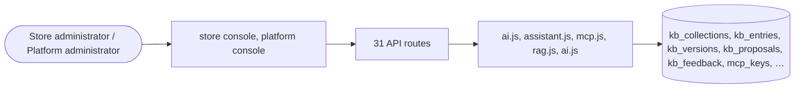

# AI

> Generated from `_registry/business-domains.json`, the code and `docs/source/ai.md` — edit those, then run `node scripts/domain-docs.js`.

## Overview

Machine help: AI providers and gateways, AI tasks and their metering.

**Foundation domain:** Agent · **Used by:** Store administrator, Platform administrator

## Switches and settings

Each is switched on per store under ⚙️ Capabilities; its parameters are that store's settings.

### AI assistant (`ai_assistant`)

The store's AI assistants (astrology guide, consultancy helper, store help…): each answers from the store's approved knowledge and calls the platform's tools, and hands a person to a human. Profiles are set in Store console -> AI; Claude credentials in AI gateways. Without credentials an assistant answers from approved knowledge only.

## Architecture

| Module | What it is |
|---|---|
| `lib/ai.js` | AI capability layer (a PRODUCT, not code). Everything (providers, capabilities, plans, per-capability model/limits/price) is DATA: providers live in provider_defs(kind='ai') + provider_availability; capabilities, plans and cleaning rules live in meta_lists (aiCapabilities / aiPlans / aiCleanRules …); the per-tenant model, limits and on/off live in the `ai` settings block. Free tier is ON by default (1st priority) via the built-in local engine; premium models are gated by REAL billing state (paid subscription plan or the `aiPro` capability) AND by provider credentials being configured. Nothing is hard-coded to a model, provider, price, limit or field — those come from registries. |
| `lib/assistant.js` | the AI assistant, one engine for every app: a profile (lib/seed/assistant.json, the store's own copy in its settings) says which knowledge collections it answers from (lib/rag.js), which platform tools it may call (the MCP tools, lib/mcp.js, called in-process), who a person is handed to, and what it must always say. |
| `lib/mcp.js` | the platform's MCP server (Model Context Protocol): the platform's capabilities as tools any MCP client can call — the platform's own AI assistant, Claude Desktop, an agent, a partner's app — over JSON-RPC 2.0 at POST /api/mcp. |
| `lib/rag.js` | the knowledge base (retrieval for the AI assistant and any app): collections of entries that any platform type can keep — astrology, consultancy, legal, product help — each with its own way of growing (its MODE, lib/seed/rag.json), set in Store console → Knowledge. |
| `lib/routes/ai.js` | ai domain routes (moved from lib/api.js; _registry/business-domains.json). Each handler answers one route of the ai domain. What it needs from the shared HTTP kit (lib/api.js) is passed in as `kit`. |

## Data model

### `kb_collections`

| Column | Type |
|---|---|
| `tenant_id` | INTEGER NOT NULL |
| `key` | TEXT NOT NULL |
| `label` | TEXT |
| `mode` | TEXT NOT NULL |
| `settings` | TEXT NOT NULL DEFAULT '{}' |

### `kb_entries`

| Column | Type |
|---|---|
| `id` | INTEGER PRIMARY KEY AUTOINCREMENT |
| `tenant_id` | INTEGER NOT NULL |
| `collection` | TEXT NOT NULL |
| `title` | TEXT NOT NULL |
| `body` | TEXT NOT NULL |
| `tags` | TEXT NOT NULL DEFAULT '[]' |
| `lang` | TEXT NOT NULL DEFAULT 'en' |
| `status` | TEXT NOT NULL |
| `source` | TEXT NOT NULL |
| `confidence` | REAL |
| `rating_sum` | REAL NOT NULL DEFAULT 0 |
| `rating_n` | INTEGER NOT NULL DEFAULT 0 |
| `confirmations` | INTEGER NOT NULL DEFAULT 0 |
| `version` | INTEGER NOT NULL DEFAULT 1 |
| `author` | TEXT |
| `approved_by` | TEXT |
| `created_at` | TEXT NOT NULL DEFAULT (datetime('now')) |
| `updated_at` | TEXT NOT NULL DEFAULT (datetime('now')) |

### `kb_versions`

| Column | Type |
|---|---|
| `entry_id` | INTEGER NOT NULL |
| `version` | INTEGER NOT NULL |
| `title` | TEXT |
| `body` | TEXT |
| `tags` | TEXT |
| `status` | TEXT |
| `changed_by` | TEXT |
| `reason` | TEXT |
| `at` | TEXT NOT NULL DEFAULT (datetime('now')) |

### `kb_proposals`

| Column | Type |
|---|---|
| `id` | INTEGER PRIMARY KEY AUTOINCREMENT |
| `tenant_id` | INTEGER NOT NULL |
| `entry_id` | INTEGER NOT NULL |
| `title` | TEXT |
| `body` | TEXT |
| `tags` | TEXT |
| `source` | TEXT NOT NULL |
| `confidence` | REAL |
| `confirmations` | INTEGER NOT NULL DEFAULT 0 |
| `reason` | TEXT |
| `author` | TEXT |
| `state` | TEXT NOT NULL DEFAULT 'open' |
| `decided_by` | TEXT |
| `created_at` | TEXT NOT NULL DEFAULT (datetime('now')) |

### `kb_feedback`

| Column | Type |
|---|---|
| `id` | INTEGER PRIMARY KEY AUTOINCREMENT |
| `tenant_id` | INTEGER NOT NULL |
| `entry_id` | INTEGER |
| `answer_ref` | TEXT |
| `rating` | INTEGER NOT NULL |
| `correction` | TEXT |
| `by_whom` | TEXT |
| `at` | TEXT NOT NULL DEFAULT (datetime('now')) |

### `mcp_keys`

| Column | Type |
|---|---|
| `id` | INTEGER PRIMARY KEY AUTOINCREMENT |
| `tenant_id` | INTEGER NOT NULL |
| `name` | TEXT |
| `key_hash` | TEXT NOT NULL UNIQUE |
| `role_key` | TEXT NOT NULL |
| `created_by` | TEXT |
| `created_at` | TEXT NOT NULL DEFAULT (datetime('now')) |
| `last_used` | TEXT |
| `revoked` | INTEGER NOT NULL DEFAULT 0 |

### `assistant_turns`

| Column | Type |
|---|---|
| `id` | INTEGER PRIMARY KEY AUTOINCREMENT |
| `tenant_id` | INTEGER NOT NULL |
| `conversation` | TEXT NOT NULL |
| `app` | TEXT NOT NULL |
| `question` | TEXT |
| `answer` | TEXT |
| `sources` | TEXT |
| `tools` | TEXT |
| `model` | TEXT |
| `mode` | TEXT |
| `owner` | TEXT |
| `created_at` | TEXT NOT NULL DEFAULT (datetime('now')) |

### `ai_usage`

| Column | Type |
|---|---|
| `id` | INTEGER PRIMARY KEY AUTOINCREMENT |
| `tenant_id` | INTEGER NOT NULL |
| `capability` | TEXT NOT NULL |
| `provider` | TEXT NOT NULL |
| `model` | TEXT DEFAULT '' |
| `units` | INTEGER NOT NULL DEFAULT 1 |
| `cost` | REAL NOT NULL DEFAULT 0 |
| `currency` | TEXT |
| `tier` | TEXT DEFAULT 'free' |
| `status` | TEXT DEFAULT 'ok' |
| `actor` | TEXT DEFAULT '' |
| `created_at` | TEXT NOT NULL DEFAULT (datetime('now')) |
| `uid` | TEXT |

### `ai_tasks`

| Column | Type |
|---|---|
| `id` | INTEGER PRIMARY KEY AUTOINCREMENT |
| `tenant_id` | INTEGER NOT NULL |
| `capability` | TEXT NOT NULL |
| `status` | TEXT NOT NULL DEFAULT 'queued' |
| `params` | TEXT DEFAULT '{}' |
| `result` | TEXT |
| `cost` | REAL DEFAULT 0 |
| `actor` | TEXT DEFAULT '' |
| `created_at` | TEXT NOT NULL DEFAULT (datetime('now')) |
| `updated_at` | TEXT |
| `uid` | TEXT |

## API reference

Every call is JSON over HTTPS; store calls carry the store (`?store=`) and the session; mutating calls accept an `Idempotency-Key` header where noted.

| Method and path | Handler | What it does |
|---|---|---|
| `GET /api/kb/collections` | `apiKbCollections` | the store's knowledge collections and their modes |
| `PUT /api/kb/collections/:key` | `apiKbCollectionPut` | creates or changes a collection: its label, mode, expert roles and thresholds |
| `GET /api/kb/:key/entries` | `apiKbEntries` | a collection's entries, optionally of one status |
| `POST /api/kb/:key/entries` | `apiKbEntryAdd` | adds an entry: an expert's is approved, anyone else's waits for review |
| `GET /api/kb/:key/proposals` | `apiKbProposals` | the revisions waiting in a collection (from staff, the AI or feedback) |
| `POST /api/kb/:key/draft` | `apiKbDraft` | the AI drafts an entry for an expert's review, where the collection's mode allows it |
| `GET /api/kb/:key/search` | `apiKbSearch` | searches a collection's approved entries by question and tags — anyone the store serves |
| `PUT /api/kb/entries/:id` | `apiKbEntryPut` | revises an entry: an expert's revision lands as a new version, anyone else's becomes a proposal |
| `POST /api/kb/entries/:id/review` | `apiKbEntryReview` | an expert approves, rejects or retires an entry |
| `POST /api/kb/entries/:id/rollback` | `apiKbEntryRollback` | an expert restores an earlier version of an entry |
| `GET /api/kb/entries/:id/history` | `apiKbEntryHistory` | every version of an entry, with who changed it and why |
| `POST /api/kb/proposals/:id/decide` | `apiKbProposalDecide` | an expert approves or rejects a proposed revision |
| `POST /api/kb/proposals/:id/confirm` | `apiKbProposalConfirm` | a staff member confirms a proposal (in auto-evolving mode, enough confirmations let it go live) |
| `GET /api/assistant/profiles` | `apiAssistantProfiles` | the store's assistant profiles (apps) |
| `PUT /api/assistant/profiles/:key` | `apiAssistantProfilePut` | changes a profile: persona, collections, tools, hand-off, disclaimer, model and effort |
| `POST /api/assistant/:key/ask` | `apiAssistantAsk` | asks one of the store's assistants (the store switches the AI assistant on in Capabilities) |
| `POST /api/assistant/turns/:id/rate` | `apiAssistantRate` | a person rates or corrects an answer |
| `GET /api/admin/mcp-keys` | `apiMcpKeys` | the store's MCP access keys: each acts as one store role |
| `POST /api/admin/mcp-keys` | `apiMcpKeyIssue` | issues a key for a role (shown once) |
| `DELETE /api/admin/mcp-keys/:id` | `apiMcpKeyRevoke` | revokes a key |
| `POST /api/mcp` | `apiMcp` | the MCP server: JSON-RPC 2.0. A Bearer MCP key acts as its role in its own store; otherwise the caller is whoever the session is (a staff role, or a shopper) |
| `GET /api/admin/ai-gateways` | `apiAdminAiGateways` | — |
| `PUT /api/admin/ai-gateways` | `apiAdminAiGatewaysPut` | — |
| `POST /api/admin/ai-gateways/:id/test` | `apiAdminAiGatewayTest` | — |
| `GET /api/ai` | `apiAiOverview` | ---------- AI product layer (capabilities, run, usage, tasks) ---------- |
| `POST /api/ai/run/:capability` | `apiAiRun` | — |
| `GET /api/ai/usage` | `apiAiUsage` | — |
| `GET /api/ai/tasks` | `apiAiTasks` | — |
| `POST /api/ai/tasks` | `apiAiTaskCreate` | — |
| `POST /api/ai/tasks/:id/run` | `apiAiTaskRun` | — |
| `GET /api/platform/ai` | `apiPlatformAi` | — |

## Data flow

## User interface

**Store console:** 🤖 AI Studio

**Platform console:** 🧠 AI · Providers & Plans · 🤖 AI Models · 🤖 Agents · 👥 Agent Teams · 💬 Prompt Registry · 🧩 Reasoning Engine · 🎯 Recommendation · 🔍 Search · 🎯 Personalization Engine · ⚙️ Optimization · 🧪 Simulation · 📈 Forecasting · 👯 Digital Twins · 🗓️ Autonomous Planning · ▶️ Autonomous Execution · ✔️ Autonomous Verification · 📚 Learning Engine · 🧬 Evolution Engine

## User flows

_Not yet written — `docs/source/ai.md`, section `## Flows`._

## Manuals

### Store administrator

_Not yet written — `docs/source/ai.md`, section `## Manual: store_admin`._

### Platform administrator

_Not yet written — `docs/source/ai.md`, section `## Manual: platform_admin`._

