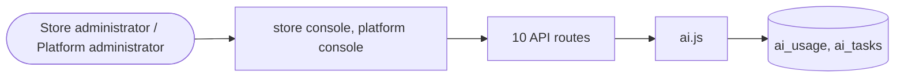

# AI

> Generated from `_registry/business-domains.json`, the code and `docs/source/ai.md` — edit those, then run `node scripts/domain-docs.js`.

## Overview

Machine help: AI providers and gateways, AI tasks and their metering.

**Foundation domain:** Agent · **Used by:** Store administrator, Platform administrator

## Architecture

| Module | What it is |
|---|---|
| `lib/ai.js` | AI capability layer (a PRODUCT, not code). Everything (providers, capabilities, plans, per-capability model/limits/price) is DATA: providers live in provider_defs(kind='ai') + provider_availability; capabilities, plans and cleaning rules live in meta_lists (aiCapabilities / aiPlans / aiCleanRules …); the per-tenant model, limits and on/off live in the `ai` settings block. Free tier is ON by default (1st priority) via the built-in local engine; premium models are gated by REAL billing state (paid subscription plan or the `aiPro` capability) AND by provider credentials being configured. Nothing is hard-coded to a model, provider, price, limit or field — those come from registries. |

## Data model

### `ai_usage`

| Column | Type |
|---|---|
| `id` | INTEGER PRIMARY KEY AUTOINCREMENT |
| `tenant_id` | INTEGER NOT NULL |
| `capability` | TEXT NOT NULL |
| `provider` | TEXT NOT NULL |
| `model` | TEXT DEFAULT '' |
| `units` | INTEGER NOT NULL DEFAULT 1 |
| `cost` | REAL NOT NULL DEFAULT 0 |
| `currency` | TEXT DEFAULT 'USD' |
| `tier` | TEXT DEFAULT 'free' |
| `status` | TEXT DEFAULT 'ok' |
| `actor` | TEXT DEFAULT '' |
| `created_at` | TEXT NOT NULL DEFAULT (datetime('now')) |
| `uid` | TEXT |

### `ai_tasks`

| Column | Type |
|---|---|
| `id` | INTEGER PRIMARY KEY AUTOINCREMENT |
| `tenant_id` | INTEGER NOT NULL |
| `capability` | TEXT NOT NULL |
| `status` | TEXT NOT NULL DEFAULT 'queued' |
| `params` | TEXT DEFAULT '{}' |
| `result` | TEXT |
| `cost` | REAL DEFAULT 0 |
| `actor` | TEXT DEFAULT '' |
| `created_at` | TEXT NOT NULL DEFAULT (datetime('now')) |
| `updated_at` | TEXT |
| `uid` | TEXT |

## API reference

Every call is JSON over HTTPS; store calls carry the store (`?store=`) and the session; mutating calls accept an `Idempotency-Key` header where noted.

| Method and path | Handler | What it does |
|---|---|---|
| `GET /api/admin/ai-gateways` | `apiAdminAiGateways` | — |
| `PUT /api/admin/ai-gateways` | `apiAdminAiGatewaysPut` | — |
| `POST /api/admin/ai-gateways/:id/test` | `apiAdminAiGatewayTest` | — |
| `GET /api/ai` | `apiAiOverview` | ---------- AI product layer (capabilities, run, usage, tasks) ---------- |
| `POST /api/ai/run/:capability` | `apiAiRun` | — |
| `GET /api/ai/usage` | `apiAiUsage` | — |
| `GET /api/ai/tasks` | `apiAiTasks` | — |
| `POST /api/ai/tasks` | `apiAiTaskCreate` | — |
| `POST /api/ai/tasks/:id/run` | `apiAiTaskRun` | — |
| `GET /api/platform/ai` | `apiPlatformAi` | — |

## Data flow

## User interface

**Store console:** 🤖 AI Studio

**Platform console:** 🧠 AI · Providers & Plans · 🤖 AI Models · 🤖 Agents · 👥 Agent Teams · 💬 Prompt Registry · 🧩 Reasoning Engine · 🎯 Recommendation · 🔍 Search · 🎯 Personalization Engine · ⚙️ Optimization · 🧪 Simulation · 📈 Forecasting · 👯 Digital Twins · 🗓️ Autonomous Planning · ▶️ Autonomous Execution · ✔️ Autonomous Verification · 📚 Learning Engine · 🧬 Evolution Engine

## User flows

_Not yet written — `docs/source/ai.md`, section `## Flows`._

## Manuals

### Store administrator

_Not yet written — `docs/source/ai.md`, section `## Manual: store_admin`._

### Platform administrator

_Not yet written — `docs/source/ai.md`, section `## Manual: platform_admin`._

