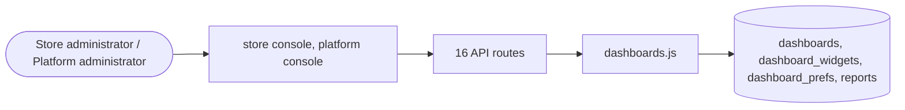

# Analytics and reports

> Generated from `_registry/business-domains.json`, the code and `docs/source/analytics.md` — edit those, then run `node scripts/domain-docs.js`.

## Overview

Knowing how the business does: dashboards and their widgets, reports and store statistics.

**Foundation domain:** Insight · **Used by:** Store administrator, Platform administrator

## Architecture

| Module | What it is |
|---|---|
| `lib/dashboards.js` | LUXORA · Universal Dashboard & Reporting Engine — Architecture1 §394 / §395. -------------------------------------------------------------------------- The constitution does not ask for "some dashboards". It declares dashboards to be RUNTIME OBJECTS: Identity, Audience, Widgets, Metrics, Dimensions, Filters, Visualizations, Security, Personalization, Actions (§1439 Dashboard Meta Model) and types from Executive to Compliance (§394). §395 declares the reporting engine the same way: Data → Analytics → Visualization → Report. |

## Data model

### `dashboards`

| Column | Type |
|---|---|
| `id` | INTEGER PRIMARY KEY AUTOINCREMENT |
| `tenant_id` | INTEGER |
| `/*` | NULL = platform canonical template */ key TEXT NOT NULL |
| `name` | TEXT NOT NULL |
| `type` | TEXT |
| `/*` | §394 dashboard categories */ audience TEXT DEFAULT 'admin' |
| `/*` | admin \| platform \| all */ description TEXT |
| `active` | INTEGER DEFAULT 1 |
| `position` | INTEGER DEFAULT 0 |

### `dashboard_widgets`

| Column | Type |
|---|---|
| `id` | INTEGER PRIMARY KEY AUTOINCREMENT |
| `dashboard_id` | INTEGER NOT NULL |
| `kind` | TEXT |
| `/*` | kpi \| table \| bar \| line \| donut \| text */ label TEXT |
| `entity` | TEXT |
| `/*` | any entity key the engine knows */ metric TEXT |
| `/*` | count \| sum \| avg \| min \| max \| distinct */ column TEXT |
| `/*` | column for sum/avg/min/max/distinct */ dimension TEXT |
| `/*` | group-by column (table/bar/line/donut) */ ord TEXT DEFAULT 'desc' |
| `/*` | asc \| desc — ordering of the aggregate */ lim INTEGER DEFAULT 10 |
| `filter` | TEXT DEFAULT '{}' |
| `/*` | JSON {field: value} equality predicates */ position INTEGER DEFAULT 0 |
| `span` | INTEGER DEFAULT 3 /* grid width 1..6 (of 6) */ |

### `dashboard_prefs`

| Column | Type |
|---|---|
| `id` | INTEGER PRIMARY KEY AUTOINCREMENT |
| `tenant_id` | INTEGER |
| `user_id` | INTEGER NOT NULL |
| `dashboard_id` | INTEGER NOT NULL |
| `widget_id` | INTEGER |
| `hidden` | INTEGER DEFAULT 0 |
| `position` | INTEGER |

### `reports`

| Column | Type |
|---|---|
| `id` | INTEGER PRIMARY KEY AUTOINCREMENT |
| `tenant_id` | INTEGER |
| `/*` | NULL = platform canonical template */ key TEXT NOT NULL |
| `name` | TEXT NOT NULL |
| `kind` | TEXT |
| `/*` | §395: scheduled \| event \| regulatory \| operational \| executive \| ai */ entity TEXT NOT NULL |
| `metrics` | TEXT DEFAULT '[]' |
| `/*` | JSON [{metric |
| `column` |  |
| `alias}]` | */ dimensions TEXT DEFAULT '[]' |
| `/*` | JSON [column] */ filter TEXT DEFAULT '{}' |
| `schedule` | TEXT DEFAULT 'manual' |
| `/*` | manual \| daily \| weekly \| monthly */ format TEXT DEFAULT 'table' |
| `/*` | table \| csv \| json */ active INTEGER DEFAULT 1 |
| `last_run` | TEXT |
| `position` | INTEGER DEFAULT 0 |

## API reference

Every call is JSON over HTTPS; store calls carry the store (`?store=`) and the session; mutating calls accept an `Idempotency-Key` header where noted.

| Method and path | Handler | What it does |
|---|---|---|
| `GET /api/dashboards/entities` | `apiDashboardEntities` | the entity vocabulary a widget may point at, so the console's picker is derived from the engine itself (native entities + every corpus universe) rather than maintained |
| `GET /api/dashboards` | `apiDashboards` | — |
| `GET /api/dashboards/:key` | `apiDashboardRender` | — |
| `POST /api/dashboards/:key` | `apiDashboardSave` | — |
| `PUT /api/dashboards/:key` | `apiDashboardSave` | — |
| `DELETE /api/dashboards/:key` | `apiDashboardDelete` | — |
| `POST /api/dashboards/:key/widgets` | `apiWidgetSave` | a widget is added/edited as a row — the console never computes, only declares |
| `DELETE /api/dashboards/:key/widgets` | `apiWidgetDelete` | — |
| `POST /api/dashboards/:key/prefs` | `apiDashboardPref` | §1439 Personalization: the operator's own view of a shared dashboard |
| `GET /api/reports` | `apiReports` | §395 Reporting Engine |
| `GET /api/reports/:key/run` | `apiReportRun` | — |
| `POST /api/reports/:key` | `apiReportSave` | — |
| `PUT /api/reports/:key` | `apiReportSave` | — |
| `DELETE /api/reports/:key` | `apiReportDelete` | — |
| `GET /api/admin/stats` | `apiAdminStats` | ================= STORE ADMIN ================= |
| `GET /api/admin/analytics` | `apiAdminAnalytics` | — |

## Data flow

## User interface

**Store console:** 📊 Analytics

**Platform console:** 📊 Analytics · A/B · 🧪 Experiments · 🗄️ Intelligence Registry · ◈ Command · 📊 Dashboards · 🎯 SLO · SLA · 🔍 Root Cause Analysis · 🩺 Diagnostics · 💸 Cost · Usage

## User flows

_Not yet written — `docs/source/analytics.md`, section `## Flows`._

## Manuals

### Store administrator

_Not yet written — `docs/source/analytics.md`, section `## Manual: store_admin`._

### Platform administrator

_Not yet written — `docs/source/analytics.md`, section `## Manual: platform_admin`._

