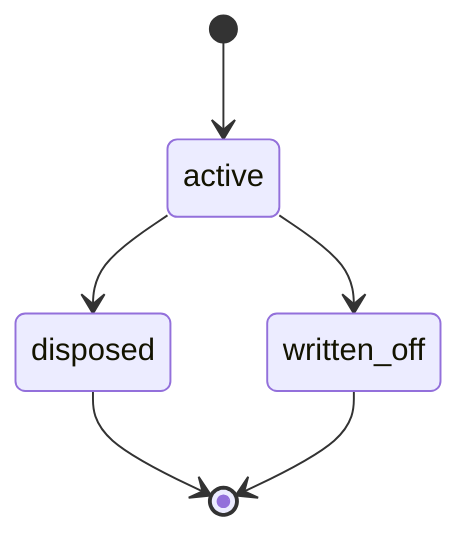
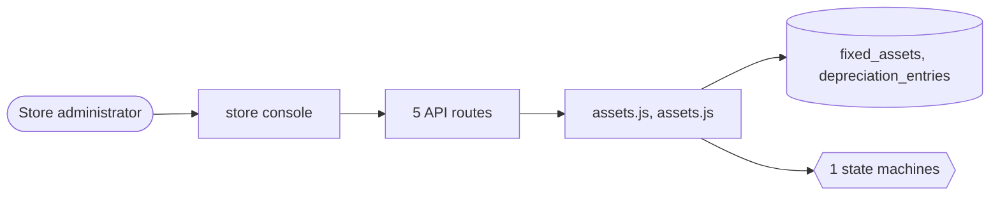

# Fixed assets

> Generated from `_registry/business-domains.json`, the code and `docs/source/assets.md` — edit those, then run `node scripts/domain-docs.js`.

## Overview

What a store owns and uses for years: bought onto the books from the bank or on credit, depreciated month by month once — straight line or declining balance — to its residual value, posted as each month ends, sold or written off with the gain or loss posted, with its whole schedule and the register's totals.

**Foundation domain:** Value · **Used by:** Store administrator

## Architecture

| Module | What it is |
|---|---|
| `lib/assets.js` | fixed assets and depreciation (owner Value). |
| `lib/routes/assets.js` | fixed assets domain routes (lib/assets.js; _registry/business-domains.json). The register of what a store owns, depreciation and disposal, under the store's assets section (the Finance role holds it). |

## Data model

### `fixed_assets`

| Column | Type |
|---|---|
| `id` | INTEGER PRIMARY KEY AUTOINCREMENT |
| `tenant_id` | INTEGER NOT NULL |
| `ref` | TEXT NOT NULL |
| `name` | TEXT NOT NULL |
| `category` | TEXT NOT NULL |
| `method` | TEXT NOT NULL |
| `currency` | TEXT NOT NULL |
| `cost` | REAL NOT NULL |
| `residual` | REAL NOT NULL DEFAULT 0 |
| `life_months` | INTEGER NOT NULL |
| `acquired_on` | TEXT NOT NULL |
| `in_service` | TEXT NOT NULL |
| `paid_from` | TEXT NOT NULL |
| `supplier_id` | INTEGER |
| `serial` | TEXT DEFAULT '' |
| `location` | TEXT DEFAULT '' |
| `accumulated` | REAL NOT NULL DEFAULT 0 |
| `last_period` | TEXT |
| `status` | TEXT NOT NULL |
| `disposed_at` | TEXT |
| `disposal_date` | TEXT |
| `proceeds` | REAL |
| `disposal_reason` | TEXT DEFAULT '' |
| `created_by` | TEXT DEFAULT '' |
| `created_at` | TEXT NOT NULL DEFAULT (datetime('now')) |
| `uid` | TEXT |

### `depreciation_entries`

| Column | Type |
|---|---|
| `id` | INTEGER PRIMARY KEY AUTOINCREMENT |
| `tenant_id` | INTEGER NOT NULL |
| `asset_id` | INTEGER NOT NULL |
| `period` | TEXT NOT NULL |
| `amount` | REAL NOT NULL |
| `journal_id` | INTEGER |
| `created_at` | TEXT NOT NULL DEFAULT (datetime('now')) |

## API reference

Every call is JSON over HTTPS; store calls carry the store (`?store=`) and the session; mutating calls accept an `Idempotency-Key` header where noted.

| Method and path | Handler | What it does |
|---|---|---|
| `GET /api/admin/assets` | `apiAssets` | The asset register: each asset with its cost, depreciation to date and book value; `category` and `status` narrow it; with totals by category, and the categories, methods and ways of paying. |
| `POST /api/admin/assets` | `apiAssetRegister` | Registers an asset: `name`, `category`, `cost`, `residual`, `life_months`, `method`, `acquired_on`, `in_service`, `paid_from` (bank or supplier), `supplier_id`, `currency`, `serial`, `location`. Its cost goes on the books. |
| `POST /api/admin/assets/depreciate` | `apiAssetsDepreciate` | Posts depreciation for every asset up to a month (`through`, YYYY-MM; by default the last one that has ended). Each month is posted once. |
| `GET /api/admin/assets/:id` | `apiAsset` | One asset, with every month of its depreciation, posted or to come. |
| `POST /api/admin/assets/:id/dispose` | `apiAssetDispose` | Sells (`proceeds`) or writes off (`write_off`) an asset on a `date`, saying why (`reason`): depreciated to that month, taken off the books, the gain or loss posted. |

## Process flows

Each record's life is a declared state machine (`lib/seed/states.json`): the moves it may make, and the actions that make them.

### Fixed asset (`fixed_asset`)

Actions: 

## Data flow

## User interface

**Store console:** 🏷️ Fixed Assets

## User flows

**Registering an asset.** An asset is something the business owns and uses for years: computers,
furniture, a vehicle, machinery, a building, software. It has a cost, a residual value (what it will
be worth at the end), a useful life in months (its category's usual life unless you set one) and a
depreciation method. Registering it puts its cost on the books, paid from the bank or owed to a
supplier.

**Depreciation.** From the month it comes into service, the asset depreciates each month: by
**straight line**, the same amount every month, or by **declining balance**, a fixed share of what
is left, switching to straight line when that charges more. It never goes below its residual value,
and the last month takes exactly what is left. Each month is posted once. The platform posts every
month as it ends; staff can post up to any month that has begun.

**Selling or writing off.** An asset sold or written off on a day is first depreciated to that
month. Its cost and depreciation then come off the books. The difference between what it was sold
for and its book value is posted as a gain or a loss. A write-off has no proceeds.

## Manuals

### Store administrator

Open **Payments & Finance → 🏷️ Fixed Assets**. Your role needs the fixed assets section; the Finance
role has it.

- **Register an asset**: name, category, cost, residual value, life (left empty, the category's),
  method, the day it was bought and how it was paid.
- **Depreciation**: choose a month and **Post depreciation**. Months already posted are left alone.
- Open an asset to see every month of its schedule, posted or to come, and to **Sell or write off**
  it, saying why.
- The register shows each asset's cost, depreciation to date and book value, with totals by category.

