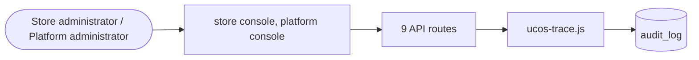

# Audit

> Generated from `_registry/business-domains.json`, the code and `docs/source/audit.md` — edit those, then run `node scripts/domain-docs.js`.

## Overview

What happened, provably: the hash-chained audit trail, its verification, retention, the trash and exports.

**Foundation domain:** Audit · **Used by:** Store administrator, Platform administrator

## Architecture

| Module | What it is |
|---|---|
| `lib/ucos-trace.js` | UCOS Ω∞ · traceability — every corpus declaration → its runtime artifact. -------------------------------------------------------------------------- The corpora declare 24,000+ concepts; the platform implements them through a small set of GENERIC engines (registry, foundation, entity, catalog). This module is the map between the two: for any key it reports every runtime artifact the declaration resolves to — registry concepts with document+line provenance, its foundation, its universe and live entity, its catalog projections, and the API routes and console views that expose it. |

## Data model

### `audit_log`

| Column | Type |
|---|---|
| `id` | INTEGER PRIMARY KEY AUTOINCREMENT |
| `tenant_id` | INTEGER |
| `actor_type` | TEXT NOT NULL DEFAULT 'system' |
| `actor_id` | INTEGER |
| `actor_name` | TEXT |
| `action` | TEXT NOT NULL |
| `entity` | TEXT |
| `entity_id` | TEXT |
| `meta` | TEXT DEFAULT '' |
| `ip` | TEXT |
| `created_at` | TEXT NOT NULL DEFAULT (datetime('now')) |
| `prev_hash` | TEXT |
| `hash` | TEXT |
| `trace_id` | TEXT |
| `uid` | TEXT |

## API reference

Every call is JSON over HTTPS; store calls carry the store (`?store=`) and the session; mutating calls accept an `Idempotency-Key` header where noted.

| Method and path | Handler | What it does |
|---|---|---|
| `GET /api/admin/trash` | `apiTrashList` | ---------- governance: trash, restore, purge, retention ---------- |
| `POST /api/admin/trash/:key/:id/restore` | `apiTrashRestore` | — |
| `POST /api/admin/trash/purge` | `apiTrashPurge` | — |
| `POST /api/platform/purge-expired` | `apiAdminPurgeExpired` | — |
| `GET /api/admin/audit` | `apiAdminAudit` | — |
| `POST /api/admin/export/:kind` | `apiAdminExport` | — |
| `GET /api/platform/chain/verify` | `apiPlatformChainVerify` | — |
| `GET /api/admin/chain/verify` | `apiAdminChainVerify` | — |
| `GET /api/platform/audit` | `apiPlatformAudit` | — |

## Data flow

## User interface

**Store console:** 📜 Audit Trail · 🗑️ Trash & Retention

**Platform console:** 📜 Global Audit · 🔍 Reviews · ✅ Approvals · 🔄 Change Control · 🧠 AI Governance · 🤖 Agent Governance · 🕸️ Governance Graph

## User flows

_Not yet written — `docs/source/audit.md`, section `## Flows`._

## Manuals

### Store administrator

_Not yet written — `docs/source/audit.md`, section `## Manual: store_admin`._

### Platform administrator

_Not yet written — `docs/source/audit.md`, section `## Manual: platform_admin`._

