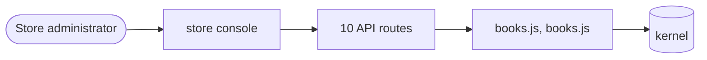

# Books

> Generated from `_registry/business-domains.json`, the code and `docs/source/books.md` — edit those, then run `node scripts/domain-docs.js`.

## Overview

A store's accounts: the chart of accounts on the kernel, entries posted to the platform's one ledger — automatically from payments, refunds, chargebacks and invoices, or by an accountant — and the trial balance, profit and loss, balance sheet and account ledgers read from them.

**Foundation domain:** Value · **Used by:** Store administrator

## Architecture

| Module | What it is |
|---|---|
| `lib/books.js` | a store's books (owner Value). |
| `lib/routes/books.js` | books domain routes (lib/books.js; _registry/business-domains.json). A store's chart of accounts, its entries, and the reports read from them. Every route belongs to the store's books section (the Finance role holds it): a role reads them with a books read grant, and posts or reverses an entry, or adds an account, with a books write grant. |

## API reference

Every call is JSON over HTTPS; store calls carry the store (`?store=`) and the session; mutating calls accept an `Idempotency-Key` header where noted.

| Method and path | Handler | What it does |
|---|---|---|
| `GET /api/admin/books/accounts` | `apiBooksAccounts` | The store's chart of accounts — the platform's accounts and the store's own, each with its group and type — and the account types. |
| `POST /api/admin/books/accounts` | `apiBooksAccountAdd` | Adds one of the store's own accounts under a group (`parent`, `code`, `name`); it takes the group's type. |
| `GET /api/admin/books/entries` | `apiBooksEntries` | The latest entries, newest first, with their lines; `from`, `to` and `ref` (the record an entry came from) narrow them. |
| `POST /api/admin/books/entries` | `apiBooksEntryPost` | Posts an accountant's entry: `memo`, `currency` and `lines` of `{ account, debit \| credit }` that must balance. |
| `POST /api/admin/books/entries/:id/reverse` | `apiBooksEntryReverse` | Reverses an entry with a `reason`: a mirror entry linked to it, allowed once; posted entries are never edited. |
| `GET /api/admin/books/trial-balance` | `apiBooksTrialBalance` | The trial balance per currency over `from`–`to`: each account's debits, credits and balance, and the totals, which are equal. |
| `GET /api/admin/books/profit-and-loss` | `apiBooksProfitAndLoss` | Profit and loss per currency over `from`–`to`: income, expenses and the profit. |
| `GET /api/admin/books/balance-sheet` | `apiBooksBalanceSheet` | The balance sheet per currency `at` an instant: assets against liabilities, equity and earnings to date, which are equal. |
| `GET /api/admin/books/accounts/:id/ledger` | `apiBooksLedger` | One account's ledger over `from`–`to`: every entry that moved it, in order. |
| `GET /api/admin/books/health` | `apiBooksHealth` | Whether the books are whole: payments and invoices not yet posted, and any entry that does not balance or match the tamper-evident log. |

## Data flow

## User interface

**Store console:** 📒 Books

## User flows

**A sale.** When a shopper's payment is captured, the books record it at once, in the payment's
currency: what the gateway now owes the store (*Payments to be settled by gateways*), and any store
credit or gift balance the shopper spent (released from *Store credit and gift balances held*),
against the sale itself, split as the order was: *Sales*, *Delivery charged* and *Tax collected*.
The gateway's fee is a second entry: *Payment gateway fees* against what the gateway owes.

**A refund.** Each refund — a returned item, a cancelled order, a refund the gateway refused and
that was handed back — is an entry of its own: *Refunds given* and the tax on it given back,
against what the gateway owes. Partial refunds each post their own amount.

**A chargeback lost.** What was not already refunded becomes *Chargebacks lost*.

**The platform's bill.** An invoice from the platform is a fee the store owes (*Platform fees*
against *Owed to suppliers*); paying it clears what is owed from the *Bank*.

**Money reaching the bank.** When a gateway pays out to the store's bank, the accountant posts it:
*Bank* against *Payments to be settled by gateways*.

**Corrections.** Nothing posted is ever edited or deleted. An accountant's own entry is corrected
by reversing it — a mirror entry, linked to it, allowed once, with the reason. An entry a sale or
refund posted is corrected by the business event that undoes it, never by hand.

**Nothing is lost.** Each automatic entry is posted once, whatever retries happen. A payment the
books cannot post (a currency the platform does not know) still goes through, and the books' check
lists it until it is posted. The same check confirms every entry balances and matches the
tamper-evident log.

## Manuals

### Store administrator

Open **Payments & Finance → 📒 Books**. Your role needs the books section; the Finance role has it.

- **Profit and loss** shows income, expenses and profit; **Balance sheet** shows what the store has
  against what it owes and its equity; **Trial balance** shows every account's debits and credits.
  Each currency the store trades in has its own statements. Add `from` and `to` (or `at` for the
  balance sheet) to the API call for a period.
- **Post an entry**: choose the account to debit and the account to credit, the amount, and what it
  is for. Entries that do not balance are refused.
- **Reverse** an entry you posted, saying why. It can be reversed once.
- **Chart of accounts**: every store starts from the platform's chart. Add your own account under a
  group; it takes the group's type and only your store sees it. Codes are never reused.
- Your accounting system can read the same figures with a store API key with the Finance role:
  `GET /api/admin/books/trial-balance`, `/profit-and-loss`, `/balance-sheet`, `/entries` — see
  `docs/api/README.md`.

