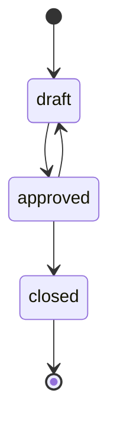
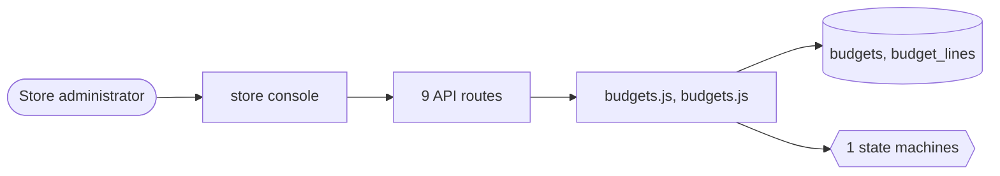

# Budgets

> Generated from `_registry/business-domains.json`, the code and `docs/source/budgets.md` — edit those, then run `node scripts/domain-docs.js`.

## Overview

A year's plan per income and expense account of the books, month by month in one currency, set by month or spread from a year's amount or from last year's actuals, approved once per year and currency, and set against the books to date with what is off plan flagged.

**Foundation domain:** Value · **Used by:** Store administrator

## Architecture

| Module | What it is |
|---|---|
| `lib/budgets.js` | budgets (owner Value). |
| `lib/routes/budgets.js` | budgets domain routes (lib/budgets.js; _registry/business-domains.json). A year's plan per account of the books and how the books compare, under the store's budgets section (the Finance role holds it). |

## Data model

### `budgets`

| Column | Type |
|---|---|
| `id` | INTEGER PRIMARY KEY AUTOINCREMENT |
| `tenant_id` | INTEGER NOT NULL |
| `ref` | TEXT NOT NULL |
| `name` | TEXT NOT NULL |
| `year` | INTEGER NOT NULL |
| `currency` | TEXT NOT NULL |
| `status` | TEXT NOT NULL |
| `total` | REAL NOT NULL DEFAULT 0 |
| `note` | TEXT DEFAULT '' |
| `created_by` | TEXT DEFAULT '' |
| `approved_by` | TEXT DEFAULT '' |
| `approved_at` | TEXT |
| `closed_at` | TEXT |
| `created_at` | TEXT NOT NULL DEFAULT (datetime('now')) |
| `uid` | TEXT |

### `budget_lines`

| Column | Type |
|---|---|
| `id` | INTEGER PRIMARY KEY AUTOINCREMENT |
| `budget_id` | INTEGER NOT NULL |
| `account` | TEXT NOT NULL |
| `month` | INTEGER NOT NULL |
| `amount` | REAL NOT NULL |

## API reference

Every call is JSON over HTTPS; store calls carry the store (`?store=`) and the session; mutating calls accept an `Idempotency-Key` header where noted.

| Method and path | Handler | What it does |
|---|---|---|
| `GET /api/admin/budgets` | `apiBudgets` | The store's budgets, latest year first, and the accounts a budget can plan. |
| `POST /api/admin/budgets` | `apiBudgetCreate` | Drafts a budget: `name`, `year`, `currency`. |
| `GET /api/admin/budgets/:id` | `apiBudget` | One budget with its lines, account by account and month by month. |
| `PUT /api/admin/budgets/:id/lines` | `apiBudgetLines` | Sets a draft's `lines`: `{ account, month, amount }`, or `{ account, annual }` spread evenly; 0 clears a month. |
| `POST /api/admin/budgets/:id/from-actuals` | `apiBudgetFromActuals` | Fills a draft from a `year` of the books' actual figures, raised by `uplift_pct`. |
| `POST /api/admin/budgets/:id/approve` | `apiBudgetApprove` | Approves a draft: one approved budget per year and currency. |
| `POST /api/admin/budgets/:id/reopen` | `apiBudgetReopen` | Reopens an approved budget as a draft. |
| `POST /api/admin/budgets/:id/close` | `apiBudgetClose` | Closes an approved budget. |
| `GET /api/admin/budgets/:id/report` | `apiBudgetReport` | The budget against the books through a month (`through`, 1–12): each account month by month and to date, its variance, and whether it is off plan. |

## Process flows

Each record's life is a declared state machine (`lib/seed/states.json`): the moves it may make, and the actions that make them.

### Budget (`budget`)

Actions: 

## Data flow

## User interface

**Store console:** 🎯 Budgets

## User flows

**A budget.** A budget is a year's plan for each income and expense account of the books, month by
month, in one currency. A line is set month by month, or as a year's amount spread evenly with the
remainder in December. A draft can also be filled from a year's actual figures, raised by a
percentage.

**Approving.** A draft is approved when it plans something. A store has one approved budget per
year and currency. An approved budget is reopened to change it, or closed at the end of the year.

**Against the books.** The report sets each account's budget against what the books show, month by
month and to date. An expense more than the tolerance (5%) above its budget, or income more than that
below it, is off plan. Anything spent or earned on an account with no budget is shown too. The
totals show planned and actual profit.

## Manuals

### Store administrator

Open **Payments & Finance → 🎯 Budgets**. Your role needs the budgets section; the Finance role has
it.

- **New budget**: name it, choose the year (and currency), then **Draft**.
- Open it to set an account's amount for the year (**Set, spread evenly**) or **Fill** it from a
  year's actuals with an uplift, then **Approve**.
- The report below shows each account against the books, and flags what is off plan.

