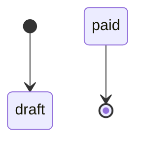
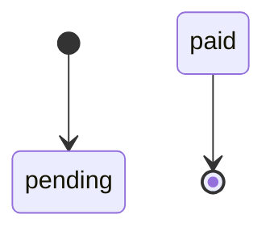
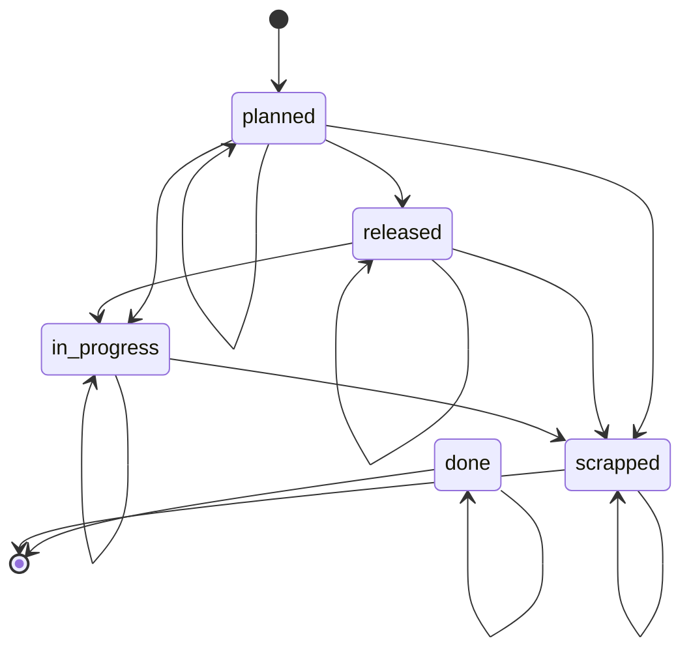
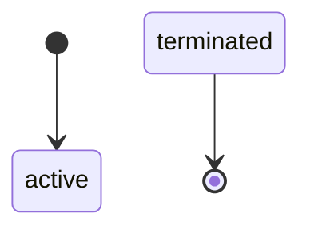
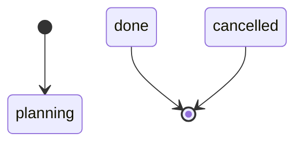
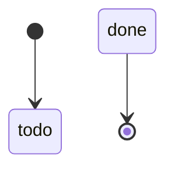
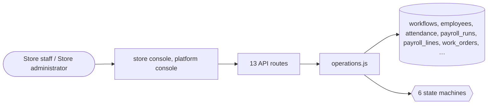

# Business operations

> Generated from `_registry/business-domains.json`, the code and `docs/source/business_operations.md` — edit those, then run `node scripts/domain-docs.js`.

## Overview

Running the business behind the store: people and payroll, manufacturing work orders, and projects with their tasks.

**Foundation domain:** Operations · **Used by:** Store staff, Store administrator

## Switches and settings

Each is switched on per store under ⚙️ Capabilities; its parameters are that store's settings.

### HRMS & payroll (`workforce`)

Employees, attendance and the payroll run: base + overtime + allowances, less configured deductions and tax, pro-rated by worked days.

| Setting | Meaning | Default |
|---|---|---|
| `standard_hours_per_day` | Standard hours before overtime begins | `8` |
| `overtime_multiplier` | Overtime pay multiple of the hourly rate | `1.5` |
| `allowance_amount` | Flat allowance added to every payslip | `0` |
| `deduction_flat` | Flat deduction before tax | `0` |
| `deduction_pct` | Deduction as a fraction of gross | `0` |
| `tax_rate_pct` | Tax applied to the taxable amount | `0` |

### Manufacturing (`manufacturing`)

Work orders consuming a bill of materials, completing at a configured yield with a configured scrap loss, and posting the finished good to inventory.

| Setting | Meaning | Default |
|---|---|---|
| `yield_pct` | Good units as a share of the run | `100` |
| `scrap_pct` | Units lost to scrap | `0` |
| `backflush` | Consume the BOM components on completion rather than on release | `true` |

### Projects & approvals (`projects`)

Projects, tasks and time-logging that accrues to a project's spend at a configured internal cost rate, plus the approval chain gating operational actions.

| Setting | Meaning | Default |
|---|---|---|
| `internal_cost_per_hour` | Cost rate applied to logged hours (0 = time is free) | `0` |
| `approval_levels` | Sign-off levels an approval passes through | `1` |

## Architecture

| Module | What it is |
|---|---|
| `lib/operations.js` | E18 · The Operations universe. -------------------------------------------------------------------------- Constitution E18: "Through configuration alone this universe yields ERP, HRMS, payroll, IT-service-management and workforce-management platforms: ERP · HRMS · Payroll · Workforce · SCM · Procurement · Manufacturing · Projects · Tasks · Approvals · Document management · Collaboration." |

## Data model

### `workflows`

| Column | Type |
|---|---|
| `id` | INTEGER PRIMARY KEY AUTOINCREMENT |
| `key` | TEXT NOT NULL UNIQUE |
| `domain` | TEXT NOT NULL |
| `name` | TEXT |
| `description` | TEXT DEFAULT '' |
| `trigger` | TEXT NOT NULL |
| `steps` | TEXT NOT NULL DEFAULT '[]' |
| `config` | TEXT NOT NULL DEFAULT '{}' |
| `status` | TEXT NOT NULL DEFAULT 'active' |
| `created_at` | TEXT NOT NULL DEFAULT (datetime('now')) |
| `updated_at` | TEXT |

### `employees`

| Column | Type |
|---|---|
| `id` | INTEGER PRIMARY KEY AUTOINCREMENT |
| `tenant_id` | INTEGER NOT NULL |
| `code` | TEXT NOT NULL |
| `name` | TEXT NOT NULL |
| `email` | TEXT |
| `department` | TEXT DEFAULT '' |
| `designation` | TEXT DEFAULT '' |
| `status` | TEXT NOT NULL DEFAULT 'active' |
| `/*` | active \| on_leave \| terminated */ joined_at TEXT NOT NULL DEFAULT (datetime('now')) |
| `exited_at` | TEXT |
| `base_salary` | REAL NOT NULL DEFAULT 0 |
| `pay_frequency` | TEXT NOT NULL DEFAULT 'monthly' |
| `bank_account` | TEXT DEFAULT '' |
| `tax_id` | TEXT DEFAULT '' |
| `manager_id` | INTEGER |
| `uid` | TEXT |

### `attendance`

| Column | Type |
|---|---|
| `id` | INTEGER PRIMARY KEY AUTOINCREMENT |
| `tenant_id` | INTEGER NOT NULL |
| `employee_id` | INTEGER NOT NULL |
| `date` | TEXT NOT NULL |
| `check_in` | TEXT |
| `check_out` | TEXT |
| `status` | TEXT NOT NULL DEFAULT 'present' |
| `/*` | present \| late \| half_day \| absent \| leave */ hours REAL DEFAULT 0 |
| `note` | TEXT DEFAULT '' |
| `uid` | TEXT |

### `payroll_runs`

| Column | Type |
|---|---|
| `id` | INTEGER PRIMARY KEY AUTOINCREMENT |
| `tenant_id` | INTEGER NOT NULL |
| `period` | TEXT NOT NULL |
| `/*` | e.g. 2026-10 */ status TEXT NOT NULL DEFAULT 'draft' |
| `/*` | draft \| approved \| paid */ gross REAL NOT NULL DEFAULT 0 |
| `deductions` | REAL NOT NULL DEFAULT 0 |
| `net` | REAL NOT NULL DEFAULT 0 |
| `headcount` | INTEGER NOT NULL DEFAULT 0 |
| `run_at` | TEXT NOT NULL DEFAULT (datetime('now')) |
| `approved_at` | TEXT |
| `paid_at` | TEXT |
| `uid` | TEXT |

### `payroll_lines`

| Column | Type |
|---|---|
| `id` | INTEGER PRIMARY KEY AUTOINCREMENT |
| `tenant_id` | INTEGER NOT NULL |
| `run_id` | INTEGER NOT NULL |
| `employee_id` | INTEGER NOT NULL |
| `employee_code` | TEXT |
| `employee_name` | TEXT |
| `base` | REAL NOT NULL DEFAULT 0 |
| `overtime` | REAL NOT NULL DEFAULT 0 |
| `deductions` | REAL NOT NULL DEFAULT 0 |
| `tax` | REAL NOT NULL DEFAULT 0 |
| `net` | REAL NOT NULL DEFAULT 0 |
| `status` | TEXT NOT NULL DEFAULT 'pending' |
| `uid` | TEXT |
| `/*` | pending \| paid */ UNIQUE (run_id, employee_id) |

### `work_orders`

| Column | Type |
|---|---|
| `id` | INTEGER PRIMARY KEY AUTOINCREMENT |
| `tenant_id` | INTEGER NOT NULL |
| `ref` | TEXT NOT NULL UNIQUE |
| `product_id` | TEXT |
| `sku_id` | INTEGER |
| `qty` | INTEGER NOT NULL DEFAULT 1 |
| `completed_qty` | INTEGER NOT NULL DEFAULT 0 |
| `status` | TEXT NOT NULL DEFAULT 'planned' |
| `/*` | planned → released → in_progress → done \| scrapped */ bom TEXT DEFAULT '{}' |
| `/*` | the bill of materials |
| `data` | not code */ unit_cost REAL NOT NULL DEFAULT 0 |
| `planned_start` | TEXT |
| `planned_end` | TEXT |
| `started_at` | TEXT |
| `completed_at` | TEXT |
| `created_at` | TEXT NOT NULL DEFAULT (datetime('now')) |
| `uid` | TEXT |

### `projects`

| Column | Type |
|---|---|
| `id` | INTEGER PRIMARY KEY AUTOINCREMENT |
| `tenant_id` | INTEGER NOT NULL |
| `code` | TEXT NOT NULL |
| `name` | TEXT NOT NULL |
| `status` | TEXT NOT NULL DEFAULT 'planning' |
| `/*` | planning \| active \| on_hold \| done \| cancelled */ owner TEXT |
| `client` | TEXT DEFAULT '' |
| `budget` | REAL NOT NULL DEFAULT 0 |
| `spent` | REAL NOT NULL DEFAULT 0 |
| `start_date` | TEXT |
| `due_date` | TEXT |
| `completed_at` | TEXT |
| `created_at` | TEXT NOT NULL DEFAULT (datetime('now')) |
| `uid` | TEXT |

### `tasks`

| Column | Type |
|---|---|
| `id` | INTEGER PRIMARY KEY AUTOINCREMENT |
| `tenant_id` | INTEGER NOT NULL |
| `project_id` | INTEGER |
| `title` | TEXT NOT NULL |
| `description` | TEXT DEFAULT '' |
| `assignee` | TEXT |
| `status` | TEXT NOT NULL DEFAULT 'todo' |
| `/*` | todo \| in_progress \| review \| done */ priority TEXT NOT NULL DEFAULT 'normal' |
| `/*` | low \| normal \| high \| urgent */ estimate_hours REAL DEFAULT 0 |
| `logged_hours` | REAL DEFAULT 0 |
| `due_date` | TEXT |
| `completed_at` | TEXT |
| `created_at` | TEXT NOT NULL DEFAULT (datetime('now')) |
| `uid` | TEXT |

## API reference

Every call is JSON over HTTPS; store calls carry the store (`?store=`) and the session; mutating calls accept an `Idempotency-Key` header where noted.

| Method and path | Handler | What it does |
|---|---|---|
| `GET /api/admin/operations` | `apiOpsGet` | — |
| `POST /api/admin/ops/employees` | `apiOpsEmployee` | — |
| `POST /api/admin/ops/attendance` | `apiOpsAttendance` | — |
| `POST /api/admin/ops/payroll/run` | `apiOpsPayrollRun` | — |
| `PUT /api/admin/ops/payroll/:id` | `apiOpsPayrollStatus` | — |
| `POST /api/admin/ops/requests` | `apiOpsRequest` | — |
| `PUT /api/admin/ops/requests/:id` | `apiOpsRequestAdvance` | — |
| `POST /api/admin/ops/work-orders` | `apiOpsWorkOrder` | — |
| `POST /api/admin/ops/work-orders/:id/complete` | `apiOpsWorkOrderComplete` | — |
| `POST /api/admin/ops/projects` | `apiOpsProject` | — |
| `POST /api/admin/ops/tasks` | `apiOpsTask` | — |
| `POST /api/admin/ops/tasks/:id/time` | `apiOpsTime` | — |
| `PUT /api/admin/ops/approvals/:id` | `apiOpsApprovalDecide` | — |

## Process flows

Each record's life is a declared state machine (`lib/seed/states.json`): the moves it may make, and the actions that make them.

### Payroll run (`payroll_run`)

Actions: `approve` → approved · `pay` → paid

### Payroll line (`payroll_line`)

Actions: 

### Work order (`work_order`)

Actions: 

### Employee (`employee`)

Actions: 

### Project (`project`)

Actions: 

### Task (`task`)

Actions: 

## Data flow

## User interface

**Store console:** 🧑‍💼 People & Payroll · 🏭 Manufacturing · 📐 Projects & Approvals

**Platform console:** 🧭 Ops Hub

## User flows

_Not yet written — `docs/source/business_operations.md`, section `## Flows`._

## Manuals

### Store staff

_Not yet written — `docs/source/business_operations.md`, section `## Manual: store_staff`._

### Store administrator

_Not yet written — `docs/source/business_operations.md`, section `## Manual: store_admin`._

