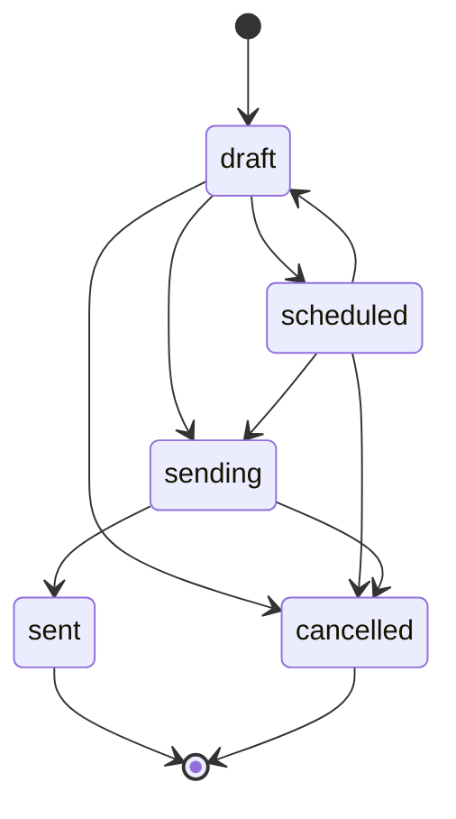
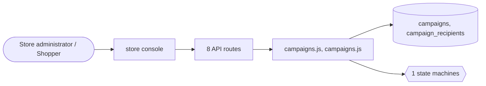

# Campaigns

> Generated from `_registry/business-domains.json`, the code and `docs/source/campaigns.md` — edit those, then run `node scripts/domain-docs.js`.

## Overview

Email, SMS and in-app messages to a store's customers, a segment, its CRM contacts or a company's people — only to those with a live marketing consent, checked when the list is built and again before each message — with an unsubscribe link in every one, sent once per person even by several servers, scheduled or sent now, and counted.

**Foundation domain:** Communication · **Used by:** Store administrator, Shopper

## Architecture

| Module | What it is |
|---|---|
| `lib/campaigns.js` | campaigns (owner Communication). |
| `lib/routes/campaigns.js` | campaigns domain routes (lib/campaigns.js; _registry/business-domains.json). A store's campaigns under its campaigns section (the Growth role holds it), and the one public route every message links to: the unsubscribe link, which needs no sign-in. |

## Data model

### `campaigns`

| Column | Type |
|---|---|
| `id` | INTEGER PRIMARY KEY AUTOINCREMENT |
| `tenant_id` | INTEGER NOT NULL |
| `ref` | TEXT NOT NULL |
| `name` | TEXT NOT NULL |
| `channel` | TEXT NOT NULL |
| `subject` | TEXT NOT NULL DEFAULT '' |
| `body` | TEXT NOT NULL |
| `audience` | TEXT NOT NULL DEFAULT '{}' |
| `purpose` | TEXT NOT NULL |
| `status` | TEXT NOT NULL |
| `scheduled_at` | TEXT |
| `started_at` | TEXT |
| `finished_at` | TEXT |
| `link_base` | TEXT DEFAULT '' |
| `created_by` | TEXT DEFAULT '' |
| `sent` | INTEGER NOT NULL DEFAULT 0 |
| `skipped` | INTEGER NOT NULL DEFAULT 0 |
| `failed` | INTEGER NOT NULL DEFAULT 0 |
| `created_at` | TEXT NOT NULL DEFAULT (datetime('now')) |
| `uid` | TEXT |

### `campaign_recipients`

| Column | Type |
|---|---|
| `id` | INTEGER PRIMARY KEY AUTOINCREMENT |
| `tenant_id` | INTEGER NOT NULL |
| `campaign_id` | INTEGER NOT NULL |
| `address` | TEXT NOT NULL |
| `name` | TEXT DEFAULT '' |
| `owner` | TEXT DEFAULT '' |
| `token` | TEXT NOT NULL UNIQUE |
| `status` | TEXT NOT NULL |
| `reason` | TEXT DEFAULT '' |
| `claimed_at` | TEXT |
| `sent_at` | TEXT |
| `unsubscribed_at` | TEXT |

## API reference

Every call is JSON over HTTPS; store calls carry the store (`?store=`) and the session; mutating calls accept an `Idempotency-Key` header where noted.

| Method and path | Handler | What it does |
|---|---|---|
| `GET /api/admin/campaigns` | `apiCampaigns` | The store's campaigns, newest first, each with how many were sent, skipped and failed, and what may be done next; and the audiences, channels and segments a campaign can use. |
| `POST /api/admin/campaigns` | `apiCampaignCreate` | Drafts a campaign: `name`, `channel` (email, sms, in_app), `subject`, `body` ({name} and {store} are filled in), and `audience` `{ kind: customers \| segment \| contacts \| company, segment?, company_id? }`. |
| `GET /api/admin/campaigns/:id` | `apiCampaign` | One campaign: its counts, why people were skipped, how many are still to go, and how many unsubscribed. |
| `GET /api/admin/campaigns/:id/preview` | `apiCampaignPreview` | How many it would reach now, and how many it would skip and why — before it is sent. |
| `POST /api/admin/campaigns/:id/send` | `apiCampaignSend` | Sends a draft or scheduled campaign now — the list is built and the first batch goes — or sends the next batch of one already sending. |
| `POST /api/admin/campaigns/:id/schedule` | `apiCampaignSchedule` | Schedules a draft for `at`; the platform sends it when the time comes. |
| `POST /api/admin/campaigns/:id/cancel` | `apiCampaignCancel` | Cancels a campaign: whoever has not been sent to yet is not. |
| `GET /api/campaigns/unsubscribe` | `apiCampaignUnsubscribe` | The link in every campaign message (`t`, the recipient's own token): withdraws their consent for the campaign's purpose and says so. Needs no sign-in. |

## Process flows

Each record's life is a declared state machine (`lib/seed/states.json`): the moves it may make, and the actions that make them.

### Campaign (`campaign`)

Actions: 

## Data flow

## User interface

**Store console:** 📣 Campaigns

## User flows

**A campaign.** A store drafts a message — by email, by SMS, or as a note in the shopper's account —
for an audience: every customer, a segment, every CRM contact, or the people at one company.
`{name}` and `{store}` in the subject and message are filled in for each person.

**Who it reaches.** Only people with a live consent for marketing. Before sending, the store sees how
many it would reach and how many it would skip and why (no consent, no address). The list is built
when the campaign starts; consent is checked again right before each message, so someone who
withdrew in the meantime is skipped.

**Unsubscribing.** Every message ends with the person's own link. Opening it withdraws their marketing
consent at once, with a confirmation page; no later campaign reaches them unless they agree again.

**Sending.** Messages go out in batches. Each person is claimed before their message, so two servers
never send the same person the same campaign; a message whose sending was cut off is marked as
interrupted, never sent twice. A campaign may be scheduled for later and goes when its time comes, or
cancelled — whoever has not been sent to yet is not.

**Erasure.** Erasing a person removes their rows from every campaign.

## Manuals

### Store administrator

Open **Marketing & Growth → 📣 Campaigns**. Your role needs the campaigns section; the Growth role
has it.

- **New campaign**: name it, choose the channel and audience (and the segment or company), write the
  subject and message, then **Draft the campaign**.
- Open it to see how many it would reach and who it would skip, then **Send now** or **Schedule**.
- Afterwards it shows how many were sent, skipped, failed and unsubscribed, and why.
- Email and SMS go through your notification gateway (**Payments & notifications**); without one
  they are counted as failed.

### Shopper

Every marketing message from a store has a link at the end. Opening it stops that store's marketing
messages to you; you can turn them back on in your account's privacy settings.

