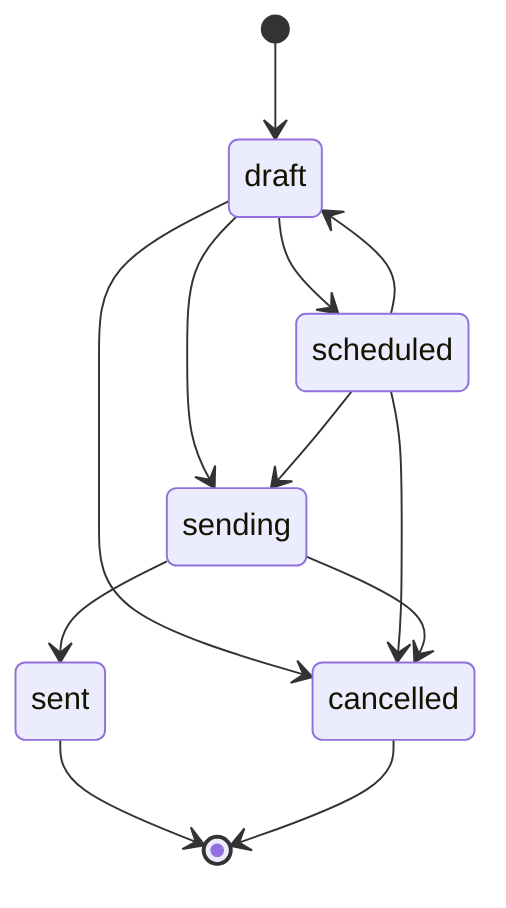
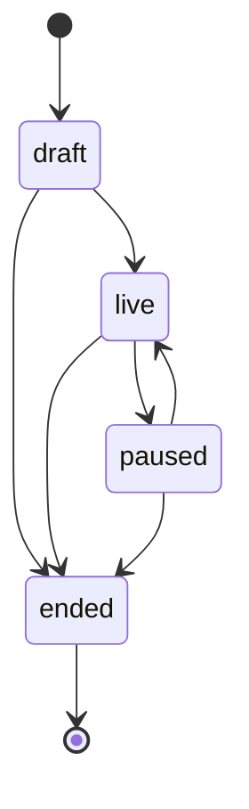
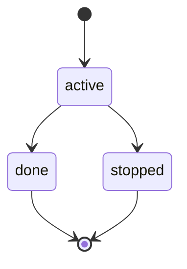
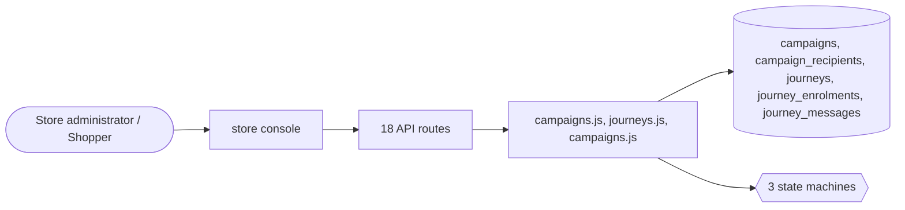

# Campaigns

> Generated from `_registry/business-domains.json`, the code and `docs/source/campaigns.md` — edit those, then run `node scripts/domain-docs.js`.

## Overview

Email, SMS and in-app messages to a store's customers, a segment, its CRM contacts or a company's people — only to those with a live marketing consent, checked when the list is built and again before each message — with an unsubscribe link in every one, sent once per person even by several servers, scheduled or sent now, and counted; journeys — messages sent on their own when someone creates an account, orders, has an order delivered or leaves a cart, or to an audience enrolled by hand, step by step, with exits, a daily cap and unsubscribing from every journey at once; opens and clicks of every message.

**Foundation domain:** Communication · **Used by:** Store administrator, Shopper

## Architecture

| Module | What it is |
|---|---|
| `lib/campaigns.js` | campaigns (owner Communication). |
| `lib/journeys.js` | journeys (owner Communication). |
| `lib/routes/campaigns.js` | campaigns domain routes (lib/campaigns.js; _registry/business-domains.json). A store's campaigns under its campaigns section (the Growth role holds it), and the public routes every message links to, which need no sign-in: the unsubscribe link and the tracked links. Journeys (lib/journeys.js) under the same section. |

## Data model

### `campaigns`

| Column | Type |
|---|---|
| `id` | INTEGER PRIMARY KEY AUTOINCREMENT |
| `tenant_id` | INTEGER NOT NULL |
| `ref` | TEXT NOT NULL |
| `name` | TEXT NOT NULL |
| `channel` | TEXT NOT NULL |
| `subject` | TEXT NOT NULL DEFAULT '' |
| `body` | TEXT NOT NULL |
| `audience` | TEXT NOT NULL DEFAULT '{}' |
| `purpose` | TEXT NOT NULL |
| `status` | TEXT NOT NULL |
| `scheduled_at` | TEXT |
| `started_at` | TEXT |
| `finished_at` | TEXT |
| `link_base` | TEXT DEFAULT '' |
| `created_by` | TEXT DEFAULT '' |
| `sent` | INTEGER NOT NULL DEFAULT 0 |
| `skipped` | INTEGER NOT NULL DEFAULT 0 |
| `failed` | INTEGER NOT NULL DEFAULT 0 |
| `created_at` | TEXT NOT NULL DEFAULT (datetime('now')) |
| `uid` | TEXT |

### `campaign_recipients`

| Column | Type |
|---|---|
| `id` | INTEGER PRIMARY KEY AUTOINCREMENT |
| `tenant_id` | INTEGER NOT NULL |
| `campaign_id` | INTEGER NOT NULL |
| `address` | TEXT NOT NULL |
| `name` | TEXT DEFAULT '' |
| `owner` | TEXT DEFAULT '' |
| `token` | TEXT NOT NULL UNIQUE |
| `status` | TEXT NOT NULL |
| `reason` | TEXT DEFAULT '' |
| `claimed_at` | TEXT |
| `sent_at` | TEXT |
| `unsubscribed_at` | TEXT |
| `opened_at` | TEXT |
| `clicked_at` | TEXT |
| `opens` | INTEGER NOT NULL DEFAULT 0 |
| `clicks` | INTEGER NOT NULL DEFAULT 0 |
| `/*` | counted by lib/campaigns.js track */ UNIQUE (campaign_id, address) |

### `journeys`

| Column | Type |
|---|---|
| `id` | INTEGER PRIMARY KEY AUTOINCREMENT |
| `tenant_id` | INTEGER NOT NULL |
| `ref` | TEXT NOT NULL |
| `name` | TEXT NOT NULL |
| `trigger_on` | TEXT NOT NULL |
| `steps` | TEXT NOT NULL DEFAULT '[]' |
| `exit_on` | TEXT NOT NULL DEFAULT '[]' |
| `reenter` | INTEGER NOT NULL DEFAULT 0 |
| `segment` | TEXT DEFAULT '' |
| `purpose` | TEXT NOT NULL |
| `status` | TEXT NOT NULL |
| `link_base` | TEXT DEFAULT '' |
| `created_by` | TEXT DEFAULT '' |
| `started_at` | TEXT |
| `ended_at` | TEXT |
| `created_at` | TEXT NOT NULL DEFAULT (datetime('now')) |
| `uid` | TEXT |

### `journey_enrolments`

| Column | Type |
|---|---|
| `id` | INTEGER PRIMARY KEY AUTOINCREMENT |
| `tenant_id` | INTEGER NOT NULL |
| `journey_id` | INTEGER NOT NULL |
| `person` | TEXT NOT NULL |
| `owner` | TEXT DEFAULT '' |
| `email` | TEXT DEFAULT '' |
| `phone` | TEXT DEFAULT '' |
| `name` | TEXT DEFAULT '' |
| `enrol_key` | TEXT NOT NULL |
| `step` | INTEGER NOT NULL DEFAULT 0 |
| `next_at` | TEXT |
| `status` | TEXT NOT NULL |
| `reason` | TEXT DEFAULT '' |
| `source` | TEXT DEFAULT '' |
| `entered_at` | TEXT NOT NULL DEFAULT (datetime('now')) |

### `journey_messages`

| Column | Type |
|---|---|
| `id` | INTEGER PRIMARY KEY AUTOINCREMENT |
| `tenant_id` | INTEGER NOT NULL |
| `journey_id` | INTEGER NOT NULL |
| `enrolment_id` | INTEGER NOT NULL |
| `step` | INTEGER NOT NULL |
| `channel` | TEXT NOT NULL |
| `person` | TEXT NOT NULL |
| `address` | TEXT DEFAULT '' |
| `token` | TEXT NOT NULL UNIQUE |
| `links` | TEXT NOT NULL DEFAULT '[]' |
| `status` | TEXT NOT NULL |
| `reason` | TEXT DEFAULT '' |
| `sent_at` | TEXT |
| `opened_at` | TEXT |
| `clicked_at` | TEXT |
| `opens` | INTEGER NOT NULL DEFAULT 0 |
| `clicks` | INTEGER NOT NULL DEFAULT 0 |
| `unsubscribed_at` | TEXT |
| `created_at` | TEXT NOT NULL DEFAULT (datetime('now')) |

## API reference

Every call is JSON over HTTPS; store calls carry the store (`?store=`) and the session; mutating calls accept an `Idempotency-Key` header where noted.

| Method and path | Handler | What it does |
|---|---|---|
| `GET /api/admin/journeys` | `apiJourneys` | The store's journeys, newest first, each with who entered, is in it, finished or left, and each step's sends, opens, clicks and unsubscribes; and the triggers, exits and channels a journey can use. |
| `POST /api/admin/journeys` | `apiJourneyCreate` | Drafts a journey: `name`, `trigger` (what starts it), `steps` `[{ wait_minutes, channel, subject?, body }]`, `exit_on` (events that take a person out), `reenter` (each time, not once), `segment` (only its members). |
| `POST /api/admin/journeys/run` | `apiJourneysRun` | Sends the journey steps that are due now, and enters people who left their carts. |
| `GET /api/admin/journeys/:id` | `apiJourney` | One journey with its steps and their numbers, and the people in it (`status` narrows them). |
| `PUT /api/admin/journeys/:id` | `apiJourneyUpdate` | Changes a draft or paused journey: any of `name`, `trigger`, `steps`, `exit_on`, `reenter`, `segment`. |
| `POST /api/admin/journeys/:id/start` | `apiJourneyStart` | Starts (or resumes) a journey: from now, the people it names enter it. |
| `POST /api/admin/journeys/:id/pause` | `apiJourneyPause` | Pauses a journey: nobody enters and nothing is sent until it is started again. |
| `POST /api/admin/journeys/:id/end` | `apiJourneyEnd` | Ends a journey for good: whoever is in it gets nothing more. |
| `POST /api/admin/journeys/:id/enrol` | `apiJourneyEnrol` | Enrols an `audience` (as campaigns name them) in a live journey that people enter by hand; those without marketing consent are skipped. |
| `GET /api/m` | `apiTrack` | A tracked link in a message (`t`, the message's own token): `o=1` counts an open and answers a one-pixel image; `n` counts a click on the message's n-th link and sends the reader on to it. Needs no sign-in. |
| `GET /api/admin/campaigns` | `apiCampaigns` | The store's campaigns, newest first, each with how many were sent, skipped and failed, and what may be done next; and the audiences, channels and segments a campaign can use. |
| `POST /api/admin/campaigns` | `apiCampaignCreate` | Drafts a campaign: `name`, `channel` (email, sms, in_app), `subject`, `body` ({name} and {store} are filled in), and `audience` `{ kind: customers \| segment \| contacts \| company, segment?, company_id? }`. |
| `GET /api/admin/campaigns/:id` | `apiCampaign` | One campaign: its counts, why people were skipped, how many are still to go, and how many unsubscribed. |
| `GET /api/admin/campaigns/:id/preview` | `apiCampaignPreview` | How many it would reach now, and how many it would skip and why — before it is sent. |
| `POST /api/admin/campaigns/:id/send` | `apiCampaignSend` | Sends a draft or scheduled campaign now — the list is built and the first batch goes — or sends the next batch of one already sending. |
| `POST /api/admin/campaigns/:id/schedule` | `apiCampaignSchedule` | Schedules a draft for `at`; the platform sends it when the time comes. |
| `POST /api/admin/campaigns/:id/cancel` | `apiCampaignCancel` | Cancels a campaign: whoever has not been sent to yet is not. |
| `GET /api/campaigns/unsubscribe` | `apiCampaignUnsubscribe` | The link in every campaign message (`t`, the recipient's own token): withdraws their consent for the campaign's purpose and says so. Needs no sign-in. |

## Process flows

Each record's life is a declared state machine (`lib/seed/states.json`): the moves it may make, and the actions that make them.

### Campaign (`campaign`)

Actions: 

### Journey (`journey`)

Actions: 

### Person in a journey (`journey_enrolment`)

Actions: 

## Data flow

## User interface

**Store console:** 📣 Campaigns · 🧭 Journeys

## User flows

**A campaign.** A store drafts a message — by email, by SMS, or as a note in the shopper's account —
for an audience: every customer, a segment, every CRM contact, or the people at one company.
`{name}` and `{store}` in the subject and message are filled in for each person.

**Who it reaches.** Only people with a live consent for marketing. Before sending, the store sees how
many it would reach and how many it would skip and why (no consent, no address). The list is built
when the campaign starts; consent is checked again right before each message, so someone who
withdrew in the meantime is skipped.

**Unsubscribing.** Every message ends with the person's own link. Opening it withdraws their marketing
consent at once, with a confirmation page; no later campaign reaches them unless they agree again.

**Sending.** Messages go out in batches. Each person is claimed before their message, so two servers
never send the same person the same campaign; a message whose sending was cut off is marked as
interrupted, never sent twice. A campaign may be scheduled for later and goes when its time comes, or
cancelled — whoever has not been sent to yet is not.

**Journeys.** A journey sends messages on its own when something happens to a person: they create
an account, place an order, have an order delivered, or leave items in their cart for a couple of
hours. A journey can also start with an audience you enrol by hand. Each step waits a while after the
one before — straight away, a day, a week — and goes by email, SMS or the shopper's account. A person
enters once, or each time it happens if you choose. A segment can narrow who enters.

**Who a journey reaches.** Only people who agreed to marketing, checked when they enter and again
before every message. Shoppers can tick "Send me offers and news" when they create an account. An
event you choose as the journey's exit takes the person out early: an order ends an abandoned-cart
journey before its reminder goes. Nobody gets more than three journey messages a day; one over the
limit waits until the next day. Unsubscribing from any message takes the person out of every journey.

**Opens and clicks.** Links in every campaign and journey message are tracked: a click is counted and
the reader goes straight on to the link. An email also counts when it is opened, where your email
gateway sends HTML email (SMTP does). Opens are approximate: some mail apps load images on their own
and some block them.

**Erasure.** Erasing a person removes their rows from every campaign and journey.

## Manuals

### Store administrator

Open **Marketing & Growth → 📣 Campaigns**. Your role needs the campaigns section; the Growth role
has it.

- **New campaign**: name it, choose the channel and audience (and the segment or company), write the
  subject and message, then **Draft the campaign**.
- Open it to see how many it would reach and who it would skip, then **Send now** or **Schedule**.
- Afterwards it shows how many were sent, skipped, failed and unsubscribed, and why.
- Email and SMS go through your notification gateway (**Payments & notifications**); without one
  they are counted as failed.

Open **Marketing & Growth → 🧭 Journeys** for journeys:

- **New journey**: name it, choose what starts it and what ends it early, add steps with their wait,
  channel, subject and message, then **Draft the journey**. **Start** it to let people in.
- Open a journey to see each step's sends, opens, clicks and unsubscribes, and who is in it.
- **Pause** stops sending and entering; a paused journey can be changed and started again. **End for
  good** stops everyone in it.
- A journey started "by hand" takes an audience: choose it and **Enrol them**.
- **Send what is due now** sends due steps at once; otherwise the platform sends them on its cycle.

### Shopper

Every marketing message from a store has a link at the end. Opening it stops that store's marketing
messages to you, including any series you are in; you can turn them back on in your account's
privacy settings. When you create an account you choose whether to get offers and news.

