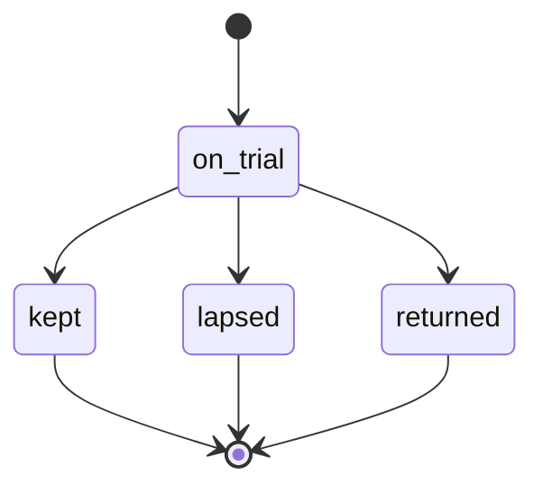
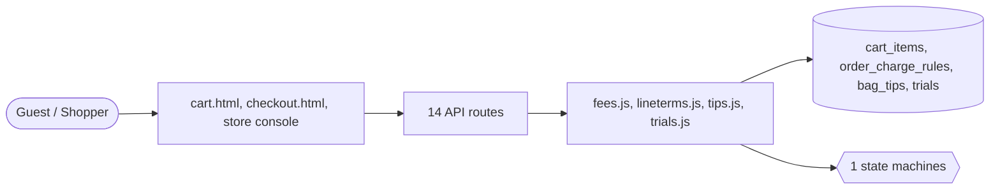

# Cart and checkout

> Generated from `_registry/business-domains.json`, the code and `docs/source/cart.md` — edit those, then run `node scripts/domain-docs.js`.

## Overview

From the bag to a placed order: bag lines and their terms, service fees and tips, buy now, try and buy, the payment step and the order it writes.

**Foundation domain:** Commerce · **Used by:** Guest, Shopper

## Switches and settings

Each is switched on per store under ⚙️ Capabilities; its parameters are that store's settings.

### Buy now (`buy_now`)

Skip the cart: a product's Buy Now goes straight to checkout.

### Fiscal context picker (`fiscal_selection`)

Customer-facing selection of a tax/invoice context at checkout. Platform policy may refuse this independently.

### Service fees (`service_fees`)

Fees a store adds to an order when their conditions hold — a small-order fee, a late-night fee, a service or packing fee — waived for members or with free shipping where the rule says, taxed or not.

### Tips (`tips`)

A tip the shopper adds for whoever serves them, among the amounts offered or their own up to a limit.

| Setting | Meaning | Default |
|---|---|---|
| `choices` | Tip amounts offered (comma separated) | `"2,5,10"` |
| `max` | Largest tip | `50` |
| `label` | What the tip line is called | `"Tip"` |

### Try and buy (`try_and_buy`)

An item taken on trial costs a deposit share at checkout; within the window the shopper keeps it (the rest is charged to their wallet) or returns it (the deposit comes back). What is not returned when the window closes is kept.

| Setting | Meaning | Default |
|---|---|---|
| `deposit_percent` | Share of the price paid at checkout (%) | `0` |
| `window_days` | Days to decide | `7` |
| `max_qty` | Most of one item on trial | `3` |
| `allow_attr` | The item fact that allows a trial (empty: every item) | `""` |
| `ledger_kind` | Wallet ledger kind for the rest of the price | `"redeem"` |
| `refund_kind` | Wallet ledger kind for a returned deposit | `"refund"` |

## Architecture

| Module | What it is |
|---|---|
| `lib/fees.js` | service fees: what a store adds to an order when its rules say. |
| `lib/lineterms.js` | line terms: what makes one bag line differ from the product's list price, and what must happen when it is ordered. |
| `lib/tips.js` | tips: what a shopper adds for whoever serves them. |
| `lib/trials.js` | try and buy: take it home, pay for what you keep. |

**Registry lists** (editable in Data Studio): `trialStatuses`

## Data model

### `cart_items`

| Column | Type |
|---|---|
| `owner` | TEXT NOT NULL |
| `product_id` | TEXT NOT NULL |
| `qty` | INTEGER NOT NULL DEFAULT 1 |
| `sku_id` | INTEGER |
| `line` | TEXT NOT NULL DEFAULT '' |
| `terms` | TEXT NOT NULL DEFAULT '{}' |
| `added_at` | TEXT NOT NULL DEFAULT (datetime('now')) |
| `slot_id` | INTEGER |
| `store_id` | INTEGER |
| `gift_wrap` | INTEGER DEFAULT 0 |
| `uid` | TEXT |

### `order_charge_rules`

| Column | Type |
|---|---|
| `id` | INTEGER PRIMARY KEY AUTOINCREMENT |
| `tenant_id` | INTEGER NOT NULL |
| `code` | TEXT NOT NULL |
| `name` | TEXT NOT NULL |
| `amount` | REAL NOT NULL DEFAULT 0 |
| `percent` | REAL NOT NULL DEFAULT 0 |
| `below_amount` | REAL |
| `from_hour` | INTEGER |
| `to_hour` | INTEGER |
| `waive_for_members` | INTEGER NOT NULL DEFAULT 0 |
| `waive_with_free_shipping` | INTEGER NOT NULL DEFAULT 0 |
| `taxable` | INTEGER NOT NULL DEFAULT 0 |
| `active` | INTEGER NOT NULL DEFAULT 1 |
| `position` | INTEGER NOT NULL DEFAULT 0 |

### `bag_tips`

| Column | Type |
|---|---|
| `tenant_id` | INTEGER NOT NULL |
| `owner` | TEXT NOT NULL |
| `amount` | REAL NOT NULL |

### `trials`

| Column | Type |
|---|---|
| `id` | INTEGER PRIMARY KEY AUTOINCREMENT |
| `tenant_id` | INTEGER NOT NULL |
| `order_id` | INTEGER NOT NULL |
| `product_id` | TEXT NOT NULL |
| `owner` | TEXT NOT NULL |
| `qty` | INTEGER NOT NULL DEFAULT 1 |
| `unit` | REAL NOT NULL |
| `deposit` | REAL NOT NULL DEFAULT 0 |
| `charged` | REAL NOT NULL DEFAULT 0 |
| `refunded` | REAL NOT NULL DEFAULT 0 |
| `notified_short` | INTEGER NOT NULL DEFAULT 0 |
| `ends_at` | TEXT NOT NULL |
| `status` | TEXT NOT NULL |
| `created_at` | TEXT NOT NULL DEFAULT (datetime('now')) |
| `decided_at` | TEXT |

## API reference

Every call is JSON over HTTPS; store calls carry the store (`?store=`) and the session; mutating calls accept an `Idempotency-Key` header where noted.

| Method and path | Handler | What it does |
|---|---|---|
| `POST /api/cart/tip` | `apiCartTip` | — |
| `GET /api/trials` | `apiTrialsMine` | — |
| `POST /api/trials/:id` | `apiTrialDecide` | — |
| `GET /api/admin/trials` | `apiAdminTrials` | — |
| `GET /api/admin/charges` | `apiAdminCharges` | — |
| `POST /api/admin/charges` | `apiAdminChargeSave` | — |
| `DELETE /api/admin/charges/:code` | `apiAdminChargeDelete` | — |
| `GET /api/admin/tips` | `apiAdminTips` | — |
| `GET /api/cart` | `apiCartGet` | — |
| `POST /api/cart` | `apiCartAdd` | — |
| `PUT /api/cart` | `apiCartPut` | — |
| `DELETE /api/cart/:id` | `apiCartDel` | — |
| `POST /api/checkout` | `apiCheckout` | — |
| `POST /api/checkout/quote` | `apiCheckoutQuote` | the checkout page's summary, priced by the same code checkout charges with |

## Process flows

Each record's life is a declared state machine (`lib/seed/states.json`): the moves it may make, and the actions that make them.

### An item tried before buying (`trial`)

Actions: `keep` → kept · `return` → returned · `lapse` → lapsed

## Data flow

## User interface

**Pages:** `cart.html`, `checkout.html`

**Store console:** 🧾 Service Fees · 💝 Tips · 👟 Try and Buy

## User flows

_Not yet written — `docs/source/cart.md`, section `## Flows`._

## Manuals

### Guest

_Not yet written — `docs/source/cart.md`, section `## Manual: guest`._

### Shopper

_Not yet written — `docs/source/cart.md`, section `## Manual: shopper`._

