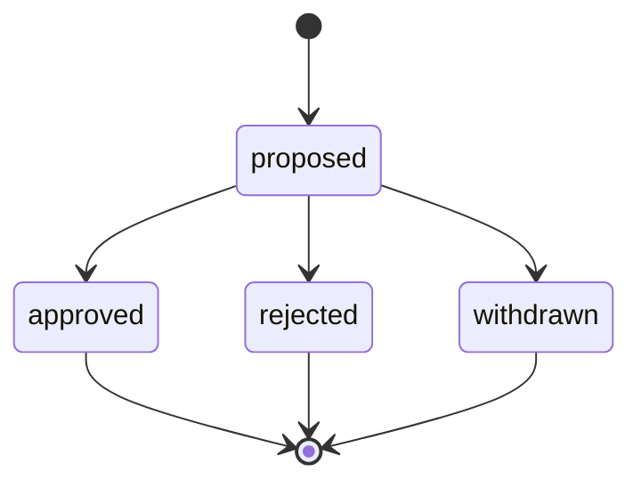
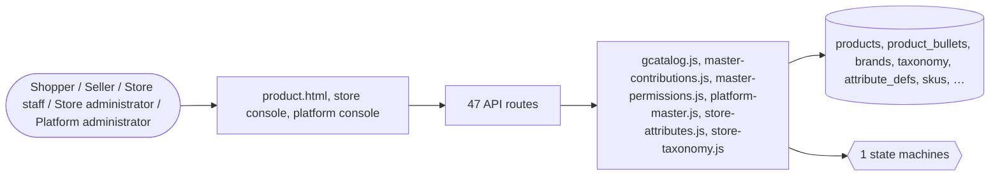

# Catalogue

> Generated from `_registry/business-domains.json`, the code and `docs/source/catalog.md` — edit those, then run `node scripts/domain-docs.js`.

## Overview

Everything a store sells, described once: products and their variants and SKUs, brands, the category tree, attributes, the platform master every product is described on, the global catalogue and contributions back to it.

**Foundation domain:** Offering · **Used by:** Shopper, Seller, Store staff, Store administrator, Platform administrator

## Architecture

| Module | What it is |
|---|---|
| `lib/gcatalog.js` | LUXORA · the global catalogue — the platform master as the platform console and the store import see it (GLOBAL_MASTER.md, P27). |
| `lib/master-contributions.js` | contributions to the platform master and the addenda they leave (GLOBAL_MASTER.md §3, roadmap P28; owner Evolution). |
| `lib/master-permissions.js` | permissions on the platform master (GLOBAL_MASTER.md §2, roadmap P28; owner Authority). |
| `lib/platform-master.js` | the platform master (GLOBAL_MASTER.md, roadmap P27; owners Identity, Semantic, Registry, Relationship and Measure). |
| `lib/store-attributes.js` | a store's attribute definitions (its "columns"), as a read model of the platform master (GLOBAL_MASTER.md §1, §6; owner Registry). |
| `lib/store-taxonomy.js` | a store's category tree, as a read model of the platform master (GLOBAL_MASTER.md §6, roadmap P27–P28; owner Semantic). |

**Registry lists** (editable in Data Studio): `contributionStatuses`

## Data model

### `products`

| Column | Type |
|---|---|
| `tenant_id` | INTEGER NOT NULL DEFAULT 1 |
| `id` | TEXT NOT NULL |
| `title` | TEXT NOT NULL |
| `brand` | TEXT NOT NULL |
| `dept` | TEXT NOT NULL |
| `price` | REAL NOT NULL |
| `list_price` | REAL |
| `rating` | REAL |
| `ratings_count` | INTEGER |
| `emoji` | TEXT |
| `hue` | INTEGER |
| `priority` | INTEGER DEFAULT 0 |
| `stock` | INTEGER DEFAULT 0 |
| `flags` | TEXT |
| `keywords` | TEXT |
| `deal_pct` | INTEGER DEFAULT 0 |
| `position` | INTEGER DEFAULT 0 |
| `moq` | INTEGER DEFAULT 1 |
| `compare_enabled` | INTEGER DEFAULT 1 |
| `gift_wrap` | INTEGER DEFAULT 1 |
| `type` | TEXT DEFAULT 'physical' |
| `node_id` | INTEGER |
| `lifecycle` | TEXT DEFAULT 'published' |
| `identity` | TEXT DEFAULT '{}' |
| `attrs` | TEXT DEFAULT '{}' |
| `vertical` | TEXT DEFAULT '{}' |
| `media` | TEXT DEFAULT '[]' |
| `seo` | TEXT DEFAULT '{}' |
| `tax_rule` | TEXT DEFAULT '{}' |
| `geo_rules` | TEXT DEFAULT '[]' |
| `pricing_rules` | TEXT DEFAULT '[]' |
| `logistics` | TEXT DEFAULT '{}' |
| `packaging` | TEXT DEFAULT '[]' |
| `docs` | TEXT DEFAULT '[]' |
| `supplier_id` | INTEGER |
| `uom` | TEXT DEFAULT '{"unit":"ea"}' |
| `tax_profile` | TEXT DEFAULT '' |
| `invoice_profile` | TEXT DEFAULT '' |
| `payment_profiles` | TEXT DEFAULT '[]' |
| `source_universe` | TEXT |
| `source_kind` | TEXT DEFAULT 'seed' |
| `source_global_id` | TEXT |
| `deleted_at` | TEXT |
| `uid` | TEXT |

### `product_bullets`

| Column | Type |
|---|---|
| `tenant_id` | INTEGER NOT NULL DEFAULT 1 |
| `product_id` | TEXT NOT NULL |
| `pos` | INTEGER NOT NULL |
| `text` | TEXT NOT NULL |
| `uid` | TEXT |

### `brands`

| Column | Type |
|---|---|
| `tenant_id` | INTEGER NOT NULL DEFAULT 1 |
| `key` | TEXT NOT NULL |
| `label` | TEXT NOT NULL |
| `icon` | TEXT |
| `logo` | TEXT |
| `story` | TEXT |
| `country` | TEXT |
| `active` | INTEGER NOT NULL DEFAULT 1 |
| `position` | INTEGER NOT NULL DEFAULT 0 |

### `taxonomy`

| Column | Type |
|---|---|
| `id` | INTEGER PRIMARY KEY AUTOINCREMENT |
| `tenant_id` | INTEGER NOT NULL |
| `parent_id` | INTEGER |
| `level` | TEXT NOT NULL |
| `key` | TEXT NOT NULL |
| `name` | TEXT NOT NULL |
| `icon` | TEXT DEFAULT '' |
| `attrs` | TEXT DEFAULT '{}' |
| `active` | INTEGER DEFAULT 1 |
| `position` | INTEGER DEFAULT 0 |
| `deleted_at` | TEXT |
| `node_uid` | TEXT |

### `attribute_defs`

| Column | Type |
|---|---|
| `tenant_id` | INTEGER NOT NULL |
| `key` | TEXT NOT NULL |
| `label` | TEXT NOT NULL |
| `grp` | TEXT DEFAULT 'General' |
| `type` | TEXT DEFAULT 'text' |
| `unit` | TEXT DEFAULT '' |
| `options` | TEXT DEFAULT '[]' |
| `validation` | TEXT DEFAULT '{}' |
| `industry` | TEXT DEFAULT '' |
| `position` | INTEGER DEFAULT 0 |
| `category` | TEXT DEFAULT '' |
| `deleted_at` | TEXT |
| `node_uid` | TEXT |

### `skus`

| Column | Type |
|---|---|
| `id` | INTEGER PRIMARY KEY AUTOINCREMENT |
| `tenant_id` | INTEGER NOT NULL |
| `product_id` | TEXT NOT NULL |
| `code` | TEXT NOT NULL |
| `name` | TEXT DEFAULT '' |
| `identity` | TEXT DEFAULT '{}' |
| `variant` | TEXT DEFAULT '{}' |
| `price` | REAL |
| `mrp` | REAL |
| `stock` | INTEGER DEFAULT 0 |
| `active` | INTEGER DEFAULT 1 |
| `group_id` | INTEGER |
| `uid` | TEXT |

### `relationships`

| Column | Type |
|---|---|
| `id` | INTEGER PRIMARY KEY AUTOINCREMENT |
| `tenant_id` | INTEGER NOT NULL |
| `from_id` | TEXT NOT NULL |
| `to_id` | TEXT NOT NULL |
| `type` | TEXT NOT NULL |

### `variant_groups`

| Column | Type |
|---|---|
| `id` | INTEGER PRIMARY KEY AUTOINCREMENT |
| `tenant_id` | INTEGER NOT NULL |
| `product_id` | TEXT NOT NULL |
| `name` | TEXT NOT NULL |
| `axis` | TEXT DEFAULT 'General' |
| `attr_key` | TEXT DEFAULT '' |
| `position` | INTEGER DEFAULT 0 |
| `active` | INTEGER DEFAULT 1 |
| `deleted_at` | TEXT |
| `uid` | TEXT |

## API reference

Every call is JSON over HTTPS; store calls carry the store (`?store=`) and the session; mutating calls accept an `Idempotency-Key` header where noted.

| Method and path | Handler | What it does |
|---|---|---|
| `GET /api/platform/global-products` | `apiGlobalProductList` | ========== Global Product Catalog API ========== The global catalogue is the platform master as the console edits it (lib/gcatalog.js projects a master item into a record and writes a record back as master writes). Every dropdown the form shows comes from the API: universes and media kinds from the registry, categories and lifecycle states from the master, the profile fields from the product entity. |
| `POST /api/platform/global-products` | `apiGlobalProductCreate` | — |
| `PUT /api/platform/global-products/:id` | `apiGlobalProductUpdate` | — |
| `DELETE /api/platform/global-products/:id` | `apiGlobalProductDelete` | — |
| `GET /api/platform/store-product-config` | `apiStoreProductConfig` | — |
| `GET /api/platform/master/tree` | `apiMasterTree` | — |
| `GET /api/platform/master/vocabulary/:key` | `apiMasterVocabulary` | — |
| `GET /api/platform/master/permissions` | `apiMasterPermissions` | — |
| `POST /api/platform/master/permissions` | `apiMasterPermissionGrant` | — |
| `DELETE /api/platform/master/permissions/:id` | `apiMasterPermissionRevoke` | — |
| `GET /api/platform/master/contributions` | `apiMasterContributions` | — |
| `POST /api/platform/master/contributions/:id/review` | `apiMasterContributionReview` | — |
| `GET /api/tenant/master/permissions` | `apiStoreMasterPermissions` | — |
| `GET /api/tenant/master/contributions` | `apiStoreContributions` | — |
| `POST /api/tenant/master/contributions` | `apiStoreContributionPropose` | — |
| `POST /api/tenant/master/contributions/:id/withdraw` | `apiStoreContributionWithdraw` | — |
| `GET /api/tenant/master/items/:ref` | `apiStoreMasterItem` | — |
| `POST /api/platform/store-product-config` | `apiStoreProductConfigSet` | — |
| `DELETE /api/platform/store-product-config/:tenant_id/:global_id` | `apiStoreProductConfigDelete` | — |
| `GET /api/tenant/products` | `apiStoreProductPermissions` | — |
| `GET /api/platform/global-catalog` | `apiGlobalCatalog` | ========== UPIP §1/§5 · Universal Global Catalog ========== The platform's catalogue is populated automatically (one canonical product per corpus universe) and manually (console rows). A store admin may pull a global product into their own catalogue ONLY when the platform has permitted it — the "if the Global Platform permits" clause, enforced by lib/gcatalog.js, never by the store. |
| `GET /api/tenant/catalog/importable` | `apiStoreCatalogImportable` | — |
| `POST /api/tenant/catalog/import` | `apiStoreCatalogImport` | — |
| `GET /api/platform/attributes` | `apiAttributeList` | — |
| `POST /api/platform/attributes` | `apiAttributeCreate` | — |
| `GET /api/taxonomy` | `apiTaxonomy` | — |
| `GET /api/products` | `apiProducts` | — |
| `GET /api/products/:id` | `apiProduct` | — |
| `GET /api/admin/products` | `apiAdminProducts` | — |
| `GET /api/admin/products/:id` | `apiAdminProductGet` | — |
| `POST /api/admin/products` | `apiAdminProductCreate` | — |
| `PUT /api/admin/products/:id` | `apiAdminProductUpdate` | — |
| `PUT /api/admin/products/:id/meta` | `apiAdminProductSaveMeta` | — |
| `POST /api/admin/products/:id/lifecycle` | `apiAdminLifecycle` | — |
| `POST /api/admin/products/:id/relationships` | `apiAdminRelationshipAdd` | — |
| `DELETE /api/admin/products/:id` | `apiAdminProductDelete` | — |
| `GET /api/admin/taxonomy` | `apiAdminTaxonomy` | — |
| `POST /api/admin/taxonomy` | `apiAdminTaxSave` | — |
| `PUT /api/admin/taxonomy/:id` | `apiAdminTaxSave` | — |
| `DELETE /api/admin/taxonomy/:id` | `apiAdminTaxDelete` | — |
| `GET /api/admin/attributes` | `apiAdminAttributes` | — |
| `POST /api/admin/attributes` | `apiAdminAttrSave` | — |
| `DELETE /api/admin/attributes/:key` | `apiAdminAttrDelete` | — |
| `POST /api/admin/skus` | `apiAdminSkuSave` | — |
| `PUT /api/admin/skus/:id` | `apiAdminSkuSave` | — |
| `DELETE /api/admin/skus/:id` | `apiAdminSkuDelete` | — |
| `DELETE /api/admin/relationships/:id` | `apiAdminRelationshipDelete` | — |

## Process flows

Each record's life is a declared state machine (`lib/seed/states.json`): the moves it may make, and the actions that make them.

### Contribution to the platform master (`contribution`)

Actions: `approve` → approved · `reject` → rejected · `withdraw` → withdrawn

## Data flow

## User interface

**Pages:** `product.html`

**Store console:** 📦 Products · 🔖 SKUs & Inventory · 🏷️ Brands · 🌳 Taxonomy · 🧬 Attributes · 🌐 Global Catalog · 🤝 Master Contributions

**Platform console:** 🌐 Global Products · 🗳️ Master Review · 🔐 Master Permissions · 👨‍👩‍👧 Product Families · 📦 Product Types · 🧬 Variants · 🧩 Attributes · 📐 Specifications · 🧺 Bundles · Kits · 📚 Collections · 🕸️ Product Graph · 🗄️ Product Registry · 📦 Catalog · SKUs · 🗂️ Industry · Categories · 🏷️ Category Tree · 🌳 Taxonomy Universe · 🚚 Suppliers · 🤝 Vendors · 🏭 Manufacturers · 🧱 Assets · 📄 Documents · 🎬 Media · 📝 Content · 📐 Entity Definitions

## User flows

_Not yet written — `docs/source/catalog.md`, section `## Flows`._

## Manuals

### Shopper

_Not yet written — `docs/source/catalog.md`, section `## Manual: shopper`._

### Seller

_Not yet written — `docs/source/catalog.md`, section `## Manual: seller`._

### Store staff

_Not yet written — `docs/source/catalog.md`, section `## Manual: store_staff`._

### Store administrator

_Not yet written — `docs/source/catalog.md`, section `## Manual: store_admin`._

### Platform administrator

_Not yet written — `docs/source/catalog.md`, section `## Manual: platform_admin`._

