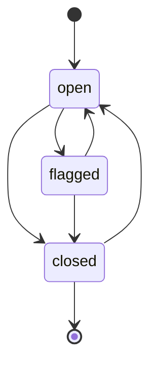
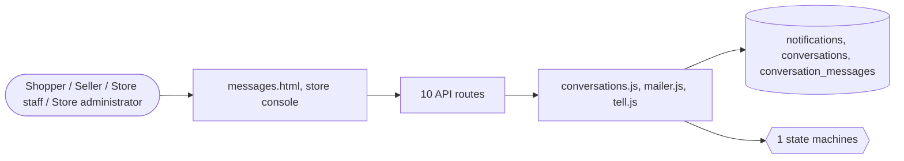

# Messages and notifications

> Generated from `_registry/business-domains.json`, the code and `docs/source/communication.md` — edit those, then run `node scripts/domain-docs.js`.

## Overview

Talking to people: conversations between buyers, sellers and staff, notifications to shoppers and staff, and email.

**Foundation domain:** Communication · **Used by:** Shopper, Seller, Store staff, Store administrator

## Switches and settings

Each is switched on per store under ⚙️ Capabilities; its parameters are that store's settings.

### Buyer–seller messages (`conversations`)

Conversations between a shopper and whoever sells a product, an order or a booking — the store or another shopper. What a conversation may be about is a conversationSubjects row; staff can review and flag.

| Setting | Meaning | Default |
|---|---|---|
| `max_length` | Longest message | `2000` |
| `hide_contact_details` | Hide email addresses and phone numbers in messages | `true` |
| `staff_can_read` | Staff can read every conversation | `true` |

## Architecture

| Module | What it is |
|---|---|
| `lib/conversations.js` | Buyer–seller conversations. A shopper messages whoever is on the other side of something — a product (its listing's owner, or the store), an order, a booking. What a conversation may be about is a conversationSubjects row naming the RESOLVER that finds that other side (this engine's own small vocabulary); a new subject is a row naming an existing resolver. The store's side is answered by its staff. Email addresses and phone numbers can be hidden so trades stay on the platform, and staff can read, flag and close any conversation. Capability: conversations. |
| `lib/mailer.js` | person-to-person delivery: a message addressed to ONE recipient (a sign-in code, a password-reset link, an order confirmation), as opposed to lib/api.js notify(), which broadcasts a store event to the store's own configured address. |
| `lib/tell.js` | telling a shopper something: an in-app notification, and an email when the shopper has an account with an address. The notification kind must be a row of the shopNotifKinds registry (an engine names the kind its capability or registry row declares); an unknown kind still emails but leaves no in-app note. Owners are "t<tenant>:u:<user>" for a signed-in shopper and "t<tenant>:s:<session>" for a guest, who has no address. |

**Registry lists** (editable in Data Studio): `shopNotifKinds`, `conversationSubjects`, `conversationStatuses`

## Data model

### `notifications`

| Column | Type |
|---|---|
| `id` | INTEGER PRIMARY KEY AUTOINCREMENT |
| `tenant_id` | INTEGER NOT NULL |
| `owner` | TEXT |
| `kind` | TEXT NOT NULL |
| `title` | TEXT NOT NULL |
| `body` | TEXT |
| `link` | TEXT |
| `read` | INTEGER DEFAULT 0 |
| `meta` | TEXT DEFAULT '{}' |
| `created_at` | TEXT NOT NULL DEFAULT (datetime('now')) |

### `conversations`

| Column | Type |
|---|---|
| `id` | INTEGER PRIMARY KEY AUTOINCREMENT |
| `tenant_id` | INTEGER NOT NULL |
| `subject_kind` | TEXT NOT NULL |
| `subject_ref` | TEXT NOT NULL |
| `buyer` | TEXT NOT NULL |
| `counterpart` | TEXT NOT NULL DEFAULT '' |
| `title` | TEXT DEFAULT '' |
| `status` | TEXT NOT NULL DEFAULT 'open' |
| `last_at` | TEXT NOT NULL DEFAULT (datetime('now')) |
| `created_at` | TEXT NOT NULL DEFAULT (datetime('now')) |

### `conversation_messages`

| Column | Type |
|---|---|
| `id` | INTEGER PRIMARY KEY AUTOINCREMENT |
| `tenant_id` | INTEGER NOT NULL |
| `conversation_id` | INTEGER NOT NULL |
| `sender` | TEXT NOT NULL |
| `side` | TEXT NOT NULL |
| `body` | TEXT NOT NULL |
| `hidden` | INTEGER NOT NULL DEFAULT 0 |
| `read_by_other` | INTEGER NOT NULL DEFAULT 0 |
| `at` | TEXT NOT NULL DEFAULT (datetime('now')) |

## API reference

Every call is JSON over HTTPS; store calls carry the store (`?store=`) and the session; mutating calls accept an `Idempotency-Key` header where noted.

| Method and path | Handler | What it does |
|---|---|---|
| `GET /api/notifications` | `apiNotifications` | — |
| `POST /api/notifications/read` | `apiNotificationsRead` | — |
| `GET /api/conversations` | `apiConversations` | conversations |
| `POST /api/conversations` | `apiConversationStart` | — |
| `GET /api/conversations/:id` | `apiConversationGet` | — |
| `POST /api/conversations/:id` | `apiConversationPost` | — |
| `GET /api/admin/conversations` | `apiAdminConversations` | — |
| `POST /api/admin/conversations/messages/:id` | `apiAdminMessageHide` | — |
| `GET /api/admin/conversations/:id` | `apiAdminConversationGet` | — |
| `POST /api/admin/conversations/:id` | `apiAdminConversationPost` | — |

## Process flows

Each record's life is a declared state machine (`lib/seed/states.json`): the moves it may make, and the actions that make them.

### Conversation (`conversation`)

Actions: `close` → closed · `flag` → flagged · `reopen` → open

## Data flow

## User interface

**Pages:** `messages.html`

**Store console:** 💬 Messages

## User flows

_Not yet written — `docs/source/communication.md`, section `## Flows`._

## Manuals

### Shopper

_Not yet written — `docs/source/communication.md`, section `## Manual: shopper`._

### Seller

_Not yet written — `docs/source/communication.md`, section `## Manual: seller`._

### Store staff

_Not yet written — `docs/source/communication.md`, section `## Manual: store_staff`._

### Store administrator

_Not yet written — `docs/source/communication.md`, section `## Manual: store_admin`._

