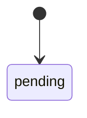
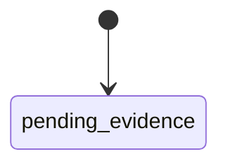
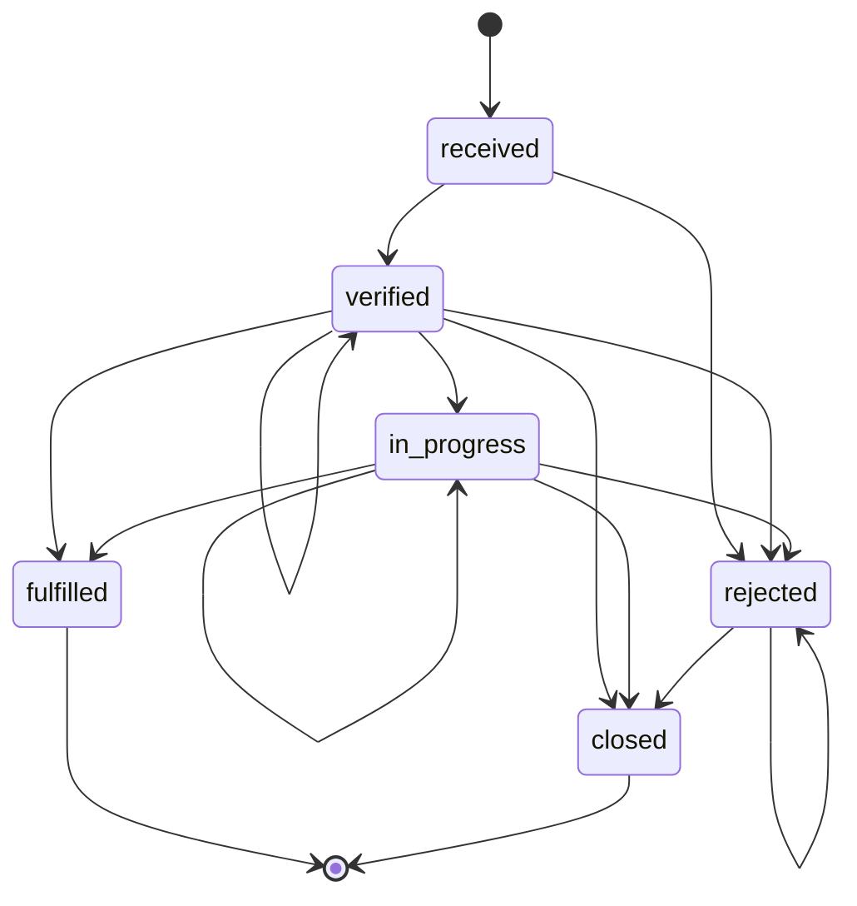
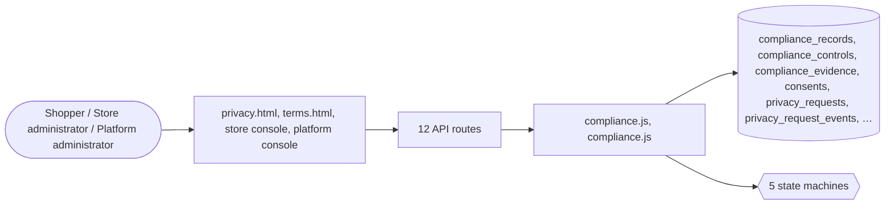

# Compliance and privacy

> Generated from `_registry/business-domains.json`, the code and `docs/source/compliance.md` — edit those, then run `node scripts/domain-docs.js`.

## Overview

Meeting obligations: controls and their evidence, certifications, know-your-customer checks, consent, and privacy requests to see or erase data.

**Foundation domain:** Compliance · **Used by:** Shopper, Store administrator, Platform administrator

## Switches and settings

Each is switched on per store under ⚙️ Capabilities; its parameters are that store's settings.

### KYC verification (`kyc`)

Identity verification that gates credit: BNPL and loans require the full tier.

| Setting | Meaning | Default |
|---|---|---|
| `full_tier_status` | KYC profile status that satisfies the full tier | `"full_kyc"` |
| `min_tier_status` | Status for the limited tier | `"min_kyc"` |

## Architecture

| Module | What it is |
|---|---|
| `lib/compliance.js` | Compliance-as-Data: named regulations, control framework, evidence, privacy & consent, and data-subject rights. -------------------------------------------------------------------------- The corpus declares a COMPLIANCE UNIVERSE whose items are the regulations themselves (GDPR · CCPA · DPDP · HIPAA · PCI-DSS · SOC 2 · ISO 27001 · NIST · FedRAMP · SEBI · RBI · TRAI · future). Before this engine those names existed nowhere in the runtime — the platform had a generic `compliance_records` table but no regulation was modeled, so "continuous compliance validation" was impossible to even ask about. |
| `lib/routes/compliance.js` | compliance domain routes (moved from lib/api.js; _registry/business-domains.json). Each handler answers one route of the compliance domain. What it needs from the shared HTTP kit (lib/api.js) is passed in as `kit`. |

**Registry lists** (editable in Data Studio): `finKycKinds`, `finKycDocs`, `finKycDocStatuses`, `finKycStatuses`

## Data model

### `compliance_records`

| Column | Type |
|---|---|
| `id` | INTEGER PRIMARY KEY AUTOINCREMENT |
| `tenant_id` | INTEGER NOT NULL |
| `scope` | TEXT NOT NULL DEFAULT 'product' |
| `ref_id` | TEXT NOT NULL DEFAULT '' |
| `kind` | TEXT NOT NULL DEFAULT 'certificate' |
| `code` | TEXT DEFAULT '' |
| `issuer` | TEXT DEFAULT '' |
| `jurisdiction` | TEXT DEFAULT '' |
| `status` | TEXT NOT NULL DEFAULT 'valid' |
| `valid_from` | TEXT |
| `valid_to` | TEXT |
| `doc_media` | TEXT DEFAULT '' |
| `notes` | TEXT DEFAULT '' |
| `created_at` | TEXT NOT NULL DEFAULT (datetime('now')) |
| `deleted_at` | TEXT |
| `uid` | TEXT |

### `compliance_controls`

| Column | Type |
|---|---|
| `id` | INTEGER PRIMARY KEY AUTOINCREMENT |
| `tenant_id` | INTEGER |
| `/*` | NULL = platform control template */ regulation TEXT NOT NULL |
| `/*` | gdpr · pci-dss · … (registry key) */ control_id TEXT NOT NULL |
| `/*` | the regulation's own control number */ name TEXT NOT NULL, evidence TEXT DEFAULT '', /* what proves it (engine + artifact) */ status TEXT NOT NULL DEFAULT 'pending_evidence', updated_at TEXT, UNIQUE(tenant_id, regulation, control_id) ); CREATE INDEX ix_compliance_controls_reg ON compliance_controls(regulation, control_id); CREATE TABLE compliance_evidence ( id INTEGER PRIMARY KEY AUTOINCREMENT, control_id INTEGER NOT NULL, tenant_id INTEGER, note TEXT NOT NULL, provided_by TEXT DEFAULT '', created_at TEXT NOT NULL DEFAULT (datetime('now')) ); CREATE TABLE consents ( id INTEGER PRIMARY KEY AUTOINCREMENT, tenant_id INTEGER NOT NULL, subject TEXT NOT NULL, /* the data subject's identifier (email) */ purpose TEXT NOT NULL |
| `/*` | registry key: privacyPurposes */ status TEXT NOT NULL DEFAULT 'granted' |
| `/*` | granted · withdrawn · denied */ lawful_basis TEXT DEFAULT 'consent' |
| `source` | TEXT DEFAULT 'console' |
| `/*` | console · checkout · signup · api */ ip TEXT DEFAULT '' |
| `granted_at` | TEXT NOT NULL DEFAULT (datetime('now')) |
| `withdrawn_at` | TEXT |
| `updated_at` | TEXT |

### `compliance_evidence`

| Column | Type |
|---|---|
| `id` | INTEGER PRIMARY KEY AUTOINCREMENT |
| `control_id` | INTEGER NOT NULL |
| `tenant_id` | INTEGER |
| `note` | TEXT NOT NULL |
| `provided_by` | TEXT DEFAULT '' |
| `created_at` | TEXT NOT NULL DEFAULT (datetime('now')) |

### `consents`

| Column | Type |
|---|---|
| `id` | INTEGER PRIMARY KEY AUTOINCREMENT |
| `tenant_id` | INTEGER NOT NULL |
| `subject` | TEXT NOT NULL |
| `/*` | the data subject's identifier (email) */ purpose TEXT NOT NULL, /* registry key: privacyPurposes */ status TEXT NOT NULL DEFAULT 'granted', /* granted · withdrawn · denied */ lawful_basis TEXT DEFAULT 'consent', source TEXT DEFAULT 'console', /* console · checkout · signup · api */ ip TEXT DEFAULT '', granted_at TEXT NOT NULL DEFAULT (datetime('now')), withdrawn_at TEXT, updated_at TEXT, UNIQUE(tenant_id, subject, purpose) ); CREATE INDEX ix_consents_subject ON consents(tenant_id, subject, status); CREATE TABLE privacy_requests ( id TEXT PRIMARY KEY, /* DSR-XXXX */ tenant_id INTEGER NOT NULL, subject TEXT NOT NULL, kind TEXT NOT NULL, /* access · erasure · portability · rectification · objection */ status TEXT NOT NULL DEFAULT 'received', due_at TEXT, fulfilled_at TEXT, created_at TEXT NOT NULL DEFAULT (datetime('now')), updated_at TEXT ); CREATE TABLE privacy_request_events ( id INTEGER PRIMARY KEY AUTOINCREMENT, request_id TEXT NOT NULL, from_state TEXT, to_state TEXT NOT NULL, actor TEXT DEFAULT '', detail TEXT DEFAULT '', created_at TEXT NOT NULL DEFAULT (datetime('now')) ); CREATE TABLE erasure_log ( id INTEGER PRIMARY KEY AUTOINCREMENT, tenant_id INTEGER NOT NULL, subject TEXT NOT NULL, removed TEXT NOT NULL DEFAULT '[]', /* JSON: {table: rows} */ executed_by TEXT DEFAULT '', created_at TEXT NOT NULL DEFAULT (datetime('now')) ); CREATE TABLE kyc_profiles ( id INTEGER PRIMARY KEY AUTOINCREMENT, tenant_id INTEGER NOT NULL, owner TEXT NOT NULL, kind TEXT NOT NULL DEFAULT 'individual', full_name TEXT, dob TEXT, pan TEXT, aadhaar_masked TEXT, gstin TEXT, company TEXT, website TEXT, doc_type TEXT, doc_ref TEXT, doc_status TEXT NOT NULL DEFAULT 'unverified', status TEXT NOT NULL DEFAULT 'pending', verified_at TEXT, created_at TEXT NOT NULL DEFAULT (datetime('now')) ); CREATE INDEX ix_kyc_owner ON kyc_profiles(tenant_id, owner, status); CREATE UNIQUE INDEX ux_compliance_records_uid ON compliance_records(uid); CREATE TRIGGER trg_compliance_records_uid AFTER INSERT ON compliance_records BEGIN UPDATE compliance_records SET uid = lower(hex(randomblob(4))\|\|'-'\|\|hex(randomblob(2))\|\|'-4'\|\|substr(hex(randomblob(2)),2)\|\|'-'\|\|substr('89ab',abs(random())%4+1,1)\|\|substr(hex(randomblob(2)),2)\|\|'-'\|\|hex(randomblob(6))) WHERE rowid = NEW.rowid; END; -- ── audit · Audit ──────────────────────────────────────────────────────────────────────────────── CREATE TABLE audit_log ( id INTEGER PRIMARY KEY AUTOINCREMENT, tenant_id INTEGER, actor_type TEXT NOT NULL DEFAULT 'system', actor_id INTEGER, actor_name TEXT, action TEXT NOT NULL, entity TEXT, entity_id TEXT, meta TEXT DEFAULT '', ip TEXT, created_at TEXT NOT NULL DEFAULT (datetime('now')) , prev_hash TEXT, hash TEXT, trace_id TEXT, uid TEXT); CREATE INDEX ix_audit_tenant ON audit_log(tenant_id, created_at); CREATE UNIQUE INDEX ux_audit_log_uid ON audit_log(uid); CREATE TRIGGER trg_audit_log_uid AFTER INSERT ON audit_log BEGIN UPDATE audit_log SET uid = lower(hex(randomblob(4))\|\|'-'\|\|hex(randomblob(2))\|\|'-4'\|\|substr(hex(randomblob(2)),2)\|\|'-'\|\|substr('89ab',abs(random())%4+1,1)\|\|substr(hex(randomblob(2)),2)\|\|'-'\|\|hex(randomblob(6))) WHERE rowid = NEW.rowid; END; -- ── security · Security ────────────────────────────────────────────────────────────────────────── CREATE TABLE idempotency_keys ( key TEXT PRIMARY KEY, tenant_id INTEGER, method TEXT, path TEXT, request_hash TEXT, status INTEGER, response TEXT, created_at TEXT NOT NULL DEFAULT (datetime('now')), expires_at TEXT NOT NULL , uid TEXT); CREATE UNIQUE INDEX ux_idempotency_keys_uid ON idempotency_keys(uid); CREATE TRIGGER trg_idempotency_keys_uid AFTER INSERT ON idempotency_keys BEGIN UPDATE idempotency_keys SET uid = lower(hex(randomblob(4))\|\|'-'\|\|hex(randomblob(2))\|\|'-4'\|\|substr(hex(randomblob(2)),2)\|\|'-'\|\|substr('89ab',abs(random())%4+1,1)\|\|substr(hex(randomblob(2)),2)\|\|'-'\|\|hex(randomblob(6))) WHERE rowid = NEW.rowid; END; -- ── ai · AI ────────────────────────────────────────────────────────────────────────────────────── CREATE TABLE ai_usage ( id INTEGER PRIMARY KEY AUTOINCREMENT, tenant_id INTEGER NOT NULL, capability TEXT NOT NULL, provider TEXT NOT NULL, model TEXT DEFAULT '', units INTEGER NOT NULL DEFAULT 1, cost REAL NOT NULL DEFAULT 0, currency TEXT, tier TEXT DEFAULT 'free', status TEXT DEFAULT 'ok', actor TEXT DEFAULT '', created_at TEXT NOT NULL DEFAULT (datetime('now')) , uid TEXT); CREATE TABLE ai_tasks ( id INTEGER PRIMARY KEY AUTOINCREMENT, tenant_id INTEGER NOT NULL, capability TEXT NOT NULL, status TEXT NOT NULL DEFAULT 'queued', params TEXT DEFAULT '{}', result TEXT, cost REAL DEFAULT 0, actor TEXT DEFAULT '', created_at TEXT NOT NULL DEFAULT (datetime('now')), updated_at TEXT , uid TEXT); CREATE UNIQUE INDEX ux_ai_usage_uid ON ai_usage(uid); CREATE TRIGGER trg_ai_usage_uid AFTER INSERT ON ai_usage BEGIN UPDATE ai_usage SET uid = lower(hex(randomblob(4))\|\|'-'\|\|hex(randomblob(2))\|\|'-4'\|\|substr(hex(randomblob(2)),2)\|\|'-'\|\|substr('89ab',abs(random())%4+1,1)\|\|substr(hex(randomblob(2)),2)\|\|'-'\|\|hex(randomblob(6))) WHERE rowid = NEW.rowid; END; CREATE UNIQUE INDEX ux_ai_tasks_uid ON ai_tasks(uid); CREATE TRIGGER trg_ai_tasks_uid AFTER INSERT ON ai_tasks BEGIN UPDATE ai_tasks SET uid = lower(hex(randomblob(4))\|\|'-'\|\|hex(randomblob(2))\|\|'-4'\|\|substr(hex(randomblob(2)),2)\|\|'-'\|\|substr('89ab',abs(random())%4+1,1)\|\|substr(hex(randomblob(2)),2)\|\|'-'\|\|hex(randomblob(6))) WHERE rowid = NEW.rowid; END; -- ── integration · Integrations and webhooks ────────────────────────────────────────────────────── CREATE TABLE custom_providers ( id INTEGER PRIMARY KEY AUTOINCREMENT, scope TEXT NOT NULL DEFAULT 'platform', tenant_id INTEGER, kind TEXT NOT NULL, manifest TEXT NOT NULL, created_at TEXT NOT NULL DEFAULT (datetime('now')) , uid TEXT); CREATE TABLE provider_defs ( id TEXT NOT NULL, kind TEXT NOT NULL, name TEXT NOT NULL, emoji TEXT, description TEXT, methods TEXT DEFAULT '[]', fee_pct REAL DEFAULT 0, fee_fixed REAL DEFAULT 0, fields TEXT DEFAULT '[]', base_fee REAL DEFAULT 0, eta_min INTEGER, eta_max INTEGER, position INTEGER DEFAULT 0, enabled INTEGER DEFAULT 1, spec TEXT DEFAULT '{}', global INTEGER DEFAULT 0, uid TEXT, PRIMARY KEY (id, kind) ); CREATE TABLE provider_availability ( provider_id TEXT NOT NULL, country_code TEXT NOT NULL REFERENCES countries(code), uid TEXT, PRIMARY KEY (provider_id, country_code) ); CREATE TABLE webhooks ( id INTEGER PRIMARY KEY AUTOINCREMENT, tenant_id INTEGER NOT NULL, url TEXT NOT NULL, secret TEXT DEFAULT '', events TEXT DEFAULT '["*"]', active INTEGER DEFAULT 1, description TEXT DEFAULT '', created_at TEXT NOT NULL DEFAULT (datetime('now')), updated_at TEXT , uid TEXT); CREATE TABLE webhook_deliveries ( id INTEGER PRIMARY KEY AUTOINCREMENT, tenant_id INTEGER NOT NULL, webhook_id INTEGER, event TEXT NOT NULL, subject_uid TEXT, payload TEXT DEFAULT '{}', status TEXT NOT NULL DEFAULT 'queued', attempts INTEGER DEFAULT 0, response TEXT DEFAULT '', next_retry_at TEXT, created_at TEXT NOT NULL DEFAULT (datetime('now')) , uid TEXT); CREATE INDEX ix_deliveries ON webhook_deliveries(tenant_id, status); CREATE TABLE inbound_events ( id INTEGER PRIMARY KEY AUTOINCREMENT, tenant_id INTEGER, provider TEXT, event TEXT, payload TEXT DEFAULT '{}', signature_ok INTEGER DEFAULT 0, processed INTEGER DEFAULT 0, created_at TEXT NOT NULL DEFAULT (datetime('now')) , uid TEXT); CREATE UNIQUE INDEX ux_provider_defs_uid ON provider_defs(uid); CREATE TRIGGER trg_provider_defs_uid AFTER INSERT ON provider_defs BEGIN UPDATE provider_defs SET uid = lower(hex(randomblob(4))\|\|'-'\|\|hex(randomblob(2))\|\|'-4'\|\|substr(hex(randomblob(2)),2)\|\|'-'\|\|substr('89ab',abs(random())%4+1,1)\|\|substr(hex(randomblob(2)),2)\|\|'-'\|\|hex(randomblob(6))) WHERE rowid = NEW.rowid; END; CREATE UNIQUE INDEX ux_provider_availability_uid ON provider_availability(uid); CREATE TRIGGER trg_provider_availability_uid AFTER INSERT ON provider_availability BEGIN UPDATE provider_availability SET uid = lower(hex(randomblob(4))\|\|'-'\|\|hex(randomblob(2))\|\|'-4'\|\|substr(hex(randomblob(2)),2)\|\|'-'\|\|substr('89ab',abs(random())%4+1,1)\|\|substr(hex(randomblob(2)),2)\|\|'-'\|\|hex(randomblob(6))) WHERE rowid = NEW.rowid; END; CREATE UNIQUE INDEX ux_custom_providers_uid ON custom_providers(uid); CREATE TRIGGER trg_custom_providers_uid AFTER INSERT ON custom_providers BEGIN UPDATE custom_providers SET uid = lower(hex(randomblob(4))\|\|'-'\|\|hex(randomblob(2))\|\|'-4'\|\|substr(hex(randomblob(2)),2)\|\|'-'\|\|substr('89ab',abs(random())%4+1,1)\|\|substr(hex(randomblob(2)),2)\|\|'-'\|\|hex(randomblob(6))) WHERE rowid = NEW.rowid; END; CREATE UNIQUE INDEX ux_webhooks_uid ON webhooks(uid); CREATE TRIGGER trg_webhooks_uid AFTER INSERT ON webhooks BEGIN UPDATE webhooks SET uid = lower(hex(randomblob(4))\|\|'-'\|\|hex(randomblob(2))\|\|'-4'\|\|substr(hex(randomblob(2)),2)\|\|'-'\|\|substr('89ab',abs(random())%4+1,1)\|\|substr(hex(randomblob(2)),2)\|\|'-'\|\|hex(randomblob(6))) WHERE rowid = NEW.rowid; END; CREATE UNIQUE INDEX ux_webhook_deliveries_uid ON webhook_deliveries(uid); CREATE TRIGGER trg_webhook_deliveries_uid AFTER INSERT ON webhook_deliveries BEGIN UPDATE webhook_deliveries SET uid = lower(hex(randomblob(4))\|\|'-'\|\|hex(randomblob(2))\|\|'-4'\|\|substr(hex(randomblob(2)),2)\|\|'-'\|\|substr('89ab',abs(random())%4+1,1)\|\|substr(hex(randomblob(2)),2)\|\|'-'\|\|hex(randomblob(6))) WHERE rowid = NEW.rowid; END; CREATE UNIQUE INDEX ux_inbound_events_uid ON inbound_events(uid); CREATE TRIGGER trg_inbound_events_uid AFTER INSERT ON inbound_events BEGIN UPDATE inbound_events SET uid = lower(hex(randomblob(4))\|\|'-'\|\|hex(randomblob(2))\|\|'-4'\|\|substr(hex(randomblob(2)),2)\|\|'-'\|\|substr('89ab',abs(random())%4+1,1)\|\|substr(hex(randomblob(2)),2)\|\|'-'\|\|hex(randomblob(6))) WHERE rowid = NEW.rowid; END; -- ── kernel · Kernel and registries ─────────────────────────────────────────────────────────────── CREATE TABLE meta_lists ( name TEXT PRIMARY KEY, label TEXT, items TEXT NOT NULL, seeded_from TEXT , edited INTEGER DEFAULT 0, uid TEXT); CREATE TABLE links ( id INTEGER PRIMARY KEY AUTOINCREMENT, tenant_id INTEGER, type TEXT NOT NULL, from_entity TEXT NOT NULL, from_uid TEXT NOT NULL, to_entity TEXT NOT NULL, to_uid TEXT NOT NULL, meta TEXT DEFAULT '{}', created_at TEXT NOT NULL DEFAULT (datetime('now')) , uid TEXT); CREATE TABLE context_types ( id INTEGER PRIMARY KEY AUTOINCREMENT, grp TEXT NOT NULL, key TEXT NOT NULL, label TEXT NOT NULL, type TEXT DEFAULT 'context', fields TEXT DEFAULT '[]', position INTEGER DEFAULT 0, uid TEXT, UNIQUE(grp, key) ); CREATE TABLE entity_defs ( key TEXT NOT NULL, scope TEXT NOT NULL DEFAULT 'tenant', tenant_id INTEGER NOT NULL DEFAULT 0, def TEXT NOT NULL, created_at TEXT NOT NULL DEFAULT (datetime('now')), uid TEXT, PRIMARY KEY (key, scope, tenant_id) ); CREATE TABLE entity_data ( id INTEGER PRIMARY KEY AUTOINCREMENT, tenant_id INTEGER, entity TEXT NOT NULL, data TEXT NOT NULL, created_at TEXT NOT NULL DEFAULT (datetime('now')) , uid TEXT); CREATE TABLE entity_types ( id INTEGER PRIMARY KEY AUTOINCREMENT, entity TEXT NOT NULL, type_key TEXT NOT NULL, label TEXT NOT NULL, icon TEXT DEFAULT '📝', fields TEXT NOT NULL DEFAULT '[]', config TEXT NOT NULL DEFAULT '{}', created_at TEXT NOT NULL DEFAULT (datetime('now')), UNIQUE (entity, type_key) ); CREATE INDEX ix_etype_entity ON entity_types(entity); CREATE TABLE entity_attributes ( id INTEGER PRIMARY KEY AUTOINCREMENT, attribute_key TEXT NOT NULL, entity TEXT NOT NULL, position INTEGER NOT NULL DEFAULT 0, created_at TEXT NOT NULL DEFAULT (datetime('now')), UNIQUE (entity, attribute_key) ); CREATE INDEX ix_eattr_entity ON entity_attributes(entity, position); CREATE TABLE entity_field_config ( id INTEGER PRIMARY KEY AUTOINCREMENT, tenant_id INTEGER NOT NULL, entity TEXT NOT NULL, field_key TEXT NOT NULL, required INTEGER NOT NULL DEFAULT 0, hidden INTEGER NOT NULL DEFAULT 0, config TEXT NOT NULL DEFAULT '{}', updated_at TEXT NOT NULL DEFAULT (datetime('now')), UNIQUE (tenant_id, entity, field_key) ); CREATE TABLE entity_meta ( id INTEGER PRIMARY KEY AUTOINCREMENT, tenant_id INTEGER NOT NULL, entity TEXT NOT NULL, ref_uid TEXT NOT NULL, tags TEXT DEFAULT '[]', meta TEXT DEFAULT '{}', notes TEXT DEFAULT '', created_at TEXT NOT NULL DEFAULT (datetime('now')), updated_at TEXT, uid TEXT, UNIQUE (tenant_id, entity, ref_uid) ); CREATE INDEX ix_entity_meta ON entity_meta(tenant_id, entity, ref_uid); CREATE TABLE entity_usage ( id INTEGER PRIMARY KEY AUTOINCREMENT, tenant_id INTEGER NOT NULL, entity TEXT NOT NULL, action TEXT NOT NULL, at TEXT NOT NULL DEFAULT (datetime('now')), UNIQUE (tenant_id, entity, action) ); CREATE TABLE knowledge_graph ( id INTEGER PRIMARY KEY AUTOINCREMENT, source_type TEXT NOT NULL, source_id INTEGER NOT NULL, relationship TEXT NOT NULL, target_type TEXT NOT NULL, target_id INTEGER NOT NULL, weight REAL NOT NULL DEFAULT 1.0, metadata TEXT NOT NULL DEFAULT '{}', created_at TEXT NOT NULL DEFAULT (datetime('now')) ); CREATE INDEX ix_kg_source ON knowledge_graph(source_type, source_id); CREATE INDEX ix_kg_target ON knowledge_graph(target_type, target_id); CREATE TABLE composition_ledger ( id INTEGER PRIMARY KEY AUTOINCREMENT, key TEXT NOT NULL UNIQUE, /* the composed model key (cp_<capability>) — one row per capability */ capability TEXT NOT NULL, /* the human label of what was composed */ source TEXT, /* provenance: doc:line / catalog / registry */ artifacts TEXT NOT NULL DEFAULT '{}', /* the full manifest (data model, API, workflow, UI, dashboard, security) */ composed_at TEXT NOT NULL ); CREATE INDEX ix_composition_key ON composition_ledger(key, composed_at); CREATE UNIQUE INDEX ux_composition_key ON composition_ledger(key); CREATE UNIQUE INDEX ux_entity_defs_uid ON entity_defs(uid); CREATE TRIGGER trg_entity_defs_uid AFTER INSERT ON entity_defs BEGIN UPDATE entity_defs SET uid = lower(hex(randomblob(4))\|\|'-'\|\|hex(randomblob(2))\|\|'-4'\|\|substr(hex(randomblob(2)),2)\|\|'-'\|\|substr('89ab',abs(random())%4+1,1)\|\|substr(hex(randomblob(2)),2)\|\|'-'\|\|hex(randomblob(6))) WHERE rowid = NEW.rowid; END; CREATE UNIQUE INDEX ux_entity_data_uid ON entity_data(uid); CREATE TRIGGER trg_entity_data_uid AFTER INSERT ON entity_data BEGIN UPDATE entity_data SET uid = lower(hex(randomblob(4))\|\|'-'\|\|hex(randomblob(2))\|\|'-4'\|\|substr(hex(randomblob(2)),2)\|\|'-'\|\|substr('89ab',abs(random())%4+1,1)\|\|substr(hex(randomblob(2)),2)\|\|'-'\|\|hex(randomblob(6))) WHERE rowid = NEW.rowid; END; CREATE UNIQUE INDEX ux_meta_lists_uid ON meta_lists(uid); CREATE TRIGGER trg_meta_lists_uid AFTER INSERT ON meta_lists BEGIN UPDATE meta_lists SET uid = lower(hex(randomblob(4))\|\|'-'\|\|hex(randomblob(2))\|\|'-4'\|\|substr(hex(randomblob(2)),2)\|\|'-'\|\|substr('89ab',abs(random())%4+1,1)\|\|substr(hex(randomblob(2)),2)\|\|'-'\|\|hex(randomblob(6))) WHERE rowid = NEW.rowid; END; CREATE UNIQUE INDEX ux_links_uid ON links(uid); CREATE TRIGGER trg_links_uid AFTER INSERT ON links BEGIN UPDATE links SET uid = lower(hex(randomblob(4))\|\|'-'\|\|hex(randomblob(2))\|\|'-4'\|\|substr(hex(randomblob(2)),2)\|\|'-'\|\|substr('89ab',abs(random())%4+1,1)\|\|substr(hex(randomblob(2)),2)\|\|'-'\|\|hex(randomblob(6))) WHERE rowid = NEW.rowid; END; CREATE UNIQUE INDEX ux_context_types_uid ON context_types(uid); CREATE TRIGGER trg_context_types_uid AFTER INSERT ON context_types BEGIN UPDATE context_types SET uid = lower(hex(randomblob(4))\|\|'-'\|\|hex(randomblob(2))\|\|'-4'\|\|substr(hex(randomblob(2)),2)\|\|'-'\|\|substr('89ab',abs(random())%4+1,1)\|\|substr(hex(randomblob(2)),2)\|\|'-'\|\|hex(randomblob(6))) WHERE rowid = NEW.rowid; END; CREATE UNIQUE INDEX ux_entity_meta_uid ON entity_meta(uid); CREATE TRIGGER trg_entity_meta_uid AFTER INSERT ON entity_meta BEGIN UPDATE entity_meta SET uid = lower(hex(randomblob(4))\|\|'-'\|\|hex(randomblob(2))\|\|'-4'\|\|substr(hex(randomblob(2)),2)\|\|'-'\|\|substr('89ab',abs(random())%4+1,1)\|\|substr(hex(randomblob(2)),2)\|\|'-'\|\|hex(randomblob(6))) WHERE rowid = NEW.rowid; END; CREATE TABLE k_events ( seq INTEGER PRIMARY KEY AUTOINCREMENT, at TEXT NOT NULL, type TEXT NOT NULL, namespace TEXT NOT NULL, subject TEXT, actor TEXT, payload TEXT NOT NULL DEFAULT '{}', prev_hash TEXT NOT NULL, hash TEXT NOT NULL); CREATE INDEX ix_k_events_subject ON k_events(subject, seq); CREATE INDEX ix_k_events_at ON k_events(at); CREATE TABLE k_kinds ( id INTEGER PRIMARY KEY AUTOINCREMENT, namespace TEXT NOT NULL, kind TEXT NOT NULL, owner TEXT NOT NULL, spec TEXT NOT NULL, rec_from INTEGER NOT NULL, rec_to INTEGER, scope TEXT); CREATE INDEX ix_k_kinds ON k_kinds(namespace, kind, rec_to); CREATE TABLE k_nodes ( uid TEXT PRIMARY KEY, namespace TEXT NOT NULL, kind TEXT NOT NULL, rec_from INTEGER NOT NULL, scope TEXT); CREATE INDEX ix_k_nodes_kind ON k_nodes(namespace, kind); CREATE TABLE k_identifiers ( id INTEGER PRIMARY KEY AUTOINCREMENT, node TEXT NOT NULL, scheme TEXT NOT NULL, value TEXT NOT NULL, valid_from TEXT NOT NULL, valid_to TEXT, rec_from INTEGER NOT NULL, rec_to INTEGER); CREATE INDEX ix_k_ident_value ON k_identifiers(scheme, value, rec_to); CREATE INDEX ix_k_ident_node ON k_identifiers(node, rec_to); CREATE TABLE k_hierarchies ( id INTEGER PRIMARY KEY AUTOINCREMENT, namespace TEXT NOT NULL, hierarchy TEXT NOT NULL, owner TEXT NOT NULL, spec TEXT NOT NULL, rec_from INTEGER NOT NULL, rec_to INTEGER, scope TEXT); CREATE INDEX ix_k_hier ON k_hierarchies(namespace, hierarchy, rec_to); CREATE TABLE k_placements ( id INTEGER PRIMARY KEY AUTOINCREMENT, hierarchy TEXT NOT NULL, node TEXT NOT NULL, parent TEXT, valid_from TEXT NOT NULL, valid_to TEXT, rec_from INTEGER NOT NULL, rec_to INTEGER); CREATE INDEX ix_k_place_parent ON k_placements(hierarchy, parent, rec_to); CREATE INDEX ix_k_place_node ON k_placements(hierarchy, node, rec_to); CREATE TABLE k_versions ( id INTEGER PRIMARY KEY AUTOINCREMENT, node TEXT NOT NULL, attrs TEXT NOT NULL, valid_from TEXT NOT NULL, valid_to TEXT, rec_from INTEGER NOT NULL, rec_to INTEGER); CREATE INDEX ix_k_versions ON k_versions(node, rec_to, valid_from); CREATE TABLE k_node_states ( id INTEGER PRIMARY KEY AUTOINCREMENT, node TEXT NOT NULL, state TEXT NOT NULL, rec_from INTEGER NOT NULL, rec_to INTEGER); CREATE INDEX ix_k_node_states ON k_node_states(node, rec_to); CREATE TABLE k_coord_systems ( id INTEGER PRIMARY KEY AUTOINCREMENT, namespace TEXT NOT NULL, system TEXT NOT NULL, owner TEXT NOT NULL, spec TEXT NOT NULL, rec_from INTEGER NOT NULL, rec_to INTEGER); CREATE INDEX ix_k_coord ON k_coord_systems(namespace, system, rec_to); CREATE TABLE k_shapes ( id INTEGER PRIMARY KEY AUTOINCREMENT, node TEXT NOT NULL, system TEXT NOT NULL, geom TEXT NOT NULL, valid_from TEXT NOT NULL, valid_to TEXT, rec_from INTEGER NOT NULL, rec_to INTEGER); CREATE INDEX ix_k_shapes ON k_shapes(system, rec_to); CREATE INDEX ix_k_shapes_node ON k_shapes(node, system, rec_to); CREATE TABLE k_declarations ( id INTEGER PRIMARY KEY AUTOINCREMENT, family TEXT NOT NULL, namespace TEXT NOT NULL, name TEXT NOT NULL, owner TEXT NOT NULL, spec TEXT NOT NULL, rec_from INTEGER NOT NULL, rec_to INTEGER, scope TEXT); CREATE INDEX ix_k_decl ON k_declarations(family, namespace, name, rec_to); CREATE TABLE k_assignments ( id INTEGER PRIMARY KEY AUTOINCREMENT, namespace TEXT NOT NULL, setting TEXT NOT NULL, scope TEXT, value TEXT NOT NULL, valid_from TEXT NOT NULL, valid_to TEXT, rec_from INTEGER NOT NULL, rec_to INTEGER); CREATE INDEX ix_k_assign ON k_assignments(setting, namespace, scope, rec_to); CREATE TABLE k_changes ( id INTEGER PRIMARY KEY AUTOINCREMENT, namespace TEXT NOT NULL, title TEXT NOT NULL, ops TEXT NOT NULL, state TEXT NOT NULL, author TEXT, approver TEXT, publish_at TEXT, seq_from INTEGER, seq_to INTEGER, rolled_back_seq INTEGER, result TEXT, report TEXT, created_at TEXT NOT NULL); CREATE INDEX ix_k_changes_state ON k_changes(state, publish_at); -- ── rules · Rules, states and settings ─────────────────────────────────────────────────────────── CREATE TABLE settings ( tenant_id INTEGER NOT NULL DEFAULT 1, key TEXT NOT NULL, value TEXT NOT NULL, uid TEXT, PRIMARY KEY (tenant_id, key) ); CREATE TABLE platform_settings ( key TEXT PRIMARY KEY, value TEXT NOT NULL , uid TEXT); CREATE TABLE config_store ( id INTEGER PRIMARY KEY AUTOINCREMENT, key TEXT NOT NULL, scope TEXT NOT NULL DEFAULT 'platform', tenant_id INTEGER, version INTEGER DEFAULT 1, value TEXT DEFAULT '{}', active INTEGER DEFAULT 1, created_at TEXT NOT NULL DEFAULT (datetime('now')), updated_at TEXT, UNIQUE (key, scope, tenant_id) ); CREATE UNIQUE INDEX ux_settings_uid ON settings(uid); CREATE TRIGGER trg_settings_uid AFTER INSERT ON settings BEGIN UPDATE settings SET uid = lower(hex(randomblob(4))\|\|'-'\|\|hex(randomblob(2))\|\|'-4'\|\|substr(hex(randomblob(2)),2)\|\|'-'\|\|substr('89ab',abs(random())%4+1,1)\|\|substr(hex(randomblob(2)),2)\|\|'-'\|\|hex(randomblob(6))) WHERE rowid = NEW.rowid; END; CREATE UNIQUE INDEX ux_platform_settings_uid ON platform_settings(uid); CREATE TRIGGER trg_platform_settings_uid AFTER INSERT ON platform_settings BEGIN UPDATE platform_settings SET uid = lower(hex(randomblob(4))\|\|'-'\|\|hex(randomblob(2))\|\|'-4'\|\|substr(hex(randomblob(2)),2)\|\|'-'\|\|substr('89ab',abs(random())%4+1,1)\|\|substr(hex(randomblob(2)),2)\|\|'-'\|\|hex(randomblob(6))) WHERE rowid = NEW.rowid; END; -- ── geography · Places and time ────────────────────────────────────────────────────────────────── CREATE TABLE countries ( code TEXT PRIMARY KEY, name TEXT NOT NULL, position INTEGER DEFAULT 0, active INTEGER DEFAULT 1 , uid TEXT); CREATE TABLE subdivisions ( code TEXT PRIMARY KEY, /* ISO 3166-2, globally unique: the master key (US-CA, IN-MH) */ country_code TEXT NOT NULL REFERENCES countries(code), name TEXT NOT NULL, /* the operator-facing label (California, Maharashtra) */ level TEXT, /* what this level is called: state / province / county / prefecture / emirate / region / territory / district */ parent_id INTEGER, /* a finer division under another division; NULL = directly under the country */ position INTEGER DEFAULT 0, active INTEGER DEFAULT 1 ); CREATE INDEX ix_subdivisions_country ON subdivisions(country_code, active); CREATE UNIQUE INDEX ux_countries_uid ON countries(uid); CREATE TRIGGER trg_countries_uid AFTER INSERT ON countries BEGIN UPDATE countries SET uid = lower(hex(randomblob(4))\|\|'-'\|\|hex(randomblob(2))\|\|'-4'\|\|substr(hex(randomblob(2)),2)\|\|'-'\|\|substr('89ab',abs(random())%4+1,1)\|\|substr(hex(randomblob(2)),2)\|\|'-'\|\|hex(randomblob(6))) WHERE rowid = NEW.rowid; END; -- ── knowledge · Platform knowledge ─────────────────────────────────────────────────────────────── CREATE TABLE domains ( id INTEGER PRIMARY KEY AUTOINCREMENT, key TEXT NOT NULL UNIQUE, name TEXT NOT NULL, description TEXT DEFAULT '', parent TEXT DEFAULT '', schema TEXT NOT NULL DEFAULT '{}', policies TEXT NOT NULL DEFAULT '[]', status TEXT NOT NULL DEFAULT 'active', created_at TEXT NOT NULL DEFAULT (datetime('now')) ); CREATE INDEX ix_domain_parent ON domains(parent, status); CREATE TABLE ucos_documents ( doc_id TEXT PRIMARY KEY, file TEXT NOT NULL, code TEXT NOT NULL, name TEXT NOT NULL, kind TEXT NOT NULL DEFAULT 'architecture', parts INTEGER DEFAULT 0, sections INTEGER DEFAULT 0, articles INTEGER DEFAULT 0, concepts INTEGER DEFAULT 0, registries INTEGER DEFAULT 0, lines INTEGER DEFAULT 0, chars INTEGER DEFAULT 0 ); CREATE TABLE ucos_parts ( id INTEGER PRIMARY KEY AUTOINCREMENT, doc_id TEXT NOT NULL, no INTEGER, label TEXT, title TEXT, line INTEGER ); CREATE INDEX ix_ucos_parts ON ucos_parts(doc_id, no); CREATE TABLE ucos_sections ( id INTEGER PRIMARY KEY AUTOINCREMENT, doc_id TEXT NOT NULL, qkey TEXT NOT NULL, no INTEGER, key TEXT, name TEXT, part_no INTEGER, line INTEGER, concepts INTEGER DEFAULT 0, registries INTEGER DEFAULT 0, meta TEXT DEFAULT '{}', kind TEXT DEFAULT 'section', doc_block TEXT ); CREATE UNIQUE INDEX ux_ucos_sections ON ucos_sections(doc_id, qkey); CREATE TABLE ucos_concepts ( id INTEGER PRIMARY KEY AUTOINCREMENT, doc_id TEXT NOT NULL, key TEXT NOT NULL, name TEXT NOT NULL, container_kind TEXT, container_key TEXT, container_name TEXT, part_no INTEGER, line INTEGER ); CREATE INDEX ix_ucos_concepts ON ucos_concepts(doc_id, key); CREATE INDEX ix_ucos_concepts_name ON ucos_concepts(doc_id, name); CREATE TABLE ucos_registries ( id INTEGER PRIMARY KEY AUTOINCREMENT, doc_id TEXT NOT NULL, key TEXT NOT NULL, label TEXT, container_kind TEXT, container_key TEXT, items TEXT DEFAULT '[]', item_count INTEGER DEFAULT 0, line INTEGER ); CREATE INDEX ix_ucos_reg ON ucos_registries(doc_id, key); CREATE TABLE ucos_edges ( id INTEGER PRIMARY KEY AUTOINCREMENT, doc_id TEXT NOT NULL, source_type TEXT NOT NULL, source_id TEXT NOT NULL, rel TEXT NOT NULL, target_type TEXT NOT NULL, target_id TEXT NOT NULL ); CREATE UNIQUE INDEX ux_ucos_edges ON ucos_edges(doc_id, source_type, source_id, rel, target_type, target_id); CREATE INDEX ix_ucos_edges_src ON ucos_edges(doc_id, source_type, source_id); CREATE TABLE ucos_annotations ( id INTEGER PRIMARY KEY AUTOINCREMENT, doc_id TEXT NOT NULL, /* which constitution the target belongs to */ target_kind TEXT NOT NULL, /* concept \| section \| part */ target_key TEXT NOT NULL, /* canonical key from the parse (never a display name) */ note TEXT NOT NULL, /* the annotation body */ pin INTEGER DEFAULT 0, /* pinned annotations float to the top of the registry view */ created_by TEXT, /* platform admin email */ created_at TEXT DEFAULT (datetime('now')), updated_at TEXT DEFAULT (datetime('now')) ); CREATE INDEX ix_ucos_ann ON ucos_annotations(doc_id, target_kind, target_key); CREATE INDEX ix_ucos_ann_pin ON ucos_annotations(doc_id, target_kind, target_key, pin); CREATE TABLE ucos_foundations ( id INTEGER PRIMARY KEY AUTOINCREMENT, key TEXT NOT NULL UNIQUE, /* canonical identity (Article 8.2: globally unique) */ name TEXT NOT NULL, parent TEXT, /* parent foundation (derivation, Article 4.1) */ universe TEXT, /* the declared universe this foundation belongs to */ lifecycle TEXT NOT NULL DEFAULT 'canonical', /* Article 5.1 states */ governance TEXT NOT NULL DEFAULT 'Foundation Authority', /* Article 6 */ classification TEXT, /* universe \| domain \| foundation \| primitive \| capability */ source_doc TEXT, /* traceability: which corpus document declares it */ source_line INTEGER, discovery TEXT, /* Article 2.2 discovery handle */ created_at TEXT ); CREATE INDEX ix_ucos_foundations_universe ON ucos_foundations(universe, lifecycle); CREATE INDEX ix_ucos_foundations_parent ON ucos_foundations(parent); CREATE TABLE ucos_foundation_deps ( id INTEGER PRIMARY KEY AUTOINCREMENT, foundation TEXT NOT NULL, dependency TEXT NOT NULL, UNIQUE(foundation, dependency) ); CREATE INDEX ix_ucos_foundation_deps_dep ON ucos_foundation_deps(dependency); CREATE TABLE ucos_foundation_evolution ( id INTEGER PRIMARY KEY AUTOINCREMENT, foundation TEXT NOT NULL, predecessor TEXT NOT NULL, UNIQUE(foundation, predecessor) ); CREATE TABLE ucos_foundation_composition ( id INTEGER PRIMARY KEY AUTOINCREMENT, parent TEXT NOT NULL, child TEXT NOT NULL, UNIQUE(parent, child) ); CREATE INDEX ix_ucos_foundation_comp_child ON ucos_foundation_composition(child); CREATE TABLE ucos_foundation_audit ( id INTEGER PRIMARY KEY AUTOINCREMENT, foundation TEXT NOT NULL, event TEXT NOT NULL, detail TEXT DEFAULT '{}', at TEXT NOT NULL ); CREATE INDEX ix_ucos_foundation_audit_f ON ucos_foundation_audit(foundation, at); CREATE TABLE ucos_universes ( id INTEGER PRIMARY KEY AUTOINCREMENT, key TEXT NOT NULL UNIQUE, /* universe identity = its foundation key */ name TEXT NOT NULL, source_doc TEXT NOT NULL, /* which corpus document declares it */ source_line INTEGER, entity_key TEXT NOT NULL, /* the generic entity_def key it instantiates as */ concepts INTEGER DEFAULT 0, /* corpus concepts this universe governs */ instantiated_at TEXT, UNIQUE(entity_key) ); CREATE TABLE ucos_record_transitions ( id INTEGER PRIMARY KEY AUTOINCREMENT, entity_key TEXT NOT NULL, /* which universe's record transitioned */ record_id INTEGER NOT NULL |
| `from_state` | TEXT NOT NULL |
| `to_state` | TEXT NOT NULL |
| `rule` | TEXT |
| `/*` | the corpus rule that authorized it (5.2) */ actor TEXT |
| `/*` | who fired the transition */ detail TEXT DEFAULT '{}' |
| `at` | TEXT NOT NULL DEFAULT (datetime('now')) |

### `privacy_requests`

| Column | Type |
|---|---|
| `id` | TEXT PRIMARY KEY |
| `/*` | DSR-XXXX */ tenant_id INTEGER NOT NULL |
| `subject` | TEXT NOT NULL |
| `kind` | TEXT NOT NULL |
| `/*` | access · erasure · portability · rectification · objection */ status TEXT NOT NULL DEFAULT 'received' |
| `due_at` | TEXT |
| `fulfilled_at` | TEXT |
| `created_at` | TEXT NOT NULL DEFAULT (datetime('now')) |
| `updated_at` | TEXT |

### `privacy_request_events`

| Column | Type |
|---|---|
| `id` | INTEGER PRIMARY KEY AUTOINCREMENT |
| `request_id` | TEXT NOT NULL |
| `from_state` | TEXT |
| `to_state` | TEXT NOT NULL |
| `actor` | TEXT DEFAULT '' |
| `detail` | TEXT DEFAULT '' |
| `created_at` | TEXT NOT NULL DEFAULT (datetime('now')) |

### `erasure_log`

| Column | Type |
|---|---|
| `id` | INTEGER PRIMARY KEY AUTOINCREMENT |
| `tenant_id` | INTEGER NOT NULL |
| `subject` | TEXT NOT NULL |
| `removed` | TEXT NOT NULL DEFAULT '[]' |
| `/*` | JSON: {table: rows} */ executed_by TEXT DEFAULT '' |
| `created_at` | TEXT NOT NULL DEFAULT (datetime('now')) |

### `kyc_profiles`

| Column | Type |
|---|---|
| `id` | INTEGER PRIMARY KEY AUTOINCREMENT |
| `tenant_id` | INTEGER NOT NULL |
| `owner` | TEXT NOT NULL |
| `kind` | TEXT NOT NULL DEFAULT 'individual' |
| `full_name` | TEXT |
| `dob` | TEXT |
| `pan` | TEXT |
| `aadhaar_masked` | TEXT |
| `gstin` | TEXT |
| `company` | TEXT |
| `website` | TEXT |
| `doc_type` | TEXT |
| `doc_ref` | TEXT |
| `doc_status` | TEXT NOT NULL DEFAULT 'unverified' |
| `status` | TEXT NOT NULL DEFAULT 'pending' |
| `verified_at` | TEXT |
| `created_at` | TEXT NOT NULL DEFAULT (datetime('now')) |

## API reference

Every call is JSON over HTTPS; store calls carry the store (`?store=`) and the session; mutating calls accept an `Idempotency-Key` header where noted.

| Method and path | Handler | What it does |
|---|---|---|
| `POST /api/fintech/kyc` | `apiFinKycSubmit` | — |
| `POST /api/fintech/kyc/:id/verify` | `apiFinKycVerify` | — |
| `GET /api/admin/compliance/status` | `apiAdminComplianceStatus` | ---------------- compliance & privacy (regulations as data) ---------------- |
| `GET /api/admin/compliance/catalog` | `apiAdminComplianceCatalog` | — |
| `POST /api/admin/compliance/control` | `apiAdminComplianceControl` | — |
| `GET /api/admin/compliance/evidence` | `apiAdminComplianceEvidence` | — |
| `GET /api/consent` | `apiConsentGet` | — |
| `POST /api/consent` | `apiConsentSet` | — |
| `POST /api/privacy/request` | `apiPrivacyRequestOpen` | a data subject opens a rights request themselves (storefront) or an operator opens one |
| `GET /api/admin/privacy/requests` | `apiAdminPrivacyRequests` | — |
| `POST /api/admin/privacy/requests/:id` | `apiAdminPrivacyRequestTransition` | — |
| `GET /api/admin/privacy/requests/:id/events` | `apiAdminPrivacyRequestEvents` | — |

## Process flows

Each record's life is a declared state machine (`lib/seed/states.json`): the moves it may make, and the actions that make them.

### KYC profile (`kyc`)

Actions: 

### KYC document (`kyc_doc`)

Actions: 

### Compliance control (`control`)

Actions: 

### Consent (`consent`)

Actions: 

### Data-subject request (`privacy_request`)

Actions: 

## Data flow

## User interface

**Pages:** `privacy.html`, `terms.html`

**Store console:** ✅ Compliance & Certs

**Platform console:** 🛡️ Compliance · 🛡️ Compliance Controls · 🏅 Certifications · 🔒 Privacy · 📨 Privacy Requests · 🧹 Erasure Log

## User flows

_Not yet written — `docs/source/compliance.md`, section `## Flows`._

## Manuals

### Shopper

_Not yet written — `docs/source/compliance.md`, section `## Manual: shopper`._

### Store administrator

_Not yet written — `docs/source/compliance.md`, section `## Manual: store_admin`._

### Platform administrator

_Not yet written — `docs/source/compliance.md`, section `## Manual: platform_admin`._

