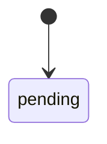
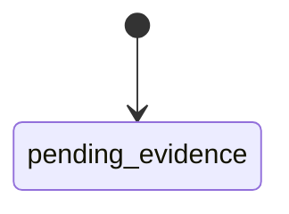
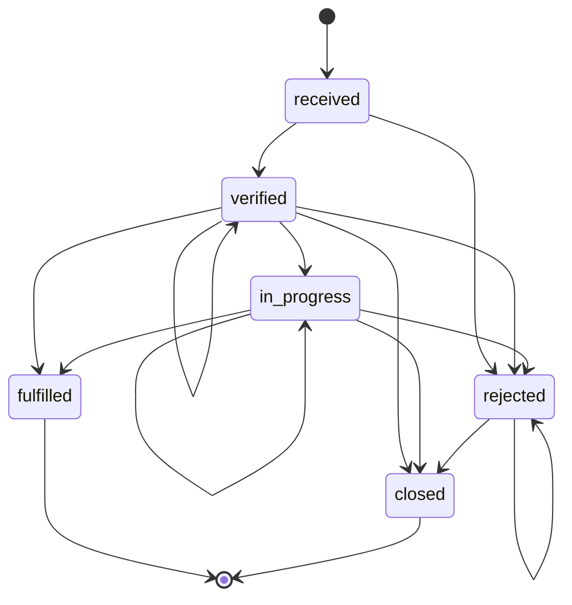
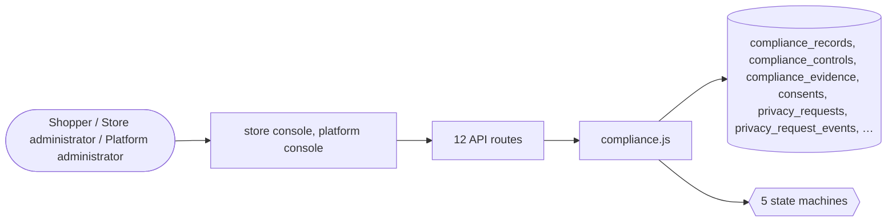

# Compliance and privacy

> Generated from `_registry/business-domains.json`, the code and `docs/source/compliance.md` — edit those, then run `node scripts/domain-docs.js`.

## Overview

Meeting obligations: controls and their evidence, certifications, know-your-customer checks, consent, and privacy requests to see or erase data.

**Foundation domain:** Compliance · **Used by:** Shopper, Store administrator, Platform administrator

## Switches and settings

Each is switched on per store under ⚙️ Capabilities; its parameters are that store's settings.

### KYC verification (`kyc`)

Identity verification that gates credit: BNPL and loans require the full tier.

| Setting | Meaning | Default |
|---|---|---|
| `full_tier_status` | KYC profile status that satisfies the full tier | `"full_kyc"` |
| `min_tier_status` | Status for the limited tier | `"min_kyc"` |

## Architecture

| Module | What it is |
|---|---|
| `lib/compliance.js` | Compliance-as-Data: named regulations, control framework, evidence, privacy & consent, and data-subject rights. -------------------------------------------------------------------------- The corpus declares a COMPLIANCE UNIVERSE whose items are the regulations themselves (GDPR · CCPA · DPDP · HIPAA · PCI-DSS · SOC 2 · ISO 27001 · NIST · FedRAMP · SEBI · RBI · TRAI · future). Before this engine those names existed nowhere in the runtime — the platform had a generic `compliance_records` table but no regulation was modeled, so "continuous compliance validation" was impossible to even ask about. |

**Registry lists** (editable in Data Studio): `finKycKinds`, `finKycDocs`, `finKycDocStatuses`, `finKycStatuses`

## Data model

### `compliance_records`

| Column | Type |
|---|---|
| `id` | INTEGER PRIMARY KEY AUTOINCREMENT |
| `tenant_id` | INTEGER NOT NULL |
| `scope` | TEXT NOT NULL DEFAULT 'product' |
| `ref_id` | TEXT NOT NULL DEFAULT '' |
| `kind` | TEXT NOT NULL DEFAULT 'certificate' |
| `code` | TEXT DEFAULT '' |
| `issuer` | TEXT DEFAULT '' |
| `jurisdiction` | TEXT DEFAULT '' |
| `status` | TEXT NOT NULL DEFAULT 'valid' |
| `valid_from` | TEXT |
| `valid_to` | TEXT |
| `doc_media` | TEXT DEFAULT '' |
| `notes` | TEXT DEFAULT '' |
| `created_at` | TEXT NOT NULL DEFAULT (datetime('now')) |
| `deleted_at` | TEXT |
| `uid` | TEXT |

### `compliance_controls`

| Column | Type |
|---|---|
| `id` | INTEGER PRIMARY KEY AUTOINCREMENT |
| `tenant_id` | INTEGER |
| `/*` | NULL = platform control template */ regulation TEXT NOT NULL |
| `/*` | gdpr · pci-dss · … (registry key) */ control_id TEXT NOT NULL |
| `/*` | the regulation's own control number */ name TEXT NOT NULL, evidence TEXT DEFAULT '', /* what proves it (engine + artifact) */ status TEXT NOT NULL DEFAULT 'pending_evidence', updated_at TEXT, UNIQUE(tenant_id, regulation, control_id) ); CREATE INDEX ix_compliance_controls_reg ON compliance_controls(regulation, control_id); CREATE TABLE compliance_evidence ( id INTEGER PRIMARY KEY AUTOINCREMENT, control_id INTEGER NOT NULL, tenant_id INTEGER, note TEXT NOT NULL, provided_by TEXT DEFAULT '', created_at TEXT NOT NULL DEFAULT (datetime('now')) ); CREATE TABLE consents ( id INTEGER PRIMARY KEY AUTOINCREMENT, tenant_id INTEGER NOT NULL, subject TEXT NOT NULL, /* the data subject's identifier (email) */ purpose TEXT NOT NULL |
| `/*` | registry key: privacyPurposes */ status TEXT NOT NULL DEFAULT 'granted' |
| `/*` | granted · withdrawn · denied */ lawful_basis TEXT DEFAULT 'consent' |
| `source` | TEXT DEFAULT 'console' |
| `/*` | console · checkout · signup · api */ ip TEXT DEFAULT '' |
| `granted_at` | TEXT NOT NULL DEFAULT (datetime('now')) |
| `withdrawn_at` | TEXT |
| `updated_at` | TEXT |

### `compliance_evidence`

| Column | Type |
|---|---|
| `id` | INTEGER PRIMARY KEY AUTOINCREMENT |
| `control_id` | INTEGER NOT NULL |
| `tenant_id` | INTEGER |
| `note` | TEXT NOT NULL |
| `provided_by` | TEXT DEFAULT '' |
| `created_at` | TEXT NOT NULL DEFAULT (datetime('now')) |

### `consents`

| Column | Type |
|---|---|
| `id` | INTEGER PRIMARY KEY AUTOINCREMENT |
| `tenant_id` | INTEGER NOT NULL |
| `subject` | TEXT NOT NULL |
| `/*` | the data subject's identifier (email) */ purpose TEXT NOT NULL, /* registry key: privacyPurposes */ status TEXT NOT NULL DEFAULT 'granted', /* granted · withdrawn · denied */ lawful_basis TEXT DEFAULT 'consent', source TEXT DEFAULT 'console', /* console · checkout · signup · api */ ip TEXT DEFAULT '', granted_at TEXT NOT NULL DEFAULT (datetime('now')), withdrawn_at TEXT, updated_at TEXT, UNIQUE(tenant_id, subject, purpose) ); CREATE INDEX ix_consents_subject ON consents(tenant_id, subject, status); CREATE TABLE privacy_requests ( id TEXT PRIMARY KEY, /* DSR-XXXX */ tenant_id INTEGER NOT NULL, subject TEXT NOT NULL, kind TEXT NOT NULL, /* access · erasure · portability · rectification · objection */ status TEXT NOT NULL DEFAULT 'received', due_at TEXT, fulfilled_at TEXT, created_at TEXT NOT NULL DEFAULT (datetime('now')), updated_at TEXT ); CREATE TABLE privacy_request_events ( id INTEGER PRIMARY KEY AUTOINCREMENT, request_id TEXT NOT NULL, from_state TEXT, to_state TEXT NOT NULL, actor TEXT DEFAULT '', detail TEXT DEFAULT '', created_at TEXT NOT NULL DEFAULT (datetime('now')) ); CREATE TABLE erasure_log ( id INTEGER PRIMARY KEY AUTOINCREMENT, tenant_id INTEGER NOT NULL, subject TEXT NOT NULL, removed TEXT NOT NULL DEFAULT '[]', /* JSON: {table: rows} */ executed_by TEXT DEFAULT '', created_at TEXT NOT NULL DEFAULT (datetime('now')) ); CREATE TABLE tenancy_nodes ( id INTEGER PRIMARY KEY AUTOINCREMENT, tenant_id INTEGER NOT NULL, kind TEXT NOT NULL, /* organization · business_unit · brand · store · channel · … */ parent_id INTEGER, /* NULL = the tenant root, which is created once and immortal */ slug TEXT NOT NULL, name TEXT NOT NULL, path TEXT NOT NULL, /* root.child.grandchild — UNIQUE within a tenant */ status TEXT NOT NULL DEFAULT 'active', /* active · suspended (a suspended node blocks creates beneath it) */ profile TEXT DEFAULT '{}', /* free-form JSON: addresses, contacts, legal entity facts */ config TEXT DEFAULT '{}', /* inline config; tenancy_config rows are the typed overrides */ uid TEXT, created_at TEXT NOT NULL DEFAULT (datetime('now')), UNIQUE(tenant_id, path) ); CREATE INDEX ix_tenancy_parent ON tenancy_nodes(tenant_id, parent_id); CREATE INDEX ix_tenancy_kind ON tenancy_nodes(tenant_id, kind); CREATE TABLE tenancy_config ( id INTEGER PRIMARY KEY AUTOINCREMENT, tenant_id INTEGER NOT NULL, node_id INTEGER NOT NULL, key TEXT NOT NULL, value TEXT DEFAULT '{}', updated_at TEXT NOT NULL DEFAULT (datetime('now')), UNIQUE(tenant_id, node_id, key) ); CREATE TABLE suppliers ( id INTEGER PRIMARY KEY AUTOINCREMENT, tenant_id INTEGER NOT NULL, name TEXT NOT NULL, party_role TEXT DEFAULT 'manufacturer', tax_id TEXT DEFAULT '', country TEXT DEFAULT 'US', region TEXT DEFAULT '', address TEXT DEFAULT '', email TEXT DEFAULT '', phone TEXT DEFAULT '', lead_time_days INTEGER DEFAULT 7, moq INTEGER DEFAULT 1, currency TEXT DEFAULT 'USD', payment_terms TEXT DEFAULT 'net30', on_time_pct REAL DEFAULT 0, status TEXT DEFAULT 'active', certifications TEXT DEFAULT '[]', price_list TEXT DEFAULT '{}', created_at TEXT NOT NULL DEFAULT (datetime('now')) , deleted_at TEXT, uid TEXT); CREATE TABLE localizations ( id INTEGER PRIMARY KEY AUTOINCREMENT, tenant_id INTEGER NOT NULL, entity TEXT NOT NULL DEFAULT 'product', ref_id TEXT NOT NULL, locale TEXT NOT NULL, name TEXT DEFAULT '', description TEXT DEFAULT '', bullets TEXT DEFAULT '[]', attrs TEXT DEFAULT '{}', active INTEGER DEFAULT 1, deleted_at TEXT, uid TEXT, UNIQUE (tenant_id, entity, ref_id, locale) ); CREATE TABLE product_suppliers ( id INTEGER PRIMARY KEY AUTOINCREMENT, tenant_id INTEGER NOT NULL, product_id TEXT NOT NULL, supplier_id INTEGER NOT NULL, supplier_sku TEXT DEFAULT '', price REAL, lead_days INTEGER DEFAULT 7, moq INTEGER DEFAULT 1, is_primary INTEGER DEFAULT 0, status TEXT DEFAULT 'active', deleted_at TEXT, uid TEXT, UNIQUE (tenant_id, product_id, supplier_id) ); CREATE TABLE contracts ( id INTEGER PRIMARY KEY AUTOINCREMENT, tenant_id INTEGER NOT NULL, ref TEXT NOT NULL, buyer_name TEXT NOT NULL, buyer_email TEXT NOT NULL, buyer_org TEXT DEFAULT '', supplier_id INTEGER, product_ids TEXT DEFAULT '[]', currency TEXT DEFAULT 'USD', pricing TEXT DEFAULT '{}', min_qty INTEGER DEFAULT 1, incoterms TEXT DEFAULT 'EXW', payment_terms TEXT DEFAULT 'net30', valid_from TEXT, valid_to TEXT, status TEXT NOT NULL DEFAULT 'draft', notes TEXT DEFAULT '', created_at TEXT NOT NULL DEFAULT (datetime('now')), deleted_at TEXT, uid TEXT, UNIQUE (tenant_id, ref) ); CREATE TABLE tenders ( id INTEGER PRIMARY KEY AUTOINCREMENT, tenant_id INTEGER NOT NULL, ref TEXT NOT NULL, title TEXT NOT NULL, buyer_org TEXT DEFAULT '', buyer_email TEXT DEFAULT '', description TEXT DEFAULT '', currency TEXT DEFAULT 'USD', budget REAL DEFAULT 0, open_at TEXT, close_at TEXT, status TEXT NOT NULL DEFAULT 'open', awarded_seller_id INTEGER, awarded_contract_id INTEGER, items TEXT DEFAULT '[]', bids TEXT DEFAULT '[]', created_at TEXT NOT NULL DEFAULT (datetime('now')), deleted_at TEXT, uid TEXT, UNIQUE (tenant_id, ref) ); CREATE UNIQUE INDEX ix_serial_tenant ON serialized_items(tenant_id, serial); CREATE TABLE ai_usage ( id INTEGER PRIMARY KEY AUTOINCREMENT, tenant_id INTEGER NOT NULL, capability TEXT NOT NULL, provider TEXT NOT NULL, model TEXT DEFAULT '', units INTEGER NOT NULL DEFAULT 1, cost REAL NOT NULL DEFAULT 0, currency TEXT DEFAULT 'USD', tier TEXT DEFAULT 'free', status TEXT DEFAULT 'ok', actor TEXT DEFAULT '', created_at TEXT NOT NULL DEFAULT (datetime('now')) , uid TEXT); CREATE TABLE ai_tasks ( id INTEGER PRIMARY KEY AUTOINCREMENT, tenant_id INTEGER NOT NULL, capability TEXT NOT NULL, status TEXT NOT NULL DEFAULT 'queued', params TEXT DEFAULT '{}', result TEXT, cost REAL DEFAULT 0, actor TEXT DEFAULT '', created_at TEXT NOT NULL DEFAULT (datetime('now')), updated_at TEXT , uid TEXT); CREATE TABLE invoice_lines ( id INTEGER PRIMARY KEY AUTOINCREMENT, invoice_id INTEGER NOT NULL, tenant_id INTEGER NOT NULL, kind TEXT NOT NULL DEFAULT 'plan', description TEXT NOT NULL, qty REAL DEFAULT 1, unit_amount REAL DEFAULT 0, amount REAL DEFAULT 0, tax REAL DEFAULT 0, tax_class TEXT DEFAULT 'standard', ref TEXT DEFAULT '', created_at TEXT NOT NULL DEFAULT (datetime('now')) , uid TEXT); CREATE TABLE usage_records ( id INTEGER PRIMARY KEY AUTOINCREMENT, tenant_id INTEGER NOT NULL, kind TEXT NOT NULL, ref TEXT DEFAULT '', description TEXT NOT NULL DEFAULT '', qty REAL DEFAULT 1, unit_amount REAL DEFAULT 0, amount REAL DEFAULT 0, currency TEXT DEFAULT 'USD', period TEXT NOT NULL DEFAULT '', billed INTEGER DEFAULT 0, created_at TEXT NOT NULL DEFAULT (datetime('now')) , uid TEXT); CREATE TABLE payment_attempts ( id INTEGER PRIMARY KEY AUTOINCREMENT, tenant_id INTEGER NOT NULL, payment_id INTEGER NOT NULL, gateway TEXT, attempt INTEGER DEFAULT 1, status TEXT NOT NULL DEFAULT 'pending', txn_ref TEXT, error TEXT, at TEXT NOT NULL DEFAULT (datetime('now')) ); CREATE INDEX ix_pay_attempts ON payment_attempts(payment_id); CREATE TABLE disputes ( id INTEGER PRIMARY KEY AUTOINCREMENT, tenant_id INTEGER NOT NULL, payment_id INTEGER, order_id INTEGER, ref TEXT NOT NULL UNIQUE, reason TEXT, amount REAL, currency TEXT, state TEXT NOT NULL DEFAULT 'opened', resolution TEXT, closed_at TEXT, created_at TEXT NOT NULL DEFAULT (datetime('now')) ); CREATE INDEX ix_disputes_state ON disputes(state, tenant_id); CREATE TABLE payouts ( id INTEGER PRIMARY KEY AUTOINCREMENT, tenant_id INTEGER NOT NULL, seller_id INTEGER, kind TEXT NOT NULL DEFAULT 'seller', ref TEXT, period TEXT, gross REAL NOT NULL DEFAULT 0, fee REAL NOT NULL DEFAULT 0, net REAL NOT NULL DEFAULT 0, currency TEXT DEFAULT 'USD', status TEXT NOT NULL DEFAULT 'open', disbursed_at TEXT, note TEXT DEFAULT '', created_at TEXT NOT NULL DEFAULT (datetime('now')) ); CREATE TABLE payout_items ( id INTEGER PRIMARY KEY AUTOINCREMENT, payout_id INTEGER NOT NULL, tenant_id INTEGER NOT NULL, ref TEXT NOT NULL, kind TEXT, description TEXT, amount REAL, currency TEXT, settled INTEGER DEFAULT 0 ); CREATE TABLE recon_batches ( id INTEGER PRIMARY KEY AUTOINCREMENT, tenant_id INTEGER NOT NULL, period TEXT, gateway TEXT, source TEXT, lines INTEGER DEFAULT 0, matched INTEGER DEFAULT 0, unmatched INTEGER DEFAULT 0, total REAL DEFAULT 0, status TEXT NOT NULL DEFAULT 'open', created_at TEXT NOT NULL DEFAULT (datetime('now')) ); CREATE TABLE recon_lines ( id INTEGER PRIMARY KEY AUTOINCREMENT, batch_id INTEGER NOT NULL, tenant_id INTEGER NOT NULL, ref TEXT, source TEXT, amount REAL, status TEXT NOT NULL DEFAULT 'matched', note TEXT, created_at TEXT NOT NULL DEFAULT (datetime('now')) ); CREATE TABLE ads ( id INTEGER PRIMARY KEY AUTOINCREMENT, tenant_id INTEGER NOT NULL, seller_id INTEGER, name TEXT NOT NULL, status TEXT NOT NULL DEFAULT 'active', bid_model TEXT NOT NULL DEFAULT 'cpc', bid_amount REAL NOT NULL DEFAULT 0, budget REAL DEFAULT 0, spent REAL DEFAULT 0, target TEXT DEFAULT '{}', start_at TEXT, end_at TEXT, created_at TEXT NOT NULL DEFAULT (datetime('now')) ); CREATE INDEX ix_ads ON ads(tenant_id, status, bid_model); CREATE TABLE ad_events ( id INTEGER PRIMARY KEY AUTOINCREMENT, tenant_id INTEGER NOT NULL, ad_id INTEGER NOT NULL, kind TEXT NOT NULL DEFAULT 'impression', ref TEXT, cost REAL DEFAULT 0, at TEXT NOT NULL DEFAULT (datetime('now')) ); CREATE INDEX ix_ad_events ON ad_events(ad_id, kind); CREATE TABLE attribution ( id INTEGER PRIMARY KEY AUTOINCREMENT, tenant_id INTEGER NOT NULL, order_id INTEGER, ad_id INTEGER, seller_id INTEGER, model TEXT DEFAULT 'last_click', revenue REAL DEFAULT 0, commission REAL DEFAULT 0, created_at TEXT NOT NULL DEFAULT (datetime('now')) ); CREATE TABLE seller_metrics ( id INTEGER PRIMARY KEY AUTOINCREMENT, tenant_id INTEGER NOT NULL, seller_id INTEGER, period TEXT, orders INTEGER DEFAULT 0, revenue REAL DEFAULT 0, take_rate REAL DEFAULT 0, commission REAL DEFAULT 0, ads_spend REAL DEFAULT 0, ad_roi REAL DEFAULT 0, note TEXT DEFAULT '{}', created_at TEXT NOT NULL DEFAULT (datetime('now')) ); CREATE TABLE review_replies ( id INTEGER PRIMARY KEY AUTOINCREMENT, tenant_id INTEGER NOT NULL, review_id INTEGER NOT NULL, author TEXT NOT NULL, role TEXT NOT NULL DEFAULT 'seller', body TEXT NOT NULL, created_at TEXT NOT NULL DEFAULT (datetime('now')) , uid TEXT); CREATE INDEX ix_review_replies ON review_replies(review_id); CREATE TABLE ugc_votes ( entity TEXT NOT NULL, entity_id INTEGER NOT NULL, tenant_id INTEGER NOT NULL, owner TEXT NOT NULL, dir TEXT NOT NULL DEFAULT 'up', at TEXT NOT NULL DEFAULT (datetime('now')), uid TEXT, PRIMARY KEY (entity, entity_id, owner) ); CREATE TABLE qna_questions ( id INTEGER PRIMARY KEY AUTOINCREMENT, tenant_id INTEGER NOT NULL, product_id TEXT NOT NULL, owner TEXT, name TEXT NOT NULL, body TEXT NOT NULL, state TEXT NOT NULL DEFAULT 'approved', votes_helpful INTEGER DEFAULT 0, votes_total INTEGER DEFAULT 0, answered_at TEXT, created_at TEXT NOT NULL DEFAULT (datetime('now')) , uid TEXT); CREATE INDEX ix_qna_q ON qna_questions(tenant_id, product_id, state); CREATE TABLE qna_answers ( id INTEGER PRIMARY KEY AUTOINCREMENT, tenant_id INTEGER NOT NULL, question_id INTEGER NOT NULL, owner TEXT, name TEXT NOT NULL, role TEXT NOT NULL DEFAULT 'customer', body TEXT NOT NULL, state TEXT NOT NULL DEFAULT 'approved', votes_helpful INTEGER DEFAULT 0, votes_total INTEGER DEFAULT 0, created_at TEXT NOT NULL DEFAULT (datetime('now')) , uid TEXT); CREATE INDEX ix_qna_a ON qna_answers(question_id, state); CREATE TABLE tickets ( id INTEGER PRIMARY KEY AUTOINCREMENT, tenant_id INTEGER NOT NULL, ref TEXT NOT NULL UNIQUE, subject TEXT NOT NULL, reason TEXT NOT NULL DEFAULT 'other', priority TEXT NOT NULL DEFAULT 'normal', status TEXT NOT NULL DEFAULT 'new', assignee TEXT, owner TEXT, owner_name TEXT NOT NULL, owner_email TEXT, order_ref TEXT DEFAULT '', product_id TEXT DEFAULT '', body TEXT NOT NULL, channel TEXT DEFAULT 'email', sla_response TEXT, sla_resolution TEXT, first_response_at TEXT, resolved_at TEXT, csat INTEGER, csat_comment TEXT DEFAULT '', created_at TEXT NOT NULL DEFAULT (datetime('now')) , uid TEXT); CREATE INDEX ix_tickets ON tickets(tenant_id, status, priority); CREATE TABLE agent_availability ( id INTEGER PRIMARY KEY AUTOINCREMENT, tenant_id INTEGER NOT NULL, agent_id TEXT NOT NULL, status TEXT NOT NULL DEFAULT 'offline', updated_at TEXT NOT NULL DEFAULT (datetime('now')), UNIQUE (tenant_id, agent_id) ); CREATE TABLE ticket_notes ( id INTEGER PRIMARY KEY AUTOINCREMENT, tenant_id INTEGER NOT NULL, ticket_id INTEGER NOT NULL, role TEXT NOT NULL DEFAULT 'agent', author TEXT NOT NULL, body TEXT NOT NULL, visibility TEXT NOT NULL DEFAULT 'public', created_at TEXT NOT NULL DEFAULT (datetime('now')) , uid TEXT); CREATE INDEX ix_ticket_notes ON ticket_notes(ticket_id); CREATE TABLE addresses ( id INTEGER PRIMARY KEY AUTOINCREMENT, tenant_id INTEGER NOT NULL, owner TEXT NOT NULL, label TEXT NOT NULL DEFAULT 'Home', name TEXT NOT NULL, address TEXT NOT NULL, city TEXT NOT NULL, state TEXT DEFAULT '', zip TEXT DEFAULT '', country TEXT DEFAULT '', phone TEXT DEFAULT '', is_default INTEGER DEFAULT 0, created_at TEXT NOT NULL DEFAULT (datetime('now')) , uid TEXT); CREATE INDEX ix_addresses ON addresses(tenant_id, owner); CREATE TABLE recurring_schedules ( id INTEGER PRIMARY KEY AUTOINCREMENT, tenant_id INTEGER NOT NULL, owner TEXT NOT NULL, product_id TEXT NOT NULL, sku_id INTEGER, qty INTEGER DEFAULT 1, frequency_days INTEGER NOT NULL DEFAULT 30, discount_pct REAL DEFAULT 0, next_ship_at TEXT NOT NULL, status TEXT NOT NULL DEFAULT 'active', cycles_completed INTEGER DEFAULT 0, created_at TEXT NOT NULL DEFAULT (datetime('now')) , uid TEXT); CREATE INDEX ix_rec_sched ON recurring_schedules(tenant_id, owner, status); CREATE TABLE recurring_cycles ( id INTEGER PRIMARY KEY AUTOINCREMENT, schedule_id INTEGER NOT NULL, tenant_id INTEGER NOT NULL, order_ref TEXT DEFAULT '', status TEXT NOT NULL DEFAULT 'scheduled', at TEXT NOT NULL , uid TEXT); CREATE INDEX ix_rec_cycles ON recurring_cycles(schedule_id, at, status); CREATE TABLE memberships ( id INTEGER PRIMARY KEY AUTOINCREMENT, tenant_id INTEGER NOT NULL, owner TEXT NOT NULL, tier TEXT NOT NULL, status TEXT NOT NULL DEFAULT 'active', started_at TEXT NOT NULL DEFAULT (datetime('now')), renews_at TEXT, cancelled_at TEXT , uid TEXT); CREATE INDEX ix_memberships ON memberships(tenant_id, owner, status); CREATE TABLE risk_events ( id INTEGER PRIMARY KEY AUTOINCREMENT, tenant_id INTEGER NOT NULL, owner TEXT DEFAULT '', ip TEXT DEFAULT '', card_fp TEXT DEFAULT '', addr_fp TEXT DEFAULT '', amount REAL DEFAULT 0, score INTEGER DEFAULT 0, action TEXT NOT NULL DEFAULT 'approve', signals TEXT DEFAULT '{}', ref TEXT DEFAULT '', resolved INTEGER DEFAULT 0, resolution TEXT DEFAULT '', note TEXT DEFAULT '', resolved_at TEXT, created_at TEXT NOT NULL DEFAULT (datetime('now')) , uid TEXT); CREATE INDEX ix_risk_events ON risk_events(tenant_id, action, resolved, created_at); CREATE INDEX ix_risk_velocity ON risk_events(tenant_id, owner, created_at); CREATE TABLE risk_blocklist ( id INTEGER PRIMARY KEY AUTOINCREMENT, tenant_id INTEGER NOT NULL, kind TEXT NOT NULL, value TEXT NOT NULL, note TEXT DEFAULT '', created_at TEXT NOT NULL DEFAULT (datetime('now')), uid TEXT, UNIQUE (tenant_id, kind, value) ); CREATE TABLE experiments ( id INTEGER PRIMARY KEY AUTOINCREMENT, tenant_id INTEGER NOT NULL, key TEXT NOT NULL, name TEXT NOT NULL, variants TEXT NOT NULL DEFAULT '[]', status TEXT NOT NULL DEFAULT 'draft', metric TEXT DEFAULT 'conversion', started_at TEXT, ended_at TEXT, created_at TEXT NOT NULL DEFAULT (datetime('now')), uid TEXT, UNIQUE (tenant_id, key) ); CREATE TABLE exp_assignments ( id INTEGER PRIMARY KEY AUTOINCREMENT, experiment_id INTEGER NOT NULL, tenant_id INTEGER NOT NULL, subject TEXT NOT NULL, variant TEXT NOT NULL, at TEXT NOT NULL DEFAULT (datetime('now')), uid TEXT, UNIQUE (experiment_id, subject) ); CREATE INDEX ix_exp_assign ON exp_assignments(experiment_id, variant); CREATE TABLE exp_conversions ( id INTEGER PRIMARY KEY AUTOINCREMENT, experiment_id INTEGER NOT NULL, tenant_id INTEGER NOT NULL, variant TEXT NOT NULL, subject TEXT NOT NULL, value REAL DEFAULT 1, at TEXT NOT NULL DEFAULT (datetime('now')) , uid TEXT); CREATE INDEX ix_exp_conv ON exp_conversions(experiment_id, variant); CREATE TABLE replenishments ( id INTEGER PRIMARY KEY AUTOINCREMENT, tenant_id INTEGER NOT NULL, sku_id INTEGER NOT NULL, product_id TEXT NOT NULL, on_hand INTEGER DEFAULT 0, reserved INTEGER DEFAULT 0, available INTEGER DEFAULT 0, avg_daily REAL DEFAULT 0, forecast_30d INTEGER DEFAULT 0, trend REAL DEFAULT 0, lead_days INTEGER DEFAULT 7, safety_stock INTEGER DEFAULT 0, reorder_point INTEGER DEFAULT 0, reorder_qty INTEGER DEFAULT 0, min_qty INTEGER DEFAULT 1, max_qty INTEGER DEFAULT 0, supplier_id INTEGER, supplier_name TEXT DEFAULT '', unit_cost REAL DEFAULT 0, status TEXT NOT NULL DEFAULT 'suggested', priority TEXT DEFAULT 'normal', po_ref TEXT DEFAULT '', po_status TEXT DEFAULT '', generated_at TEXT NOT NULL DEFAULT (datetime('now')), updated_at TEXT, closed_at TEXT, UNIQUE (tenant_id, sku_id) ); CREATE INDEX ix_replen ON replenishments(tenant_id, status, priority); CREATE INDEX ix_replen_sku ON replenishments(tenant_id, sku_id); CREATE TABLE credit_notes ( id INTEGER PRIMARY KEY AUTOINCREMENT, tenant_id INTEGER NOT NULL, number TEXT NOT NULL UNIQUE, invoice_id INTEGER, amount REAL NOT NULL, currency TEXT DEFAULT 'USD', reason TEXT DEFAULT '', status TEXT NOT NULL DEFAULT 'issued', to_wallet INTEGER DEFAULT 0, created_at TEXT NOT NULL DEFAULT (datetime('now')) , uid TEXT); CREATE TABLE billing_events ( id INTEGER PRIMARY KEY AUTOINCREMENT, tenant_id INTEGER NOT NULL, invoice_id INTEGER, kind TEXT NOT NULL, detail TEXT DEFAULT '{}', created_at TEXT NOT NULL DEFAULT (datetime('now')) , uid TEXT); CREATE INDEX ix_invoice_lines ON invoice_lines(invoice_id); CREATE INDEX ix_usage_open ON usage_records(tenant_id, billed); CREATE TABLE webhooks ( id INTEGER PRIMARY KEY AUTOINCREMENT, tenant_id INTEGER NOT NULL, url TEXT NOT NULL, secret TEXT DEFAULT '', events TEXT DEFAULT '["*"]', active INTEGER DEFAULT 1, description TEXT DEFAULT '', created_at TEXT NOT NULL DEFAULT (datetime('now')), updated_at TEXT , uid TEXT); CREATE TABLE webhook_deliveries ( id INTEGER PRIMARY KEY AUTOINCREMENT, tenant_id INTEGER NOT NULL, webhook_id INTEGER, event TEXT NOT NULL, subject_uid TEXT, payload TEXT DEFAULT '{}', status TEXT NOT NULL DEFAULT 'queued', attempts INTEGER DEFAULT 0, response TEXT DEFAULT '', next_retry_at TEXT, created_at TEXT NOT NULL DEFAULT (datetime('now')) , uid TEXT); CREATE TABLE entity_meta ( id INTEGER PRIMARY KEY AUTOINCREMENT, tenant_id INTEGER NOT NULL, entity TEXT NOT NULL, ref_uid TEXT NOT NULL, tags TEXT DEFAULT '[]', meta TEXT DEFAULT '{}', notes TEXT DEFAULT '', created_at TEXT NOT NULL DEFAULT (datetime('now')), updated_at TEXT, uid TEXT, UNIQUE (tenant_id, entity, ref_uid) ); CREATE TABLE idempotency_keys ( key TEXT PRIMARY KEY, tenant_id INTEGER, method TEXT, path TEXT, request_hash TEXT, status INTEGER, response TEXT, created_at TEXT NOT NULL DEFAULT (datetime('now')), expires_at TEXT NOT NULL , uid TEXT); CREATE INDEX ix_deliveries ON webhook_deliveries(tenant_id, status); CREATE INDEX ix_entity_meta ON entity_meta(tenant_id, entity, ref_uid); CREATE TABLE stock_transfers ( id INTEGER PRIMARY KEY AUTOINCREMENT, tenant_id INTEGER NOT NULL, from_warehouse INTEGER, to_warehouse INTEGER, sku_id INTEGER, qty INTEGER NOT NULL DEFAULT 1, status TEXT NOT NULL DEFAULT 'draft', reference TEXT DEFAULT '', note TEXT DEFAULT '', created_at TEXT NOT NULL DEFAULT (datetime('now')), deleted_at TEXT , uid TEXT); CREATE TABLE remittance_records ( id INTEGER PRIMARY KEY AUTOINCREMENT, tenant_id INTEGER NOT NULL, period TEXT NOT NULL, jurisdiction TEXT NOT NULL, tax_type TEXT DEFAULT 'vat', taxable REAL DEFAULT 0, tax_collected REAL DEFAULT 0, currency TEXT DEFAULT 'USD', status TEXT NOT NULL DEFAULT 'pending', filed_at TEXT, reference TEXT DEFAULT '', created_at TEXT NOT NULL DEFAULT (datetime('now')), deleted_at TEXT , uid TEXT); CREATE TABLE inbound_events ( id INTEGER PRIMARY KEY AUTOINCREMENT, tenant_id INTEGER, provider TEXT, event TEXT, payload TEXT DEFAULT '{}', signature_ok INTEGER DEFAULT 0, processed INTEGER DEFAULT 0, created_at TEXT NOT NULL DEFAULT (datetime('now')) , uid TEXT); CREATE TABLE sso_connections ( tenant_id INTEGER PRIMARY KEY, provider TEXT DEFAULT 'okta', entity_id TEXT DEFAULT '', sso_url TEXT DEFAULT '', cert TEXT DEFAULT '', enabled INTEGER DEFAULT 0, domains TEXT DEFAULT '[]', mode TEXT DEFAULT 'saml', issuer TEXT DEFAULT '', client_id TEXT DEFAULT '', client_secret TEXT DEFAULT '', redirect_uri TEXT DEFAULT '', scope TEXT DEFAULT 'openid email profile', auto_provision INTEGER DEFAULT 0, default_role TEXT DEFAULT 'manager', updated_at TEXT NOT NULL DEFAULT (datetime('now')) , uid TEXT); CREATE TABLE sso_states ( state TEXT PRIMARY KEY, tenant_id INTEGER NOT NULL, nonce TEXT DEFAULT '', created_at TEXT NOT NULL DEFAULT (datetime('now')) ); CREATE TABLE scim_tokens ( id INTEGER PRIMARY KEY AUTOINCREMENT, tenant_id INTEGER NOT NULL, token_hash TEXT NOT NULL, label TEXT DEFAULT '', prefix TEXT DEFAULT '', created_at TEXT NOT NULL DEFAULT (datetime('now')) , uid TEXT); CREATE TABLE offers ( id INTEGER PRIMARY KEY AUTOINCREMENT, tenant_id INTEGER NOT NULL DEFAULT 0, scope_level TEXT NOT NULL DEFAULT 'tenant', channel TEXT NOT NULL DEFAULT 'commerce', name TEXT NOT NULL, code TEXT DEFAULT '', type TEXT NOT NULL, direction TEXT NOT NULL DEFAULT 'discount', value REAL DEFAULT 0, currency TEXT DEFAULT 'USD', scope_type TEXT NOT NULL DEFAULT 'store', scope_value TEXT DEFAULT '{}', funder TEXT NOT NULL DEFAULT 'self', funder_ref TEXT DEFAULT '', brand_ref TEXT DEFAULT '', min_amount REAL DEFAULT 0, min_qty INTEGER DEFAULT 0, max_discount REAL DEFAULT 0, usage_limit INTEGER DEFAULT 0, per_owner_limit INTEGER DEFAULT 0, used INTEGER DEFAULT 0, stack_group TEXT DEFAULT '', stack_policy TEXT DEFAULT 'stack_with_others', priority INTEGER DEFAULT 0, starts TEXT, ends TEXT, status TEXT DEFAULT 'active', rules TEXT DEFAULT '{}', summary TEXT DEFAULT '', source TEXT DEFAULT 'offer', created_at TEXT NOT NULL DEFAULT (datetime('now')) , deleted_at TEXT, domain TEXT DEFAULT 'incentive', benefit TEXT DEFAULT '', reality TEXT DEFAULT 'any', economic_unit TEXT DEFAULT '', temporal_spec TEXT DEFAULT '{}', spatial_spec TEXT DEFAULT '{}', conditions TEXT DEFAULT '{}', distribution TEXT DEFAULT '[]', attribution_model TEXT DEFAULT 'last_touch', funding TEXT DEFAULT '{}', governance TEXT DEFAULT '{}', campaign TEXT DEFAULT '', version INTEGER DEFAULT 1, parent_id INTEGER, uid TEXT); CREATE TABLE coupons ( id INTEGER PRIMARY KEY AUTOINCREMENT, tenant_id INTEGER NOT NULL DEFAULT 0, code TEXT NOT NULL, offer_id INTEGER, funder TEXT DEFAULT 'self', funder_ref TEXT DEFAULT '', brand_ref TEXT DEFAULT '', kind TEXT NOT NULL DEFAULT 'single_use', value REAL DEFAULT 0, currency TEXT DEFAULT 'USD', max_uses INTEGER DEFAULT 1, per_owner_limit INTEGER DEFAULT 1, used INTEGER DEFAULT 0, issued_to TEXT DEFAULT '', batch TEXT DEFAULT '', starts TEXT, ends TEXT, status TEXT DEFAULT 'active', note TEXT DEFAULT '', created_at TEXT NOT NULL DEFAULT (datetime('now')), deleted_at TEXT, uid TEXT, UNIQUE (tenant_id, code) ); CREATE TABLE coupon_redemptions ( id INTEGER PRIMARY KEY AUTOINCREMENT, tenant_id INTEGER NOT NULL, coupon_id INTEGER, offer_id INTEGER, code TEXT, order_id INTEGER, invoice_id INTEGER, owner TEXT, channel TEXT DEFAULT 'commerce', amount REAL DEFAULT 0, qty INTEGER DEFAULT 1, funder TEXT DEFAULT 'self', funder_ref TEXT DEFAULT '', brand_ref TEXT DEFAULT '', meta TEXT DEFAULT '{}', created_at TEXT NOT NULL DEFAULT (datetime('now')) , credits REAL DEFAULT 0, offer_type TEXT DEFAULT '', status TEXT DEFAULT 'redeemed', settlement_id INTEGER, unit TEXT DEFAULT '', uid TEXT); CREATE TABLE wallet_entries ( id INTEGER PRIMARY KEY AUTOINCREMENT, tenant_id INTEGER NOT NULL DEFAULT 0, owner TEXT NOT NULL, currency TEXT DEFAULT 'USD', kind TEXT NOT NULL, amount REAL NOT NULL, balance_after REAL DEFAULT 0, ref TEXT DEFAULT '', note TEXT DEFAULT '', channel TEXT DEFAULT 'commerce', actor TEXT DEFAULT 'system', created_at TEXT NOT NULL DEFAULT (datetime('now')) , uid TEXT); CREATE TABLE ledger_accounts ( id INTEGER PRIMARY KEY AUTOINCREMENT, tenant_id INTEGER NOT NULL, wallet_id TEXT, system_key TEXT, unit TEXT NOT NULL, created_at TEXT NOT NULL DEFAULT (datetime('now')), UNIQUE(wallet_id), UNIQUE(tenant_id, system_key, unit) ); CREATE TABLE ledger_journals ( id INTEGER PRIMARY KEY AUTOINCREMENT, tenant_id INTEGER NOT NULL, op TEXT NOT NULL, ref TEXT NOT NULL DEFAULT '', idem_key TEXT, request_hash TEXT NOT NULL DEFAULT '', actor TEXT NOT NULL DEFAULT '', reason TEXT NOT NULL DEFAULT '', reverses INTEGER, event_seq INTEGER, created_at TEXT NOT NULL DEFAULT (datetime('now')), UNIQUE(tenant_id, idem_key), UNIQUE(reverses) ); CREATE TABLE ledger_postings ( id INTEGER PRIMARY KEY AUTOINCREMENT, journal_id INTEGER NOT NULL, account_id INTEGER NOT NULL, unit TEXT NOT NULL, amount INTEGER NOT NULL ); CREATE INDEX ix_ledger_postings_account ON ledger_postings(account_id); CREATE INDEX ix_ledger_postings_journal ON ledger_postings(journal_id); CREATE TABLE wallet_holds ( id INTEGER PRIMARY KEY AUTOINCREMENT, wallet_id TEXT NOT NULL, amount INTEGER NOT NULL, captured INTEGER NOT NULL DEFAULT 0, purpose TEXT NOT NULL DEFAULT '', ref TEXT NOT NULL DEFAULT '', idem_key TEXT, expires_at TEXT, status TEXT NOT NULL, decided_at TEXT, created_at TEXT NOT NULL DEFAULT (datetime('now')), UNIQUE(wallet_id, idem_key) ); CREATE INDEX ix_wallet_holds ON wallet_holds(wallet_id, status); CREATE TABLE goip_touchpoints ( id INTEGER PRIMARY KEY AUTOINCREMENT, tenant_id INTEGER NOT NULL DEFAULT 0, subject_uid TEXT DEFAULT '', offer_id INTEGER, code TEXT DEFAULT '', kind TEXT NOT NULL DEFAULT 'view', party TEXT DEFAULT '', party_type TEXT DEFAULT 'customer', channel TEXT DEFAULT 'commerce', distribution TEXT DEFAULT 'in_app', device TEXT DEFAULT '', owner TEXT DEFAULT '', session TEXT DEFAULT '', order_id INTEGER, value REAL DEFAULT 0, unit TEXT DEFAULT 'USD', context TEXT DEFAULT '{}', created_at TEXT NOT NULL DEFAULT (datetime('now')) , uid TEXT); CREATE TABLE goip_budgets ( id INTEGER PRIMARY KEY AUTOINCREMENT, tenant_id INTEGER NOT NULL DEFAULT 0, domain TEXT NOT NULL DEFAULT 'incentive', funder TEXT NOT NULL DEFAULT 'self', funder_ref TEXT DEFAULT '', unit TEXT NOT NULL DEFAULT 'USD', allocated REAL DEFAULT 0, reserved REAL DEFAULT 0, consumed REAL DEFAULT 0, period TEXT NOT NULL DEFAULT '', status TEXT NOT NULL DEFAULT 'open', policy TEXT DEFAULT '{}', created_at TEXT NOT NULL DEFAULT (datetime('now')), updated_at TEXT , uid TEXT); CREATE TABLE goip_settlements ( id INTEGER PRIMARY KEY AUTOINCREMENT, tenant_id INTEGER NOT NULL DEFAULT 0, period TEXT NOT NULL DEFAULT '', party TEXT NOT NULL DEFAULT '', party_type TEXT NOT NULL DEFAULT 'merchant', unit TEXT NOT NULL DEFAULT 'USD', gross REAL DEFAULT 0, fees REAL DEFAULT 0, net REAL DEFAULT 0, redemptions REAL DEFAULT 0, status TEXT NOT NULL DEFAULT 'accrued', reference TEXT DEFAULT '', paid_at TEXT, meta TEXT DEFAULT '{}', created_at TEXT NOT NULL DEFAULT (datetime('now')), updated_at TEXT , uid TEXT); CREATE TABLE goip_entitlements ( id INTEGER PRIMARY KEY AUTOINCREMENT, tenant_id INTEGER NOT NULL DEFAULT 0, owner TEXT NOT NULL DEFAULT '', benefit TEXT NOT NULL DEFAULT '', unit TEXT DEFAULT '', qty REAL DEFAULT 0, tier TEXT DEFAULT '', scope TEXT DEFAULT '{}', starts TEXT, ends TEXT, status TEXT NOT NULL DEFAULT 'active', source_offer INTEGER, source_redemption INTEGER, meta TEXT DEFAULT '{}', created_at TEXT NOT NULL DEFAULT (datetime('now')) , uid TEXT); CREATE TABLE entity_usage ( id INTEGER PRIMARY KEY AUTOINCREMENT, tenant_id INTEGER NOT NULL, entity TEXT NOT NULL, action TEXT NOT NULL, at TEXT NOT NULL DEFAULT (datetime('now')), UNIQUE (tenant_id, entity, action) ); CREATE TABLE capabilities ( id INTEGER PRIMARY KEY AUTOINCREMENT, tenant_id INTEGER NOT NULL, key TEXT NOT NULL, category TEXT NOT NULL DEFAULT 'feature', name TEXT NOT NULL, description TEXT DEFAULT '', version TEXT DEFAULT '1.0.0', schema TEXT DEFAULT '{}', config TEXT DEFAULT '{}', dependencies TEXT DEFAULT '[]', status TEXT DEFAULT 'active', enabled INTEGER DEFAULT 1, created_at TEXT NOT NULL DEFAULT (datetime('now')), updated_at TEXT ); CREATE TABLE config_store ( id INTEGER PRIMARY KEY AUTOINCREMENT, key TEXT NOT NULL, scope TEXT NOT NULL DEFAULT 'platform', tenant_id INTEGER, version INTEGER DEFAULT 1, value TEXT DEFAULT '{}', active INTEGER DEFAULT 1, created_at TEXT NOT NULL DEFAULT (datetime('now')), updated_at TEXT, UNIQUE (key, scope, tenant_id) ); CREATE TABLE workflows ( id INTEGER PRIMARY KEY AUTOINCREMENT, key TEXT NOT NULL UNIQUE, domain TEXT NOT NULL, name TEXT, description TEXT DEFAULT '', trigger TEXT NOT NULL, steps TEXT NOT NULL DEFAULT '[]', config TEXT NOT NULL DEFAULT '{}', status TEXT NOT NULL DEFAULT 'active', created_at TEXT NOT NULL DEFAULT (datetime('now')), updated_at TEXT ); CREATE INDEX ix_workflow_domain ON workflows(domain, status); CREATE TABLE knowledge_graph ( id INTEGER PRIMARY KEY AUTOINCREMENT, source_type TEXT NOT NULL, source_id INTEGER NOT NULL, relationship TEXT NOT NULL, target_type TEXT NOT NULL, target_id INTEGER NOT NULL, weight REAL NOT NULL DEFAULT 1.0, metadata TEXT NOT NULL DEFAULT '{}', created_at TEXT NOT NULL DEFAULT (datetime('now')) ); CREATE INDEX ix_kg_source ON knowledge_graph(source_type, source_id); CREATE INDEX ix_kg_target ON knowledge_graph(target_type, target_id); CREATE TABLE usage_events ( id INTEGER PRIMARY KEY AUTOINCREMENT, tenant_id INTEGER, entity TEXT NOT NULL, entity_id INTEGER, event_type TEXT NOT NULL, quantity REAL NOT NULL DEFAULT 1, unit TEXT NOT NULL DEFAULT 'count', metadata TEXT NOT NULL DEFAULT '{}', created_at TEXT NOT NULL DEFAULT (datetime('now')) ); CREATE INDEX ix_usage_tenant ON usage_events(tenant_id, entity, created_at); CREATE TABLE composition_ledger ( id INTEGER PRIMARY KEY AUTOINCREMENT, key TEXT NOT NULL UNIQUE, /* the composed model key (cp_<capability>) — one row per capability */ capability TEXT NOT NULL, /* the human label of what was composed */ source TEXT, /* provenance: doc:line / catalog / registry */ artifacts TEXT NOT NULL DEFAULT '{}', /* the full manifest (data model, API, workflow, UI, dashboard, security) */ composed_at TEXT NOT NULL ); CREATE INDEX ix_composition_key ON composition_ledger(key, composed_at); CREATE TABLE domains ( id INTEGER PRIMARY KEY AUTOINCREMENT, key TEXT NOT NULL UNIQUE, name TEXT NOT NULL, description TEXT DEFAULT '', parent TEXT DEFAULT '', schema TEXT NOT NULL DEFAULT '{}', policies TEXT NOT NULL DEFAULT '[]', status TEXT NOT NULL DEFAULT 'active', created_at TEXT NOT NULL DEFAULT (datetime('now')) ); CREATE INDEX ix_domain_parent ON domains(parent, status); CREATE TABLE policies ( id INTEGER PRIMARY KEY AUTOINCREMENT, key TEXT NOT NULL UNIQUE, domain TEXT, name TEXT NOT NULL, description TEXT DEFAULT '', type TEXT NOT NULL DEFAULT 'validation', priority INTEGER NOT NULL DEFAULT 0, rule TEXT NOT NULL, context TEXT NOT NULL DEFAULT '{}', status TEXT NOT NULL DEFAULT 'active', created_at TEXT NOT NULL DEFAULT (datetime('now')) ); CREATE INDEX ix_policy_domain ON policies(domain, priority, status); CREATE TABLE identity_providers ( id TEXT PRIMARY KEY, tenant_id INTEGER NOT NULL, provider_type TEXT NOT NULL, name TEXT NOT NULL, enabled INTEGER DEFAULT 1, config TEXT DEFAULT '{}', display_order INTEGER DEFAULT 0, created_at TEXT DEFAULT (datetime('now')), updated_at TEXT ); CREATE TABLE platform_identity_templates ( id INTEGER PRIMARY KEY AUTOINCREMENT, name TEXT NOT NULL, description TEXT DEFAULT '', config TEXT DEFAULT '{}', is_default INTEGER DEFAULT 0, created_at TEXT NOT NULL DEFAULT (datetime('now')) ); CREATE TABLE user_identity_methods ( user_id INTEGER NOT NULL, method_id TEXT PRIMARY KEY, method_type TEXT NOT NULL, identifier TEXT NOT NULL, metadata TEXT DEFAULT '{}', is_primary INTEGER NOT NULL DEFAULT 0, created_at TEXT NOT NULL DEFAULT (datetime('now')), updated_at TEXT NOT NULL DEFAULT (datetime('now')) ); CREATE INDEX ix_uim_user ON user_identity_methods(user_id, is_primary); CREATE TABLE identity_otps ( id INTEGER PRIMARY KEY AUTOINCREMENT, user_id INTEGER NOT NULL, identifier TEXT NOT NULL, otp TEXT NOT NULL, expires_at INTEGER NOT NULL, attempts INTEGER NOT NULL DEFAULT 0, verified INTEGER NOT NULL DEFAULT 0, created_at TEXT NOT NULL DEFAULT (datetime('now')) ); CREATE INDEX ix_otp_user ON identity_otps(user_id, identifier, verified); CREATE TABLE identity_magic_links ( id INTEGER PRIMARY KEY AUTOINCREMENT, user_id INTEGER NOT NULL, identifier TEXT NOT NULL, token TEXT NOT NULL, expires_at INTEGER NOT NULL, used_at TEXT, created_at TEXT NOT NULL DEFAULT (datetime('now')) ); CREATE INDEX ix_magic_token ON identity_magic_links(token, used_at); CREATE TABLE identity_biometric_challenges ( id INTEGER PRIMARY KEY AUTOINCREMENT, user_id INTEGER NOT NULL, challenge TEXT NOT NULL, expires_at INTEGER NOT NULL, verified INTEGER NOT NULL DEFAULT 0, created_at TEXT NOT NULL DEFAULT (datetime('now')) ); CREATE INDEX ix_bio_challenge ON identity_biometric_challenges(user_id, challenge, verified); CREATE TABLE identity_login_states ( state TEXT PRIMARY KEY, tenant_id INTEGER NOT NULL, provider_id TEXT NOT NULL, expires_at INTEGER NOT NULL, created_at TEXT NOT NULL DEFAULT (datetime('now')) ); CREATE INDEX ix_login_state ON identity_login_states(tenant_id, expires_at); CREATE INDEX ix_goip_touch ON goip_touchpoints(tenant_id, owner, created_at); CREATE INDEX ix_goip_touch_party ON goip_touchpoints(tenant_id, party_type, party); CREATE INDEX ix_goip_budget ON goip_budgets(tenant_id, funder, unit, period, status); CREATE INDEX ix_goip_settle ON goip_settlements(tenant_id, period, status); CREATE INDEX ix_goip_ent ON goip_entitlements(tenant_id, owner, status); CREATE UNIQUE INDEX ux_offers_code ON offers(tenant_id, code) WHERE code<>''; CREATE INDEX ix_offers_chan ON offers(channel, status, tenant_id); CREATE INDEX ix_wallet_tx ON wallet_entries(tenant_id, owner); CREATE INDEX ix_products_tenant ON products(tenant_id, dept); CREATE INDEX ix_reviews_pid ON reviews(tenant_id, product_id); CREATE INDEX ix_orders_tenant ON orders(tenant_id, created_at); CREATE INDEX ix_audit_tenant ON audit_log(tenant_id, created_at); CREATE TABLE ucos_documents ( doc_id TEXT PRIMARY KEY, file TEXT NOT NULL, code TEXT NOT NULL, name TEXT NOT NULL, kind TEXT NOT NULL DEFAULT 'architecture', parts INTEGER DEFAULT 0, sections INTEGER DEFAULT 0, articles INTEGER DEFAULT 0, concepts INTEGER DEFAULT 0, registries INTEGER DEFAULT 0, lines INTEGER DEFAULT 0, chars INTEGER DEFAULT 0 ); CREATE TABLE ucos_parts ( id INTEGER PRIMARY KEY AUTOINCREMENT, doc_id TEXT NOT NULL, no INTEGER, label TEXT, title TEXT, line INTEGER ); CREATE INDEX ix_ucos_parts ON ucos_parts(doc_id, no); CREATE TABLE ucos_sections ( id INTEGER PRIMARY KEY AUTOINCREMENT, doc_id TEXT NOT NULL, qkey TEXT NOT NULL, no INTEGER, key TEXT, name TEXT, part_no INTEGER, line INTEGER, concepts INTEGER DEFAULT 0, registries INTEGER DEFAULT 0, meta TEXT DEFAULT '{}', kind TEXT DEFAULT 'section', doc_block TEXT ); CREATE UNIQUE INDEX ux_ucos_sections ON ucos_sections(doc_id, qkey); CREATE TABLE ucos_concepts ( id INTEGER PRIMARY KEY AUTOINCREMENT, doc_id TEXT NOT NULL, key TEXT NOT NULL, name TEXT NOT NULL, container_kind TEXT, container_key TEXT, container_name TEXT, part_no INTEGER, line INTEGER ); CREATE INDEX ix_ucos_concepts ON ucos_concepts(doc_id, key); CREATE INDEX ix_ucos_concepts_name ON ucos_concepts(doc_id, name); CREATE TABLE ucos_registries ( id INTEGER PRIMARY KEY AUTOINCREMENT, doc_id TEXT NOT NULL, key TEXT NOT NULL, label TEXT, container_kind TEXT, container_key TEXT, items TEXT DEFAULT '[]', item_count INTEGER DEFAULT 0, line INTEGER ); CREATE INDEX ix_ucos_reg ON ucos_registries(doc_id, key); CREATE TABLE ucos_edges ( id INTEGER PRIMARY KEY AUTOINCREMENT, doc_id TEXT NOT NULL, source_type TEXT NOT NULL, source_id TEXT NOT NULL, rel TEXT NOT NULL, target_type TEXT NOT NULL, target_id TEXT NOT NULL ); CREATE UNIQUE INDEX ux_ucos_edges ON ucos_edges(doc_id, source_type, source_id, rel, target_type, target_id); CREATE INDEX ix_ucos_edges_src ON ucos_edges(doc_id, source_type, source_id); CREATE TABLE ucos_annotations ( id INTEGER PRIMARY KEY AUTOINCREMENT, doc_id TEXT NOT NULL, /* which constitution the target belongs to */ target_kind TEXT NOT NULL, /* concept \| section \| part */ target_key TEXT NOT NULL, /* canonical key from the parse (never a display name) */ note TEXT NOT NULL, /* the annotation body */ pin INTEGER DEFAULT 0, /* pinned annotations float to the top of the registry view */ created_by TEXT, /* platform admin email */ created_at TEXT DEFAULT (datetime('now')), updated_at TEXT DEFAULT (datetime('now')) ); CREATE INDEX ix_ucos_ann ON ucos_annotations(doc_id, target_kind, target_key); CREATE INDEX ix_ucos_ann_pin ON ucos_annotations(doc_id, target_kind, target_key, pin); CREATE TABLE ucos_foundations ( id INTEGER PRIMARY KEY AUTOINCREMENT, key TEXT NOT NULL UNIQUE, /* canonical identity (Article 8.2: globally unique) */ name TEXT NOT NULL, parent TEXT, /* parent foundation (derivation, Article 4.1) */ universe TEXT, /* the declared universe this foundation belongs to */ lifecycle TEXT NOT NULL DEFAULT 'canonical', /* Article 5.1 states */ governance TEXT NOT NULL DEFAULT 'Foundation Authority', /* Article 6 */ classification TEXT, /* universe \| domain \| foundation \| primitive \| capability */ source_doc TEXT, /* traceability: which corpus document declares it */ source_line INTEGER, discovery TEXT, /* Article 2.2 discovery handle */ created_at TEXT ); CREATE INDEX ix_ucos_foundations_universe ON ucos_foundations(universe, lifecycle); CREATE INDEX ix_ucos_foundations_parent ON ucos_foundations(parent); CREATE TABLE ucos_foundation_deps ( id INTEGER PRIMARY KEY AUTOINCREMENT, foundation TEXT NOT NULL, dependency TEXT NOT NULL, UNIQUE(foundation, dependency) ); CREATE INDEX ix_ucos_foundation_deps_dep ON ucos_foundation_deps(dependency); CREATE TABLE ucos_foundation_evolution ( id INTEGER PRIMARY KEY AUTOINCREMENT, foundation TEXT NOT NULL, predecessor TEXT NOT NULL, UNIQUE(foundation, predecessor) ); CREATE TABLE ucos_foundation_composition ( id INTEGER PRIMARY KEY AUTOINCREMENT, parent TEXT NOT NULL, child TEXT NOT NULL, UNIQUE(parent, child) ); CREATE INDEX ix_ucos_foundation_comp_child ON ucos_foundation_composition(child); CREATE TABLE ucos_foundation_audit ( id INTEGER PRIMARY KEY AUTOINCREMENT, foundation TEXT NOT NULL, event TEXT NOT NULL, detail TEXT DEFAULT '{}', at TEXT NOT NULL ); CREATE INDEX ix_ucos_foundation_audit_f ON ucos_foundation_audit(foundation, at); CREATE TABLE ucos_universes ( id INTEGER PRIMARY KEY AUTOINCREMENT, key TEXT NOT NULL UNIQUE, /* universe identity = its foundation key */ name TEXT NOT NULL, source_doc TEXT NOT NULL, /* which corpus document declares it */ source_line INTEGER, entity_key TEXT NOT NULL, /* the generic entity_def key it instantiates as */ concepts INTEGER DEFAULT 0, /* corpus concepts this universe governs */ instantiated_at TEXT, UNIQUE(entity_key) ); CREATE TABLE ucos_record_transitions ( id INTEGER PRIMARY KEY AUTOINCREMENT, entity_key TEXT NOT NULL, /* which universe's record transitioned */ record_id INTEGER NOT NULL |
| `from_state` | TEXT NOT NULL |
| `to_state` | TEXT NOT NULL |
| `rule` | TEXT |
| `/*` | the corpus rule that authorized it (5.2) */ actor TEXT |
| `/*` | who fired the transition */ detail TEXT DEFAULT '{}' |
| `at` | TEXT NOT NULL DEFAULT (datetime('now')) |

### `privacy_requests`

| Column | Type |
|---|---|
| `id` | TEXT PRIMARY KEY |
| `/*` | DSR-XXXX */ tenant_id INTEGER NOT NULL |
| `subject` | TEXT NOT NULL |
| `kind` | TEXT NOT NULL |
| `/*` | access · erasure · portability · rectification · objection */ status TEXT NOT NULL DEFAULT 'received' |
| `due_at` | TEXT |
| `fulfilled_at` | TEXT |
| `created_at` | TEXT NOT NULL DEFAULT (datetime('now')) |
| `updated_at` | TEXT |

### `privacy_request_events`

| Column | Type |
|---|---|
| `id` | INTEGER PRIMARY KEY AUTOINCREMENT |
| `request_id` | TEXT NOT NULL |
| `from_state` | TEXT |
| `to_state` | TEXT NOT NULL |
| `actor` | TEXT DEFAULT '' |
| `detail` | TEXT DEFAULT '' |
| `created_at` | TEXT NOT NULL DEFAULT (datetime('now')) |

### `erasure_log`

| Column | Type |
|---|---|
| `id` | INTEGER PRIMARY KEY AUTOINCREMENT |
| `tenant_id` | INTEGER NOT NULL |
| `subject` | TEXT NOT NULL |
| `removed` | TEXT NOT NULL DEFAULT '[]' |
| `/*` | JSON: {table: rows} */ executed_by TEXT DEFAULT '' |
| `created_at` | TEXT NOT NULL DEFAULT (datetime('now')) |

### `kyc_profiles`

| Column | Type |
|---|---|
| `id` | INTEGER PRIMARY KEY AUTOINCREMENT |
| `tenant_id` | INTEGER NOT NULL |
| `owner` | TEXT NOT NULL |
| `kind` | TEXT NOT NULL DEFAULT 'individual' |
| `full_name` | TEXT |
| `dob` | TEXT |
| `pan` | TEXT |
| `aadhaar_masked` | TEXT |
| `gstin` | TEXT |
| `company` | TEXT |
| `website` | TEXT |
| `doc_type` | TEXT |
| `doc_ref` | TEXT |
| `doc_status` | TEXT NOT NULL DEFAULT 'unverified' |
| `status` | TEXT NOT NULL DEFAULT 'pending' |
| `verified_at` | TEXT |
| `created_at` | TEXT NOT NULL DEFAULT (datetime('now')) |

## API reference

Every call is JSON over HTTPS; store calls carry the store (`?store=`) and the session; mutating calls accept an `Idempotency-Key` header where noted.

| Method and path | Handler | What it does |
|---|---|---|
| `POST /api/fintech/kyc` | `apiFinKycSubmit` | — |
| `POST /api/fintech/kyc/:id/verify` | `apiFinKycVerify` | — |
| `GET /api/admin/compliance/status` | `apiAdminComplianceStatus` | ---------------- compliance & privacy (regulations as data) ---------------- |
| `GET /api/admin/compliance/catalog` | `apiAdminComplianceCatalog` | — |
| `POST /api/admin/compliance/control` | `apiAdminComplianceControl` | — |
| `GET /api/admin/compliance/evidence` | `apiAdminComplianceEvidence` | — |
| `GET /api/consent` | `apiConsentGet` | — |
| `POST /api/consent` | `apiConsentSet` | — |
| `POST /api/privacy/request` | `apiPrivacyRequestOpen` | a data subject opens a rights request themselves (storefront) or an operator opens one |
| `GET /api/admin/privacy/requests` | `apiAdminPrivacyRequests` | — |
| `POST /api/admin/privacy/requests/:id` | `apiAdminPrivacyRequestTransition` | — |
| `GET /api/admin/privacy/requests/:id/events` | `apiAdminPrivacyRequestEvents` | — |

## Process flows

Each record's life is a declared state machine (`lib/seed/states.json`): the moves it may make, and the actions that make them.

### KYC profile (`kyc`)

Actions: 

### KYC document (`kyc_doc`)

Actions: 

### Compliance control (`control`)

Actions: 

### Consent (`consent`)

Actions: 

### Data-subject request (`privacy_request`)

Actions: 

## Data flow

## User interface

**Store console:** ✅ Compliance & Certs

**Platform console:** 🛡️ Compliance · 🛡️ Compliance Controls · 🏅 Certifications · 🔒 Privacy · 📨 Privacy Requests · 🧹 Erasure Log

## User flows

_Not yet written — `docs/source/compliance.md`, section `## Flows`._

## Manuals

### Shopper

_Not yet written — `docs/source/compliance.md`, section `## Manual: shopper`._

### Store administrator

_Not yet written — `docs/source/compliance.md`, section `## Manual: store_admin`._

### Platform administrator

_Not yet written — `docs/source/compliance.md`, section `## Manual: platform_admin`._

