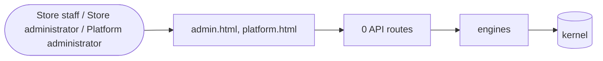

# Consoles

> Generated from `_registry/business-domains.json`, the code and `docs/source/consoles.md` — edit those, then run `node scripts/domain-docs.js`.

## Overview

The frames every domain's screens sit in: the store console and the platform console — signing in, navigation, layout, the shared table, form and chart parts — and nothing of any domain's own.

**Foundation domain:** Experience · **Used by:** Store staff, Store administrator, Platform administrator

## Architecture

## Data flow

## User interface

**Pages:** `admin.html`, `platform.html`

## User flows

_Not yet written — `docs/source/consoles.md`, section `## Flows`._

## Manuals

### Store staff

_Not yet written — `docs/source/consoles.md`, section `## Manual: store_staff`._

### Store administrator

_Not yet written — `docs/source/consoles.md`, section `## Manual: store_admin`._

### Platform administrator

_Not yet written — `docs/source/consoles.md`, section `## Manual: platform_admin`._

