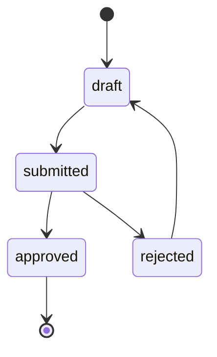
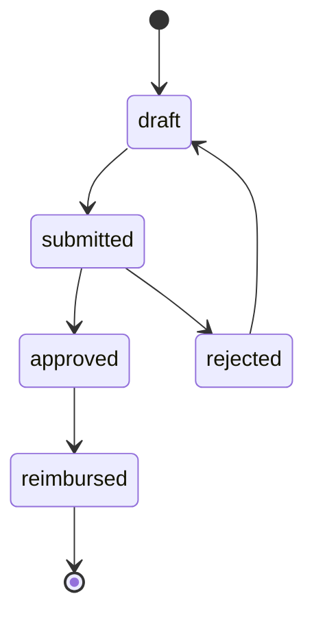
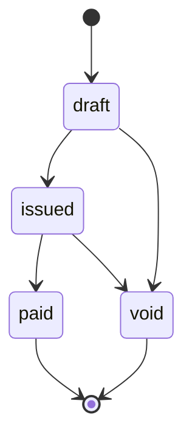
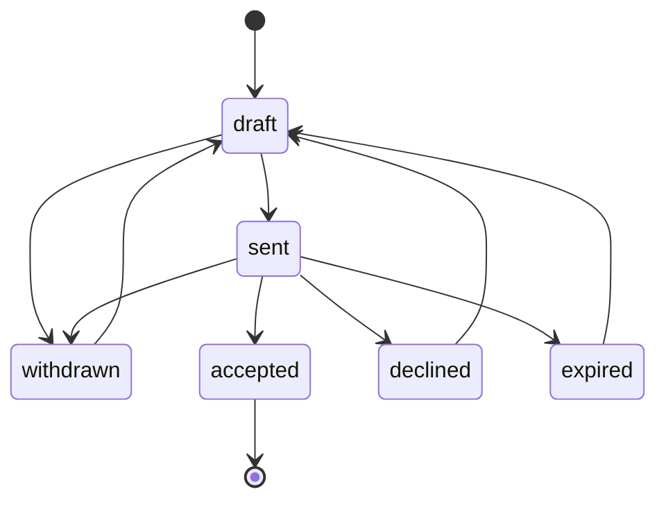
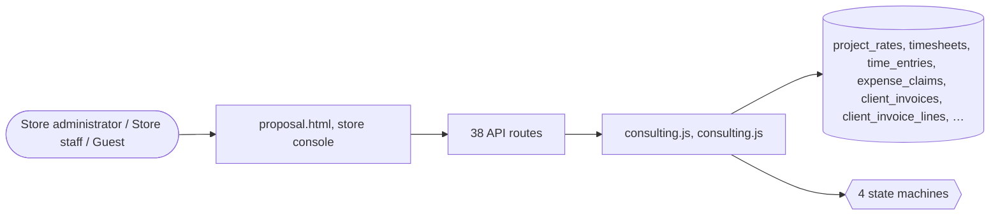

# Consultancy and professional services

> Generated from `_registry/business-domains.json`, the code and `docs/source/consulting.md` — edit those, then run `node scripts/domain-docs.js`.

## Overview

The work a store's people do for its clients and how it is billed: projects for a CRM company billed by time and materials, a fixed fee in instalments or not at all; a timesheet per person and week, approved by someone else and priced at each person's rate; expense claims owed and paid back and billed on; invoices to clients drafted from approved, unbilled time and expenses, each billed once, posted to the books; proposals from a deal answered from the client's private link, starting the project and winning the deal; the resource plan and utilisation.

**Foundation domain:** Operations · **Used by:** Store administrator, Store staff, Guest

## Architecture

| Module | What it is |
|---|---|
| `lib/consulting.js` | consultancy and professional services (owner Operations). |
| `lib/routes/consulting.js` | consulting domain routes (lib/consulting.js; _registry/business-domains.json). Projects billed to clients, timesheets, expense claims, invoices billed by time, proposals and the resource plan, under the store's consulting section (the Delivery and Finance roles hold it); and the two public routes a client's proposal link uses, which need no sign-in. |

## Data model

### `project_rates`

| Column | Type |
|---|---|
| `id` | INTEGER PRIMARY KEY AUTOINCREMENT |
| `tenant_id` | INTEGER NOT NULL |
| `project_id` | INTEGER NOT NULL |
| `employee_id` | INTEGER NOT NULL |
| `rate` | REAL NOT NULL |

### `timesheets`

| Column | Type |
|---|---|
| `id` | INTEGER PRIMARY KEY AUTOINCREMENT |
| `tenant_id` | INTEGER NOT NULL |
| `ref` | TEXT NOT NULL |
| `employee_id` | INTEGER NOT NULL |
| `week` | TEXT NOT NULL |
| `status` | TEXT NOT NULL |
| `hours` | REAL NOT NULL DEFAULT 0 |
| `billable_hours` | REAL NOT NULL DEFAULT 0 |
| `submitted_by` | TEXT DEFAULT '' |
| `submitted_at` | TEXT |
| `approved_by` | TEXT DEFAULT '' |
| `approved_at` | TEXT |
| `rejected_reason` | TEXT DEFAULT '' |
| `created_at` | TEXT NOT NULL DEFAULT (datetime('now')) |
| `uid` | TEXT |

### `time_entries`

| Column | Type |
|---|---|
| `id` | INTEGER PRIMARY KEY AUTOINCREMENT |
| `tenant_id` | INTEGER NOT NULL |
| `timesheet_id` | INTEGER NOT NULL |
| `employee_id` | INTEGER NOT NULL |
| `project_id` | INTEGER NOT NULL |
| `task_id` | INTEGER |
| `date` | TEXT NOT NULL |
| `hours` | REAL NOT NULL |
| `billable` | INTEGER NOT NULL DEFAULT 0 |
| `note` | TEXT DEFAULT '' |
| `rate` | REAL |
| `cost_rate` | REAL |
| `currency` | TEXT DEFAULT '' |
| `invoice_id` | INTEGER |

### `expense_claims`

| Column | Type |
|---|---|
| `id` | INTEGER PRIMARY KEY AUTOINCREMENT |
| `tenant_id` | INTEGER NOT NULL |
| `ref` | TEXT NOT NULL |
| `employee_id` | INTEGER NOT NULL |
| `project_id` | INTEGER |
| `date` | TEXT NOT NULL |
| `category` | TEXT NOT NULL |
| `description` | TEXT NOT NULL |
| `amount` | REAL NOT NULL |
| `currency` | TEXT NOT NULL |
| `billable` | INTEGER NOT NULL DEFAULT 0 |
| `receipt_ref` | TEXT DEFAULT '' |
| `status` | TEXT NOT NULL |
| `submitted_by` | TEXT DEFAULT '' |
| `submitted_at` | TEXT |
| `approved_by` | TEXT DEFAULT '' |
| `approved_at` | TEXT |
| `rejected_reason` | TEXT DEFAULT '' |
| `paid_at` | TEXT |
| `invoice_id` | INTEGER |
| `created_at` | TEXT NOT NULL DEFAULT (datetime('now')) |
| `uid` | TEXT |

### `client_invoices`

| Column | Type |
|---|---|
| `id` | INTEGER PRIMARY KEY AUTOINCREMENT |
| `tenant_id` | INTEGER NOT NULL |
| `ref` | TEXT NOT NULL |
| `project_id` | INTEGER NOT NULL |
| `company_id` | INTEGER |
| `currency` | TEXT NOT NULL |
| `period_to` | TEXT |
| `fees` | REAL NOT NULL DEFAULT 0 |
| `expenses` | REAL NOT NULL DEFAULT 0 |
| `tax_pct` | REAL NOT NULL DEFAULT 0 |
| `tax` | REAL NOT NULL DEFAULT 0 |
| `gross` | REAL NOT NULL DEFAULT 0 |
| `status` | TEXT NOT NULL |
| `issued_at` | TEXT |
| `due_at` | TEXT |
| `paid_at` | TEXT |
| `voided_at` | TEXT |
| `void_reason` | TEXT DEFAULT '' |
| `sent_to` | TEXT DEFAULT '' |
| `note` | TEXT DEFAULT '' |
| `created_by` | TEXT DEFAULT '' |
| `created_at` | TEXT NOT NULL DEFAULT (datetime('now')) |
| `uid` | TEXT |

### `client_invoice_lines`

| Column | Type |
|---|---|
| `id` | INTEGER PRIMARY KEY AUTOINCREMENT |
| `invoice_id` | INTEGER NOT NULL |
| `kind` | TEXT NOT NULL |
| `description` | TEXT NOT NULL |
| `qty` | REAL NOT NULL DEFAULT 1 |
| `rate` | REAL NOT NULL DEFAULT 0 |
| `amount` | REAL NOT NULL |

### `proposals`

| Column | Type |
|---|---|
| `id` | INTEGER PRIMARY KEY AUTOINCREMENT |
| `tenant_id` | INTEGER NOT NULL |
| `ref` | TEXT NOT NULL |
| `deal_id` | INTEGER |
| `company_id` | INTEGER |
| `contact_id` | INTEGER |
| `title` | TEXT NOT NULL |
| `intro` | TEXT DEFAULT '' |
| `currency` | TEXT NOT NULL |
| `billing` | TEXT NOT NULL |
| `lines` | TEXT NOT NULL DEFAULT '[]' |
| `net` | REAL NOT NULL DEFAULT 0 |
| `tax_pct` | REAL NOT NULL DEFAULT 0 |
| `tax` | REAL NOT NULL DEFAULT 0 |
| `total` | REAL NOT NULL DEFAULT 0 |
| `valid_until` | TEXT |
| `status` | TEXT NOT NULL |
| `token` | TEXT UNIQUE |
| `sent_at` | TEXT |
| `sent_to` | TEXT DEFAULT '' |
| `answered_at` | TEXT |
| `answered_by` | TEXT DEFAULT '' |
| `decline_reason` | TEXT DEFAULT '' |
| `project_id` | INTEGER |
| `created_by` | TEXT DEFAULT '' |
| `created_at` | TEXT NOT NULL DEFAULT (datetime('now')) |
| `uid` | TEXT |

### `resource_allocations`

| Column | Type |
|---|---|
| `id` | INTEGER PRIMARY KEY AUTOINCREMENT |
| `tenant_id` | INTEGER NOT NULL |
| `employee_id` | INTEGER NOT NULL |
| `project_id` | INTEGER NOT NULL |
| `week` | TEXT NOT NULL |
| `hours` | REAL NOT NULL |

## API reference

Every call is JSON over HTTPS; store calls carry the store (`?store=`) and the session; mutating calls accept an `Idempotency-Key` header where noted.

| Method and path | Handler | What it does |
|---|---|---|
| `GET /api/admin/consulting` | `apiConsulting` | The consulting overview: every project with how it is billed, what is ready to bill, invoiced and paid; what waits for approval; what clients owe; the people and their rates; and the billing models, expense categories and proposal line kinds. |
| `GET /api/admin/consulting/projects/:id` | `apiConsultingProject` | One project: its billing, rates, hours, cost, expenses, what is invoiced and paid, and what is ready to bill up to `through`. |
| `PUT /api/admin/consulting/projects/:id` | `apiConsultingProjectSet` | Sets how a project is billed: `billing` (time_materials, fixed, non_billable), `company_id`, `currency`, `bill_rate`, `tax_pct`, `budget` (the fixed fee), and `rates` `[{ employee_id, rate }]` for its people (a null rate removes one). |
| `PUT /api/admin/consulting/people/:id` | `apiConsultingPerson` | Sets a person's `bill_rate`, `cost_rate` and weekly `capacity_hours`. |
| `GET /api/admin/consulting/timesheets` | `apiTimesheets` | Timesheets, newest week first; `status`, `employee_id` and `week` narrow them. |
| `POST /api/admin/consulting/timesheets` | `apiTimesheetOpen` | Opens a person's timesheet for a week (`employee_id`, `week` — any day of it), or returns the one they have. |
| `GET /api/admin/consulting/timesheets/:id` | `apiTimesheet` | One timesheet: its days, its entries and what may be done next. |
| `PUT /api/admin/consulting/timesheets/:id` | `apiTimesheetSave` | Replaces a draft week's `entries` `[{ project_id, task_id?, date, hours, billable?, note? }]`. |
| `POST /api/admin/consulting/timesheets/:id/submit` | `apiTimesheetSubmit` | Submits a draft week for approval. |
| `POST /api/admin/consulting/timesheets/:id/approve` | `apiTimesheetApprove` | Approves a submitted week — not by whoever submitted it: its hours are priced at each person's rate and cost, and add to their tasks and projects. |
| `POST /api/admin/consulting/timesheets/:id/reject` | `apiTimesheetReject` | Sends a submitted week back with a `reason`. |
| `POST /api/admin/consulting/timesheets/:id/reopen` | `apiTimesheetReopen` | Reopens a week that was sent back, as a draft. |
| `GET /api/admin/consulting/expenses` | `apiExpenses` | Expense claims, newest first; `status`, `employee_id` and `project_id` narrow them. |
| `POST /api/admin/consulting/expenses` | `apiExpenseSave` | Drafts a claim, or changes a draft (`id`): `employee_id`, `project_id`, `date`, `category`, `description`, `amount`, `currency`, `billable` (billed on to the client), `receipt_ref`. |
| `POST /api/admin/consulting/expenses/:id/submit` | `apiExpenseSubmit` | Submits a draft claim for approval. |
| `POST /api/admin/consulting/expenses/:id/approve` | `apiExpenseApprove` | Approves a submitted claim — not by whoever submitted it: the books owe it to the person. |
| `POST /api/admin/consulting/expenses/:id/reject` | `apiExpenseReject` | Sends a submitted claim back with a `reason`. |
| `POST /api/admin/consulting/expenses/:id/reopen` | `apiExpenseReopen` | Reopens a claim that was sent back, as a draft. |
| `POST /api/admin/consulting/expenses/:id/reimburse` | `apiExpenseReimburse` | Records an approved claim as paid back to the person: the books clear it from the bank. |
| `GET /api/admin/consulting/invoices` | `apiClientInvoices` | Invoices to clients, newest first; `status` and `project_id` narrow them. |
| `POST /api/admin/consulting/invoices` | `apiClientInvoiceDraft` | Drafts an invoice for a project (`project_id`) from its approved, unbilled time and expenses up to `through`, or a fixed-fee instalment (`fixed_amount`, `fixed_description`); `time: false` or `expenses: false` leaves those out, `tax_pct` overrides the project's. Each entry is billed once. |
| `GET /api/admin/consulting/invoices/:id` | `apiClientInvoice` | One invoice with its lines, its project and its client. |
| `POST /api/admin/consulting/invoices/:id/issue` | `apiClientInvoiceIssue` | Issues a draft: the client owes it, due in the store's terms; with `send_to` it is emailed there. |
| `POST /api/admin/consulting/invoices/:id/pay` | `apiClientInvoicePay` | Records an issued invoice as paid: the books move it from what the client owes to the bank. |
| `POST /api/admin/consulting/invoices/:id/void` | `apiClientInvoiceVoid` | Voids an invoice (an issued one with a `reason`): its entry is undone in the books and its time and expenses can be billed again. |
| `GET /api/admin/consulting/receivables` | `apiReceivables` | What each client owes, by how overdue it is. |
| `GET /api/admin/consulting/proposals` | `apiProposals` | Proposals, newest first; `status` and `deal_id` narrow them. |
| `POST /api/admin/consulting/proposals` | `apiProposalSave` | Drafts a proposal, or changes a draft (`id`): `deal_id` (its company, contact, title and currency come with it), `company_id`, `contact_id`, `title`, `intro`, `currency`, `billing`, `lines` `[{ kind: time \| fixed \| expense, description, qty, rate }]`, `tax_pct`, `valid_until`. |
| `GET /api/admin/consulting/proposals/:id` | `apiProposal` | One proposal with its lines, its company, contact and deal. |
| `POST /api/admin/consulting/proposals/:id/send` | `apiProposalSend` | Sends a draft: it gets a private link for the client, is emailed to `to` or the contact, and its deal moves to the proposal stage. Returns the link. |
| `POST /api/admin/consulting/proposals/:id/answer` | `apiProposalAnswer` | Records the client's answer given another way: `accept` true or false, and a `reason` for a decline. Accepted, the project starts and the deal is won. |
| `POST /api/admin/consulting/proposals/:id/withdraw` | `apiProposalWithdraw` | Withdraws a draft or sent proposal; its link stops accepting answers. |
| `POST /api/admin/consulting/proposals/:id/redraft` | `apiProposalRedraft` | Makes a declined, expired or withdrawn proposal a draft again; its old link stops working. |
| `GET /api/admin/consulting/plan` | `apiPlan` | The resource plan: who is booked on which project, week by week from `from` for `weeks`, against their capacity. |
| `PUT /api/admin/consulting/plan` | `apiPlanSet` | Books a person onto a project for a week: `employee_id`, `project_id`, `week` (its Monday), `hours` (0 takes the booking off). Says whether they are now booked past their capacity. |
| `GET /api/admin/consulting/utilisation` | `apiUtilisation` | Utilisation from `from` to `to`: each person's capacity against what was planned, logged and billable. |
| `GET /api/proposals/view` | `apiProposalPublic` | The proposal a client's link (`t`) shows: what is offered, for how much, until when, and whether it can still be answered. Needs no sign-in. |
| `POST /api/proposals/answer` | `apiProposalPublicAnswer` | The client's answer from their link: `t`, `accept` true or false, `name` (needed to accept), `reason`. Accepted, the store's project starts and its deal is won. Needs no sign-in. |

## Process flows

Each record's life is a declared state machine (`lib/seed/states.json`): the moves it may make, and the actions that make them.

### Timesheet (`timesheet`)

Actions: 

### Expense claim (`expense_claim`)

Actions: 

### Client invoice (`client_invoice`)

Actions: 

### Proposal (`proposal`)

Actions: 

## Data flow

## User interface

**Pages:** `proposal.html`

**Store console:** ⏱️ Consulting

## User flows

**A project and how it is billed.** A project is done for a company in the CRM and is billed one of
three ways: by **time and materials** (each approved hour at a rate, plus expenses), at a **fixed
fee** billed in instalments that never add up to more than the fee, or **not at all** (internal work).
An hour is billed at the person's own rate on that project if one is set, otherwise at the project's
rate, otherwise at the person's rate.

**A timesheet a week.** Each person has one timesheet per week, which starts on Monday. They log time
against projects and, if they like, their tasks; a day holds at most 24 hours, and time on a project
that is not billed cannot be marked billable. A draft is changed freely, then submitted. Someone
other than whoever submitted it approves it or sends it back with a reason. A week sent back is
reopened, corrected and submitted again. On approval each billable hour is priced at the person's
rate, every hour at their cost, the tasks' logged hours and the project's spend go up, and the week
no longer changes.

**Expense claims.** A person claims what they spent: the date, category, description, amount and
receipt number, optionally against a project and to be billed on to the client. A claim is
submitted, approved by someone else (the books then owe it to the person) and recorded as paid back
(the books clear it from the bank). A claim sent back is reopened and corrected.

**Invoices to clients.** An invoice is drafted from a project: its approved, billable time not yet
invoiced, up to a day you choose, one line per person and rate; its billable expenses in the
project's currency; or a fixed-fee instalment. Each entry belongs to one invoice only, so two people
drafting at once cannot bill the same time twice. Issuing it makes it owed by the client, due after
the store's payment terms, and can email it. When the client pays it is recorded as paid. Voiding an
issued invoice needs a reason, undoes its entry in the books, and makes its time and expenses ready
to bill again.

**Proposals.** A proposal is drafted, usually from a deal: its company, contact, title and currency
come with it. It has lines of time, fixed fees or expenses, and a tax rate. Sending it gives it a
private link for the client, valid for the store's number of days unless a date is set; it is
emailed to the deal's contact and the deal moves to the proposal stage. The client opens the link,
reads the proposal and accepts it by typing their name, or declines it. Staff can also record an
answer given on a call. Once accepted, the project starts for that company, billed the proposal's
way with its value as the budget, and the deal is won at that value. A proposal past its date
expires and can no longer be accepted. A declined, expired or withdrawn proposal can be made a draft
again, and its old link stops working.

**The resource plan.** People are booked onto projects by the hour, week by week, against their
weekly capacity (40 hours unless set). Anyone booked past capacity is shown as over. Utilisation
shows, for a span of weeks, each person's capacity against what was planned, what was logged and how
much of it was billable.

**The books.** Invoices to clients post to *Owed by clients*, *Fees for services*, *Expenses billed
to clients* and *Tax collected*; payments move what is owed to the bank. Expense claims post to
*Staff expenses* and *Expenses owed to staff*, cleared from the bank when paid back.

## Manuals

### Store administrator

Open **Business Operations → ⏱️ Consulting**. Your role needs the consulting section; the Delivery
and Finance roles have it.

- **Projects**: each project with how it is billed, what is ready to bill, invoiced and paid. Open
  one to set its billing, client, currency, rate an hour, tax and fixed fee, and a person's own rate
  on it. **Draft an invoice** from what is ready, or bill a fixed-fee instalment. Projects
  themselves are added under **Business Operations → Projects**, or start when a proposal is
  accepted.
- **People and rates**: what each person is billed at, what they cost and their hours a week.
- **Timesheets**: choose a person and any day of the week, then **Open**. Add time, **Save the
  week**, and **submit** it.
- **Approvals**: weeks and expense claims waiting for you. **approve** or **reject** each one, giving
  a reason. You cannot approve your own.
- **Expenses**: claim an expense, then **submit** it; once approved, **reimburse** it when it is paid
  back.
- **Invoices**: open one to **issue** it (with an email address to send it to), record it **paid**,
  **void** it, or print it.
- **Proposals**: draft one from a deal, one line each as `kind | what | quantity | rate`, then
  **send** it. You get the client's link to copy. Record an answer given another way with **accept**
  or **decline**.
- **Plan** and **Utilisation**: book people onto projects week by week, and see how they are used.

### Store staff

Your timesheet and expense claims are under **Business Operations → ⏱️ Consulting**, if your role
has the consulting section. Open your week, log your time, save it and submit it by the end of the
week. Someone else approves it. If it is sent back, the reason is shown: reopen it, correct it and
submit it again.

### Guest

A store may send you a proposal with a private link. Open it to read what is offered, for how much
and until when. To accept, type your full name and press **Accept this proposal**. To decline,
press **Decline**, giving a reason if you like. You can answer once, before the date shown.

