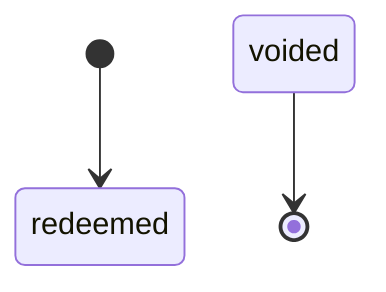
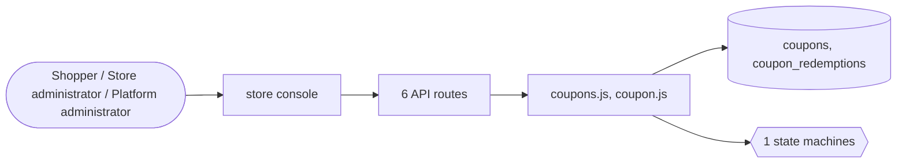

# Coupons

> Generated from `_registry/business-domains.json`, the code and `docs/source/coupon.md` — edit those, then run `node scripts/domain-docs.js`.

## Overview

The codes a shopper types at the cart: a code that carries a value, issued by staff or in bulk, validated against its kind and its limits, redeemed into the redemption ledger, and voided when the order is refunded. The kinds — a single-use code, a bulk lot, a referral code — are rows.

**Foundation domain:** Commerce · **Used by:** Shopper, Store administrator, Platform administrator

## Switches and settings

Each is switched on per store under ⚙️ Capabilities; its parameters are that store's settings.

### Promo codes (`coupons`)

Shopper-redeemable coupon codes at cart and checkout. Platform policy may refuse this independently.

## Architecture

| Module | What it is |
|---|---|
| `lib/coupons.js` | coupons (the Coupon domain): a code that carries a value. |
| `lib/routes/coupon.js` | coupon domain routes (moved from lib/routes/offer.js; _registry/business-domains.json). Each handler answers one route of the coupon domain: the code a shopper applies at the cart, and the staff surface that issues, generates and voids them. What it needs from the shared HTTP kit (lib/api.js) is passed in as `kit`. |

**Registry lists** (editable in Data Studio): `couponKinds`, `couponStatuses`, `redemptionStatuses`

## Data model

### `coupons`

| Column | Type |
|---|---|
| `id` | INTEGER PRIMARY KEY AUTOINCREMENT |
| `tenant_id` | INTEGER NOT NULL DEFAULT 0 |
| `code` | TEXT NOT NULL |
| `offer_id` | INTEGER |
| `funder` | TEXT DEFAULT 'self' |
| `funder_ref` | TEXT DEFAULT '' |
| `brand_ref` | TEXT DEFAULT '' |
| `kind` | TEXT NOT NULL DEFAULT 'single_use' |
| `value` | REAL DEFAULT 0 |
| `currency` | TEXT DEFAULT 'USD' |
| `max_uses` | INTEGER DEFAULT 1 |
| `per_owner_limit` | INTEGER DEFAULT 1 |
| `used` | INTEGER DEFAULT 0 |
| `issued_to` | TEXT DEFAULT '' |
| `batch` | TEXT DEFAULT '' |
| `starts` | TEXT |
| `ends` | TEXT |
| `status` | TEXT DEFAULT 'active' |
| `note` | TEXT DEFAULT '' |
| `created_at` | TEXT NOT NULL DEFAULT (datetime('now')) |
| `deleted_at` | TEXT |
| `uid` | TEXT |

### `coupon_redemptions`

| Column | Type |
|---|---|
| `id` | INTEGER PRIMARY KEY AUTOINCREMENT |
| `tenant_id` | INTEGER NOT NULL |
| `coupon_id` | INTEGER |
| `offer_id` | INTEGER |
| `code` | TEXT |
| `order_id` | INTEGER |
| `invoice_id` | INTEGER |
| `owner` | TEXT |
| `channel` | TEXT DEFAULT 'commerce' |
| `amount` | REAL DEFAULT 0 |
| `qty` | INTEGER DEFAULT 1 |
| `funder` | TEXT DEFAULT 'self' |
| `funder_ref` | TEXT DEFAULT '' |
| `brand_ref` | TEXT DEFAULT '' |
| `meta` | TEXT DEFAULT '{}' |
| `created_at` | TEXT NOT NULL DEFAULT (datetime('now')) |
| `credits` | REAL DEFAULT 0 |
| `offer_type` | TEXT DEFAULT '' |
| `status` | TEXT DEFAULT 'redeemed' |
| `settlement_id` | INTEGER |
| `unit` | TEXT DEFAULT '' |
| `uid` | TEXT |

## API reference

Every call is JSON over HTTPS; store calls carry the store (`?store=`) and the session; mutating calls accept an `Idempotency-Key` header where noted.

| Method and path | Handler | What it does |
|---|---|---|
| `POST /api/coupon` | `apiCoupon` | a shopper applies a code at the cart — or removes the one they had |
| `GET /api/offers/coupons` | `apiCouponsList` | staff: the store's codes and what they were worth |
| `POST /api/offers/coupons` | `apiCouponCreate` | staff issue one code |
| `POST /api/offers/coupons/generate` | `apiCouponGenerate` | staff generate a batch of codes |
| `DELETE /api/offers/coupons/:id` | `apiCouponVoid` | staff void one code |
| `GET /api/offers/analytics` | `apiCouponsAnalytics` | the redemption ledger's performance |

## Process flows

Each record's life is a declared state machine (`lib/seed/states.json`): the moves it may make, and the actions that make them.

### Coupon redemption (`redemption`)

Actions: 

## Data flow

## User interface

**Store console:** 🎟️ Coupons

## User flows

**Issuing.** Staff issue one code, or generate a batch of up to 1,000 codes in one go. Each code has
a kind (a row of the coupon kinds — a single-use code, a bulk lot, a referral code), a value, a
funder (who bears the discount, and that funder's reference), how many times it may be used in all
and how many times by one shopper, and optional start and end dates. A code left blank is made up
from the store's code prefix. An offer that grants a code, and the Voucher domain, issue through the
same writer; nothing else writes a code. When no coupon kind is declared at all, nothing is issued.

**Applying at the cart.** A shopper types a code. It is accepted only if it is active, inside its
dates, not used up, not already used by this shopper as often as it allows, allowed by the
applicability rules for codes (and for the offer behind it), and — for a kind marked new customers
only — the shopper has no earlier order. Otherwise the shopper is told why. Applying a new code
replaces the old one; clearing it removes it. Platform policy can switch codes off for every store,
and each store can switch them off for itself.

**Redeeming.** When the order is placed, what the code was worth on that order is written to the
redemption ledger: its amount, any credits, the offer it came from, the funder, the channel and the
unit. The code's use count goes up; a code that reaches its limit is exhausted.

**Voiding and expiry.** Refunding an order voids every redemption on it: the code's use and the
offer's use are given back and the ledger row is marked void with the reason. Staff can revoke a
code so it can no longer be applied. A code past its end date expires; the codes are swept whenever
they are listed.

**Performance.** The redemption ledger is the record of what every code was worth: totals, the top
codes, and what each funder bore.

## Manuals

### Shopper

1. In your bag, type the code into the code box under your items and apply it. If it cannot be used, you are told
   why (for example "Coupon already used on this account" or "New customers only").
2. The discount shows in your bag and at checkout. Only one code is applied at a time; applying
   another replaces it.
3. Clear the code to remove it.
4. If your order is refunded, the code's use is given back where the code allows more than one use.

### Store administrator

1. Codes need the **Promo codes** capability (⚙️ Capabilities). Platform policy may refuse codes for
   every store; the store then says so instead of accepting them.
2. Open **Offers → 🎟️ Coupons**.
3. **Issue a coupon**: choose the kind, leave the code blank for one to be made up (or type your own),
   give the value, the funder and its reference, the most uses in all and the most per shopper, then
   **+ Coupon**. **Generate 10 codes** makes a batch with the same settings.
4. The list shows every code with its kind, funder, value, uses and state. Codes marked **GLOBAL**
   belong to the platform and apply in every store. **Void** revokes one of your own codes at once.
5. **Redemption performance** shows how many redemptions there were, the discount given and the
   credits rewarded, the top codes and the split by funder. **Recent redemptions** lists the latest,
   each with its amount, funder, channel and shopper.
6. The kinds are rows you can edit in **Data Studio** (`couponKinds`).

### Platform administrator

1. **Platform → Provisioning → coupons allowed** switches codes on or off for every store. When it is
   off, shoppers are told codes are disabled and the cart refuses them.
2. The coupon kinds, coupon statuses and redemption statuses are platform registries (`couponKinds`,
   `couponStatuses`, `redemptionStatuses`); a store reads them as they are declared.
3. A code that belongs to no store (the platform's own) appears in every store's list marked
   **GLOBAL** and applies in every store.
4. An offer of type `coupon_issue` grants a code worth the offer's value once the cart reaches the
   offer's minimum; the code is written by the Coupon domain like any other.

