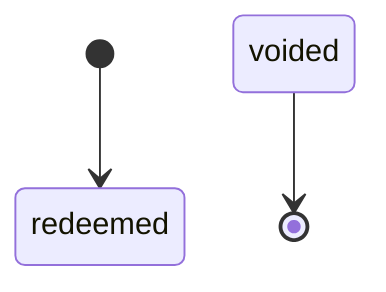

# Coupons

> Generated from `_registry/business-domains.json`, the code and `docs/source/coupon.md` — edit those, then run `node scripts/domain-docs.js`.

## Overview

The codes a shopper types at the cart: a code that carries a value, issued by staff or in bulk, validated against its kind and its limits, redeemed into the redemption ledger, and voided when the order is refunded. The kinds — a single-use code, a bulk lot, a referral code — are rows.

**Foundation domain:** Commerce · **Used by:** Shopper, Store administrator, Platform administrator

## Switches and settings

Each is switched on per store under ⚙️ Capabilities; its parameters are that store's settings.

### Promo codes (`coupons`)

Shopper-redeemable coupon codes at cart and checkout. Platform policy may refuse this independently.

## Architecture

| Module | What it is |
|---|---|
| `lib/coupons.js` | coupons (the Coupon domain): a code that carries a value. |
| `lib/routes/coupon.js` | coupon domain routes (moved from lib/routes/offer.js; _registry/business-domains.json). Each handler answers one route of the coupon domain: the code a shopper applies at the cart, and the staff surface that issues, generates and voids them. What it needs from the shared HTTP kit (lib/api.js) is passed in as `kit`. |

**Registry lists** (editable in Data Studio): `couponKinds`, `couponStatuses`, `redemptionStatuses`

## Data model

### `coupons`

| Column | Type |
|---|---|
| `id` | INTEGER PRIMARY KEY AUTOINCREMENT |
| `tenant_id` | INTEGER NOT NULL DEFAULT 0 |
| `code` | TEXT NOT NULL |
| `offer_id` | INTEGER |
| `funder` | TEXT DEFAULT 'self' |
| `funder_ref` | TEXT DEFAULT '' |
| `brand_ref` | TEXT DEFAULT '' |
| `kind` | TEXT NOT NULL DEFAULT 'single_use' |
| `value` | REAL DEFAULT 0 |
| `currency` | TEXT DEFAULT 'USD' |
| `max_uses` | INTEGER DEFAULT 1 |
| `per_owner_limit` | INTEGER DEFAULT 1 |
| `used` | INTEGER DEFAULT 0 |
| `issued_to` | TEXT DEFAULT '' |
| `batch` | TEXT DEFAULT '' |
| `starts` | TEXT |
| `ends` | TEXT |
| `status` | TEXT DEFAULT 'active' |
| `note` | TEXT DEFAULT '' |
| `created_at` | TEXT NOT NULL DEFAULT (datetime('now')) |
| `deleted_at` | TEXT |
| `uid` | TEXT |

### `coupon_redemptions`

| Column | Type |
|---|---|
| `id` | INTEGER PRIMARY KEY AUTOINCREMENT |
| `tenant_id` | INTEGER NOT NULL |
| `coupon_id` | INTEGER |
| `offer_id` | INTEGER |
| `code` | TEXT |
| `order_id` | INTEGER |
| `invoice_id` | INTEGER |
| `owner` | TEXT |
| `channel` | TEXT DEFAULT 'commerce' |
| `amount` | REAL DEFAULT 0 |
| `qty` | INTEGER DEFAULT 1 |
| `funder` | TEXT DEFAULT 'self' |
| `funder_ref` | TEXT DEFAULT '' |
| `brand_ref` | TEXT DEFAULT '' |
| `meta` | TEXT DEFAULT '{}' |
| `created_at` | TEXT NOT NULL DEFAULT (datetime('now')) |
| `credits` | REAL DEFAULT 0 |
| `offer_type` | TEXT DEFAULT '' |
| `status` | TEXT DEFAULT 'redeemed' |
| `settlement_id` | INTEGER |
| `unit` | TEXT DEFAULT '' |
| `uid` | TEXT |

## API reference

Every call is JSON over HTTPS; store calls carry the store (`?store=`) and the session; mutating calls accept an `Idempotency-Key` header where noted.

| Method and path | Handler | What it does |
|---|---|---|
| `POST /api/coupon` | `apiCoupon` | a shopper applies a code at the cart — or removes the one they had |
| `GET /api/offers/coupons` | `apiCouponsList` | staff: the store's codes and what they were worth |
| `POST /api/offers/coupons` | `apiCouponCreate` | staff issue one code |
| `POST /api/offers/coupons/generate` | `apiCouponGenerate` | staff generate a batch of codes |
| `DELETE /api/offers/coupons/:id` | `apiCouponVoid` | staff void one code |
| `GET /api/offers/analytics` | `apiCouponsAnalytics` | the redemption ledger's performance |

## Process flows

Each record's life is a declared state machine (`lib/seed/states.json`): the moves it may make, and the actions that make them.

### Coupon redemption (`redemption`)

Actions: 

## Data flow

## User interface

**Store console:** 🎟️ Coupons

## User flows

**Issue.** A store administrator chooses a registered coupon kind, value, funder, limits and validity, then issues one code or a batch. The code is shown to staff only at issue time and is stored as a protected lookup value.

**Apply and redeem.** A shopper enters a code in the cart. The platform checks tenant scope, dates, state, usage limits, owner limits and policy rules before showing the resulting cart. Checkout records one redemption against the order. A failed payment or refund voids that redemption and restores the available use.

**Failure states.** An unknown, expired, exhausted, revoked or over-limit code is rejected with a reason and does not alter the cart or ledger.

## Manuals

### Shopper

Enter a code in the cart and choose **Apply**. The cart shows the discount or credit before checkout. An invalid code leaves the cart unchanged and explains the reason. A code is counted only when the order is successfully recorded.

### Store administrator

Open **Offers → Coupons**. Issue a single code or batch, set its kind, value, funder and limits, and give the code to its intended audience. Use the redemption table and analytics to reconcile usage. Void an unused or compromised code; refunds automatically claw back redemptions.

### Platform administrator

Manage coupon kinds, statuses and redemption states in Data Studio. Platform policy can disable promo codes globally. Review cross-store redemption totals and funder attribution from the platform offer surfaces.

