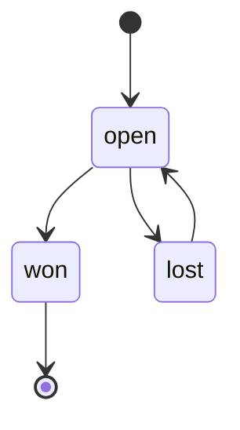
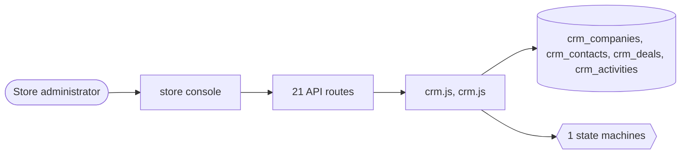

# Customer relationships

> Generated from `_registry/business-domains.json`, the code and `docs/source/crm.md` — edit those, then run `node scripts/domain-docs.js`.

## Overview

The companies a store sells to and the people there, deals through the store's own pipeline to won or lost with a weighted forecast, the calls, meetings, emails, tasks and notes on a timeline, and one view of each customer — orders, spend, returns, support cases, wallet, segments, deals and activities.

**Foundation domain:** Party · **Used by:** Store administrator

## Architecture

| Module | What it is |
|---|---|
| `lib/crm.js` | customer relationships (owner Party). |
| `lib/routes/crm.js` | CRM domain routes (lib/crm.js; _registry/business-domains.json). Companies, contacts, the pipeline and its deals, activities and one view of a customer. Every route belongs to the store's crm section (the Growth role may change it; Support may read it). |

## Data model

### `crm_companies`

| Column | Type |
|---|---|
| `id` | INTEGER PRIMARY KEY AUTOINCREMENT |
| `tenant_id` | INTEGER NOT NULL |
| `name` | TEXT NOT NULL |
| `domain` | TEXT DEFAULT '' |
| `industry` | TEXT DEFAULT '' |
| `size` | TEXT DEFAULT '' |
| `country` | TEXT DEFAULT '' |
| `tax_id` | TEXT DEFAULT '' |
| `owner_staff` | TEXT DEFAULT '' |
| `note` | TEXT DEFAULT '' |
| `created_at` | TEXT NOT NULL DEFAULT (datetime('now')) |
| `deleted_at` | TEXT |
| `uid` | TEXT |

### `crm_contacts`

| Column | Type |
|---|---|
| `id` | INTEGER PRIMARY KEY AUTOINCREMENT |
| `tenant_id` | INTEGER NOT NULL |
| `company_id` | INTEGER |
| `user_id` | INTEGER |
| `name` | TEXT NOT NULL |
| `email` | TEXT DEFAULT '' |
| `phone` | TEXT DEFAULT '' |
| `title` | TEXT DEFAULT '' |
| `created_at` | TEXT NOT NULL DEFAULT (datetime('now')) |
| `deleted_at` | TEXT |
| `uid` | TEXT |

### `crm_deals`

| Column | Type |
|---|---|
| `id` | INTEGER PRIMARY KEY AUTOINCREMENT |
| `tenant_id` | INTEGER NOT NULL |
| `ref` | TEXT NOT NULL |
| `title` | TEXT NOT NULL |
| `company_id` | INTEGER |
| `contact_id` | INTEGER |
| `case_id` | INTEGER |
| `amount` | REAL NOT NULL DEFAULT 0 |
| `currency` | TEXT NOT NULL |
| `stage` | TEXT NOT NULL |
| `probability` | INTEGER NOT NULL DEFAULT 0 |
| `status` | TEXT NOT NULL |
| `expected_close` | TEXT |
| `owner_staff` | TEXT DEFAULT '' |
| `lost_reason` | TEXT DEFAULT '' |
| `created_at` | TEXT NOT NULL DEFAULT (datetime('now')) |
| `closed_at` | TEXT |
| `uid` | TEXT |

### `crm_activities`

| Column | Type |
|---|---|
| `id` | INTEGER PRIMARY KEY AUTOINCREMENT |
| `tenant_id` | INTEGER NOT NULL |
| `kind` | TEXT NOT NULL |
| `subject` | TEXT NOT NULL |
| `body` | TEXT DEFAULT '' |
| `company_id` | INTEGER |
| `contact_id` | INTEGER |
| `deal_id` | INTEGER |
| `due_at` | TEXT |
| `done_at` | TEXT |
| `outcome` | TEXT DEFAULT '' |
| `owner_staff` | TEXT DEFAULT '' |
| `created_at` | TEXT NOT NULL DEFAULT (datetime('now')) |
| `uid` | TEXT |

## API reference

Every call is JSON over HTTPS; store calls carry the store (`?store=`) and the session; mutating calls accept an `Idempotency-Key` header where noted.

| Method and path | Handler | What it does |
|---|---|---|
| `GET /api/admin/crm/companies` | `apiCrmCompanies` | The store's companies, by name, with how many contacts and deals each has; `q` searches name and domain. |
| `POST /api/admin/crm/companies` | `apiCrmCompanyAdd` | Adds a company: `name`, `domain`, `industry`, `size`, `country`, `tax_id`, `owner_staff`, `note`. |
| `GET /api/admin/crm/companies/:id` | `apiCrmCompany` | One company with its contacts, its deals and everything done about it. |
| `PUT /api/admin/crm/companies/:id` | `apiCrmCompanySave` | Changes a company's details. |
| `GET /api/admin/crm/contacts` | `apiCrmContacts` | The store's contacts, by name, with their company; `q` searches name and email, `company_id` narrows. |
| `POST /api/admin/crm/contacts` | `apiCrmContactAdd` | Adds a contact: `name`, `email` (once per store; linked to their shopper account when they have one), `phone`, `title`, `company_id`. |
| `PUT /api/admin/crm/contacts/:id` | `apiCrmContactSave` | Changes a contact's details. |
| `GET /api/admin/crm/pipeline` | `apiCrmPipeline` | The pipeline board: each stage with its open deals, then the deals won and lost. |
| `GET /api/admin/crm/forecast` | `apiCrmForecast` | The forecast per currency and month: the open pipeline, the same weighted by each stage's chance, and what was won. |
| `GET /api/admin/crm/stages` | `apiCrmStages` | The store's pipeline stages, each with its chance of winning. |
| `PUT /api/admin/crm/stages` | `apiCrmStagesSave` | Sets the store's own pipeline: `stages` of `{ key, label, probability }`. A stage that still has open deals cannot be removed. |
| `POST /api/admin/crm/deals` | `apiCrmDealOpen` | Opens a deal: `title`, `company_id` or `contact_id`, or `case_id` to turn a shopper's enquiry into one; `amount`, `currency`, `stage`, `expected_close`, `owner_staff`. |
| `GET /api/admin/crm/deals/:id` | `apiCrmDeal` | One deal with its company, contact, stage and timeline. |
| `PUT /api/admin/crm/deals/:id` | `apiCrmDealSave` | Moves an open deal: its `stage` (and so its chance), `amount`, `expected_close`, `title` or `owner_staff`. |
| `POST /api/admin/crm/deals/:id/won` | `apiCrmDealWon` | Marks a deal won. |
| `POST /api/admin/crm/deals/:id/lost` | `apiCrmDealLost` | Marks a deal lost, with the `reason`. |
| `POST /api/admin/crm/deals/:id/reopen` | `apiCrmDealReopen` | Reopens a lost deal in the stage it was in. |
| `POST /api/admin/crm/activities` | `apiCrmActivityLog` | Records an activity: `kind` (call, meeting, email, task, note), `subject`, `body`, about a `deal_id`, `contact_id` or `company_id`; `due_at` for what is still to do, `done` for what happened. |
| `POST /api/admin/crm/activities/:id/done` | `apiCrmActivityDone` | Marks an activity done, with its `outcome`. |
| `GET /api/admin/crm/agenda` | `apiCrmAgenda` | What is still to do, by due date; `staff` narrows it to one person's. |
| `GET /api/admin/crm/people/:id` | `apiCrmPerson` | One view of a shopper: their orders, what they spent, returns, support cases, wallet, segments, and their contacts, deals and activities. |

## Process flows

Each record's life is a declared state machine (`lib/seed/states.json`): the moves it may make, and the actions that make them.

### Deal (`crm_deal`)

Actions: 

## Data flow

## User interface

**Store console:** 🤝 CRM

## User flows

**Companies and people.** A store adds the companies it sells to and the people there. A contact
whose email is also a shopper's account is linked to it, so their orders and their deals meet in one
place. Who a contact is — name, email, phone — stays in the store's records, where erasure removes it;
the master knows the contact existed, their job title and their company.

**A deal.** A deal is opened for a company or a contact — or from a shopper's enquiry, whose opener
becomes the contact. It starts in the first stage of the store's pipeline and moves through the stages;
each stage carries the chance a deal there is won. Won and lost are its state: a lost deal says why and
may be reopened; a won one stays won. Every stage a deal went through is kept.

**The pipeline.** Every store starts from a standard pipeline and may set its own stages and chances.
A stage that still has open deals cannot be removed.

**The forecast.** The open deals of each month and currency, their total, the same weighted by each
stage's chance, and what was won — what a sales team plans against.

**Activities.** Calls, meetings, emails, tasks and notes are recorded against a deal, a contact or a
company. What is still to do has a due date and appears first, on the timeline and in the agenda,
until it is marked done with its outcome.

**One view of a customer.** For any shopper: their orders, what they spent, their returns, support
cases, wallet balances, segments, and their contacts, deals and activities.

**Erasure.** Erasing a person removes their account, addresses, reviews, questions, support cases,
contact record and the activities about them, as `lib/seed/erasure.json` lists; orders, payments,
deals and the other records the law obliges the store to keep stay, no longer linked to the erased
person on the master. Anything erasure could not clear is reported.

## Manuals

### Store administrator

Open **Customer Care → 🤝 CRM**. Your role needs the crm section: the Growth role can change it,
Support can read it.

- **Pipeline**: open a deal, move it between stages with the stage list on its card, and mark it
  **Won** or **Lost** (with the reason). **Open** shows its timeline.
- **Companies** and **Contacts**: add them; open a company to see its people, deals and timeline,
  and record an activity. A contact with a shopper account has **Customer view**.
- **Agenda**: what is still to do, by due date. **Forecast**: the pipeline by month.
- To set your own stages, use `PUT /api/admin/crm/stages`; your CRM or sales tools can use every
  `/api/admin/crm/…` route with a store API key — see `docs/api/README.md`.

