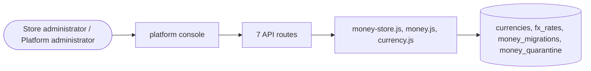

# Currencies and exchange

> Generated from `_registry/business-domains.json`, the code and `docs/source/currency.md` — edit those, then run `node scripts/domain-docs.js`.

## Overview

Every unit of value and how they convert: currencies, points and credits, and exchange rates.

**Foundation domain:** Value · **Used by:** Store administrator, Platform administrator

## Architecture

| Module | What it is |
|---|---|
| `lib/money-store.js` | money at rest (PR-016). |
| `lib/money.js` | money, exactly (PR-016). One representation: an amount is a whole number of MINOR units of one currency, and a currency's minor unit is data (its `decimals` in Value's master, lib/registry.js). Nothing here does binary floating-point arithmetic on money: a JS number coming in is read through its decimal spelling (see `parse`), held as a BigInt scaled by a power of ten, and rounded once, by a NAMED rule. |
| `lib/routes/currency.js` | currency domain routes (_registry/business-domains.json `currency`). Money at rest (lib/money-store.js): the platform's reconciliation of every payment-spine amount, and the amounts the money migration could not convert — each resolved by an operator with a recorded decision, never guessed. What it needs from the shared HTTP kit (lib/api.js) is passed in as `kit`. |

## Data model

### `currencies`

| Column | Type |
|---|---|
| `code` | TEXT PRIMARY KEY |
| `name` | TEXT NOT NULL |
| `symbol` | TEXT NOT NULL |
| `decimals` | INTEGER NOT NULL DEFAULT 2 |
| `usd` | REAL NOT NULL DEFAULT 1 |
| `position` | INTEGER DEFAULT 0 |
| `active` | INTEGER DEFAULT 1 |
| `class` | TEXT |
| `settleable` | INTEGER DEFAULT 1 |
| `uid` | TEXT |

### `fx_rates`

| Column | Type |
|---|---|
| `id` | INTEGER PRIMARY KEY AUTOINCREMENT |
| `currency` | TEXT NOT NULL |
| `usd` | REAL NOT NULL |
| `source` | TEXT DEFAULT 'manual' |
| `note` | TEXT DEFAULT '' |
| `created_at` | TEXT NOT NULL DEFAULT (datetime('now')) |
| `uid` | TEXT |

### `money_migrations`

| Column | Type |
|---|---|
| `version` | TEXT PRIMARY KEY |
| `status` | TEXT NOT NULL |
| `started_at` | TEXT NOT NULL DEFAULT (datetime('now')) |
| `finished_at` | TEXT |
| `report` | TEXT NOT NULL DEFAULT '{}' |

### `money_quarantine`

| Column | Type |
|---|---|
| `id` | INTEGER PRIMARY KEY AUTOINCREMENT |
| `version` | TEXT NOT NULL |
| `table_name` | TEXT NOT NULL |
| `row_key` | TEXT NOT NULL |
| `column_name` | TEXT NOT NULL |
| `tenant_id` | INTEGER |
| `source_value` | TEXT |
| `source_currency` | TEXT |
| `reason` | TEXT NOT NULL |
| `candidates` | TEXT NOT NULL DEFAULT '{}' |
| `status` | TEXT NOT NULL |
| `resolved_minor` | INTEGER |
| `resolved_currency` | TEXT |
| `resolved_scale` | INTEGER |
| `resolved_by` | TEXT |
| `resolved_at` | TEXT |
| `note` | TEXT DEFAULT '' |
| `created_at` | TEXT NOT NULL DEFAULT (datetime('now')) |

## API reference

Every call is JSON over HTTPS; store calls carry the store (`?store=`) and the session; mutating calls accept an `Idempotency-Key` header where noted.

| Method and path | Handler | What it does |
|---|---|---|
| `GET /api/fx` | `apiFxConvert` | — |
| `GET /api/platform/fx` | `apiPlatformFx` | — |
| `POST /api/platform/fx/rates` | `apiPlatformFxRates` | — |
| `PUT /api/platform/fx/provider` | `apiPlatformFxProvider` | — |
| `POST /api/platform/fx/sync` | `apiPlatformFxSync` | — |
| `GET /api/platform/money` | `apiPlatformMoney` | — |
| `POST /api/platform/money/quarantine/:id/resolve` | `apiPlatformMoneyResolve` | — |

## Data flow

## User interface

**Platform console:** 💰 Currencies · 📈 Exchange Rates · 🪙 Currency Universe

## User flows

_Not yet written — `docs/source/currency.md`, section `## Flows`._

## Manuals

### Store administrator

_Not yet written — `docs/source/currency.md`, section `## Manual: store_admin`._

### Platform administrator

_Not yet written — `docs/source/currency.md`, section `## Manual: platform_admin`._

