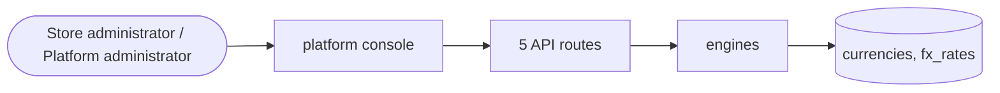

# Currencies and exchange

> Generated from `_registry/business-domains.json`, the code and `docs/source/currency.md` — edit those, then run `node scripts/domain-docs.js`.

## Overview

Every unit of value and how they convert: currencies, points and credits, and exchange rates.

**Foundation domain:** Value · **Used by:** Store administrator, Platform administrator

## Architecture

## Data model

### `currencies`

| Column | Type |
|---|---|
| `code` | TEXT PRIMARY KEY |
| `name` | TEXT NOT NULL |
| `symbol` | TEXT NOT NULL |
| `decimals` | INTEGER NOT NULL DEFAULT 2 |
| `usd` | REAL NOT NULL DEFAULT 1 |
| `position` | INTEGER DEFAULT 0 |
| `active` | INTEGER DEFAULT 1 |
| `class` | TEXT |
| `settleable` | INTEGER DEFAULT 1 |
| `uid` | TEXT |

### `fx_rates`

| Column | Type |
|---|---|
| `id` | INTEGER PRIMARY KEY AUTOINCREMENT |
| `currency` | TEXT NOT NULL |
| `usd` | REAL NOT NULL |
| `source` | TEXT DEFAULT 'manual' |
| `note` | TEXT DEFAULT '' |
| `created_at` | TEXT NOT NULL DEFAULT (datetime('now')) |
| `uid` | TEXT |

## API reference

Every call is JSON over HTTPS; store calls carry the store (`?store=`) and the session; mutating calls accept an `Idempotency-Key` header where noted.

| Method and path | Handler | What it does |
|---|---|---|
| `GET /api/fx` | `apiFxConvert` | — |
| `GET /api/platform/fx` | `apiPlatformFx` | — |
| `POST /api/platform/fx/rates` | `apiPlatformFxRates` | — |
| `PUT /api/platform/fx/provider` | `apiPlatformFxProvider` | — |
| `POST /api/platform/fx/sync` | `apiPlatformFxSync` | — |

## Data flow

## User interface

**Platform console:** 💰 Currencies · 📈 Exchange Rates · 🪙 Currency Universe

## User flows

_Not yet written — `docs/source/currency.md`, section `## Flows`._

## Manuals

### Store administrator

_Not yet written — `docs/source/currency.md`, section `## Manual: store_admin`._

### Platform administrator

_Not yet written — `docs/source/currency.md`, section `## Manual: platform_admin`._

