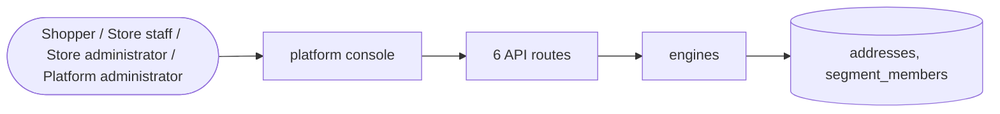

# Customers

> Generated from `_registry/business-domains.json`, the code and `docs/source/customers.md` — edit those, then run `node scripts/domain-docs.js`.

## Overview

The people and organisations a store sells to: their profiles and addresses, segments they belong to, and leads not yet customers.

**Foundation domain:** Party · **Used by:** Shopper, Store staff, Store administrator, Platform administrator

## Architecture

## Data model

### `addresses`

| Column | Type |
|---|---|
| `id` | INTEGER PRIMARY KEY AUTOINCREMENT |
| `tenant_id` | INTEGER NOT NULL |
| `owner` | TEXT NOT NULL |
| `label` | TEXT NOT NULL DEFAULT 'Home' |
| `name` | TEXT NOT NULL |
| `address` | TEXT NOT NULL |
| `city` | TEXT NOT NULL |
| `state` | TEXT DEFAULT '' |
| `zip` | TEXT DEFAULT '' |
| `country` | TEXT DEFAULT '' |
| `phone` | TEXT DEFAULT '' |
| `is_default` | INTEGER DEFAULT 0 |
| `created_at` | TEXT NOT NULL DEFAULT (datetime('now')) |
| `uid` | TEXT |

### `segment_members`

| Column | Type |
|---|---|
| `id` | INTEGER PRIMARY KEY AUTOINCREMENT |
| `tenant_id` | INTEGER NOT NULL |
| `owner` | TEXT NOT NULL |
| `segment` | TEXT NOT NULL |
| `created_at` | TEXT NOT NULL DEFAULT (datetime('now')) |

## API reference

Every call is JSON over HTTPS; store calls carry the store (`?store=`) and the session; mutating calls accept an `Idempotency-Key` header where noted.

| Method and path | Handler | What it does |
|---|---|---|
| `GET /api/addresses` | `apiAddressList` | ---------------- address book ---------------- |
| `POST /api/addresses` | `apiAddressSave` | — |
| `PUT /api/addresses/:id` | `apiAddressSave` | — |
| `DELETE /api/addresses/:id` | `apiAddressDel` | — |
| `POST /api/admin/segments/members` | `apiAdminSegmentMemberAdd` | hand-assigned segment memberships, by the customer's email or their owner id |
| `DELETE /api/admin/segments/members/:id` | `apiAdminSegmentMemberDelete` | — |

## Data flow

## User interface

**Platform console:** 🧑‍🤝‍🧑 Customers · 🏪 Sellers · 🛍️ Buyers · 🤝 Partners · 🚚 Distributors · 🏪 Dealers · 🏪 Franchises · 👷 Workforce · 🎯 Leads · 💼 Opportunities · 🗂️ Accounts · 📇 Contacts · 📅 Activities · 🧩 Pipelines

## User flows

_Not yet written — `docs/source/customers.md`, section `## Flows`._

## Manuals

### Shopper

_Not yet written — `docs/source/customers.md`, section `## Manual: shopper`._

### Store staff

_Not yet written — `docs/source/customers.md`, section `## Manual: store_staff`._

### Store administrator

_Not yet written — `docs/source/customers.md`, section `## Manual: store_admin`._

### Platform administrator

_Not yet written — `docs/source/customers.md`, section `## Manual: platform_admin`._

