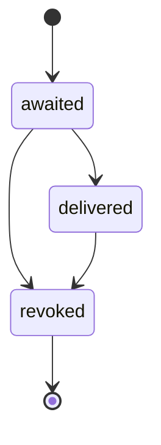
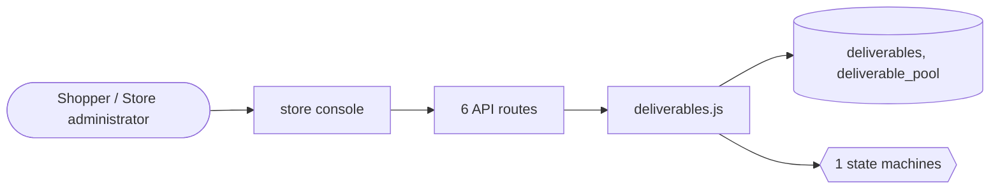

# Digital goods

> Generated from `_registry/business-domains.json`, the code and `docs/source/digital_goods.md` — edit those, then run `node scripts/domain-docs.js`.

## Overview

What is delivered without shipping: licence keys from a pool, course access and progress, and the deliverables machinery other domains use.

**Foundation domain:** Offering · **Used by:** Shopper, Store administrator

## Switches and settings

Each is switched on per store under ⚙️ Capabilities; its parameters are that store's settings.

### Licence keys (`licence_keys`)

An item whose facts carry the licence fact hands over one key per unit from the store's pool the moment it is ordered; staff are told when a pool runs low or out.

| Setting | Meaning | Default |
|---|---|---|
| `fact` | The item fact that makes it deliver a licence key | `"licence"` |
| `low_stock` | Warn staff when a pool holds fewer keys than | `5` |

### Course progress (`course_progress`)

An ordered course grants access at once and counts the lessons the shopper finishes.

| Setting | Meaning | Default |
|---|---|---|
| `fact` | The item fact that makes it a course | `"course"` |
| `steps_fact` | The item fact counting its lessons | `"lessons"` |
| `access_url` | Where the course opens, with {id} for the shopper's access | `"account.html?deliverable={id}"` |

## Architecture

| Module | What it is |
|---|---|
| `lib/deliverables.js` | deliverables: what an order hands the shopper beyond the goods. |

**Registry lists** (editable in Data Studio): `deliverableKinds`, `deliverableStatuses`

## Data model

### `deliverables`

| Column | Type |
|---|---|
| `id` | INTEGER PRIMARY KEY AUTOINCREMENT |
| `tenant_id` | INTEGER NOT NULL |
| `order_id` | INTEGER NOT NULL |
| `product_id` | TEXT NOT NULL |
| `owner` | TEXT NOT NULL |
| `kind` | TEXT NOT NULL |
| `value` | TEXT |
| `status` | TEXT NOT NULL |
| `steps_total` | INTEGER NOT NULL DEFAULT 0 |
| `steps_done` | INTEGER NOT NULL DEFAULT 0 |
| `delivered_at` | TEXT |
| `delivered_by` | TEXT NOT NULL DEFAULT '' |
| `created_at` | TEXT NOT NULL DEFAULT (datetime('now')) |

### `deliverable_pool`

| Column | Type |
|---|---|
| `id` | INTEGER PRIMARY KEY AUTOINCREMENT |
| `tenant_id` | INTEGER NOT NULL |
| `product_id` | TEXT NOT NULL |
| `code` | TEXT NOT NULL |
| `taken_by` | INTEGER |

## API reference

Every call is JSON over HTTPS; store calls carry the store (`?store=`) and the session; mutating calls accept an `Idempotency-Key` header where noted.

| Method and path | Handler | What it does |
|---|---|---|
| `GET /api/deliverable-kinds` | `apiDeliverableKinds` | — |
| `GET /api/deliverables` | `apiDeliverablesMine` | — |
| `POST /api/deliverables/:id/step` | `apiDeliverableStep` | — |
| `GET /api/admin/deliverables/:kind` | `apiAdminDeliverables` | — |
| `POST /api/admin/deliverables/:kind/pool` | `apiAdminDeliverablePool` | — |
| `POST /api/admin/deliverables/item/:id` | `apiAdminDeliverableUpload` | — |

## Process flows

Each record's life is a declared state machine (`lib/seed/states.json`): the moves it may make, and the actions that make them.

### What an order hands the shopper (`deliverable`)

Actions: `deliver` → delivered · `revoke` → revoked

## Data flow

## User interface

**Store console:** 🔑 Licence Keys · 🎓 Course Progress

## User flows

_Not yet written — `docs/source/digital_goods.md`, section `## Flows`._

## Manuals

### Shopper

_Not yet written — `docs/source/digital_goods.md`, section `## Manual: shopper`._

### Store administrator

_Not yet written — `docs/source/digital_goods.md`, section `## Manual: store_admin`._

