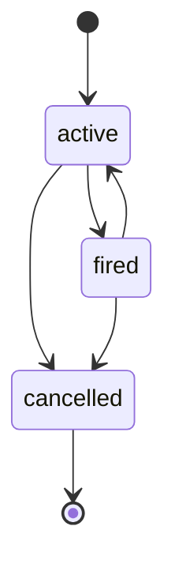
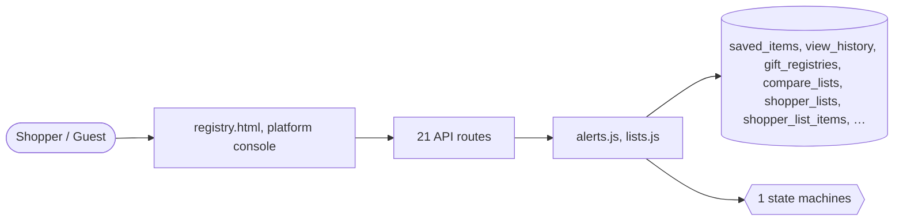

# Lists, alerts and history

> Generated from `_registry/business-domains.json`, the code and `docs/source/engagement.md` — edit those, then run `node scripts/domain-docs.js`.

## Overview

What a shopper keeps and watches: wish lists and gift registries, saved and compared items, price and stock alerts, and what they viewed.

**Foundation domain:** Experience · **Used by:** Shopper, Guest

## Switches and settings

Each is switched on per store under ⚙️ Capabilities; its parameters are that store's settings.

### Registries (`registry`)

Wish-list style product registries a shopper shares by link.

### Save for later (`save_for_later`)

Moving a cart line to a saved list and back.

### Wish lists (`wish_lists`)

Shoppers keep named lists of products — private, shared by link or public. What a kind of list is and what each visibility means are registry rows (listKinds, listVisibilities).

| Setting | Meaning | Default |
|---|---|---|
| `max_lists` | Lists one shopper may keep | `20` |
| `max_items` | Items one list may hold | `200` |
| `allow_sharing` | Shoppers may share a list by link | `true` |
| `allow_public` | Shoppers may make a list public | `true` |

### Price & stock alerts (`product_alerts`)

A shopper watches a product and is told when its price drops, reaches their target, or it is back in stock. Each kind of alert is an alertKinds row naming its trigger and its message.

| Setting | Meaning | Default |
|---|---|---|
| `min_drop_pct` | Smallest drop that alerts | `5` |
| `max_watches` | Active alerts one shopper may keep | `50` |
| `cooldown_hours` | Hours before one alert may fire again | `24` |
| `rearm` | A fired alert keeps watching from the new price | `true` |
| `email` | Also email the shopper | `true` |

## Architecture

| Module | What it is |
|---|---|
| `lib/alerts.js` | Price & stock alerts. A signed-in shopper watches a product and is told when something they care about happens to it. What can happen is the engine's own small vocabulary of TRIGGERS (a price below the price they watched at, a price at or below a target, stock coming back); which triggers exist as alerts a shopper can choose, what each is called, when it may be set and what its message says are alertKinds registry rows — so "tell me when it is 30% off" is a row naming a trigger, not code. The thresholds (how big a drop counts, how often one watch may fire) are the product_alerts capability's params. |
| `lib/lists.js` | Shopper lists: wish lists, shopping lists, idea lists. A signed-in shopper keeps any number of named lists of products. What a kind of list IS (its starting visibility, whether people it is shared with may mark a gift bought) and what a visibility MEANS (reachable by its link? listed for anyone to find?) are rows of the listKinds and listVisibilities registries, so a new kind of list — a baby list, a classroom list — is a Data Studio row, never code. How many lists and items a shopper may keep, and whether sharing or public lists are allowed at all, are the wish_lists capability's params. Gift registries (an event, a date, a shipping address) keep their own engine; a list is the lighter, everyday shape. |

**Registry lists** (editable in Data Studio): `shopRegistryStatuses`, `listKinds`, `listVisibilities`, `listPriorities`, `alertKinds`, `watchStatuses`

## Data model

### `saved_items`

| Column | Type |
|---|---|
| `owner` | TEXT NOT NULL |
| `product_id` | TEXT NOT NULL |
| `added_at` | TEXT NOT NULL DEFAULT (datetime('now')) |
| `uid` | TEXT |

### `view_history`

| Column | Type |
|---|---|
| `owner` | TEXT NOT NULL |
| `product_id` | TEXT NOT NULL |
| `seen_at` | TEXT NOT NULL DEFAULT (datetime('now')) |
| `uid` | TEXT |

### `gift_registries`

| Column | Type |
|---|---|
| `id` | INTEGER PRIMARY KEY AUTOINCREMENT |
| `tenant_id` | INTEGER NOT NULL |
| `ref` | TEXT |
| `owner` | TEXT NOT NULL |
| `name` | TEXT NOT NULL |
| `event` | TEXT |
| `event_date` | TEXT |
| `shipping_address` | TEXT |
| `notes` | TEXT |
| `items` | TEXT DEFAULT '[]' |
| `contributors` | TEXT DEFAULT '[]' |
| `status` | TEXT NOT NULL DEFAULT 'open' |
| `created_at` | TEXT NOT NULL DEFAULT (datetime('now')) |

### `compare_lists`

| Column | Type |
|---|---|
| `id` | INTEGER PRIMARY KEY AUTOINCREMENT |
| `tenant_id` | INTEGER NOT NULL |
| `owner` | TEXT NOT NULL |
| `product_ids` | TEXT DEFAULT '[]' |
| `created_at` | TEXT NOT NULL DEFAULT (datetime('now')) |

### `shopper_lists`

| Column | Type |
|---|---|
| `id` | INTEGER PRIMARY KEY AUTOINCREMENT |
| `tenant_id` | INTEGER NOT NULL |
| `owner` | TEXT NOT NULL |
| `owner_name` | TEXT DEFAULT '' |
| `kind` | TEXT NOT NULL |
| `name` | TEXT NOT NULL |
| `visibility` | TEXT NOT NULL |
| `token` | TEXT NOT NULL |
| `notes` | TEXT DEFAULT '' |
| `created_at` | TEXT NOT NULL DEFAULT (datetime('now')) |
| `updated_at` | TEXT |

### `shopper_list_items`

| Column | Type |
|---|---|
| `id` | INTEGER PRIMARY KEY AUTOINCREMENT |
| `tenant_id` | INTEGER NOT NULL |
| `list_id` | INTEGER NOT NULL |
| `product_id` | TEXT NOT NULL |
| `qty` | INTEGER NOT NULL DEFAULT 1 |
| `purchased` | INTEGER NOT NULL DEFAULT 0 |
| `priority` | TEXT |
| `note` | TEXT DEFAULT '' |
| `price_added` | REAL |
| `added_at` | TEXT NOT NULL DEFAULT (datetime('now')) |

### `product_watches`

| Column | Type |
|---|---|
| `id` | INTEGER PRIMARY KEY AUTOINCREMENT |
| `tenant_id` | INTEGER NOT NULL |
| `owner` | TEXT NOT NULL |
| `product_id` | TEXT NOT NULL |
| `kind` | TEXT NOT NULL |
| `target_price` | REAL |
| `baseline_price` | REAL |
| `baseline_stock` | INTEGER |
| `status` | TEXT NOT NULL DEFAULT 'active' |
| `fired_at` | TEXT |
| `fired_price` | REAL |
| `fires` | INTEGER NOT NULL DEFAULT 0 |
| `created_at` | TEXT NOT NULL DEFAULT (datetime('now')) |

## API reference

Every call is JSON over HTTPS; store calls carry the store (`?store=`) and the session; mutating calls accept an `Idempotency-Key` header where noted.

| Method and path | Handler | What it does |
|---|---|---|
| `GET /api/compare` | `apiCompare` | — |
| `POST /api/compare` | `apiCompareAdd` | — |
| `POST /api/compare/remove` | `apiCompareRemove` | — |
| `GET /api/lists` | `apiLists` | — |
| `POST /api/lists` | `apiListCreate` | — |
| `GET /api/lists/find` | `apiListsFind` | — |
| `GET /api/lists/:id` | `apiListGet` | — |
| `PUT /api/lists/:id` | `apiListUpdate` | — |
| `DELETE /api/lists/:id` | `apiListDelete` | — |
| `POST /api/lists/:id/items` | `apiListItemAdd` | — |
| `PUT /api/list-items/:id` | `apiListItemUpdate` | — |
| `DELETE /api/list-items/:id` | `apiListItemDelete` | — |
| `GET /api/shared-lists/:token` | `apiSharedList` | — |
| `POST /api/shared-lists/:token/purchased` | `apiSharedListPurchased` | — |
| `GET /api/alerts` | `apiAlerts` | — |
| `POST /api/alerts` | `apiAlertCreate` | — |
| `DELETE /api/alerts/:id` | `apiAlertDelete` | — |
| `POST /api/saved` | `apiSavedAdd` | — |
| `DELETE /api/saved/:id` | `apiSavedDel` | — |
| `POST /api/saved/:id/move` | `apiSavedMove` | — |
| `POST /api/viewed` | `apiViewed` | — |

## Process flows

Each record's life is a declared state machine (`lib/seed/states.json`): the moves it may make, and the actions that make them.

### Product watch (`product_watch`)

Actions: `cancel` → cancelled · `rearm` → active

## Data flow

## User interface

**Pages:** `registry.html`

**Platform console:** 🧭 UX Journeys · 🛤️ Customer Journeys · 🗄️ Experience Registry

## User flows

_Not yet written — `docs/source/engagement.md`, section `## Flows`._

## Manuals

### Shopper

_Not yet written — `docs/source/engagement.md`, section `## Manual: shopper`._

### Guest

_Not yet written — `docs/source/engagement.md`, section `## Manual: guest`._

