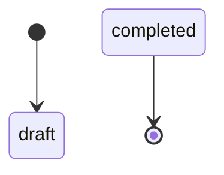
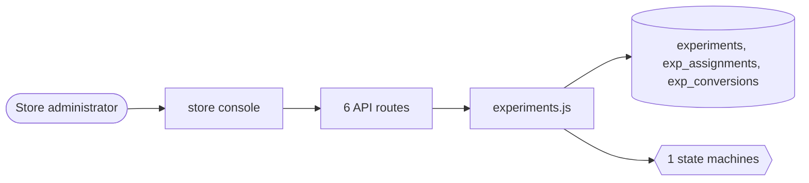

# Experiments

> Generated from `_registry/business-domains.json`, the code and `docs/source/experiments.md` — edit those, then run `node scripts/domain-docs.js`.

## Overview

Testing what works: experiments with variants, who sees which, and what converts.

**Foundation domain:** Insight · **Used by:** Store administrator

## Switches and settings

Each is switched on per store under ⚙️ Capabilities; its parameters are that store's settings.

### Experiments (`experiments`)

A/B experiment assignment for storefront surfaces.

## Architecture

| Module | What it is |
|---|---|
| `lib/experiments.js` | Experimentation (A/B testing). Experiments with weighted variants; assignment is deterministic per (experiment, subject) via a stable hash, so a returning customer always sees the same variant. Conversion events are tracked per variant and a simple significance readout (two-proportion z-test) is computed on demand. Variants and statuses are meta_lists registries (expStatuses). Feature-gated by settings.features.experiments. |

## Data model

### `experiments`

| Column | Type |
|---|---|
| `id` | INTEGER PRIMARY KEY AUTOINCREMENT |
| `tenant_id` | INTEGER NOT NULL |
| `key` | TEXT NOT NULL |
| `name` | TEXT NOT NULL |
| `variants` | TEXT NOT NULL DEFAULT '[]' |
| `status` | TEXT NOT NULL DEFAULT 'draft' |
| `metric` | TEXT DEFAULT 'conversion' |
| `started_at` | TEXT |
| `ended_at` | TEXT |
| `created_at` | TEXT NOT NULL DEFAULT (datetime('now')) |
| `uid` | TEXT |

### `exp_assignments`

| Column | Type |
|---|---|
| `id` | INTEGER PRIMARY KEY AUTOINCREMENT |
| `experiment_id` | INTEGER NOT NULL |
| `tenant_id` | INTEGER NOT NULL |
| `subject` | TEXT NOT NULL |
| `variant` | TEXT NOT NULL |
| `at` | TEXT NOT NULL DEFAULT (datetime('now')) |
| `uid` | TEXT |

### `exp_conversions`

| Column | Type |
|---|---|
| `id` | INTEGER PRIMARY KEY AUTOINCREMENT |
| `experiment_id` | INTEGER NOT NULL |
| `tenant_id` | INTEGER NOT NULL |
| `variant` | TEXT NOT NULL |
| `subject` | TEXT NOT NULL |
| `value` | REAL DEFAULT 1 |
| `at` | TEXT NOT NULL DEFAULT (datetime('now')) |
| `uid` | TEXT |

## API reference

Every call is JSON over HTTPS; store calls carry the store (`?store=`) and the session; mutating calls accept an `Idempotency-Key` header where noted.

| Method and path | Handler | What it does |
|---|---|---|
| `GET /api/experiments/:id/assign` | `apiExpAssign` | ---------------- experimentation ---------------- |
| `POST /api/experiments/:id/convert` | `apiExpConvert` | — |
| `GET /api/admin/experiments` | `apiAdminExpList` | — |
| `POST /api/admin/experiments` | `apiAdminExpCreate` | — |
| `PUT /api/admin/experiments/:id/status` | `apiAdminExpStatus` | — |
| `GET /api/admin/experiments/:id/results` | `apiAdminExpResults` | — |

## Process flows

Each record's life is a declared state machine (`lib/seed/states.json`): the moves it may make, and the actions that make them.

### Experiment (`experiment`)

Actions: 

## Data flow

## User interface

**Store console:** 🧪 Experiments

## User flows

_Not yet written — `docs/source/experiments.md`, section `## Flows`._

## Manuals

### Store administrator

_Not yet written — `docs/source/experiments.md`, section `## Manual: store_admin`._

