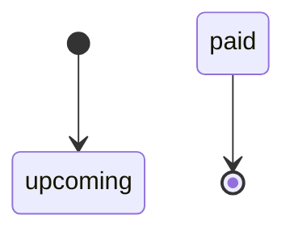
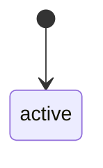
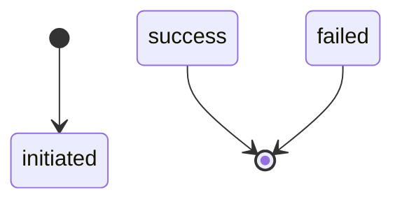
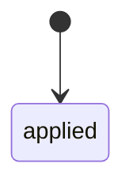
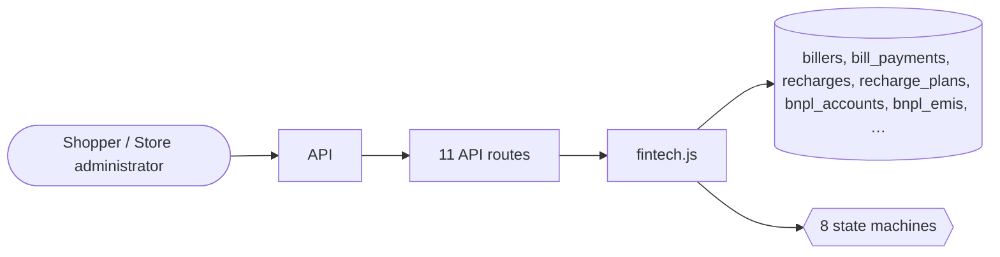

# Financial services

> Generated from `_registry/business-domains.json`, the code and `docs/source/financial_services.md` — edit those, then run `node scripts/domain-docs.js`.

## Overview

Financial products sold to buyers: bill payments, recharges, insurance, and credit — pay later and loans with their instalments.

**Foundation domain:** Value · **Used by:** Shopper, Store administrator

## Switches and settings

Each is switched on per store under ⚙️ Capabilities; its parameters are that store's settings.

### Buy-now-pay-later (`bnpl`)

A KYC-gated credit account that generates an EMI schedule on each spend.

| Setting | Meaning | Default |
|---|---|---|
| `default_tenure_months` | Tenure when none is supplied | `3` |
| `min_amount` | Lowest financeable amount | `0.01` |

### Loans & credit lines (`lending`)

Apply, approve and disburse credit. The EMI is computed from the principal, tenure and rate.

| Setting | Meaning | Default |
|---|---|---|
| `default_tenure_months` | Tenure when none is supplied | `12` |
| `default_rate_pct` | Annual rate when none is supplied (0 = flat) | `0` |

### Bill payments (BBPS) (`bbps`)

Pay electricity, water, gas and similar bills through registered billers.

| Setting | Meaning | Default |
|---|---|---|
| `default_category` | Category when the biller is unknown | `"electricity"` |

### Mobile / DTH recharge (`recharge`)

Prepaid recharge against a plan catalogue; a recharge debits the wallet on success.

| Setting | Meaning | Default |
|---|---|---|
| `default_kind` | Recharge kind when none is supplied | `"mobile"` |

### Insurance distribution (`insurance`)

Quote a policy and activate it; activation debits the premium from the wallet.

| Setting | Meaning | Default |
|---|---|---|
| `activation_debits_premium` | Activating a policy charges the premium | `true` |

## Architecture

| Module | What it is |
|---|---|
| `lib/fintech.js` | Fintech engine (configurable money rails). UPI collect/push, QR scan-pay, payment links, mandates/auto-debit, escrow hold-and-release, split payments, KYC, bank-account payouts, BBPS bill payments, mobile/DTH recharge, P2P wallet transfer, BNPL/EMI, loans & credit lines, insurance distribution and gift vouchers. |

**Registry lists** (editable in Data Studio): `finBillerCategories`, `finBillStatuses`, `finOperators`, `finCircles`, `finRechargeKinds`, `finRechargeStatuses`, `finBnplStatuses`, `finEmiStatuses`, `finLoanStatuses`, `finInsuranceStatuses`

## Data model

### `billers`

| Column | Type |
|---|---|
| `id` | INTEGER PRIMARY KEY AUTOINCREMENT |
| `tenant_id` | INTEGER NOT NULL |
| `name` | TEXT NOT NULL |
| `category` | TEXT NOT NULL |
| `code` | TEXT |
| `fetch_required` | INTEGER DEFAULT 1 |
| `fields` | TEXT DEFAULT '[]' |
| `status` | TEXT NOT NULL DEFAULT 'active' |
| `position` | INTEGER DEFAULT 0 |

### `bill_payments`

| Column | Type |
|---|---|
| `id` | INTEGER PRIMARY KEY AUTOINCREMENT |
| `tenant_id` | INTEGER NOT NULL |
| `ref` | TEXT |
| `owner` | TEXT |
| `biller_id` | INTEGER |
| `category` | TEXT |
| `account_no` | TEXT |
| `amount` | REAL NOT NULL |
| `currency` | TEXT |
| `convenience_fee` | REAL DEFAULT 0 |
| `status` | TEXT NOT NULL DEFAULT 'initiated' |
| `txn_ref` | TEXT |
| `created_at` | TEXT NOT NULL DEFAULT (datetime('now')) |

### `recharges`

| Column | Type |
|---|---|
| `id` | INTEGER PRIMARY KEY AUTOINCREMENT |
| `tenant_id` | INTEGER NOT NULL |
| `ref` | TEXT |
| `owner` | TEXT |
| `number` | TEXT NOT NULL |
| `operator` | TEXT |
| `circle` | TEXT |
| `plan_id` | INTEGER |
| `amount` | REAL NOT NULL |
| `currency` | TEXT |
| `kind` | TEXT NOT NULL DEFAULT 'mobile' |
| `status` | TEXT NOT NULL DEFAULT 'initiated' |
| `txn_ref` | TEXT |
| `created_at` | TEXT NOT NULL DEFAULT (datetime('now')) |

### `recharge_plans`

| Column | Type |
|---|---|
| `id` | INTEGER PRIMARY KEY AUTOINCREMENT |
| `tenant_id` | INTEGER NOT NULL |
| `operator` | TEXT NOT NULL |
| `circle` | TEXT |
| `kind` | TEXT NOT NULL DEFAULT 'mobile' |
| `amount` | REAL NOT NULL |
| `currency` | TEXT |
| `validity` | TEXT |
| `data` | TEXT |
| `sms` | TEXT |
| `calls` | TEXT |
| `description` | TEXT |
| `popular` | INTEGER DEFAULT 0 |
| `status` | TEXT NOT NULL DEFAULT 'active' |
| `position` | INTEGER DEFAULT 0 |

### `bnpl_accounts`

| Column | Type |
|---|---|
| `id` | INTEGER PRIMARY KEY AUTOINCREMENT |
| `tenant_id` | INTEGER NOT NULL |
| `owner` | TEXT NOT NULL |
| `provider` | TEXT |
| `credit_limit` | REAL DEFAULT 0 |
| `used` | REAL DEFAULT 0 |
| `available` | REAL DEFAULT 0 |
| `tenure_months` | INTEGER DEFAULT 3 |
| `status` | TEXT NOT NULL DEFAULT 'inactive' |
| `kyc_id` | INTEGER |
| `created_at` | TEXT NOT NULL DEFAULT (datetime('now')) |

### `bnpl_emis`

| Column | Type |
|---|---|
| `id` | INTEGER PRIMARY KEY AUTOINCREMENT |
| `tenant_id` | INTEGER NOT NULL |
| `account_id` | INTEGER NOT NULL |
| `order_id` | INTEGER |
| `installment_no` | INTEGER |
| `amount` | REAL |
| `due_at` | TEXT |
| `status` | TEXT NOT NULL DEFAULT 'upcoming' |
| `paid_at` | TEXT |
| `created_at` | TEXT NOT NULL DEFAULT (datetime('now')) |

### `loans`

| Column | Type |
|---|---|
| `id` | INTEGER PRIMARY KEY AUTOINCREMENT |
| `tenant_id` | INTEGER NOT NULL |
| `ref` | TEXT |
| `owner` | TEXT NOT NULL |
| `principal` | REAL NOT NULL |
| `currency` | TEXT |
| `tenure_months` | INTEGER |
| `rate` | REAL |
| `emi` | REAL |
| `processing_fee` | REAL |
| `disbursed_at` | TEXT |
| `status` | TEXT NOT NULL DEFAULT 'applied' |
| `kyc_id` | INTEGER |
| `created_at` | TEXT NOT NULL DEFAULT (datetime('now')) |

### `insurance_policies`

| Column | Type |
|---|---|
| `id` | INTEGER PRIMARY KEY AUTOINCREMENT |
| `tenant_id` | INTEGER NOT NULL |
| `ref` | TEXT |
| `owner` | TEXT NOT NULL |
| `product_id` | INTEGER |
| `plan_name` | TEXT |
| `premium` | REAL NOT NULL |
| `currency` | TEXT |
| `cover` | REAL |
| `starts_at` | TEXT |
| `ends_at` | TEXT |
| `nominees` | TEXT |
| `status` | TEXT NOT NULL DEFAULT 'quoted' |
| `created_at` | TEXT NOT NULL DEFAULT (datetime('now')) |

## API reference

Every call is JSON over HTTPS; store calls carry the store (`?store=`) and the session; mutating calls accept an `Idempotency-Key` header where noted.

| Method and path | Handler | What it does |
|---|---|---|
| `GET /api/fintech/billers` | `apiFinBillers` | — |
| `POST /api/fintech/bills` | `apiFinBillPay` | — |
| `GET /api/fintech/plans` | `apiFinPlans` | — |
| `POST /api/fintech/recharge` | `apiFinRecharge` | — |
| `POST /api/fintech/bnpl` | `apiFinBnplOpen` | — |
| `POST /api/fintech/bnpl/:id/spend` | `apiFinBnplSpend` | — |
| `POST /api/fintech/emi/:id/pay` | `apiFinEmiPay` | a customer pays an installment from their wallet; staff may record an offline payment. It used to mark any EMI paid for free, restoring the credit line without a payment. |
| `POST /api/fintech/loans` | `apiFinLoanApply` | — |
| `POST /api/fintech/loans/:id/disburse` | `apiFinLoanDisburse` | — |
| `POST /api/fintech/insurance` | `apiFinInsuranceQuote` | — |
| `POST /api/fintech/insurance/:id/activate` | `apiFinInsuranceActivate` | — |

## Process flows

Each record's life is a declared state machine (`lib/seed/states.json`): the moves it may make, and the actions that make them.

### BNPL instalment (EMI) (`emi`)

Actions: 

### Biller (`biller`)

Actions: 

### Recharge plan (`recharge_plan`)

Actions: 

### Bill payment (`bill_payment`)

Actions: 

### Recharge (`recharge`)

Actions: 

### BNPL account (`bnpl_account`)

Actions: 

### Loan (`loan`)

Actions: 

### Insurance policy (`insurance_policy`)

Actions: 

## Data flow

## User interface

## User flows

_Not yet written — `docs/source/financial_services.md`, section `## Flows`._

## Manuals

### Shopper

_Not yet written — `docs/source/financial_services.md`, section `## Manual: shopper`._

### Store administrator

_Not yet written — `docs/source/financial_services.md`, section `## Manual: store_admin`._

