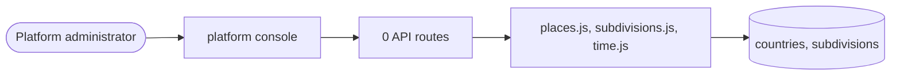

# Places and time

> Generated from `_registry/business-domains.json`, the code and `docs/source/geography.md` — edit those, then run `node scripts/domain-docs.js`.

## Overview

Where and when: countries, subdivisions and places, coordinate systems, calendars and time.

**Foundation domain:** Geo · **Used by:** Platform administrator

## Architecture

| Module | What it is |
|---|---|
| `lib/places.js` | places on the kernel (P09, owner Geo). |
| `lib/subdivisions.js` | ISO 3166-2 subdivision registry: pure data manifest. A country's states/provinces/regions are MASTER DATA, children of the country master. This file is the corpus declaration — the same role providers.js plays for providers and meta.js for taxonomies. Adding a country's subdivisions is editing this DATA, never code; lib/registry.js's reconcileSubdivisions() materialises it into the `subdivisions` table for every country present, on every boot and the moment a country is added. |
| `lib/time.js` | Time (P11, owner Time). |

## Data model

### `countries`

| Column | Type |
|---|---|
| `code` | TEXT PRIMARY KEY |
| `name` | TEXT NOT NULL |
| `position` | INTEGER DEFAULT 0 |
| `active` | INTEGER DEFAULT 1 |
| `uid` | TEXT |

### `subdivisions`

| Column | Type |
|---|---|
| `code` | TEXT PRIMARY KEY |
| `/*` | ISO 3166-2 |
| `globally` | unique: the master key (US-CA, IN-MH) */ country_code TEXT NOT NULL REFERENCES countries(code) |
| `name` | TEXT NOT NULL |
| `/*` | the operator-facing label (California, Maharashtra) */ level TEXT |
| `/*` | what this level is called: state / province / county / prefecture / emirate / region / territory / district */ parent_id INTEGER |
| `/*` | a finer division under another division; NULL = directly under the country */ position INTEGER DEFAULT 0 |
| `active` | INTEGER DEFAULT 1 |

## Data flow

## User interface

**Platform console:** 🗺️ Countries · 🏞️ States · Regions · 🏙️ Cities · ⚖️ Jurisdictions · 📍 Addresses · 🌍 Geo Registry · Taxes · 🌐 Geography Universe · 📅 Calendars · ⏱️ Schedules · 🔁 Recurrence · 🗓️ Appointments · 🪑 Reservations · 🪟 Time Windows · 🚚 Delivery Slots · 🟢 Availability · 🛡️ SLA · ⏳ Temporal Universe

## User flows

_Not yet written — `docs/source/geography.md`, section `## Flows`._

## Manuals

### Platform administrator

_Not yet written — `docs/source/geography.md`, section `## Manual: platform_admin`._

